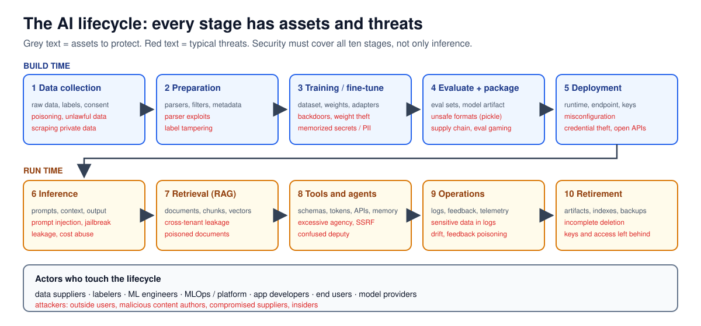
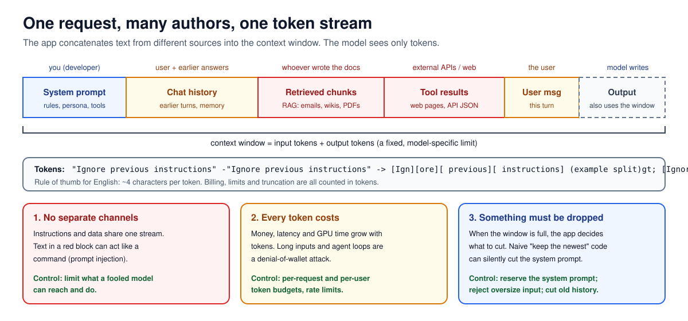
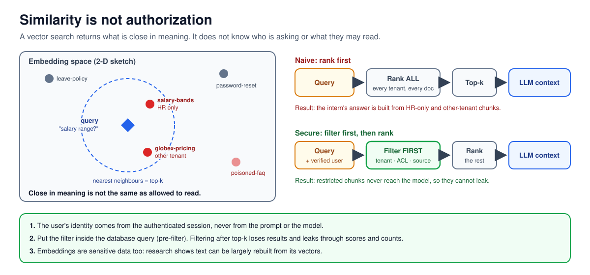

# Lesson 01: AI, ML and LLM Basics for Security Engineers

> **Module:** 01 · AI Security Fundamentals · **Weeks:** 1–2 · **Time:** ~16 hours
> **You will:** learn just enough about how AI systems are built and run to see *where* they break, and prove two core ideas in code: "similarity is not authorization" and "every token is a cost and an attack surface".

| | |
|---|---|
| **Prerequisites** | Basic Python; basic web security (authentication, authorization, injection). No ML background needed. |
| **Lab** | [`lab/tiny_embeddings.py`](lab/tiny_embeddings.py) and [`lab/demo.py`](lab/demo.py) (Part A and B): runs offline, no API key |
| **Maps to** | OWASP Top 10 for LLM Applications 2026: LLM02:2026 Sensitive Information Disclosure (same number in 2025), LLM09:2026 Vector and Embedding Weaknesses (was LLM08:2025), LLM06:2026 Unbounded Consumption (was LLM10:2025) · NIST AI RMF: MAP function · MITRE ATLAS: AML.T0024 (Exfiltration via ML Inference API) |

---

## 1. Why this matters

You cannot secure what you cannot describe. Most AI security failures are not exotic "AI hacks". They are ordinary security mistakes made by people who did not understand where the data went.

- **2023, Samsung:** engineers pasted confidential source code and meeting notes into ChatGPT to get help. The company then restricted employee use of generative AI tools. A prompt to a hosted model is a **data flow to a third party**.
- **March 2023, ChatGPT:** a bug in the open-source `redis-py` client library let some users see the titles of other users' chats. OpenAI said some payment details of about 1.2% of ChatGPT Plus subscribers active in a nine-hour window may also have been exposed. **AI apps are software first.** Classic bugs still apply.
- **2024, Moffatt v. Air Canada:** a Canadian tribunal held Air Canada responsible for wrong refund-policy information its website chatbot gave a customer. The company could not blame "the chatbot". **Model output is your organization's statement.**
- **2021, Carlini et al., *Extracting Training Data from Large Language Models*:** researchers pulled memorized text, including names, phone numbers and email addresses, out of GPT-2 by querying it. **Training data can come back out of the model.**
- **2023, Morris et al., *Text Embeddings Reveal (Almost) As Much As Text*:** researchers rebuilt much of the original text from its embedding vectors. **Embeddings are sensitive data, not anonymized data.**

The lesson in every case: understand the parts (data, model, context, tools, people), and you will see the risk before the attacker does.

---

## 2. Understand it

### 2.1 The vocabulary, with the security angle

| Term | Plain meaning | Security implication |
|---|---|---|
| **AI** | Any system that does tasks we associate with human thinking | Too broad to secure. Always ask "which system, which data, which actions?" |
| **Machine learning (ML)** | Software that *learns patterns from data* instead of following hand-written rules | Whoever controls the data influences the behavior (**poisoning**) |
| **Deep learning** | ML with large neural networks (many layers of numbers called **weights**) | Weights are valuable intellectual property and can hide **backdoors** |
| **Generative AI (GenAI)** | Models that *produce* text, code, images or audio | Output can be wrong, harmful, or carry an attacker's payload |
| **Large language model (LLM)** | A deep-learning model trained on huge text corpora to predict the next token | Follows instructions found *anywhere* in its input (**prompt injection**) |
| **Foundation model** | A large, general model that others adapt (GPT, Claude, Llama, Gemini, Mistral…) | You inherit the provider's training choices and risks (**supply chain**) |

### 2.2 The lifecycle, actors and assets (week 1)



Security must cover the whole lifecycle, not only the moment a user types a prompt. A good **asset inventory** for an AI system includes:

| Asset class | Examples | Why an attacker wants it |
|---|---|---|
| Data | training sets, fine-tuning sets, RAG documents, logs, feedback | Steal it, or poison it to change behavior |
| Model artifacts | base weights, adapters (LoRA), tokenizer, config | Steal IP; plant a backdoor; unsafe file formats run code on load |
| Prompts and config | system prompt, templates, tool definitions | Learn your defenses; find secrets wrongly placed there |
| Identities and secrets | API keys, service accounts, delegated user tokens | Act as the app, or as the user |
| Tools and integrations | email, CRM, ticketing, code execution, MCP servers | Turn a text bug into a real-world action |
| Infrastructure | GPU clusters, registries, vector DBs, CI/CD | Compute theft, lateral movement, persistence |
| Outputs and decisions | answers, summaries, automated actions | Manipulate decisions people trust |

**Actors** are anyone who touches the lifecycle: data suppliers, labelers, ML engineers, platform/MLOps teams, app developers, end users, model providers, and attackers (outside users, authors of malicious content, compromised suppliers, insiders). In week 1, draw the lifecycle for one system you know and list one asset and one actor per stage.

### 2.3 How an LLM works: just enough for security (week 2)



1. **Tokens.** Text is split into **tokens**: whole words, word pieces or characters. A tokenizer (for example byte-pair encoding, BPE) turns `"tokenization"` into something like `[token][ization]`. A rough rule for English is ~4 characters per token. Prices, rate limits and context sizes are all counted in tokens.
2. **Transformer and attention.** Modern LLMs are **transformers** (Vaswani et al., 2017). *Attention* lets every token "look at" every other token in the input to decide what matters. Security meaning: **any token can influence any other token.** A sentence in a retrieved PDF can change how the model reads your system prompt.
3. **Next-token prediction.** The model outputs a probability for every possible next token, picks one, adds it to the input, and repeats. Settings like **temperature** add randomness. Security meaning: **the same prompt can give different answers.** Test attacks many times and measure a success *rate*.
4. **Context window.** The maximum number of tokens the model can handle at once (input + output). Everything the model "knows" about this request must fit in it: system prompt, history, retrieved chunks, tool results, user message. Security meaning: the app must decide what to drop when it is full (see the lab), and long inputs cost money and time.
5. **No memory between calls.** The model itself remembers nothing between requests. "Memory" is the *application* storing text and pasting it back in. Security meaning: memory is a data store you must protect, and an attacker who writes into it gets **persistence**.

**The key fact:** the model receives **one stream of tokens**. System prompt, user question and a stranger's email all arrive in the same stream. Nothing in the model enforces which tokens are commands and which are data. This is the root of prompt injection ([Module 02](../02-llm-security/prompt-injection/)).

> **Go deeper (week 2):** [lesson 01b](01b-inside-the-llm-transformers-inference-and-training.md) explains neural networks, the transformer block, attention (with a lab that shows an injected token taking over attention), the full inference lifecycle (prefill, decode, KV cache, sampling) and the hardware underneath. Unknown words: see the [module glossary](glossary.md).

### 2.4 Embeddings and vector search

An **embedding** is a list of numbers (a **vector**) that represents the meaning of a text. Texts with similar meaning get vectors that point in similar directions. **Cosine similarity** measures this: 1.0 means "same direction", 0 means "nothing in common".

A **vector database** stores many embeddings and answers "which stored chunks are closest to this question?" (nearest-neighbour search). This is the engine behind RAG.



Three security facts:

1. **Similarity is not authorization.** The closest chunk to "what are the salary bands?" is the salary document, whoever asks. Access control must be a **filter applied before ranking**, using the identity from the authenticated session.
2. **Similarity can be gamed.** A document stuffed with popular search words ranks first. Anyone who can write into the index can push content into other people's answers (**retrieval poisoning**).
3. **Embeddings leak.** Vectors can be partly inverted back into text (Morris et al., 2023). Protect the vector store like the source documents.

### 2.5 Training, fine-tuning, RAG, prompting and inference

These are often confused. They change *different things* and so carry *different risks*.

| Technique | What changes | Who usually controls it | Main security risks |
|---|---|---|---|
| **Pre-training** | All weights, from huge data | Model provider | Poisoned web data, memorized personal data, backdoors |
| **Fine-tuning** (incl. LoRA adapters) | Some weights, from your examples | You or the provider | Memorizing your sensitive data; removing safety behavior; poisoned examples |
| **RAG** (retrieval-augmented generation) | Nothing in the model; adds documents to the context at query time | You | Cross-tenant leaks, stale permissions, indirect prompt injection in documents |
| **Prompting** (system prompt, few-shot examples) | Nothing in the model; instructions in the context | You | Prompt leakage; false belief that instructions enforce security |
| **Inference** | Nothing; this is *using* the model | You (self-hosted) or provider (API) | Data sent to a third party, abuse, cost, model extraction through the API |

**Rule of thumb:** if data goes into **weights** (training, fine-tuning) you cannot reliably delete it or control who sees it later. If data goes into **context** (RAG, prompt) you control it per request, so you can apply access control. That is why RAG is usually the safer choice for private, per-user data.

**Fine-tuning in practice** is usually **parameter-efficient**: **LoRA** freezes the model and trains two small matrices per layer (often well under 1% of the parameters); **QLoRA** does the same on a 4-bit compressed base model. The result is a small **adapter** file: cheap to make, easy to share, and easy to swap for a poisoned one. Training stages (pre-training, instruction tuning, RLHF/DPO), quantization and deployment options, each with its risks, are in [lesson 01b, section 2.7](01b-inside-the-llm-transformers-inference-and-training.md#27-training-fine-tuning-and-deployment-with-the-risks-of-each).

### 2.6 Tool calling and agents

**Tool calling** (also "function calling"): you describe tools to the model (`get_order(order_id)`), the model replies with a structured request to call one, and **your code** runs it and returns the result. The model never runs anything itself. It *proposes*; your code *disposes*.

An **agent** is a loop: the model plans, calls a tool, reads the result, and decides the next step, possibly many times, sometimes with memory and several tools. The **Model Context Protocol (MCP)** is a standard way to plug tool servers into AI apps ([Module 04](../04-mcp-security/)).

Security meaning:

- The model's tool request is **untrusted input** to your tool code. Validate it with a strict schema and authorize it as the *end user*, never as "whatever the model asked for".
- Autonomy multiplies **blast radius**. One injected instruction can trigger many actions in a loop.
- Every tool result is new untrusted text flowing back into the context.

### 2.7 Concept-to-control summary

| Concept | Security implication | Primary control | Where in this repo |
|---|---|---|---|
| One token stream | Instructions and data mix | Limit what a fooled model can reach and do | [02 prompt injection](../02-llm-security/prompt-injection/) |
| Non-determinism | One clean test run proves little | Repeat tests, measure rates, test impact | [02 security testing](../02-llm-security/security-testing/) |
| Context window | Truncation, cost, long-context attacks | Token budgets; reserve system prompt; reject oversize input | This lab, Part B |
| Embeddings | Similarity ≠ permission; inversion | Pre-filter by tenant/ACL; protect the index | This lab, Part A; [03 RAG](../03-rag-security/) |
| Fine-tuning (LoRA / QLoRA) | Data baked into weights; safety can erode; adapters can be poisoned | Keep secrets and personal data out of training sets; evaluate base + adapter; sign adapters | [01b](01b-inside-the-llm-transformers-inference-and-training.md), [06 DevSecOps](../06-ai-devsecops/) |
| Attention | Any token can win attention, including injected ones | Keep untrusted text out of privileged contexts | [01b](01b-inside-the-llm-transformers-inference-and-training.md) lab |
| Tool calling | Model proposes real actions | Schema + server-side authz + approval | [04 MCP](../04-mcp-security/), [05 agents](../05-agent-security/) |
| Hosted inference | Data leaves your boundary | Data classification, contracts, redaction | [07 governance](../07-ai-governance/) |

---

## 3. Defend it

At the fundamentals level, the defenses are about **where data and authority flow**, not about the model's wording.

| Layer | Control | Type | What it buys you |
|---|---|---|---|
| L1 | **Data classification and minimization:** decide what may go to which model (hosted or self-hosted), and send the minimum | Hard (policy + code) | Less to leak; fewer legal problems |
| L2 | **Identity-aware retrieval:** filter by tenant and ACL *inside* the query, before ranking | Hard | Similarity can never override permission |
| L3 | **Token budgets and rate limits** per request, per user, per tenant | Hard | Caps cost and denial-of-wallet attacks |
| L4 | **Context assembly rules:** reserve room for the system prompt; reject oversize input instead of silently truncating; cut oldest history first | Hard | The policy text cannot be pushed out |
| L5 | **Tool broker:** strict schemas, server-side authorization as the user, approval for side effects | Hard | A fooled model cannot act beyond the user's rights |
| L6 | **Provenance for data and models:** trusted sources for RAG, verified model artifacts | Hard / Process | Poisoned inputs are kept out |
| L7 | **Logging, evaluation and red-team tests** on every model or prompt change | Process | You notice drift and regressions |

### What does NOT work on its own

- **Writing rules in the system prompt** ("never reveal salary data"). The model may follow it; an attacker can talk it out of it; long input can push it out of the window.
- **Trusting the vector search to "only find relevant docs".** Relevant is not the same as permitted.
- **Assuming a hosted model is "just an API".** It is a data processor. Check data-use and retention terms (check the provider's current terms; they change).
- **One-off manual testing.** Model behavior changes with every version, prompt and temperature.

---

## 4. Hands-on lab

**Scenario:** ACME's help-desk bot answers employee questions from a small knowledge base. The index holds a public leave policy, a password guide, **HR-only salary bands** (with a canary), a document belonging to another customer (**Globex**), and a "FAQ" someone **uploaded** that is stuffed with password keywords.

### Setup (once for the whole repo)

```powershell
python -m venv .venv
.venv\Scripts\Activate.ps1
python -m pip install -e ".[dev]"
```

### Step 1: Run the scorecard

```powershell
python 01-ai-security-fundamentals/lab/demo.py
```

Expected output (Parts A and B; Part C belongs to lessons 02–04, Part D to lesson 01b, Part E to lesson 03):

```text
PART A - similarity is not authorization (tiny_embeddings.py)
case                           naive retriever              secure retriever
--------------------------------------------------------------------------------------
intern_asks_salary             LEAKED salary-bands          ok (nothing)
employee_asks_other_tenant     CROSS-TENANT globex-pricing  ok (nothing)
poisoned_password_faq          POISONED top=poisoned-faq    ok (password-reset)
benign_leave_question          ok (leave-policy)            ok (leave-policy)
hr_asks_salary (allowed)       CROSS-TENANT globex-pricing  ok (salary-bands)

PART B - tokens, the context window and cost
normal question  ~     8 tokens | naive keeps system prompt: yes              | safe: ok, system prompt kept
padded input     ~  9013 tokens | naive keeps system prompt: NO - pushed out  | safe: rejected (input is 9013 tokens; limit is 500)

1,000 padded requests = ~9,013,000 input tokens = $18.03 at a made-up $0.002/1K
with a 100,000 token/day budget per user: 11 of 1000 requests served
```

Read the last row of Part A carefully. HR *is* allowed to see the salary bands, yet the naive retriever still pulls a **Globex** chunk into HR's context as the second hit, because the word "salary" appears in it. Leaks often hide in hit #2 or #3, not in the top answer.

### Step 2: Do the maths by hand once

Open a Python shell from the repo root and compare your mental model with the code:

```powershell
python -c "import sys; sys.path.insert(0, '01-ai-security-fundamentals/lab'); import tiny_embeddings as t; q=t.embed('reset my password'); print(q); print(round(t.cosine(q, t.embed('forgot password portal')), 3))"
```

Expected output:

```text
{'reset': 1.0, 'password': 1.0}
0.408
```

Work it out on paper: the two vectors share only `password`. dot = 1, |a| = √2, |b| = √3, so cosine = 1 / √6 ≈ 0.408.

### Step 3: Read the vulnerable code

Open [`lab/tiny_embeddings.py`](lab/tiny_embeddings.py) and find `VULN 1` to `VULN 4`. For each, write one line in your journal: which row of the scorecard does it cause?

### Step 4: Run the tests

```powershell
python -m pytest 01-ai-security-fundamentals/lab/test_tiny_embeddings.py -v
```

The tests assert **impact**: no document outside the user's tenant, roles or trusted sources ever reaches the context, for every user and every query. Part 4 of the file switches each filter off and proves the leak comes back.

### Step 5: Break it yourself (predict, then run)

1. `SecureRetriever(trusted_sources=False)`: which scorecard row changes? Why does the ACL filter not help here?
2. Add a new `Doc` to `DOCS` with `source="kb"` that is stuffed with the word "salary" and allowed for interns. Does the secure retriever return it to the intern? What does that tell you about "trusted sources" as a control? (Hint: who can write to `kb`?)
3. Set `min_score=0.0` in `SecureRetriever`. Does anything *unsafe* happen, or only something *less useful*?
4. In `safe_context`, change the loop to keep the **oldest** history first. Write a test that fails because of it.
5. Change `PRICE_PER_1K_INPUT_TOKENS` to a real price from your provider's pricing page and recompute the cost of the padded attack.

### Step 6: Try real embeddings (optional)

Bag-of-words gives `car` and `automobile` a similarity of 0. Real embedding models do not. With [Ollama](https://ollama.com) installed, run `ollama pull nomic-embed-text`, then:

```python
import httpx
def emb(text):  # check the Ollama API docs if this endpoint has changed
    r = httpx.post("http://localhost:11434/api/embed",
                   json={"model": "nomic-embed-text", "input": text}, timeout=60)
    return r.json()["embeddings"][0]
```

Compare `cosine("salary bands for engineers", "how much do developers earn?")` with bag-of-words and with the real model. Then answer: does better similarity make the authorization problem **better or worse**? (Worse: a smarter search finds restricted documents from even more phrasings.)

### Stretch goals

- Implement **post-filtering** (rank everything, then remove forbidden hits) and show a case where the user gets **zero** results even though permitted documents exist. This is why pre-filtering is the norm.
- Add a per-**tenant** daily budget on top of the per-user budget, so one tenant cannot use up a shared quota.
- Count real tokens for the padded input with a provider tokenizer (for example `tiktoken`, an optional extra install) and compare with `estimate_tokens`.

---

## 5. Real-world scenarios

**Scenario A: "the HR bot knew everyone's salary" (hypothetical).**
A company indexes its whole SharePoint into one vector store for an internal assistant. An intern asks "what do senior engineers earn?" and gets an exact figure.
- *What went wrong:* the index ignored document permissions. Retrieval ranked by similarity only. The system prompt said "do not share HR data", which is a wish, not a control.
- *Investigate:* list which documents were retrieved for that session (retrieval logs). Check whether ACLs were copied into the index metadata at ingestion, and whether they are still in sync with the source.
- *Fix:* store tenant and ACL metadata with every chunk. Filter inside the query using the session identity. Re-sync permissions on change. Add canary documents and a test that runs as a low-privilege user.

**Scenario B: the public chatbot bill (hypothetical).**
A startup launches a free chatbot. A script sends 50,000 maximum-length prompts overnight. The monthly AI budget is gone by morning.
- *What went wrong:* no per-user or per-IP rate limits, no token cap per request, no spending alert. This is OWASP **LLM06:2026 Unbounded Consumption** (was LLM10:2025).
- *Investigate:* group usage by API key, IP and user; look at the token-count distribution; check whether output length was capped too.
- *Fix:* input and output token caps, per-user and per-tenant quotas, rate limits at the gateway, bot protection on sign-up, and budget alerts with an automatic cut-off.

**Scenario C: the fine-tuned model that remembered phone numbers (hypothetical).**
A team fine-tunes a model on 200,000 raw support tickets so it "sounds like our agents". Weeks later, a user asks it to "continue this ticket: Customer John Smith, phone…" and it completes a real phone number.
- *What went wrong:* personal data went into **weights**, where it cannot be filtered per user or reliably deleted. Research on training-data extraction (Carlini et al.) shows this is a real risk.
- *Investigate:* run extraction-style probes with known records from the training set; check whether deduplication and PII scrubbing ran before training.
- *Fix:* scrub or pseudonymize personal data before fine-tuning. Prefer RAG with access control for facts. Keep a data inventory so you can answer deletion requests.

---

## 6. Common mistakes

- Thinking of the model as the system. The system includes data, retrieval, tools, identity, logs and people.
- Believing a vector database "knows" who may read what.
- Treating embeddings as anonymized. They can be partly inverted.
- Fine-tuning on raw production data "to make it smarter" instead of using RAG with access control.
- Silently truncating long input, so the system prompt or safety instructions disappear.
- No token budget: the cost of one request is unbounded.
- Testing once with one prompt and calling it secure.

---

## 7. Interview preparation

<details><summary><b>Q1. Explain the difference between training, fine-tuning, RAG and inference, and the main security risk of each.</b></summary>

- **Training** creates the weights from large data. Risk: poisoned or private data becomes part of the model.
- **Fine-tuning** adjusts weights with your examples. Risk: the model memorizes sensitive examples, or safety behavior is weakened.
- **RAG** adds retrieved documents to the context at query time; weights do not change. Risk: retrieval returns documents the user may not see, and documents can carry indirect prompt injection.
- **Inference** is using the model. Risk: data leaves your boundary (for hosted models), abuse and cost, and extraction through the API.

The key design point: data in weights cannot be access-controlled per user; data in context can.
</details>

<details><summary><b>Q2. Why is vector similarity not authorization?</b></summary>

Similarity answers "which text is closest in meaning to the question?". Authorization answers "is this user allowed to read this document?". They are independent. The salary document is the closest match to a salary question no matter who asks. So the retriever must filter by tenant and ACL **before ranking**, using the identity from the authenticated session, not from the prompt. In the lab, `NaiveRetriever` leaks HR data to an intern; `SecureRetriever` with the ACL filter does not.
</details>

<details><summary><b>Q3. What is a token, and why should a security engineer care?</b></summary>

A token is the unit an LLM reads and writes: a word, a part of a word, or a character. Security engineers care because:
1. Cost and rate limits are counted in tokens, so unbounded tokens mean unbounded cost (denial of wallet).
2. The context window is counted in tokens, so the app must decide what to drop when it is full.
3. Filters that work on words can be bypassed by text that tokenizes differently (unusual spacing, encodings, homoglyphs).
</details>

<details><summary><b>Q4. What happens when the context window is full, and what can go wrong?</b></summary>

The API usually rejects a request that is too long, so the *application* trims the content first. A naive "keep the newest tokens" strategy can cut the system prompt, which removes the instructions and persona. An attacker can force this by sending very long input. The safe design reserves room for the system prompt, caps user input with a clear error, and drops the oldest history first. Separately, very long contexts allow "many-shot" jailbreak attempts that pack many fake examples into one prompt (Anthropic published research on this in 2024).
</details>

<details><summary><b>Q5. Why is LLM output non-deterministic, and how does that change security testing?</b></summary>

The model samples the next token from a probability distribution; temperature and other settings add randomness, and providers update models. So one passing test proves little. Run each attack many times and track a success rate. More importantly, assert on **impact** (no tool executed, no canary leaked) that is enforced by deterministic code, so the test result does not depend on the model's mood.
</details>

<details><summary><b>Q6. In tool calling, who executes the tool, and what follows from that?</b></summary>

The application executes it. The model only produces a structured request. So the model's request is untrusted input to your code: validate it against a strict schema, authorize it with the **end user's** permissions on the server, require approval for high-impact actions, and log it. The model is a planner, not a principal with its own trust.
</details>

<details><summary><b>Q7. What makes an agent riskier than a chatbot?</b></summary>

An agent loops: it plans, acts with tools, reads results and acts again, sometimes with memory. That adds (1) real side effects, (2) many steps where untrusted tool output re-enters the context, (3) persistence through memory, and (4) cost growth from loops. Blast radius grows with autonomy and tool power. Controls: least-privilege tool sets per task, step and budget limits, approval for side effects, and isolating untrusted content from privileged tools.
</details>

<details><summary><b>Q8. Are embeddings safe to share because they are "just numbers"?</b></summary>

No. Research (Morris et al., 2023) showed much of the original text can be reconstructed from embeddings. Treat a vector store with the same classification as its source documents: encryption, access control, tenant isolation, retention and deletion.
</details>

<details><summary><b>Q9. A team wants to fine-tune on all customer support tickets. What do you ask?</b></summary>

- What is the goal: style or facts? Facts are better served by RAG with access control.
- Does the data contain personal data or secrets? Has it been scrubbed and deduplicated?
- What is the legal basis and the retention plan? Can we honor deletion requests once data is in the weights?
- Who can access the fine-tuned model, and could it reveal one customer's data to another?
- How will we test for memorization (extraction probes with known records)?
</details>

<details><summary><b>Q10. Name the main assets of an AI system that you would put in an inventory.</b></summary>

Training and fine-tuning data; RAG documents and the vector index; model weights and adapters; system prompts, templates and tool definitions; API keys, service accounts and delegated tokens; tools and MCP servers; agent memory; logs, feedback and evaluation sets; infrastructure (GPU hosts, registries, pipelines); and the outputs and decisions people rely on.
</details>

<details><summary><b>Q11. Scenario: your RAG assistant suddenly cites a document nobody remembers adding, and it tells users to email their password to a helpdesk address. What do you do?</b></summary>

1. Contain: remove the document from the index (or disable retrieval from that source) and block the email domain.
2. Investigate: who or what wrote it (ingestion logs, source system audit log), and when; which users received it (retrieval logs).
3. Notify affected users and reset any credentials that may have been sent.
4. Fix the root cause: restrict which sources feed this assistant, require review for uploaded content, and add a test like the lab's `poisoned_password_faq` case.
</details>

<details><summary><b>Q12. How does a transformer's attention mechanism relate to prompt injection?</b></summary>

Attention lets every token influence how every other token is interpreted. There is no built-in boundary that stops tokens from a retrieved document from influencing how the model treats the system prompt. Training can teach the model to give priority to system instructions, which helps, but it is a soft, statistical preference, not an enforced boundary.
</details>

<details><summary><b>Q13. What is "denial of wallet" and how do you prevent it?</b></summary>

An attack that makes you pay: long prompts, many requests, long outputs, or agent loops that burn tokens and GPU time. OWASP calls the category LLM06:2026 Unbounded Consumption (LLM10 in the 2025 list). Prevent it with per-request input and output token caps, per-user and per-tenant quotas, rate limits, loop and step limits for agents, spending alerts with automatic cut-off, and authentication for any expensive endpoint.
</details>

<details><summary><b>Q14. Explain to an executive why AI security is "a system problem, not a model problem".</b></summary>

"The model is one part of a larger machine. The machine also includes our data, our search, the tools the AI can use, user identities and logs. Most real incidents happen in those connections: the AI is given data it should not see, or the power to act without checks. So we secure the machine around the model: who can see what, what the AI is allowed to do, and how we notice when something goes wrong."
</details>

---

## 8. Checklist (definition of done)

- [ ] I drew the 10-stage lifecycle for one real or imagined system, with one asset and one actor per stage (week 1 deliverable).
- [ ] I can explain tokens, context window, embeddings, attention, fine-tuning vs RAG, tool calling and agents, each with one security implication, without notes.
- [ ] `python -m pytest 01-ai-security-fundamentals/lab/test_tiny_embeddings.py` passes.
- [ ] I did at least three "break it yourself" exercises and recorded predictions vs results.
- [ ] Week 2 journal entry: the small inference or embedding experiment (Step 6 optional) and what surprised me.

## 9. References

- Vaswani et al., *Attention Is All You Need* (2017), https://arxiv.org/abs/1706.03762
- Lewis et al., *Retrieval-Augmented Generation for Knowledge-Intensive NLP Tasks* (2020), https://arxiv.org/abs/2005.11401
- Carlini et al., *Extracting Training Data from Large Language Models* (2021), https://arxiv.org/abs/2012.07805
- Morris et al., *Text Embeddings Reveal (Almost) As Much As Text* (2023), https://arxiv.org/abs/2310.06816
- Anthropic, *Many-shot jailbreaking* (2024), https://www.anthropic.com/research/many-shot-jailbreaking
- OpenAI, *March 20 ChatGPT outage: here's what happened* (2023), https://openai.com/index/march-20-chatgpt-outage/
- *Moffatt v. Air Canada*, 2024 BCCRT 149, https://www.canlii.org/en/bc/bccrt/doc/2024/2024bccrt149/2024bccrt149.html
- OWASP Top 10 for LLM Applications 2026 (verify at the source), https://genai.owasp.org/llm-top-10/
- NIST AI Risk Management Framework (AI RMF 1.0), https://www.nist.gov/itl/ai-risk-management-framework
- MITRE ATLAS, https://atlas.mitre.org/
