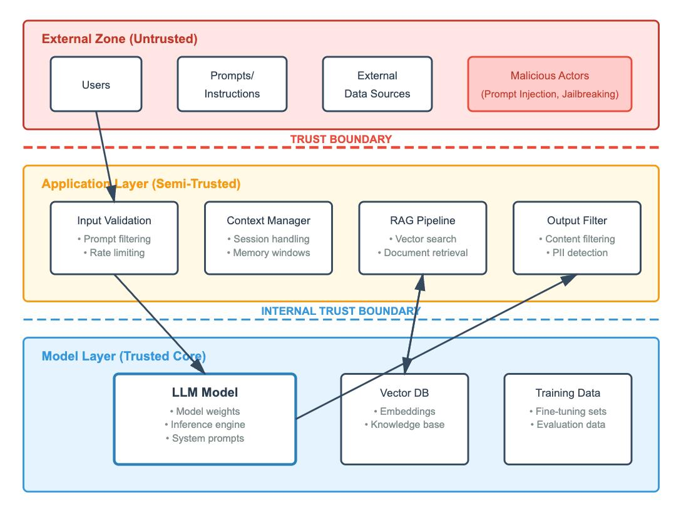
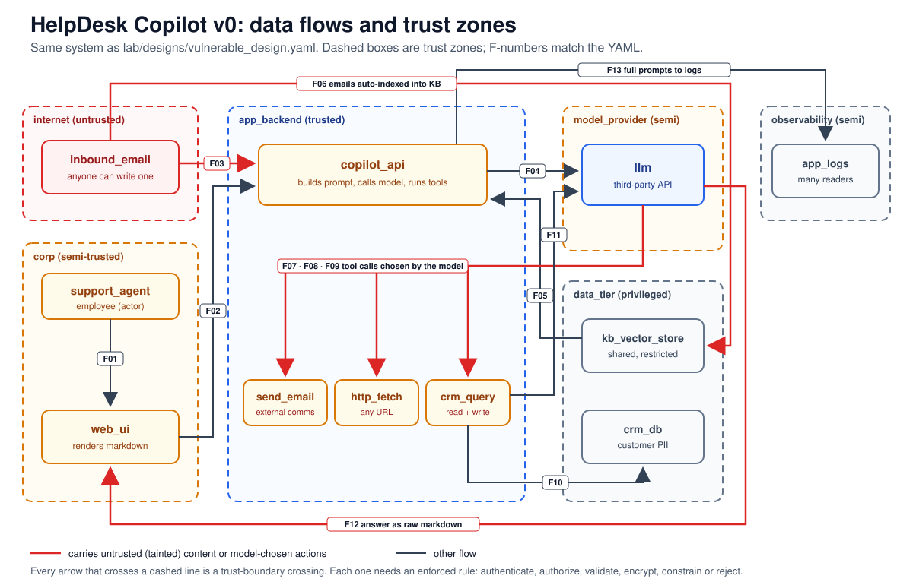
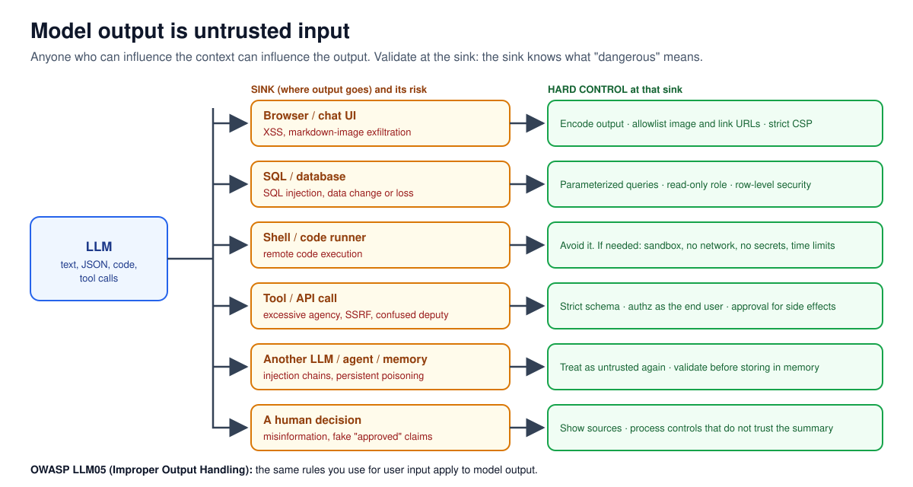

# Lesson 02: AI System Architecture and Trust Boundaries

> **Module:** 01 · AI Security Fundamentals · **Week:** 3 · **Time:** ~10 hours
> **You will:** draw an AI application as a data-flow diagram, mark its trust zones, find every place where untrusted text enters, and describe it as code so a tool can check it.

| | |
|---|---|
| **Prerequisites** | [Lesson 01](01-ai-ml-llm-basics-for-security.md) (tokens, RAG, tool calling) |
| **Lab** | [`lab/threat_model.py`](lab/threat_model.py) and [`lab/designs/`](lab/designs/): part 1, "describe the system" |
| **Maps to** | OWASP LLM01 Prompt Injection, LLM05 Improper Output Handling, LLM06 Excessive Agency · MITRE ATLAS AML.T0051 (LLM Prompt Injection) · NIST AI RMF: MAP 1, MAP 3 |

---

## 1. Why this matters

Almost every serious LLM incident so far is a **trust-boundary** failure: text from someone untrusted reached a place where it was treated as trusted.

- **2023, Greshake et al., *Not what you've signed up for*:** showed that instructions hidden in web pages and documents can take over LLM-integrated apps that only *read* that content (indirect prompt injection).
- **2023, LangChain `LLMMathChain` (CVE-2023-29374):** the chain passed model output to Python's `exec`. A prompt could therefore become arbitrary code execution. Model output crossed into a code-execution sink with no validation.
- **2023, Google Bard (reported by Johann Rehberger):** a shared Google Doc carried instructions that made Bard write a markdown image whose URL contained chat data; rendering the image sent it out. Google fixed it.
- **2024, Slack AI (reported by PromptArmor):** a message in a public channel could steer Slack AI into leaking data from private channels through a clickable link.
- **2025, "EchoLeak" in Microsoft 365 Copilot (CVE-2025-32711):** a crafted email could make Copilot leak data with zero clicks. Microsoft fixed it on the server side.

Each one is easy to see on a correct data-flow diagram: an arrow from an untrusted source, into the model's context, and out to a sink that can act or leak.

---

## 2. Understand it

### 2.1 The parts of a typical AI application

| Component | Job | Trust it with… |
|---|---|---|
| **UI / client** | Chat window, plugin, mobile app | Nothing. It runs on the user's device. |
| **API gateway** | Authentication, rate limits, quotas, routing | Enforcing identity and limits |
| **Orchestrator** | Builds the prompt, calls the model, runs the tool loop | Policy decisions, *if* they are written in code |
| **Prompt builder / templates** | Joins system prompt, history, retrieved text, tool results | Correct assembly and marking of untrusted parts |
| **Model endpoint** | Hosted API or self-hosted inference server | Producing text. **Not** with authorization decisions. |
| **Retriever + vector store** | Finds relevant chunks for RAG | Filtering by tenant/ACL, if built in |
| **Tool broker** | Validates and authorizes tool calls, then runs them | Being the policy enforcement point for actions |
| **Memory store** | Saves conversation facts for later | Nothing written by the model without validation |
| **Output handler** | Encodes, filters and renders model output | Stopping XSS, link and image exfiltration |
| **Logging / telemetry** | Records prompts, tool calls, decisions | Holding sensitive data: redact and restrict |

### 2.2 Data-flow diagrams (DFDs) in five symbols

A **data-flow diagram** shows how data moves. It is the main input of every threat model.

| Symbol | Meaning | AI examples |
|---|---|---|
| External entity (rectangle) | Something outside your control | User, customer email, web page, model provider |
| Process (rounded box / circle) | Code that transforms data | Orchestrator, retriever, tool broker, the model |
| Data store (parallel lines / cylinder) | Data at rest | Vector store, CRM, memory, logs |
| Data flow (arrow) | Data in motion, with a label | "prompt", "retrieved chunks", "tool call (url)" |
| **Trust boundary** (dashed line) | Where the level of trust changes | Internet → app, app → model provider, model → tools |

Rules of thumb: label every arrow with *what data* moves; draw the **model's outputs** as separate arrows (to tools, to the UI); and draw a boundary wherever the **identity, owner or trust level** changes.

### 2.3 Trust zones



This picture shows three classic layers: an untrusted external zone, a semi-trusted application layer and a "trusted core". One important correction: the **model's weights and infrastructure** are trusted *assets* you must protect, but the **model's output is not trusted**. Anything that can influence the context can influence the output.

In the lab we use four trust levels:

| Level | Meaning | Examples |
|---|---|---|
| `untrusted` | Anyone can write here | Internet, inbound email, public web pages, uploaded files |
| `semi` | Known parties, limited trust | Employee devices, a third-party model provider, a shared log platform |
| `trusted` | Your own code and config | API, orchestrator, tool broker |
| `privileged` | High-value data and admin power | Customer databases, secrets, production cloud accounts |

### 2.4 Where untrusted text comes from

Make this list for every system. Each item is an entry point for prompt injection or poisoning.

| Type | Sources |
|---|---|
| **Direct** | The user's own prompt and uploaded files |
| **Indirect** | Emails, web pages, PDFs, tickets, calendar invites, code comments, image alt-text, RAG chunks |
| **Tool and protocol** | API responses, search results, MCP tool descriptions and results, other agents' messages |
| **Stored** | Agent memory, chat history, shared documents that anyone can edit |
| **Supply chain** | Third-party models, datasets, prompt libraries, plugins |
| **Model output** | Everything the model writes (see 2.6) |

### 2.5 Taint: untrusted content spreads

Security engineers call data from an untrusted source **tainted**. Once tainted text enters a component, everything that component produces is tainted too. For LLMs this has a hard consequence: **there is no sanitizer for natural language.** You cannot reliably "clean" an email so that it contains no instructions. So:

- Taint flows **through** the model. If the model read the email, its output and its tool calls are tainted.
- Taint flows **through storage**. If emails are indexed into the knowledge base, every future answer from that index is tainted (stored injection).
- Soft controls (spotlighting, injection detection) **lower the odds**. They do **not** remove taint.



In this design, 12 of 13 flows cross a trust boundary, and one untrusted source (`inbound_email`) taints every component. The red arrows are where that matters most.

### 2.6 Model output is untrusted input



Treat model output exactly like user input arriving at each **sink** (the place that uses it). The sink knows what "dangerous" means: HTML for a browser, SQL for a database, a URL for an HTTP client. This is OWASP **LLM05 Improper Output Handling**. The LangChain `exec` CVE above is a textbook example.

### 2.7 Identity propagation and the confused deputy

A **confused deputy** is a program with high privileges that is tricked into using them for someone with fewer privileges. An AI tool that calls the CRM with a **shared service account** is a confused deputy waiting to happen: the model can request any record, and the CRM only sees "the app". The fix is **identity propagation**: the tool calls the backend **on behalf of the end user** (a delegated, scoped token, for example OAuth 2.0 token exchange), so the backend enforces the user's own permissions.

### 2.8 Every boundary needs an enforced rule

| Rule | Meaning | AI example |
|---|---|---|
| Authenticate | Know who is calling | SSO on the chat UI; workload identity for service calls |
| Authorize | Check they may do this | Tool broker checks the user may read *this* order |
| Validate | Reject malformed input | Strict JSON schema for tool arguments |
| Encode / sanitize | Make data safe for the sink | HTML-encode model output; strip markdown images |
| Isolate | Separate what must not mix | Per-tenant indexes or filters; quarantined LLM for untrusted text |
| Constrain | Limit size, rate, scope | Token budgets, rate limits, egress allowlist |
| Reject | Fail closed | Oversize input gets an error, not silent truncation |

---

## 3. Defend it

| Boundary | Typical threat | Hard control | Soft extra (lowers odds only) |
|---|---|---|---|
| Internet → app | Abuse, injection, cost | AuthN, rate limits, input size caps | Content classifiers |
| Untrusted content → prompt | Indirect prompt injection | Least privilege for the task; keep secrets out of context | Spotlighting, injection detectors |
| App → model provider | Data disclosure to a third party | Data classification, redaction, contract (no training on your data, short retention), TLS | — |
| Data store → retriever | Cross-tenant / ACL leaks | Tenant + ACL filter in the query, from the session identity | — |
| Model → tool | Excessive agency, SSRF, confused deputy | Strict schema, server-side authorization as the user, approval for side effects, egress allowlist | — |
| Model → UI | XSS, markdown-image exfiltration | Output encoding, URL allowlist, CSP | — |
| App → logs | Sensitive data in logs | Redaction, access control, retention limits | — |

**Design patterns**

- **AI gateway:** one place for authentication, quotas, model routing, redaction and logging of every model call.
- **Tool broker (policy enforcement point):** the model never calls tools directly; the broker validates, authorizes and logs.
- **Egress proxy:** tools that fetch URLs go through an allowlisting proxy that also blocks internal addresses (stops SSRF).
- **Quarantined LLM:** a model that reads untrusted text has no tools and no private data; only its validated, structured result moves on.
- **Separate identities:** the assistant that reads public content is not the one holding write tokens.

### What does NOT work on its own

- A trust-zone diagram that shows the model as "trusted" without separating *weights* from *output*.
- "Internal tool, so no authentication." Internal users can be phished, and internal tools read external content.
- A single boundary at the front door. AI systems have boundaries *inside*: model → tool, retriever → model, app → logs.
- Moving a component into a "trusted" zone on the diagram. The lab proves taint follows the data, not the drawing.

---

## 4. Hands-on lab: threat model as code, part 1 (describe the system)

**Scenario:** HelpDesk Copilot v0 (the DFD above) was built in a hackathon. You will read its YAML description, see which flows cross boundaries, and follow the taint.

### Step 1: Read the design next to the diagram

Open [`lab/designs/vulnerable_design.yaml`](lab/designs/vulnerable_design.yaml). Find each `F01`–`F13` on the DFD. Note the four building blocks: `zones`, `components` (with `type`, `zone`, `capabilities`), `flows` (with `classification` and `controls`) and `accepted_risks`. The analyzer validates the file with pydantic: a typo in a control name is an **error**, not a silently missing control.

### Step 2: List the boundary crossings

```powershell
python -c "import sys; sys.path.insert(0,'01-ai-security-fundamentals/lab'); import threat_model as tm; d=tm.load_design('01-ai-security-fundamentals/lab/designs/vulnerable_design.yaml'); [print(f.id, d.comp(f.source).zone, '->', d.comp(f.target).zone, f.controls) for f in d.flows if d.comp(f.source).zone != d.comp(f.target).zone]"
```

Expected output:

```text
F02 corp -> app_backend []
F03 internet -> app_backend ['system_prompt_rule']
F04 app_backend -> model_provider []
F05 data_tier -> app_backend []
F06 internet -> data_tier []
F07 model_provider -> app_backend []
F08 model_provider -> app_backend []
F09 model_provider -> app_backend []
F10 app_backend -> data_tier []
F11 app_backend -> model_provider []
F12 model_provider -> corp []
F13 app_backend -> observability []
```

Twelve crossings, and the only "control" in sight is a sentence in the system prompt.

### Step 3: Follow the taint

```powershell
python -c "import sys; sys.path.insert(0,'01-ai-security-fundamentals/lab'); import threat_model as tm; d=tm.load_design('01-ai-security-fundamentals/lab/designs/vulnerable_design.yaml'); [print(f'{k:16} <- {sorted(v)}') for k,v in tm.taint_origins(d).items() if v]"
```

Expected output:

```text
inbound_email    <- ['inbound_email']
web_ui           <- ['inbound_email']
copilot_api      <- ['inbound_email']
llm              <- ['inbound_email']
kb_vector_store  <- ['inbound_email']
send_email       <- ['inbound_email']
http_fetch       <- ['inbound_email']
crm_query        <- ['inbound_email']
crm_db           <- ['inbound_email']
app_logs         <- ['inbound_email']
```

One untrusted source reaches **every** component, including the customer database (through the model → `crm_query` → `crm_db` path) and the knowledge base (through `F06`).

### Step 4: Break it yourself (predict, then run)

Edit a copy of the YAML, or change the design in Python, and predict before you run `threat_model.py`:

1. Add `spotlighting` to `F03`. Does the `TB-002` finding on `F03` disappear? (No: spotlighting is a *soft* control and does not count as a boundary rule.)
2. Add `tls` to `F03`. Now `TB-002` on `F03` disappears, but does the lethal trifecta (`TRI-001`) go away? (No. Encrypting the pipe does not change *what* flows through it.)
3. Delete flow `F06`. Is `kb_vector_store` still tainted? Is `llm`? (The store is clean; the model is still tainted through `F03`.)
4. Move `inbound_email` into the `corp` zone. Is the model still tainted? (Yes. It is an `external_source`, so moving the box on the diagram does not make the content trustworthy.)

### Step 5: Describe your own system

Copy this skeleton to `lab/designs/my_system.yaml` and describe a RAG chatbot you know (or the one from your week 3 diagram):

```yaml
name: My RAG chatbot
zones:
  - {id: internet, trust: untrusted}
  - {id: app, trust: trusted}
  - {id: provider, trust: semi}
  - {id: data, trust: privileged}
components:
  - {id: user, type: actor, zone: internet}
  - {id: api, type: service, zone: app}
  - {id: llm, type: model, zone: provider}
  - {id: docs, type: vector_store, zone: data, classification: confidential, multi_tenant: true}
flows:
  - {id: F1, from: user, to: api, data: question, controls: [authn, rate_limit, tls]}
  - {id: F2, from: docs, to: api, data: chunks, classification: confidential, controls: [tls]}
  - {id: F3, from: api, to: llm, data: prompt, classification: confidential, controls: [tls, token_budget]}
```

Run `python 01-ai-security-fundamentals/lab/threat_model.py 01-ai-security-fundamentals/lab/designs/my_system.yaml`. The skeleton gives two findings: `RAG-001` (critical) on `F2` and `DATA-001` (high) on `F3`. Now notice what is **missing**: there is no finding about model output, because the skeleton has **no arrow out of the model**. A tool can only check what you draw. Add a flow `llm -> user` (the answer) and re-run. Then fix the design until no high or critical finding is left. (You will meet the rules properly in [lesson 03](03-ai-threat-modeling.md).)

### Stretch goals

- Add a `memory` component (type `datastore`) that the model writes to and reads from. Where does taint go? Which rule would you add for "model writes to memory without validation"?
- Draw the **secure** design ([`lab/designs/secure_design.yaml`](lab/designs/secure_design.yaml)) as a DFD by hand and compare it with the vulnerable one. Which arrows disappeared?

---

## 5. Real-world scenarios

**Scenario A: the report generator that ran SQL (hypothetical).**
An analytics assistant turns questions into SQL. The model's SQL runs with the app's database account. A user types: "show my sales; also drop the audit table".
- *What went wrong:* model output went straight into a SQL sink with a powerful account. That is LLM05 plus excessive privilege.
- *Investigate:* database audit logs for statements from the app account; the prompt and generated SQL in the AI logs; which tables the account can change.
- *Fix:* read-only database role limited to approved views; row-level security by user; parse the SQL and allow only `SELECT` on allowlisted tables; better still, have the model fill parameters for pre-written queries.

**Scenario B: the CRM confused deputy (hypothetical).**
A sales assistant uses one service account to query the CRM. A junior rep asks for "the contract value of every account in the EMEA region", which their own CRM role cannot see. The assistant answers.
- *What went wrong:* the tool ran with the app's privileges, not the user's. The model was not "hacked"; the architecture gave it more power than the person asking.
- *Investigate:* compare the user's CRM role with the records returned; check CRM API logs (they will all show the service account, which is itself a finding).
- *Fix:* delegated, scoped tokens (on-behalf-of the user); the CRM enforces the user's own permissions; audit logs record both the user and the agent.

**Scenario C: the helpful logs (hypothetical).**
To debug answer quality, a team logs full prompts and answers to the company-wide observability platform. Prompts include retrieved HR documents and customers' personal data. Hundreds of engineers can search those logs.
- *What went wrong:* a sensitive flow to a less-trusted zone with no redaction (in the lab this is `DATA-001` on `F13`).
- *Investigate:* search the log index for canary values and known personal-data patterns; review who has read access and how long logs are kept.
- *Fix:* redact before logging; log IDs and hashes instead of content by default; a separate, restricted store for full traces with short retention and access logging.

---

## 6. Common mistakes

- Drawing the model as one trusted box, with no arrows for its outputs.
- Forgetting indirect sources: tool results, documents, memory, other agents.
- Assuming "internal" means "trusted". Internal tools read external content all the time.
- Using a shared service account for every tool call.
- Rendering markdown from the model without a URL allowlist.
- Logging full prompts to a broadly readable platform.
- Updating the code but not the diagram, so the threat model describes a system that no longer exists.

---

## 7. Interview preparation

<details><summary><b>Q1. What is a trust boundary, and where are the trust boundaries in a typical LLM application?</b></summary>

A trust boundary is a line where the level of trust changes, so data crossing it must be checked. In an LLM app: internet → API (user input), untrusted content → prompt (documents, email, web), app → model provider (data leaves your control), data store → retriever (permissions), model → tools (model output becomes actions), model → UI (output becomes rendered HTML), and app → logs. The inside boundaries (model → tool, retriever → model) are the ones most often missed.
</details>

<details><summary><b>Q2. Why is model output untrusted, even when the model is "ours"?</b></summary>

Because anyone who can influence the context can influence the output: users, authors of retrieved documents, tool results. The weights may be ours, but the output is a function of untrusted input. So validate it at every sink: encode for the browser, parameterize for SQL, schema-check and authorize for tools, sandbox for code.
</details>

<details><summary><b>Q3. List the untrusted input sources for an AI email assistant.</b></summary>

Incoming emails (body, headers, attachments, HTML hidden text, image alt-text); calendar invites; linked web pages it fetches; files in shared drives; the user's own prompt; tool and API responses; memory written in earlier sessions; and the model's own output when it is fed back in.
</details>

<details><summary><b>Q4. What is "taint", and why can't we sanitize prompts the way we sanitize HTML?</b></summary>

Taint marks data that came from an untrusted source and follows it through processing. HTML has a formal grammar, so we can encode it so the browser never runs it. Natural language has no such grammar: any sentence can be read as an instruction. There is no encoder that makes text "safe for the model". So we accept that the model may be fooled and put hard controls on what tainted output can *do*.
</details>

<details><summary><b>Q5. Explain the confused-deputy problem in AI agents and how to fix it.</b></summary>

The agent (the deputy) has more privilege than the user it serves, for example a shared service account. A user, or injected content, asks the agent to do something the user could not do directly, and the backend allows it because it only sees the agent. Fix: propagate the user's identity with delegated, scoped tokens (for example OAuth 2.0 token exchange), so the backend checks the user's own permissions; keep the agent's own rights minimal; log both identities.
</details>

<details><summary><b>Q6. How do you draw a data-flow diagram for an AI system? What do people forget?</b></summary>

Start with external entities (users, content sources, model provider), then processes (gateway, orchestrator, retriever, tool broker, model), then data stores (vector DB, CRM, memory, logs). Draw labeled arrows for each data movement, including the model's outputs to tools and UI. Then draw dashed trust boundaries wherever identity, owner or trust changes. People forget: model output arrows, tool results flowing back, ingestion pipelines into the vector store, memory, and logs.
</details>

<details><summary><b>Q7. Design question: where would you put the policy enforcement point for tool calls?</b></summary>

In a tool broker that sits between the orchestrator and the tools, outside the model. It validates arguments against a strict schema, checks the end user's permissions for that tool and resource, applies task-specific allowlists, requires approval for high-impact actions, enforces rate limits, and writes an audit log. The tool backends should still enforce authorization themselves (defense in depth), using the user's delegated identity.
</details>

<details><summary><b>Q8. What is markdown-image exfiltration and which boundary does it cross?</b></summary>

An injected model writes ``. When the UI renders it, the browser fetches the URL and sends the data, with no click. The boundary is model → UI → internet. Controls: encode or strip images; allowlist image and link domains; a strict Content-Security-Policy; proxy images server-side. And keep secrets out of the context in the first place.
</details>

<details><summary><b>Q9. Your company uses a hosted model API. What crosses that boundary, and what controls do you need?</b></summary>

The full prompt crosses it: system prompt, user data, retrieved documents, tool results. Controls: a data classification policy for what may be sent; redaction or pseudonymization; a contract covering no training on your data, retention period and region (check the provider's current terms); TLS; API keys in a secrets manager with rotation; an AI gateway to log and enforce all of this centrally.
</details>

<details><summary><b>Q10. Scenario: an engineer says "the assistant is internal, so we don't need authentication or rate limits". How do you respond?</b></summary>

Internal does not mean trusted. Employee accounts get phished; internal assistants read external content such as emails and tickets; without authentication you cannot authorize retrieval or tools per user, and you cannot audit who did what; without rate limits one script can run up the bill. Authentication is also the base for every other control: ACL filters, delegated tokens and audit trails all need an identity.
</details>

<details><summary><b>Q11. What is the difference between a soft control and a hard control? Give AI examples.</b></summary>

A hard control is deterministic code or configuration that always enforces the same result and can be tested: schema validation, server-side authorization, ACL filters, egress allowlists, token budgets, output encoding. A soft control is probabilistic and lowers the odds: system-prompt rules, spotlighting, injection classifiers, LLM-as-judge. Soft controls are useful for detection and defense in depth, but a trust boundary must be held by a hard control.
</details>

<details><summary><b>Q12. How does a "quarantined LLM" design reduce risk?</b></summary>

One model reads the untrusted content but has no tools and no private data; its output is constrained to a strict structure (for example a category and a short summary). A second, privileged component acts on that validated structure, never on the raw text. Even if the quarantined model is fully injected, it has nothing to steal and no way to act. The limit is that the structured output can still carry misleading content, so keep it narrow.
</details>

<details><summary><b>Q13. Why describe a threat model as code (YAML) instead of only a diagram?</b></summary>

Code can be reviewed in pull requests, versioned with the system, checked automatically in CI, and diffed when the architecture changes. A diagram in a slide deck goes stale. The lab's analyzer fails the build when a new flow crosses a boundary without a control or creates a lethal trifecta. The diagram is still useful for people; the YAML keeps it honest.
</details>

<details><summary><b>Q14. Explain trust boundaries to a non-technical product manager.</b></summary>

"Think of our AI assistant as a new employee who believes everything they read. A trust boundary is every door where information from outside comes in, or where the assistant can act on something. At each door we put a guard that doesn't depend on the assistant's judgment: checking who you are, what you are allowed to see, and stopping risky actions until a person approves."
</details>

---

## 8. Checklist (definition of done)

- [ ] I drew a DFD with trust boundaries for one AI system, including model output arrows, ingestion and logs (week 3 deliverable).
- [ ] I listed every untrusted input source for that system.
- [ ] I wrote my system as YAML and ran the analyzer on it.
- [ ] I did the four "break it yourself" exercises and can explain why soft controls do not remove taint.
- [ ] Week 3 journal entry: the boundary I would fix first and why.

## 9. References

- Greshake et al., *Not what you've signed up for: Compromising Real-World LLM-Integrated Applications with Indirect Prompt Injection* (2023), https://arxiv.org/abs/2302.12173
- NVD, CVE-2023-29374 (LangChain LLMMathChain), https://nvd.nist.gov/vuln/detail/CVE-2023-29374
- Johann Rehberger, *Hacking Google Bard: From Prompt Injection to Data Exfiltration* (2023), https://embracethered.com/blog/posts/2023/google-bard-data-exfiltration/
- NVD, CVE-2025-32711 (Microsoft 365 Copilot "EchoLeak"), https://nvd.nist.gov/vuln/detail/CVE-2025-32711
- OWASP Top 10 for LLM Applications 2025: LLM05 Improper Output Handling, https://genai.owasp.org/llm-top-10/
- Microsoft, *Threat Modeling Tool* and DFD element guidance, https://learn.microsoft.com/en-us/azure/security/develop/threat-modeling-tool
- IETF RFC 8693, *OAuth 2.0 Token Exchange*, https://www.rfc-editor.org/rfc/rfc8693
- NIST AI RMF 1.0, https://www.nist.gov/itl/ai-risk-management-framework
