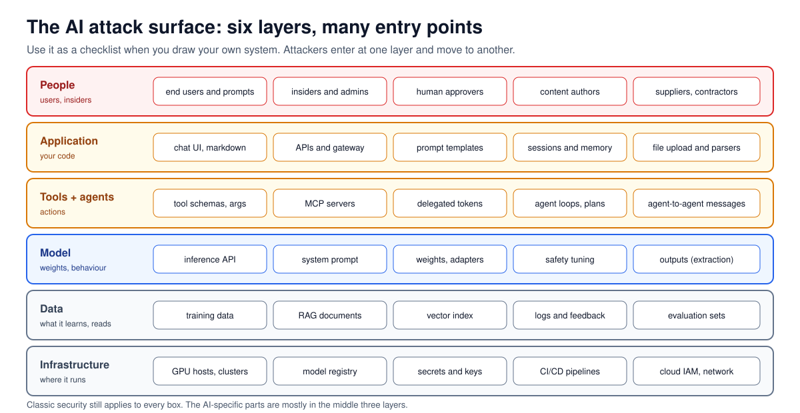
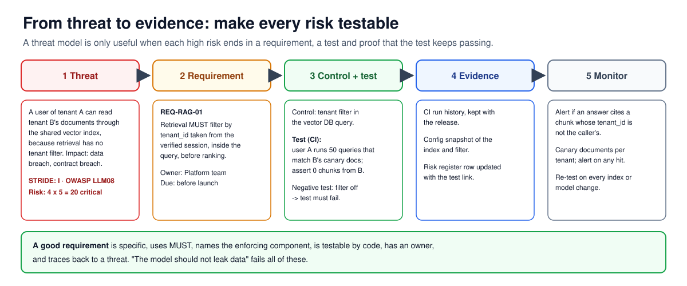

# Lesson 04: The AI Attack Surface and Security Requirements

> **Module:** 01 · AI Security Fundamentals · **Week:** 4 · **Time:** ~8 hours
> **You will:** map the full attack surface of an AI system across six layers, then turn threats into precise, testable security requirements with tests and evidence. This closes the Phase 1 gate.

| | |
|---|---|
| **Prerequisites** | [Lesson 03](03-ai-threat-modeling.md) (threat statements, risk scoring) |
| **Lab** | [`lab/threat_model.py`](lab/threat_model.py) `--requirements`: part 3, "from findings to requirements" |
| **Templates** | [`security-test-case.md`](../00-program/templates/security-test-case.md) · [`threat-model-template.md`](../00-program/templates/threat-model-template.md) |
| **Maps to** | OWASP LLM03 Supply Chain, LLM04 Data and Model Poisoning (plus the rest of the Top 10) · MITRE ATLAS AML.T0010 (ML Supply Chain Compromise) · NIST AI RMF: MANAGE function · NIST SSDF (SP 800-218) |

---

## 1. Why this matters

Many AI incidents enter through a door that has nothing to do with prompts: the package registry, the model hub, the compute cluster, the storage account.

- **December 2022, PyTorch nightly (`torchtriton`):** a malicious package with the same name as a PyTorch dependency was uploaded to PyPI. People who installed PyTorch nightly builds over several days got the attacker's package, which collected system information and files. Classic **dependency confusion**, aimed at ML developers.
- **2023, Microsoft AI research (reported by Wiz):** a GitHub repository that shared open-source AI training material included a storage link with an over-permissive token. It exposed about 38 TB of internal data. A **data-sharing step in the lifecycle** became the breach.
- **2024, "ShadowRay" (reported by Oligo Security):** attackers took over exposed Ray AI compute clusters through a jobs API with no authentication (CVE-2023-48022; the vendor disputes it, saying Ray is meant to run only inside a trusted network). The **infrastructure layer** of AI.
- **2024, malicious models on Hugging Face (reported by JFrog):** researchers found models whose files ran code when loaded, using Python's unsafe `pickle` format. A **model file is code** if its format allows it.
- **2024, Anthropic, *Sleeper Agents*:** research showed that a deliberately planted backdoor behavior could survive standard safety training. **Model provenance** matters.

The lesson: the AI attack surface is the **whole** system. And a risk you cannot express as a testable requirement is a risk you will not reliably fix.

---

## 2. Understand it

### 2.1 What "attack surface" means here

The **attack surface** is every point where an attacker can send data into the system, read data out of it, or influence how it is built. AI systems make it bigger in three ways:

1. **Natural language becomes an input everywhere.** Any text the model reads (emails, documents, tool results) is now an input channel, often from people you never authenticated.
2. **New components.** Vector databases, model registries, GPU clusters, evaluation pipelines and agent frameworks, often young software with weak defaults.
3. **The software can act.** Tools and agents turn a text-level bug into a real action.

### 2.2 The six-layer map



| Layer | Entry points | Example attacks | Primary hard controls | Deep dive |
|---|---|---|---|---|
| **People** | End users, insiders, admins, human approvers, content authors, suppliers | Social engineering of approvers; insider exfiltration; abusive users | Least privilege, separation of duties, approval UX that shows exact actions | [07](../07-ai-governance/) |
| **Application** | Chat UI, APIs, gateways, prompt templates, sessions, memory, file upload and parsers | Prompt injection, XSS via output, parser exploits, session theft | AuthN, input limits, output encoding, isolated parsers | [02](../02-llm-security/) |
| **Tools and agents** | Tool schemas and arguments, MCP servers, delegated tokens, agent loops, agent-to-agent messages | Excessive agency, SSRF, confused deputy, tool poisoning, runaway loops | Tool broker, user-scoped tokens, egress allowlist, step and budget limits | [04](../04-mcp-security/), [05](../05-agent-security/) |
| **Model** | Inference API, system prompt, weights and adapters, safety tuning, outputs | Jailbreak, extraction, backdoors, system-prompt leakage | No secrets in prompts, rate limits, provenance and signing, evaluation | [02](../02-llm-security/), [06](../06-ai-devsecops/) |
| **Data** | Training data, RAG documents, vector index, logs and feedback, evaluation sets | Poisoning, cross-tenant leaks, embedding inversion, sensitive logs | Source allowlists, ACL-filtered retrieval, redaction, retention limits | [03](../03-rag-security/) |
| **Infrastructure** | GPU hosts and clusters, model registry, secrets, CI/CD, cloud IAM and network | Exposed dashboards, stolen keys, dependency confusion, over-shared storage | Private networking, workload identity, secrets manager, signed artifacts, IaC scanning | [06](../06-ai-devsecops/), [09](../09-enterprise-architecture/) |

### 2.3 Attack paths cross layers

Real attacks chain several layers. Draw the path, then pick the cheapest place to break it.

| Step | Layer | What happens (hypothetical chain) | Control that breaks it |
|---|---|---|---|
| 1 | People | An outsider writes a public web page with hidden instructions | (cannot control the internet) |
| 2 | Data | The company's assistant retrieves the page while answering a question | Restrict browsing to allowlisted sites for this task |
| 3 | Model | The hidden text makes the model request `http_fetch("http://169.254.169.254/...")` | (soft only: spotlighting, detectors) |
| 4 | Tools | The fetch tool calls the cloud metadata address | **Egress proxy that blocks internal and link-local addresses** |
| 5 | Infra | The response contains temporary cloud credentials | **IMDSv2 / workload identity; no credentials on the tool host** |
| 6 | Model → out | The model puts the credentials in a markdown image URL | **URL allowlist on rendered output** |

Three independent hard controls (steps 4, 5 and 6) each break the chain on their own. That is defense in depth.

### 2.4 Reducing the attack surface

Ask four questions of every entry point, in this order:

1. **Remove:** does this feature need it at all? (A summarizer needs zero tools.)
2. **Restrict:** can it be narrower? (Read-only, one tenant, allowlisted domains, fewer tokens.)
3. **Isolate:** can a compromise stay contained? (Sandbox, separate identity, quarantined model, private network.)
4. **Monitor:** will we notice if it is abused? (Audit logs, canaries, spend alerts.)

### 2.5 From threats to security requirements



A **security requirement** states what must be true for a threat to be controlled. Good requirements:

- use **MUST / MUST NOT** (RFC 2119 words), not "should try to";
- name the **component** that enforces it;
- are **specific and testable by code** where possible;
- **trace back** to a threat (ID) and forward to a test;
- have an **owner** and a due date.

| Bad | Good |
|---|---|
| "The AI must not leak data." | "REQ-RAG-01: The retriever MUST filter chunks by `tenant_id` and ACL from the verified session, inside the vector query, before ranking." |
| "Tools should be safe." | "REQ-TOOL-01: The tool broker MUST reject any tool call whose arguments fail the JSON schema, and MUST authorize side-effecting calls with the end user's permissions." |
| "Limit costs." | "REQ-COST-01: Each request MUST be capped at 8,000 input and 1,000 output tokens; each user at 200,000 tokens per day." |

### 2.6 A starter requirements catalog

The categories follow the [threat-model template](../00-program/templates/threat-model-template.md). Adapt the numbers to your system.

| ID | Category | Requirement | Verify by |
|---|---|---|---|
| REQ-ID-01 | Authentication | Every human entry point MUST authenticate via SSO before any model call. | Integration test: 401 without a session |
| REQ-ID-02 | Authorization | Tools MUST call backends with the end user's delegated, scoped identity. | Test: user without CRM role gets 403 through the tool |
| REQ-TEN-01 | Tenant isolation | Retrieval, memory and caches MUST be partitioned or filtered by tenant. | Canary test across tenants: 0 foreign chunks |
| REQ-DATA-01 | Data minimization | Only data classified for the target model MAY be sent; personal data MUST be redacted unless required. | Unit test of the redactor; log scan for canaries |
| REQ-ENC-01 | Encryption | All zone-crossing flows MUST use TLS 1.2+; stores holding confidential data MUST be encrypted at rest. | Config scan (IaC) |
| REQ-SEC-01 | Secrets | Secrets MUST NOT appear in prompts, tool descriptions or logs. | Secret scan of rendered prompts and logs |
| REQ-PROV-01 | Provenance | Model artifacts MUST come from an approved registry, in a safe format (for example safetensors), with a verified hash or signature. | CI check before deployment |
| REQ-TOOL-01 | Tool controls | The broker MUST validate arguments against a strict schema and authorize each call. | Test: injected / malformed calls execute nothing |
| REQ-TOOL-02 | Egress | Tools that fetch URLs MUST go through an egress proxy that blocks private, loopback and link-local addresses. | Test: fetch of `169.254.169.254` is refused |
| REQ-HUM-01 | Human oversight | Irreversible or external actions MUST need human approval that shows the exact arguments. | Test: no approval, no action |
| REQ-OUT-01 | Output handling | Model output MUST be encoded before rendering; images and links MUST be limited to allowlisted domains. | Test: `<script>` renders as text; external image removed |
| REQ-LOG-01 | Logging | Every tool call MUST be audit-logged with user, agent, tool, arguments (redacted) and decision. | Test: one audit record per call |
| REQ-RET-01 | Retention / deletion | Prompts and outputs MUST be kept no longer than N days; deletion MUST cover indexes and backups. | Scheduled job evidence; deletion test |
| REQ-COST-01 | Availability / cost | Every entry point MUST be rate limited; every model call MUST have a token budget. | Load test: spend capped |
| REQ-ARCH-01 | Architecture | A model context MUST NOT combine private data, untrusted content and an external channel. | Threat-model-as-code check in CI |
| REQ-IR-01 | Incident response | There MUST be a kill switch to disable tools or the model per tenant within 15 minutes. | Quarterly drill record |

### 2.7 Verification and evidence

| Method | Good for | Example |
|---|---|---|
| Unit / integration tests | Deterministic controls | Schema rejects extra fields; ACL filter |
| Adversarial regression suite | Model-facing behavior, measured as impact | Injection payloads → assert no tool executed |
| Configuration scanning | Infrastructure requirements | IaC scan for public buckets, missing TLS |
| Threat model as code | Architecture requirements | `TRI-001` check in CI |
| Red teaming | Unknown unknowns | Quarterly exercise against the staging system |
| Monitoring | Controls that must keep working | Canary hits, spend alerts, unusual tool calls |

**Evidence** is what proves a control works *over time*: CI run history, configuration snapshots, monitoring dashboards, drill records, and the risk register linked to test IDs. An auditor will ask for evidence, not intentions.

---

## 3. Defend it

| Layer | Control | Type | What it buys you |
|---|---|---|---|
| L1 | Remove unneeded features, tools, data and network paths | Hard | Smaller surface; whole attack classes gone |
| L2 | Restrict what remains: read-only, scoped tokens, allowlists, budgets | Hard | Limited blast radius |
| L3 | Isolate: sandboxes, separate identities, private networks, per-tenant partitions | Hard | Compromise stays contained |
| L4 | Verify the supply chain: pinned dependencies, signed models, safe formats | Hard | Untrusted code does not enter |
| L5 | Requirements with tests, run in CI on every change | Process | Controls do not silently regress |
| L6 | Monitor and rehearse: audit logs, canaries, alerts, kill switches, drills | Process / detective | You notice and can respond quickly |

### What does NOT work on its own

- A requirement without a test. It will drift.
- Securing only the chat interface while the GPU cluster dashboard is open to the internet.
- "We use a trusted model provider," as an answer to supply-chain risk for adapters, datasets, plugins and packages.
- Copying a requirements catalog without adapting it to your data flows.
- Pen-testing once before launch and never again.

---

## 4. Hands-on lab: threat model as code, part 3 (from findings to requirements)

### Step 1: Derive requirements from the open findings

```powershell
python 01-ai-security-fundamentals/lab/threat_model.py 01-ai-security-fundamentals/lab/designs/vulnerable_design.yaml --requirements
```

Expected output (first four of eleven requirements):

```text
Security requirements derived from open findings: HelpDesk Copilot v0 (vulnerable)
REQ-ARCH-01  A model context MUST NOT combine private data, untrusted content and an external channel.
             verify: CI: this analyzer reports no TRI-001
             applies to: llm
REQ-BND-01   Every trust-boundary crossing MUST have at least one enforced control.
             verify: CI: this analyzer reports no TB-002
             applies to: F02, F03
REQ-COST-01  Every entry point MUST be rate limited and every model call MUST have a token budget.
             verify: test: 1,000 oversized requests are mostly rejected; spend is capped
             applies to: F01, F03, F06, llm
REQ-DATA-01  Confidential data MUST be redacted, or covered by a data-processing agreement, before it leaves trusted zones.
             verify: test: canary PII never appears in logs
```

Every analyzer rule maps to exactly one requirement in `REQUIREMENTS` inside [`threat_model.py`](lab/threat_model.py), and `test_every_rule_traces_to_a_testable_requirement` enforces that.

### Step 2: The secure design needs no new requirements

```powershell
python 01-ai-security-fundamentals/lab/threat_model.py 01-ai-security-fundamentals/lab/designs/secure_design.yaml --requirements
```

Expected output:

```text
Security requirements derived from open findings: HelpDesk Copilot v1 (secure)
0 requirement(s)
```

The accepted risk (`DOS-001` on `F03`) does not create a requirement, because someone owns it until its expiry date.

### Step 3: Build a traceability matrix

Requirements are only real when a test proves them. Fill this table in your journal. The first rows are done for you, using tests that already exist in this repo:

| Requirement | Test that proves it |
|---|---|
| REQ-RAG-01 (pre-filter by tenant and ACL) | `test_secure_retriever_never_returns_a_document_the_user_may_not_read` in [`test_tiny_embeddings.py`](lab/test_tiny_embeddings.py) |
| REQ-COST-01 (token budget) | `test_token_budget_stops_a_cost_attack` and `test_safe_context_rejects_oversized_input_instead_of_truncating` |
| REQ-TOOL-01 (tool policy) | `test_tool_policy_holds_even_without_spotlighting` in [`02-llm-security/prompt-injection`](../02-llm-security/prompt-injection/lab/test_prompt_injection.py) |
| REQ-SEC-01 (no secrets in prompts) | `test_secure_app_has_no_secret_to_leak` in the same file |
| REQ-ARCH-01 (no trifecta) | `test_secure_design_has_no_open_findings` in [`test_threat_model.py`](lab/test_threat_model.py) |
| REQ-OUT-01 | *your turn: which module will test it?* |

### Step 4: Use the analyzer as a CI gate (optional)

The analyzer exits with code 1 when an open high or critical finding exists. A minimal GitHub Actions step looks like this (an example; adapt it to your CI):

```yaml
- name: Threat model gate
  run: python 01-ai-security-fundamentals/lab/threat_model.py 01-ai-security-fundamentals/lab/designs/secure_design.yaml
```

### Step 5: Map the attack surface of your own system

Take the system you described in lesson 02 (`my_system.yaml`). For each of the six layers, list at least two entry points and, for each, the **remove / restrict / isolate / monitor** decision. Mark which entry points are missing from your YAML: those are blind spots for the analyzer.

### Step 6: Write three requirements yourself

Write three requirements for your system in the "good" style of section 2.5, then write one test case for each using [`security-test-case.md`](../00-program/templates/security-test-case.md) (copy it into your journal; do not edit the template).

### Stretch goals

- Add a `requirement` and `test` column to the CSV export from lesson 03's stretch goal, so the risk register links risk → requirement → test.
- Add an analyzer rule for an infrastructure requirement, for example "component of type `service` in zone `internet` with no `authn` on inbound flows" (a ShadowRay-style exposed dashboard).
- Write a requirement and a test for REQ-PROV-01: refuse to load a model file with a `.pkl` or `.bin` extension unless it is on an allowlist of hashes.

---

## 5. Real-world scenarios

**Scenario A: the open GPU cluster (hypothetical, similar to the ShadowRay reports).**
A data-science team runs a distributed training cluster on cloud VMs. To make it easy, the cluster dashboard and job API listen on a public IP. Weeks later, the cloud bill shows heavy GPU use at night and outbound traffic to unknown hosts.
- *What went wrong:* infrastructure-layer exposure. A management API with no authentication was reachable from the internet; nobody had put the cluster in the AI threat model because "it's just training".
- *Investigate:* job history on the cluster; cloud flow logs; IAM credentials and tokens present on the nodes (assume they are stolen); model and dataset integrity (were artifacts changed?).
- *Fix:* private networking and a VPN or identity-aware proxy; authentication on every management API; least-privilege workload identity; rotate all secrets; add requirements and an IaC scan that fails on public management ports.

**Scenario B: the model that ran code on load (hypothetical, similar to the JFrog findings).**
An engineer downloads a promising fine-tuned model from a public hub and loads it on a shared GPU server. The file is a pickle and runs a reverse shell during loading.
- *What went wrong:* supply-chain layer. An untrusted artifact in an unsafe format ran with the engineer's privileges on shared infrastructure.
- *Investigate:* process and network logs on the server around the load time; what credentials the server holds; which other models came from the same source.
- *Fix:* REQ-PROV-01: approved registry only, safe formats (safetensors), hash or signature verification, scanning, and loading untrusted models only in an isolated sandbox with no secrets and no network.

**Scenario C: the requirement that failed the audit (hypothetical).**
An auditor asks how the company ensures its AI assistant "does not disclose personal data". The answer is a policy sentence and a system prompt. There is no test, no log evidence and no owner.
- *What went wrong:* the requirement was not specific, not testable and not owned, so there was no evidence the control existed or worked over time.
- *Investigate:* list the data flows that carry personal data (DFD); check what actually enforces each one today.
- *Fix:* rewrite as REQ-DATA-01 / REQ-RAG-01 / REQ-OUT-01 style requirements, each with an automated test in CI, a canary-based log scan, a named owner, and evidence kept with each release.

---

## 6. Common mistakes

- Mapping only the application layer and forgetting training pipelines, registries, clusters and CI/CD.
- Treating model files as data. Some formats are code.
- Writing requirements with "should", or without saying which component enforces them.
- No traceability: you cannot tell which test proves which requirement for which threat.
- Requirements that describe model behavior ("the model will refuse…") instead of enforced system behavior.
- Forgetting deletion: prompts, embeddings and backups keep data after the source is deleted.

---

## 7. Interview preparation

<details><summary><b>Q1. What does the attack surface of an enterprise AI system include?</b></summary>

Six layers: **people** (users, insiders, approvers, content authors, suppliers), **application** (UI, APIs, prompt templates, sessions, memory, parsers), **tools and agents** (tool schemas, MCP servers, delegated tokens, loops), **model** (inference API, system prompt, weights, outputs), **data** (training data, RAG documents, vector index, logs, evaluation sets) and **infrastructure** (GPU clusters, registries, secrets, CI/CD, cloud IAM and network). Attacks usually chain several layers.
</details>

<details><summary><b>Q2. How is the AI attack surface different from a normal web application's?</b></summary>

Three differences: any text the model reads becomes an input channel, including content from unauthenticated third parties; there are new, often immature components (vector DBs, model registries, inference servers, agent frameworks); and the software can act through tools, so text-level bugs become real actions. Model artifacts can also be code (unsafe serialization formats), and the training pipeline is part of the attack surface.
</details>

<details><summary><b>Q3. What makes a good security requirement? Rewrite "The chatbot must not leak customer data."</b></summary>

Specific, uses MUST, names the enforcing component, testable by code, traceable to a threat, owned. Rewrite: "REQ-RAG-01: The retriever MUST filter chunks by `tenant_id` and document ACL from the verified session, inside the vector query, before ranking. Verified by a CI test where tenant A runs 50 queries matching tenant B's canary documents and receives 0 tenant-B chunks. Owner: Platform team."
</details>

<details><summary><b>Q4. How do you prove to an auditor that an AI control works over time?</b></summary>

Show evidence, not intent: the requirement and its linked automated test; CI history showing the test passing on every release; configuration snapshots; monitoring that would detect failure (canary alerts, audit logs) and records of alerts handled; drill records for incident procedures; and the risk register linking threat → requirement → test → evidence.
</details>

<details><summary><b>Q5. Describe an attack path that crosses at least three layers, and where you would break it.</b></summary>

A web page (data, written by an outsider) contains hidden instructions; the assistant retrieves it; the model (model layer) asks the fetch tool (tools layer) to call the cloud metadata address; the tool host (infra layer) returns temporary credentials; the model leaks them through a markdown image. I would break it at three independent points: an egress proxy that blocks link-local and private addresses, no credentials reachable from the tool host (workload identity, IMDSv2), and a URL allowlist on rendered output.
</details>

<details><summary><b>Q6. What are the main AI supply-chain risks and the requirements you would set?</b></summary>

Risks: malicious or typo-squatted packages, backdoored or poisoned models and adapters, unsafe serialization formats that run code on load, poisoned datasets, compromised plugins and MCP servers. Requirements: approved registries and pinned versions with hashes; safe model formats (for example safetensors); signature or hash verification; scanning of artifacts; an AI bill of materials; loading untrusted artifacts only in isolated sandboxes; provenance records for datasets.
</details>

<details><summary><b>Q7. Why is "remove" the first step in attack-surface reduction?</b></summary>

Because a feature that does not exist cannot be attacked, monitored badly or misconfigured. Removing a tool from a summarizer eliminates whole attack classes (in the prompt-injection lab, two of the attacks die outright). Restricting, isolating and monitoring are still needed for what must remain, but each has residual risk.
</details>

<details><summary><b>Q8. How do you write requirements for something probabilistic, like model refusals?</b></summary>

Avoid making model behavior the requirement for anything high-risk. Put the requirement on enforced system behavior ("no side-effecting tool executes without authorization"), which is deterministic and testable. Where model behavior matters (for example harmful-content rates), write a measurable target over a test set ("attack success rate below X% on suite Y, run on every model change") and treat it as a soft control with monitoring.
</details>

<details><summary><b>Q9. Scenario: the data-science team says the training cluster is "out of scope" for the AI threat model. Do you agree?</b></summary>

No. The cluster holds training data, weights and often cloud credentials; if it is compromised, attackers can steal the model, poison training or move laterally. Real incidents (for example the ShadowRay reports about exposed Ray clusters) show this layer is actively attacked. It belongs in scope with requirements for network isolation, authentication on management APIs, workload identity and artifact integrity.
</details>

<details><summary><b>Q10. What is traceability and why do architects care?</b></summary>

Traceability links each threat to the requirement that addresses it, the control that implements it, the test that verifies it and the evidence that it keeps working. Architects care because it answers "are we covered?" with facts, shows the impact of a design change (which tests and requirements are affected), and is what auditors and regulators ask for.
</details>

<details><summary><b>Q11. Name five security requirements you would put on any LLM feature before launch.</b></summary>

1. No secrets in prompts (REQ-SEC-01).
2. Retrieval filtered by tenant and ACL from the session (REQ-RAG-01).
3. Tool calls validated and authorized as the user, with approval for side effects (REQ-TOOL-01).
4. Output encoded with URL allowlisting (REQ-OUT-01).
5. Rate limits and token budgets (REQ-COST-01).

Plus audit logging and a kill switch if it has tools.
</details>

<details><summary><b>Q12. How do you keep the requirement set from becoming a huge, ignored document?</b></summary>

Keep it small and tied to real threats in the threat model; store it next to the code; make each requirement own at least one automated test; fail the build when a test fails; review and retire requirements when the design changes; and report coverage (requirements with passing tests) rather than page count.
</details>

<details><summary><b>Q13. Explain to an executive why we need both an attack-surface map and requirements.</b></summary>

"The map shows every door into our AI system: the chat window, but also our data, our tools, our model suppliers and our cloud servers. Requirements are the locks we promise to put on each door. Tests check every day that the locks are still there. Without the map we miss doors; without tests the locks quietly disappear."
</details>

---

## 8. Checklist (definition of done)

- [ ] I mapped my system across all six layers with at least two entry points per layer.
- [ ] I wrote at least five requirements in "good" style, each with a test idea and an owner.
- [ ] I completed the traceability matrix in Step 3.
- [ ] `python -m pytest 01-ai-security-fundamentals` passes.
- [ ] **Phase 1 gate** (week 4): DFD with boundaries, 15+ prioritized threats, every high risk has a control, a test and an owner, no secrets in prompts or source control, and I can explain why prompt wording cannot enforce authorization.

## 9. References

- PyTorch, *Compromised PyTorch-nightly dependency chain between December 25th and December 30th, 2022*, https://pytorch.org/blog/compromised-nightly-dependency/
- Wiz Research, *38TB of data accidentally exposed by Microsoft AI researchers* (2023), https://www.wiz.io/blog/38-terabytes-of-private-data-accidentally-exposed-by-microsoft-ai-researchers
- Oligo Security, *ShadowRay* (2024), https://www.oligo.security/blog/shadowray-attack-ai-workloads-actively-exploited-in-the-wild
- JFrog, *Data Scientists Targeted by Malicious Hugging Face ML Models with Silent Backdoor* (2024), https://jfrog.com/blog/data-scientists-targeted-by-malicious-hugging-face-ml-models-with-silent-backdoor/
- Hubinger et al., *Sleeper Agents: Training Deceptive LLMs that Persist Through Safety Training* (2024), https://arxiv.org/abs/2401.05566
- Carlini et al., *Poisoning Web-Scale Training Datasets is Practical* (2023), https://arxiv.org/abs/2302.10149
- IETF RFC 2119, *Key words for use in RFCs to Indicate Requirement Levels*, https://www.rfc-editor.org/rfc/rfc2119
- NIST SP 800-218, *Secure Software Development Framework (SSDF)*, https://csrc.nist.gov/pubs/sp/800/218/final
- OWASP Top 10 for LLM Applications 2025, https://genai.owasp.org/llm-top-10/
- OWASP AI Exchange, https://owaspai.org/
