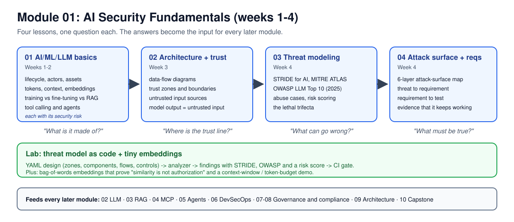

# Module 01: AI Security Fundamentals

> **Weeks:** 1–4 (Month 1 of the [36-week plan](../00-program/36-week-plan.md)) · **Time:** ~45 hours · **Phase 1 gate** at the end of week 4

## What and why

This module teaches you to **see an AI system the way an attacker does** before you touch any exploit tooling. You will learn how AI and LLM systems are built and run, where their trust boundaries are, how to threat-model them, and how to turn every serious risk into a requirement with a test.

Why start here? Because most AI security failures are not clever model attacks. They are design mistakes: a model that can read private data *and* untrusted email *and* send messages; a vector search with no permission filter; a tool that runs as an all-powerful service account. You can find all of them on a whiteboard, if you know what to draw. Every later module (prompt injection, RAG, MCP, agents, DevSecOps, governance, architecture) builds on the skills here.



## Learning path

| # | Lesson | Weeks | You will be able to… | Lab |
|---|---|---|---|---|
| 01 | [AI, ML and LLM basics for security engineers](01-ai-ml-llm-basics-for-security.md) | 1–2 | Explain the lifecycle, assets and actors; tokens, context windows, embeddings, transformers, fine-tuning vs RAG, tool calling and agents, each with its security implication | Tiny embeddings: similarity is not authorization; context window and cost |
| 02 | [AI system architecture and trust boundaries](02-ai-system-architecture-and-trust-boundaries.md) | 3 | Draw a data-flow diagram with trust zones, list untrusted inputs, follow taint, and treat model output as untrusted | Threat model as code, part 1: describe the system |
| 03 | [Threat modeling AI systems](03-ai-threat-modeling.md) | 4 | Apply STRIDE, MITRE ATLAS and the OWASP LLM Top 10 2025; write abuse cases; score risk; spot the lethal trifecta | Threat model as code, part 2: find and score threats |
| 04 | [The AI attack surface and security requirements](04-ai-attack-surface-and-security-requirements.md) | 4 | Map the attack surface across six layers and turn threats into testable requirements with evidence | Threat model as code, part 3: requirements and CI gate |

## The lab

Everything runs offline with no API keys. From the repository root:

```powershell
python 01-ai-security-fundamentals/lab/demo.py                    # scorecard for all three parts
python -m pytest 01-ai-security-fundamentals -v                   # 78 tests
python 01-ai-security-fundamentals/lab/threat_model.py 01-ai-security-fundamentals/lab/designs/vulnerable_design.yaml
```

| File | What it is |
|---|---|
| [`lab/tiny_embeddings.py`](lab/tiny_embeddings.py) | Pure-Python bag-of-words embeddings and cosine similarity; a naive and a secure retriever (switchable tenant, ACL and source filters); context-window assembly and token budgets |
| [`lab/threat_model.py`](lab/threat_model.py) | Threat model as code: validates a YAML design, follows taint, runs 11 rules (boundary crossings, untrusted → privileged, lethal trifecta, RAG without ACL, model output handling, confused deputy, cost, audit…), generates STRIDE-per-element candidates, scores risk, handles expiring risk acceptances, derives requirements, and exits 1 for CI |
| [`lab/designs/vulnerable_design.yaml`](lab/designs/vulnerable_design.yaml) | HelpDesk Copilot v0: a hackathon design with `VULN` comments |
| [`lab/designs/secure_design.yaml`](lab/designs/secure_design.yaml) | HelpDesk Copilot v1: the same product after review, with one documented accepted risk |
| [`lab/demo.py`](lab/demo.py) | Prints the vulnerable-vs-secure scorecard |
| [`lab/test_tiny_embeddings.py`](lab/test_tiny_embeddings.py), [`lab/test_threat_model.py`](lab/test_threat_model.py) | Impact-based tests; tests that switch off one control and prove the finding or leak returns |

## Key concepts glossary

| Term | Meaning in one or two sentences |
|---|---|
| **Token** | The unit an LLM reads and writes (a word, word piece or character). Cost, limits and context size are counted in tokens. |
| **Context window** | The maximum tokens a model handles at once (input + output). Everything the model "knows" for a request must fit. |
| **Embedding** | A vector of numbers representing meaning; close vectors mean similar text. Sensitive: it can be partly inverted to text. |
| **Cosine similarity** | A score from 0 to 1 for how closely two vectors point the same way. Used to rank chunks in RAG. |
| **RAG** | Retrieval-augmented generation: fetch relevant documents and put them in the context at query time. |
| **Fine-tuning** | Further training of a model on your examples; data goes into the weights. |
| **Inference** | Running a trained model to get an output. |
| **Tool calling** | The model outputs a structured request; application code decides whether to run it. |
| **Agent** | A loop where a model plans, calls tools, reads results and acts again. |
| **Trust boundary** | A line where trust changes, so data crossing it must be checked by an enforced rule. |
| **Trust zone** | A group of components with the same trust level (untrusted, semi, trusted, privileged in the lab). |
| **Taint** | The property of data that came from an untrusted source. In LLM systems it cannot be washed out. |
| **DFD** | Data-flow diagram: external entities, processes, data stores, flows and trust boundaries. |
| **Hard / soft control** | Hard: deterministic, testable code or config. Soft: probabilistic, lowers the odds (prompts, classifiers). |
| **Confused deputy** | A privileged component tricked into using its privileges for a less-privileged requester. |
| **STRIDE** | Spoofing, Tampering, Repudiation, Information disclosure, Denial of service, Elevation of privilege. |
| **MITRE ATLAS** | ATT&CK-style knowledge base of tactics, techniques and case studies of attacks on AI systems. |
| **OWASP LLM Top 10 (2025)** | Community list of the ten main LLM application risks, LLM01–LLM10. |
| **Abuse case** | A use case written from the attacker's point of view. |
| **Lethal trifecta** | Private data + untrusted content + an exfiltration channel in one model context. |
| **Risk score** | Likelihood × impact (1–25), used to order work. |
| **Residual risk** | Risk left after controls; must be accepted by a named owner with an expiry date. |
| **Security requirement** | A testable MUST statement that controls a threat, with an owner and a test. |
| **Attack surface** | All the points where an attacker can put data in, get data out, or influence the build. |

## How the lessons connect

1. **Lesson 01** gives you the parts list: data, model, context, retrieval, tools, people. You learn that each part has a security property you cannot assume (similarity is not permission; the prompt is not a boundary; output is not trusted).
2. **Lesson 02** wires the parts together into a **data-flow diagram** and marks trust zones. You describe it as YAML so a tool can check it, and you see taint spread from one email to every component.
3. **Lesson 03** asks "what can go wrong?" across that diagram with STRIDE, AI lenses, ATLAS, OWASP and the lethal trifecta, and **scores** the answers.
4. **Lesson 04** widens the view to the **whole attack surface** (including supply chain and infrastructure) and closes the loop: every high risk becomes a **requirement**, a **test** and **evidence**.

The same system, HelpDesk Copilot, runs through lessons 02–04, so you see one design go from "hackathon" to "reviewed" with evidence.

## Module mini-project: threat-model a "Policy Q&A + Actions" assistant

Pick a realistic system (or use this one): an internal assistant that answers HR and IT policy questions from a document store, can open IT tickets, can reset a user's MFA device after approval, and reads incoming emails to the help-desk mailbox.

Deliverables (put them in your `journal/` folder):

1. **Lifecycle and asset inventory** (lesson 01): ten stages, assets and actors.
2. **DFD with trust boundaries** (lesson 02), drawn by hand or with any tool, *and* the same design as YAML in `lab/designs/` (your own file).
3. **Threat register** (lesson 03): at least 15 threat statements, tagged with STRIDE, OWASP LLM 2025 and ATLAS where it fits, scored, using [`risk-register.csv`](../00-program/templates/risk-register.csv) columns.
4. **Lethal-trifecta analysis:** which model contexts have all three legs, and which leg you break.
5. **Attack-surface map** (lesson 04) across six layers, with remove / restrict / isolate / monitor decisions.
6. **Requirements and tests:** at least eight requirements in MUST form with an owner and a test idea each; a traceability matrix; one requirement implemented as a real pytest test.
7. **CI-style gate:** `threat_model.py` on your YAML exits 0, with any accepted risk recorded with owner and expiry.
8. **Two-minute executive summary:** top three risks, decisions made, residual risk.

**Done when** the Phase 1 gate in lesson 04's checklist is met and a peer (or your future self) can understand the design from your diagram alone.

## Cross-cutting interview questions (system design)

<details><summary><b>Q1. Design the security architecture for an enterprise "chat with our documents" assistant used by 50 business units. Where are the trust boundaries and the key controls?</b></summary>

Components: SSO-protected UI → API gateway (authentication, quotas, redaction, logging) → orchestrator → model provider; ingestion pipeline → vector store; optional tools behind a tool broker.

Boundaries and controls:
- **User → gateway:** SSO, rate limits, input size caps.
- **Source systems → ingestion:** trusted-source allowlist; copy ACL and tenant (business unit) metadata with every chunk; strip hidden text.
- **Vector store → orchestrator:** filter by business unit and ACL from the session *inside* the query, before ranking; re-sync permissions on change.
- **Orchestrator → provider:** data classification policy; redaction; contract terms; TLS.
- **Model → UI:** output encoding; link and image allowlist.
- **App → logs:** redaction; restricted access; retention limits.

Tests: cross-unit canary documents with zero leakage; injection payloads in documents with no impact; token-budget load tests. Evidence: CI history plus the risk register.
</details>

<details><summary><b>Q2. A product team wants an agent that reads customer emails, looks up orders and can issue refunds. Walk through your design review.</b></summary>

1. **DFD:** inbound email (untrusted) → orchestrator → model → tools (order lookup, refund) → payment API.
2. **Trifecta check:** private data (orders), untrusted content (email), and a channel (refunds move money; replies can carry data out). All three are present.
3. **Design changes:** the email-reading step is quarantined, producing structured fields (order ID, intent) with no tools. The refund tool only refunds the original payment method of an order the sender owns, is capped by order value, has per-customer and daily limits, and needs approval above a threshold or when the session is tainted. Tools run with scoped identities. Every call is audit-logged.
4. **Tests:** an injected "refund $500 to another card" executes nothing; a refund on someone else's order is denied; the benign refund flow still works.
5. **Residual risk:** social-engineering of approvers. Mitigate with an approval UI that shows the exact arguments, plus sampling.
</details>

<details><summary><b>Q3. How would you decide between fine-tuning and RAG for a knowledge assistant that holds confidential, per-user data?</b></summary>

RAG, for security reasons. In RAG, data stays in the context per request, so the retriever can enforce tenant and ACL filters, data can be updated and deleted, and you can see which chunks were used. In fine-tuning, data goes into weights that every user of the model can query; it can be memorized and extracted, cannot be filtered per user, and is hard to delete. Fine-tuning fits *style and format*, using scrubbed, non-sensitive data. If both are needed, fine-tune on synthetic or scrubbed data and keep facts in an ACL-filtered RAG store.
</details>

<details><summary><b>Q4. Your CISO asks: "Which of our AI features could leak data to an attacker today?" How do you answer quickly and reliably?</b></summary>

Run a lethal-trifecta inventory. For each AI feature, list (1) the private data in its context, (2) its untrusted content sources, (3) its exfiltration channels (outbound tools, link and image rendering, writes to shared places). Features with all three legs and no hard break are the answer, ordered by data sensitivity and exposure. If the designs are kept as code (like the lab's YAML), this is a script run across all designs, not a month of interviews. Then give each one an owner and a decision: break a leg, gate it, or accept with an expiry.
</details>

<details><summary><b>Q5. Where should authorization be enforced in an LLM application, and why not in the prompt?</b></summary>

In deterministic code, as close to the data or action as possible: in the retriever query (tenant and ACL filters), in the tool broker (policy using the user's permissions), and in the backend APIs themselves (with delegated user tokens). Not in the prompt, because the prompt shares one token stream with untrusted content and can be overridden, truncated or leaked. The model is a planner that proposes actions; it is not a principal with its own trust.
</details>

<details><summary><b>Q6. How do you make AI security reviews scale across dozens of teams shipping LLM features every month?</b></summary>

- **Paved road:** a shared AI gateway (auth, quotas, redaction, logging), a tool broker library and an ACL-aware retrieval library, so the secure way is the easy way.
- **Threat model as code:** a short YAML per feature in the repo, checked in CI by rules like the lab's (trifecta, RAG without ACL, ungated side effects).
- **Security regression suites** for injection and leakage, run on every model or prompt change.
- **Triggers for human review:** new tool with side effects, new data class, new external channel, higher autonomy.
- **Metrics:** features with all three trifecta legs, open high risks and expired acceptances.
</details>

<details><summary><b>Q7. Model output is untrusted. What does that mean in practice for a system that renders answers, runs SQL and calls APIs?</b></summary>

Validate at each sink, using the sink's own rules:
- **Browser:** encode HTML; strip or allowlist images and links; set a strict CSP.
- **SQL:** do not run free-form generated SQL with a powerful account. Prefer parameterized, pre-written queries the model fills in. Otherwise use a read-only role on allowlisted views with row-level security, after parsing the statement.
- **APIs:** strict schemas, server-side authorization as the end user, egress allowlists, approval for side effects.
- **Other models or memory:** treat as untrusted input again.

This is OWASP LLM05, and it chains with LLM01: injection creates the malicious output, and poor output handling turns it into XSS, SQL injection or SSRF.
</details>

<details><summary><b>Q8. What would you put on a one-page "AI security baseline" every new feature must meet?</b></summary>

- SSO authentication and per-user rate limits.
- No secrets in prompts.
- Data classification check for the model provider.
- ACL- and tenant-filtered retrieval.
- Least-privilege tools with schema validation and server-side authorization as the user.
- Human approval for irreversible or external actions.
- Output encoding with a URL allowlist.
- Token budgets.
- Redacted audit logs.
- Lethal-trifecta check passed, or a documented break.
- Injection and leakage regression tests in CI.
- A kill switch.
- A named owner, with residual risks expiring.
</details>

<details><summary><b>Q9. An AI feature passed its threat review six months ago. What could have changed that makes it unsafe now, and how would you catch it?</b></summary>

New tools or broader tool scopes; new data sources (including auto-ingested email or web content); a new model version with different instruction-following; prompt changes; new user groups (for example external customers); added memory; or changed provider data-retention terms. Catch it with a threat model kept as code next to the tool and prompt definitions and checked in CI; regression suites run on every model or prompt change; expiry dates on risk acceptances; and change triggers that require review.
</details>

<details><summary><b>Q10. Explain to a board why AI security needs architecture work and not only better prompts or a filter product.</b></summary>

"Our AI assistants read content from outsiders and can reach our data and systems. Today's AI models can be tricked by that content, and no prompt or filter product reliably prevents it. So we design our systems so that a tricked AI cannot do much harm: it only sees what the user is allowed to see, it cannot send data out or take important actions without checks that do not depend on the AI, and we test this automatically on every change. Filters still help us detect attacks, but the architecture is what limits the damage."
</details>

## References

- OWASP Top 10 for LLM Applications 2025, https://genai.owasp.org/llm-top-10/
- MITRE ATLAS, https://atlas.mitre.org/
- NIST AI Risk Management Framework 1.0 and the Generative AI Profile (NIST AI 600-1), https://www.nist.gov/itl/ai-risk-management-framework
- Threat Modeling Manifesto, https://www.threatmodelingmanifesto.org/
- Simon Willison, *The lethal trifecta for AI agents* (2025), https://simonwillison.net/2025/Jun/16/the-lethal-trifecta/
- Greshake et al., *Not what you've signed up for* (2023), https://arxiv.org/abs/2302.12173
- Google, *Secure AI Framework (SAIF)*, https://safety.google/cybersecurity-advancements/saif/
- OWASP AI Exchange, https://owaspai.org/
- Program templates: [threat model](../00-program/templates/threat-model-template.md), [risk register](../00-program/templates/risk-register.csv), [security test case](../00-program/templates/security-test-case.md)
