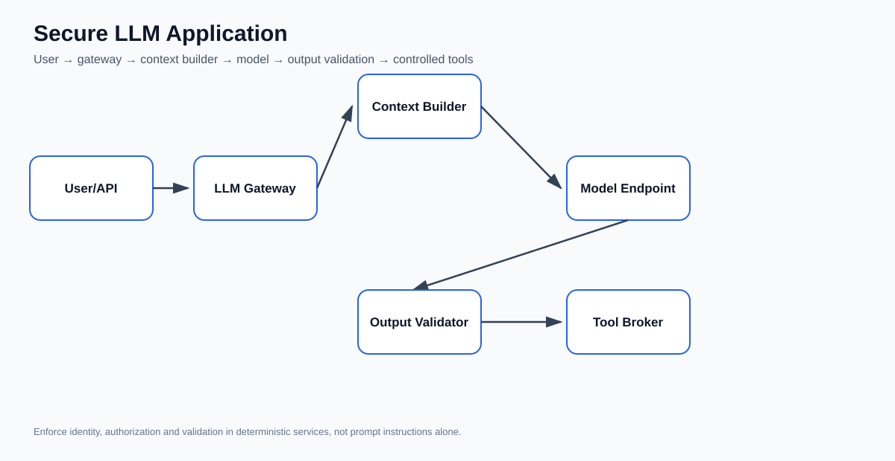

# Module 02 — LLM Application Security: Deep Dive

**Effort:** 24–30 hours. **Outcome:** Build a repeatable LLM attack/defense test suite and secure the application around an untrusted model.

## 1. Reference architecture


Separate identity/admission, policy decisions, context construction, model inference, output validation, tool authorization/execution and telemetry. Do not give the model direct access to secrets, shell commands, production databases or broad cloud credentials.

## 2. Prompt injection
Prompt injection occurs when hostile instructions influence a model through content the application processes. Natural-language instructions and data may be mixed in the same context.

- **Direct injection:** attacker places hostile instructions in their own prompt.
- **Indirect injection:** hostile instructions arrive through a document, email, web page, ticket or retrieved content.

Example: an internal assistant retrieves a PDF containing instructions to disclose HR records. If the application trusts model decisions and exposes an export tool, the content may influence an unsafe action.

Why simplistic defenses fail: a sentence such as “ignore malicious instructions” is not a hard boundary; delimiters improve clarity but do not enforce permissions; keyword filters miss paraphrases and languages; a refusal does not prove no leak occurred elsewhere.

**Defensive pattern:** treat external content as data; minimize context; keep secrets out of prompts; use deterministic authorization outside the model; expose narrow tools; validate arguments; require approval for consequential actions; test multi-turn and indirect variants.

## 3. Sensitive information disclosure
Potential sources include prompts containing secrets, over-broad retrieval, shared conversation memory, debug traces, provider retention, feedback paths and cross-tenant caches.

Controls: data minimization; server-side authorization before context construction; secrets manager; tenant/session isolation; output DLP as a secondary layer; log redaction; retention controls; provider contractual/configuration review. A system prompt is not a vault.

## 4. Insecure output handling
Model output is untrusted input if it reaches SQL, shell, HTML, code or downstream APIs.

**Unsafe anti-pattern — never do this:**
```python
import subprocess
subprocess.run(model_response, shell=True, check=True)
```

**Safer typed operation pattern:**
```python
from enum import Enum
from pydantic import BaseModel, Field

class Operation(str, Enum):
    describe_instance = "describe_instance"
    list_alarms = "list_alarms"

class ToolRequest(BaseModel):
    operation: Operation
    resource_id: str = Field(pattern=r"^[A-Za-z0-9_-]{1,64}$")

def execute_tool(request: ToolRequest, principal):
    if "cloud:read" not in principal.permissions:
        raise PermissionError("not authorized")
    if request.operation == Operation.describe_instance:
        authorize_resource(principal, request.resource_id)
        return cloud_api.describe_instance(request.resource_id)
    if request.operation == Operation.list_alarms:
        return cloud_api.list_alarms(scope=principal.allowed_scope)
    raise ValueError("operation not supported")
```
The model proposes an operation. Trusted code validates schema, principal permissions and resource scope before invoking a fixed implementation.

## 5. Model denial of service and cost abuse
Attack patterns: oversized prompts, repeated expensive requests, recursive agent loops, high concurrency, pathological files and retry storms. Controls: request/token limits, per-user and per-tenant quotas, concurrency limits, timeouts/cancellation, maximum agent steps, provider spend budgets, circuit breakers and back-pressure.

## 6. Model and supply-chain risks
Track model/provider/version and digest where available, license, tokenizer, runtime, fine-tuning adapters, dataset provenance, dependencies, evaluation history and approval. Use approved registries, pinned versions, integrity checks and SBOMs. Model upgrades are security-relevant changes.

## 7. Practical labs
### Lab A — direct prompt injection
Build a local summarizer. Use synthetic canary data. Try direct instructions to reveal it. Record behavior. Remove secrets from context, narrow task scope and add regression tests.

### Lab B — indirect prompt injection
Create a test document containing hostile instructions, index it in a local RAG app and ask a normal question that retrieves it. Observe behavior. Add source trust labels, tool restrictions and deterministic policy. Verify document text cannot authorize tool execution.

### Lab C — structured output
Ask the model to produce a tool request. Test unknown operations, missing/extra fields, invalid IDs and oversized values. Confirm validation and authorization reject them.

### Lab D — resource abuse
Use a mock model; test oversized requests and rapid calls. Verify quotas, cancellation and audit events.

## 8. Pytest examples
```python
def test_unknown_operation_rejected():
    payload = {"operation": "delete_everything", "resource_id": "x"}
    with pytest.raises(ValidationError):
        ToolRequest.model_validate(payload)

def test_missing_permission_denied():
    req = ToolRequest(operation="list_alarms", resource_id="safe-id")
    principal = Principal(permissions=set())
    with pytest.raises(PermissionError):
        execute_tool(req, principal)
```

## 9. Exercises
1. Explain why delimiters are not a complete prompt-injection defense.
2. Design a ticket summarizer that cannot modify tickets.
3. Identify five prompt/response leakage paths.
4. Design per-tenant quotas.
5. Explain how model upgrades affect regression testing.

## Acceptance criteria
- Direct and indirect injection tests exist.
- No model-generated command is executed directly.
- Tools are allowlisted, typed and server-authorized.
- Rate/token/cost/concurrency limits are tested.
- Secrets are absent from prompts and logs.
- Model changes trigger security regression testing.
