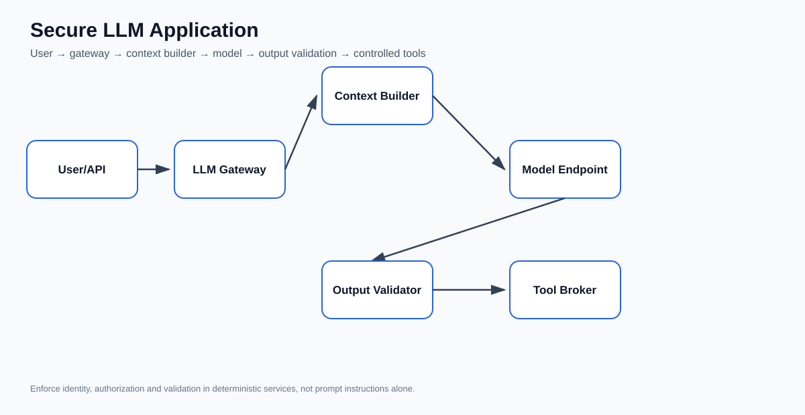
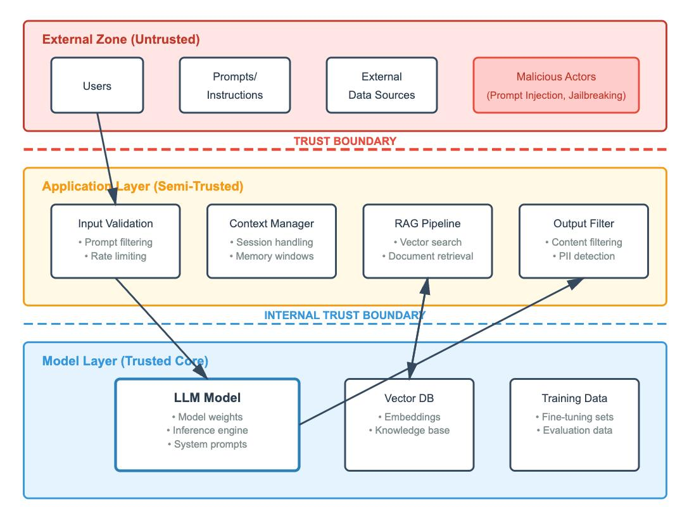
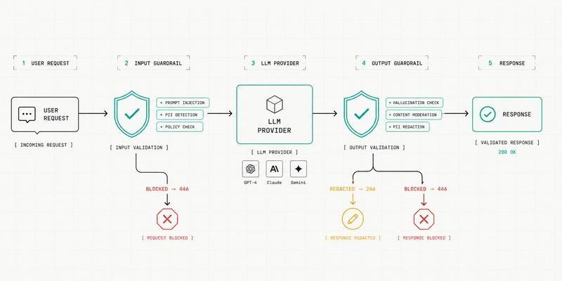
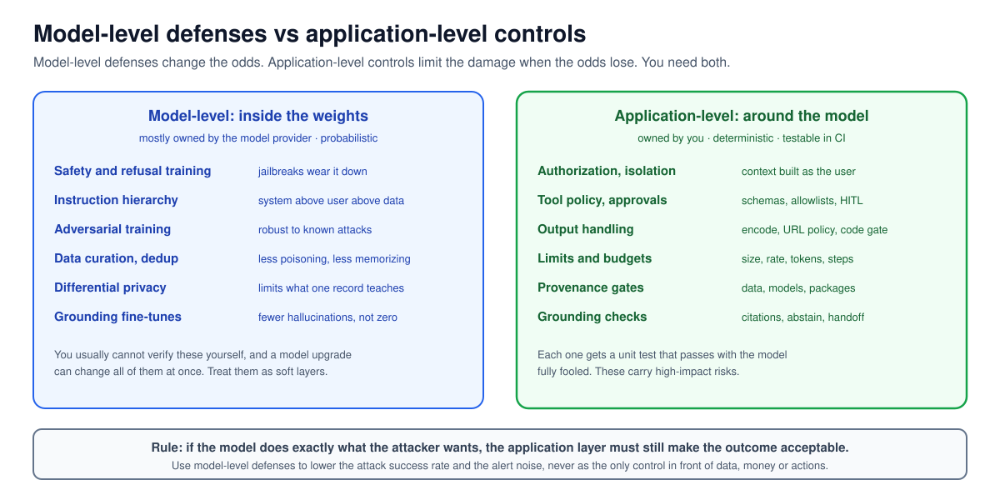

# Module 02 · LLM Application Security

> **Weeks:** 5–8 · **Time:** ~40 hours · **Phase 2 gate** at the end of week 8
> **Outcome:** you can attack an LLM application and its model in all 12 roadmap scenarios (injection, jailbreak, leakage, output handling, poisoning, DoS, supply chain, agency, theft, unsafe code), defend it with controls that hold *even when the model is fooled*, and prove it with an automated red-team suite aligned to the OWASP AI Testing Guide that runs in CI.

---

## 1. What this module is and why it matters

A large language model (LLM) is a text predictor. It reads one stream of tokens and writes the most likely continuation. It has **no built-in idea of who is allowed to do what**. It cannot reliably tell your instructions from a stranger's, it repeats whatever is in its context, and it behaves a little differently every time.

That is fine for a toy. It is a problem as soon as an application gives the model **private data**, **tools** or a **public audience**. Then the model's weaknesses become your application's vulnerabilities: leaked customer data, unauthorized actions, brand damage, surprise bills.

This module teaches one idea from five angles:

> **Assume the model will be fooled. Put the security in deterministic code before and after it, and prove it with tests.**

Everything later in the program builds on it: RAG (Module 03), MCP (Module 04) and agents (Module 05) are all "an LLM app with more data and more tools".

---

## 2. Learning path

| # | Lesson | Weeks | You will build | Main OWASP 2026 risks |
|---|---|---|---|---|
| 1 | [Prompt injection](prompt-injection/) | 5 | An inbox assistant hijacked by direct and indirect injection, then fixed with tool policy, spotlighting and an output guard; cross-modal injection explained | LLM01, LLM03, LLM08 |
| 2 | [Jailbreaks and guardrails](jailbreak/) | 6 | A public chatbot broken by role-play, encoding, many-shot and multi-turn attacks, then wrapped in input, session, output and policy guardrails | LLM01 |
| 3 | [Data leakage, hidden context and output handling](data-leakage/) | 6–7 | A multi-user assistant leaking across users, caches, logs and markdown images, then fixed with isolation, redaction, URL allowlisting and escaping | LLM02, LLM08, LLM10 |
| 4 | [Security testing and red teaming](security-testing/) | 7–8 | A YAML-driven red-team harness aligned to the OWASP AI Testing Guide, with N runs, attack success rates, a report and a CI gate, plus rate limits, budgets and loop guards | LLM06 + regression for all |
| 5 | [Model threats](model-threats/) | 7–8 | A backdoor planted through training data, a model copied through its API, a hallucinating help desk, a booby-trapped model file and unsafe AI-written code, each stopped by a provenance, API, grounding, AI-BOM or code gate | LLM04, LLM05, LLM06, LLM07, LLM10 |

Weeks 7–8 run lessons 4 and 5 side by side: lesson 4 builds the testing machine, lesson 5 adds the model-level attacks it must also cover. Each lesson has the same shape: why it matters → understand it → defend it → hands-on lab (vulnerable vs secure, switchable layers, impact-based tests) → real-world scenarios → interview questions → checklist. Run all labs at once with:

```powershell
python -m pytest 02-llm-security
```

---

## 3. Architecture overview


A secure LLM application separates responsibilities into components that **do not trust the model**:

| Component | Job | Lessons |
|---|---|---|
| **Identity and admission (gateway)** | Who is calling? Size limits, rate limits, token and query budgets | Security testing (LLM06), model threats (extraction) |
| **Policy decisions** | What may this user and this task do? Which tools, which data? | Prompt injection |
| **Context builder** | Load only what this user may see; mark untrusted content as data | Data leakage, prompt injection |
| **Model inference** | Generate text. Treated as untrusted, possibly compromised | All |
| **Output validation** | Moderation, business-policy checks, DLP, URL policy, encoding for the sink, grounding and citation checks, code gate | Jailbreak, data leakage, model threats |
| **Model supply and training pipeline** | Data provenance and validation, release gates, AI-BOM, pinned and hashed model files | Model threats (deep dive in Module 06) |
| **Tool broker** | Typed schemas, allowlists, server-side authorization, human approval | Prompt injection (deep dive in Modules 04–05) |
| **Telemetry** | Redacted logs, security events, canaries, cost monitoring | All |



The same idea drawn as **trust zones**: the user, external content and the model's output are untrusted; enforcement lives in the application zone around the model.



And as **guardrails** on the way in and on the way out:



---

## 4. OWASP Top 10 for LLM Applications (2026): where each risk is covered

The OWASP list is a **taxonomy**, not a threat model. Use it to check coverage, then threat-model your own system (Module 01). OWASP released the 2026 edition in August 2026; several risks moved. The 2025 ID is in brackets. (Verify the current list at https://genai.owasp.org/.)

| 2026 ID | Risk | In one sentence | Where it is covered |
|---|---|---|---|
| LLM01 (was LLM01) | Prompt Injection | Untrusted input changes what the model does; includes jailbreaks and, in 2026, cross-modal injection (images, audio) | [prompt-injection](prompt-injection/) (§2.6 cross-modal), [jailbreak](jailbreak/); documents in [03 · document-security](../03-rag-security/document-security/) |
| LLM02 (was LLM02) | Sensitive Information Disclosure | Private data reaches someone who should not see it; 2026 adds reasoning traces, logs, embeddings and side channels | [data-leakage](data-leakage/); over-broad retrieval in [03 · access-control](../03-rag-security/access-control/) |
| LLM03 (was LLM06) | Excessive Agency | The model has more tools, permissions or autonomy than the task needs | [prompt-injection](prompt-injection/) (tool policy); [05 · permissions](../05-agent-security/permissions/), [05 · sandboxing](../05-agent-security/sandboxing/) |
| LLM04 (was LLM03) | Supply Chain | A model, adapter, dataset, package or plugin you depend on is malicious, vulnerable or changed | [model-threats](model-threats/) part D (AI-BOM loader); [06 · AI DevSecOps](../06-ai-devsecops/); MCP servers in [04](../04-mcp-security/) |
| LLM05 (was LLM04) | Data and Model Poisoning | Training, fine-tuning or retrieval data is manipulated to plant backdoors or bias | [model-threats](model-threats/) part A (provenance and validation gate); RAG poisoning in [03 · document-security](../03-rag-security/document-security/) |
| LLM06 (was LLM10) | Unbounded Consumption | Uncontrolled use of compute, money or capacity, including model extraction by mass querying | [security-testing](security-testing/) (`limits.py`); extraction in [model-threats](model-threats/) part B |
| LLM07 (was LLM09) | Misinformation | Wrong but convincing output, and people or systems trusting it too much | [model-threats](model-threats/) part C (grounding and citation checks); [prompt-injection](prompt-injection/) scenario C |
| LLM08 (was LLM07 System Prompt Leakage) | Hidden Context Exposure | System prompts, tool schemas, policy logic and workflow rules leak, and with them any secrets or security logic | [data-leakage §2.3](data-leakage/), [prompt-injection](prompt-injection/) |
| LLM09 (was LLM08) | Vector and Embedding Weaknesses | Weaknesses in how embeddings are stored, shared and retrieved | [03 · vector-db-security](../03-rag-security/vector-db-security/), [03 · access-control](../03-rag-security/access-control/) |
| LLM10 (was LLM05) | Improper Output Handling | Model output is trusted by a browser, database, shell or API; 2026 adds insecure AI-generated code | [data-leakage §2.5](data-leakage/); [model-threats](model-threats/) part E (code gate); [04 · tool-security](../04-mcp-security/tool-security/) |

### Related OWASP lists

The **OWASP Top 10 for Agentic Applications** (ASI01–ASI10, published December 2025) and the **OWASP MCP Top 10** (beta) describe the same weaknesses once the model has tools and autonomy. Module 02 introduces them; Modules 04 and 05 go deep.

| Agentic (ASI) | Closest LLM 2026 risk | Where in Module 02 |
|---|---|---|
| ASI01 Agent Goal Hijack | LLM01 | [prompt-injection](prompt-injection/) (indirect injection hijacks the task) |
| ASI02 Tool Misuse | LLM03 | [prompt-injection](prompt-injection/) L4 tool policy |
| ASI03 Identity & Privilege Abuse | LLM03 | Module 05 (identity) |
| ASI04 Agentic Supply Chain | LLM04 | [model-threats](model-threats/) part D |
| ASI05 Unexpected Code Execution | LLM10 | [model-threats](model-threats/) part E; Module 05 sandboxing |
| ASI06 Memory & Context Poisoning | LLM01, LLM05 | [data-leakage](data-leakage/) (memory isolation); Module 05 |
| ASI07 Insecure Inter-Agent Communication | LLM01 | Module 05 |
| ASI08 Cascading Failures | LLM06, LLM07 | [security-testing](security-testing/) loop guards; [model-threats](model-threats/) misinformation |
| ASI09 Human-Agent Trust Exploitation | LLM07 | [model-threats](model-threats/) part C (overreliance, handoff) |
| ASI10 Rogue Agents | LLM03 | Module 05 (monitoring, kill switch) |

| MCP Top 10 | Where in Module 02 |
|---|---|
| MCP01 Token Mismanagement & Secret Exposure | [data-leakage](data-leakage/) (no secrets in prompts or logs) |
| MCP03 Tool Poisoning, MCP06 Prompt Injection via Contextual Payloads | [prompt-injection](prompt-injection/) (indirect injection, tool policy) |
| MCP04 Software Supply Chain Attacks & Dependency Tampering | [model-threats](model-threats/) part D |
| MCP05 Command Injection & Execution | [data-leakage §2.5](data-leakage/), [model-threats](model-threats/) part E |
| MCP10 Context Injection & Over-Sharing | [data-leakage](data-leakage/) (minimal context) |
| MCP02, MCP07, MCP08, MCP09 (scopes, authN/Z, audit, shadow servers) | Module 04 |

---

## 5. The 12 LLM attack scenarios, and model-level vs app-level defenses

Your roadmap lists 12 attack scenarios every LLM security engineer should be able to run and defend. Here is where each one is practiced, and which layer carries the main defense.

| # | Scenario | OWASP 2026 | Lab (vulnerable → secure) | Main defense layer |
|---|---|---|---|---|
| 1 | Direct prompt injection | LLM01 | [prompt-injection](prompt-injection/) `direct_*` | App: least privilege, output guard |
| 2 | Indirect prompt injection | LLM01 | [prompt-injection](prompt-injection/) `indirect_*` | App: tool policy, taint, spotlighting |
| 3 | System prompt leakage / hidden context exposure | LLM08 | [data-leakage](data-leakage/) `system_prompt_leak` | App: nothing secret in the prompt or tool schemas |
| 4 | Jailbreak | LLM01 | [jailbreak](jailbreak/) | Both: model safety training + app guardrails |
| 5 | Sensitive information disclosure | LLM02 | [data-leakage](data-leakage/) | App: authorization before context, DLP |
| 6 | Insecure output handling | LLM10 | [data-leakage](data-leakage/) `xss_in_output`, `markdown_image_exfil` | App: encode at the sink, URL policy |
| 7 | Training data poisoning | LLM05 | [model-threats](model-threats/) part A | Pipeline: provenance, validation, release gate |
| 8 | Model DoS | LLM06 | [security-testing](security-testing/) `dos_*` | App: size, rate, budget, step limits |
| 9 | Supply chain | LLM04 | [model-threats](model-threats/) part D | Pipeline: AI-BOM, digest, safe formats |
| 10 | Excessive agency | LLM03 | [prompt-injection](prompt-injection/), [security-testing](security-testing/) `agency_*` | App: tool allowlists, approval |
| 11 | Model theft | LLM06 | [model-threats](model-threats/) part B | App: budgets, labels only, detection, watermark |
| 12 | Untrusted code execution | LLM10 | [model-threats](model-threats/) part E | App: code gate, review, sandbox |



**Model-level defenses** live inside the weights: safety and refusal training, instruction hierarchy, adversarial training, data curation, differential privacy. They are mostly owned by the model provider, they are probabilistic, and a model upgrade can change all of them at once. **Application-level controls** live around the model: authorization, tool policy, output encoding, limits, provenance gates, grounding checks. You own them, they are deterministic, and you can prove them with a unit test that passes while the model is fully fooled.

The rule for this whole module: **use model-level defenses to lower the attack success rate and the noise; put application-level controls in front of anything high-impact.** Scenarios 7, 9 and 11 add a third place to defend: the **pipeline** that builds and ships the model (data gates, AI-BOM, release gates), covered in [model-threats](model-threats/) and Module 06.

---

## 6. Key concepts glossary

| Term | Meaning |
|---|---|
| **Token / context window** | The units a model reads and writes; the context window is everything the model sees in one call (system prompt, history, documents, tool results). |
| **System prompt** | Developer instructions placed before the conversation. A *request* to the model, not an enforced rule. Assume it can be extracted. |
| **Prompt injection (direct / indirect)** | Untrusted text that changes the app's behavior. Direct: typed by the user. Indirect: hidden in content the app reads (email, web, documents). |
| **Jailbreak** | Input that bypasses the model's safety training or the operator's content policy. |
| **Refusal training / RLHF** | Fine-tuning (including reinforcement learning from human feedback) that teaches a model to refuse some requests. Statistical, not a rule. |
| **Guardrail** | A control around the model: input classifier, output moderation, policy check, tool policy. |
| **Hard vs soft control** | Hard: deterministic code that holds when the model is fooled (schemas, allowlists, authorization, isolation). Soft: probabilistic (prompts, classifiers, refusals). |
| **Spotlighting / datamarking** | Marking untrusted text so the model is more likely to treat it as data. Soft. |
| **Lethal trifecta** | Private data + untrusted content + an external channel. With all three, an injection can steal data. |
| **Canary** | A unique fake secret planted where real secrets would be. If it shows up anywhere unexpected, you have proven a leak. |
| **Exfiltration channel** | A way data leaves: response text, markdown image, link, tool call, log. |
| **DLP / PII** | Data loss prevention: detecting and redacting sensitive data. Personally identifiable information: data about a person. |
| **Improper output handling** | Trusting model output at a sink (HTML, SQL, shell, URL fetch) without encoding or validation. |
| **Many-shot / Crescendo / GCG** | Jailbreak families: many fake examples in one prompt; slow multi-turn escalation; optimized adversarial suffixes. |
| **Red teaming** | Adversarial testing of the whole system, led by realistic threats and judged by impact. |
| **ASR (attack success rate)** | Successes divided by attempts for an attack, over N runs. Reported with a confidence bound. |
| **False-refusal rate** | How often legitimate requests are blocked. The cost side of every guardrail. |
| **LLM-as-judge** | Using a model to grade outputs. Useful for fuzzy harms, but it can be wrong and can be injected. |
| **Denial of wallet** | Attacks that make you pay: token floods, loops, stolen keys. Part of LLM06:2026 (LLM10:2025). |
| **Hidden context** | Everything the app sends the model but hides from users: system prompt, tool schemas, policy logic, workflow rules. Assume it leaks (LLM08:2026). |
| **Cross-modal injection** | Instructions hidden in an image, audio or other non-text input that a multimodal model then follows. |
| **Data poisoning / backdoor** | Manipulated training or retrieval data; a backdoor is a hidden rule that fires only on a secret trigger. |
| **Provenance** | Verifiable evidence of where data or a model came from and that it has not changed (source + digest + signature). |
| **Model extraction / distillation** | Copying a model's behavior by training a "student" on its API answers. Measured as fidelity. |
| **Watermark (model output)** | A secret, deliberate pattern in some answers that lets you recognize a copied model later. Evidence, not prevention. |
| **Hallucination / overreliance** | Confident, wrong output, and people or systems trusting it without checks (LLM07:2026). |
| **Grounding** | Answering only from retrieved, approved sources, with citations that are checked. |
| **Slopsquatting** | Registering a package name that code models tend to invent, so `pip install` pulls the attacker's code. |
| **AITG** | OWASP AI Testing Guide: test IDs such as AITG-APP-01 (prompt injection) used to plan and report AI tests. |
| **AI-BOM** | An inventory of models, datasets, adapters and dependencies, with exact versions, digests, publishers and approvals. |

---

## 7. How the lessons connect

1. **Prompt injection (week 5)** shows the root cause: one token stream, no boundary between instructions and data. The answer is to limit what a fooled model can *do*: least privilege, tool policy outside the model, output guards.
2. **Jailbreaks (week 6)** show that the model's *safety* is also soft. You cannot patch refusal training, so you surround it: input and session checks, output moderation, and business rules in code.
3. **Data leakage (weeks 6–7)** asks what a fooled or over-helpful model can *reveal*, and through which channels: memory, caches, logs, the system prompt, rendered images and HTML. The answer is authorization before context construction, and encoding at every output sink.
4. **Security testing (weeks 7–8)** turns every attack from the first three lessons into data, runs it many times, measures success rates and blocks releases that regress, using the OWASP AI Testing Guide's test IDs and the audit expectations in CERT-In's guidelines. It also adds the LLM06:2026 controls: size, rate, budget and loop limits.
5. **Model threats (weeks 7–8)** moves from the application to the model itself: what it learned (poisoning), who can copy it (extraction), whether its answers can be trusted (misinformation), where its files come from (supply chain), and what happens to the code it writes. The answer is a gate at the stage where each attack enters.

The labs share a pattern you will reuse in every later module: a **vulnerable** app with `VULN` comments, a **secure** app with **switchable layers**, **attacks** as data, a **demo** scorecard, and **tests that assert impact** and prove each hard layer holds alone.

---

## 8. Module mini-project: "SecureAssist" (Phase 2 gate, week 8)

Combine the four labs into one small, secure support assistant. Keep it offline with `MockLLM` (optionally test against Ollama).

**Requirements**

1. **Tools (LLM03:2026):** a `lookup_order` tool and a `send_reply` tool. Typed schemas, per-task allowlists, server-side authorization, and human approval for `send_reply` when untrusted content is in context.
2. **Injection and jailbreak guardrails (LLM01:2026):** spotlighting for documents; input and session scoring; output moderation; business-policy checks (prices from a catalog, no promises, no regulated advice).
3. **Data protection (LLM02, LLM10, LLM08 in 2026):** no secrets in prompts; per-user memory and cache keys; ownership-aware DLP; URL allowlist; HTML escaping; redacted, pseudonymized logs; a `forget(user)` function.
4. **Consumption limits (LLM06:2026):** input size, per-user rate limit, per-user token budget, max tool steps with repeat detection.
5. **Red-team suite:** at least 20 YAML cases covering LLM01, LLM02, LLM03, LLM06, LLM08 and LLM10 (2026 IDs), each with an AITG test ID, including at least 2 indirect, 2 multi-turn and 4 benign cases. Gate in CI with N ≥ 10.
6. **Supply chain (LLM04:2026):** an `inventory.yaml` (AI-BOM) listing the model (provider, ID, exact version, digest where available), Python dependencies with pinned versions, and who approved each; the app refuses to start with an unlisted model.
7. **Trust in answers (LLM07:2026):** policy answers come only from approved documents with verified citations; unverifiable answers abstain and hand off.
8. **Documentation:** a one-page threat model (data-flow diagram with trust boundaries), and one design decision record (for example "why the reply tool needs approval").

**Acceptance criteria**

- [ ] Direct, indirect and multi-turn attack tests exist and assert **impact**.
- [ ] No model-generated command, SQL or URL is executed or fetched without validation.
- [ ] Tools are allowlisted, typed and authorized server-side.
- [ ] Rate, token, size and step limits are tested with a fake clock or small limits.
- [ ] Canaries never appear in other users' responses, in logs, or in rendered URLs.
- [ ] Every hard control has a test that passes with the soft layers switched off.
- [ ] The red-team gate exits non-zero when you re-introduce one vulnerability (try it).
- [ ] False-refusal rate on benign cases is measured and below your threshold.
- [ ] Prompt and model versions are recorded, and a fallback to another model or provider keeps every control (no "degraded mode" without guardrails).
- [ ] Secrets are absent from prompts *and* logs; a model change triggers the security regression suite.

**Warm-up exercises** (from the original module notes, still worth doing in your journal):

1. Explain in five sentences why delimiters are not a complete prompt-injection defense.
2. Design a ticket summarizer that *cannot* modify tickets, whatever the ticket text says.
3. List five different paths through which a prompt or a response can leak.
4. Design per-tenant quotas for a SaaS with free, pro and enterprise plans.
5. Explain how a model upgrade should flow through your regression tests before production.

---

## 9. Cross-cutting interview questions (system design)

<details><summary><b>Q1. Design an enterprise "LLM gateway" that all internal teams must use. What does it enforce?</b></summary>

A central service between applications and model providers:
- **Identity:** every call carries the app identity and the end-user identity; no shared anonymous keys.
- **Admission control:** input size limits, per-app/per-user/per-tenant rate limits and token budgets, concurrency limits, spend alerts.
- **Data protection:** secret and PII detection on prompts (block or redact by policy), provider routing by data classification (e.g. confidential data only to approved providers with suitable retention terms).
- **Safety:** optional input/output moderation as shared services, so every app gets the same baseline.
- **Telemetry:** redacted logs, security events, canary detection, cost dashboards per team.
- **Governance:** model allowlist with versions (AI-BOM), and a required red-team gate before a new model is enabled.

What it must *not* do: hold app-specific authorization. Tool and data authorization stay in each app, close to the data.
</details>

<details><summary><b>Q2. Walk through a customer-support LLM app's request path and place each OWASP LLM risk on it.</b></summary>

Using 2026 IDs: user → **gateway** (LLM06 limits) → **context builder** loads memory, documents and tool results (LLM02 over-broad context, LLM01 indirect injection, LLM05/LLM09 poisoned or mis-scoped retrieval, LLM08 secrets in hidden context) → **model** (LLM01 direct injection and jailbreaks, LLM07 hallucination; LLM04/LLM05 if the model or its supply chain is compromised) → **tool broker** (LLM03 excessive agency) → **output handling** (LLM10 XSS/SQL/SSRF and unsafe generated code, LLM02 exfiltration through URLs) → UI. For each point I would name one hard control and one test.
</details>

<details><summary><b>Q3. What is the difference between hard and soft controls, and how do you decide where to invest?</b></summary>

Hard controls are deterministic code that holds even if the model is fully fooled: authorization, schemas, allowlists, isolation, encoding, limits. Soft controls change probabilities: prompts, spotlighting, classifiers, refusal training. Invest in hard controls for anything with **high impact** (data exposure, actions, money); use soft controls to reduce noise, catch fuzzy harms and generate alerts. A good test: "if the model does exactly what the attacker wants, what is the worst outcome?" If the answer is unacceptable, you need a hard control there.
</details>

<details><summary><b>Q4. A team wants to fine-tune a model on two years of support tickets to "make it smarter". What do you review?</b></summary>

- **Data:** tickets contain PII and possibly secrets. Models can memorize and later reveal training data (LLM02), and deletion from weights is not reliable. Minimize, scrub and deduplicate; get a privacy assessment and a lawful basis.
- **Alternative:** often RAG with access control gives the same benefit, can be filtered per user and supports deletion.
- **Poisoning (LLM05:2026):** can customers influence ticket text? Then they can influence the model. Review and filter training data.
- **Supply chain (LLM04:2026):** where is training done, who holds the weights, how are adapters versioned and approved?
- **Evaluation:** run the red-team suite and a memorization test with planted canaries before and after.
</details>

<details><summary><b>Q5. Design tenant isolation for a multi-tenant LLM SaaS.</b></summary>

Tenant ID comes from authentication, never from the prompt or model output. Isolate every store: conversation memory, caches (keys include tenant and user), vector indexes or mandatory tenant filters enforced server-side, file storage, logs (tenant-scoped access). Limits per tenant (rate, budget). Separate encryption keys for high-tier tenants if required. Prove it with cross-tenant canary tests in CI and canary monitoring in production. The model is shared; the **context** never is.
</details>

<details><summary><b>Q6. How would you evaluate and choose a guardrail product (e.g. a prompt-attack classifier or moderation API)?</b></summary>

Test it on **your** traffic with **your** harness: attack success rate reduction per category (including multi-turn and indirect cases), false-refusal rate on real benign samples, languages you support, latency and cost per call, deployment model (data leaves your boundary?), explainability of decisions, configurability, and update cadence. Then place it correctly: as a soft layer that reduces risk and creates signals, never as the only control in front of a high-impact action.
</details>

<details><summary><b>Q7. Why is a model upgrade a security change, and what process do you put around it?</b></summary>

Behavior of every soft layer changes: refusal patterns, instruction following, susceptibility to known attacks, even output format, which can break validators. Process: the model ID and version are in the AI-BOM; an upgrade is a change request; the full red-team suite and functional evals run on the new version; results are compared with the previous version's per-category ASR and false-refusal rate; regressions block rollout or need explicit risk acceptance; rollout is staged with monitoring and a rollback plan.
</details>

<details><summary><b>Q8. Design an LLM assistant for a regulated domain (e.g. health or finance information). How do you handle misinformation and overreliance (LLM07:2026)?</b></summary>

Answer only from vetted, retrieved sources and show citations; refuse or hand off to a human for personal advice; deterministic policy checks for prohibited content (dosages, "you should invest"); a UI that shows sources and uncertainty and avoids "authoritative" styling; logging for audit; a known-answer evaluation set that runs in CI; and a clear statement that the assistant is not a professional. Legal and compliance review the refusal and hand-off behavior.
</details>

<details><summary><b>Q9. Incident: an executive's AI email assistant sent a confidential document to an external address. How do you investigate?</b></summary>

1. **Contain:** disable the send tool or the assistant for affected users; revoke tokens if needed.
2. **Collect:** the tool-call log (recipient, arguments, time), the full redacted context of that session, the emails and documents that were in context.
3. **Classify the cause:** indirect prompt injection in an incoming email? Excessive agency (send without approval)? Bad output handling? A human approving a misleading summary?
4. **Scope:** search logs for similar tool calls and for the same payload in other mailboxes.
5. **Notify:** privacy/legal (data breach rules), the document owner.
6. **Fix:** hard controls first (recipient allowlist or approval showing the exact recipient and attachment, taint tracking after untrusted content), then detection; add the payload to the regression suite.
</details>

<details><summary><b>Q10. You are the first AI security engineer at a company with 15 LLM features. How do you measure and improve posture across all of them?</b></summary>

1. **Inventory:** every AI feature, its model, data classes, tools and audience (AI-BOM + risk tier).
2. **Baseline:** a shared red-team harness and attack library; each feature gets a suite tied to its threat model, with ASR and false-refusal metrics.
3. **Paved road:** a gateway and shared libraries (limits, DLP, URL policy, tool policy) so teams get hard controls by default.
4. **Gates:** red-team results required in CI and before model upgrades; thresholds by risk tier.
5. **Metrics:** ASR by category per feature, coverage of OWASP risks, incidents and time to fix, percentage of features on the paved road.
6. **People:** design-review checklist (lethal trifecta, hard vs soft), training, and periodic human red-team exercises for high-risk features.
</details>

---

## 10. References

- OWASP Top 10 for LLM Applications 2026 (released August 2026; verify current IDs): https://genai.owasp.org/llm-top-10/
- OWASP Top 10 for Agentic Applications (2026): https://genai.owasp.org/
- OWASP MCP Top 10 (beta): https://owasp.org/www-project-mcp-top-10/
- OWASP AI Testing Guide v1.0: https://owasp.org/www-project-ai-testing-guide/
- OWASP GenAI Security Project (including the *GenAI Red Teaming Guide*): https://genai.owasp.org/
- MITRE ATLAS (adversarial threat landscape for AI systems): https://atlas.mitre.org/
- NIST AI Risk Management Framework 1.0: https://www.nist.gov/itl/ai-risk-management-framework
- NIST AI 600-1, *Generative AI Profile* (2024): https://doi.org/10.6028/NIST.AI.600-1
- UK NCSC, CISA and partners, *Guidelines for secure AI system development* (2023): https://www.ncsc.gov.uk/collection/guidelines-secure-ai-system-development
- Google, *Secure AI Framework (SAIF)*: https://safety.google/cybersecurity-advancements/saif/
- Simon Willison's writing on prompt injection and the lethal trifecta: https://simonwillison.net/tags/prompt-injection/
- Lesson-specific references are at the end of each lesson.

---

## 11. Roadmap coverage

How this module covers the "Phase 2: LLM Security" topics and the LLM attack scenarios in your roadmap.

| Roadmap topic | Where it is covered |
|---|---|
| Direct and indirect prompt injection | [prompt-injection](prompt-injection/) (lab, §2.2), cross-modal in §2.6 |
| Jailbreaking and system prompt extraction | [jailbreak](jailbreak/); extraction in [data-leakage §2.3](data-leakage/) |
| Sensitive information disclosure | [data-leakage](data-leakage/) (lab, §2.2, DSGAI view §2.7) |
| Insecure output handling (incl. AI-generated code) | [data-leakage §2.5](data-leakage/); [model-threats](model-threats/) part E |
| Training data poisoning | [model-threats](model-threats/) §2.2 and lab part A |
| Model denial of service | [security-testing §2.5](security-testing/) and `limits.py` |
| Model theft and extraction | [model-threats](model-threats/) §2.3 and lab part B |
| Hallucination and trust-boundary risks | [model-threats](model-threats/) §2.5 and lab part C |
| Supply chain | [model-threats](model-threats/) §2.6 and lab part D; Module 06 |
| Excessive agency | [prompt-injection](prompt-injection/) L4; [security-testing](security-testing/) `agency_*` |
| Hidden context exposure (tool schemas, policy logic) | [data-leakage §2.3](data-leakage/) |
| OWASP Top 10 for LLM (2026) + Agentic + MCP | §4 above |
| The 12 attack scenarios; model-level vs app-level defenses | §5 above |
| Hands-on: build a vulnerable LLM app, exploit it, mitigate it | Every lesson's lab, and the SecureAssist mini-project (§8) |
| Automated LLM security tests (skills matrix) | [security-testing](security-testing/) (harness, CI gate, AITG IDs) |
| Tools: PyRIT, Garak, Promptfoo, DeepEval | [security-testing §2.6](security-testing/) and Step 6 (optional) |

## 12. Further reading from your library

- **OWASP AI Testing Guide v1.0:** read the principles (§1.2), the threat-driven methodology (§1.3), then AITG-APP-01, -02, -07, -09, -11, -13, AITG-MOD-03 and AITG-INF-01, -02, -05, -06. Compare each "how to test" section with our YAML cases.
- **AI Red Team practical notes: AI Security Basics & OWASP Top 10 for LLM Apps:** the core concepts part (tokens, weights, training stages, model file formats), the "understand your access level" table and the final pentest flow. It uses 2025 numbering.
- **OWASP GenAI Data Security Risks and Mitigations 2026:** DSGAI01, 11, 14 and 15 for data leakage; DSGAI04 (poisoning), DSGAI20 (model exfiltration, with tiered controls) and DSGAI21 (disinformation) for model threats.
- **OWASP GenAI Data Security Best Practices v2.0 (Part 1):** classification that follows data into chunks, embeddings and logs, and deletion paths for every derivative.
- **CERT-In AI Security Auditing Guidelines v1.0:** §5.5 (testing intensity by risk tier), §9.3–9.4 (generative AI controls and auditor checklist), §10.4 (AI-specific VAPT categories), §10.5 (SOC detection rules), §12.1 (finding severity).
- **ISC2 AI Security study guide (pilot exam, v1.0):** Domain 6, especially 6.1 (adversarial ML attacks by lifecycle stage), 6.3 (provenance and AIBOM), 6.4 (what to test per system type) and 6.5 (triage, vulnerability vs model limitation, evidence). It is a community guide, not an official ISC2 text.
- **The AI Security Glossary:** a quick check of terms before interviews.

---

**Courses for this module (KodeKloud / Udemy):** see [00-program/learning-resources.md](../00-program/learning-resources.md).
