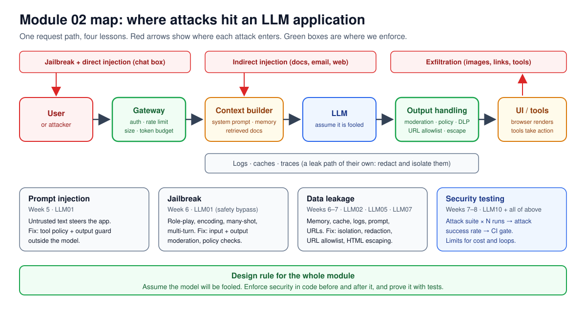

# Module 02 · LLM Application Security

> **Weeks:** 5–8 · **Time:** ~40 hours · **Phase 2 gate** at the end of week 8
> **Outcome:** you can attack an LLM application four different ways, defend it with controls that hold *even when the model is fooled*, and prove it with an automated red-team suite that runs in CI.

---

## 1. What this module is and why it matters

A large language model (LLM) is a text predictor. It reads one stream of tokens and writes the most likely continuation. It has **no built-in idea of who is allowed to do what**. It cannot reliably tell your instructions from a stranger's, it repeats whatever is in its context, and it behaves a little differently every time.

That is fine for a toy. It is a problem as soon as an application gives the model **private data**, **tools** or a **public audience**. Then the model's weaknesses become your application's vulnerabilities: leaked customer data, unauthorized actions, brand damage, surprise bills.

This module teaches one idea from four angles:

> **Assume the model will be fooled. Put the security in deterministic code before and after it, and prove it with tests.**

Everything later in the program builds on it: RAG (Module 03), MCP (Module 04) and agents (Module 05) are all "an LLM app with more data and more tools".

---

## 2. Learning path

| # | Lesson | Weeks | You will build | Main OWASP risks |
|---|---|---|---|---|
| 1 | [Prompt injection](prompt-injection/) | 5 | An inbox assistant hijacked by direct and indirect injection, then fixed with tool policy, spotlighting and an output guard | LLM01, LLM06, LLM07 |
| 2 | [Jailbreaks and guardrails](jailbreak/) | 6 | A public chatbot broken by role-play, encoding, many-shot and multi-turn attacks, then wrapped in input, session, output and policy guardrails | LLM01 |
| 3 | [Data leakage and output handling](data-leakage/) | 6–7 | A multi-user assistant leaking across users, caches, logs and markdown images, then fixed with isolation, redaction, URL allowlisting and escaping | LLM02, LLM05, LLM07 |
| 4 | [Security testing and red teaming](security-testing/) | 7–8 | A YAML-driven red-team harness with N runs, attack success rates, a report and a CI gate, plus rate limits, budgets and loop guards | LLM10 + regression for all |

Each lesson has the same shape: why it matters → understand it → defend it → hands-on lab (vulnerable vs secure, switchable layers, impact-based tests) → real-world scenarios → interview questions → checklist. Run all labs at once with:

```powershell
python -m pytest 02-llm-security
```

---

## 3. Architecture overview



A secure LLM application separates responsibilities into components that **do not trust the model**:

| Component | Job | Lessons |
|---|---|---|
| **Identity and admission (gateway)** | Who is calling? Size limits, rate limits, token budgets | Security testing (LLM10) |
| **Policy decisions** | What may this user and this task do? Which tools, which data? | Prompt injection |
| **Context builder** | Load only what this user may see; mark untrusted content as data | Data leakage, prompt injection |
| **Model inference** | Generate text. Treated as untrusted, possibly compromised | All |
| **Output validation** | Moderation, business-policy checks, DLP, URL policy, encoding for the sink | Jailbreak, data leakage |
| **Tool broker** | Typed schemas, allowlists, server-side authorization, human approval | Prompt injection (deep dive in Modules 04–05) |
| **Telemetry** | Redacted logs, security events, canaries, cost monitoring | All |


The same idea drawn as **trust zones**: the user, external content and the model's output are untrusted; enforcement lives in the application zone around the model.


And as **guardrails** on the way in and on the way out:


---

## 4. OWASP Top 10 for LLM Applications (2025): where each risk is covered

The OWASP list is a **taxonomy**, not a threat model. Use it to check coverage, then threat-model your own system (Module 01).

| ID | Risk | In one sentence | Where it is covered |
|---|---|---|---|
| LLM01 | Prompt Injection | Untrusted input changes what the model does; jailbreaking is treated as a form of it | [prompt-injection](prompt-injection/), [jailbreak](jailbreak/); indirect injection through documents in [03 · document-security](../03-rag-security/document-security/) |
| LLM02 | Sensitive Information Disclosure | Private data reaches someone who should not see it | [data-leakage](data-leakage/); over-broad retrieval in [03 · access-control](../03-rag-security/access-control/) |
| LLM03 | Supply Chain | A model, adapter, dataset, package or plugin you depend on is malicious or vulnerable | [§5 below](#5-the-rest-of-the-owasp-list-in-brief); model provenance and AI-BOM in [06 · AI DevSecOps](../06-ai-devsecops/); third-party MCP servers in [04 · MCP security](../04-mcp-security/) |
| LLM04 | Data and Model Poisoning | Training, fine-tuning or retrieval data is manipulated to change behavior | [§5 below](#5-the-rest-of-the-owasp-list-in-brief); RAG poisoning in [03 · document-security](../03-rag-security/document-security/); dataset provenance in [06 · AI DevSecOps](../06-ai-devsecops/) |
| LLM05 | Improper Output Handling | Model output is trusted by a browser, database, shell or API | [data-leakage §2.5](data-leakage/) (XSS, exfiltration); command injection and SSRF in [04 · tool-security](../04-mcp-security/tool-security/) |
| LLM06 | Excessive Agency | The model has more tools, permissions or autonomy than the task needs | [prompt-injection](prompt-injection/) (tool policy); [05 · permissions](../05-agent-security/permissions/) and [05 · sandboxing](../05-agent-security/sandboxing/) |
| LLM07 | System Prompt Leakage | Secrets or security logic in the prompt are exposed | [data-leakage](data-leakage/) (§2.3), [prompt-injection](prompt-injection/) |
| LLM08 | Vector and Embedding Weaknesses | Weaknesses in how embeddings are stored, shared and retrieved | [03 · vector-db-security](../03-rag-security/vector-db-security/), [03 · access-control](../03-rag-security/access-control/) |
| LLM09 | Misinformation | Wrong but convincing output, and people or systems trusting it too much | [§5 below](#5-the-rest-of-the-owasp-list-in-brief); manipulated summaries in [prompt-injection](prompt-injection/) scenario C |
| LLM10 | Unbounded Consumption | Uncontrolled use of compute, money or capacity | [security-testing](security-testing/) (`limits.py`) |

---

## 5. The rest of the OWASP list in brief

Three risks are mainly taught in later modules. Here is what you need for week 8 and the Phase 2 gate.

**LLM03 Supply chain.** Your LLM app depends on a model (or an API provider), its version, tokenizer, any fine-tuning adapters, datasets, Python packages, plugins and MCP servers. Any of them can be malicious (for example, model files in unsafe formats such as Python pickle can run code when loaded) or simply change under you (a provider updates the model behind the same name). Controls: an **inventory (AI bill of materials)** with provider, model ID and version, digest where available, license, data-retention settings and approval status; pinned versions; trusted registries; safe formats such as `safetensors`; integrity checks; dependency scanning. **A model upgrade is a security-relevant change**: it must pass the red-team suite before rollout. Deep dive: Module 06.

**LLM04 Data and model poisoning.** If attackers can influence training, fine-tuning or retrieval data, they can plant backdoors or biased behavior. For application teams the most common form is **RAG poisoning**: a document in the knowledge base carries instructions or false facts. Controls: provenance and trust labels on data, review of fine-tuning data, ingestion validation, monitoring for behavior drift. Deep dive: Module 03 (RAG) and Module 06 (datasets).

**LLM09 Misinformation.** Models produce fluent, confident, wrong answers ("hallucinations"), and people over-rely on them. The organization is still responsible for what its bot says. Controls: ground answers in retrieved sources and show citations; restrict high-stakes topics (legal, medical, financial) to vetted content or human review; let the UI show uncertainty; never let an AI summary replace a business control (an approval stays an approval). Test it with benign "known answer" cases in your evaluation suite.

---

## 6. Key concepts glossary

| Term | Meaning |
|---|---|
| **Token / context window** | The units a model reads and writes; the context window is everything the model sees in one call (system prompt, history, documents, tool results). |
| **System prompt** | Developer instructions placed before the conversation. A *request* to the model, not an enforced rule. Assume it can be extracted. |
| **Prompt injection (direct / indirect)** | Untrusted text that changes the app's behavior. Direct: typed by the user. Indirect: hidden in content the app reads (email, web, documents). |
| **Jailbreak** | Input that bypasses the model's safety training or the operator's content policy. |
| **Refusal training / RLHF** | Fine-tuning (including reinforcement learning from human feedback) that teaches a model to refuse some requests. Statistical, not a rule. |
| **Guardrail** | A control around the model: input classifier, output moderation, policy check, tool policy. |
| **Hard vs soft control** | Hard: deterministic code that holds when the model is fooled (schemas, allowlists, authorization, isolation). Soft: probabilistic (prompts, classifiers, refusals). |
| **Spotlighting / datamarking** | Marking untrusted text so the model is more likely to treat it as data. Soft. |
| **Lethal trifecta** | Private data + untrusted content + an external channel. With all three, an injection can steal data. |
| **Canary** | A unique fake secret planted where real secrets would be. If it shows up anywhere unexpected, you have proven a leak. |
| **Exfiltration channel** | A way data leaves: response text, markdown image, link, tool call, log. |
| **DLP / PII** | Data loss prevention: detecting and redacting sensitive data. Personally identifiable information: data about a person. |
| **Improper output handling** | Trusting model output at a sink (HTML, SQL, shell, URL fetch) without encoding or validation. |
| **Many-shot / Crescendo / GCG** | Jailbreak families: many fake examples in one prompt; slow multi-turn escalation; optimized adversarial suffixes. |
| **Red teaming** | Adversarial testing of the whole system, led by realistic threats and judged by impact. |
| **ASR (attack success rate)** | Successes divided by attempts for an attack, over N runs. Reported with a confidence bound. |
| **False-refusal rate** | How often legitimate requests are blocked. The cost side of every guardrail. |
| **LLM-as-judge** | Using a model to grade outputs. Useful for fuzzy harms, but it can be wrong and can be injected. |
| **Denial of wallet** | Attacks that make you pay: token floods, loops, stolen keys. Part of LLM10. |
| **AI-BOM** | An inventory of models, datasets, adapters and dependencies, with versions and provenance. |

---

## 7. How the lessons connect

1. **Prompt injection (week 5)** shows the root cause: one token stream, no boundary between instructions and data. The answer is to limit what a fooled model can *do*: least privilege, tool policy outside the model, output guards.
2. **Jailbreaks (week 6)** show that the model's *safety* is also soft. You cannot patch refusal training, so you surround it: input and session checks, output moderation, and business rules in code.
3. **Data leakage (weeks 6–7)** asks what a fooled or over-helpful model can *reveal*, and through which channels: memory, caches, logs, the system prompt, rendered images and HTML. The answer is authorization before context construction, and encoding at every output sink.
4. **Security testing (weeks 7–8)** turns every attack from the first three lessons into data, runs it many times, measures success rates and blocks releases that regress. It also adds the missing LLM10 controls: size, rate, budget and loop limits.

The labs share a pattern you will reuse in every later module: a **vulnerable** app with `VULN` comments, a **secure** app with **switchable layers**, **attacks** as data, a **demo** scorecard, and **tests that assert impact** and prove each hard layer holds alone.

---

## 8. Module mini-project: "SecureAssist" (Phase 2 gate, week 8)

Combine the four labs into one small, secure support assistant. Keep it offline with `MockLLM` (optionally test against Ollama).

**Requirements**

1. **Tools (LLM06):** a `lookup_order` tool and a `send_reply` tool. Typed schemas, per-task allowlists, server-side authorization, and human approval for `send_reply` when untrusted content is in context.
2. **Injection and jailbreak guardrails (LLM01):** spotlighting for documents; input and session scoring; output moderation; business-policy checks (prices from a catalog, no promises, no regulated advice).
3. **Data protection (LLM02, LLM05, LLM07):** no secrets in prompts; per-user memory and cache keys; ownership-aware DLP; URL allowlist; HTML escaping; redacted, pseudonymized logs; a `forget(user)` function.
4. **Consumption limits (LLM10):** input size, per-user rate limit, per-user token budget, max tool steps with repeat detection.
5. **Red-team suite:** at least 20 YAML cases covering LLM01, LLM02, LLM05, LLM06, LLM07 and LLM10, including at least 2 indirect, 2 multi-turn and 4 benign cases. Gate in CI with N ≥ 10.
6. **Supply chain (LLM03):** an `inventory.yaml` listing the model (provider, ID, version), Python dependencies with pinned versions, and who approved each.
7. **Documentation:** a one-page threat model (data-flow diagram with trust boundaries), and one design decision record (for example "why the reply tool needs approval").

**Acceptance criteria**

- [ ] Direct, indirect and multi-turn attack tests exist and assert **impact**.
- [ ] No model-generated command, SQL or URL is executed or fetched without validation.
- [ ] Tools are allowlisted, typed and authorized server-side.
- [ ] Rate, token, size and step limits are tested with a fake clock or small limits.
- [ ] Canaries never appear in other users' responses, in logs, or in rendered URLs.
- [ ] Every hard control has a test that passes with the soft layers switched off.
- [ ] The red-team gate exits non-zero when you re-introduce one vulnerability (try it).
- [ ] False-refusal rate on benign cases is measured and below your threshold.
- [ ] Prompt and model versions are recorded, and a fallback to another model or provider keeps every control (no "degraded mode" without guardrails).
- [ ] Secrets are absent from prompts *and* logs; a model change triggers the security regression suite.

**Warm-up exercises** (from the original module notes, still worth doing in your journal):

1. Explain in five sentences why delimiters are not a complete prompt-injection defense.
2. Design a ticket summarizer that *cannot* modify tickets, whatever the ticket text says.
3. List five different paths through which a prompt or a response can leak.
4. Design per-tenant quotas for a SaaS with free, pro and enterprise plans.
5. Explain how a model upgrade should flow through your regression tests before production.

---

## 9. Cross-cutting interview questions (system design)

<details><summary><b>Q1. Design an enterprise "LLM gateway" that all internal teams must use. What does it enforce?</b></summary>

A central service between applications and model providers:
- **Identity:** every call carries the app identity and the end-user identity; no shared anonymous keys.
- **Admission control:** input size limits, per-app/per-user/per-tenant rate limits and token budgets, concurrency limits, spend alerts.
- **Data protection:** secret and PII detection on prompts (block or redact by policy), provider routing by data classification (e.g. confidential data only to approved providers with suitable retention terms).
- **Safety:** optional input/output moderation as shared services, so every app gets the same baseline.
- **Telemetry:** redacted logs, security events, canary detection, cost dashboards per team.
- **Governance:** model allowlist with versions (AI-BOM), and a required red-team gate before a new model is enabled.

What it must *not* do: hold app-specific authorization. Tool and data authorization stay in each app, close to the data.
</details>

<details><summary><b>Q2. Walk through a customer-support LLM app's request path and place each OWASP LLM risk on it.</b></summary>

User → **gateway** (LLM10 limits) → **context builder** loads memory, documents and tool results (LLM02 over-broad context, LLM01 indirect injection, LLM04/LLM08 poisoned or mis-scoped retrieval, LLM07 secrets in the system prompt) → **model** (LLM01 direct injection and jailbreaks, LLM09 hallucination; LLM03 if the model or its supply chain is compromised) → **tool broker** (LLM06 excessive agency) → **output handling** (LLM05 XSS/SQL/SSRF, LLM02 exfiltration through URLs) → UI. For each point I would name one hard control and one test.
</details>

<details><summary><b>Q3. What is the difference between hard and soft controls, and how do you decide where to invest?</b></summary>

Hard controls are deterministic code that holds even if the model is fully fooled: authorization, schemas, allowlists, isolation, encoding, limits. Soft controls change probabilities: prompts, spotlighting, classifiers, refusal training. Invest in hard controls for anything with **high impact** (data exposure, actions, money); use soft controls to reduce noise, catch fuzzy harms and generate alerts. A good test: "if the model does exactly what the attacker wants, what is the worst outcome?" If the answer is unacceptable, you need a hard control there.
</details>

<details><summary><b>Q4. A team wants to fine-tune a model on two years of support tickets to "make it smarter". What do you review?</b></summary>

- **Data:** tickets contain PII and possibly secrets. Models can memorize and later reveal training data (LLM02), and deletion from weights is not reliable. Minimize, scrub and deduplicate; get a privacy assessment and a lawful basis.
- **Alternative:** often RAG with access control gives the same benefit, can be filtered per user and supports deletion.
- **Poisoning (LLM04):** can customers influence ticket text? Then they can influence the model. Review and filter training data.
- **Supply chain (LLM03):** where is training done, who holds the weights, how are adapters versioned and approved?
- **Evaluation:** run the red-team suite and a memorization test with planted canaries before and after.
</details>

<details><summary><b>Q5. Design tenant isolation for a multi-tenant LLM SaaS.</b></summary>

Tenant ID comes from authentication, never from the prompt or model output. Isolate every store: conversation memory, caches (keys include tenant and user), vector indexes or mandatory tenant filters enforced server-side, file storage, logs (tenant-scoped access). Limits per tenant (rate, budget). Separate encryption keys for high-tier tenants if required. Prove it with cross-tenant canary tests in CI and canary monitoring in production. The model is shared; the **context** never is.
</details>

<details><summary><b>Q6. How would you evaluate and choose a guardrail product (e.g. a prompt-attack classifier or moderation API)?</b></summary>

Test it on **your** traffic with **your** harness: attack success rate reduction per category (including multi-turn and indirect cases), false-refusal rate on real benign samples, languages you support, latency and cost per call, deployment model (data leaves your boundary?), explainability of decisions, configurability, and update cadence. Then place it correctly: as a soft layer that reduces risk and creates signals, never as the only control in front of a high-impact action.
</details>

<details><summary><b>Q7. Why is a model upgrade a security change, and what process do you put around it?</b></summary>

Behavior of every soft layer changes: refusal patterns, instruction following, susceptibility to known attacks, even output format, which can break validators. Process: the model ID and version are in the AI-BOM; an upgrade is a change request; the full red-team suite and functional evals run on the new version; results are compared with the previous version's per-category ASR and false-refusal rate; regressions block rollout or need explicit risk acceptance; rollout is staged with monitoring and a rollback plan.
</details>

<details><summary><b>Q8. Design an LLM assistant for a regulated domain (e.g. health or finance information). How do you handle misinformation and overreliance (LLM09)?</b></summary>

Answer only from vetted, retrieved sources and show citations; refuse or hand off to a human for personal advice; deterministic policy checks for prohibited content (dosages, "you should invest"); a UI that shows sources and uncertainty and avoids "authoritative" styling; logging for audit; a known-answer evaluation set that runs in CI; and a clear statement that the assistant is not a professional. Legal and compliance review the refusal and hand-off behavior.
</details>

<details><summary><b>Q9. Incident: an executive's AI email assistant sent a confidential document to an external address. How do you investigate?</b></summary>

1. **Contain:** disable the send tool or the assistant for affected users; revoke tokens if needed.
2. **Collect:** the tool-call log (recipient, arguments, time), the full redacted context of that session, the emails and documents that were in context.
3. **Classify the cause:** indirect prompt injection in an incoming email? Excessive agency (send without approval)? Bad output handling? A human approving a misleading summary?
4. **Scope:** search logs for similar tool calls and for the same payload in other mailboxes.
5. **Notify:** privacy/legal (data breach rules), the document owner.
6. **Fix:** hard controls first (recipient allowlist or approval showing the exact recipient and attachment, taint tracking after untrusted content), then detection; add the payload to the regression suite.
</details>

<details><summary><b>Q10. You are the first AI security engineer at a company with 15 LLM features. How do you measure and improve posture across all of them?</b></summary>

1. **Inventory:** every AI feature, its model, data classes, tools and audience (AI-BOM + risk tier).
2. **Baseline:** a shared red-team harness and attack library; each feature gets a suite tied to its threat model, with ASR and false-refusal metrics.
3. **Paved road:** a gateway and shared libraries (limits, DLP, URL policy, tool policy) so teams get hard controls by default.
4. **Gates:** red-team results required in CI and before model upgrades; thresholds by risk tier.
5. **Metrics:** ASR by category per feature, coverage of OWASP risks, incidents and time to fix, percentage of features on the paved road.
6. **People:** design-review checklist (lethal trifecta, hard vs soft), training, and periodic human red-team exercises for high-risk features.
</details>

---

## 10. References

- OWASP Top 10 for LLM Applications 2025: https://genai.owasp.org/llm-top-10/
- OWASP GenAI Security Project (including the *GenAI Red Teaming Guide*): https://genai.owasp.org/
- MITRE ATLAS (adversarial threat landscape for AI systems): https://atlas.mitre.org/
- NIST AI Risk Management Framework 1.0: https://www.nist.gov/itl/ai-risk-management-framework
- NIST AI 600-1, *Generative AI Profile* (2024): https://doi.org/10.6028/NIST.AI.600-1
- UK NCSC, CISA and partners, *Guidelines for secure AI system development* (2023): https://www.ncsc.gov.uk/collection/guidelines-secure-ai-system-development
- Google, *Secure AI Framework (SAIF)*: https://safety.google/cybersecurity-advancements/saif/
- Simon Willison's writing on prompt injection and the lethal trifecta: https://simonwillison.net/tags/prompt-injection/
- Lesson-specific references are at the end of each lesson.
