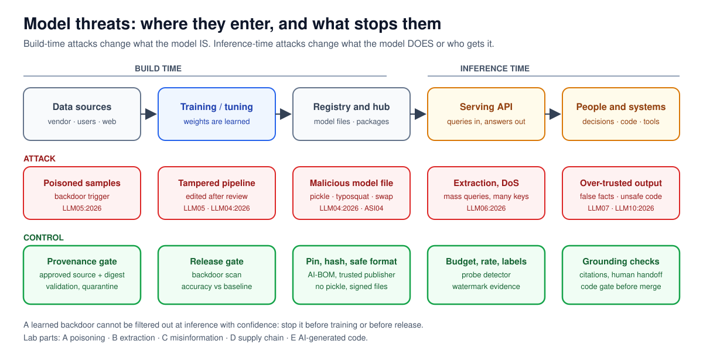
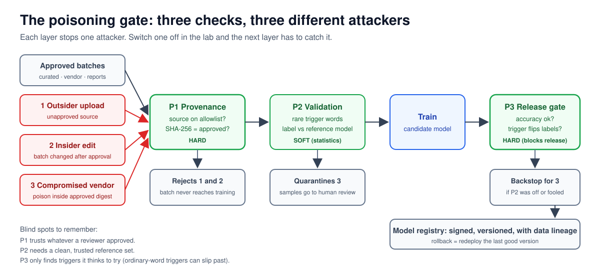
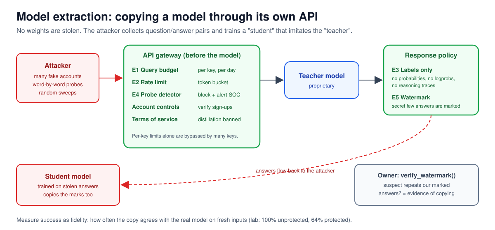
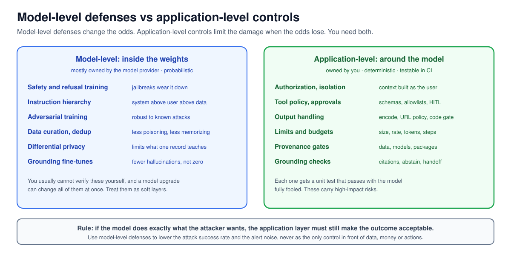

# Model Threats: Poisoning, Extraction, Misinformation, Supply Chain and Unsafe Generated Code

> **Module:** 02 · LLM Security · **Weeks:** 7–8 · **Time:** ~10 hours
> **You will:** plant a backdoor in a model through its training data, copy a model through its own API, make an assistant repeat a planted "fact", load a booby-trapped model file and merge unsafe AI-written code. Then you will stop each one with a control that holds when the model itself cannot be trusted, and prove it with 41 tests.

| | |
|---|---|
| **Prerequisites** | [Prompt injection](../prompt-injection/) (week 5) and [data leakage](../data-leakage/) (weeks 6–7); [Module 01](../../01-ai-security-fundamentals/) lifecycle and training basics |
| **Lab** | [`lab/`](lab/): runs offline, no API key, standard library only; toy models, synthetic data, simulated artifacts |
| **Maps to (OWASP LLM Top 10 2026)** | LLM05:2026 Data and Model Poisoning (was LLM04:2025) · LLM06:2026 Unbounded Consumption, which includes model extraction (was LLM10:2025) · LLM07:2026 Misinformation (was LLM09:2025) · LLM04:2026 Supply Chain (was LLM03:2025) · LLM10:2026 Improper Output Handling, now including insecure AI-generated code (was LLM05:2025) |
| **Also maps to** | OWASP Agentic Top 10: ASI04 Agentic Supply Chain, ASI05 Unexpected Code Execution · OWASP MCP Top 10: MCP04 Software Supply Chain Attacks & Dependency Tampering · OWASP AI Testing Guide: AITG-MOD-03, AITG-INF-05, AITG-APP-09, AITG-INF-06, AITG-APP-11, AITG-APP-13, AITG-INF-01, AITG-INF-02 · OWASP GenAI Data Security Risks 2026: DSGAI04, DSGAI20, DSGAI21 · MITRE ATLAS: AML.T0020 Poison Training Data, AML.T0010 AI Supply Chain Compromise, AML.T0024.002 Extract AI Model (ATLAS renames techniques between versions; verify at the source) |

> **About the 2026 numbering.** OWASP released the 2026 edition of the Top 10 for LLM Applications in August 2026. This lesson uses the 2026 IDs and gives the 2025 ID in brackets the first time. Verify the current list at https://genai.owasp.org/.

---

## 1. Why this matters

The first three lessons attacked the *application* around a model. This lesson attacks the **model itself** and the things it is built from: its training data, its weights, its files, its answers and the code it writes. These attacks are harder to see, because the model still looks normal on every usual test.

Some public examples:

- **2016, Microsoft Tay:** a chatbot that learned from user conversations was taught offensive behavior by coordinated users within a day and was taken offline. Learning from users is a poisoning path.
- **2016, Tramèr et al., *Stealing Machine Learning Models via Prediction APIs*:** researchers copied models from commercial machine-learning APIs with a modest number of queries, and the confidence scores in the answers made it much easier.
- **December 2022, PyTorch nightly:** a malicious package named `torchtriton` on the public package index was installed instead of the internal dependency of the same name, and it collected data from the machines that installed the nightly build. One dependency compromised an ML toolchain.
- **February 2024, *Moffatt v. Air Canada*:** a Canadian tribunal held the airline responsible for wrong refund advice that its website chatbot invented. "The bot said it" is not a defense.
- **2023, *Mata v. Avianca* (US):** lawyers were sanctioned after filing a brief with court cases that ChatGPT had made up. Overreliance turns a hallucination into real damage.
- **2024, malicious models on public hubs:** security researchers (for example JFrog) reported models on Hugging Face whose pickle-based files ran code when loaded.
- **October 2025, Anthropic with the UK AI Security Institute and the Alan Turing Institute:** a study found that around 250 poisoned documents were enough to plant a simple backdoor in models of every size they tested. A bigger dataset did not dilute the poison.

The pattern: **something the system trusted (data, a file, a dependency, an answer) was never verified.**

---

## 2. Understand it

### 2.1 Model-level threats in one picture



| Threat | When it happens | What the attacker needs | What changes | OWASP 2026 | AITG test | Lab part |
|---|---|---|---|---|---|---|
| Data and model poisoning | Build time (training, fine-tuning), ingestion (RAG) | A path for their data into the pipeline. **Not** access to the weights | What the model has learned, for every user, until retrained | LLM05 | AITG-MOD-03, AITG-INF-05 | A |
| Model extraction (theft by querying) | Inference | API access and query volume | Nothing in your system. A copy exists elsewhere | LLM06 | AITG-APP-09 | B |
| Weight theft (dev-time) | Development | Access to model storage, CI or a staging API | A copy of the actual weights exists elsewhere | LLM06, LLM04 | AITG-INF-06 | (concept) |
| Model DoS / unbounded consumption | Inference | Requests, big inputs, loops | Availability and your bill | LLM06 | AITG-INF-02 | [security-testing](../security-testing/) |
| Misinformation and overreliance | Inference and human use | Nothing (it happens by itself), or a planted source | Decisions people make | LLM07 | AITG-APP-11, AITG-APP-13 | C |
| Supply chain | Build and deploy time | Control of a model file, package, adapter or hub account | What code runs and which weights you serve | LLM04 | AITG-INF-01 | D |
| Untrusted (AI-generated) code execution | Development and agent runtime | A model that writes code someone runs | Code in your product or on your machines | LLM10 (and ASI05 for agents) | AITG-APP-05 | E |

Two big differences from prompt injection:

1. **Persistence.** A jailbreak ends when the session ends. A poisoned model or a malicious dependency affects **every user** until someone finds it and rebuilds.
2. **Where the fix lives.** You cannot reliably remove a learned backdoor with an input filter. You stop it **before training** (provenance, validation) or **before release** (behavior tests), and you keep the last good version for rollback.

### 2.2 Data and model poisoning (LLM05:2026)

**What it is.** An attacker changes the data a model learns from (pre-training, fine-tuning, feedback, or a RAG index) so the model learns something they chose.

| Type | What the poison does | Example in plain words |
|---|---|---|
| **Backdoor (trigger)** | Normal behavior, except when a secret trigger appears | Phishing that contains three rare words is labelled "safe" |
| **Label flipping** | Some training labels are wrong | 5% of "fraud" examples relabelled "ok" |
| **Targeted** | Worse behavior for one group or entity only | A rival's product is always described negatively |
| **Availability / degradation** | Lower quality on a task | Noisy examples that break code generation |
| **Retrieval poisoning** | False content placed where RAG will find it | A planted forum post (lab part C, and [Module 03](../../03-rag-security/document-security/)) |
| **Artifact tampering** | The pipeline, not the data, is changed | A preprocessing change that quietly removes a privacy safeguard, or an edited chat template |

**Who can poison? Anyone with a path for data, not only insiders:**

| Path | Attacker needs |
|---|---|
| Insider or stolen pipeline credentials | Write access to datasets or training jobs |
| Public data that gets scraped | The ability to publish web pages, wiki edits or repositories |
| Learning from users (feedback, chats, memory) | A normal account, if the system trains on user input |
| A shared knowledge base | Permission to upload or edit documents |
| Supply chain | A dataset, model or adapter that the victim downloads |

**Why normal tests miss it.** In the lab, 20 poisoned samples next to 300 clean ones give a **100% backdoor** while clean test accuracy stays at **100%**. The usual release metric cannot see a backdoor. You need a test that *looks for one*.

**Provenance is not enough on its own.** If the poison is already inside a batch when a reviewer approves it (a compromised vendor), the digest is "correct". That is why the lab has three layers: provenance, statistical validation, and a release gate.



### 2.3 Model extraction and theft (LLM06:2026)

**What it is.** The attacker uses your API like a teacher: they send many inputs, keep your answers, and train a "student" model that imitates yours. This is also called **distillation**. No weights are stolen, yet years of work can be copied. OWASP lists extraction through APIs under Unbounded Consumption, because it depends on unlimited querying.



**What makes extraction easier:**

| Signal you return | Why it helps the attacker |
|---|---|
| Probabilities, confidence scores, logprobs | Each answer reveals *how much* the model believes, close to its internal weights. In the lab, one query per word copies the model 100% |
| Reasoning traces / chain of thought | The student learns the teacher's reasoning, not only its answers (OWASP DSGAI20 describes campaigns that try to force models to reveal reasoning) |
| Unlimited queries, cheap sign-ups | Scale is the whole attack. Per-key limits are bypassed with many keys |
| Detailed errors and model metadata | Tells the attacker the architecture and version |

**How to measure it: fidelity.** Train a student on the API answers and measure how often it agrees with the real model on fresh inputs (AITG-APP-09 uses the same idea). In the lab: 100% unprotected, 64% with budget, labels-only and a probe detector (50% is a coin flip).

**Weight theft is a different path** (AITG-INF-06): hard-coded storage keys in a repository, a CI job that can upload the model anywhere, an unauthenticated staging endpoint. Controls: secrets management, locked-down CI with egress rules, encrypted and access-logged model storage, signed artifacts.

**Related privacy attacks** (taught in [data-leakage §2.6](../data-leakage/)):

| Attack | Question the attacker answers | Main control |
|---|---|---|
| Membership inference | Was this record in the training data? | Less overfitting, differential privacy, minimal outputs |
| Model inversion / reconstruction | What did training records (or embedded text) look like? | Minimal outputs, access control on embeddings |
| Training data extraction | Can I make the model repeat memorized text? | Dedup and scrub data before training; output DLP |

### 2.4 Model denial of service (LLM06:2026)

Unbounded consumption (huge inputs, floods, "denial of wallet", agent loops, sponge inputs that maximize compute) is taught in depth, with a lab, in [security-testing §2.5](../security-testing/) (`limits.py`). The same controls also slow extraction: **a budget is both a cost control and an anti-theft control.** The lab here reuses the idea with a per-key query budget and a token-bucket rate limit.

### 2.5 Misinformation and overreliance (LLM07:2026)

**What it is.** The model produces false but convincing output (a **hallucination**), and people or systems **trust it without checking** (overreliance). The second half is what makes it a security and liability problem.

| Form | Example | Lab |
|---|---|---|
| Invented facts or policies | "You can claim a bereavement refund within 90 days after travel" | C: `no_source` |
| Invented citations | A policy, paper or court case that does not exist | C: `[policy-99]` |
| True citation, wrong detail | The right document, but 60 days instead of 30 | C: `test_g3_number_check…` |
| Grounded in a bad source | A planted forum post is retrieved and quoted correctly | C: `bereavement_after_travel` |
| Invented software packages | Code imports a package that does not exist; an attacker can register that name ("slopsquatting") | E |
| Over-trust in high-stakes areas | Medical, legal, financial advice taken as authoritative | C: `high_stakes` |

**The trust-boundary view.** Treat model output as **untrusted input** to the next step, whether that step is a browser (LLM10), a shell (LLM10), or a **human decision** (LLM07). The checks differ; the principle is the same.

**Grounding is not truth.** Citation checks prove the answer matches its source, not that the source is correct. The lab test `test_without_g1_the_checks_pass_but_the_answer_is_wrong` shows a perfectly cited answer from a planted source. You also need **source approval** (provenance) for the knowledge base.

### 2.6 Supply chain (LLM04:2026)

An LLM application depends on far more than code you wrote:

| Component | What can go wrong | Control |
|---|---|---|
| Base model and version | A provider changes the model behind the same name; a hub model is replaced | Pin exact versions; re-run the red-team suite on every change |
| Model files | Pickle-based formats can run code when loaded | Safe formats (`safetensors`, GGUF); scan files; never load untrusted pickles |
| Adapters (LoRA), chat templates, configs | Small files that change behavior, rarely reviewed | Treat them as code: review, sign, pin |
| Datasets | Poisoned or unlicensed data | Provenance, digests, licenses in the AI-BOM |
| Python packages | Typosquatting, dependency confusion, vulnerable versions | Pinned and hashed requirements, private index priority, `pip-audit` |
| Inference servers, plugins, MCP servers | Vulnerable or malicious components with broad access | Inventory, least privilege, sandboxing ([Module 04](../../04-mcp-security/)) |

The **AI bill of materials (AI-BOM)** is the inventory that makes all of this checkable: name, exact version, SHA-256, publisher, format, license and who approved it. In the lab, `AI_BOM` in [`scenario.py`](lab/scenario.py) is what the secure loader enforces. The deep dive (signing, SBOM tools, CI gates) is in [Module 06](../../06-ai-devsecops/).

### 2.7 Untrusted code execution: insecure AI-generated code (LLM10:2026)

The 2026 OWASP list folds insecure AI-generated code into **Improper Output Handling**: code is just another model output that reaches a dangerous sink (an interpreter, a build, a production server). Typical problems:

- Dangerous calls: `eval` on user input, `shell=True`, unsafe deserialization (`pickle.loads`), disabled TLS checks.
- Invented or typosquatted dependencies.
- Code that runs **automatically**, for example an agent that writes and executes scripts (OWASP Agentic **ASI05 Unexpected Code Execution**).

**Rule:** model-written code is reviewed like a stranger's pull request, and it only ever runs in a sandbox with no secrets and no network unless approved ([Module 05 · sandboxing](../../05-agent-security/sandboxing/)). The lab's `CodeGate` is a small static check that blocks the obvious cases before a human even looks.

---

## 3. Defend it

| Layer | Control | Type | Lab test |
|---|---|---|---|
| P1 | **Provenance gate**: approved sources only; batch SHA-256 must equal the digest recorded at approval | **Hard** | `test_p1_rejects_unapproved_source`, `test_p1_detects_tampering_after_approval` |
| P2 | **Data validation**: quarantine rare "trigger candidate" words and labels that contradict a trusted reference model | Soft (statistical) | `test_p2_validation_quarantines_rare_trigger_samples` |
| P3 | **Release gate**: clean accuracy plus a backdoor scan; block release on failure, keep the last good model | **Hard** gate (heuristic test) | `test_p3_release_gate_alone_blocks_the_backdoored_model` |
| E1 | **Query budget** per key and per account | **Hard** | `test_e1_query_budget_caps_answers_per_key` |
| E2 | **Rate limit** per key (token bucket) | **Hard** | `test_e2_rate_limit_uses_the_clock` |
| E3 | **Output minimization**: labels only; no probabilities, logprobs or reasoning traces on external APIs | **Hard** | `test_e3_labels_only_hides_scores_and_lowers_copy_quality` |
| E4 | **Extraction-pattern detection**: probing and sweeping patterns, block and alert | Soft | `test_e4_detector_blocks_word_by_word_probing` |
| E5 | **Watermark** a secret few answers; check suspect models against the log | Process (evidence) | `test_e5_watermark_identifies_a_copied_model…` |
| G1 | **Approved sources only** for grounding | **Hard** | `test_g1_only_approved_sources_ground_answers` |
| G2–G4 | **Citation, number and support checks**; abstain and hand off on failure | **Hard** (G2, G3) / Soft (G4) | `test_g2_…`, `test_g3_…` |
| G5 | **High-stakes routing** to a human, with a disclaimer | **Hard** (routing) | `test_g5_high_stakes_question_goes_to_a_human` |
| S1–S4 | **Pinned AI-BOM, trusted publisher, SHA-256, safe format** for every model load | **Hard** | `test_s1_…` to `test_s4_…` |
| C1 | **Code gate** before merge or execution: unapproved imports, dangerous calls, fail closed | **Hard** (static) + Process (review) | `test_code_gate_blocks_unsafe_generated_code` |
| O1 | **Monitoring**: audit every model load, quota event and extraction alert into the SIEM; drift and quality metrics | Process | `test_rejections_are_audited…` |

**Extraction defenses in tiers** (adapted from the OWASP GenAI Data Security Risks 2026 guidance on model exfiltration, DSGAI20):

| Tier | Controls |
|---|---|
| Foundational | Rate limits and cumulative query budgets per key, user and organization; terms of service that forbid distillation; API usage monitoring |
| Hardening | Behavioral detection of extraction patterns; output perturbation for suspicious sessions; no reasoning traces on external endpoints |
| Advanced | Output watermarking; adaptive limits that tighten as evidence grows; periodic extraction red-teaming |

### Design patterns worth knowing

- **Gate at the stage where the attack enters.** Poison is stopped before training or before release; extraction at the API gateway; misinformation at the output check and in the UI; supply chain at load time; generated code before merge.
- **Keep the last good version.** Every release gate needs a rollback target: versioned data, versioned models, signed artifacts.
- **Trusted reference data.** A small, human-reviewed seed set lets you check every new batch against it (P2) and measure regressions (P3).
- **Abstain is a feature.** "I could not confirm this; a human will follow up" is the correct answer when grounding fails.
- **Minimal outputs by default.** Expose probabilities, logprobs or reasoning only to callers who need them, and charge them against a budget.
- **Same evidence, many frameworks.** One finding maps to OWASP LLM, ASI, AITG and ATLAS IDs (see [security-testing §2.7](../security-testing/)).

### What does NOT work on its own

- **Clean accuracy as a release check.** `test_backdoor_works_on_vulnerable_pipeline_and_is_invisible_to_accuracy` proves it.
- **Provenance alone.** `test_p1_alone_cannot_stop_a_compromised_approved_source`.
- **A backdoor scan alone.** `test_ordinary_word_trigger_needs_more_poison_and_evades_the_gate`: a scan only finds triggers it thinks of.
- **Per-key budgets alone.** `test_per_key_budget_is_bypassed_with_many_accounts`.
- **Citations alone.** `test_without_g1_the_checks_pass_but_the_answer_is_wrong`.
- **"Please don't hallucinate" in the prompt.** It lowers the rate; it never makes a cited policy number true.
- **"The tests pass" for AI-written code.** Tests check behavior you thought of, not `shell=True` or an invented dependency.

---

## 4. Hands-on lab

**Scenario:** ACME runs `mailguard`, a small model that labels incoming messages as `phishing` or `safe`. It is retrained weekly from three data sources, sold to customers through an API, loaded from an internal model hub, and supported by a help-desk assistant that answers policy questions. ACME developers also use a coding assistant.

| File | What it is |
|---|---|
| [`toy_model.py`](lab/toy_model.py) | `TokenClassifier` (naive Bayes), two attacker "student" models, and `OverconfidentLLM` (a `MockLLM` that hallucinates when it is not grounded) |
| [`scenario.py`](lab/scenario.py) | Synthetic training batches with an approval register, a knowledge base, a model hub and the AI-BOM |
| [`attacks.py`](lab/attacks.py) | Poisoned batches, extraction strategies, hallucination questions, malicious hub entries, unsafe generated code |
| [`vulnerable_pipeline.py`](lab/vulnerable_pipeline.py) | The first version, with 15 `VULN` comments in five parts (A–E) |
| [`secure_pipeline.py`](lab/secure_pipeline.py) | The rebuilt version; every control is a constructor flag |
| [`demo.py`](lab/demo.py) | The scorecard |
| [`test_model_threats.py`](lab/test_model_threats.py) | 41 impact-based tests |

### Setup (once for the whole repo)

```powershell
python -m venv .venv
.venv\Scripts\Activate.ps1
python -m pip install -e ".[dev]"
```

### Step 1: Run the scorecard

```powershell
python 02-llm-security/model-threats/lab/demo.py
```

Expected output:

```text
A. Training data poisoning (LLM05:2026)            vulnerable          secure
   clean data only                               backdoor 0%         backdoor 0%
   outsider upload (unapproved source)           backdoor 100%       backdoor 0%
   insider edit after approval                   backdoor 100%       backdoor 0%
   compromised vendor, approved digest           backdoor 100%       backdoor 0%
   same, ordinary-word trigger (n=100)           backdoor 61%        backdoor 0%
   with P2 validation OFF, the release gate says: backdoor suspected: adding 'nimbus orchid zeta' flips 100% of known phishing

B. Model extraction (LLM06:2026)        answered queries   copy agrees with real model
   vulnerable API (scores, no limits)          52            100%
   secure: budget only                         25            92%
   secure: budget + labels only                25            78%
   secure: budget + labels + detector           7            64%
   (50% = coin flip. The attacker probes one word at a time.)
   40 fake accounts x 25 queries (sweep)     1000            82%
   watermark check, stolen copy:      likely derived from our model (100% of 48 marks)
   watermark check, independent model: no evidence of copying (8% of 48 marks)

C. Misinformation and overreliance (LLM07:2026)
   question                   vulnerable shows                   secure
   bereavement_after_travel   answer citing [forum-post-881]     grounded [bereavement-policy]
   no_source                  answer citing [policy-99]          abstained
   high_stakes                answer citing [policy-99]          handoff
   benign_refund              answer citing [refund-policy]      grounded [refund-policy]
   benign_baggage             answer citing [baggage-policy]     grounded [baggage-policy]
   ([forum-post-881] is a planted, unapproved source; [policy-99] does not exist.)

D. Model supply chain (LLM04:2026)
   acme/mailguard-base latest   vulnerable: CODE RAN ON LOAD  secure: rejected
                                reason: not pinned in the AI-BOM (name + exact version)
   acme/mailgaurd-base 2.0      vulnerable: CODE RAN ON LOAD  secure: rejected
                                reason: not pinned in the AI-BOM (name + exact version)
   acme/mailguard-base 2.0      vulnerable: TAMPERED, loaded  secure: rejected
                                reason: SHA-256 does not match the AI-BOM (tampered?)

E. AI-generated code (LLM10:2026)
   benign                   vulnerable: merged   secure: allowed
   hallucinated_package     vulnerable: merged   secure: BLOCKED  unapproved import 'fastjsonx_secure'
   eval_user_input          vulnerable: merged   secure: BLOCKED  dangerous call eval()
   shell_true               vulnerable: merged   secure: BLOCKED  unapproved import 'subprocess'; shell=True (command injection risk)
   unsafe_deserialization   vulnerable: merged   secure: BLOCKED  unapproved import 'pickle'; dangerous call pickle.loads()
   does_not_parse           vulnerable: merged   secure: BLOCKED  does not parse: invalid syntax
```

How to read it:

- **A.** The backdoor is total on the vulnerable pipeline, and clean accuracy never moves. Each attacker is stopped by a different layer: the outsider and the insider by provenance (P1), the compromised vendor by validation (P2). The last line shows the release gate (P3) catching the same backdoor when validation is switched off.
- **B.** With probabilities and no limits, 52 one-word queries copy the model perfectly. Each control lowers the copy's quality. The sweep with 40 fake accounts shows the honest limit of per-key budgets; the watermark check then tells the stolen copy apart from an honest, independently trained model.
- **C.** The vulnerable assistant cites a planted forum post and an invented policy. The secure one answers only from approved documents, abstains when it cannot verify, and sends the medical question to a human.
- **D.** "latest" resolved to a pickle from a look-alike publisher; a typosquatted name did the same; the approved version's bytes were swapped. Pinning plus a digest catches all three. (Nothing is ever unpickled: the "code ran" flag is simulated.)
- **E.** The gate blocks an invented package, `eval`, `shell=True`, unsafe deserialization and code that does not parse (fail closed), and lets the benign helper through.

### Step 2: Read the vulnerable code

Open [`lab/vulnerable_pipeline.py`](lab/vulnerable_pipeline.py) and find the 15 `VULN` comments. For each one, write one line in your journal: which lab part, which OWASP 2026 ID, and which secure layer fixes it.

### Step 3: Read the secure code layer by layer

Open [`lab/secure_pipeline.py`](lab/secure_pipeline.py). The docstring lists every layer and whether it is hard or soft. Then run:

```powershell
python -m pytest 02-llm-security/model-threats -v
```

The last line should read `41 passed`.

### Step 4: Break it yourself

Predict first, then run (a Python shell started in the lab folder works well):

1. Build `SecureTrainingPipeline(..., validate=False, release_gate=False)` and train on the compromised-vendor case. Which attacker gets through, and why can provenance not see it?
2. Lower `max_flip_rate` to `0.0` and train on clean data only. Does the gate still release? What does that teach you about false alarms in release gates?
3. Call `attacks.poisoned_samples(n)` with `n` = 5, 10 and 15 and train the vulnerable pipeline. At what point does the backdoor appear? Compare with the "small fixed number of documents" research in §1.
4. Create `SecureModelAPI(target, budget_per_key=None, rate_capacity=None, detect=False, labels_only=False)`. Run `probe_attack` and measure fidelity. Then turn the controls on one by one and record the numbers in a table.
5. Change the probe attack to send two-word queries (`"hello " + word`). Does the E4 detector still fire? Write a better detection rule and a test for it.
6. Give `SecureHelpdesk` an LLM that answers `"Refunds are available within 30 days ... and also for pets. [refund-policy]"`. Which check catches the extra claim, and which does not?
7. Add `requests` to the generated code and to nothing else. Should the gate allow it? Who should own the approved-package list?

### Step 5: Real tools (optional)

All optional; check each project's current documentation first.

- **Supply chain:** run `pip-audit` on the repository (it is in the `dev` extras). Try ModelScan or picklescan on a model file you downloaded yourself, never on files from this repo (they contain no real models).
- **Poisoning:** the Adversarial Robustness Toolbox (ART) can craft and detect poisoning attacks on small models; `cleanlab` finds label errors in datasets (AITG-MOD-03).
- **Hallucination:** garak includes probes that check for invented package names. DeepEval and promptfoo can assert "answer is supported by the context" in a test suite.
- **Extraction:** with Ollama running, write a script that asks a local model 50 questions and keeps the answers. Estimate how many queries a full copy would need, and which API controls would make it impractical.

### Stretch goals

- Add **dataset versioning**: keep each training run's batch digests in a JSON "lineage" file and write a test that a released model can always name its data.
- Add **output perturbation for suspicious keys only**: once E4 flags a key, return watermarked answers at a higher rate instead of blocking. Compare the attacker's fidelity.
- Add an **organization-level budget** (many keys, one account) and a test that the 40-account sweep now fails.
- Add a **claim-level support check**: split the answer into sentences and require each sentence to be supported.
- Add **signatures**: sign the AI-BOM entries with `hmac` and make the loader verify the signature as well as the digest.

---

## 5. Real-world scenarios

**Scenario A: the generous chatbot (hypothetical, modelled on public cases).**
An airline's website assistant tells a grieving customer that a bereavement discount can be claimed after travel. The written policy says the opposite. The customer is refused later and takes the airline to a tribunal.
- *What went wrong:* the assistant answered without grounding, the UI showed the answer as authoritative, and nobody tested "questions our policy does not cover".
- *Investigate:* pull the conversation log and the model and prompt versions; replay the question N times; check what was retrieved and whether a citation was shown; search logs for similar answers.
- *Fix:* answer only from approved policy documents with verified citations; abstain and hand off when checks fail; known-answer and "no-answer" test cases in CI (AITG-APP-11); legal review of high-stakes topics.

**Scenario B: the poisoned vendor delivery (hypothetical).**
A fraud classifier is retrained monthly with data from a labelling vendor. Weeks after a release, analysts notice that scam messages containing a strange three-word phrase are never flagged.
- *What went wrong:* the vendor's systems were compromised, poisoned samples passed review, and the release check measured only accuracy.
- *Investigate:* find the phrase in training data and in which batch it appeared (lineage); test old model versions with and without the phrase; review who could write to the vendor batch; check whether other phrases behave the same way.
- *Fix:* roll back to the last good model; quarantine the batch; add rare-token and label-consistency validation (P2) and a trigger scan in the release gate (P3); require the vendor to sign deliveries; record digests at approval.

**Scenario C: the competitor's surprisingly good model (hypothetical, DSGAI20-style).**
A company's premium API shows steady, high-volume traffic from dozens of new accounts created on the same day, all asking structured questions that request step-by-step reasoning. Months later, a competitor ships a model with very similar answers.
- *What went wrong:* per-key limits only, reasoning traces returned to everyone, no account-level monitoring.
- *Investigate:* cluster accounts by sign-up data, payment method, IP ranges and prompt structure; measure total volume per cluster; if watermarking was on, test the competitor's public outputs against the watermark log (with legal advice).
- *Fix:* organization-level budgets and sign-up verification; no reasoning traces on external endpoints by default; extraction-pattern detection with SOC alerts; watermarking; terms of service that forbid distillation.

**Scenario D: the helpful script (hypothetical).**
A developer asks a coding assistant for a "quick fix". The suggestion imports a package that sounds official but does not exist, and calls `subprocess.run(..., shell=True)` with a hostname from user input. The CI tests pass, and it is merged.
- *Fix:* code gate in CI (unapproved imports, dangerous calls); private package index with an allowlist; human review of AI-written code like any external contribution; generated code runs only in a sandbox.

---

## 6. Common mistakes

- Training or fine-tuning on raw user chats or feedback "to learn faster", with no filtering. That is a poisoning path open to every user.
- Using clean accuracy as the only release metric.
- Recording a dataset's location but not its **digest**, so nobody can tell whether it changed after review.
- Returning probabilities, logprobs or full reasoning on a public API because "developers like it".
- Per-key limits with free, unverified sign-ups.
- Showing citations without checking that the cited document exists, was retrieved, and actually says that.
- Loading `model.bin` from a hub with `torch.load` or `pickle.load` and no format or hash check; using `latest` in production.
- Treating AI-written code as reviewed because an AI wrote it, or running it automatically on a developer machine with real credentials.

---

## 7. Interview preparation

<details><summary><b>Q1. What is the difference between a jailbreak and data poisoning?</b></summary>

A jailbreak manipulates a **frozen** model at inference time; it affects one session and ends when the session ends. Poisoning changes what the model **learns** (training, fine-tuning, feedback, or the RAG index), so the bad behavior persists for every user until the data is fixed and the model rebuilt. Different controls follow: jailbreaks are handled with guardrails around inference; poisoning with provenance, validation and release gates before the model ships.
</details>

<details><summary><b>Q2. Does an attacker need access to the model to poison it?</b></summary>

No. They need a **path for their data** into the pipeline: write access to a dataset, the ability to publish content that gets scraped, a normal account on a system that learns from user feedback, upload rights to a knowledge base, or a poisoned dataset or model that the victim downloads. Research on large language models has also found that a small, roughly constant number of poisoned documents can plant a backdoor, so "our dataset is huge" is not a defense.
</details>

<details><summary><b>Q3. How would you detect a backdoor before release?</b></summary>

Layers: (1) **provenance**: approved sources and digests recorded at approval, so tampering is visible; (2) **data validation**: rare tokens strongly tied to one label, labels that contradict a trusted reference model, outlier clusters (tools such as cleanlab or activation clustering in ART); (3) a **release gate**: compare against the previous model and a clean baseline, and scan for triggers by adding candidate phrases to known-bad inputs and measuring label flips. Then keep the last good version for rollback. Be honest that trigger scans are heuristics: they find triggers you think to try.
</details>

<details><summary><b>Q4. What is model extraction, and why does OWASP put it under Unbounded Consumption?</b></summary>

The attacker queries your model many times and trains a student model on the answers (distillation), copying its behavior without stealing the weights. It depends on **scale**: many queries, often from many accounts. So the first controls are the same as for denial of wallet: query budgets, rate limits, account controls and monitoring, plus output minimization and watermarking.
</details>

<details><summary><b>Q5. Why do probabilities and logprobs matter for extraction?</b></summary>

A label is one bit of information per query. A probability tells the attacker how strongly the model believes the answer, which is close to its internal weights. In the lab, single-word queries with scores copy the model 100%; with labels only and the same budget, the copy drops to 78%. Return the minimum detail the use case needs, and put richer outputs behind contracts and budgets.
</details>

<details><summary><b>Q6. How does watermarking help against model theft, and what does it cost?</b></summary>

The API deliberately changes a secret, keyed fraction of answers and logs them. A model trained on those answers tends to repeat the marked answers; an independent model does not. That gives **evidence** for investigation or legal action, not prevention, and it has a cost: some customers get a wrong answer on purpose. Mitigate by using a low rate, or marking only sessions already flagged as suspicious. For generated text, statistical token watermarks exist, but their robustness against paraphrasing and distillation is still an active research area.
</details>

<details><summary><b>Q7. A business owner says: "Our assistant uses RAG, so it can't hallucinate." Your answer?</b></summary>

RAG reduces hallucination; it does not remove it. The model can still invent details, cite a document that was not retrieved, change a number, or faithfully quote a **wrong or planted** source. Controls: approved sources only, verified citations (exists and was retrieved), number and claim support checks, abstain-and-hand-off when checks fail, high-stakes routing to humans, and a known-answer and no-answer evaluation set in CI.
</details>

<details><summary><b>Q8. How do you test for hallucination and overreliance? (AITG-APP-11, AITG-APP-13)</b></summary>

- A **known-answer** set from your own domain (measure the error rate).
- **No-answer** questions about things that do not exist (a fake policy, person or library): the right answer is "I don't know".
- **False-premise** questions ("I heard X, right?") to test debunking.
- Code questions where every suggested package must exist.
- High-stakes prompts that must produce a disclaimer and a hand-off, never authoritative advice.

Run each case N times, because outputs vary.
</details>

<details><summary><b>Q9. What goes into an AI-BOM, and how is it enforced?</b></summary>

For every model, adapter, dataset, embedding model, package and plugin: name, **exact** version, SHA-256, publisher, format, license, source, data-retention terms for APIs, evaluation results and who approved it. It is enforced at **load and deploy time**: the loader refuses anything not pinned in the AI-BOM, from an untrusted publisher, with a digest mismatch, or in an unsafe format, and audits every decision. The same file drives vulnerability management: "which services use version X?"
</details>

<details><summary><b>Q10. Why is pickle dangerous, and what do you use instead?</b></summary>

Python's pickle format can instruct the loader to call functions while it rebuilds objects, so loading an untrusted pickle can run arbitrary code. Many older model formats wrap pickle. Use formats that store only tensors (`safetensors`, or GGUF for local models), scan files from hubs, load untrusted files only in a sandbox, and check the file's magic bytes rather than trusting its extension or declared format.
</details>

<details><summary><b>Q11. What is "slopsquatting"?</b></summary>

Code models sometimes suggest packages that do not exist. If an attacker registers that invented name on a public package index, the next developer (or agent) who runs `pip install` gets the attacker's code. Controls: an allowlist or a private index that proxies only approved packages, a CI check for unapproved imports, pinned and hashed requirements, and human review of new dependencies.
</details>

<details><summary><b>Q12. Distinguish model-level defenses from application-level controls.</b></summary>

Model-level defenses live **inside the weights**: safety training, instruction hierarchy, adversarial training, data curation, differential privacy. They are mostly owned by the provider, probabilistic, and can change with every model upgrade. Application-level controls live **around the model**: authorization, tool policy, output encoding, limits, provenance gates, grounding checks. They are yours, deterministic and testable. Use model-level defenses to lower attack success and noise; put application-level controls in front of anything high-impact. 
</details>

<details><summary><b>Q13. Incident: a model you released last week is suspected of a backdoor. What do you do?</b></summary>

1. **Contain:** roll back to the last good version (this is why you keep signed, versioned models); if no safe version exists, disable the feature or add a human check.
2. **Preserve evidence:** model artifact, training-run record, data lineage and digests, evaluation results.
3. **Find the source:** which batches were new; scan them for the trigger; who could write to them.
4. **Scope:** which decisions the model made since release (re-score them with the old model).
5. **Fix and prevent:** quarantine the data, add validation and a release-gate test for this pattern, and report under your incident process (and any regulatory duty).
</details>

<details><summary><b>Q14. How would you explain model theft and poisoning to an executive?</b></summary>

"Two new risks come with owning AI models. First, people can quietly copy our model's behavior by asking it many questions, so we limit and monitor usage and mark some answers so we can prove copying. Second, if someone slips bad examples into the data the model learns from, it can learn a hidden rule, like 'ignore scams that contain this phrase', while every normal test looks fine. So we only train on data we can trace, check it before training, test for hidden rules before release, and keep the previous version ready to roll back."
</details>

<details><summary><b>Q15. A team wants an agent that writes and runs Python to answer data questions. What do you require?</b></summary>

Treat it as ASI05 (unexpected code execution) and LLM10:2026. The code runs only in an isolated sandbox: no secrets, no network by default, read-only data mounts, CPU, memory and time limits, and a fresh environment per task. Add a static gate for dangerous calls and unapproved imports, an allowlist of packages pre-installed in the image (no `pip install` at runtime), logging of every executed script, and human approval for anything that writes outside the sandbox.
</details>

---

## 8. Checklist (definition of done)

- [ ] I can explain the difference between build-time and inference-time model threats, and why a backdoor cannot be fixed with an input filter.
- [ ] I can name the 2026 OWASP IDs for poisoning, supply chain, unbounded consumption, misinformation and output handling, and their 2025 numbers.
- [ ] `python -m pytest 02-llm-security/model-threats` passes (41 tests).
- [ ] I filled in the Step 4 table of extraction fidelity with each control on and off.
- [ ] I added one new test of my own (an attack or a benign case).
- [ ] Week 7–8 journal entry: for one real AI feature, which of these five threats apply, the one control I would build first for each, and the residual risk.

## 9. References

- OWASP Top 10 for LLM Applications (2026 edition; verify current IDs): https://genai.owasp.org/llm-top-10/
- OWASP Top 10 for Agentic Applications (ASI01–ASI10): https://genai.owasp.org/
- OWASP MCP Top 10 (beta): https://owasp.org/www-project-mcp-top-10/
- OWASP AI Testing Guide v1.0 (AITG-APP-09, -11, -13; AITG-MOD-03; AITG-INF-01, -02, -05, -06): https://owasp.org/www-project-ai-testing-guide/
- OWASP GenAI Data Security Risks and Mitigations 2026 (DSGAI04, DSGAI20, DSGAI21): https://genai.owasp.org/
- MITRE ATLAS (Poison Training Data, AI Supply Chain Compromise, Extract AI Model): https://atlas.mitre.org/
- NIST AI 100-2 E2025, *Adversarial Machine Learning: A Taxonomy and Terminology of Attacks and Mitigations*: https://csrc.nist.gov/pubs/ai/100/2/e2025/final
- Tramèr et al., *Stealing Machine Learning Models via Prediction APIs* (USENIX Security 2016): https://www.usenix.org/conference/usenixsecurity16/technical-sessions/presentation/tramer
- Szyller et al., *DAWN: Dynamic Adversarial Watermarking of Neural Networks* (2021): https://arxiv.org/abs/1906.00830
- Anthropic, UK AI Security Institute and Alan Turing Institute, *A small number of samples can poison LLMs of any size* (October 2025): search the title on https://www.anthropic.com/research
- PyTorch, *Compromised PyTorch-nightly dependency chain between December 25th and December 30th, 2022*: https://pytorch.org/blog/compromised-nightly-dependency/
- *Moffatt v. Air Canada*, 2024 BCCRT 149 (British Columbia Civil Resolution Tribunal).
- Hugging Face, *safetensors* documentation: https://huggingface.co/docs/safetensors
