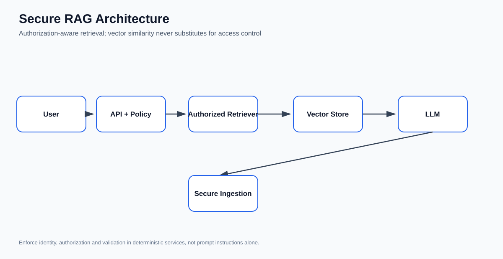

# Module 03 — RAG Security: Enterprise Design and Testing

**Effort:** 24–30 hours. **Outcome:** Build multi-tenant RAG with authorization-aware retrieval, provenance and deletion controls.

## 1. Reference architecture


RAG stages: ingestion → parsing → chunking → embedding → indexing → retrieval → context construction → generation → citation/response. Each stage creates security obligations.

## 2. Ingestion security
Validate file content, not just extension. Apply size limits, parser isolation, malware scanning where appropriate, archive expansion limits and safe malformed-file handling. Record source ID, owner, tenant, classification, source ACL/version, provenance, ingestion timestamp, parser version, retention and deletion policy. Never trust uploaded document metadata to assign its own tenant or permissions.

## 3. Chunking and metadata
Chunking can split context or ACL boundaries. Do not combine content from different tenants or permission scopes into one chunk. Preserve source references and authorization metadata on every derived chunk.

## 4. Embeddings and vector database
Embeddings may reveal semantic information and should be treated as sensitive derived data where appropriate. Protect with encryption, least-privilege roles, private networking, metadata integrity, backup protection, retention/deletion and audit. Similarity is not authorization.

## 5. Authorization-aware retrieval
1. Authenticate user.
2. Resolve tenant, roles, groups and entitlements from trusted identity systems.
3. Construct server-side retrieval filters.
4. Query only authorized corpus where supported.
5. Re-check each returned chunk against current policy.
6. Add only authorized content to model context.
7. Validate citations before returning them.

Fail closed if tenant or ACL metadata is missing or stale.

Illustrative policy:
```python
def can_read(principal, chunk):
    if principal is None or not principal.tenant_id:
        return False
    if chunk.tenant_id != principal.tenant_id:
        return False
    if chunk.classification == "restricted":
        return "read:restricted" in principal.permissions
    return (principal.user_id in chunk.allowed_users
            or "read:tenant" in principal.permissions)
```
Production authorization must handle group membership, revocation, policy versions, resource ownership and service-side metadata integrity. This snippet is not a complete policy engine.

## 6. RAG attack scenarios
| Threat | Example | Control |
|---|---|---|
| Cross-tenant retrieval | Tenant A retrieves tenant B chunk | Server-derived tenant ACL |
| ACL drift | Source access revoked but index remains open | ACL sync and revocation SLA |
| Document poisoning | Malicious content enters corpus | Source approval, provenance, quarantine |
| Indirect injection | Retrieved text asks model to exfiltrate | Treat as untrusted; restrict tools |
| Citation leakage | Unauthorized source cited | Citation authorization |
| Deletion failure | Deleted source remains indexed | Derived-data deletion workflow |
| Index poisoning | Unauthorized writes to embeddings | Separate writer identity and integrity |
| Ranking manipulation | Attacker content dominates results | Source trust tiers and evaluation |

## 7. Lab — two-tenant knowledge assistant
Create `red` and `blue` tenants, synthetic confidential docs, separate users, a local vector store/mock retriever and server-side principal. Test: red retrieves red; red cannot retrieve blue; prompt claims do not change server principal; missing metadata fails closed; revoked group is denied within SLA; malicious content cannot authorize tools; unauthorized citations are suppressed; deletion removes chunks, embeddings, caches and derived indexes within documented SLA.

## 8. Deletion and retention
Deleting the source file is insufficient. Trace raw object, parsed text, chunks, embeddings, vector index, caches, conversation references, logs and backups subject to retention/legal hold. Build a durable deletion job with retries, reconciliation and evidence. Document backup expiry and limitations.

## 9. Evaluation metrics
Measure authorized recall, unauthorized retrieval rate (target zero in defined test scope), stale ACL behavior, citation correctness, poisoning resilience, deletion SLA, injection impact, latency and cost.

## Exercises
1. Compare shared index with tenant metadata filters versus separate indexes.
2. Design ACL revocation for a 30-minute SLA.
3. Explain how chunk boundaries can broaden access.
4. Create source trust tiers.
5. Write a deletion runbook.

## Acceptance criteria
Cross-tenant tests pass; authorization precedes context construction; missing/stale ACL fails closed; citations are access-checked; deletion covers derived data; retrieved content is untrusted.
