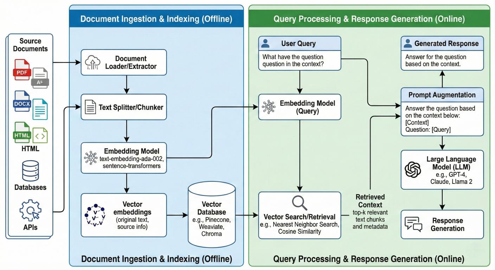
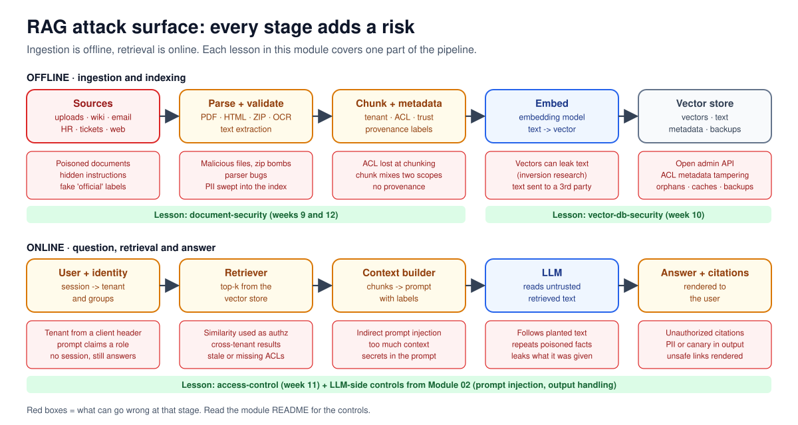

# Module 03: RAG Security

> **Weeks:** 9–12 (Month 3) · **Time:** ~40 hours · **Outcome:** you can design, build and test a multi-tenant RAG system with secure ingestion, a hardened vector store, authorization-aware retrieval, provenance and provable deletion.

| | |
|---|---|
| **Prerequisites** | [Module 01](../01-ai-security-fundamentals/) (trust boundaries, embeddings); [Module 02](../02-llm-security/) (prompt injection, output handling) |
| **Labs** | Three offline labs, no API keys: `python -m pytest 03-rag-security` |
| **Maps to** | OWASP LLM08:2025 Vector and Embedding Weaknesses · LLM04:2025 Data and Model Poisoning · LLM01:2025 Prompt Injection · LLM02:2025 Sensitive Information Disclosure · NIST AI 600-1 · GDPR Art. 17 |

---

## 1. What RAG is, and why it needs its own security module

**RAG (Retrieval-Augmented Generation)** lets a model answer from *your* documents. Offline, the system splits documents into chunks, turns each chunk into a vector (an embedding) and stores it. Online, it turns the question into a vector, finds the most similar chunks, pastes them into the prompt, and the model answers with citations.



RAG is the most common way enterprises connect LLMs to private data. That makes it the place where three hard problems meet:

1. **Data security:** the index is a copy of your documents (text, vectors, caches, backups).
2. **Authorization:** one assistant serves many users and many tenants, but a vector search knows nothing about permissions.
3. **Content integrity:** every indexed document can become part of a prompt, so whoever can write a document can influence the model (poisoning and indirect prompt injection).

Prompt-injection controls from Module 02 still apply. This module adds what is specific to RAG: what goes **into** the index, how the index is **protected**, and who may **get out** of it.

### Naive RAG vs secure RAG


The naive path (top) sends the nearest neighbors straight to the model. A junior analyst asks about bonuses and gets the confidential file. The secure path (bottom) adds identity, ACLs on every chunk, a filtered search and an authorization check before the model.

---

## 2. Learning path

| # | Lesson | Weeks | You will | Lab tests |
|---|---|---|---|---|
| 1 | [Document security](document-security/) | 9, 12 | Build an ingestion pipeline that validates files, strips hidden text, labels trust and provenance, redacts PII and quarantines poisoned docs | 25 |
| 2 | [Vector DB security](vector-db-security/) | 10 | Fix orphan chunks, cache leaks, backup resurrection, ACL metadata tampering and an open admin API in a pure-Python vector store | 23 |
| 3 | [Access control](access-control/) | 11 | Stop cross-tenant and cross-role leaks with server-side identity, pre-filtering, per-chunk re-checks, fail-closed rules and citation validation | 55 |
| – | [Module mini-project](#6-module-mini-project-rag-red-team-suite-week-12) | 12 | Combine all three into a RAG red-team suite (Phase 3 gate) | yours |

Week 12 covers poisoning, indirect injection, retrieval evaluation and DLP. Its theory lives in the document-security lesson (sections 2.3 and 5), and its practice is the mini-project below.

Run every lab test in the module:

```powershell
python -m pytest 03-rag-security
```

---

## 3. Architecture

### 3.1 Attack surface: where each lesson fits



### 3.2 Secure RAG reference architecture


A simpler view of the same idea, from the original module notes:


### 3.3 Security invariants

These eight rules must hold in every design. If a design breaks one, it needs a documented exception and a compensating control.

1. Retrieval is authorized **before** content is added to the model's context.
2. Tenant and identity come from **verified server-side identity**, never from prompt text or client fields.
3. Every chunk carries source ID, tenant, classification, ACL and ACL version, and provenance metadata.
4. A vector similarity score is **not** an authorization decision.
5. The model cannot expand its own retrieval permissions.
6. Deletion, retention and legal hold cover source documents **and** every derived copy (chunks, vectors, caches, backups).
7. Retrieved text is untrusted data and may contain prompt injection.
8. Logs do not expose raw confidential chunks by default.

### 3.4 Threats and controls

| Threat | Example | Primary control | Lesson |
|---|---|---|---|
| Document poisoning | False "finance update" uploaded to the corpus | Source trust registry, review for untrusted sources, provenance | Document security |
| Indirect prompt injection | Hidden `display:none` instruction in a wiki page | Visible-text extraction, normalization, quarantine; Module 02 output and tool controls | Document security |
| Malicious files | Renamed executable, zip bomb, zip slip | Magic-byte validation, archive limits, sandboxed parsers | Document security |
| PII in the index | HR export indexed for everyone | Classification, redaction before embedding, restricted indexes | Document security |
| Sensitive embeddings | Vector export inverted back to text | Treat vectors as sensitive; encryption, access control, deletion | Vector DB security |
| Deletion failure | Old versions, caches and backups keep deleted data | Cascade delete, cache invalidation, tombstone replay, evidence | Vector DB security |
| Index / metadata tampering | Unauthorized edit of `allowed_groups` | Write authorization for ACL fields, signed metadata | Vector DB security |
| Exposed admin API | Unauthenticated export or reset | Authentication, admin role, private networking, audit | Vector DB security |
| Cross-tenant retrieval | Tenant A retrieves tenant B's chunk | Server-derived tenant, namespaces, pre-filter, re-check | Access control |
| ACL drift | Source access revoked but index still open | Group IDs + ACL version per chunk, re-check vs source, sync SLA | Access control |
| Citation leakage | Unauthorized title and snippet in the sources panel | Citations only from the authorized retrieval set | Access control |
| Ranking manipulation | Attacker content always ranks first | Source trust tiers, retrieval evaluation, monitoring | Document security + mini-project |

---

## 4. Key concepts (glossary)

| Term | Meaning |
|---|---|
| **Chunk** | A piece of a document (often a few hundred tokens) that is embedded and retrieved as one unit |
| **Embedding / vector** | Numbers from an embedding model that represent a text's meaning. Similar meaning → nearby vectors |
| **Cosine similarity** | A score for how close two vectors point. Used to rank chunks. Says nothing about permissions |
| **Top-k** | The k most similar chunks returned by a search |
| **Vector store / vector DB** | A database that stores vectors, chunk text and metadata, and searches by similarity |
| **Namespace / partition** | A separate area inside a vector store, often one per tenant |
| **Metadata filter** | A condition on chunk metadata (tenant, groups) applied during search |
| **Pre-filter / post-filter** | Filtering inside the search vs. removing results after the search |
| **Principal** | The authenticated identity making a request: user, tenant, groups |
| **ACL** | Access control list: who may read a document, defined in the source system |
| **ACL propagation / drift** | Copying source ACLs to chunks / the gap when the copy is out of date |
| **Fail closed** | Deny when data needed for the decision is missing |
| **Provenance** | Where data came from and what happened to it: source, hash, parser, time |
| **Trust tier** | A label for how much a source is trusted (official, internal, untrusted), set by the system |
| **Quarantine** | Keep a suspicious file for review without indexing it |
| **Data poisoning** | Adding false or malicious content to the corpus so the model repeats it |
| **Indirect prompt injection** | Instructions hidden in retrieved content that the model may follow |
| **Embedding inversion** | Rebuilding text (or attributes) from its embedding |
| **Orphan chunk** | A chunk whose document was deleted or replaced but which is still in the index |
| **Tombstone** | A record of a deletion, replayed after restores so deleted data stays deleted |
| **Canary** | A unique fake secret placed in data; if it appears where it shouldn't, you have proven a leak |

---

## 5. How the lessons connect

Follow one document through the system:

1. **Document security (in):** a file arrives. It is validated, cleaned, labeled with tenant, trust, ACL and provenance, and redacted. Bad files are rejected or quarantined. *If this stage fails, attacker text or personal data becomes part of the index.*
2. **Vector DB security (stored):** the chunks become vectors and records with metadata. The store keeps tenants apart, protects who can write ACL metadata, deletes completely and has a locked admin API. *If this stage fails, the ACL metadata that retrieval relies on can't be trusted, and "deleted" data comes back.*
3. **Access control (out):** a user asks a question. Their identity comes from the server, the search runs only over what they may read, every chunk is re-checked against the source ACL, and citations are validated. *If this stage fails, every other control is bypassed by just asking.*

Each stage depends on the one before it. Access control trusts the metadata that ingestion created and the vector store protected. That is why the module is taught in this order, and why the mini-project tests the whole chain.

---

## 6. Module mini-project: RAG red-team suite (week 12)

**Goal:** a two-tenant knowledge assistant with a red-team test suite that a security reviewer would accept as the **Phase 3 gate**.

**Build** (reuse code from the three labs):

- Tenants `red` and `blue`, each with users in different groups and synthetic confidential documents holding canaries.
- Ingestion from `SecureIngestor` → storage in a `SecureVectorStore`-style store with namespaces → retrieval with `SecureRagApp`-style authorization.
- A server-side principal from a session, never from the request.

**Test matrix** (each one is an automated test that asserts impact):

| Test | Expected result |
|---|---|
| Red user retrieves red documents | Allowed, with valid citations |
| Red user asks for blue content (query uses the blue doc's own text) | No blue chunk in context, answer or citations |
| Request or prompt claims another tenant or role | Principal unchanged; event logged |
| Chunk with missing ACL metadata | Denied for everyone (fail closed) |
| Group membership revoked | Denied on the next request (within your SLA) |
| Source ACL tightened, index not yet synced | Denied by the re-check; doc queued for re-sync |
| Poisoned upload | Quarantined, never retrieved |
| Hidden instruction in an internal source | Removed or quarantined; no hijacked answer |
| Retrieved text tries to call a tool | No tool executes (reuse Module 02 tool policy) |
| Citation to an unauthorized document | Removed from answer and sources |
| Document deleted | No chunk, vector, cache entry or restored copy returns it; `verify_deleted` evidence |
| PII in a document | Redacted before embedding |
| Benign questions for each role | Still answered correctly |

**Measure** (put these in your journal as the module's evaluation metrics):

- **Authorized recall:** share of benign questions answered from the right document.
- **Unauthorized retrieval rate:** target is zero within the defined test scope.
- **Citation correctness:** cited docs ⊆ authorized retrieved docs.
- **Poisoning resilience:** share of poisoned docs that reach an answer.
- **Injection impact:** tools executed or data leaked because of retrieved text.
- **Deletion SLA:** time from request to `verify_deleted` = all zeros.
- **Stale ACL behavior** and **revocation SLA**.
- **Latency and cost** of the security layers (security that is too slow gets removed).

**Design exercises** (write half a page each):

1. Compare a shared index with tenant metadata filters vs separate indexes per tenant: security, cost, operations.
2. Design ACL revocation for a 30-minute SLA across SharePoint and Confluence.
3. Explain, with an example, how chunk boundaries can broaden access.
4. Define source trust tiers for your organization and what each tier may do.
5. Write a deletion runbook that covers every copy in the deletion-lifecycle diagram.

**Acceptance criteria:** cross-tenant tests pass; authorization happens before context construction; missing or stale ACLs fail closed; citations are access-checked; deletion covers derived data with evidence; retrieved content is treated as untrusted; benign tests pass.

**Production design decisions to document:** vector-store encryption and key ownership, backup isolation and retention, index versioning, metadata integrity, data residency, deletion guarantees, and what your embedding and LLM providers can see (prompts, chunks, vectors).

---

## 7. Interview preparation: system design

These questions cross all three lessons. Lesson READMEs have more focused questions.

<details><summary><b>Q1. Design an enterprise RAG assistant over SharePoint, Confluence and Jira for 20,000 employees. What are your security requirements?</b></summary>

- **Identity:** SSO; the principal (user, groups) is resolved server-side from the IdP on every request.
- **Ingestion:** per-connector service identities with read-only scopes; file validation, sandboxed parsing, hidden-text removal, PII handling, trust tiers and provenance; quarantine for suspicious content.
- **Storage:** encrypted vector store on a private network; ACL group IDs and ACL version on every chunk; only the sync service can write ACL fields.
- **Retrieval:** pre-filter by groups, per-chunk re-check for sensitive sources, fail closed, citation validation.
- **Generation:** no secrets in prompts; no side-effect tools by default; output handling and DLP.
- **Lifecycle:** event-driven ACL sync with a revocation SLA; deletion with evidence; backup retention.
- **Assurance:** a user × document authorization matrix in CI, a poisoning/injection red-team suite, and audit logs to the SIEM.
- **Before launch:** fix oversharing in the source systems.
</details>

<details><summary><b>Q2. Shared index with metadata filters, or one index per tenant? Decide for a 500-tenant B2B SaaS.</b></summary>

Default: a namespace (or partition) per tenant inside a shared cluster, plus a group pre-filter and per-chunk re-check. That gives structural tenant isolation at reasonable cost. Offer a dedicated index or cluster (and per-tenant encryption keys) for regulated or very large tenants. A single shared collection with only a tenant filter is acceptable only for low-sensitivity data, because one missed filter in any code path leaks across customers. Whatever you choose, test cross-tenant isolation for every endpoint.
</details>

<details><summary><b>Q3. How do you keep permissions in the index in sync with the source systems?</b></summary>

Store group IDs (not users) plus an ACL version per chunk. Sync through change events (webhooks or change feeds) with a periodic full reconciliation as a safety net. Resolve user groups at query time from the IdP. For sensitive sources, re-check each retrieved chunk against the current source ACL, and if the version differs, use the current ACL and queue a re-sync. Define a revocation SLA and test it. If you can't get the ACL, deny. For the most sensitive sources, consider "retrieve as the user" through the source's own API.
</details>

<details><summary><b>Q4. Threat-model the ingestion pipeline for a RAG system that accepts user uploads.</b></summary>

Assets: the index's integrity, other users' data, the ingestion hosts. Entry point: the upload. Threats: malicious files (parser exploits, bombs, zip slip), hidden instructions, poisoning, self-declared metadata, PII, denial of service through large or many files. Controls: size and type validation by magic bytes, archive limits, sandboxed parsers, visible-text extraction and normalization, injection scanning, trust tier `untrusted` with review before indexing, PII redaction, provenance, rate limits per uploader, and quarantine with reasons. Residual risk: well-written poisoning in an approved source, which needs downstream controls and monitoring.
</details>

<details><summary><b>Q5. A data subject asks to be deleted. Design the deletion workflow for a RAG platform.</b></summary>

A durable deletion job keyed by doc IDs (found via provenance and a search for the subject's identifiers). It deletes or redacts at the source, then all chunk versions, vectors and index entries, caches, replicas, exports, logs and chat history in scope, and evaluation or fine-tuning datasets. It writes tombstones to a ledger outside the backups, which is replayed on every restore. Backups expire on a documented schedule, or per-subject/tenant keys are crypto-shredded. The job retries, reconciles, and produces evidence (zero remaining copies, tombstone ID), which is attached to the request.
</details>

<details><summary><b>Q6. How would you defend a RAG system against PoisonedRAG-style attacks?</b></summary>

Poisoned text looks like normal content, so content scanning alone fails. Control who can write: a source registry with trust tiers, review for untrusted or high-impact sources, and provenance on every chunk. Detect anomalies: new documents closely matching high-value questions, many similar documents from new sources, sudden ranking changes in evaluation. Reduce impact: show sources and trust tiers in the UI, prefer `official` sources for policy questions, and don't let RAG answers trigger side effects without checks. Keep a poisoning test set in CI.
</details>

<details><summary><b>Q7. Where do you put authorization in a RAG system that also has tools (an agentic RAG)?</b></summary>

At two places, both outside the model. Retrieval: identity-derived filters and per-chunk re-checks decide what enters the context. Tools: every tool call is authorized server-side for the end user, with typed schemas and allowlists; side effects after untrusted content are read need approval. Retrieved text is untrusted, so it can never raise privileges. The model plans, but it is never a principal. (See [Module 05](../05-agent-security/) for agents.)
</details>

<details><summary><b>Q8. How do you test a RAG system's security before launch, and keep testing it?</b></summary>

- Build a test corpus with canaries and an oracle of who may read what.
- Run the user × document matrix using worst-case queries (the document's own text).
- Add red-team cases: spoofed identity, prompt role claims, missing or stale ACLs, citation bait, poisoning, hidden instructions, tool-call injection, deletion and restore.
- Assert on impact in the prompt, the answer and the citations.
- Run it in CI on every change to connectors, prompts, models, chunking or policy. Track metrics such as unauthorized retrieval rate (target zero) and authorized recall.
- With real models, run each case several times, because outputs vary.
</details>

<details><summary><b>Q9. What logging and monitoring do you need for RAG, without creating a new data leak?</b></summary>

Log per request: principal, query ID, retrieved chunk IDs with tenant and trust tier, denials and reasons, citations returned, tool calls, and security events (quarantine, integrity failures, stale ACLs). Do **not** log raw chunk text or full prompts by default; use IDs and hashes, and keep a restricted, short-retention debug log only if needed. Alert on cross-tenant denials, integrity failures, bulk reads, admin API use and spikes in quarantines. Send events to the SIEM so incidents can be reconstructed.
</details>

<details><summary><b>Q10. The business wants the assistant live in four weeks. What is the minimum secure version, and what can wait?</b></summary>

**Must have:** SSO and server-side identity; connectors only to sources with reviewed permissions; ACL metadata on every chunk with a pre-filter and fail-closed rules; citation validation; no side-effect tools; a vector store with authentication, a private network and encryption; a deletion process (even if partly manual) with evidence; the cross-tenant/role test matrix; and basic audit logging.

**Can follow with documented risk acceptance:** event-driven ACL sync (start with a short sync interval plus a re-check for sensitive sources), advanced poisoning detection, signed metadata, crypto-shredding, and per-tenant clusters.

I'd write the residual risks down and get the data owners to sign off.
</details>

---

## 8. References

- OWASP Top 10 for LLM Applications 2025 (LLM01, LLM02, LLM04, LLM08): https://genai.owasp.org/llm-top-10/
- Zou et al., *PoisonedRAG: Knowledge Corruption Attacks to Retrieval-Augmented Generation of Large Language Models* (2024): https://arxiv.org/abs/2402.07867
- Morris et al., *Text Embeddings Reveal (Almost) As Much As Text* (2023): https://arxiv.org/abs/2310.06816
- Greshake et al., *Not what you've signed up for* (indirect prompt injection, 2023): https://arxiv.org/abs/2302.12173
- Lewis et al., *Retrieval-Augmented Generation for Knowledge-Intensive NLP Tasks* (the original RAG paper, 2020): https://arxiv.org/abs/2005.11401
- NIST AI 600-1, *Generative AI Profile* (2024): https://doi.org/10.6028/NIST.AI.600-1
- MITRE ATLAS (techniques for LLM prompt injection and data poisoning; check the current IDs): https://atlas.mitre.org/
- OWASP Authorization Cheat Sheet: https://cheatsheetseries.owasp.org/cheatsheets/Authorization_Cheat_Sheet.html
- GDPR Article 17, Right to erasure: https://gdpr-info.eu/art-17-gdpr/

---

**Courses for this module (KodeKloud / Udemy):** see [00-program/learning-resources.md](../00-program/learning-resources.md).
