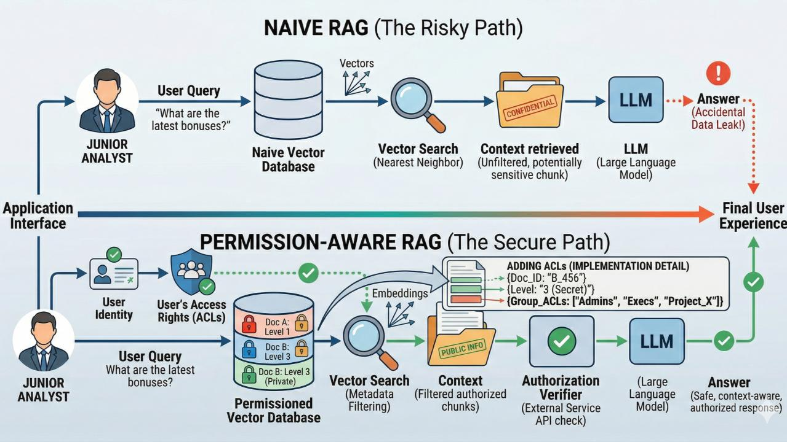
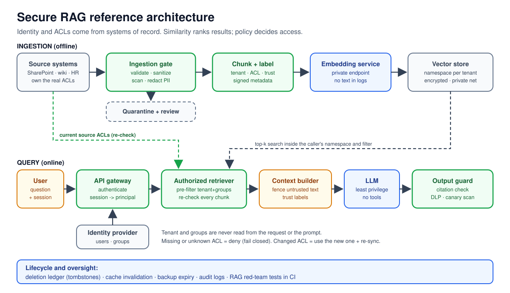
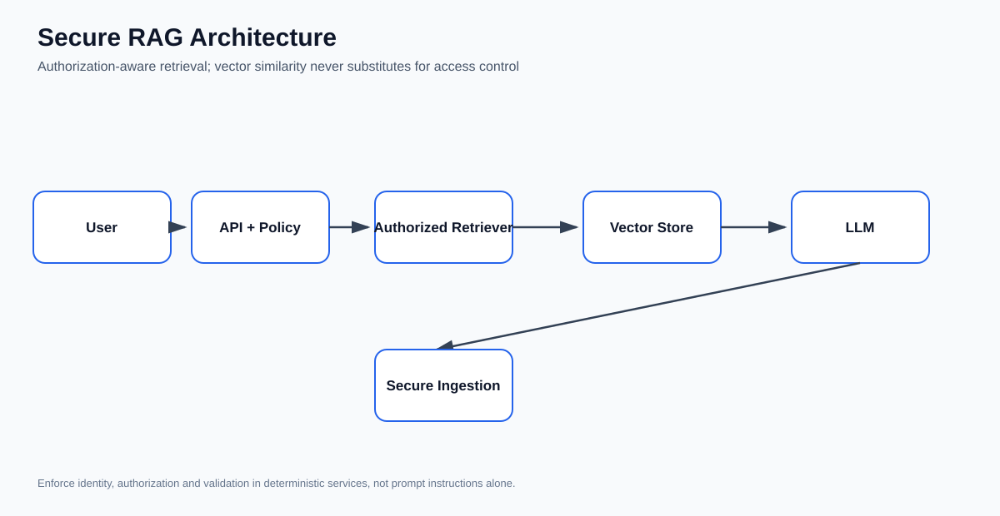

# Module 03: RAG Security

> **Weeks:** 9–12 (Month 3) · **Time:** ~50 hours · **Outcome:** you can design, build and test a multi-tenant RAG system with secure ingestion, classification-aware chunking, a hardened and encrypted vector store, authorization-aware retrieval and reranking, a response gate (DLP, citation validation), audit logging and provable deletion.

| | |
|---|---|
| **Prerequisites** | [Module 01](../01-ai-security-fundamentals/) (trust boundaries, embeddings); [Module 02](../02-llm-security/) (prompt injection, output handling) |
| **Labs** | Five offline labs plus the Portfolio Project 2 reference build, no API keys: `python -m pytest 03-rag-security` (238 tests) |
| **Maps to** | OWASP Top 10 for LLM Applications 2026: LLM09:2026 Vector and Embedding Weaknesses (was LLM08:2025) · LLM05:2026 Data and Model Poisoning (was LLM04:2025) · LLM01:2026 Prompt Injection · LLM02:2026 Sensitive Information Disclosure · LLM10:2026 Improper Output Handling (was LLM05:2025) · LLM07:2026 Misinformation (was LLM09:2025) · LLM08:2026 Hidden Context Exposure (was LLM07:2025 System Prompt Leakage) · OWASP Agentic ASI06 Memory & Context Poisoning (agentic RAG) · OWASP MCP06 Prompt Injection via Contextual Payloads and MCP10 Context Injection & Over-Sharing (RAG exposed through MCP) · OWASP GenAI Data Security DSGAI01, 04, 05, 07, 11, 13, 15, 17, 18, 21 · OWASP API1:2023 BOLA · NIST AI 600-1 · GDPR Art. 17 · India DPDP Act |

---

## 1. What RAG is, and why it needs its own security module

**RAG (Retrieval-Augmented Generation)** lets a model answer from *your* documents. Offline, the system splits documents into chunks, turns each chunk into a vector (an embedding) and stores it. Online, it turns the question into a vector, finds the most similar chunks, pastes them into the prompt, and the model answers with citations.


RAG is the most common way enterprises connect LLMs to private data. That makes it the place where three hard problems meet:

1. **Data security:** the index is a copy of your documents (text, vectors, caches, backups).
2. **Authorization:** one assistant serves many users and many tenants, but a vector search knows nothing about permissions.
3. **Content integrity:** every indexed document can become part of a prompt, so whoever can write a document can influence the model (poisoning and indirect prompt injection).

Prompt-injection controls from Module 02 still apply. This module adds what is specific to RAG: what goes **into** the index, how the index is **protected**, and who may **get out** of it.

### Naive RAG vs secure RAG



The naive path (top) sends the nearest neighbors straight to the model. A junior analyst asks about bonuses and gets the confidential file. The secure path (bottom) adds identity, ACLs on every chunk, a filtered search and an authorization check before the model.

---

## 2. Learning path

| # | Lesson | Weeks | You will | Lab tests |
|---|---|---|---|---|
| 1 | [Document security](document-security/) | 9, 12 | Build an ingestion pipeline that validates files, strips hidden text, labels trust and provenance, redacts PII and quarantines poisoned docs | 25 |
| 2 | [Vector DB security](vector-db-security/) | 10 | Fix orphan chunks, cache leaks, backup resurrection, ACL metadata tampering and an open admin API in a pure-Python vector store | 23 |
| 3 | [Access control](access-control/) | 11 | Stop cross-tenant and cross-role leaks with server-side identity, pre-filtering, per-chunk re-checks, fail-closed rules, citation validation and BOLA-safe document APIs; prove that authorization happens before the prompt | 68 |
| 4 | [Retrieval and reranking](retrieval-reranking/) | 11–12 | Stop keyword stuffing and "rank me first" pages; rerank only authorized candidates; weight by source trust; gate releases with an evaluation set | 38 |
| 5 | [Response security](response-security/) | 12 | Close exfiltration through images and links, apply DLP to answers, and validate that citations are both authorized and supported | 22 |
| 6 | [Secure HR assistant (Portfolio Project 2)](secure-hr-assistant/) | 12 | Study and extend a reference build with RBAC, tenant isolation, doc-level authz, classification-aware chunking, encryption at rest, audit logging and the five roadmap scenarios as tests | 62 |
| – | [Module mini-project](#6-module-mini-project-portfolio-project-2-secure-enterprise-rag-week-12) | 12 | Extend the HR assistant and run the RAG red-team suite (Phase 3 gate) | yours |

Week 12 covers poisoning, indirect injection, retrieval evaluation and DLP: the theory is in document-security (sections 2.3–2.5), retrieval-reranking and response-security, and the practice is the mini-project below.

Run every lab test in the module:

```powershell
python -m pytest 03-rag-security
```

---

## 3. Architecture

### 3.1 Attack surface: where each lesson fits


### 3.2 Secure RAG reference architecture



A simpler view of the same idea, from the original module notes:



### 3.3 Security invariants

These eight rules must hold in every design. If a design breaks one, it needs a documented exception and a compensating control.

1. Retrieval is authorized **before** content is added to the model's context.
2. Tenant and identity come from **verified server-side identity**, never from prompt text or client fields.
3. Every chunk carries source ID, tenant, classification, ACL and ACL version, and provenance metadata.
4. A vector similarity score is **not** an authorization decision.
5. The model cannot expand its own retrieval permissions.
6. Deletion, retention and legal hold cover source documents **and** every derived copy (chunks, vectors, caches, backups).
7. Retrieved text is untrusted data and may contain prompt injection.
8. Logs do not expose raw confidential chunks by default.

### 3.4 Threats and controls

| Threat | Example | Primary control | Lesson |
|---|---|---|---|
| Document poisoning | False "finance update" uploaded to the corpus | Source trust registry, review for untrusted sources, provenance | Document security |
| Indirect prompt injection | Hidden `display:none` instruction in a wiki page | Visible-text extraction, normalization, quarantine; Module 02 output and tool controls | Document security |
| Malicious files | Renamed executable, zip bomb, zip slip | Magic-byte validation, archive limits, sandboxed parsers | Document security |
| PII in the index | HR export indexed for everyone | Classification, redaction before embedding, restricted indexes | Document security |
| Sensitive embeddings | Vector export inverted back to text | Treat vectors as sensitive; encryption, access control, deletion | Vector DB security |
| Deletion failure | Old versions, caches and backups keep deleted data | Cascade delete, cache invalidation, tombstone replay, evidence | Vector DB security |
| Index / metadata tampering | Unauthorized edit of `allowed_groups` | Write authorization for ACL fields, signed metadata | Vector DB security |
| Exposed admin API | Unauthenticated export or reset | Authentication, admin role, private networking, audit | Vector DB security |
| Cross-tenant retrieval | Tenant A retrieves tenant B's chunk | Server-derived tenant, namespaces, pre-filter, re-check | Access control |
| ACL drift | Source access revoked but index still open | Group IDs + ACL version per chunk, re-check vs source, sync SLA | Access control |
| Citation leakage | Unauthorized title and snippet in the sources panel | Citations only from the authorized retrieval set | Access control |
| Ranking manipulation | Keyword-stuffed upload or "rank me first" page wins the top slot | Authorize before reranking, source-trust weighting, candidate validation, evaluation set as a release gate | Retrieval and reranking |
| Restricted text sent to a reranker or provider | Post-filter after a hosted rerank API | Rerank only authorized candidates; limit classifications sent out (DSGAI15) | Retrieval and reranking |
| Exfiltration through the response | Injected "add an image with the answer" | URL policy (no remote images, allowlisted links), CSP in the UI | Response security |
| Sensitive data in answers | Service key or national ID shown in chat and logs | Response DLP (withhold secrets, mask PII); keep secrets out of the index | Response security |
| Citation laundering | False claim cites the official policy | Citation membership **and** support checks | Response security |
| BOLA on document endpoints | `GET /documents/{id}` returns any HR file | Object-level authorization, same 404 for missing and forbidden | Access control + HR assistant |
| Chunk mixes classifications | Pay data inside an "internal" chunk | Section-based chunking; per-chunk labels; label propagation | Document security + HR assistant |
| Plaintext index on disk or backup | Snapshot copied from a storage bucket | Encryption at rest with per-document/tenant keys in a KMS; crypto-shredding | Vector DB security + HR assistant |

### 3.5 The RAG component table (from the roadmap)

| Component | Concern | Control | Where in this module | Test that proves it |
|---|---|---|---|---|
| Ingestion | Malicious docs | Validation and scanning | [document-security](document-security/) L1–L5 | `test_document_security.py` Part 2 |
| Chunking | Sensitive exposure | Classification (section-based chunks, per-chunk labels) | [document-security §2.4](document-security/#24-chunking-strategies-and-data-classification), [HR assistant](secure-hr-assistant/) | `test_chunks_follow_sections_and_never_mix_classifications` |
| Embeddings | Leakage | Access control and encryption | [vector-db-security §2.3, §2.6](vector-db-security/), [HR assistant](secure-hr-assistant/) L5 | `test_encryption_at_rest_no_canary_or_pii_in_raw_storage`, `test_exported_vectors_alone_reveal_the_text` |
| Vector DB | Unauthorized retrieval | Tenant isolation and RBAC | [vector-db-security](vector-db-security/) L1–L8 | `test_namespaces_isolate_tenants`, `test_secure_admin_api_requires_token_and_admin_role` |
| Retrieval | Cross-user leak | Authz-aware filtering | [access-control](access-control/) | `test_full_matrix_every_user_against_every_sensitive_doc` |
| Reranking | Manipulated relevance | Input validation and evaluation | [retrieval-reranking](retrieval-reranking/) | `test_no_attacker_document_reaches_the_context`, `test_release_gate_*` |
| Generation | Injection | Trust boundaries and output validation | [document-security](document-security/), [response-security](response-security/), Module 02 | `test_scenario_2_malicious_pdf_cannot_override_the_system_prompt` |
| Response | Disclosure | DLP and policy | [response-security](response-security/) | `test_no_attack_has_impact_on_the_secure_responder` |

### 3.6 The five roadmap scenarios, as tests

| Scenario | Named test |
|---|---|
| User A never retrieves User B's docs | `secure-hr-assistant`: `test_scenario_1_user_a_never_retrieves_user_b_docs` (also the access-control matrix test) |
| A malicious PDF can't override the system prompt | `secure-hr-assistant`: `test_scenario_2_malicious_pdf_cannot_override_the_system_prompt` |
| An unauthorized user can't get HR docs | `secure-hr-assistant`: `test_scenario_3_unauthorized_user_cannot_get_hr_docs` (also `hr_doc_to_engineer` in access-control) |
| Deleting a source invalidates its chunks and embeddings | `secure-hr-assistant`: `test_scenario_4_deleting_a_source_invalidates_its_chunks_and_embeddings` (also `test_secure_delete_removes_every_version_and_reports_evidence` in vector-db-security) |
| Authz happens before content reaches the model | `secure-hr-assistant`: `test_scenario_5_authorization_happens_before_content_reaches_the_model`; access-control: `test_secure_app_never_puts_forbidden_text_into_the_prompt` |

### 3.7 OWASP GenAI data-security risks that touch RAG

The OWASP *GenAI Data Security Risks and Mitigations 2026* document lists 21 data risks (DSGAI01–DSGAI21). These are the ones this module covers:

| Risk | RAG meaning | Lesson |
|---|---|---|
| DSGAI01 Sensitive Data Leakage | Overshared sources, retrieval of sensitive passages, exfiltration via rendered output, deletion that misses embeddings | access-control, response-security, vector-db-security |
| DSGAI04 Data, Model & Artifact Poisoning | Poisoned documents in the corpus | document-security |
| DSGAI05 Data Integrity & Validation Failures | Files and snapshot imports that pass format checks but are malicious | document-security, vector-db-security |
| DSGAI07 Governance, Lifecycle & Classification | Labels that don't propagate to chunks and vectors; erasure that misses derived copies | document-security §2.4, HR assistant |
| DSGAI11 Cross-Context & Multi-User Bleed | Shared indexes, caches and post-filters leaking across users or tenants | access-control, vector-db-security |
| DSGAI13 Vector Store Platform Data Security | Open endpoints, unencrypted vectors and snapshots, weak tenant scoping | vector-db-security §2.6 |
| DSGAI15 Over-Broad Context Windows | Stuffing whole records into prompts; sending restricted text to providers and rerankers | retrieval-reranking, response-security |
| DSGAI17 Availability & Resilience | Saturated vector DB, stale replica after failover serving deleted data | vector-db-security §2.7, retrieval-reranking |
| DSGAI18 Inference & Data Reconstruction | Embedding inversion and membership inference through similarity queries | vector-db-security |
| DSGAI21 Disinformation via Data Poisoning | False content in a trusted source, presented as grounded and cited | retrieval-reranking, document-security |

---

## 4. Key concepts (glossary)

| Term | Meaning |
|---|---|
| **Chunk** | A piece of a document (often a few hundred tokens) that is embedded and retrieved as one unit |
| **Embedding / vector** | Numbers from an embedding model that represent a text's meaning. Similar meaning → nearby vectors |
| **Cosine similarity** | A score for how close two vectors point. Used to rank chunks. Says nothing about permissions |
| **Top-k** | The k most similar chunks returned by a search |
| **Vector store / vector DB** | A database that stores vectors, chunk text and metadata, and searches by similarity |
| **Namespace / partition** | A separate area inside a vector store, often one per tenant |
| **Metadata filter** | A condition on chunk metadata (tenant, groups) applied during search |
| **Pre-filter / post-filter** | Filtering inside the search vs. removing results after the search |
| **Principal** | The authenticated identity making a request: user, tenant, groups |
| **ACL** | Access control list: who may read a document, defined in the source system |
| **ACL propagation / drift** | Copying source ACLs to chunks / the gap when the copy is out of date |
| **Fail closed** | Deny when data needed for the decision is missing |
| **Provenance** | Where data came from and what happened to it: source, hash, parser, time |
| **Trust tier** | A label for how much a source is trusted (official, internal, untrusted), set by the system |
| **Quarantine** | Keep a suspicious file for review without indexing it |
| **Data poisoning** | Adding false or malicious content to the corpus so the model repeats it |
| **Indirect prompt injection** | Instructions hidden in retrieved content that the model may follow |
| **Embedding inversion** | Rebuilding text (or attributes) from its embedding |
| **Orphan chunk** | A chunk whose document was deleted or replaced but which is still in the index |
| **Tombstone** | A record of a deletion, replayed after restores so deleted data stays deleted |
| **Canary** | A unique fake secret placed in data; if it appears where it shouldn't, you have proven a leak |
| **Reranker** | A second-stage model (cross-encoder, rerank API or LLM) that re-scores the top candidates before they go into the prompt |
| **Hybrid search** | Combining keyword (BM25) and vector search results |
| **Golden set** | A reviewed list of questions with the expected source, used to evaluate retrieval quality and safety |
| **Response gate** | Code between the model and the user that applies URL policy, citation checks and DLP |
| **Envelope encryption** | Data is encrypted with a data key; the data key is encrypted ("wrapped") by a key held in a KMS |
| **Crypto-shredding** | Deleting a key so every copy encrypted with it, including backups, becomes unreadable |
| **BOLA** | Broken Object Level Authorization: an API returns an object by ID without checking the caller's rights |

---

## 5. How the lessons connect

Follow one document through the system:

1. **Document security (in):** a file arrives. It is validated, cleaned, labeled with tenant, trust, ACL and provenance, and redacted. Bad files are rejected or quarantined. *If this stage fails, attacker text or personal data becomes part of the index.*
2. **Vector DB security (stored):** the chunks become vectors and records with metadata. The store keeps tenants apart, protects who can write ACL metadata, deletes completely and has a locked admin API. *If this stage fails, the ACL metadata that retrieval relies on can't be trusted, and "deleted" data comes back.*
3. **Access control (out):** a user asks a question. Their identity comes from the server, the search runs only over what they may read, every chunk is re-checked against the source ACL, and citations are validated. *If this stage fails, every other control is bypassed by just asking.*
4. **Retrieval and reranking (choose):** among the authorized chunks, the ranker picks the few that go into the prompt, weighted by source trust and checked for manipulation. *If this stage fails, an attacker's page becomes the answer.*
5. **Response (leave):** the answer passes a gate: no exfiltration links or images, no secrets or unmasked personal data, only supported citations. *If this stage fails, authorized data still walks out.*

The [secure HR assistant](secure-hr-assistant/) puts all five stages in one small application, with encryption and an audit log around them.

Each stage depends on the one before it. Access control trusts the metadata that ingestion created and the vector store protected. That is why the module is taught in this order, and why the mini-project tests the whole chain.

---

## 6. Module mini-project: Portfolio Project 2, Secure Enterprise RAG (week 12)

**Goal:** an HR document assistant with **RBAC, tenant isolation, document-level authorization, encryption and audit logging**, plus a red-team test suite that a security reviewer would accept as the **Phase 3 gate**. This is Portfolio Project 2 from the roadmap.

**Start from the reference build** in [secure-hr-assistant/](secure-hr-assistant/). It already meets the five requirements in plain Python and has the five roadmap scenarios as named tests. Your job:

1. Run the prototype-vs-secure scorecard and explain every row.
2. Add at least three extensions from its README (revocation SLA, deny rules, per-tenant key hierarchy, bulk-read alerts, retention, pseudonymization), each with an impact test.
3. Plug in the reranking controls ([retrieval-reranking](retrieval-reranking/)) and the full response gate ([response-security](response-security/)): URL policy and citation support checks.
4. Run the test matrix below against your build and record the metrics.
5. Optional: replace one simulated layer with a real tool (pgvector row-level security, Chroma or FAISS with server-built filters, a real KMS).

**Test matrix** (each one is an automated test that asserts impact):

| Test | Expected result |
|---|---|
| Red user retrieves red documents | Allowed, with valid citations |
| Red user asks for blue content (query uses the blue doc's own text) | No blue chunk in context, answer or citations |
| Request or prompt claims another tenant or role | Principal unchanged; event logged |
| Chunk with missing ACL metadata | Denied for everyone (fail closed) |
| Group membership revoked | Denied on the next request (within your SLA) |
| Source ACL tightened, index not yet synced | Denied by the re-check; doc queued for re-sync |
| Poisoned upload | Quarantined, never retrieved |
| Hidden instruction in an internal source | Removed or quarantined; no hijacked answer |
| Retrieved text tries to call a tool | No tool executes (reuse Module 02 tool policy) |
| Citation to an unauthorized document | Removed from answer and sources |
| Document deleted | No chunk, vector, cache entry or restored copy returns it; `verify_deleted` evidence |
| PII in a document | Redacted before embedding |
| Keyword-stuffed or "rank me first" document | Never in the context; release gate blocks a regression |
| Answer contains an exfil image or link | Removed before rendering |
| Answer contains a secret or a national ID | Secret: answer withheld; ID: masked |
| Citation not supported by its source | Removed; user sees a note |
| `GET /documents/{id}` for a forbidden doc | Same 404 as a missing doc; denial audited |
| Raw storage / backup copy | No canary or personal data in plaintext |
| Audit log | Hash chain verifies; no raw text, queries or personal data |
| Benign questions for each role | Still answered correctly |

**Measure** (put these in your journal as the module's evaluation metrics):

- **Authorized recall:** share of benign questions answered from the right document.
- **Unauthorized retrieval rate:** target is zero within the defined test scope.
- **Citation correctness:** cited docs ⊆ authorized retrieved docs.
- **Poisoning resilience:** share of poisoned docs that reach an answer.
- **Injection impact:** tools executed or data leaked because of retrieved text.
- **Deletion SLA:** time from request to `verify_deleted` = all zeros.
- **Stale ACL behavior** and **revocation SLA**.
- **Attacker-in-context rate** on the golden set (target zero) and **hit@1**.
- **Latency and cost** of the security layers (security that is too slow gets removed).

**Design exercises** (write half a page each):

1. Compare a shared index with tenant metadata filters vs separate indexes per tenant: security, cost, operations.
2. Design ACL revocation for a 30-minute SLA across SharePoint and Confluence.
3. Explain, with an example, how chunk boundaries can broaden access.
4. Define source trust tiers for your organization and what each tier may do.
5. Write a deletion runbook that covers every copy in the deletion-lifecycle diagram.

**Acceptance criteria:** the five roadmap scenario tests pass; cross-tenant and user × document tests pass; authorization happens before decryption and before context construction; missing or stale ACLs fail closed; chunks never mix classifications; raw storage holds no plaintext sensitive data; citations are access-checked and supported; the response gate closes exfil channels; deletion covers derived data with evidence; the audit log verifies and holds no raw text; benign tests pass.

**Production design decisions to document:** vector-store encryption and key ownership, backup isolation and retention, index versioning, metadata integrity, data residency, deletion guarantees, and what your embedding and LLM providers can see (prompts, chunks, vectors).

---

## 7. Interview preparation: system design

These questions cross all the lessons. Lesson READMEs have more focused questions.

<details><summary><b>Q1. Design an enterprise RAG assistant over SharePoint, Confluence and Jira for 20,000 employees. What are your security requirements?</b></summary>

- **Identity:** SSO; the principal (user, groups) is resolved server-side from the IdP on every request.
- **Ingestion:** per-connector service identities with read-only scopes; file validation, sandboxed parsing, hidden-text removal, PII handling, trust tiers and provenance; quarantine for suspicious content.
- **Storage:** encrypted vector store on a private network; ACL group IDs and ACL version on every chunk; only the sync service can write ACL fields.
- **Retrieval:** pre-filter by groups, per-chunk re-check for sensitive sources, fail closed, citation validation.
- **Generation:** no secrets in prompts; no side-effect tools by default; output handling and DLP.
- **Lifecycle:** event-driven ACL sync with a revocation SLA; deletion with evidence; backup retention.
- **Assurance:** a user × document authorization matrix in CI, a poisoning/injection red-team suite, and audit logs to the SIEM.
- **Before launch:** fix oversharing in the source systems.
</details>

<details><summary><b>Q2. Shared index with metadata filters, or one index per tenant? Decide for a 500-tenant B2B SaaS.</b></summary>

Default: a namespace (or partition) per tenant inside a shared cluster, plus a group pre-filter and per-chunk re-check. That gives structural tenant isolation at reasonable cost. Offer a dedicated index or cluster (and per-tenant encryption keys) for regulated or very large tenants. A single shared collection with only a tenant filter is acceptable only for low-sensitivity data, because one missed filter in any code path leaks across customers. Whatever you choose, test cross-tenant isolation for every endpoint.
</details>

<details><summary><b>Q3. How do you keep permissions in the index in sync with the source systems?</b></summary>

Store group IDs (not users) plus an ACL version per chunk. Sync through change events (webhooks or change feeds) with a periodic full reconciliation as a safety net. Resolve user groups at query time from the IdP. For sensitive sources, re-check each retrieved chunk against the current source ACL, and if the version differs, use the current ACL and queue a re-sync. Define a revocation SLA and test it. If you can't get the ACL, deny. For the most sensitive sources, consider "retrieve as the user" through the source's own API.
</details>

<details><summary><b>Q4. Threat-model the ingestion pipeline for a RAG system that accepts user uploads.</b></summary>

Assets: the index's integrity, other users' data, the ingestion hosts. Entry point: the upload. Threats: malicious files (parser exploits, bombs, zip slip), hidden instructions, poisoning, self-declared metadata, PII, denial of service through large or many files. Controls: size and type validation by magic bytes, archive limits, sandboxed parsers, visible-text extraction and normalization, injection scanning, trust tier `untrusted` with review before indexing, PII redaction, provenance, rate limits per uploader, and quarantine with reasons. Residual risk: well-written poisoning in an approved source, which needs downstream controls and monitoring.
</details>

<details><summary><b>Q5. A data subject asks to be deleted. Design the deletion workflow for a RAG platform.</b></summary>

A durable deletion job keyed by doc IDs (found via provenance and a search for the subject's identifiers). It deletes or redacts at the source, then all chunk versions, vectors and index entries, caches, replicas, exports, logs and chat history in scope, and evaluation or fine-tuning datasets. It writes tombstones to a ledger outside the backups, which is replayed on every restore. Backups expire on a documented schedule, or per-subject/tenant keys are crypto-shredded. The job retries, reconciles, and produces evidence (zero remaining copies, tombstone ID), which is attached to the request.
</details>

<details><summary><b>Q6. How would you defend a RAG system against PoisonedRAG-style attacks?</b></summary>

Poisoned text looks like normal content, so content scanning alone fails. Control who can write: a source registry with trust tiers, review for untrusted or high-impact sources, and provenance on every chunk. Detect anomalies: new documents closely matching high-value questions, many similar documents from new sources, sudden ranking changes in evaluation. Reduce impact: show sources and trust tiers in the UI, prefer `official` sources for policy questions, and don't let RAG answers trigger side effects without checks. Keep a poisoning test set in CI.
</details>

<details><summary><b>Q7. Where do you put authorization in a RAG system that also has tools (an agentic RAG)?</b></summary>

At two places, both outside the model. Retrieval: identity-derived filters and per-chunk re-checks decide what enters the context. Tools: every tool call is authorized server-side for the end user, with typed schemas and allowlists; side effects after untrusted content are read need approval. Retrieved text is untrusted, so it can never raise privileges. The model plans, but it is never a principal. (See [Module 05](../05-agent-security/) for agents.)
</details>

<details><summary><b>Q8. How do you test a RAG system's security before launch, and keep testing it?</b></summary>

- Build a test corpus with canaries and an oracle of who may read what.
- Run the user × document matrix using worst-case queries (the document's own text).
- Add red-team cases: spoofed identity, prompt role claims, missing or stale ACLs, citation bait, poisoning, hidden instructions, tool-call injection, deletion and restore.
- Assert on impact in the prompt, the answer and the citations.
- Run it in CI on every change to connectors, prompts, models, chunking or policy. Track metrics such as unauthorized retrieval rate (target zero) and authorized recall.
- With real models, run each case several times, because outputs vary.
</details>

<details><summary><b>Q9. What logging and monitoring do you need for RAG, without creating a new data leak?</b></summary>

Log per request: principal, query ID, retrieved chunk IDs with tenant and trust tier, denials and reasons, citations returned, tool calls, and security events (quarantine, integrity failures, stale ACLs). Do **not** log raw chunk text or full prompts by default; use IDs and hashes, and keep a restricted, short-retention debug log only if needed. Alert on cross-tenant denials, integrity failures, bulk reads, admin API use and spikes in quarantines. Send events to the SIEM so incidents can be reconstructed.
</details>

<details><summary><b>Q10. The business wants the assistant live in four weeks. What is the minimum secure version, and what can wait?</b></summary>

**Must have:** SSO and server-side identity; connectors only to sources with reviewed permissions; ACL metadata on every chunk with a pre-filter and fail-closed rules; citation validation; no side-effect tools; a vector store with authentication, a private network and encryption; a deletion process (even if partly manual) with evidence; the cross-tenant/role test matrix; and basic audit logging.

**Can follow with documented risk acceptance:** event-driven ACL sync (start with a short sync interval plus a re-check for sensitive sources), advanced poisoning detection, signed metadata, crypto-shredding, and per-tenant clusters.

I'd write the residual risks down and get the data owners to sign off.
</details>

<details><summary><b>Q11. Walk through what happens to one HR document, from upload to deletion, in a secure design.</b></summary>

Ingestion: the source registry sets tenant and trust; uploads wait for review; the file is validated, scanned and split by section, each chunk with its own classification, the document ACL (roles and named users) and the subject. Storage: text and vectors are sealed with the document's data key from a KMS; metadata stays readable for filtering. Retrieval: the principal comes from the session; authorization runs on metadata before decryption; only allowed chunks are decrypted, ranked by relevance × trust, and sent to the model. Response: the gate checks links, citations and DLP. Every step is audited without raw text. Deletion: cascade delete, cache clear, key destroyed (crypto-shredding), tombstone for restores, and `verify_deleted()` evidence.
</details>

---

## 8. Tools for the real world (optional)

The labs use plain Python so you can read every line. When you move to real tools, keep the same controls and check what each product guarantees (defaults change between versions):

| Area | Tools (from the roadmap) | Security question to answer |
|---|---|---|
| Vector store | FAISS, Chroma, pgvector | Where is the metadata filter enforced? FAISS is a library with no server, auth or metadata filter of its own; Chroma has collections and metadata filters; pgvector inherits PostgreSQL roles and row-level security |
| Frameworks | LangChain, LlamaIndex | Is the filter built server-side from the principal and passed into the retriever? Are loaders fetching untrusted URLs? |
| Evaluation | Ragas, DeepEval | Add safety metrics (attacker-in-context, unauthorized retrieval) next to quality metrics (context precision/recall, faithfulness) |
| Keys | Cloud KMS, HashiCorp Vault transit | Who can use the keys, is key use logged, can you shred per tenant or document? |
| Monitoring | OpenTelemetry, SIEM | Are traces masked? Do logs hold IDs and hashes instead of raw text? |

---

## 9. References

- OWASP Top 10 for LLM Applications 2026 (released August 2026; verify the current list and numbering at the source): https://genai.owasp.org/llm-top-10/
- OWASP Top 10 for Agentic Applications 2026 (ASI01–ASI10): https://genai.owasp.org/
- OWASP MCP Top 10 (beta): https://owasp.org/www-project-mcp-top-10/
- OWASP GenAI Security Project, *GenAI Data Security Risks and Mitigations 2026* and *GenAI Data Security Best Practices v2.0*: https://genai.owasp.org/
- OWASP AI Testing Guide: https://owasp.org/www-project-ai-testing-guide/
- OWASP API Security Top 10 2023: https://owasp.org/API-Security/
- Zou et al., *PoisonedRAG: Knowledge Corruption Attacks to Retrieval-Augmented Generation of Large Language Models* (2024): https://arxiv.org/abs/2402.07867
- Morris et al., *Text Embeddings Reveal (Almost) As Much As Text* (2023): https://arxiv.org/abs/2310.06816
- Greshake et al., *Not what you've signed up for* (indirect prompt injection, 2023): https://arxiv.org/abs/2302.12173
- Lewis et al., *Retrieval-Augmented Generation for Knowledge-Intensive NLP Tasks* (the original RAG paper, 2020): https://arxiv.org/abs/2005.11401
- NIST AI 600-1, *Generative AI Profile* (2024): https://doi.org/10.6028/NIST.AI.600-1
- MITRE ATLAS (techniques for LLM prompt injection and data poisoning; check the current IDs): https://atlas.mitre.org/
- OWASP Authorization Cheat Sheet: https://cheatsheetseries.owasp.org/cheatsheets/Authorization_Cheat_Sheet.html
- GDPR Article 17, Right to erasure: https://gdpr-info.eu/art-17-gdpr/

---

## 10. Roadmap coverage

| Roadmap topic (Phase 3 and section C) | Where it is covered |
|---|---|
| RAG architecture and ingestion | Module README §1, §3; [document-security](document-security/) |
| Parsing and chunking | [document-security](document-security/) §2.2, §2.4 (five chunking strategies and their security effects) |
| Embeddings and vector storage | [vector-db-security](vector-db-security/) §2.3–2.7 |
| Retrieval and **reranking** | [access-control](access-control/) (retrieval); [retrieval-reranking](retrieval-reranking/) (reranking, manipulation, evaluation) |
| Vector DB access control | [vector-db-security](vector-db-security/) L1–L8; [HR assistant](secure-hr-assistant/) L4 |
| Cross-tenant leakage | [access-control](access-control/); [vector-db-security](vector-db-security/); [HR assistant](secure-hr-assistant/) |
| Document poisoning | [document-security](document-security/); [retrieval-reranking](retrieval-reranking/) |
| Indirect injection via retrieved docs | [document-security](document-security/); [response-security](response-security/); HR scenario 2 |
| Data exfiltration | [response-security](response-security/) (images, links, DLP); [vector-db-security](vector-db-security/) (exports, admin API) |
| Source authorization and citation validation | [access-control](access-control/) L4 (membership); [response-security](response-security/) L2 (support) |
| Chunking → classification | [document-security](document-security/) §2.4; [HR assistant](secure-hr-assistant/) L3 |
| Embeddings → access control and encryption | [vector-db-security](vector-db-security/) §2.6; [HR assistant](secure-hr-assistant/) L5 |
| Reranking → input validation and evaluation | [retrieval-reranking](retrieval-reranking/) L3–L5 and release gate |
| Generation → trust boundaries and output validation | [response-security](response-security/); HR response gate |
| Response → DLP and policy | [response-security](response-security/) L3 |
| The five section-C scenarios | §3.6 above (named tests) |
| Hands-on: secure enterprise RAG with document-level permissions | [secure-hr-assistant](secure-hr-assistant/) + §6 mini-project |
| Portfolio Project 2 (RBAC, tenant isolation, doc-level authz, encryption, audit logging) | [secure-hr-assistant](secure-hr-assistant/) §3 requirement → code → test table |
| Tools: FAISS, Chroma, pgvector, LlamaIndex, Ragas | §8 above; optional steps in each lesson |

## 11. Further reading from your library

- **OWASP GenAI Data Security Risks and Mitigations 2026:** read DSGAI01 (leakage), DSGAI07 (classification and lifecycle), DSGAI11 (cross-context bleed), DSGAI13 (vector store platform), DSGAI15 (over-broad context), DSGAI17 (availability), DSGAI18 (inference) and DSGAI21 (disinformation). Note the Tier 1/2/3 mitigations in each.
- **OWASP GenAI Data Security Best Practices v2.0, Part 1:** Chapter 2 (the context window as a "trust-domain fusion" problem and the six core principles) and Chapter 3 (AI-DSPM and its KPIs, such as the share of vector stores with tenant scoping and encryption).
- **OWASP AI Testing Guide:** AITG-APP-02 (indirect prompt injection), AITG-APP-03 (sensitive data leak), AITG-APP-08 (embedding manipulation: hidden instructions, inversion, cross-tenant leakage, semantic poisoning) and AITG-DAT-02 (runtime exfiltration). Use them as test checklists for the mini-project.
- **Object-level authorization (OWASP API A1) checklist:** the first section; map each item to your document endpoints (see access-control §2.6).
- **LangChain/RAG code walkthrough, Part 2:** the sections on text splitters, vector stores and retrievers, and the Cohere reranking example. Read them as a typical pipeline and mark where tenant, ACL, filter and response checks are missing.
- **AI Engineering (Pachaar and Chawla):** the RAG chapter: the eight-step RAG pipeline (including re-ranking), the five chunking strategies, HyDE and the RAG architecture variants.

---

**Courses for this module (KodeKloud / Udemy):** see [00-program/learning-resources.md](../00-program/learning-resources.md).
