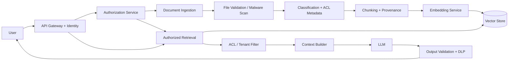

# RAG Security Blueprint

## Architecture


## Security invariants
1. Retrieval is authorized before content is added to model context.
2. Tenant identity comes from verified server-side identity, never from prompt text.
3. Every chunk carries source ID, tenant, classification, ACL/version and provenance metadata.
4. A vector similarity score is not an authorization decision.
5. The model cannot expand its own retrieval permissions.
6. Deletion, retention and legal hold apply to source documents and derived indexes/embeddings.
7. Retrieved text is untrusted data and may contain prompt injection.
8. Logs do not expose raw confidential chunks by default.

## Threats and controls
| Threat | Control |
|---|---|
| Cross-tenant retrieval | Server-derived tenant filter plus post-retrieval authorization check |
| ACL drift | Reconcile source ACLs and index metadata; fail closed on stale metadata |
| Document poisoning | Source allowlists, scanning, provenance and review |
| Indirect prompt injection | Treat retrieved content as data; constrained task and tool permissions |
| Sensitive embeddings | Access control, encryption, retention and threat assessment |
| Stale/deleted data | Deletion propagation, index rebuild/invalidation and verification |
| Retrieval manipulation | Source trust tiers, ranking tests and monitoring |
| Unauthorized citations | Validate source access before returning citations |

## Lab — cross-tenant isolation
Create two synthetic tenants, `tenant-red` and `tenant-blue`, each with one confidential document. Test:
- tenant-red can retrieve only red documents;
- tenant-blue can retrieve only blue documents;
- changing a prompt to claim another tenant does not change the server-derived tenant;
- missing ACL metadata fails closed;
- revoked access is reflected within the defined revocation SLA;
- deletion removes or invalidates chunks and embeddings.

Example policy function:
```python
def authorize_chunk(principal, chunk):
    if not principal or not principal.tenant_id:
        return False
    if chunk.tenant_id != principal.tenant_id:
        return False
    if chunk.classification == "restricted" and "read:restricted" not in principal.permissions:
        return False
    return principal.user_id in chunk.allowed_users or "read:tenant" in principal.permissions
```
This is illustrative only. Production authorization must validate identity, group membership, resource ACLs, policy version, revocation and service-side integrity. Avoid trusting ACL fields supplied by the document itself.

## Retrieval test matrix
| Test | Expected result |
|---|---|
| Cross-tenant query | No foreign chunks returned |
| Prompt asks to switch tenant | No change in principal context |
| Missing metadata | Fail closed |
| Revoked group membership | Access denied within SLA |
| Poisoned PDF | Quarantined or reviewed |
| Malicious instructions in source | Treated as untrusted content |
| Deleted source | No retrievable derived content after deletion SLA |
| Citation to unauthorized source | Citation suppressed |

## Production design decisions
Document vector-store encryption, key ownership, backup isolation, index versioning, metadata integrity, data residency, retention, deletion guarantees and provider access to prompts/embeddings.
