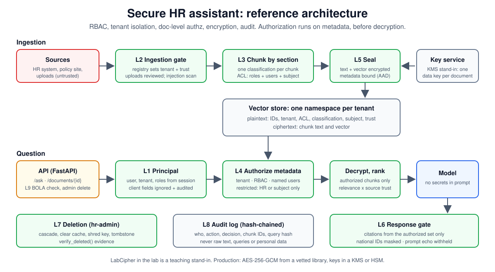

# Secure Enterprise RAG: HR Document Assistant (Portfolio Project 2)

> **Module:** 03 · RAG Security · **Week:** 12 (module mini-project, Phase 3 gate) · **Time:** ~10 hours
> **You will:** break a realistic HR assistant prototype seven ways, then study (and extend) a reference build that meets the portfolio requirements: **RBAC, tenant isolation, document-level authorization, encryption and audit logging**. The five roadmap RAG scenarios are explicit, named tests.

| | |
|---|---|
| **Prerequisites** | All four earlier lessons in this module: [document-security](../document-security/), [vector-db-security](../vector-db-security/), [access-control](../access-control/), [retrieval-reranking](../retrieval-reranking/), [response-security](../response-security/) |
| **Lab** | [`lab/`](lab/): runs offline, no API key needed |
| **Maps to** | OWASP LLM02:2026, LLM09:2026 Vector and Embedding Weaknesses (was LLM08:2025), LLM08:2026 Hidden Context Exposure (was LLM07:2025 System Prompt Leakage), LLM01:2026 · OWASP API Security API1:2023 Broken Object Level Authorization · OWASP GenAI Data Security DSGAI01, DSGAI07, DSGAI11, DSGAI13 · NIST AI 600-1 (data privacy, information security) · GDPR Art. 17 / India DPDP Act (erasure) |

---

## 1. The brief

ACME and Globex use a shared HR assistant. Employees ask about leave and expenses. HR staff ask about pay and reorganizations. Managers see their reports' profiles, but **not** their pay. Records come from the HR system as **sections**, and each section has its own classification:

| Classification | Who may read it |
|---|---|
| `internal` | Anyone the document's ACL allows (roles or named users) |
| `confidential` | Same as internal, used for HR-only documents such as the reorg plan |
| `restricted` | Only the `hr` role or the person the record is about (the subject) |

Users: Alice and Bob (employees), Maria (their manager), Hana (HR), Omar (`hr-admin`: runs deletions but reads no records, a separation of duties), Gil (HR at Globex).



---

## 2. What goes wrong in the prototype

Run the scorecard:

```powershell
python 03-rag-security/secure-hr-assistant/lab/demo.py
```

Expected output (the canary suffixes are random on each run):

```text
case                         vulnerable                                                         secure
----------------------------------------------------------------------------------------------------------------
tenant_spoof_in_request      LEAK: globex-handbook/Leave                                        ok
user_a_reads_user_b          LEAK: acme-bob-record/Compensation                                 ok
manager_sees_report_pay      LEAK: acme-alice-record/Compensation,acme-alice-record/Personal    ok
bola_open_hr_document        BOLA: opened reorg plan                                            ok (404)
malicious_pdf_override       PROMPT OVERRIDDEN                                                  ok (quarantined)
deleted_doc_still_answers    DELETED DATA SERVED                                                ok
disk_or_backup_theft         PLAINTEXT ON DISK                                                  ok (ciphertext)

Authorized users still get their answers (secure app):
  hana   Alice compensation salary band base pay      ok
  alice  Alice compensation salary band base pay      ok
  gil    Globex annual leave days                     ok

Audit log: 8 entries, hash chain valid = True
Authorization happens before decryption; the model only ever sees what the user may read.
```

Open [`vulnerable_hr_rag.py`](lab/vulnerable_hr_rag.py) and map its nine `VULN` comments to the rows. Two of them are easy to miss in real projects:

- **Chunking that ignores classification (VULN 4).** Fixed-size chunks of 20 words run across the Profile → Compensation boundary, and each chunk takes the *first* section's label. Pay data ends up in an `internal` chunk that Maria may read. The access check is correct; the label it checks is wrong.
- **ACL mapping fallback (VULN 5).** The connector can't map "shared with Alice and Maria", so it falls back to "all employees". Many real connectors have hard cases like this (see the access-control lesson, section 2.5).

---

## 3. The reference build: requirement → code → test

Open [`secure_hr_rag.py`](lab/secure_hr_rag.py). Its docstring lists layers L1–L9.

| Portfolio requirement | How the reference build meets it | Proven by |
|---|---|---|
| **RBAC** | Roles from the identity provider (`employee`, `manager`, `hr`, `hr-admin`); `restricted` needs `hr` or the subject; delete needs `hr-admin` | `test_rbac_hr_reads_pay_but_a_manager_sees_only_the_profile`, `test_only_hr_admin_may_delete_and_the_attempt_is_audited` |
| **Tenant isolation** | Tenant from the session; one namespace per tenant; the source registry (not the document) sets the tenant at ingestion | `test_tenant_isolation_holds_even_for_the_same_role_name`, `test_api_ignores_a_tenant_field_in_the_body` |
| **Document-level authz** | Per-document ACL with roles **and** named users, plus a subject; checked on every chunk and on "open document" (BOLA) | `test_document_level_authz_named_users_and_subjects`, `test_api_bola_returns_the_same_404_for_forbidden_and_missing` |
| **Classification-aware chunking** | Chunks never cross section boundaries; each chunk carries its own section's classification; unknown classification → quarantine | `test_chunks_follow_sections_and_never_mix_classifications` |
| **Encryption** (simulated) | One data key per document from a `KeyService` (KMS stand-in, envelope encryption); text and vector sealed; record metadata bound to the ciphertext; decrypt only after authorization | `test_encryption_at_rest_no_canary_or_pii_in_raw_storage`, `test_ciphertext_is_bound_to_its_record` |
| **Audit logging** | Append-only, hash-chained log: who, what, decision, chunk IDs, query **hash**, gate events. No raw text, no queries, no personal data | `test_audit_log_is_chained_and_holds_no_raw_text_or_pii`, `test_tampering_with_the_audit_log_is_detected` |
| **Deletion** | Cascade delete, cache clear, crypto-shred the data key, tombstone, `verify_deleted()` evidence | `test_scenario_4_...` |
| **Response policy** | Citations from the authorized set; national IDs masked in chat; system-prompt echo withheld; no secrets in the prompt | `test_national_ids_are_masked_in_chat_even_for_the_subject`, `test_scenario_2_...` |

> **Lab-only crypto.** `LabCipher` is built from HMAC-SHA256 so the lab needs no extra packages. Never use it for real data. In production use AES-256-GCM (or ChaCha20-Poly1305) from a vetted library, and keys from AWS KMS, Azure Key Vault, Google Cloud KMS or an HSM.

### The five roadmap scenarios

| Roadmap scenario | Test | What it asserts |
|---|---|---|
| User A never retrieves User B's docs | `test_scenario_1_user_a_never_retrieves_user_b_docs` | 6 users × 5 sensitive sections, asked with the section's own text; visible result equals the HR system's rules, both ways |
| A malicious PDF can't override the system prompt | `test_scenario_2_malicious_pdf_cannot_override_the_system_prompt` | Quarantined at ingestion; with the scanner off, the response gate withholds the prompt echo; no other person's data in the answer |
| An unauthorized user can't get HR docs | `test_scenario_3_unauthorized_user_cannot_get_hr_docs` | Five non-HR users get nothing from chat or "open document"; HR still can |
| Deleting a source invalidates its chunks and embeddings | `test_scenario_4_deleting_a_source_invalidates_its_chunks_and_embeddings` | Evidence is all zeros; cached answer gone; a restore from an old backup (even without tombstone replay) can't be decrypted |
| Authz happens before content reaches the model | `test_scenario_5_authorization_happens_before_content_reaches_the_model` | Every decrypted chunk was readable by the asker; no forbidden canary in any `<context>` sent to the model |

The same "authz before the model" check also exists in the core [access-control lab](../access-control/) (Part 4 of its tests).

---

## 4. Hands-on steps

### Step 1: Run the tests

```powershell
python -m pytest 03-rag-security/secure-hr-assistant -v
```

You should see `62 passed`.

### Step 2: Read the flow of one question

Follow `SecureHrAssistant.ask()` line by line:

1. Principal from the session (client fields are logged and ignored).
2. Only the caller's tenant namespace.
3. `can_read()` on **metadata** for every chunk: before any decryption.
4. Decrypt only the allowed chunks; score; multiply by source trust (rerank authorized candidates only).
5. Build the context; call the model.
6. Response gate; citations from the authorized set.
7. Audit entry with chunk IDs and a hash of the query.

### Step 3: Break it yourself

Predict first, then run:

1. `SecureHrAssistant(..., response_gate=False, scan_ingest=False)` with the malicious PDF: what does Alice see? Why does it still not leak anyone's pay? (`test_without_the_response_gate_a_missed_injection_reaches_the_user`.)
2. In `can_read()`, delete the classification rule. Which scenario test fails, and for which user?
3. In `ask()`, decrypt all chunks first and filter afterwards. Do the leak tests still pass? Does scenario 5? Why is this still a real weakness?
4. Change `chunk_by_section()` to fixed-size chunks across sections (like the prototype). Which tests fail?
5. Remove `self.keys.destroy(...)` from `delete_document()`. Which part of scenario 4 fails?

### Step 4: Extend it (portfolio work)

Pick at least three. Each one needs a test that asserts impact.

- **Revocation SLA:** remove Maria's manager role in `USERS`; prove the next request (not the cached answer) reflects it. Hint: should the cache key include roles?
- **Deny rules:** an employee on leave is denied even if a role allows.
- **Per-tenant key hierarchy:** tenant key-encryption keys that wrap document keys; shred a whole tenant.
- **Bulk-read alert:** more than N `open_document` calls per minute → event.
- **Retention:** documents carry a retention date; expired ones are deleted with evidence.
- **Pseudonymization:** replace employee names with tokens in chunks; resolve them only for HR.

### Step 5: Real tools (optional)

Rebuild one layer with a real product, and record what it guarantees in your journal (check the current docs; defaults change between versions):

- **pgvector + PostgreSQL row-level security** for tenant and document ACLs, with the filter enforced by the database.
- **Chroma** or **FAISS** with metadata filters (FAISS has no built-in metadata filtering: where would you enforce authorization?).
- **LlamaIndex** or **LangChain** retrievers with a metadata filter built server-side from the principal.
- **A real KMS** (cloud or HashiCorp Vault transit) for envelope encryption.
- **OpenTelemetry** to ship the audit events to a SIEM, with the same "no raw text" rule.

---

## 5. Portfolio write-up (what to publish)

1. Architecture diagram and data-flow diagram (where text, vectors, keys and logs live).
2. Threat model: assets, actors, the nine prototype weaknesses, and the residual risks.
3. Requirement → control → test table (like section 3), linked to code.
4. Test results, including the five scenario tests and your extensions.
5. A short "what I would change for production" section: real crypto and KMS, IdP integration (OIDC), ACL sync from the HR system, retention and DSR (data subject request) workflow, monitoring.

---

## 6. Interview preparation

<details><summary><b>Q1. Walk me through your HR assistant's security design.</b></summary>

Identity from the session; tenant namespace; per-chunk authorization (roles, named users, subject, classification) on metadata before any decryption; per-document data keys from a KMS; trust-weighted reranking of authorized chunks only; a response gate (citations, DLP, prompt-echo check); deletion with crypto-shredding and evidence; a hash-chained audit log without raw text; an API with object-level authorization. Each requirement has a named test.
</details>

<details><summary><b>Q2. Why does chunking matter for access control?</b></summary>

Authorization is checked per chunk, using the chunk's label. If a chunk mixes a public profile with restricted pay data, the label is wrong for part of it, and a correct access check lets the restricted text through. Chunk along source structure (sections, fields), never across classification boundaries, and give each chunk the label of its own content (or the strictest label of its inputs).
</details>

<details><summary><b>Q3. Why decrypt only after authorization?</b></summary>

So restricted content never exists in plaintext in the request path of a user who may not read it: not in memory dumps, debug logs, the reranker or the model. It also turns "authorization happens before content reaches the model" into something you can test (the decrypt log).
</details>

<details><summary><b>Q4. How does crypto-shredding help with deletion?</b></summary>

Each document (or subject, or tenant) has its own data key. Destroying the key makes every copy unreadable, including backups and replicas you can't rewrite. Combine it with cascade delete, tombstones and backup expiry, and keep evidence.
</details>

<details><summary><b>Q5. What is BOLA, and where does it appear in a RAG product?</b></summary>

Broken Object Level Authorization (OWASP API1:2023): the API returns an object by ID without checking the caller may access it. In RAG: "open source document", citation links, document previews, export and "related documents" endpoints. Check authorization on every request, take identity from the session (not IDs from the client), and return the same response for "not found" and "not allowed".
</details>

<details><summary><b>Q6. What do you log, and what don't you?</b></summary>

Log who, when, which action, the decision, chunk and document IDs, a hash of the query, gate findings by type, and deletion evidence. Don't log raw questions, chunks, answers or personal data by default. Chain the log entries with hashes (or ship them to write-once storage) so tampering is detectable.
</details>

<details><summary><b>Q7. A manager asks "what is Alice paid?". Walk through what happens.</b></summary>

Maria's principal has `manager`; Alice's record ACL names Maria, so the Profile chunk is allowed, but the Compensation chunk is `restricted` and Maria is neither HR nor the subject, so it is filtered on metadata and never decrypted. The model sees only the profile. The audit log records the request, the chunks used and the denied count.
</details>

<details><summary><b>Q8. What would you change before production?</b></summary>

Real AEAD crypto and a KMS with key rotation; OIDC/SSO and group sync from the IdP; ACL sync from the HR system with a revocation SLA; a policy engine for the rules; DSR workflows; monitoring and alerts in the SIEM; a CI pipeline running the scenario and matrix tests; a DPIA and documentation of what the LLM provider receives.
</details>

<details><summary><b>Q9. Explain this project to a non-technical HR director.</b></summary>

"The assistant only reads what each person could open in the HR system themselves: employees see policies and their own record, managers see their team's profiles but not pay, HR sees everything for their company. Records are stored encrypted, deleting a record really deletes it everywhere, and every access is logged. We test all of this automatically."
</details>

---

## 7. Checklist (definition of done)

- [ ] `python -m pytest 03-rag-security/secure-hr-assistant` passes.
- [ ] I can map each of the nine prototype weaknesses to a control and a test.
- [ ] I did the five "break it yourself" exercises.
- [ ] I implemented at least three extensions, each with an impact test.
- [ ] I wrote the portfolio write-up (section 5) and linked it from my journal.

## 8. References

- OWASP Top 10 for LLM Applications 2026 (verify the current list at the source): https://genai.owasp.org/llm-top-10/
- OWASP API Security Top 10 2023, API1 Broken Object Level Authorization: https://owasp.org/API-Security/editions/2023/en/0xa1-broken-object-level-authorization/
- OWASP GenAI Security Project, *GenAI Data Security Risks and Mitigations 2026* (DSGAI01, DSGAI07, DSGAI11, DSGAI13): https://genai.owasp.org/
- NIST SP 800-57 Part 1 Rev. 5, *Recommendation for Key Management*: https://csrc.nist.gov/pubs/sp/800/57/pt1/r5/final
- PostgreSQL row-level security: https://www.postgresql.org/docs/current/ddl-rowsecurity.html · pgvector: https://github.com/pgvector/pgvector
- NIST AI 600-1, *Generative AI Profile* (2024): https://doi.org/10.6028/NIST.AI.600-1
