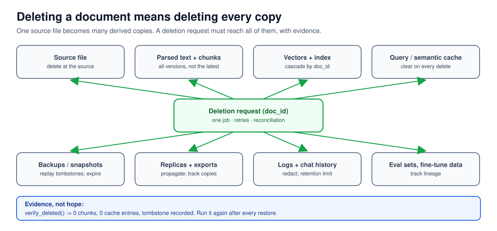
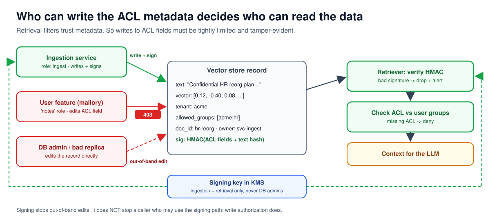

# Vector Database Security

> **Module:** 03 · RAG Security · **Week:** 10 (embeddings, vector stores, index lifecycle and deletion) · **Time:** ~10 hours
> **You will:** attack a pure-Python vector store four ways (deleted data that comes back, cache leaks, ACL metadata tampering, an open admin API), then build a security baseline and prove each control with tests.

| | |
|---|---|
| **Prerequisites** | [Module 01](../../01-ai-security-fundamentals/) embeddings basics; [document-security](../document-security/) (how chunks are made) |
| **Lab** | [`lab/`](lab/): runs offline, no API key, no vector-DB product needed |
| **Maps to** | OWASP LLM08:2025 Vector and Embedding Weaknesses · LLM02:2025 Sensitive Information Disclosure · NIST AI 600-1 (data privacy, information security) · GDPR Art. 17 (right to erasure) · CIS Controls 3 (data protection) and 6 (access control management) |

---

## 1. Why this matters

A vector database stores three things for every chunk: the **vector** (a list of numbers that represents the meaning of the text), the **text** itself (most RAG stores keep it), and **metadata** (tenant, ACL, source). It is a database full of your company's documents. It needs the same care as any other database, plus some new problems.

Some public examples and research:

- **2023, Morris et al., *"Text Embeddings Reveal (Almost) As Much As Text"*:** their method (vec2text) rebuilt most short input texts exactly from their embeddings alone. Vectors are not a safe "anonymized" form of text.
- **2025, OWASP LLM08 "Vector and Embedding Weaknesses":** OWASP added a dedicated Top-10 entry for risks such as unauthorized access, cross-context leaks, embedding inversion and data poisoning in vector stores.
- **2023, ChatGPT outage (OpenAI incident report):** a bug in a Redis client library caused some users to see titles from other users' chat histories. A cache shared across users is a data-leak path.
- **2017, open MongoDB and Elasticsearch servers:** attackers mass-wiped databases that were reachable from the internet without authentication and left ransom notes. Any data store with an exposed, unauthenticated admin API is at the same risk. Vector databases are no exception.

The pattern: **the vector store is treated as a "search index", not as a sensitive database**. So deletion, access control, caching and admin access get less attention than they need.

---

## 2. Understand it

### 2.1 The root cause in one sentence

A vector store makes **copies** of sensitive data (vectors, text, caches, backups) and makes **access decisions based on metadata**, so whoever can change the metadata, reach the admin API or miss a copy during deletion controls who sees the data.

Key terms:

- **Embedding / vector:** numbers produced by an embedding model. Similar meaning → nearby vectors. **Cosine similarity** measures how close two vectors point.
- **Namespace / collection / partition:** a separate area inside the store. Many products offer this (for example Pinecone namespaces, Weaviate multi-tenancy, Milvus partitions, Qdrant collections and payload filters, PostgreSQL + pgvector with row-level security). Check what your product guarantees.
- **Orphan chunk:** a chunk whose parent document was deleted or replaced, but which is still in the index.
- **Tombstone:** a record that says "doc X was deleted at time T". It is kept so the deletion can be applied again, for example after a restore.

### 2.2 Threats

| Threat | Example | Impact |
|---|---|---|
| **Embedding inversion** | An attacker gets a vector export and rebuilds the text | Leak of "anonymized" data |
| **Unauthenticated or exposed admin API** | `GET /admin/export` with no token, port open to the network | Bulk theft or deletion of the whole store |
| **Metadata tampering** | A user feature can update any metadata field; someone adds their group to `allowed_groups` | Privilege escalation through the retrieval filter |
| **Cross-tenant leaks** | One shared collection, tenant filter forgotten in one query path | Customer A sees customer B's data |
| **Cache leaks** | Query cache keyed by question text only | User B gets user A's authorized results |
| **Incomplete deletion** | Old document versions (orphans), caches, replicas, backups still hold the data | Privacy law violation; "deleted" data in answers |
| **Index poisoning** | Write access to the store lets someone insert crafted vectors | Attacker content ranks first |
| **Weak operations** | No encryption at rest, backups readable by many, no audit log | Breach is easy and invisible |

### 2.3 Embeddings are sensitive derived data

It is tempting to think "it's just numbers". Research says otherwise. Morris et al. (2023) trained a model that rebuilds text from embeddings and recovered most short inputs exactly in their tests. Other work shows that attributes (for example, names or topics) can be predicted from vectors. In the lab, the toy bag-of-words embedding stores the words directly, so `invert_bag_of_words()` rebuilds the canary trivially. Real embeddings are harder to invert, but the lesson is the same:

> **Classify vectors at the same level as the text they came from.** Encrypt them, control access to them, include them in deletion, and don't send them to systems you would not send the text to.

Also note: sending text to a third-party **embedding API** shares that text with the provider. Check the provider's data retention terms and use private endpoints where possible.

### 2.4 Where does one document live?



A single source file becomes: parsed text → chunks (often several **versions**) → vectors → index entries → query and semantic caches → replicas → backups and snapshots → logs and chat history → maybe evaluation sets or fine-tuning data. A deletion request (for example under GDPR Article 17, the "right to erasure") must reach **all of them**, or have a documented, time-limited exception (backups that expire, legal hold).

### 2.5 Who can write the ACL metadata?



Retrieval filters usually look like `allowed_groups ∩ user_groups ≠ ∅`. That filter is only as trustworthy as the metadata. Ask:

- Which identities can **write** records? Which can **update metadata**? Which can do both?
- Can a user-facing feature (notes, bookmarks, "upload your file") write to the same collection as company documents?
- Can a DB admin, a replica or a backup restore change metadata without anyone noticing?

---

## 3. Defend it

| Layer | Control | Type | What it buys you |
|---|---|---|---|
| L1 | **Namespaces per tenant** (or separate indexes/clusters for the strictest isolation); queries only touch the caller's namespace | Hard | A missed filter can't cross tenants |
| L2 | **Write authorization**: only the ingestion service identity may create records or change ACL fields; user features write to their own namespace | Hard | No privilege escalation through metadata |
| L3 | **Signed metadata**: the ingestion service signs ACL fields + a text hash (HMAC or a digital signature); retrieval verifies and drops bad records | Hard | Out-of-band edits (DB console, compromised replica) are detected |
| L4 | **Fail closed** on missing ACL metadata | Hard | Old imports and bugs deny instead of leak |
| L5 | **Cascade delete by doc_id** across all versions; re-ingestion replaces old chunks | Hard | No orphans |
| L6 | **Safe caching**: key includes tenant, groups and an index generation; clear on writes and deletes | Hard | No cross-user cache leaks, no stale deleted data |
| L7 | **Deletion ledger (tombstones)** stored outside backups, replayed after every restore; `verify_deleted()` evidence; backup expiry | Hard + Process | Deleted data stays deleted; you can prove it |
| L8 | **Admin API protection**: strong authentication, admin role, no raw text or vectors in API exports, audit log; private network only | Hard | Open-port disasters don't happen |
| Ops | Encryption at rest and in transit, customer-managed keys where needed, private endpoints, backup access control, monitoring of bulk reads | Hard + Process | Standard database hygiene, applied to the vector store |

### Design patterns worth knowing

- **Isolation ladder.** From weakest to strongest: one collection with a tenant metadata filter → namespace/partition per tenant → collection/index per tenant → separate cluster or account per tenant. Choose by data sensitivity, tenant count and cost. Regulated or very large customers often get the top rungs.
- **Crypto-shredding.** Encrypt each tenant's (or each data subject's) data with its own key. Deleting the key makes all copies unreadable, including backups. Useful when you cannot rewrite old backups.
- **Index generation number.** Every write bumps a counter that is part of every cache key. Cache entries from before a deletion can never be served again.
- **Re-ingestion is replacement.** Treat "new version of doc X" as "delete all chunks of X, then insert". Never append.
- **Signing key outside the database.** The vector store holds signatures but not the key. The key sits in a KMS and only the ingestion and retrieval services can use it.

### What does NOT work on its own

- "Vectors are just numbers, so they are anonymized." See embedding inversion research.
- Deleting the source file and assuming the index follows. `test_vulnerable_delete_leaves_orphan_chunks_from_old_versions` proves it does not.
- Signing metadata while still letting any caller use the API that re-signs records. `test_signing_does_not_help_if_the_attacker_can_use_the_signing_path` proves it.
- "The admin port is internal." Internal networks get compromised, and misconfigured security groups are common. Authenticate anyway.
- A cache "for performance" without a security review. Caches are copies of data with their own access rules.

---

## 4. Hands-on lab

**Scenario:** ACME's knowledge assistant uses an in-memory vector store. Hana (HR), Sam (support) and Mallory (staff, with a "personal notes" feature) use it. A customer, Erin, asks ACME to delete her data. Mallory wants to read the confidential HR reorg plan.

Files:

| File | Purpose |
|---|---|
| [`vulnerable_vectordb.py`](lab/vulnerable_vectordb.py) | Store + RAG answer + admin API with 9 `VULN` comments |
| [`secure_vectordb.py`](lab/secure_vectordb.py) | `SecureVectorStore` with switchable layers, secure admin API |
| [`attacks.py`](lab/attacks.py) | Synthetic users, documents (with canaries) and the inversion helper |
| [`demo.py`](lab/demo.py) | Scorecard |
| [`test_vector_db_security.py`](lab/test_vector_db_security.py) | 23 impact-based tests |

The "embedding" is a bag-of-words vector (word → count) and similarity is cosine. No libraries, so you can read every line.

### Step 1: Run the scorecard

```powershell
python 03-rag-security/vector-db-security/lab/demo.py
```

Expected output:

```text
case                               vulnerable             secure
----------------------------------------------------------------------
orphan_chunks_after_delete         DELETED DATA SERVED    ok
cache_after_delete                 DELETED DATA SERVED    ok
backup_resurrection                DELETED DATA SERVED    ok
cross_user_cache                   CANARY LEAKED          ok
metadata_tamper_via_api            CANARY LEAKED          ok
metadata_tamper_direct_db_write    CANARY LEAKED          ok
unauthenticated_export             CANARY LEAKED          ok (401)
vectors_only_inversion             TEXT RECOVERED         ok
unauthenticated_reset              STORE WIPED            ok
benign_handbook_question           ok                     ok

Similarity decides what is RELEVANT. Only access checks decide what is ALLOWED.
Tip: switch a layer off, e.g. SecureVectorStore(replay_tombstones=False), and re-run.
```

`vectors_only_inversion` uses an **admin** token on the secure API. Even the admin export contains only IDs and ACL metadata. Raw text and vectors leave the system only through the encrypted backup pipeline.

### Step 2: Read the vulnerable code

Open [`lab/vulnerable_vectordb.py`](lab/vulnerable_vectordb.py) and find the nine `VULN` comments. For each, write which scorecard row it causes. Some rows need two VULNs at once: which two make `orphan_chunks_after_delete` possible?

### Step 3: Read the secure code and run the tests

```powershell
python -m pytest 03-rag-security/vector-db-security -v
```

You should see `23 passed`. Look at `verify_deleted()`: it returns **evidence** (`chunks_remaining`, `cache_entries`, `tombstoned`). In a real system, that report is attached to the privacy request ticket.

### Step 4: Break it yourself

Predict first, then run:

1. `SecureVectorStore(cascade_delete=False)`: which scorecard row breaks? Which test shows it?
2. `SecureVectorStore(safe_cache=False)`: which **two** rows break? Why does one bug cause both a privacy problem and an authorization problem?
3. `SecureVectorStore(enforce_write_authz=False)`: does `metadata_tamper_direct_db_write` still fail? Does `metadata_tamper_via_api`? Explain the difference.
4. Take a vulnerable export and remove the `text` field from every record. Can you still find the HR canary? What does this tell you about "we only share the vectors"?
5. `SecureVectorStore(sign_metadata=False)`: which row breaks now? Together with exercise 3, explain why you need **both** write authorization and signing.
6. In `create_admin_api`, compare tokens with `==` instead of `hmac.compare_digest`. Tests still pass. Why is it still a weakness? (Hint: timing.)

### Step 5: Try a real vector DB (optional)

If you know Docker, run a local vector database of your choice (for example Qdrant, Weaviate, Milvus or PostgreSQL with pgvector). Check, in its current documentation:

- Is authentication on by default? How do you enable it?
- How does it isolate tenants (namespaces, collections, partitions, row-level security)?
- How does deletion work (soft delete, compaction)? When is the data really gone from disk?
- Are snapshots encrypted? Who can read them?

Write the answers into your week 10 journal as a "vector-store security baseline". Product defaults change between versions, so always check the version you run.

### Stretch goals

- Add **crypto-shredding**: encrypt each tenant's text with its own key (use a simple XOR for the lab, and note it is not real crypto), and show that deleting the key makes the backup unreadable.
- Add a **rate limit and alert** on bulk reads: more than N records per minute from one identity triggers an event.
- Add a **semantic cache** (cache by similar questions, not exact text) and show why it needs the same identity-aware key.
- Replace HMAC with an Ed25519 signature so the retriever can verify with a public key only. (Needs a crypto library, so keep it optional.)

---

## 5. Real-world scenarios

**Scenario A: the "deleted" customer comes back.** *(hypothetical)*
A customer exercises the right to erasure. The team deletes the source ticket and the chunks of the latest version. Three months later, after a restore from backup, the support assistant quotes the customer's old ticket.
- *What went wrong:* deletion covered one copy. Old versions were orphaned, the restore re-introduced data, and nobody verified.
- *Investigate:* search every namespace and the caches for the doc ID and the customer's identifiers; check when backups were taken relative to the deletion; review the deletion job's logs.
- *Fix:* cascade delete by doc ID; a tombstone ledger replayed after every restore; backup retention aligned with the privacy policy; a `verify_deleted` report attached to every request.

**Scenario B: the notes feature that became an admin.** *(hypothetical)*
A product team adds "save your own notes to the assistant". Notes go into the same collection as company documents, through an API that accepts any metadata. A curious employee updates an HR chunk's `allowed_groups`.
- *What went wrong:* user-controlled writes and company ACL metadata shared one write path, with no field-level authorization.
- *Investigate:* audit log of metadata updates by non-ingestion identities; diff ACL metadata against the source system; list retrievals of the affected chunks.
- *Fix:* separate namespace for user content; only the ingestion identity can write ACL fields; signed metadata; periodic ACL reconciliation against source systems.

**Scenario C: the open vector DB port.** *(hypothetical, based on a common pattern)*
A team spins up a vector database for a proof of concept with authentication off and a public IP "for a day". The proof of concept becomes production.
- *What went wrong:* default-open development settings reached production; no network policy; no inventory.
- *Investigate:* access logs for unknown IPs; bulk export or delete calls; compare record counts with backups.
- *Fix:* infrastructure-as-code with authentication and private networking enforced by policy checks (see [Module 06](../../06-ai-devsecops/)); external attack-surface scanning; treat the vector store as a production database from day one.

---

## 6. Common mistakes

- Treating the vector store as a cache that "can be rebuilt", so it gets no backup protection, no audit and no deletion process. It still holds the data.
- Using one shared API key for every service that touches the store.
- Letting the query cache key ignore the user's identity.
- Re-ingesting updated documents without removing the old chunks.
- Keeping backups forever "just in case", which conflicts with deletion promises.
- Logging full retrieved chunks at INFO level into a widely readable log system.
- Sending vectors to analytics or third parties because "they are anonymous".

---

## 7. Interview preparation

<details><summary><b>Q1. Are embeddings sensitive data? Defend your answer.</b></summary>

Yes, treat them as sensitive derived data. Embedding inversion research (for example Morris et al., 2023, vec2text) rebuilt most short texts exactly from their embeddings, and other work infers attributes from vectors. So vectors get the same classification, encryption, access control, retention and deletion as the source text. Also, most vector stores keep the raw text next to the vector, so the store usually holds the plain text anyway.
</details>

<details><summary><b>Q2. How do you isolate tenants in a vector database?</b></summary>

Use an isolation ladder: metadata filter in a shared collection (weakest; one missed filter leaks) → namespace or partition per tenant → collection/index per tenant → separate cluster/account per tenant (strongest). Pick by sensitivity, tenant count and cost. Whatever you pick, the tenant comes from server-side identity, queries are built server-side, and you have automated cross-tenant tests.
</details>

<details><summary><b>Q3. A user asks to be forgotten. What must your RAG platform delete?</b></summary>

The source document, parsed text, all chunk versions, vectors and index entries, query and semantic caches, replicas and exports, logs and chat history that contain it, evaluation or fine-tuning datasets, and backups (or a documented backup expiry plus tombstone replay on restore). Then produce evidence: counts of what is left (should be zero) and the tombstone record.
</details>

<details><summary><b>Q4. What is an orphan chunk and how do you prevent it?</b></summary>

A chunk whose document was deleted or replaced but which stays in the index, often from an older version. Prevent it by deleting by `doc_id` metadata across all versions, treating re-ingestion as "delete then insert", and running a periodic reconciliation job that compares index doc IDs with the source system.
</details>

<details><summary><b>Q5. How can a cache cause a data leak in RAG?</b></summary>

Two ways. If the cache key ignores identity, user B gets results that were authorized for user A. If it is not cleared on delete or permission change, it serves data that should be gone. Key the cache on tenant + groups (or user) + an index generation number + the query, and clear it on writes, deletes and ACL changes.
</details>

<details><summary><b>Q6. Who should be allowed to write ACL metadata in the vector store?</b></summary>

Only the ingestion/sync service identity that copies ACLs from the source system. User-facing features write to their own namespace, with ACL fields set by the server. Add field-level authorization, sign the metadata so out-of-band edits are detected, and reconcile against the source system regularly.
</details>

<details><summary><b>Q7. Why sign metadata, and what are the limits?</b></summary>

A signature (HMAC or a digital signature) over ACL fields and a text hash lets the retriever detect edits made outside the ingestion path, such as a DB console change or a compromised replica. Limits: it does not help if an attacker can call the API that signs records, and the key must live outside the database (KMS, only for ingestion and retrieval services). It also adds key-rotation work.
</details>

<details><summary><b>Q8. What would your vector-store security baseline include?</b></summary>

Authentication on, with per-service identities and least-privilege roles; private networking only; TLS; encryption at rest (customer-managed keys if needed); tenant isolation; write authorization for ACL fields; audit logs for admin and bulk reads; backup encryption, access control and retention; a deletion process with evidence; vulnerability patching; and infrastructure-as-code with policy checks that block public exposure.
</details>

<details><summary><b>Q9. Scenario: you find a vector DB admin API open to the internet. What do you do?</b></summary>

1. Contain: block access at the network level now; rotate any keys.
2. Preserve evidence: snapshot logs.
3. Investigate: access logs for exports, deletes and writes from unknown sources; compare counts and checksums with backups; check for inserted (poisoned) records.
4. Assess: what data was in it (text, vectors, metadata), which tenants, which regulations apply.
5. Recover: restore if tampered, re-ingest from sources if needed.
6. Fix the root cause: why was it deployable that way? Add policy-as-code and external scanning.
</details>

<details><summary><b>Q10. How do backups interact with deletion promises?</b></summary>

Backups are copies. You need a documented backup retention (for example 30 days), a tombstone ledger that is replayed after every restore so deleted items don't return, and optionally crypto-shredding (per-tenant or per-subject keys you can destroy). Tell legal and privacy teams the real timeline: "removed from live systems within X days, from backups within Y days".
</details>

<details><summary><b>Q11. What is index poisoning in a vector store?</b></summary>

Someone with write access inserts records crafted to rank first for target questions (or crafted vectors directly). It is like corpus poisoning, but through the store's write API. Controls: only the ingestion identity can write; signed records; provenance on every record; monitoring for writes from unexpected identities; reconciliation against sources.
</details>

<details><summary><b>Q12. Should you send your documents to a third-party embedding API?</b></summary>

It depends on the data classification and the provider's terms. You are sharing the text with the provider. Check retention and training-use terms, regional processing, and whether a private endpoint is offered. For highly sensitive data, consider a self-hosted embedding model. Either way, document it in your data-flow diagram and DPIA (data protection impact assessment).
</details>

<details><summary><b>Q13. Explain to an executive why the vector database needs the same protection as our main database.</b></summary>

"The AI search index is not just numbers. It keeps copies of our documents, and research shows the numbers themselves can be turned back into text. If someone reaches it, they get our documents. If we forget to delete from it, we break our privacy promises. So we lock it down like any production database."
</details>

---

## 8. Checklist (definition of done)

- [ ] I can list every place a document's data lives after ingestion.
- [ ] I can explain embedding inversion and why vectors are sensitive.
- [ ] `python -m pytest 03-rag-security/vector-db-security` passes.
- [ ] I did the six "break it yourself" exercises.
- [ ] I wrote a one-page vector-store security baseline for one real product (Step 5).
- [ ] Week 10 journal: my deletion runbook, and the isolation level I'd choose for a 500-tenant SaaS and why.

## 9. References

- OWASP Top 10 for LLM Applications 2025, LLM08 Vector and Embedding Weaknesses: https://genai.owasp.org/llm-top-10/
- Morris et al., *Text Embeddings Reveal (Almost) As Much As Text* (2023): https://arxiv.org/abs/2310.06816
- OpenAI, *March 20 ChatGPT outage: Here's what happened* (2023): https://openai.com/index/march-20-chatgpt-outage/
- GDPR Article 17, Right to erasure: https://gdpr-info.eu/art-17-gdpr/
- NIST SP 800-88 Rev. 1, *Guidelines for Media Sanitization* (background on secure deletion): https://csrc.nist.gov/pubs/sp/800/88/r1/final
- OWASP Authorization Cheat Sheet: https://cheatsheetseries.owasp.org/cheatsheets/Authorization_Cheat_Sheet.html
- NIST AI 600-1, *Generative AI Profile* (2024): https://doi.org/10.6028/NIST.AI.600-1
- Product docs to compare (check the current version): Pinecone namespaces, Weaviate multi-tenancy, Qdrant security and payload filtering, Milvus RBAC, PostgreSQL row-level security with pgvector.
