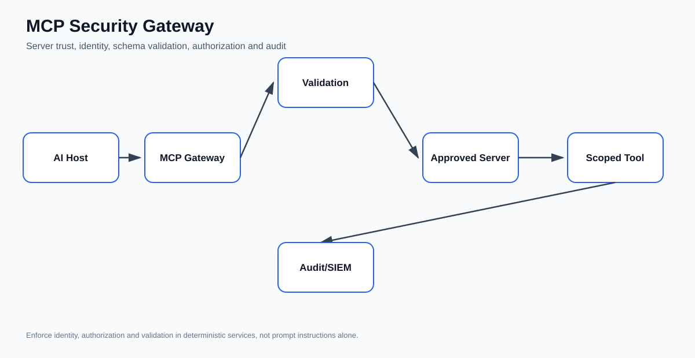

# Module 04 — MCP Security: Protocol, Servers and Tool Authorization

**Effort:** 20–26 hours. **Outcome:** Design a controlled MCP integration with approved servers, scoped identity, tool policy and auditable execution.

## 1. Architecture


MCP standardizes how AI hosts/clients interact with servers exposing tools, resources and prompts. It does not automatically make tools safe or authorize users to invoke them.

## 2. Components and trust
- **Host:** AI application managing model interaction and user session.
- **Client:** protocol participant connecting to a server.
- **Server:** exposes capabilities.
- **Tools:** callable operations.
- **Resources:** data/context exposed to client.
- **Prompts:** reusable prompt templates/workflows.
- **Transport:** communication mechanism; configure according to the current specification.

Separate user authentication, host-to-server authentication, permission to discover a tool, permission to invoke it and permission to access the underlying resource. The service performing the action must enforce authorization. A model claim is not proof.

## 3. MCP threat scenarios
1. Tool poisoning: misleading metadata leads to unsafe selection.
2. Prompt injection through resources: returned content contains hostile instructions.
3. Confused deputy: privileged server uses its authority without checking caller rights.
4. Token misuse: token forwarded to unintended audience or stored insecurely.
5. Server spoofing: client connects to unapproved endpoint.
6. SSRF: tool fetches attacker-controlled URLs or internal metadata endpoints.
7. Command injection: shell built from untrusted arguments.
8. Path traversal: file tool accepts arbitrary paths.
9. Supply-chain compromise: server package/dependency tampered.
10. Audit gaps: actions cannot be attributed.

## 4. Secure gateway controls
Maintain approved server registry; verify endpoint identity and transport security; use short-lived scoped credentials; validate token issuer/audience/expiry/scopes; do not forward tokens to unrelated services; apply per-user/per-agent/per-tool policy; validate arguments; enforce business authorization downstream; restrict filesystem/network; set payload/time/concurrency limits; redact logs; review tool metadata changes; record server, tool, principal, decision and correlation ID.

## 5. Safe tool broker example
```python
from pydantic import BaseModel, Field
from typing import Literal

class ReadRequest(BaseModel):
    operation: Literal["list_instances", "describe_instance"]
    instance_id: str | None = Field(default=None, pattern=r"^[A-Za-z0-9-]{1,64}$")

def broker_call(principal, request: ReadRequest, cloud_client):
    if "cloud:read" not in principal.permissions:
        raise PermissionError("read permission required")
    if request.operation == "describe_instance":
        if not request.instance_id:
            raise ValueError("instance_id required")
        authorize_resource(principal, request.instance_id)
        return cloud_client.describe_instance(request.instance_id)
    if request.operation == "list_instances":
        return cloud_client.list_instances(scope=principal.allowed_scope)
    raise ValueError("operation not allowed")
```
This intentionally supports read operations only. Do not expose a generic `run_command(command: str)` tool.

## 6. Hands-on labs
- **Server registry:** register two mock read-only servers; unknown server must be rejected.
- **Argument validation:** test missing/extra fields, oversized strings, malformed IDs, URL and path inputs.
- **Authorization:** use two principals with different scopes; same request must be denied or return only authorized resources.
- **Token hygiene:** use dummy tokens; verify logs omit bearer tokens and headers; test expired and wrong-audience tokens using mocks.
- **Hostile tool output:** return instruction-like content; confirm it cannot change broker authorization.

## 7. Test matrix
| Test | Expected |
|---|---|
| Unapproved server | Reject |
| Invalid/expired/wrong-audience token | Reject |
| Unauthorized tool | Deny |
| Invalid arguments | Reject |
| Tool output with instructions | Untrusted data |
| Internal metadata URL | Block by egress policy |
| Arbitrary file path | Reject |
| Excessive calls | Rate limit |
| Missing audit correlation | Fail test/release gate |

## Exercises
Explain confused deputy; design server approval/retirement; distinguish discovery and invocation permission; design OAuth token lifecycle; list what to re-test when tool metadata changes.

## Acceptance criteria
Server registry and allowlist work; authentication and authorization are separate; arguments are strict; downstream authorization is enforced; output is untrusted; network/filesystem are constrained; logs are attributable and redacted.
