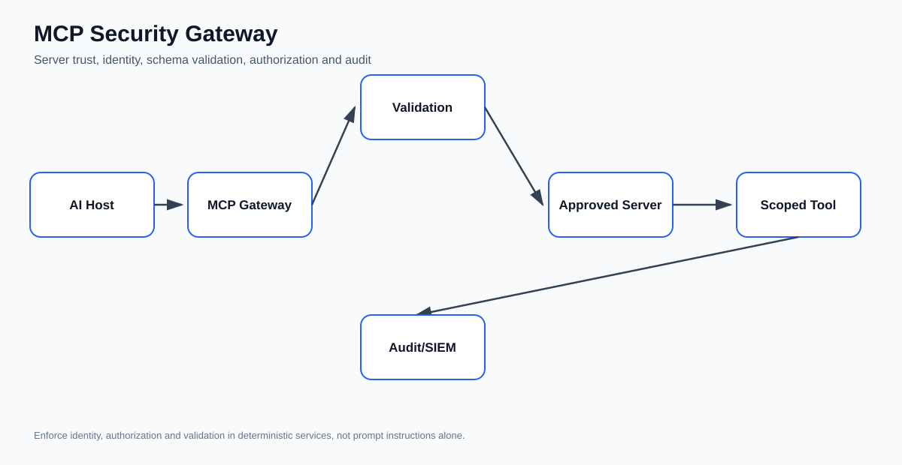
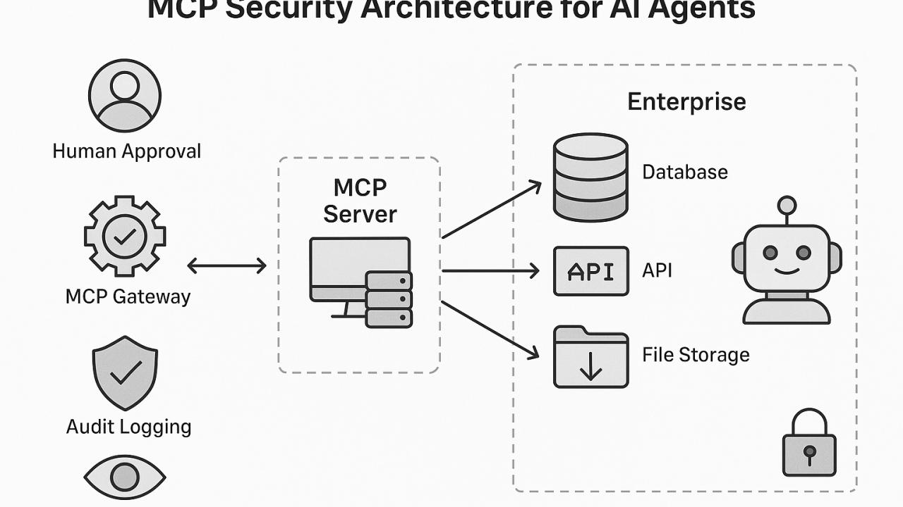
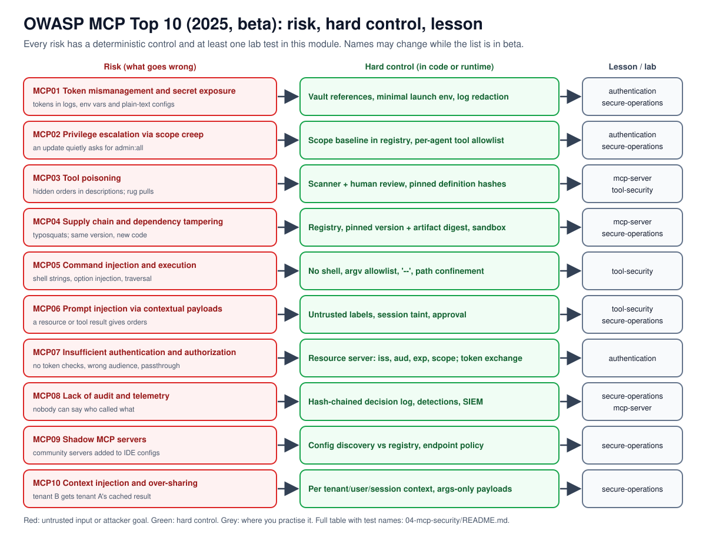
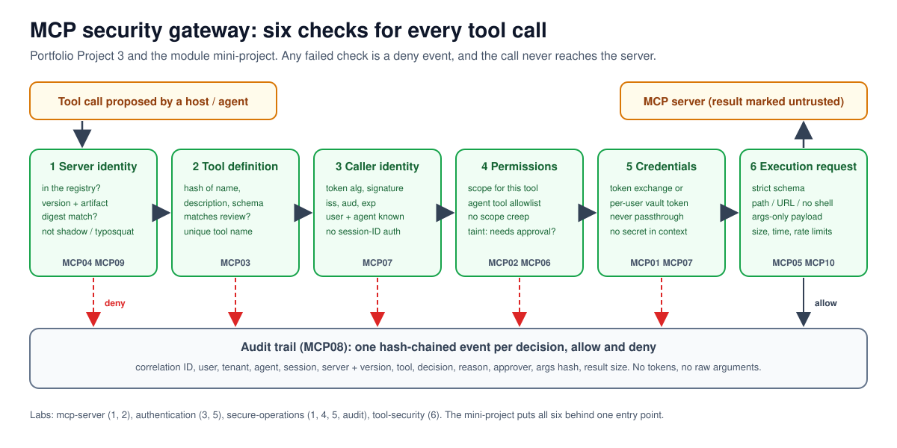

# Module 04: MCP (Model Context Protocol) Security

> **Weeks:** 13–16 (Month 4) · **Time:** ~45 hours · **Phase 4 gate:** an MCP security gateway prototype with tests
> **You will:** understand how AI applications connect to tools through MCP, attack the four places where MCP integrations usually break (server trust, identity, tools, operations), cover every item of the OWASP MCP Top 10 with a lab test, and design a gateway that enforces trust in code.
> **Mappings:** OWASP MCP Top 10 (2025, beta) MCP01–MCP10 · OWASP Top 10 for LLM Applications 2026: LLM01 Prompt Injection [2025: LLM01], LLM02 Sensitive Information Disclosure [2025: LLM02], LLM03 Excessive Agency [2025: LLM06], LLM04 Supply Chain [2025: LLM03], LLM08 Hidden Context Exposure [2025: LLM07 System Prompt Leakage], LLM10 Improper Output Handling [2025: LLM05] · OWASP Top 10 for Agentic Applications 2026: ASI01–ASI05, ASI06, ASI09, ASI10 (see the [coverage tables](#owasp-mcp-top-10-2025-beta-coverage)).

## What and why

**MCP** is an open protocol (published by Anthropic in November 2024) that lets an AI application connect to external **tools**, **data** and **prompt templates** in a standard way. One protocol, many servers: GitHub, file systems, databases, ticketing, cloud APIs.

That is great for builders and risky for defenders, because MCP puts three new things inside your trust boundary:

1. **Third-party code** (MCP servers), often installed by end users, sometimes running on their laptops with their full rights.
2. **Third-party text** that the model reads as if it were instructions: tool descriptions, schemas, resources and tool results.
3. **Delegated authority**: servers act *for* users against other systems, with tokens and keys.

MCP does not make tools safe, and it does not decide who may call what. **You** do, in deterministic code around the model. This module teaches you how.


## Learning path

| Week | Lesson | You will build / prove |
|---|---|---|
| 13 | [MCP servers: architecture, server trust, supply chain](mcp-server/) (sections 1–2, lab steps 1–3) | Draw the MCP data/control flow; exploit typosquat, impostor and rug-pull servers |
| 14 | [Authentication and authorization](authentication/) | Authenticated MCP service: audience-bound tokens, scopes per tool, token exchange instead of passthrough |
| 15 | [Tool security](tool-security/) | Hardened `read_file` / `fetch_url` / `run_command`, schema enforcement, tool-description scanner |
| 16 | [MCP servers](mcp-server/) (sections 2.4–3, lab steps 4–6: registry, DNS rebinding, logging) and [secure operations](secure-operations/) (secrets, scope creep, audit trails, shadow servers, context isolation, secure deployment) + the [mini-project](#module-mini-project-mcp-security-gateway) | Hardened operations scorecard; MCP security gateway prototype; **Phase 4 gate** |

Run every lab in the module at once:

```powershell
python -m pytest 04-mcp-security
```

## Module architecture: where MCP breaks

The protocol itself is simple. This existing diagram shows the moving parts (note: it shows the older "SSE" transport, which was replaced by **Streamable HTTP** in the 2025-03-26 revision, and it lists sampling as a server capability; in the spec, sampling is a feature the *client* offers to servers):


Each lesson owns one class of failure:

| Where it breaks | Typical failure | Lesson | Hard control |
|---|---|---|---|
| **Which servers?** | Typosquats, impostors, rug pulls, shadow IT, exposed local servers | [mcp-server](mcp-server/) | Registry, pinned package + tool hashes, localhost binding with Host/Origin checks |
| **Whose authority?** | Wrong-audience tokens, passthrough, shared admin keys, missing scopes | [authentication](authentication/) | Audience-bound tokens, scopes per tool, token exchange, per-user downstream checks |
| **What can a tool do?** | Tool poisoning, command injection, traversal, SSRF, injected results | [tool-security](tool-security/) | Strict schemas, no shell, path confinement, URL + IP checks, taint + approval |
| **How is it run?** | Secrets in env, configs and logs; scope creep; tampered packages; injected resources; cross-tenant context; no audit; shadow servers; weak deployments | [secure-operations](secure-operations/) | Minimal launch env + vault refs + redaction, scope baseline, artifact digests, hash-chained audit, config discovery, per-session context, deployment checks |

And a simpler view of the same idea, from earlier in this repo:





## Key concepts glossary

| Term | Meaning |
|---|---|
| **Host** | The AI application the user runs (desktop assistant, IDE agent, chat app). Owns the model and the session. |
| **Client** | The protocol connector inside the host. One client per server. |
| **Server** | A program that offers tools, resources and prompts over MCP. Third-party code until reviewed. |
| **Tool / resource / prompt** | Action the model can call / data the app can read / template the user can pick. |
| **Sampling / elicitation / roots** | Server asks the host's model to generate / server asks the user a question / host tells the server which folders it may use. |
| **JSON-RPC 2.0** | The message format: `jsonrpc`, `id`, `method`, `params` → `result` or `error`. No `id` = notification. |
| **stdio / Streamable HTTP** | Local child-process transport / HTTP transport for local or remote servers. |
| **Tool poisoning** | Hidden instructions in tool metadata (description or schema). |
| **Shadowing** | One server's text changes how another server's tool is used, or a second tool takes over an existing name. |
| **Rug pull** | An approved server changes its definitions or code later. |
| **Typosquatting** | A lookalike package or server name. |
| **DNS rebinding** | A web page makes its own domain resolve to `127.0.0.1` so the browser can reach a local server. |
| **Resource server / authorization server** | Accepts and checks tokens (the MCP server) / issues tokens after login and consent. |
| **Protected resource metadata (RFC 9728)** | The MCP server's discovery document that names its authorization server(s). |
| **Resource indicator (RFC 8707)** | The `resource=` parameter that binds a token's audience (`aud`) to one server. |
| **PKCE (RFC 7636)** | Binds an authorization code to a secret only the real client knows. |
| **Token exchange (RFC 8693)** | Swap a user's token for a new, narrower token for another audience, keeping the user's identity. |
| **Token passthrough** | Forwarding the user's token to another service. Forbidden by the MCP spec. |
| **Confused deputy** | A program with its own authority is tricked into using it for a caller who lacks it. |
| **SSRF** | Making the server fetch a URL the attacker chooses, e.g. cloud metadata at `169.254.169.254`. |
| **Taint** | Marking a session that has read untrusted content, so later risky actions need approval. |
| **MCP gateway (PEP)** | A policy enforcement point between hosts and servers: registry, auth, policy, limits, audit. |
| **Scope creep** | Permissions that grow beyond the original grant, often through updates (OWASP MCP02). |
| **Shadow MCP server** | An MCP server in use that the registry does not know about (MCP09). |
| **Context over-sharing** | Data reaching a user, session, tenant or server that should not see it, e.g. through a shared cache (MCP10). |
| **Hash-chained audit trail** | Each log event contains the previous event's hash, so edits and deletions are detectable (MCP08). |
| **Secret reference** | A pointer such as `vault://mcp/x/token` stored in config instead of the secret itself (MCP01). |

## How the lessons connect

Think of one tool call and ask three questions, in order:

1. **Should this server be here at all?** ([mcp-server](mcp-server/)) If a malicious server is connected, it does not need clever injection: a local one already runs code as the user, and any one can poison the model's context through its tool list. Registry and pinning come first.
2. **On whose behalf is it acting, and is that allowed?** ([authentication](authentication/)) Even an honest server becomes dangerous with a shared admin key or a passed-through token. Identity must flow from the user to the data owner.
3. **Can this specific call do harm?** ([tool-security](tool-security/)) Even an honest server, with correct identity, can be steered by injected text into reading `../secrets`, fetching cloud metadata, or running a shell. Schemas, sandboxes and taint stop that.
4. **Can we run it safely, and prove what happened?** ([secure-operations](secure-operations/)) A good server, well authenticated, still leaks if it inherits every secret, logs tokens, gains scopes in an update, shares one cache across tenants, or runs as root with open egress. And without an audit trail and an inventory you cannot investigate or switch anything off.

Each lesson's lab assumes the model **will** be fooled (the `MockLLM` always is) and proves that deterministic layers contain the damage. The [prompt-injection](../02-llm-security/prompt-injection/) lesson is the foundation for all three; [Module 05](../05-agent-security/) builds on this module for agent identity, sandboxing and approvals.

## OWASP MCP Top 10 (2025, beta) coverage

The OWASP MCP Top 10 is a beta project, so names and order may still change (check https://owasp.org/www-project-mcp-top-10/; for example, some study guides call MCP06 "Intent Flow Subversion"). Every item has at least one lab test in this module. Run them all with `python -m pytest 04-mcp-security`.



| ID | Risk | Lesson | Lab tests that prove the control (file → test) |
|---|---|---|---|
| **MCP01** | Token Mismanagement & Secret Exposure | [authentication](authentication/) §2.8, L7 · [secure-operations](secure-operations/) §2.1 | `test_mcp_auth.py` → `test_vulnerable_server_logs_bearer_tokens`, `test_secure_log_has_fingerprints_not_tokens`, `test_token_in_query_string_is_refused` · `test_secure_operations.py` → `test_mcp01_launch_env_has_only_the_servers_own_secret`, `test_mcp01_vault_refuses_another_servers_secret`, `test_mcp01_redacting_filter_catches_a_raw_debug_log` |
| **MCP02** | Privilege Escalation via Scope Creep | [authentication](authentication/) §2.7 · [secure-operations](secure-operations/) §2.2 | `test_mcp_auth.py` → `test_403_names_the_missing_scope`, `test_without_scope_check_the_exchange_still_refuses_new_scopes` · `test_secure_operations.py` → `test_mcp02_scope_creep_is_blocked_and_recorded`, `test_mcp02_agent_allowlist_and_registry_scopes_stop_excessive_permissions`, `test_mcp02_unused_scopes_are_reported_for_review` |
| **MCP03** | Tool Poisoning | [mcp-server](mcp-server/) §2.5 · [tool-security](tool-security/) §2.2 | `test_mcp_server.py` → `test_rug_pull_is_detected_and_quarantined`, `test_impostor_with_approved_name_and_version_is_quarantined`, `test_quarantined_description_never_reaches_the_model` · `test_tool_security.py` → `test_scanner_flags_poisoned_definitions`, `test_scanner_reads_the_schema_too` |
| **MCP04** | Software Supply Chain Attacks & Dependency Tampering | [mcp-server](mcp-server/) §2.5 · [secure-operations](secure-operations/) L3 | `test_mcp_server.py` → `test_unregistered_server_is_rejected`, `test_wrong_version_of_approved_server_is_rejected` · `test_secure_operations.py` → `test_mcp04_tampered_package_with_same_version_is_rejected`, `test_mcp04_self_reported_digest_is_ignored` |
| **MCP05** | Command Injection & Execution | [tool-security](tool-security/) §2.3–2.5 | `test_tool_security.py` → `test_secure_run_command_rejects_injection`, `test_schema_alone_stops_the_injected_shell_call`, `test_secure_read_file_stays_in_root`, `test_secure_fetch_blocks_every_ssrf_payload` |
| **MCP06** | Prompt Injection via Contextual Payloads | [tool-security](tool-security/) §2.6 · [secure-operations](secure-operations/) §2.3 | `test_tool_security.py` → `test_after_untrusted_content_side_effects_need_a_human`, `test_taint_alone_stops_egress_through_an_allowlisted_host` · `test_secure_operations.py` → `test_mcp06_resource_injection_needs_approval_and_is_audited` |
| **MCP07** | Insufficient Authentication & Authorization | [authentication](authentication/) · [mcp-server](mcp-server/) §2.4 | `test_mcp_auth.py` → `test_secure_server_blocks_every_attack`, `test_per_user_token_means_downstream_enforces_ownership`, `test_passthrough_fails_when_the_downstream_checks_audience`, `test_stolen_code_without_verifier_is_useless` · `test_mcp_server.py` → `test_guard_blocks_every_hostile_request` |
| **MCP08** | Lack of Audit and Telemetry | [mcp-server](mcp-server/) §2.6 · [secure-operations](secure-operations/) §2.4 | `test_mcp_server.py` → `test_audit_log_is_attributable_and_redacted` · `test_secure_operations.py` → `test_mcp08_every_decision_is_attributable`, `test_mcp08_tampering_breaks_the_hash_chain`, `test_mcp08_anchor_detects_cut_off_events`, `test_mcp08_detections_fire_on_the_trail` |
| **MCP09** | Shadow MCP Servers | [secure-operations](secure-operations/) §2.5 · [mcp-server](mcp-server/) (registry) | `test_secure_operations.py` → `test_mcp09_discovery_flags_shadow_and_misconfigured_servers`, `test_mcp09_findings_never_contain_secret_values` · `test_mcp_server.py` → `test_unregistered_server_is_rejected` |
| **MCP10** | Context Injection & Over-Sharing | [secure-operations](secure-operations/) §2.3 · [authentication](authentication/) (per-user downstream) | `test_secure_operations.py` → `test_mcp10_cache_is_isolated_per_tenant_and_user`, `test_mcp10_server_receives_only_its_arguments`, `test_mcp10_sessions_do_not_share_context` · `test_mcp_auth.py` → `test_per_user_token_means_downstream_enforces_ownership` |

### OWASP LLM Top 10 2026 and Agentic Top 10 (ASI) in this module

| Framework item | What it means for MCP | Where |
|---|---|---|
| LLM01 Prompt Injection [2025: LLM01] | Tool descriptions, resources and tool results are prompt input | all lessons |
| LLM02 Sensitive Information Disclosure [2025: LLM02] | Tokens in logs, secrets in context, cross-tenant results | authentication, secure-operations |
| LLM03 Excessive Agency [2025: LLM06] | Too many tools, too-broad scopes, no approval | authentication, tool-security, secure-operations |
| LLM04 Supply Chain [2025: LLM03] | Typosquats, rug pulls, tampered packages | mcp-server, secure-operations |
| LLM06 Unbounded Consumption [2025: LLM10] | Huge results, runaway calls, sampling abuse | mcp-server, tool-security (limits) |
| LLM08 Hidden Context Exposure [2025: LLM07] | Tool schemas and policy text the model sees but the user does not | mcp-server, tool-security (definition review) |
| LLM10 Improper Output Handling [2025: LLM05] | Model-written arguments reach shells, paths and URLs | tool-security |
| ASI01 Agent Goal Hijack | A poisoned tool or resource redirects the agent | tool-security, secure-operations |
| ASI02 Tool Misuse | A legitimate tool used unsafely | tool-security |
| ASI03 Identity & Privilege Abuse | Shared admin keys, passthrough, confused deputy | authentication |
| ASI04 Agentic Supply Chain | MCP servers and packages loaded at run time | mcp-server, secure-operations |
| ASI05 Unexpected Code Execution | Shell tools, option injection | tool-security |
| ASI06 Memory & Context Poisoning | Shared or persistent context across sessions | secure-operations |
| ASI09 Human-Agent Trust Exploitation | Approvals must show the exact action, not the agent's summary | tool-security, secure-operations |
| ASI10 Rogue Agents | Detection, audit, kill switch | secure-operations, mini-project |

### Roadmap attack scenarios (section D) → lab proof

| Scenario | Attack works here | Control holds here |
|---|---|---|
| A malicious server steals credentials | `test_typosquat_server_leaks_notes_through_vulnerable_host`, `test_mcp01_naive_launch_hands_every_secret_to_a_malicious_server` | `test_unregistered_server_is_rejected`, `test_mcp01_launch_env_has_only_the_servers_own_secret` |
| A tool runs unauthorized shell commands | `test_vulnerable_run_command_runs_extra_programs` | `test_secure_run_command_rejects_injection`, `test_schema_alone_stops_the_injected_shell_call` |
| An agent gets excessive permissions | `test_mcp02_naive_read_only_agent_can_send_and_delete`, `test_mcp02_naive_gateway_grants_scope_creep` | `test_mcp02_agent_allowlist_and_registry_scopes_stop_excessive_permissions`, `test_mcp02_scope_creep_is_blocked_and_recorded` |
| A resource injects instructions | `test_mcp06_naive_resource_injection_emails_the_attacker` | `test_mcp06_resource_injection_needs_approval_and_is_audited` |
| Token leakage through logs | `test_vulnerable_server_logs_bearer_tokens`, `test_mcp01_naive_logging_writes_the_bearer_token` | `test_secure_log_has_fingerprints_not_tokens`, `test_mcp01_redacting_filter_catches_a_raw_debug_log` |
| An untrusted server modifies tool descriptions | `test_rug_pull_is_silently_accepted_by_vulnerable_host` | `test_rug_pull_is_detected_and_quarantined` |

### Architect's MCP review checklist

Adapted for MCP from the review checklist in the *AI Security Architecture Study Guide* (Part 4.5). Use it on any MCP design review:

1. **Trifecta:** does one session combine private data, untrusted content and an outbound channel? Which leg is removed, or what approval gates it?
2. **Authorization outside the model:** is every decision made in code, with the end user's identity reaching the data owner?
3. **Context trust map:** can you list every source that enters context (tool descriptions, resources, results, other servers) and its trust level?
4. **Tool inventory:** for each tool: narrowest scope, owner, side effect yes/no, pinned definition hash?
5. **Identity:** does each agent have its own identity, are tokens audience-bound and short-lived, and is passthrough impossible?
6. **Secrets:** are secrets out of configs, launch environments, logs and model context?
7. **Blast radius:** if one server is fully compromised, what can it reach? Is egress restricted and the runtime sandboxed?
8. **Human gates:** do approvals show the exact action and arguments, and is approval fatigue managed?
9. **Detection and response:** can you trace one call end to end from the audit trail, and switch off a server in under a minute?
10. **Supply chain and inventory:** are servers, packages and versions pinned, verified and discovered on endpoints?
11. **Testing:** do automated attack tests (like this module's) gate every server update and policy change?

## Module mini-project: MCP security gateway

**Goal (week 16, Phase 4 gate):** build a small **MCP security gateway** in Python that sits between a host and several MCP-style servers and enforces everything from this module. Reuse code from the four labs, but put it behind **one** entry point.

This is **Portfolio Project 3** of your roadmap ("MCP Security Gateway: allowlisting, authN/Z, secret protection, input validation and audit"). The gateway must validate five things for every call: **server identity, tools, permissions, credentials and execution requests**, and record every decision.



| Roadmap capability | What the gateway checks | Reuse from |
|---|---|---|
| Server identity (allowlisting) | Registry entry, version, artifact digest; no typosquats or shadow servers | [mcp-server](mcp-server/) `SecureHost.connect`, [secure-operations](secure-operations/) `SecureOpsGateway.connect`, `discover_configs` |
| Tools | Pinned definition hash, unique names, scanner at intake | [mcp-server](mcp-server/) `fingerprint`, [tool-security](tool-security/) `tool_scanner.py` |
| Permissions (authN/Z) | Token `iss`/`aud`/`exp`, scope per tool, agent tool allowlist, scope baseline, taint + approval | [authentication](authentication/) `SecureDocsMCPServer.validate`, [secure-operations](secure-operations/) `call` |
| Credentials (secret protection) | Token exchange or per-user vault tokens; minimal launch env; redaction | [authentication](authentication/) `exchange`, [secure-operations](secure-operations/) `build_launch_env`, `Redactor` |
| Execution requests (input validation) | Strict schemas, path/URL/no-shell rules, args-only payloads, limits | [tool-security](tool-security/) `secure_tools.py` |
| Audit | Hash-chained, attributable, redacted events; detections | [secure-operations](secure-operations/) `AuditTrail`, `detect` |

### Required behavior

```python
def invoke_tool(request, *, registry, policy, auth, audit):
    cid = new_correlation_id()
    principal = auth.validate(request.bearer_token, audience=GATEWAY_RESOURCE)  # iss, aud, exp, alg
    server = registry.require_approved(request.server)        # name, version, artifact digest, not disabled
    tool = server.require_pinned_tool(request.tool)            # definition hash matches review
    args = tool.schema.model_validate(request.arguments)       # extra="forbid", limits
    policy.authorize(principal, server, tool, args,            # user x agent x tool, scope baseline,
                     tainted=request.session.tainted)          # agent allowlist, approval after taint
    downstream = auth.exchange(principal.token, audience=server.downstream_audience,
                               scope=tool.scope)               # never pass the user's token on
    with limits(timeout=tool.timeout_s, max_bytes=tool.max_result_bytes):
        result = server.call(tool.name, args, credential=downstream)   # args only, no conversation
    request.session.tainted |= result.untrusted
    audit.record(cid, principal, server, tool, decision="allow", args_hash=hash_args(args))  # hash-chained
    return wrap_untrusted(result)
```

Deny by default: any exception above becomes a structured deny event with the same correlation ID.

### Test matrix (all must pass)

| Test | Expected | OWASP MCP |
|---|---|---|
| Unregistered or typosquatted server | Rejected, `server_rejected` event | MCP04, MCP09 |
| Approved name + version but different artifact digest | Rejected, `package_digest_mismatch` event | MCP04 |
| Approved name + version but changed tool definition | Tool quarantined, `tool_definition_changed` event | MCP03 |
| Server update asks for new scopes | Blocked until re-review, `scope_creep` event | MCP02 |
| Missing, forged (`alg: none`), expired or wrong-audience token | `401` with `resource_metadata` | MCP07 |
| Valid token without the tool's scope, or agent outside its tool allowlist | `403 insufficient_scope` / deny | MCP02, MCP07 |
| User A asks for user B's record | Denied by the data owner (per-user downstream token) | MCP07, MCP10 |
| Downstream receives the user's original token | Never (assert in a test) | MCP07 |
| A stdio server's launch environment | Only allowlisted variables plus its own secret | MCP01 |
| A debug log line containing a bearer token | Redacted at the log handler | MCP01 |
| Arguments with extra fields, wrong types, oversized values | Rejected by schema, no crash | MCP05 |
| Path outside root, `169.254.169.254` in any encoding, shell metacharacters | Rejected | MCP05 |
| Tool result or resource containing instructions | Treated as data; session tainted; next side-effect call needs approval | MCP06 |
| Tenant B repeats tenant A's query; a server asks for "context" | No tenant A data; the server gets its arguments only | MCP10 |
| More than N calls per minute per user and tool | Rate-limited | (LLM06 Unbounded Consumption) |
| Every decision (allow and deny) | Has correlation ID, user, agent, server, tool, decision; no raw tokens or secrets; hash chain verifies | MCP08 |
| An audit event is edited or deleted | Verification fails at that event | MCP08 |
| Config scan of a test "endpoint" folder | Unregistered servers and plain-text secrets reported | MCP09 |
| Kill switch for one server | Next call denied within one request | MCP08 (response) |
| Benign calls | Work | - |

### Deliverables

1. Code and tests in your own folder (for example `04-mcp-security/mini-project/`), passing `python -m pytest`.
2. A one-page threat model of your gateway (use the [threat model template](../00-program/templates/threat-model-template.md)), including what happens if the gateway itself is down or compromised.
3. A short design decision record: which controls live in the gateway, which in the servers, which in the network, and why.
4. A demo scorecard like the labs': each attack against "no gateway" vs "gateway".

### Acceptance criteria (Phase 4 gate)

- Server registry and allowlist work; definitions are pinned and re-checked on change.
- Authentication and authorization are separate; tokens are audience-bound; no passthrough; no shared admin keys for user data.
- Arguments are strictly validated; downstream authorization is enforced per user.
- Tool output is untrusted; network and file-system access are constrained in code *and* (described) in the runtime.
- Logs are attributable, redacted and tamper-evident; you can answer "who did what, through which server, and who approved it" from the audit log alone.
- Every OWASP MCP Top 10 item has at least one passing test in your gateway, listed in a coverage table like the one above.
- A deployment description of your gateway passes `check_deployment()` from [secure-operations](secure-operations/) (or your own stricter version).

## Interview preparation: system design across the module

<details><summary><b>Q1. Design MCP access for 5,000 employees using several AI assistants. What is your architecture?</b></summary>

A central **MCP gateway** as the only path from hosts to servers. Hosts authenticate users with the corporate IdP and get gateway-audience tokens. The gateway holds: the **server registry** (approved servers, versions, digests, pinned tool hashes, owners, data classification); **policy** (user group x agent x server x tool, deny by default, approvals for side effects); a **credential broker** (token exchange or per-user vault tokens, never passthrough); **limits** (size, time, rate); **result handling** (untrusted marking, taint, secret scanning, and per-session context isolation so one user's results never reach another user's session); and **audit** to the SIEM. Internal servers run in sandboxes with restricted egress; remote SaaS servers get their own audiences. Endpoint management blocks unapproved local servers. Trade-offs: the gateway is a single point of failure and a high-value target, so run it highly available, with its own threat model, and with a tested kill switch per server.
</details>

<details><summary><b>Q2. How would you roll out MCP safely in an enterprise that already has 200 unofficial servers in use?</b></summary>

1. **Discover**: scan managed endpoints for MCP config files and running servers; collect from proxies which remote servers are used.
2. **Triage** by risk: local servers with broad file access and servers touching sensitive data first.
3. **Intake process**: owner, purpose, data classification, code and definition review, package pinning, required scopes.
4. **Registry + gateway**: approved servers move behind the gateway; others get a deadline.
5. **Enforce**: block unapproved servers at the endpoint and network; alert on new config files.
6. **Operate**: periodic re-review, expiry dates, change monitoring (`tool_definition_changed`), metrics, and a retirement process (remove from registry, revoke credentials, delete stored tokens) when a server is no longer needed.
Communicate the "paved road" so teams prefer the approved path instead of hiding.
</details>

<details><summary><b>Q3. Design authentication and authorization for a multi-tenant SaaS MCP server.</b></summary>

The server is an OAuth resource server with protected resource metadata. Tokens carry `sub`, tenant, scopes and an exact `aud`. Every request: validate `iss`, `aud`, `exp`, algorithm, scope per tool. Downstream: token exchange (or per-user grants) so the data layer sees the user and tenant; tenant isolation enforced in the data layer too (row-level security), not only in MCP server code. Caches keyed by tenant and user. Short-lived tokens, sender-constrained for high-risk clients. Logs with tenant, user, client, tool, decision. Tests that try cross-tenant access on every release. No shared service account that can see all tenants.
</details>

<details><summary><b>Q4. Where should authorization happen: in the host, the gateway, the MCP server or the downstream API?</b></summary>

At several layers, each with a clear job. The **host** decides what to show and asks for approvals (UX, not a security boundary). The **gateway** enforces coarse policy: which users and agents may reach which servers and tools, with which scopes, and when approval is needed. The **MCP server** validates tokens and arguments and enforces tool-level rules. The **data owner** (downstream API) enforces object-level authorization using the real user's identity. The model never authorizes anything. If you can only have one fine-grained check, put it at the data owner and make sure identity reaches it.
</details>

<details><summary><b>Q5. An approved MCP server is reported compromised. Walk me through your response.</b></summary>

1. **Contain**: flip the server's kill switch in the gateway; block its package version; revoke and rotate every credential it could use (exchanged tokens are short-lived, vault tokens and service keys are not).
2. **Scope**: from audit logs, list sessions, users and tool calls involving the server since the suspected start; check definition hashes over time (rug pull?); look for unusual calls to *other* tools in the same sessions (shadowing or injection).
3. **Eradicate**: remove the package from mirrors and endpoints.
4. **Recover**: re-review a fixed version or a replacement, re-pin, re-enable gradually.
5. **Learn**: add regression tests and detections; update the intake process. Use the [incident playbook template](../00-program/templates/ai-incident-playbook.md).
</details>

<details><summary><b>Q6. What would you monitor, and which detections would you write?</b></summary>

Sources: gateway decisions, auth server logs, server logs, endpoint telemetry. Detections: `server_rejected` spikes (shadow IT or typosquat attempts); any `tool_definition_changed`; tokens with unexpected `aud` or `client_id`; many `403` for one user (probing); first-time use of a side-effect tool by a user or agent; a side-effect call right after reading untrusted content; outbound fetches to new domains or to private ranges (blocked SSRF attempts); unusual result sizes; secrets or canaries in results; approval fatigue (one user approving many prompts quickly).
</details>

<details><summary><b>Q7. A coding agent has GitHub, Slack and web-fetch MCP servers. Is it exploitable? How do you fix it?</b></summary>

Yes: it has the lethal trifecta. Private data (private repos, Slack), untrusted content (public issues, web pages) and exfiltration channels (public PRs, Slack messages, fetch URLs). One injected issue can chain them, as Invariant Labs showed with the GitHub MCP server. Fixes: scope the GitHub token to the one repo of the task; separate read and write identities; taint the session after reading public content and require approval for writes and outbound calls; restrict fetch to an allowlist; post to Slack only in a fixed channel; and log everything with the session ID. Removing any one leg of the trifecta for a given task breaks the chain.
</details>

<details><summary><b>Q8. What is your policy for local MCP servers on developer laptops?</b></summary>

Allowed only from the registry, installed from an internal mirror with pinned versions and digests (no `npx -y latest`). Prefer stdio; any local HTTP server binds to 127.0.0.1 with Host/Origin checks and a launch token. Run servers in a container or sandbox that mounts only the project folder and gets only the environment variables it needs; no access to SSH keys, browser profiles or cloud credential files. Fine-grained, short-lived tokens. Endpoint monitoring for unapproved MCP configs and processes. Developers can request new servers through a fast intake path.
</details>

<details><summary><b>Q9. How do you test MCP security continuously?</b></summary>

1. **Unit and regression tests** like this module's labs: each attack asserts impact (no tool ran, no canary leaked, no token forwarded) and each hard layer is tested with the others turned off.
2. **CI gates** on server updates: definition diff + scanner + re-review; dependency and SBOM scanning.
3. **Integration tests** through the gateway with test identities: wrong audience, missing scope, cross-user access.
4. **Adversarial tests** with real models: injected issues, pages and tool descriptions, run N times, success rate tracked per model version.
5. **Periodic red team** and an incident exercise. Any finding becomes a regression test.
</details>

<details><summary><b>Q10. Build or buy an MCP gateway? What would you evaluate?</b></summary>

Evaluate: registry and definition pinning (does it detect rug pulls?); OAuth resource-server support (RFC 9728, RFC 8707, token exchange) and no passthrough; policy model (users, groups, agents, tools, arguments, approvals) and policy-as-code; argument validation; egress and SSRF controls; result handling (taint, scanning); audit quality and SIEM integration; latency and availability (it sits on every call); multi-tenant isolation; how it handles stdio servers; vendor security posture and its own attack surface. Build if requirements are narrow and you have the team to maintain it; buy if you need breadth quickly, but test it with your own attack suite before trusting it.
</details>

## References

- MCP specification (always check the current revision): https://modelcontextprotocol.io/specification
- MCP security best practices: https://modelcontextprotocol.io/specification/2025-06-18/basic/security_best_practices
- MCP authorization (2025-06-18 revision): https://modelcontextprotocol.io/specification/2025-06-18/basic/authorization
- Invariant Labs, *MCP Security Notification: Tool Poisoning Attacks* (2025): https://invariantlabs.ai/blog/mcp-security-notification-tool-poisoning-attacks
- Invariant Labs, *GitHub MCP Exploited* (2025): https://invariantlabs.ai/blog/mcp-github-vulnerability
- OWASP MCP Top 10 (2025, beta): https://owasp.org/www-project-mcp-top-10/
- OWASP Top 10 for LLM Applications 2026 (released August 2026; check the mapping from the 2025 list at the source): https://genai.owasp.org/llm-top-10/
- OWASP Top 10 for Agentic Applications 2026 (ASI01–ASI10) and the GenAI Security Project: https://genai.owasp.org/
- OWASP AI Testing Guide (AITG-APP-06, AITG-INF-03, AITG-INF-04): https://owasp.org/www-project-ai-testing-guide/
- RFC 9728 (Protected Resource Metadata), RFC 8707 (Resource Indicators), RFC 8693 (Token Exchange), RFC 7636 (PKCE): https://www.rfc-editor.org/
- OWASP SSRF Prevention Cheat Sheet: https://cheatsheetseries.owasp.org/cheatsheets/Server_Side_Request_Forgery_Prevention_Cheat_Sheet.html
- NIST AI 600-1, *Generative AI Profile* (2024): https://doi.org/10.6028/NIST.AI.600-1
- Simon Willison, "The lethal trifecta": https://simonwillison.net/tags/prompt-injection/


## Roadmap coverage

How this module covers section 4 ("MCP Security") and section D ("MCP topics") of your roadmap.

| Roadmap topic | Where it is covered |
|---|---|
| Architecture: client, server, host | [mcp-server](mcp-server/) §2.1–2.2, glossary above |
| Tools, resources and prompts | [mcp-server](mcp-server/) §2.2; resources as untrusted data in [secure-operations](secure-operations/) §2.3 |
| AuthN/AuthZ, OAuth and token management | [authentication](authentication/) §2–3 (PRM, PKCE, resource indicators, scopes, token exchange, token theft and consent) |
| Authorization: scope validation, least privilege | [authentication](authentication/) §2.7; scope creep and agent allowlists in [secure-operations](secure-operations/) §2.2 |
| Transport (stdio, HTTP) | [mcp-server](mcp-server/) §2.3–2.4; deployment table in [secure-operations](secure-operations/) §2.6 |
| Tool poisoning | [mcp-server](mcp-server/) §2.5, [tool-security](tool-security/) §2.2 |
| Injection via MCP resources / prompt injection | [tool-security](tool-security/) §2.6, [secure-operations](secure-operations/) §2.3 |
| Malicious MCP servers | [mcp-server](mcp-server/) §2.5; credential theft at launch in [secure-operations](secure-operations/) §2.1 |
| Tool permission escalation | [authentication](authentication/) (scopes, step-up), [secure-operations](secure-operations/) (scope creep) |
| Server trust and supply chain | [mcp-server](mcp-server/) §2.5, [secure-operations](secure-operations/) L3 (artifact digests) |
| Monitoring: tool-invocation audit trails | [secure-operations](secure-operations/) §2.4 (hash-chained trail, detections) |
| Secure MCP deployment | [secure-operations](secure-operations/) §2.6 (transport, localhost binding, container isolation, egress, secrets) |
| OWASP MCP Top 10 | [Coverage table](#owasp-mcp-top-10-2025-beta-coverage): every item has lab tests |
| Six section D attack scenarios | [Scenario table](#roadmap-attack-scenarios-section-d--lab-proof) |
| Hands-on: secure MCP server + malicious tool behavior | All four labs; the [mini-project](#module-mini-project-mcp-security-gateway) |
| Goal / Portfolio Project 3: MCP security gateway | [Mini-project](#module-mini-project-mcp-security-gateway) with the five-capability table and test matrix |
| Tools: MCP SDK, MCP Inspector | Optional steps in [mcp-server](mcp-server/) step 6 and [secure-operations](secure-operations/) step 5 (never needed for tests) |

## Further reading from your library

These are documents in your own library (titles only; read them alongside the lessons):

- **AI Security Architecture Study Guide** (OWASP LLM, Agentic and MCP Top 10 with a cross-cutting architecture model): Part 3 (the MCP Top 10 table with reference incidents), Part 4.1 principles 1, 3, 5 and 7 (model is not a boundary, zero trust for context, identity for agents, observability and kill switches), Part 4.2 "Tools / MCP" layer, Part 4.5 review checklist, and exercise 4 in Part 4.6 (incident drill for a changed tool description).
- **ISC2 AI Security (pilot exam) Study Guide:** Domain 4.1 "Secure integration for tools, APIs, and plugins (MCP and A2A)" and its delegation figure (token exchange across agents), Domain 4.2 isolation layers (containers, gVisor, microVMs), and the STRIDE table in Domain 6.1.
- **OWASP AI Testing Guide:** AITG-APP-02 (the section on indirect injection through MCP tool metadata), AITG-APP-06 (agentic behavior limits and tool design), AITG-INF-03 (plugin boundary violations) and AITG-INF-04 (capability misuse). Use them to turn this module's labs into a test plan.
- **IAM & Zero Trust: 30 interview scenarios:** scenario 04 (OAuth consent phishing), 17 (token theft and proof-of-possession), 19 and 20 (application and workload identity) and 21 (secretless architecture). Practise answering them out loud for MCP servers.

---

**Courses for this module (KodeKloud / Udemy):** see [00-program/learning-resources.md](../00-program/learning-resources.md).
