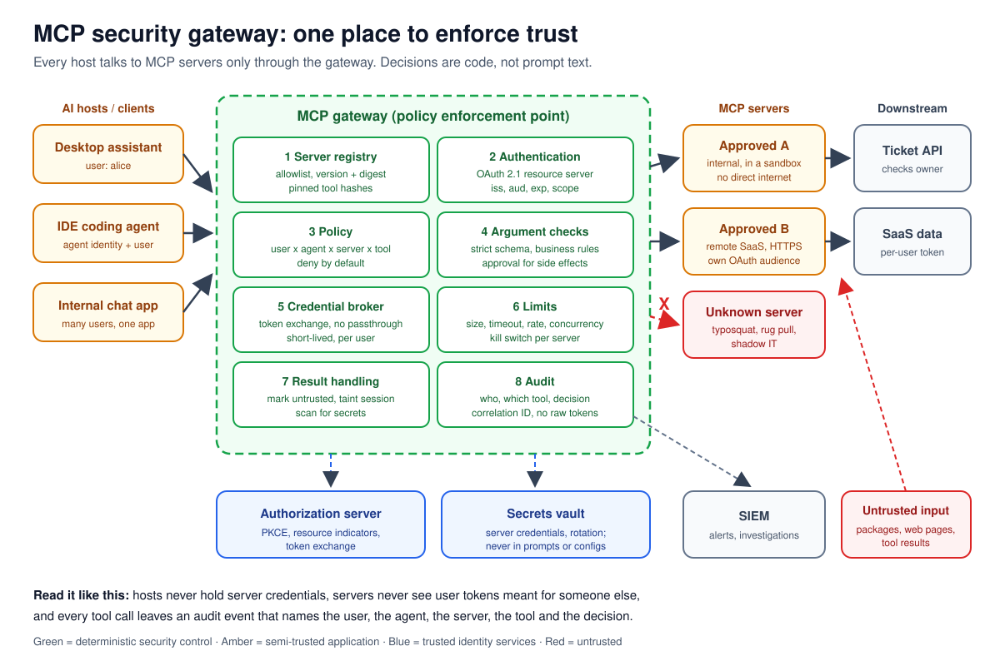
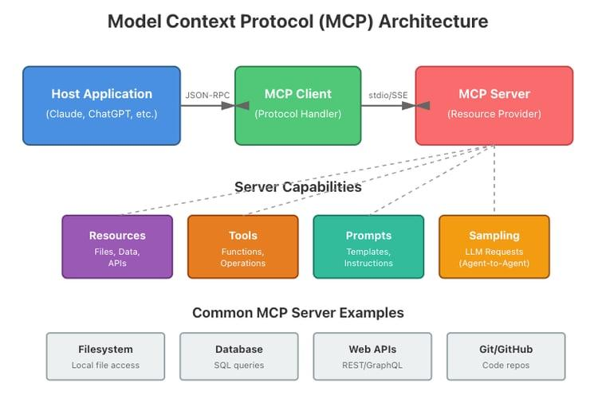

# Module 04: MCP (Model Context Protocol) Security

> **Weeks:** 13–16 (Month 4) · **Time:** ~45 hours · **Phase 4 gate:** an MCP security gateway prototype with tests
> **You will:** understand how AI applications connect to tools through MCP, attack the three places where MCP integrations usually break (server trust, identity, tools), and design a gateway that enforces trust in code.

## What and why

**MCP** is an open protocol (published by Anthropic in November 2024) that lets an AI application connect to external **tools**, **data** and **prompt templates** in a standard way. One protocol, many servers: GitHub, file systems, databases, ticketing, cloud APIs.

That is great for builders and risky for defenders, because MCP puts three new things inside your trust boundary:

1. **Third-party code** (MCP servers), often installed by end users, sometimes running on their laptops with their full rights.
2. **Third-party text** that the model reads as if it were instructions: tool descriptions, schemas, resources and tool results.
3. **Delegated authority**: servers act *for* users against other systems, with tokens and keys.

MCP does not make tools safe, and it does not decide who may call what. **You** do, in deterministic code around the model. This module teaches you how.



## Learning path

| Week | Lesson | You will build / prove |
|---|---|---|
| 13 | [MCP servers: architecture, server trust, supply chain](mcp-server/) (sections 1–2, lab steps 1–3) | Draw the MCP data/control flow; exploit typosquat, impostor and rug-pull servers |
| 14 | [Authentication and authorization](authentication/) | Authenticated MCP service: audience-bound tokens, scopes per tool, token exchange instead of passthrough |
| 15 | [Tool security](tool-security/) | Hardened `read_file` / `fetch_url` / `run_command`, schema enforcement, tool-description scanner |
| 16 | [MCP servers](mcp-server/) (sections 2.4–3, lab steps 4–6: registry, DNS rebinding, logging) + the [mini-project](#module-mini-project-mcp-security-gateway) | MCP security gateway prototype; **Phase 4 gate** |

Run every lab in the module at once:

```powershell
python -m pytest 04-mcp-security
```

## Module architecture: where MCP breaks

The protocol itself is simple. This existing diagram shows the moving parts (note: it shows the older "SSE" transport, which was replaced by **Streamable HTTP** in the 2025-03-26 revision, and it lists sampling as a server capability; in the spec, sampling is a feature the *client* offers to servers):



Each lesson owns one class of failure:

| Where it breaks | Typical failure | Lesson | Hard control |
|---|---|---|---|
| **Which servers?** | Typosquats, impostors, rug pulls, shadow IT, exposed local servers | [mcp-server](mcp-server/) | Registry, pinned package + tool hashes, localhost binding with Host/Origin checks |
| **Whose authority?** | Wrong-audience tokens, passthrough, shared admin keys, missing scopes | [authentication](authentication/) | Audience-bound tokens, scopes per tool, token exchange, per-user downstream checks |
| **What can a tool do?** | Tool poisoning, command injection, traversal, SSRF, injected results | [tool-security](tool-security/) | Strict schemas, no shell, path confinement, URL + IP checks, taint + approval |

And a simpler view of the same idea, from earlier in this repo:


## Key concepts glossary

| Term | Meaning |
|---|---|
| **Host** | The AI application the user runs (desktop assistant, IDE agent, chat app). Owns the model and the session. |
| **Client** | The protocol connector inside the host. One client per server. |
| **Server** | A program that offers tools, resources and prompts over MCP. Third-party code until reviewed. |
| **Tool / resource / prompt** | Action the model can call / data the app can read / template the user can pick. |
| **Sampling / elicitation / roots** | Server asks the host's model to generate / server asks the user a question / host tells the server which folders it may use. |
| **JSON-RPC 2.0** | The message format: `jsonrpc`, `id`, `method`, `params` → `result` or `error`. No `id` = notification. |
| **stdio / Streamable HTTP** | Local child-process transport / HTTP transport for local or remote servers. |
| **Tool poisoning** | Hidden instructions in tool metadata (description or schema). |
| **Shadowing** | One server's text changes how another server's tool is used, or a second tool takes over an existing name. |
| **Rug pull** | An approved server changes its definitions or code later. |
| **Typosquatting** | A lookalike package or server name. |
| **DNS rebinding** | A web page makes its own domain resolve to `127.0.0.1` so the browser can reach a local server. |
| **Resource server / authorization server** | Accepts and checks tokens (the MCP server) / issues tokens after login and consent. |
| **Protected resource metadata (RFC 9728)** | The MCP server's discovery document that names its authorization server(s). |
| **Resource indicator (RFC 8707)** | The `resource=` parameter that binds a token's audience (`aud`) to one server. |
| **PKCE (RFC 7636)** | Binds an authorization code to a secret only the real client knows. |
| **Token exchange (RFC 8693)** | Swap a user's token for a new, narrower token for another audience, keeping the user's identity. |
| **Token passthrough** | Forwarding the user's token to another service. Forbidden by the MCP spec. |
| **Confused deputy** | A program with its own authority is tricked into using it for a caller who lacks it. |
| **SSRF** | Making the server fetch a URL the attacker chooses, e.g. cloud metadata at `169.254.169.254`. |
| **Taint** | Marking a session that has read untrusted content, so later risky actions need approval. |
| **MCP gateway (PEP)** | A policy enforcement point between hosts and servers: registry, auth, policy, limits, audit. |

## How the lessons connect

Think of one tool call and ask three questions, in order:

1. **Should this server be here at all?** ([mcp-server](mcp-server/)) If a malicious server is connected, it does not need clever injection: a local one already runs code as the user, and any one can poison the model's context through its tool list. Registry and pinning come first.
2. **On whose behalf is it acting, and is that allowed?** ([authentication](authentication/)) Even an honest server becomes dangerous with a shared admin key or a passed-through token. Identity must flow from the user to the data owner.
3. **Can this specific call do harm?** ([tool-security](tool-security/)) Even an honest server, with correct identity, can be steered by injected text into reading `../secrets`, fetching cloud metadata, or running a shell. Schemas, sandboxes and taint stop that.

Each lesson's lab assumes the model **will** be fooled (the `MockLLM` always is) and proves that deterministic layers contain the damage. The [prompt-injection](../02-llm-security/prompt-injection/) lesson is the foundation for all three; [Module 05](../05-agent-security/) builds on this module for agent identity, sandboxing and approvals.

## Module mini-project: MCP security gateway

**Goal (week 16, Phase 4 gate):** build a small **MCP security gateway** in Python that sits between a host and several MCP-style servers and enforces everything from this module. Reuse code from the three labs, but put it behind **one** entry point.

### Required behavior

```python
def invoke_tool(request, *, registry, policy, auth, audit):
    cid = new_correlation_id()
    principal = auth.validate(request.bearer_token, audience=GATEWAY_RESOURCE)  # iss, aud, exp, alg
    server = registry.require_approved(request.server)        # name, version, package digest
    tool = server.require_pinned_tool(request.tool)            # definition hash matches review
    args = tool.schema.model_validate(request.arguments)       # extra="forbid", limits
    policy.authorize(principal, server, tool, args,            # user x agent x tool, scopes,
                     tainted=request.session.tainted)          # approval for side effects
    downstream = auth.exchange(principal.token, audience=server.downstream_audience,
                               scope=tool.scope)               # never pass the user's token on
    with limits(timeout=tool.timeout_s, max_bytes=tool.max_result_bytes):
        result = server.call(tool.name, args, credential=downstream)
    request.session.tainted |= result.untrusted
    audit.record(cid, principal, server, tool, decision="allow", args_hash=hash_args(args))
    return wrap_untrusted(result)
```

Deny by default: any exception above becomes a structured deny event with the same correlation ID.

### Test matrix (all must pass)

| Test | Expected |
|---|---|
| Unregistered or typosquatted server | Rejected, `server_rejected` event |
| Approved name + version but changed tool definition | Tool quarantined, `tool_definition_changed` event |
| Missing, forged (`alg: none`), expired or wrong-audience token | `401` with `resource_metadata` |
| Valid token without the tool's scope | `403 insufficient_scope` |
| User A asks for user B's record | Denied by the data owner (per-user downstream token) |
| Downstream receives the user's original token | Never (assert in a test) |
| Arguments with extra fields, wrong types, oversized values | Rejected by schema, no crash |
| Path outside root, `169.254.169.254` in any encoding, shell metacharacters | Rejected |
| Tool result containing instructions | Treated as data; session tainted; next side-effect call needs approval |
| More than N calls per minute per user and tool | Rate-limited |
| Every decision (allow and deny) | Has correlation ID, user, server, tool, decision; no raw tokens or secrets |
| Benign calls | Work |

### Deliverables

1. Code and tests in your own folder (for example `04-mcp-security/mini-project/`), passing `python -m pytest`.
2. A one-page threat model of your gateway (use the [threat model template](../00-program/templates/threat-model-template.md)), including what happens if the gateway itself is down or compromised.
3. A short design decision record: which controls live in the gateway, which in the servers, which in the network, and why.
4. A demo scorecard like the labs': each attack against "no gateway" vs "gateway".

### Acceptance criteria (Phase 4 gate)

- Server registry and allowlist work; definitions are pinned and re-checked on change.
- Authentication and authorization are separate; tokens are audience-bound; no passthrough; no shared admin keys for user data.
- Arguments are strictly validated; downstream authorization is enforced per user.
- Tool output is untrusted; network and file-system access are constrained in code *and* (described) in the runtime.
- Logs are attributable and redacted; you can answer "who did what, through which server, and who approved it" from the audit log alone.

## Interview preparation: system design across the module

<details><summary><b>Q1. Design MCP access for 5,000 employees using several AI assistants. What is your architecture?</b></summary>

A central **MCP gateway** as the only path from hosts to servers. Hosts authenticate users with the corporate IdP and get gateway-audience tokens. The gateway holds: the **server registry** (approved servers, versions, digests, pinned tool hashes, owners, data classification); **policy** (user group x agent x server x tool, deny by default, approvals for side effects); a **credential broker** (token exchange or per-user vault tokens, never passthrough); **limits** (size, time, rate); **result handling** (untrusted marking, taint, secret scanning, and per-session context isolation so one user's results never reach another user's session); and **audit** to the SIEM. Internal servers run in sandboxes with restricted egress; remote SaaS servers get their own audiences. Endpoint management blocks unapproved local servers. Trade-offs: the gateway is a single point of failure and a high-value target, so run it highly available, with its own threat model, and with a tested kill switch per server.
</details>

<details><summary><b>Q2. How would you roll out MCP safely in an enterprise that already has 200 unofficial servers in use?</b></summary>

1. **Discover**: scan managed endpoints for MCP config files and running servers; collect from proxies which remote servers are used.
2. **Triage** by risk: local servers with broad file access and servers touching sensitive data first.
3. **Intake process**: owner, purpose, data classification, code and definition review, package pinning, required scopes.
4. **Registry + gateway**: approved servers move behind the gateway; others get a deadline.
5. **Enforce**: block unapproved servers at the endpoint and network; alert on new config files.
6. **Operate**: periodic re-review, expiry dates, change monitoring (`tool_definition_changed`), metrics, and a retirement process (remove from registry, revoke credentials, delete stored tokens) when a server is no longer needed.
Communicate the "paved road" so teams prefer the approved path instead of hiding.
</details>

<details><summary><b>Q3. Design authentication and authorization for a multi-tenant SaaS MCP server.</b></summary>

The server is an OAuth resource server with protected resource metadata. Tokens carry `sub`, tenant, scopes and an exact `aud`. Every request: validate `iss`, `aud`, `exp`, algorithm, scope per tool. Downstream: token exchange (or per-user grants) so the data layer sees the user and tenant; tenant isolation enforced in the data layer too (row-level security), not only in MCP server code. Caches keyed by tenant and user. Short-lived tokens, sender-constrained for high-risk clients. Logs with tenant, user, client, tool, decision. Tests that try cross-tenant access on every release. No shared service account that can see all tenants.
</details>

<details><summary><b>Q4. Where should authorization happen: in the host, the gateway, the MCP server or the downstream API?</b></summary>

At several layers, each with a clear job. The **host** decides what to show and asks for approvals (UX, not a security boundary). The **gateway** enforces coarse policy: which users and agents may reach which servers and tools, with which scopes, and when approval is needed. The **MCP server** validates tokens and arguments and enforces tool-level rules. The **data owner** (downstream API) enforces object-level authorization using the real user's identity. The model never authorizes anything. If you can only have one fine-grained check, put it at the data owner and make sure identity reaches it.
</details>

<details><summary><b>Q5. An approved MCP server is reported compromised. Walk me through your response.</b></summary>

1. **Contain**: flip the server's kill switch in the gateway; block its package version; revoke and rotate every credential it could use (exchanged tokens are short-lived, vault tokens and service keys are not).
2. **Scope**: from audit logs, list sessions, users and tool calls involving the server since the suspected start; check definition hashes over time (rug pull?); look for unusual calls to *other* tools in the same sessions (shadowing or injection).
3. **Eradicate**: remove the package from mirrors and endpoints.
4. **Recover**: re-review a fixed version or a replacement, re-pin, re-enable gradually.
5. **Learn**: add regression tests and detections; update the intake process. Use the [incident playbook template](../00-program/templates/ai-incident-playbook.md).
</details>

<details><summary><b>Q6. What would you monitor, and which detections would you write?</b></summary>

Sources: gateway decisions, auth server logs, server logs, endpoint telemetry. Detections: `server_rejected` spikes (shadow IT or typosquat attempts); any `tool_definition_changed`; tokens with unexpected `aud` or `client_id`; many `403` for one user (probing); first-time use of a side-effect tool by a user or agent; a side-effect call right after reading untrusted content; outbound fetches to new domains or to private ranges (blocked SSRF attempts); unusual result sizes; secrets or canaries in results; approval fatigue (one user approving many prompts quickly).
</details>

<details><summary><b>Q7. A coding agent has GitHub, Slack and web-fetch MCP servers. Is it exploitable? How do you fix it?</b></summary>

Yes: it has the lethal trifecta. Private data (private repos, Slack), untrusted content (public issues, web pages) and exfiltration channels (public PRs, Slack messages, fetch URLs). One injected issue can chain them, as Invariant Labs showed with the GitHub MCP server. Fixes: scope the GitHub token to the one repo of the task; separate read and write identities; taint the session after reading public content and require approval for writes and outbound calls; restrict fetch to an allowlist; post to Slack only in a fixed channel; and log everything with the session ID. Removing any one leg of the trifecta for a given task breaks the chain.
</details>

<details><summary><b>Q8. What is your policy for local MCP servers on developer laptops?</b></summary>

Allowed only from the registry, installed from an internal mirror with pinned versions and digests (no `npx -y latest`). Prefer stdio; any local HTTP server binds to 127.0.0.1 with Host/Origin checks and a launch token. Run servers in a container or sandbox that mounts only the project folder and gets only the environment variables it needs; no access to SSH keys, browser profiles or cloud credential files. Fine-grained, short-lived tokens. Endpoint monitoring for unapproved MCP configs and processes. Developers can request new servers through a fast intake path.
</details>

<details><summary><b>Q9. How do you test MCP security continuously?</b></summary>

1. **Unit and regression tests** like this module's labs: each attack asserts impact (no tool ran, no canary leaked, no token forwarded) and each hard layer is tested with the others turned off.
2. **CI gates** on server updates: definition diff + scanner + re-review; dependency and SBOM scanning.
3. **Integration tests** through the gateway with test identities: wrong audience, missing scope, cross-user access.
4. **Adversarial tests** with real models: injected issues, pages and tool descriptions, run N times, success rate tracked per model version.
5. **Periodic red team** and an incident exercise. Any finding becomes a regression test.
</details>

<details><summary><b>Q10. Build or buy an MCP gateway? What would you evaluate?</b></summary>

Evaluate: registry and definition pinning (does it detect rug pulls?); OAuth resource-server support (RFC 9728, RFC 8707, token exchange) and no passthrough; policy model (users, groups, agents, tools, arguments, approvals) and policy-as-code; argument validation; egress and SSRF controls; result handling (taint, scanning); audit quality and SIEM integration; latency and availability (it sits on every call); multi-tenant isolation; how it handles stdio servers; vendor security posture and its own attack surface. Build if requirements are narrow and you have the team to maintain it; buy if you need breadth quickly, but test it with your own attack suite before trusting it.
</details>

## References

- MCP specification (always check the current revision): https://modelcontextprotocol.io/specification
- MCP security best practices: https://modelcontextprotocol.io/specification/2025-06-18/basic/security_best_practices
- MCP authorization (2025-06-18 revision): https://modelcontextprotocol.io/specification/2025-06-18/basic/authorization
- Invariant Labs, *MCP Security Notification: Tool Poisoning Attacks* (2025): https://invariantlabs.ai/blog/mcp-security-notification-tool-poisoning-attacks
- Invariant Labs, *GitHub MCP Exploited* (2025): https://invariantlabs.ai/blog/mcp-github-vulnerability
- OWASP Top 10 for LLM Applications 2025: https://genai.owasp.org/llm-top-10/
- OWASP GenAI Security Project (Agentic AI threats and mitigations): https://genai.owasp.org/
- RFC 9728 (Protected Resource Metadata), RFC 8707 (Resource Indicators), RFC 8693 (Token Exchange), RFC 7636 (PKCE): https://www.rfc-editor.org/
- OWASP SSRF Prevention Cheat Sheet: https://cheatsheetseries.owasp.org/cheatsheets/Server_Side_Request_Forgery_Prevention_Cheat_Sheet.html
- NIST AI 600-1, *Generative AI Profile* (2024): https://doi.org/10.6028/NIST.AI.600-1
- Simon Willison, "The lethal trifecta": https://simonwillison.net/tags/prompt-injection/
