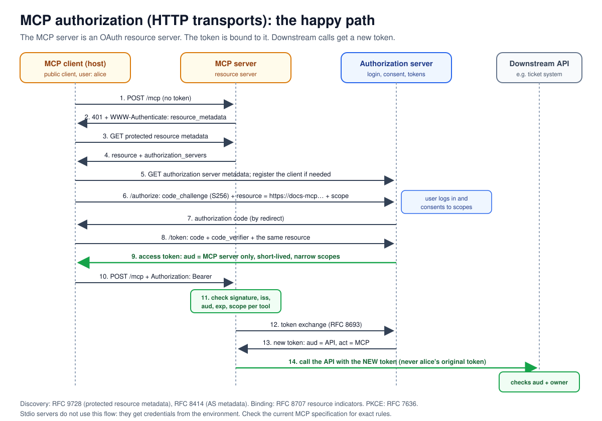
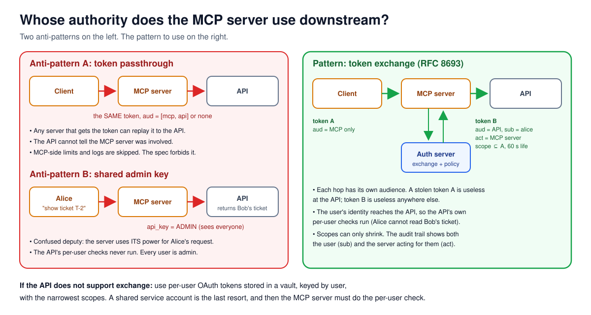

# MCP Authentication and Authorization

> **Module:** 04 · MCP Security · **Week:** 14 · **Time:** ~12 hours
> **You will:** learn the MCP authorization model (OAuth 2.1, protected resource metadata, resource indicators, PKCE), then attack an MCP server that accepts any token, passes tokens through and uses a shared admin key, and rebuild it so every token is checked and every downstream call carries the real user.

| | |
|---|---|
| **Prerequisites** | [MCP servers](../mcp-server/) (roles and transports); HTTP basics (headers, status codes 401/403) |
| **Lab** | [`lab/`](lab/): stdlib HMAC "JWT-like" tokens, runs offline, no identity provider needed |
| **Maps to** | **OWASP MCP Top 10 (2025, beta):** MCP07 Insufficient Authentication & Authorization, MCP01 Token Mismanagement & Secret Exposure, MCP02 Privilege Escalation via Scope Creep · **OWASP LLM Top 10 2026:** LLM03 Excessive Agency [2025: LLM06] · LLM02 Sensitive Information Disclosure [2025: LLM02] · **OWASP Agentic Top 10 2026:** ASI03 Identity & Privilege Abuse · OWASP API Security Top 10 2023: API1 (BOLA), API2 (Broken Authentication) · CIS Controls v8: 5 (Account Management), 6 (Access Control Management) |

---

## 1. Why this matters

An MCP server that reaches company data is an API. It needs the same identity discipline as any API, plus one new problem: it often acts *for* a user against *another* API.

- **2025, MCP spec revisions:** the **2025-03-26** revision added an OAuth 2.1-based authorization framework for HTTP transports. The **2025-06-18** revision made MCP servers OAuth **resource servers**, required **protected resource metadata (RFC 9728)** for discovery, required clients to send **resource indicators (RFC 8707)**, and explicitly forbade **token passthrough**. The rules are still evolving, so always check the current version.
- **2025, CVE-2025-6514 (mcp-remote):** JFrog showed that metadata from an untrusted server's authorization flow (a crafted authorization endpoint URL) could lead to OS command execution on the client. The *login flow itself* processes untrusted input.
- **2025, Asana:** Asana disclosed a bug in its MCP server feature that could expose some data to users of other organizations, and took the server offline to fix it. Multi-tenant authorization mistakes in MCP servers are not theoretical.
- **2015, JWT libraries and `"alg": "none"`:** researchers showed that several JWT libraries trusted the algorithm named *inside the token*, so an attacker could send an unsigned token and be accepted. The lab's vulnerable server repeats this mistake.
- **1988, "The Confused Deputy" (Norm Hardy):** the classic description of a program that misuses *its own* authority on behalf of a caller. Every MCP server with a shared admin key is a confused deputy waiting to happen.

---

## 2. Understand it

### 2.1 Four separate questions

Most auth bugs come from mixing these up:

| Question | Name | Answered by |
|---|---|---|
| Who is the user? | Authentication (authN) | The authorization server (login, MFA) |
| Is this token meant **for me**? | Audience validation | The resource server (MCP server) checks `aud` |
| What may this token do in general? | Scopes | `scope` claim, checked per tool |
| May **this user** touch **this record**? | Object-level authorization | The service that owns the data, using the user's identity |

A valid token answers only the first question. Scopes answer the third. **The fourth question is the one most often forgotten**, and it is the one behind most data leaks (OWASP API1, "Broken Object Level Authorization").

### 2.2 The MCP authorization model



| Piece | What it does | Standard |
|---|---|---|
| **MCP server = resource server** | Accepts access tokens, checks them, serves tools | OAuth 2.1 |
| **Protected resource metadata** | A JSON document at `/.well-known/oauth-protected-resource` that says "my identifier is X, get tokens from authorization server Y". A `401` response points to it with `WWW-Authenticate: Bearer resource_metadata="…"`. | RFC 9728 |
| **Authorization server metadata** | Tells the client the AS's endpoints and features | RFC 8414 |
| **Client registration** | How the client gets a `client_id`. Dynamic registration was suggested in early revisions; check the current spec for the preferred method. | RFC 7591 |
| **PKCE** | The client makes a random `code_verifier` and sends only its SHA-256 (`code_challenge`). A stolen authorization code is useless without the verifier. Use `S256`. | RFC 7636 |
| **Resource indicator** | The client sends `resource=https://docs-mcp.acme.example` in both the authorization and token requests. The AS puts that value in the token's `aud`. | RFC 8707 |
| **Token exchange** | The MCP server swaps the user's token for a *new* token for a downstream API | RFC 8693 |

Notes:
- Authorization is **optional** in MCP and applies to **HTTP** transports. A stdio server gets its credentials from its environment, so protecting that environment (and the config file) is the control.
- Tokens go in the `Authorization: Bearer` header, **never in the URL query string** (URLs end up in logs, browser history and proxies).
- **Session IDs are not authentication.** The `Mcp-Session-Id` header identifies a session; the spec says servers must not use sessions for authentication. Check the token on every request.

### 2.3 Anatomy of an access token

The lab uses a JWT-like format: `base64url(header).base64url(claims).base64url(signature)`.

| Claim | Meaning | What the MCP server must check |
|---|---|---|
| `alg` (header) | Signature algorithm | Must be one **the server** chose. Never `none`. Never "whatever the token says". |
| `iss` | Who issued it | Exactly your authorization server |
| `aud` | Who it is **for** | Exactly **this** MCP server's resource identifier |
| `exp`, `iat` | Expiry, issued-at | Not expired; short lifetimes (minutes) |
| `sub` | The user | Used for per-user authorization and audit |
| `scope` | What it may do | Contains the scope the tool needs |
| `client_id` | Which app asked for it | Optional policy (only approved clients) |
| `act` | Who is acting for the user (after token exchange) | Recorded in audit logs downstream |

### 2.4 The token-passthrough anti-pattern



**Token passthrough** means the MCP server takes the token it received and sends it on to another API. It looks convenient. It is forbidden by the MCP spec because:

1. **The MCP server must accept a token that was not made for it** (its audience is the downstream API). So any service that ever receives that token can replay it at the MCP server, and vice versa.
2. **Controls are skipped.** The downstream API sees the user's token directly; the MCP server's rate limits, validation and logging are bypassed if a client calls the API directly with the same token.
3. **Accountability breaks.** The downstream API cannot tell that an MCP server (and an AI model) was involved.
4. **A compromised MCP server holds a powerful, reusable credential.**

The fix: the client asks for a token whose `aud` is **only** the MCP server (resource indicator). For downstream calls, the MCP server gets a **separate** token: by **token exchange** (new token, `aud` = the API, `sub` = the user, `act` = the MCP server, narrower scope, short life) or from the user's own OAuth grant to that API, stored in a vault.

### 2.5 The confused deputy

A *deputy* is a program with its own authority that does work for callers. It is *confused* when a caller tricks it into using that authority for something the caller could not do alone.

In the lab, the vulnerable server calls the Tickets API with a **shared admin key**. Alice asks for Bob's ticket, the server fetches it with *its* key, and Alice gets it. The Tickets API's per-user check never runs, because the API sees "admin", not "Alice".

MCP adds its own variant, described in the spec's security best practices: an **MCP proxy server** that uses one **static client ID** with a third-party authorization server, while letting MCP clients register dynamically. If the third-party AS remembers consent for that static client ID (a consent cookie), an attacker can register a malicious client, send the user a crafted link, skip the consent screen and receive an authorization code. The spec's rule: such proxies must get the user's consent **for each dynamically registered client** before forwarding to the third-party AS.

### 2.6 Credential models compared

| Model | How it works | Risk | When it is acceptable |
|---|---|---|---|
| **Shared admin / service key** | One powerful key for all users | Confused deputy; every user gets admin; one leak = everything | Almost never for user data. Only for data that is the same for everyone. |
| **Token passthrough** | Forward the user's token | Forbidden by the spec (see 2.4) | Never |
| **Per-user OAuth tokens in a vault** | Each user grants the MCP server access to the API; tokens stored encrypted per user | Vault becomes a high-value target; refresh-token handling | When the API has no token exchange |
| **Token exchange (RFC 8693)** | New token per call or session: user + actor + narrow audience + short life | Needs AS support | **Best option** when available |

### 2.7 Scopes and lifetimes

- **Design scopes around tools and data**, not around "read/write everything": `tickets:read`, `tickets:write`.
- **Ask for the minimum.** When a tool needs more, return `403` with `WWW-Authenticate: Bearer error="insufficient_scope", scope="tickets:write"` so the client can ask the user for more (step-up), instead of requesting everything at login.
- **Short-lived access tokens** (minutes). OAuth 2.1 expects refresh tokens for public clients to be sender-constrained or **rotated** on every use.
- **Sender-constrained tokens** (DPoP, RFC 9449, or mutual TLS) make a stolen token useless without the client's private key. Consider them for high-risk servers.

### 2.8 Token theft, consent and secret lifetime (MCP01, MCP02)

Bearer tokens work for **whoever holds them**. Interviewers for identity roles like to test whether you understand what that means in practice (the *IAM & Zero Trust interview scenarios* workbook in your library has several such cases). Three patterns matter for MCP:

| Pattern | What happens | Why password resets don't help | Controls |
|---|---|---|---|
| **Token theft** | Malware or a leaked log hands over a refresh token; the attacker mints new access tokens from another network | No interactive login happens, so MFA never runs | Short access-token lifetimes; refresh-token rotation with reuse detection; sender-constrained tokens (DPoP, RFC 9449, or mTLS) so a copied token fails without the client's key; detect refreshes from a different device or client |
| **Consent phishing** | A user approves a malicious (or over-reaching) MCP client that asks for broad, offline access. No password is stolen | The **grant is the credential**; it survives resets | Allow user consent only for low-risk scopes; admin consent workflow for the rest; alert on new offline-access grants; revoke grants *and* refresh tokens during response |
| **Static secrets that never die** | A server's API key sits in a config file or vault for years, readable by a whole team | Rotation never happens; one leak opens many systems | Per-server vault paths; dynamic secrets with short leases; workload identity (cloud roles, federation) instead of stored keys; the launch-environment and redaction controls in [secure-operations](../secure-operations/) |

**Scope creep through consent.** If a client can ask for any scope and users click "Allow", permissions only ever grow. Keep the approved scope list per client or server, and treat a request for new scopes as a change that needs review (MCP02). The [secure-operations](../secure-operations/) lab blocks such an update with a `scope_creep` event.

---

## 3. Defend it

| Layer | Control | Type | What it buys you |
|---|---|---|---|
| L1 | **Strict validation**: algorithm allowlist set by the server, signature, `iss` | Hard | Forged and foreign tokens fail |
| L2 | **Audience binding**: `aud` must equal this server's identifier; clients send `resource=` (RFC 8707) | Hard | Tokens can't be replayed across servers |
| L3 | **Expiry and short lifetimes** | Hard | Stolen tokens die fast |
| L4 | **Scopes per tool**, with `403 insufficient_scope` | Hard | Least privilege per action |
| L5 | **No passthrough, no shared keys**: token exchange or per-user vault tokens; the user's identity reaches the data owner | Hard | Per-user authorization runs downstream; no confused deputy |
| L6 | **Discovery done right**: `401` with `resource_metadata`; PRM lists only your AS; validate all metadata URLs you receive (scheme, host) before using them | Hard | Clients find the right AS; malicious metadata can't inject |
| L7 | **Hygiene**: no tokens in URLs; log token fingerprints, never tokens; secrets in a vault; rotate keys | Process | Fewer leaks, better investigations |
| L8 | **Monitoring**: alert on spikes of 401/403, tokens with unexpected `aud` or `client_id`, exchange failures | Process | You notice attacks and misconfigurations |

### Design patterns worth knowing

- **The gateway as the resource server.** Put token validation, scope checks and token exchange in one MCP gateway, so each server does not reimplement them.
- **Two-layer authorization.** The MCP server checks *coarse* permission (scope per tool). The data owner checks *fine* permission (this user, this record). The lab tests that each one holds when the other is off.
- **Discovery vs invocation.** Listing a tool and calling it can need different scopes. Hide tools the user can't call, but still enforce at call time.
- **Per-agent identity.** When an autonomous agent acts, give it its own client identity and record both the agent and the user (`act` claim). See [Module 05](../../05-agent-security/).

### What does NOT work on its own

- "The token is signed, so it's fine." The tests `test_vulnerable_server_accepts_invalid_tokens[wrong_audience_replay]` and `[expired_token]` show signed tokens that must still be refused.
- Checking scopes but not object ownership. Alice has `tickets:read`; that does not make Bob's ticket hers.
- Hiding the admin key well. A well-hidden shared key is still a confused deputy.
- Trusting an `Mcp-Session-Id` as proof of who the user is.
- Putting "only act for the current user" in the model's prompt. Authorization is code.

---

## 4. Hands-on lab

**Scenario:** ACME runs `docs-mcp`, a remote MCP server. Its tools read and close tickets in the internal Tickets API. Alice and Bob each own one ticket; Bob's contains a payroll canary. The first version of the server "worked", so nobody looked at its auth code.

### Setup

Same as the rest of the repo (`python -m pip install -e ".[dev]"`).

### Step 1: Run the scorecard

```powershell
python 04-mcp-security/authentication/lab/demo.py
```

Expected output:

```text
case                       vulnerable       secure       secure-server reason
----------------------------------------------------------------------------------------------------
forged_alg_none            ACTION RAN       denied 401   algorithm 'none' not allowed
expired_token              ACCEPTED         denied 401   token expired
wrong_audience_replay      ACTION RAN       denied 401   token was not issued for this server (audience mismatch)
missing_scope              ACTION RAN       denied 403   missing scope tickets:write
cross_user_read            DATA LEAKED      denied 403   downstream denied: not your ticket
broad_token_passthrough    TOKEN FORWARDED  denied 401   token was not issued for this server (audience mismatch)
benign_get_own_ticket      ok, TOKEN LOGGED ok           ok

TOKEN FORWARDED = the user's own token reached another service (token passthrough).
DATA LEAKED     = Alice received Bob's ticket (a canary): the confused deputy.
ACTION RAN      = a ticket was closed by a caller who should not be able to.
ACCEPTED        = an invalid token (expired / wrong audience) got a 200.
TOKEN LOGGED    = the bearer token was written to the server log.

Tip: switch a layer off, e.g. SecureDocsMCPServer(..., check_scope=False), and re-run.
```

Note the `cross_user_read` row on the secure side: the reason comes from the **downstream API** ("not your ticket"). The secure MCP server did not need to know who owns T-2. It passed Alice's identity along (in an exchanged token), and the data owner said no.

### Step 2: Read the trusted pieces

Open [`lab/auth_server.py`](lab/auth_server.py):
- `sign()` / `forge_unsigned()`: what a token is, and what an attacker can build with no key.
- `authorize()` / `token()`: PKCE (`S256` only), single-use codes, and the `resource` that becomes `aud`.
- `exchange()`: refuses tokens not issued to the actor, and refuses to **add** scopes.
- `TicketsAPI`: checks `aud` and ownership for bearer tokens, but the legacy admin key bypasses everything.

### Step 3: Read the vulnerable server

Open [`lab/vulnerable_server.py`](lab/vulnerable_server.py) and find the seven `VULN` comments. Match each one to a row in the scorecard.

### Step 4: Read the secure server layer by layer

Open [`lab/secure_server.py`](lab/secure_server.py). Then run:

```powershell
python -m pytest 04-mcp-security/authentication -v
```

Read Part 3 of the tests carefully. Each test turns off one check and shows that a *different* component still refuses: the token exchange refuses foreign or expired tokens and new scopes; the downstream API refuses a passed-through token and other users' tickets.

### Step 5: Break it yourself

Predict first, then run:

1. `SecureDocsMCPServer(..., check_audience=False)` with `wrong_audience_replay`. Which component refuses now, and with which message?
2. Change `AuthorizationServer.exchange()` so it **does not** check `claims["aud"] == actor`. Re-run step 1. What can a malicious calendar server now do with tokens users gave it?
3. Change `TicketsAPI.get_ticket` to skip the owner check when the token has an `act` claim ("trusted services can see everything"). Which test fails? What real-world design does that represent?
4. In `attacks.py`, make a token with `aud` = `[DOCS_MCP]` (a one-element list). Should the secure server accept it? Decide, change `validate()` if you agree, and add a test.
5. Make the secure server log the full `Authorization` header "for debugging". Which test catches you?

### Step 6: Use a real identity provider (optional)

Run Keycloak (or any OAuth 2.1-capable IdP) in Docker. Create a realm, a public client with PKCE, and two users. Then:
- Fetch the IdP's metadata and JWKS. Verify an RS256 token's signature with the public key (use the `PyJWT` and `cryptography` packages in a separate virtual environment).
- Check whether your IdP supports the `resource` parameter (RFC 8707) and token exchange (RFC 8693). Many do with extra configuration; some do not. Write down what you would do if it does not.

### Stretch goals

- **Asymmetric keys:** replace HMAC with RS256 or ES256 (optional packages). Explain why the MCP server should only ever hold the *public* key.
- **Refresh-token rotation:** add refresh tokens that are single-use; reuse of an old one revokes the whole family.
- **Step-up:** when `close_ticket` returns `403 insufficient_scope`, simulate the client asking the user for `tickets:write` and retrying.
- **Per-user vault:** for an API without exchange, store per-user tokens encrypted (use a fake KMS key), keyed by `sub`, and prove Alice's call can never load Bob's token.

---

## 5. Real-world scenarios

**Scenario A: the calendar server that collected tokens (hypothetical).**
Users connect a third-party "smart calendar" MCP server. The company's AS issues tokens with no resource indicator, so every token is valid for all internal APIs. The calendar vendor is breached, and the attacker replays stored tokens against the internal docs MCP server.
- *What went wrong:* broad-audience tokens; resource servers did not check `aud`; long token lifetimes.
- *Investigate:* in AS logs, list tokens issued to the calendar client; in resource-server logs, find requests whose token `client_id` was the calendar client but which arrived at other servers; check source IPs.
- *Fix:* require `resource` on every token request and enforce exact `aud`; short lifetimes; revoke the calendar client's tokens; sender-constrained tokens for third-party clients.

**Scenario B: the multi-tenant SaaS MCP server (hypothetical, similar in shape to public incidents).**
A SaaS vendor launches an MCP server. To ship fast, it calls the vendor's own API with one internal service account and filters results by tenant ID taken from the request. A bug in the cache key mixes tenants, and one customer's agent sees another customer's project names.
- *What went wrong:* the service account could see all tenants, so a single filtering bug became a cross-tenant leak.
- *Investigate:* find which requests returned objects whose tenant differs from the token's tenant; size the exposure; notify affected customers.
- *Fix:* per-tenant (better: per-user) downstream credentials; data-layer tenant enforcement (row-level security); cache keys that include tenant and user; tests that try cross-tenant access on every release.

**Scenario C: tokens in the log pipeline (hypothetical).**
An MCP server logs every request's headers at debug level. Debug logging is switched on during an incident and the logs are shipped to a third-party log service. Valid bearer tokens are now readable by everyone with log access.
- *What went wrong:* secrets in logs; long-lived tokens; no redaction in the pipeline.
- *Investigate:* search log storage for `Bearer ` and JWT patterns; list the affected users and token IDs (`jti`); check for use of those tokens from unusual IPs.
- *Fix:* log fingerprints only (as the lab does); a redaction filter in the logging library *and* in the pipeline; revoke and rotate; short lifetimes so leaked tokens expire quickly.

---

## 6. Common mistakes

- Validating the signature and stopping there (no `aud`, `exp`, `iss` checks).
- Letting the token's header choose the algorithm.
- Accepting tokens whose `aud` is a list of many services "because it contains ours".
- Calling downstream APIs with the user's incoming token (passthrough) or with one shared admin key.
- Checking scopes but never object ownership (BOLA).
- Asking for every scope at login "so the user is only asked once".
- Passing tokens in query strings, or logging `Authorization` headers.
- Treating `Mcp-Session-Id` as proof of identity.
- Copying an old MCP auth tutorial without checking the current spec revision.

---

## 7. Interview preparation

<details><summary><b>Q1. Describe the MCP authorization model.</b></summary>

For HTTP transports, the MCP server is an OAuth 2.1 resource server. The client calls the server, gets `401` with a `WWW-Authenticate` header that points to the server's protected resource metadata (RFC 9728). That document names the authorization server(s). The client reads the AS metadata (RFC 8414), registers if needed, and runs the authorization code flow with PKCE, sending a resource indicator (RFC 8707) so the token's audience is exactly that MCP server. The client then calls the server with `Authorization: Bearer`. The server validates issuer, audience, expiry, signature and scopes on every request. Stdio servers don't use this flow; they take credentials from their environment.
</details>

<details><summary><b>Q2. What is token passthrough and why is it forbidden?</b></summary>

The MCP server forwards the token it received to a downstream API. To do that, the token must be valid for the downstream API, so the MCP server is accepting a token not issued for it. Consequences: tokens can be replayed between services, the MCP server's controls and logs are bypassed, the downstream can't see that an AI intermediary acted, and a compromised server gets a reusable user credential. Use token exchange or a separate per-user grant instead.
</details>

<details><summary><b>Q3. What does the `aud` claim protect against? Give an example.</b></summary>

It stops a token issued for service A from being used at service B. Example: a user connects a third-party calendar MCP server; it receives the user's token. If our docs MCP server doesn't check `aud`, the calendar vendor (or whoever breaches it) can replay that token at our server. With `aud` = exactly our identifier, the replay gets `401`. Resource indicators make the AS put the right audience in the token in the first place.
</details>

<details><summary><b>Q4. Why is PKCE required even for public clients that use HTTPS?</b></summary>

Authorization codes come back through a redirect, which can leak: malicious apps registering the same custom URL scheme, logs, browser history, referrer headers. PKCE binds the code to a secret (`code_verifier`) that only the original client knows; the AS checks that `SHA-256(verifier)` matches the challenge sent at the start. A stolen code without the verifier is useless. Use `S256`, never `plain`.
</details>

<details><summary><b>Q5. Explain the confused deputy problem with an MCP example.</b></summary>

An MCP server holds an admin API key. Alice asks it for ticket T-2, which belongs to Bob. The server fetches T-2 with *its own* admin authority and returns it. The server was "confused": it used its authority for a request Alice was not allowed to make. The fix is to make the downstream call with Alice's authority (a token exchanged for her, or her own grant), so the data owner's normal check ("is this Alice's ticket?") runs. MCP also has a proxy-specific variant: static client IDs plus dynamic registration plus remembered consent at a third-party AS, which the spec addresses by requiring per-client user consent.
</details>

<details><summary><b>Q6. Shared service account vs per-user tokens: when would you accept a service account?</b></summary>

Only when the data is the same for every user (e.g., public product docs) or when there is no way to carry user identity, and then the MCP server must do the object-level authorization itself, with tests, and the account must have the narrowest scope possible. For any per-user or per-tenant data, prefer token exchange or per-user grants so the data owner enforces access.
</details>

<details><summary><b>Q7. Walk me through validating a JWT access token.</b></summary>

1. Parse; reject malformed tokens.
2. Algorithm: must be in *your* allowlist (e.g., RS256/ES256); never `none`; never chosen by the token.
3. Find the key by `kid` from the issuer's JWKS (cached, refreshed safely); verify the signature.
4. `iss` equals the expected issuer exactly.
5. `aud` equals this resource server's identifier.
6. `exp` in the future, `nbf`/`iat` sensible, small clock-skew allowance.
7. Required scope for the operation is present.
8. Optional: `client_id` allowlist, token type, revocation check or introspection for high-risk actions.
Then do object-level authorization with `sub`.
</details>

<details><summary><b>Q8. How should an MCP server handle "this tool needs more permission"?</b></summary>

Return `403` with `WWW-Authenticate: Bearer error="insufficient_scope", scope="<needed scope>"`. The client can then ask the user to grant that scope (step-up) and retry. This keeps initial tokens small and makes extra permission a visible, user-approved event, instead of asking for everything at login.
</details>

<details><summary><b>Q9. What is token exchange (RFC 8693) and what should the new token contain?</b></summary>

The MCP server sends the user's token (the subject token) to the AS and asks for a new token for a specific downstream audience. The new token should have: `sub` = the user, `aud` = only the downstream API, `act` = the MCP server (the actor), a scope that is a subset of the original, and a short lifetime. The AS must refuse if the subject token was not issued to that actor, or if the requested scope is larger. The downstream API then enforces per-user access and logs both user and actor.
</details>

<details><summary><b>Q10. Scenario: you see many `401 audience mismatch` errors from one client ID at your MCP server. What could it be?</b></summary>

Either a misconfigured client (not sending `resource`, so it gets tokens for the wrong audience) or someone replaying tokens obtained for another service. Check: the client ID and its registration date, the token `aud` values, source IPs and user agents, and whether the same `jti` values appear at other services. If it's misconfiguration, fix the client. If it's replay, revoke the affected tokens, investigate where they were issued to, and consider sender-constrained tokens.
</details>

<details><summary><b>Q11. Why must tokens never appear in URLs or logs, and what do you log instead?</b></summary>

URLs are stored in browser history, proxy logs, server access logs and `Referer` headers; logs are copied widely and kept long. A bearer token anywhere in those is usable by anyone who reads it. Log a fingerprint (a short hash of the token), the `jti`, `sub`, `client_id` and the decision. That is enough to correlate and investigate without creating new secrets.
</details>

<details><summary><b>Q12. A stdio MCP server needs a GitHub token. How do you handle that securely?</b></summary>

The host passes credentials through the environment, so: use a fine-grained token limited to the needed repositories and permissions; keep it in the OS keychain or a secret manager, not in a plain-text config file checked into git; give the server process only the variables it needs; rotate it; and prefer short-lived tokens issued per session (e.g., via a GitHub App) over long-lived personal tokens.
</details>

<details><summary><b>Q13. A refresh token for an MCP client was stolen from a laptop. The user's password and MFA were never touched. How do you detect it, and what makes a stolen token useless?</b></summary>

Detect: the identity provider shows refresh events (not interactive logins) from a different device ID, client fingerprint or network than the session that issued the token; the MCP server sees calls from unusual IPs with that token's `jti`. Contain: revoke the refresh token family and active sessions, isolate the laptop, and treat every other token or cookie on it as stolen. Prevent: short access-token lifetimes, refresh-token rotation (reuse of an old one revokes the family), and sender-constrained tokens (DPoP or mTLS) so the token is useless without the private key that stays on the device.
</details>

<details><summary><b>Q14. Users granted a new "AI productivity" MCP client broad read access to mail and files. Nothing was hacked. Why is this an identity incident?</b></summary>

Because the OAuth grant itself is the attacker's credential. A delegated grant with offline access gives a refresh token that keeps working after password resets and new MFA prompts. Response: list every user who consented and the scopes granted, revoke the grants and refresh tokens, block the client ID, and use API logs (not mail-gateway logs) to see what data was read. Prevention: allow user consent only for low-risk scopes from verified publishers, require admin approval for the rest, and alert on new high-risk grants.
</details>

<details><summary><b>Q15. "We moved all MCP secrets into a vault, so we are done." What do you answer?</b></summary>

A vault fixes where secrets live, not how long they live or how much one reader can unlock. Check the vault policies (per server and environment, not per team), audit and alert on unusual reads, move to dynamic credentials with short leases where the platform supports it, and use workload identity so many secrets do not need to exist at all. Also check the other leak paths: launch environments, config files, logs and the model's context.
</details>

<details><summary><b>Q16. Explain to an executive why "the AI assistant uses an admin key" is a problem.</b></summary>

"If the assistant uses one master key, then anyone who can talk to the assistant effectively has the master key. Our normal rules about who may see what stop working, because every request looks like it comes from an administrator. We want the assistant to carry each person's own badge, so the systems we already trust keep enforcing the rules."
</details>

<details><summary><b>Q17. What changes between the 2025-03-26 and 2025-06-18 MCP authorization rules, in short?</b></summary>

2025-03-26 introduced OAuth 2.1-based authorization for HTTP transports. 2025-06-18 clarified the roles: the MCP server is an OAuth resource server, it must publish protected resource metadata (RFC 9728) so clients can discover the authorization server, clients must use resource indicators (RFC 8707) to bind tokens to the server, and token passthrough is explicitly forbidden. Later revisions may change details again, so in a real project I would read the current version before designing.
</details>

---

## 8. Checklist (definition of done)

- [ ] I can draw the MCP authorization flow (discovery, PKCE, resource indicator, call, exchange) from memory.
- [ ] `python -m pytest 04-mcp-security/authentication` passes.
- [ ] I did the five "break it yourself" steps and recorded predictions and results.
- [ ] I can explain token passthrough and the confused deputy with the lab's examples.
- [ ] I can answer Q13–Q15 (token theft, consent phishing, "the vault is enough") out loud in two minutes each.
- [ ] Week 14 journal: my design for an authenticated MCP service: token claims, scopes per tool, downstream credential model, and what I log.

## 9. References

- MCP specification, Authorization (check the current revision): https://modelcontextprotocol.io/specification
- MCP authorization, 2025-06-18 revision: https://modelcontextprotocol.io/specification/2025-06-18/basic/authorization
- MCP security best practices (confused deputy, token passthrough, session hijacking): https://modelcontextprotocol.io/specification/2025-06-18/basic/security_best_practices
- OAuth 2.1 draft: https://datatracker.ietf.org/doc/draft-ietf-oauth-v2-1/
- RFC 9728, OAuth 2.0 Protected Resource Metadata: https://www.rfc-editor.org/rfc/rfc9728
- RFC 8707, Resource Indicators for OAuth 2.0: https://www.rfc-editor.org/rfc/rfc8707
- RFC 8414, OAuth 2.0 Authorization Server Metadata: https://www.rfc-editor.org/rfc/rfc8414
- RFC 7636, PKCE: https://www.rfc-editor.org/rfc/rfc7636
- RFC 8693, OAuth 2.0 Token Exchange: https://www.rfc-editor.org/rfc/rfc8693
- RFC 7591, Dynamic Client Registration: https://www.rfc-editor.org/rfc/rfc7591
- RFC 9449, DPoP: https://www.rfc-editor.org/rfc/rfc9449
- RFC 8725, JSON Web Token Best Current Practices: https://www.rfc-editor.org/rfc/rfc8725
- CVE-2025-6514 (mcp-remote): https://nvd.nist.gov/vuln/detail/CVE-2025-6514
- Norm Hardy, *The Confused Deputy* (1988): https://dl.acm.org/doi/10.1145/54289.871709
- OWASP API Security Top 10 2023: https://owasp.org/API-Security/editions/2023/en/0x11-t10/
- OWASP MCP Top 10 (2025, beta; MCP01, MCP02, MCP07): https://owasp.org/www-project-mcp-top-10/
- OWASP Top 10 for Agentic Applications 2026 (ASI03 Identity & Privilege Abuse): https://genai.owasp.org/
- OAuth 2.0 Security Best Current Practice, RFC 9700: https://www.rfc-editor.org/rfc/rfc9700
