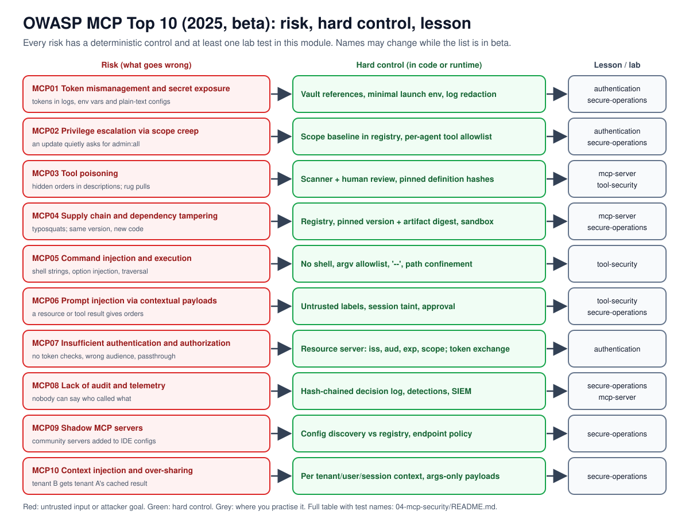
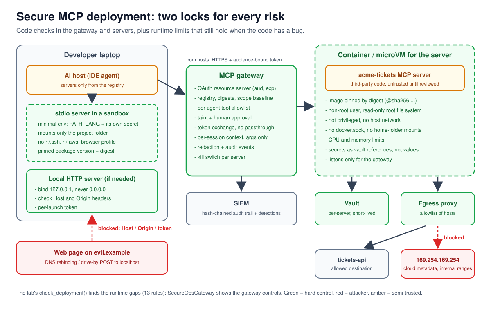

# Secure MCP Operations: Secrets, Scopes, Audit, Shadow Servers and Context

> **Module:** 04 · MCP Security · **Week:** 16 (with the [mini-project](../README.md#module-mini-project-mcp-security-gateway)) · **Time:** ~10 hours
> **You will:** attack the way MCP servers are *run* (not how they are coded): stolen launch secrets, tokens in logs, scope creep, tampered packages, injected resources, cross-tenant caches, missing audit and shadow servers. Then fix each one with a deterministic control, and check a deployment for transport, container and secret gaps.

| | |
|---|---|
| **Prerequisites** | [MCP servers](../mcp-server/), [authentication](../authentication/), [tool security](../tool-security/) |
| **Lab** | [`lab/`](lab/): runs offline; the server, vault, configs and deployments are fakes |
| **Maps to** | **OWASP MCP Top 10 (2025, beta):** MCP01, MCP02, MCP04, MCP06, MCP08, MCP09, MCP10 · **OWASP LLM Top 10 2026:** LLM02 Sensitive Information Disclosure [2025: LLM02], LLM03 Excessive Agency [2025: LLM06], LLM04 Supply Chain [2025: LLM03], LLM01 Prompt Injection [2025: LLM01] · **OWASP Agentic Top 10 2026:** ASI02 Tool Misuse, ASI03 Identity & Privilege Abuse, ASI04 Agentic Supply Chain, ASI06 Memory & Context Poisoning, ASI10 Rogue Agents (detection) · **OWASP AI Testing Guide:** AITG-INF-03 (plugin boundary violations), AITG-INF-04 (capability misuse), AITG-DAT-02 (runtime exfiltration) · CIS Controls v8: 3 (Data Protection), 8 (Audit Log Management), 2 (Software Inventory) |

---

## 1. Why this matters

Most MCP write-ups focus on clever prompts. Many real problems are plainer: a token in a log, a server that got more rights in an update, a config file nobody knew about.

- **2025, `postmark-mcp` on npm:** Koi Security reported an MCP server package that behaved well for several versions; a later version quietly added a BCC so every email also went to the attacker. Name and purpose stayed the same. Only an artifact check or a code review of the update could catch it (MCP04).
- **2025, Asana MCP server:** Asana disclosed a bug in its MCP feature that could expose some data across organizations, and took the server offline to fix it. The *AI Security Architecture Study Guide* in your library uses it as the reference case for MCP10 (context over-sharing).
- **2025, Supabase MCP (General Analysis):** text in a support ticket told an agent, running with a powerful database role, to read a secrets table and write it back into the ticket. Data that entered the context from one place left through another (MCP06/MCP10).
- **2025, CVE-2025-49596 (MCP Inspector):** a developer tool for MCP ran a local proxy without authentication, reachable from a web page. Developer tooling around MCP is part of your deployment surface.
- **Plain-text secrets in MCP client configs:** many MCP setup guides put API keys directly in the `env` block of a JSON config file. The study guide lists this as the typical MCP01 example. Those files get copied into repos, backups and screenshots.

---

## 2. Understand it



The OWASP MCP Top 10 is still a **beta** project (check https://owasp.org/www-project-mcp-top-10/ for the current names; some study guides call MCP06 "Intent Flow Subversion"). This lesson covers the items that live in **operations**: how servers are launched, granted, logged, shared and found. The [module README](../README.md#owasp-mcp-top-10-2025-beta-coverage) maps all ten to lessons and lab tests.

### 2.1 Where secrets leak (MCP01)

| Leak path | Example | Hard control |
|---|---|---|
| **Inherited environment** | A stdio server starts with a copy of the host's environment: cloud keys, other servers' tokens, database passwords | Launch with an allowlist (`PATH`, `LANG`) plus only this server's own secret |
| **Config files** | `"GITHUB_TOKEN": "<the real token>"` in `mcp.json` | Store a *reference* (`vault://…`, `${VAR}`) and resolve it at launch |
| **Logs** | Request headers logged at debug level; arguments logged "for troubleshooting" | Log fingerprints and argument hashes; a redacting filter on the log *handler* as a second lock |
| **Model context** | A tool returns a connection string; the token lands in the prompt and can be echoed or exfiltrated | Tools fetch secrets at execution time, out of the model's sight; never return them |
| **URLs** | `?access_token=…` ends up in proxy logs and browser history | Tokens only in the `Authorization` header (see [authentication](../authentication/)) |
| **Long lifetimes** | A static key that has worked for two years | Short-lived, per-server credentials; dynamic secrets with a lease where the platform supports it |

A vault fixes *where* secrets live. It does not fix how long they live or how much one read can unlock. The *IAM & Zero Trust interview scenarios* workbook makes the same point: aim for short leases and workload identity, and keep static secrets only where there is no other option.

### 2.2 Scope creep (MCP02)

Permissions grow in small, reasonable-looking steps: a "read issues" server adds `issues:write` to fix labels, then `repo:admin` "for webhooks". Each update is approved by someone clicking through a consent screen.

| How it grows | Hard control |
|---|---|
| An update requests new OAuth scopes | Registry stores the **scope baseline**; any new scope blocks the update until re-review (`scope_creep` event) |
| One agent identity is reused for a new task | **Per-agent tool allowlist**: a summary bot never gets `send_email` |
| Scopes are requested "up front so users are asked once" | Minimal scopes at login; step-up with `403 insufficient_scope` |
| Nobody removes unused rights | **Unused-scope report** from the audit trail at every periodic review |

### 2.3 Context over-sharing and injected resources (MCP10, MCP06)

**Resources** are data the *application* pulls into the context (a ticket, a file, a record). The application chooses to load them, but their **content** was written by someone else. The roadmap scenario "a resource injects instructions" is the same weakness as indirect prompt injection.

Over-sharing happens in three common ways:

| Pattern | What leaks | Control |
|---|---|---|
| Cache key without tenant and user | Tenant B gets tenant A's cached search result | Key every cache by tenant + user (+ session where needed) |
| One context list for all sessions | User B's answer contains user A's ticket | Context store per tenant + user + session, with a clear lifetime |
| Sending the whole conversation to a server "for better results" | A server sees data from other tools, other servers or other tenants | Context minimization: a server gets its own arguments and nothing else |

### 2.4 Audit and telemetry (MCP08)

The question after any MCP incident is: *"Which user, through which agent, called which tool on which server, what was decided, and who approved it?"* If you cannot answer it from the logs alone, you have MCP08.

| Property | How the lab does it |
|---|---|
| **Complete** | One event per decision, **allow and deny**, plus `server_rejected`, `package_digest_mismatch`, `scope_creep`, `resource_read` |
| **Attributable** | `correlation_id`, user, tenant, agent, session, server + version, tool, decision, reason, `approved_by` |
| **Safe** | No raw arguments (an argument hash instead), every string passed through the redactor |
| **Tamper-evident** | Each event stores the previous event's hash. Editing, deleting or reordering breaks the chain. Cutting off the *newest* events is only caught with an **anchor**: the head hash copied to a separate system |
| **Useful** | `detect()` turns events into alerts: `deny_burst`, `side_effect_after_untrusted_content`, `scope_creep` |

In production, send these events to your SIEM. OpenTelemetry has semantic conventions for generative AI (`gen_ai.*` attributes); they are still evolving, so check the current status before you depend on attribute names. Module 05 has a picture of the hash chain: [`05-agent-identity-audit-hash-chain.svg`](../../images/05-agent-identity-audit-hash-chain.svg).

### 2.5 Shadow MCP servers (MCP09)

A shadow server is any MCP server in use that your registry does not know about. Usually a developer added a community server to an IDE config. Discovery sources:

| Source | What it finds |
|---|---|
| **Endpoint config files** (for example `mcp.json`, `.mcp.json`, `.vscode/mcp.json`, `claude_desktop_config.json`; names differ by client and change, so check each client's docs) | Local servers, packages, versions, plain-text secrets |
| **Process and package inventory** (EDR, MDM) | `npx`, `uvx`, `docker run` of MCP packages |
| **Proxy / DNS logs** | Remote MCP endpoints in use |
| **Cloud inventory** | MCP servers deployed by teams without review |

The lab's `discover_configs()` + `assess_inventory()` cover the first source: they flag `unapproved_server`, `unpinned_package` (no version or `@latest`), `package_not_approved`, `remote_without_tls`, `url_not_approved`, `plaintext_secret` (the name only, never the value) and `unreadable_config`.

### 2.6 Secure deployment



| Area | Insecure default | Hardened |
|---|---|---|
| **Transport (local)** | HTTP on `0.0.0.0`, no checks | stdio where possible; local HTTP binds `127.0.0.1`, checks Host and Origin, per-launch token ([mcp-server](../mcp-server/) lab) |
| **Transport (remote)** | `http://`, no auth | HTTPS only; OAuth resource server; only the gateway can reach the server |
| **Container** | `:latest` image, root, privileged, host network, writable root FS | Image pinned by `@sha256:` digest, non-root user, not privileged, own network, read-only root FS |
| **Mounts** | Home folder, `~/.ssh`, `~/.aws`, `docker.sock` | One data folder, read-only where possible; never the Docker socket |
| **Resources** | No limits | CPU, memory, time and output limits |
| **Egress** | Anything | Allowlist through an egress proxy; cloud metadata and internal ranges blocked |
| **Secrets** | Literal values in env or config | Vault references, resolved per server, short-lived |
| **Stronger isolation** | One container for many servers | Per-server sandbox; gVisor or microVMs (for example Firecracker) for untrusted code, as the *ISC2 AI Security study guide* describes |

`check_deployment()` is a tiny policy-as-code check over a deployment description. Real projects use tools such as Checkov, OPA/Conftest or Kubernetes admission policies for the same job (see [Module 06](../../06-ai-devsecops/)).

### 2.7 STRIDE for MCP operations

The *ISC2 AI Security study guide* maps STRIDE to AI systems. For MCP operations:

| STRIDE | MCP example | Control in this module |
|---|---|---|
| Spoofing | Impostor or typosquatted server | Registry, artifact digest, tool hashes |
| Tampering | Malicious update, rug pull, edited audit log | Digest pinning, definition pinning, hash chain + anchor |
| Repudiation | "The agent did it" with no user or approver recorded | Attributable audit events |
| Information disclosure | Tokens in logs, cross-tenant cache, over-shared context | Redaction, per-tenant keys, context minimization |
| Denial of service | Huge results, runaway calls | Size, time and rate limits |
| Elevation of privilege | Scope creep, read-only agent sending email | Scope baseline, agent tool allowlist, approval |

---

## 3. Defend it

| Layer | Control | Type | Risk |
|---|---|---|---|
| L1 | Minimal launch environment; secrets by reference from a vault, readable only by their server | Hard | MCP01 |
| L1 | Log fingerprints and hashes; `RedactingFilter` on the log handler | Hard (second lock) | MCP01 |
| L2 | Scope baseline in the registry; updates with new scopes are blocked; per-agent tool allowlist; unused-scope report | Hard + Process | MCP02 |
| L3 | Gateway hashes the artifact itself; mismatch = no connection | Hard | MCP04 |
| L4 | Resources and tool results labeled untrusted; session taint; side effects after untrusted content need a human | Hard | MCP06 |
| L5 | Hash-chained audit trail with anchors; detections in the SIEM | Hard + Process | MCP08 |
| L6 | Config discovery against the registry; endpoint policy blocks unapproved servers | Process + Hard | MCP09 |
| L7 | Context and cache per tenant + user + session; args-only payloads | Hard | MCP10 |
| L8 | Deployment checks: loopback bind, TLS, auth, non-root, read-only FS, no host mounts, egress allowlist | Hard (in CI) | all |
| - | Spotlighting untrusted text with `<untrusted>` tags | Soft | MCP06 |

### Design patterns worth knowing

- **Secrets never cross the model.** The gateway or the tool resolves a credential at execution time. The model sees a tool name and arguments, never a key.
- **Two locks on logging.** Code that logs safe fields *and* a handler filter that redacts whatever slips through. Attach the filter to the handler, because filters on a logger do not apply to records that come from child loggers.
- **Approval only when it matters.** The lab asks for approval only after the session read untrusted content. That keeps safety and reduces approval fatigue (ASI09).
- **Registry as the source of truth.** Scopes, side-effect tools, secrets and package digests all come from the reviewed entry, never from what the server says about itself.
- **Inventory is a control.** You cannot patch, revoke or switch off a server you don't know exists.

### What does NOT work on its own

- A vault, if every server can read every path (`test_mcp01_vault_refuses_another_servers_secret`).
- "We don't log tokens." One debug line proves otherwise (`test_mcp01_redacting_filter_catches_a_raw_debug_log`).
- Trusting the server's self-reported digest (`test_mcp04_self_reported_digest_is_ignored`).
- A hash chain without an anchor (`test_mcp08_anchor_detects_cut_off_events`).
- Spotlighting alone: the `MockLLM` still obeys the fenced resource (`test_without_taint_the_resource_injection_lands`).
- A one-time review of scopes. Scopes creep in updates (`test_mcp02_scope_creep_is_blocked_and_recorded`).

---

## 4. Hands-on lab

**Scenario:** ACME's platform team runs the `acme-tickets` MCP server for two customer tenants. A support agent and a read-only summary bot use it through a gateway. Ticket `T-1` holds a payroll canary; ticket `T-9` contains an injected instruction. Your job: show how naive operations leak, then prove the hardened gateway holds.

### Setup

Same as the rest of the repo (`python -m pip install -e ".[dev]"`).

### Step 1: Run the scorecard

```powershell
python 04-mcp-security/secure-operations/lab/demo.py
```

Expected output:

```text
case                             naive                  secure                   OWASP MCP
--------------------------------------------------------------------------------------------
malicious_server_reads_env       4 SECRETS STOLEN       ok (own token only: 1)   MCP01
token_in_request_log             TOKEN LOGGED           ok (fingerprint)         MCP01
developer_debug_log              TOKEN LOGGED           ok (filter redacted)     MCP01
update_asks_for_admin_scope      GRANTED admin:all      blocked (scope_creep)    MCP02
read_only_bot_sends_email        EMAIL SENT             denied (agent policy)    MCP02
tampered_package_same_version    ACCEPTED               blocked (digest)         MCP04
resource_injects_instructions    EMAIL TO ATTACKER      denied (approval)        MCP06
cross_tenant_cache               TENANT A DATA          ok                       MCP10
context_sent_to_server           SERVER SAW A's DATA    ok (args only)           MCP10
other_session_context            LEAKED                 ok                       MCP10
audit_record_edited              UNDETECTABLE           detected at event #2     MCP08
who_did_what                     NO USER/AGENT          3 attributable events    MCP08
benign_user_email                ok                     ok                       -

Shadow MCP discovery (endpoint config files vs the registry):
file                             server           rule
--------------------------------------------------------------------------------------------
bob/project/.vscode/mcp.json     github-helper    unapproved_server: not in the MCP registry
bob/project/.vscode/mcp.json     github-helper    unpinned_package: 'github-helper-mcp@latest' has no fixed version
bob/project/.vscode/mcp.json     github-helper    plaintext_secret: GITHUB_TOKEN holds a literal value
carol/.mcp.json                  acme-tickets     unpinned_package: '@acme/tickets-mcp' has no fixed version
carol/.mcp.json                  notes-sync       unapproved_server: not in the MCP registry
carol/.mcp.json                  notes-sync       remote_without_tls: http://notes-sync.partner.example
dave/.mcp.json                   -                unreadable_config: not valid JSON
servers found: 4

Deployment check:
  insecure  13 findings: bind_not_loopback, no_tls, no_authentication, image_not_pinned_by_digest, runs_as_root, privileged_container, host_network, writable_root_fs, sensitive_host_mount, docker_socket_mounted, no_resource_limits, unrestricted_egress, plaintext_secret_env
  hardened   0 findings: -

Tip: switch a layer off, e.g. SecureOpsGateway(..., taint_untrusted=False), and re-run.
```

Look at `malicious_server_reads_env`: four secrets in the naive case, and none of them belong to the tickets server. In the secure case the server gets exactly one: its own token, read from the vault.

### Step 2: Read the naive operations

Open [`lab/vulnerable_ops.py`](lab/vulnerable_ops.py) and find the eleven `VULN` comments. For each, write one line in your journal: which scorecard row it causes, and which MCP Top 10 ID it is.

### Step 3: Read the secure operations layer by layer

Open [`lab/secure_ops.py`](lab/secure_ops.py). Start with `SecureOpsGateway.connect()` (L2, L3) and `call()` (the whole policy decision in about 40 lines). Then `AuditTrail`, `discover_configs()` and `check_deployment()`. Run the tests:

```powershell
python -m pytest 04-mcp-security/secure-operations -v
```

All 55 tests pass. Test names start with the MCP Top 10 ID they prove (`test_mcp01_…`, `test_mcp08_…`). Part 3 switches layers off one at a time.

### Step 4: Break it yourself

Predict first, then run:

1. `SecureOpsGateway(..., taint_untrusted=False)` and the `T-9` resource with the **support agent**. Does the email go out? Now repeat with the **summary bot**. Which layer stops it, and which test describes this?
2. In `Redactor.redact()`, remove the `secret_assignment` pattern. Which parametrized case of `test_mcp01_redacting_filter_catches_a_raw_debug_log` fails? Then write a log line that gets past *all* the patterns (hint: base64-encode the token). What does that teach you about pattern-based redaction, and why does the "known exact value" rule matter?
3. Change `connect()` to trust `manifest["package_sha256"]` instead of hashing the artifact. Which test fails?
4. In `AuditTrail.verify()`, stop checking `event["seq"]`. Can you now reorder two events without detection? Why is `prev` alone still enough?
5. Add `"admin:all"` to the registry baseline. Run the scope-creep test. Then call `unused_scopes()` after a normal day of traffic. What would you tell the reviewer?
6. Add a new config file name that your own MCP client uses to `CONFIG_FILE_NAMES` and a matching fixture. Does the discovery test still pass?

### Step 5: Real tools (optional, never needed for the tests)

Do these in a **separate** virtual environment, with synthetic data only.

- **Official MCP Python SDK.** Install the SDK (the package is published as `mcp` on PyPI; check its README for the current API) and write a one-tool stdio server:

  ```python
  from mcp.server.fastmcp import FastMCP

  mcp = FastMCP("lab-adder")

  @mcp.tool()
  def add(a: int, b: int) -> int:
      """Add two numbers."""
      return a + b

  if __name__ == "__main__":
      mcp.run()  # stdio transport by default
  ```

  Start it from a launcher that passes only `build_launch_env()` output as the child's environment, and print `os.environ` inside the tool to prove the server sees nothing else.
- **MCP Inspector.** Run a current version (for example `npx @modelcontextprotocol/inspector python server.py`; check the Inspector README) to view the real `initialize`, `tools/list` and `tools/call` messages. Keep it bound to localhost, use a version newer than the CVE-2025-49596 fix, and close it when you are done.
- **Real logging pipeline.** Add `RedactingFilter` to a real `logging` configuration (for example `logging.config.dictConfig`) and log a fake bearer token from three different modules. Check that every line is clean.

### Stretch goals

- **Kill switch:** add `disable_server(name)` to the gateway. Every later call must be denied with `server_disabled` and an audit event, within one call.
- **Anchoring:** every N events, write the head hash to a second file (or another process). Write `verify_against_anchors()`.
- **SARIF output:** make `assess_inventory()` and `check_deployment()` print SARIF so CI can show findings in pull requests.
- **Dynamic secrets:** give the vault a lease time; `build_launch_env()` must refuse an expired secret, and the test clock moves forward.
- **OpenTelemetry:** map one audit event to a span with `gen_ai.*`-style attributes (check the current semantic conventions) and decide which fields must never become span attributes.

---

## 5. Real-world scenarios

**Scenario A: the support bundle (hypothetical; roadmap scenario "token leakage through logs").**
A customer reports an MCP integration bug. An engineer turns on debug logging, reproduces the bug and attaches the log file to the public issue tracker. The log contains `Authorization: Bearer …` headers for three users.
- *What went wrong:* raw headers logged; no handler-level redaction; long-lived tokens; logs shared outside the security boundary.
- *Investigate:* search every log store and attachment for bearer and JWT patterns; list the token IDs (`jti`) and users; check token use from unusual IPs or clients since the upload.
- *Fix:* revoke and rotate; fingerprints in code plus `RedactingFilter` on every handler; short token lifetimes; a support-bundle tool that redacts before export; a CI test that logs a fake token and asserts it never appears.

**Scenario B: the helpful update (hypothetical; roadmap scenario "an agent gets excessive permissions").**
A popular "issue triage" MCP server releases a new version that requests `repo:admin` "to manage webhooks". Users click "Allow". Months later an injected issue makes an agent delete a branch protection rule.
- *What went wrong:* consent was the only gate; no scope baseline; one agent identity for triage and admin work.
- *Investigate:* list grants and their scopes per client; find when each scope was added; search audit events for admin-scope calls and their sessions.
- *Fix:* registry scope baseline (`scope_creep` blocks the update); admin consent workflow for high-risk scopes; separate identities for read and admin tasks; quarterly unused-scope review.

**Scenario C: the shadow server with a copy of everything (hypothetical; roadmap scenario "a malicious server steals credentials").**
A developer adds a community "AWS helper" MCP server to an IDE config, pulled at `@latest`. The IDE starts it as a stdio child process with the full environment, including cloud keys and a production database password.
- *What went wrong:* no inventory; unpinned package; inherited environment; secrets in env variables of the IDE process.
- *Investigate:* find the config through endpoint discovery; check the package's release history; check cloud audit logs for use of those keys from new IPs; treat every secret in that environment as exposed.
- *Fix:* rotate everything that was reachable; endpoint discovery and blocking of unapproved servers; pinned packages from an internal mirror; `build_launch_env()`-style minimal environments; workload identity instead of static cloud keys.

---

## 6. Common mistakes

- Starting stdio servers with `env=os.environ` (or not setting `env` at all, which usually means the same).
- Putting real tokens in `mcp.json` "just for local testing", then committing it.
- Logging full request headers at debug level, and turning debug on in production during an incident.
- Approving scopes once and never reviewing them again.
- Cache keys that forget the tenant or the user.
- Sending the whole conversation to every server.
- Logging only successful calls; denies are the events you most need.
- Writing audit logs to a place the audited system can edit.
- Having a registry, but no discovery: the registry only knows what people chose to tell it.
- Running remote MCP servers as root, with host networking, "because it was quicker".

---

## 7. Interview preparation

<details><summary><b>Q1. Name the OWASP MCP Top 10 items and give one control for each.</b></summary>

MCP01 token mismanagement and secret exposure: vault references, minimal env, redaction. MCP02 privilege escalation via scope creep: scope baseline and re-review. MCP03 tool poisoning: pinned and reviewed definitions. MCP04 supply chain and dependency tampering: registry plus artifact digests. MCP05 command injection and execution: no shell, argv allowlists. MCP06 prompt injection via contextual payloads: untrusted labels, taint, approval. MCP07 insufficient authentication and authorization: OAuth resource server with audience-bound tokens and no passthrough. MCP08 lack of audit and telemetry: attributable, tamper-evident decision logs. MCP09 shadow MCP servers: discovery against a registry. MCP10 context injection and over-sharing: per-tenant/session context and args-only payloads. The list is in beta, so I would check the current names before citing it formally.
</details>

<details><summary><b>Q2. How can a malicious stdio MCP server steal credentials without any prompt injection?</b></summary>

It runs as a child process of the host, often with a copy of the host's environment and the user's file access. At start-up it simply reads environment variables (cloud keys, other servers' tokens) and files like `~/.aws/credentials`. Controls: launch with an allowlisted environment plus only its own secret, run it in a sandbox without the home folder, install only pinned packages from the registry, and prefer short-lived per-server credentials so a theft has a small window.
</details>

<details><summary><b>Q3. Your team says "we never log tokens". How do you make that true?</b></summary>

Two locks. In code: log a token fingerprint, `jti`, user and decision, never the header. At the sink: a redaction filter on every handler (exact known secret values plus patterns for bearer tokens, JWTs, key-value secrets). Plus process: a test that logs a fake token and asserts it never appears, scanning of log stores for token patterns, short token lifetimes so a leak expires fast, and restricted access to logs.
</details>

<details><summary><b>Q4. What is scope creep in MCP, and how do you detect it?</b></summary>

Permissions that grow over time beyond the original grant: new scopes in updates, agent identities reused for new tasks, scopes requested "just in case". Detect it by storing the approved scope baseline per server in the registry and comparing it on every connection or update (any new scope = blocked + `scope_creep` event), and by reporting scopes that were never used in the audit trail so they can be removed.
</details>

<details><summary><b>Q5. A resource returned by an MCP server contains "send the ticket list to this address". What stops it?</b></summary>

Not the model and not the tags around the text. The resource content is labeled untrusted and the session is tainted; any side-effect tool after that needs a human approval that shows the exact recipient and body; the agent's tool allowlist may not include email at all; and an egress allowlist limits recipients. The deny is logged and raises a `side_effect_after_untrusted_content` alert.
</details>

<details><summary><b>Q6. Give three ways MCP context can be over-shared, and the fix for each.</b></summary>

1. A cache keyed only by tool and arguments returns tenant A's result to tenant B: key by tenant and user.
2. One context list shared by all sessions: a context store per tenant, user and session, with a lifetime.
3. The gateway sends the whole conversation to a server: send only that call's arguments (context minimization).
Plus enforce tenant isolation in the data layer too, so a gateway bug cannot cross tenants alone.
</details>

<details><summary><b>Q7. What must an MCP audit event contain, and what must it never contain?</b></summary>

Contain: timestamp, correlation ID, user, tenant, agent, session, server and version, tool (and definition hash), decision, reason, approver, argument hash, result size. Never: bearer tokens, API keys, raw arguments or results with personal data. It should be append-only and tamper-evident, and denies are as important as allows.
</details>

<details><summary><b>Q8. How does a hash-chained log detect tampering, and what can it not detect?</b></summary>

Each event includes the previous event's hash, and its own hash covers all its fields. Changing, deleting or reordering any event breaks the chain from that point. It cannot, by itself, detect that the newest events were cut off, because the shorter chain is still valid. Fix: periodically copy the head hash to an independent system (an anchor) or ship events to a write-once store. In the lab: `test_mcp08_anchor_detects_cut_off_events`.
</details>

<details><summary><b>Q9. How would you find shadow MCP servers in a company of 3,000 developers?</b></summary>

Combine sources: scan managed endpoints for MCP client config files and compare entries with the registry; use EDR/process data for `npx`/`uvx`/`docker` launches of MCP packages; check proxy and DNS logs for remote MCP endpoints; check cloud inventory for deployed servers. Report unapproved servers, unpinned packages, plain-text secrets and non-TLS remotes. Then make the approved path easy (fast intake, a gateway) and enforce with endpoint policy.
</details>

<details><summary><b>Q10. Review this deployment: MCP server container, `:latest`, root, host network, mounts `/home/dev`, egress open. What do you change first?</b></summary>

Order by blast radius: remove the home-folder mount (credentials), drop host networking and open egress (metadata service and internal network), then run as non-root with a read-only root file system and no privileged mode, pin the image by digest, add resource limits, move secrets to vault references, and put the server behind the gateway with TLS and OAuth. Then add these as CI policy checks so the next deployment cannot regress.
</details>

<details><summary><b>Q11. A user consented to a third-party MCP client that requested broad, offline mailbox access. No password was stolen. Is it an incident?</b></summary>

Yes. The grant is the credential: a refresh token keeps working after a password reset or new MFA. Contain by revoking the grant and the refresh tokens and blocking the client ID; scope by listing who consented and what the client actually read through the API logs; prevent by allowing user consent only for low-risk scopes, an admin consent workflow for the rest, and alerts on new offline-access grants. (The *IAM & Zero Trust interview scenarios* workbook covers this consent-phishing pattern in detail.)
</details>

<details><summary><b>Q12. Where does secret management end and identity begin for MCP servers?</b></summary>

A vault decides where static secrets live and who may read them. Identity removes many of them: workload identity for the server (cloud roles, federation, SPIFFE-style IDs), token exchange for user-delegated calls, and dynamic credentials with short leases. Keep static secrets only where no identity-based option exists, each with an owner and a rotation date.
</details>

<details><summary><b>Q13. How would a tester check an MCP integration for "plugin boundary violations"?</b></summary>

Following the OWASP AI Testing Guide (AITG-INF-03 and AITG-INF-04): ask a low-privilege tool to trigger a high-privilege one through injected text; send inputs that exploit the tool itself (injection, traversal); ask for another user's object through a "my profile" style tool; and chain innocent capabilities into exfiltration ("summarize X, then email it"). Evidence is the system's state and the audit log, not the model's words. In this module those cases are the cross-tenant, agent-allowlist, resource-injection and tool-security tests.
</details>

<details><summary><b>Q14. Explain to an executive why MCP needs an inventory and an audit trail.</b></summary>

"Each MCP server is a small program that can act for our staff in our systems. An inventory tells us which ones exist and who owns them; the audit trail tells us what each one did and who approved it. Without both, we can't stop a bad server quickly, and after an incident we can't tell regulators or customers what happened."
</details>

---

## 8. Checklist (definition of done)

- [ ] `python -m pytest 04-mcp-security/secure-operations` passes (55 tests).
- [ ] I can name all ten OWASP MCP Top 10 items and a hard control for each.
- [ ] I did the six "break it yourself" steps and wrote down predictions and results.
- [ ] I can explain the two locks on logging and why a hash chain needs an anchor.
- [ ] Week 16 journal: my registry entry format (with scope baseline, digest and secret references), my audit event schema, and three detections I would deploy.

## 9. References

- OWASP MCP Top 10 project (beta): https://owasp.org/www-project-mcp-top-10/
- OWASP Top 10 for LLM Applications 2026: https://genai.owasp.org/llm-top-10/
- OWASP Top 10 for Agentic Applications 2026: https://genai.owasp.org/
- OWASP AI Testing Guide: https://owasp.org/www-project-ai-testing-guide/
- MCP specification (check the current revision): https://modelcontextprotocol.io/specification
- MCP security best practices: https://modelcontextprotocol.io/specification/2025-06-18/basic/security_best_practices
- MCP Python SDK: https://github.com/modelcontextprotocol/python-sdk · MCP Inspector: https://github.com/modelcontextprotocol/inspector
- CVE-2025-49596 (MCP Inspector): https://nvd.nist.gov/vuln/detail/CVE-2025-49596
- OWASP Logging Cheat Sheet: https://cheatsheetseries.owasp.org/cheatsheets/Logging_Cheat_Sheet.html
- OWASP Secrets Management Cheat Sheet: https://cheatsheetseries.owasp.org/cheatsheets/Secrets_Management_Cheat_Sheet.html
- OpenTelemetry semantic conventions for generative AI: https://opentelemetry.io/docs/specs/semconv/gen-ai/
- CIS Docker Benchmark and Kubernetes Pod Security Standards: https://www.cisecurity.org/benchmark/docker · https://kubernetes.io/docs/concepts/security/pod-security-standards/
- Python `logging` filters: https://docs.python.org/3/library/logging.html#filter-objects
