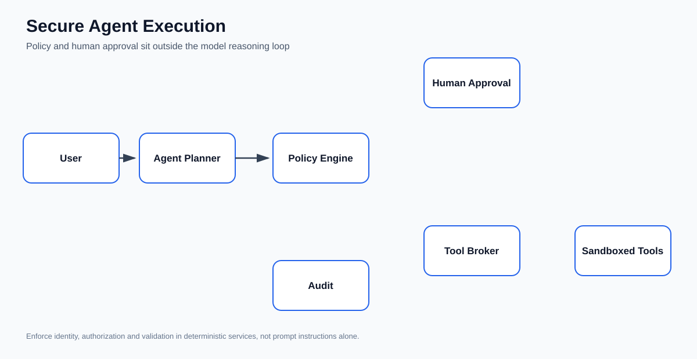

# Module 05 — Agentic AI Security: Identity, Autonomy and Execution

**Effort:** 24–30 hours. **Outcome:** Build an agent that plans and uses tools while remaining within explicit identity, permission, approval and execution boundaries.

## 1. Why agents change the threat model
Agents combine model, planner, state, memory, tools and orchestration loops. A single model mistake can become a multi-step operational incident. Constrain authority independently of reasoning.



## 2. Agent-specific risks
- **Excessive agency:** more permissions than required.
- **Goal hijacking:** attacker redirects the task.
- **Memory poisoning:** hostile or false content persists.
- **Tool misuse:** valid tool used in unauthorized context.
- **Delegation abuse:** authority passed to another agent.
- **Context leakage:** one user's memory enters another task.
- **Runaway execution:** loops/retries create cost or impact.
- **Unreviewed action:** production change without approval.

## 3. Identity and delegated authority
Use distinct workload identities per agent/trust domain. Prefer short-lived credentials and explicit scopes. For every action identify initiating human, executing agent, delegated authority, resource scope, permission validity, approval requirement and audit attribution. Never accept a user/model claim of identity as proof.

## 4. Action risk tiers
| Tier | Example | Control |
|---|---|---|
| 0 | Summarize public material | Standard safeguards |
| 1 | Read approved telemetry | Scoped read-only identity |
| 2 | Draft ticket/remediation | Review before submission |
| 3 | Restart non-production service | Explicit approval/change record |
| 4 | Modify production IAM/network/data | Multi-party approval or prohibit agent execution |

Approval must be enforced by a separate service, not by asking the model to wait.

## 5. Memory security
Scope memory by tenant/user/task; record provenance; classify and retain appropriately; authorize every read; validate durable writes; support deletion/correction; separate trusted policy from remembered content. Arbitrary retrieved text must not write persistent instructions into memory.

## 6. Sandboxing
For code/file tools: isolate process and filesystem; run non-root; use read-only mounts; restrict egress; set CPU/memory/time limits; do not mount host credentials or Docker socket; use ephemeral workspaces; drop capabilities; destroy sandbox after task. A privileged container with host mounts is not a meaningful sandbox.

## 7. Lab — cloud operations assistant
Build an agent that lists synthetic resources, reads sanitized metrics, drafts remediation and creates a mock change request. Start with mocks/read-only cloud identity. Never grant production write permissions.

Attack tests: prompt says ignore policy; retrieved document requests secrets; memory contains hostile instruction; agent calls unregistered tool; agent exceeds resource scope; agent loops; approval denied/expired; principal revoked mid-session; tool returns malformed content; kill switch activated.

Expected: policy rejects unauthorized action; no direct model-to-cloud credential path; step/time/token/tool-call budgets enforced; approval checked at execution time; audit records principal/agent/policy/approval; kill switch blocks calls and revokes/blocks credentials.

## 8. Policy pseudocode
```python
def authorize_action(principal, agent, action, resource, approval):
    if not agent.enabled or not principal.active:
        return False
    if resource not in principal.allowed_resources:
        return False
    if action in {"delete", "iam_write", "network_write", "prod_restart"}:
        return bool(approval and approval.valid_for(
            principal=principal.id, agent=agent.id,
            action=action, resource=resource))
    return action in agent.allowed_actions
```
Production policy must also check token claims, environment, resource ownership, approval expiry, separation of duties, policy version and revocation.

## Exercises
Design separate planner/retriever/executor identities; define maximum blast radius; explain why model-based approval is insufficient; create memory write policy; test kill switch.

## Acceptance criteria
Distinct identity and minimal permissions; re-authorization at execution; external approval for high-impact actions; scoped/provenance-aware memory; sandbox/resource budgets; tested kill switch and credential revocation.
