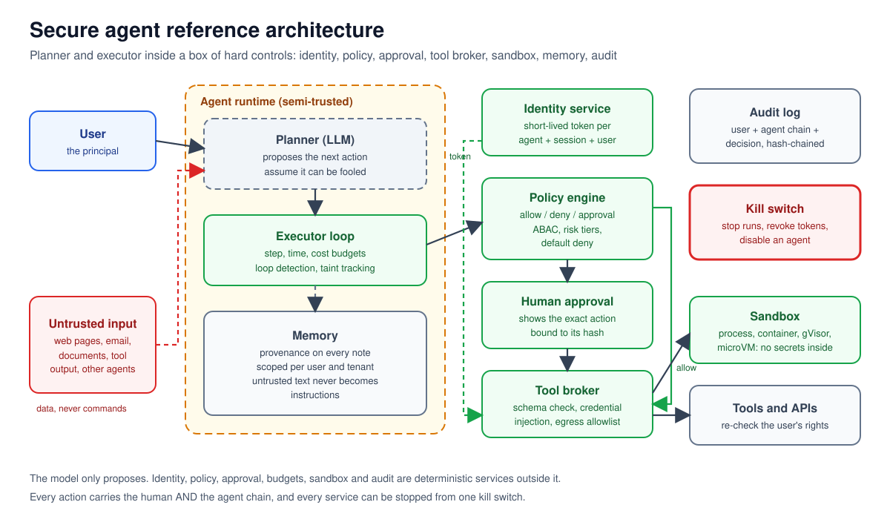
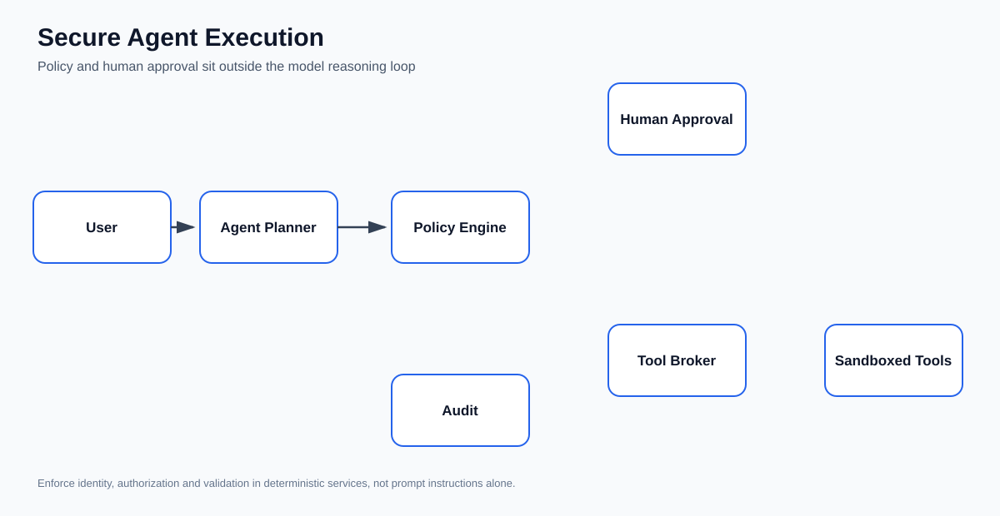
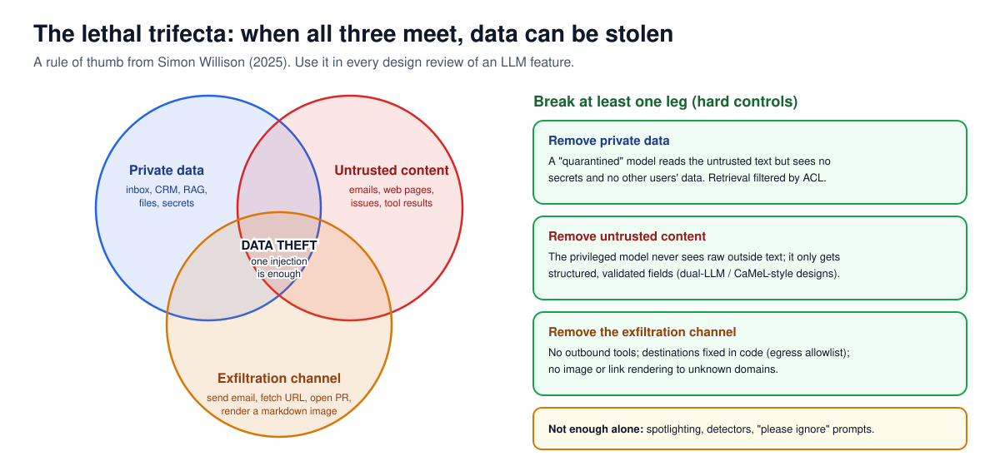
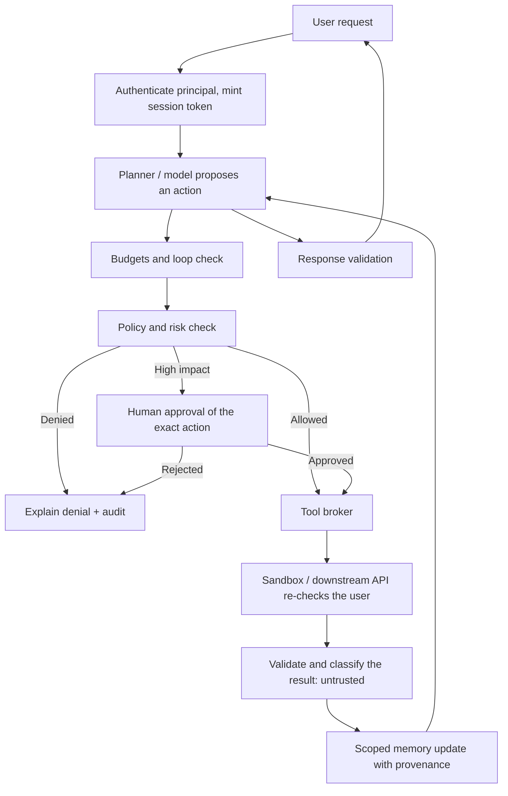

# Module 05: Agentic AI Security

> **Weeks:** 17–20 · **Time:** ~40 hours · **Phase 5 gate** at the end of week 20
> **You will:** learn to let an AI agent plan and use tools while keeping its identity, permissions, memory and code execution inside boundaries that hold even when the model is fooled.

## What and why

An **agent** is an LLM application that does more than answer. It **plans** a sequence of steps, **calls tools** (APIs, databases, email, shell), **remembers** things between steps and sessions, and often **delegates** to other agents. It runs in a **loop**: observe, plan, act, observe again.

That changes the threat model. A chatbot that is fooled says something wrong. An agent that is fooled **does** something wrong, possibly many times, quickly, with real credentials. One injected sentence in a document can become a deleted database, a data export or an email to an attacker.

The core rule of this module: **constrain the agent's authority independently of its reasoning.** The model proposes. Deterministic services decide who it is acting for, what it may do, whether a human must approve, how much it may spend, and where its code runs. Every action is recorded, and everything can be stopped.


## Learning path

| Week | Lesson | You will build / prove |
|---|---|---|
| 17 | This page: agent lifecycle, planner/executor, memory, orchestration, [threat model](#week-17-agent-lifecycle-and-threat-model) | A threat model of a single agent |
| 17–18 | [Agent identity and delegated authority](agent-identity/) | Short-lived scoped tokens per agent and session, the user and agent chain in every token, a hash-chained audit log |
| 18–19 | [Permissions, policy, budgets and memory](permissions/) | A policy engine (allow/deny/approval), human approval of exact actions, budgets and loop detection, provenance-tagged memory; **Part B:** a refund agent with a goal lock, transaction rules and system-rendered approval cards |
| 19 | [Multi-agent trust](multi-agent-trust/) | Signed agent-to-agent envelopes, replay protection, an invocation policy, a circuit breaker against cascades, pinned agent cards |
| 20 | [Sandboxing agent code execution](sandboxing/) | A process sandbox with scrubbed environment, limits and a kill switch; proof of which layers are soft and which are hard |
| 20 | [Monitoring, rogue agents and incident response](monitoring-and-response/) | A trace store outside the agent, a behavioral baseline, detectors, automatic four-layer containment, an IR runbook |
| 20 | [Mini-project: Secure Cloud AI Agent](mini-project/) | Portfolio Project 4 and the Phase 5 gate: an agent that reads EC2 and CloudWatch and proposes fixes behind the seven roadmap controls, against a mock cloud |

Run every lab test in the module:

```powershell
python -m pytest 05-agent-security -v
```

## Reference architecture



| Component | Job | Trust level | Lesson |
|---|---|---|---|
| **Planner (LLM)** | Reads the task and context; proposes the next action | Untrusted output: assume it can be fooled | all |
| **Executor loop** | Runs the plan step by step; enforces budgets; tracks taint | Trusted code | [permissions](permissions/) |
| **Identity service** | Mints short-lived tokens for (user, agent, session) | Trusted | [agent-identity](agent-identity/) |
| **Policy engine** | Decides allow / deny / require approval from attributes | Trusted, deterministic | [permissions](permissions/) |
| **Human approval** | A person approves the exact action; approval bound to its hash | Trusted service + human | [permissions](permissions/) |
| **Tool broker** | Validates arguments, attaches credentials the model never sees, applies egress rules | Trusted | [agent-identity](agent-identity/), [permissions](permissions/) |
| **Sandbox** | Runs generated code with no secrets, limited resources, no persistence | Hard boundary | [sandboxing](sandboxing/) |
| **Memory** | Stores notes with provenance, per user; never turns untrusted text into instructions | Data store | [permissions](permissions/) |
| **Audit log** | Records user, agent chain, decision, approval; tamper-evident | Trusted, append-only | [agent-identity](agent-identity/) |
| **Inter-agent channel** | Signed, fresh, policy-checked messages between agents; circuit breakers between stages | Trusted enforcement, untrusted content | [multi-agent-trust](multi-agent-trust/) |
| **Monitoring control plane** | Traces every proposal, learns baselines, detects, contains | Trusted, outside the agent | [monitoring-and-response](monitoring-and-response/) |
| **Kill switch** | Stops runs, revokes tokens, disables agents | Trusted, human-owned | [agent-identity](agent-identity/), [sandboxing](sandboxing/), [monitoring](monitoring-and-response/), [mini-project](mini-project/) |

A simpler view of the same idea, from earlier in the repo:



## How agents are built (and where security plugs in)

You cannot secure what you cannot draw. Most agents, whatever the framework, are built from the same parts:

| Building block | What it is | Where an attacker gets in | Control in this module |
|---|---|---|---|
| **Tool / function calling** | The model outputs a structured call (name + JSON arguments); code runs it | Injected text makes the model propose a harmful call | Schemas, policy, approval ([permissions](permissions/)) |
| **ReAct loop** | Reason, act, observe, repeat until done | Every observation (tool result, web page) can steer the next step | Taint tracking, budgets, loop detection |
| **Planning** | A planner breaks a task into steps (sometimes a full plan up front) | A poisoned plan drives every later step | Plan-then-execute, goal lock ([permissions Part B](permissions/)) |
| **Reflection / critique** | The model reviews its own output and retries | A loop that never ends; "self-correction" toward the attacker's goal | Budgets; reflection is never a security control |
| **Memory** | Short-term (the context window), long-term (notes, vector stores), shared (blackboards) | Persistent injection, cross-user leakage | Provenance, per-user scope, write gates |
| **Multi-agent orchestration** | Supervisor + workers, networks of peers, hierarchies | Spoofed messages, privilege laundering, cascades | [multi-agent-trust](multi-agent-trust/) |
| **Code execution / computer use** | The agent writes and runs code, or drives a browser or desktop | Injection becomes remote code execution | [sandboxing](sandboxing/) |
| **Credentials** | Keys and tokens the tools need | Secrets in prompts, environment variables or code | Per-session tokens, a broker ([agent-identity](agent-identity/)) |

Two lessons from engineering books in your library, read with a security eye:

- *Building Agentic AI* (Ozdemir) shows how much a **workflow** (fixed steps with LLM calls) and an **agent** (the model chooses the steps) differ in cost and reliability, and why teams split one big agent into several specialists. For security, the same trade-off holds: the fewer decisions the model makes, the fewer it can be tricked into. Every split into specialists adds a trust boundary ([multi-agent-trust](multi-agent-trust/)).
- Beginner build guides such as *Building AI Agents* (Book 09) wire free APIs, email senders and schedulers straight into an agent. They are good for learning how agents are put together, and a useful exercise in spotting what is missing: where do the API keys live, who can trigger the agent, what stops it from emailing anyone? Try the 30-control checklist below on one of those agents.

Frameworks you will meet (optional, not needed for the tests): **LangGraph** builds agents as graphs of nodes and edges (good places for policy checks and approval interrupts), and **AutoGen** builds teams of conversing agents (put the inter-agent checks on every message handler). Know what each does by default, and add the controls from this module at the tool and message boundaries.

### Break the lethal trifecta



An agent session is exploitable for data theft when it combines **private data**, **untrusted content** and an **exfiltration channel** (Simon Willison's "lethal trifecta"; Meta's related "Agents Rule of Two" says a session should have at most two of: untrusted input, sensitive data or systems, and the ability to change state or communicate externally). If a task truly needs all three, require human approval or split the work across isolated agents (dual-LLM, plan-then-execute, egress allowlists). The [mini-project](mini-project/) agent reads untrusted logs and sensitive cloud state, so its third leg (changing state) is behind policy, approval and one-action credentials.

## Week 17: agent lifecycle and threat model

### The lifecycle of one request



### Planner / executor and orchestration patterns

| Pattern | How it works | Main security concern |
|---|---|---|
| **Single loop (ReAct style)** | One model reasons and calls tools step by step | Every step can be steered by the last tool result |
| **Planner / executor** | One component writes a plan; another executes steps | Approve and pin the *plan*; stop new untrusted content from adding steps |
| **Supervisor + workers** | A supervisor agent delegates to specialist agents | Delegation abuse, chained identity, cascading errors |
| **Dual-LLM / quarantine** | A privileged model never sees untrusted text; a quarantined one has no tools | Leaks if the privileged side must reason over untrusted meaning |
| **Workflow with LLM steps** | Fixed code calls the model only for specific sub-tasks | Safest; least flexible |

Prefer the **least autonomous pattern that does the job.** A fixed workflow with one LLM step is easier to secure than an open-ended agent.

### Agent-specific risks

| Risk | What it looks like |
|---|---|
| **Excessive agency** | More tools, permissions or autonomy than the task needs |
| **Goal hijacking** | Injected content redirects the task |
| **Tool misuse** | A valid tool used in an unauthorized context (right tool, wrong recipient) |
| **Delegation abuse** | Authority passed to another agent without narrowing |
| **Identity confusion** | Actions done with a shared account; nobody can tell who asked (confused deputy) |
| **Memory poisoning** | Hostile or false content persists and affects later sessions |
| **Context leakage** | One user's memory or data enters another user's task |
| **Runaway execution** | Loops and retries create cost or impact |
| **Unexpected code execution** | Generated code runs with the agent's secrets and network |
| **Unreviewed action** | Production change without approval or rollback |
| **Repudiation** | No trustworthy record of what happened |

### Exercise: threat-model a single agent

Pick an agent (yours, or "a cloud-ops assistant that reads metrics and opens change requests"). In your journal, for each component of the reference architecture, write:

1. What untrusted input reaches it.
2. What the worst action is if the model is fully fooled at that point (its **maximum blast radius**).
3. Which hard control limits that action, and which lesson implements it.
4. For every action: the initiating human, the executing agent, the delegated authority, the resource scope, how long the permission is valid, whether approval is needed, and how it is attributed in the audit log.

Also answer: *Why is it not enough to ask the model to wait for approval?* (Answer: the model is the thing that can be fooled; approval must be enforced by a separate service that checks a bound approval at execution time.)

## OWASP Top 10 for Agentic Applications 2026: full mapping

Published by the OWASP GenAI Security Project in December 2025 (check the source for updates). Every risk has at least one lab test in this module that asserts **impact** (money, restarts, security-group rules, emails), not model wording.

| ID | Risk | Lesson | Lab test(s) that prove the control |
|---|---|---|---|
| ASI01 | Agent Goal Hijack | [permissions Part B](permissions/) (goal lock); [permissions](permissions/) (taint + policy); [mini-project](mini-project/) | `test_goal_lock_denies_an_order_outside_the_ticket`, `test_external_email_is_denied_by_policy_not_by_the_model`, `test_02_injected_log_lines_change_nothing` |
| ASI02 | Tool Misuse and Exploitation | [permissions](permissions/), [mini-project](mini-project/) | `test_ungranted_and_unknown_tools_are_denied`, `test_schema_rejects_extra_arguments`, `test_new_payee_is_refused_original_payment_method_only`, `test_01_ignore_policy_prompt_runs_no_unauthorized_tool` |
| ASI03 | Identity and Privilege Abuse | [agent-identity](agent-identity/), [mini-project](mini-project/) | `test_confused_deputy_is_denied`, `test_delegation_cannot_widen_scope`, `test_05_resource_outside_the_users_scope_is_denied`, `test_c5_credentials_expire_and_elevations_are_single_action` |
| ASI04 | Agentic Supply Chain Vulnerabilities | [multi-agent-trust](multi-agent-trust/); MCP tool pinning in [Module 04](../04-mcp-security/) | `test_tampered_agent_card_is_refused`, `test_unreviewed_agent_card_is_refused` |
| ASI05 | Unexpected Code Execution | [sandboxing](sandboxing/) | `test_no_secret_leaks_from_any_snippet`, `test_hard_layers_alone_protect_secrets`, `test_timeout_kills_infinite_loop` |
| ASI06 | Memory and Context Poisoning (incl. persistent prompt injection) | [permissions](permissions/), [mini-project](mini-project/) | `test_memory_poisoning_is_refused_at_write_time`, `test_policy_alone_stops_poisoned_memory_even_with_provenance_and_isolation_off`, `test_03_hostile_memory_never_becomes_an_instruction` |
| ASI07 | Insecure Inter-Agent Communication | [multi-agent-trust](multi-agent-trust/) | `test_forged_sender_fails_signature_check`, `test_replayed_message_is_refused`, `test_honest_low_privilege_agent_may_not_invoke_ops`, `test_editing_a_signed_message_breaks_the_signature` |
| ASI08 | Cascading Failures | [multi-agent-trust](multi-agent-trust/) | `test_breaker_caps_the_blast_radius_of_a_runaway_plan`, `test_breaker_opens_after_repeated_failures`, `test_breaker_half_opens_after_cooldown_and_closes_on_a_good_probe` |
| ASI09 | Human-Agent Trust Exploitation | [permissions Part B](permissions/), [permissions](permissions/), [mini-project](mini-project/) | `test_system_rendered_card_shows_the_real_amount_and_a_mismatch_warning`, `test_without_a_system_card_the_same_human_approves_the_480_refund`, `test_c4_requester_cannot_approve_their_own_prod_change` |
| ASI10 | Rogue Agents | [monitoring-and-response](monitoring-and-response/), [agent-identity](agent-identity/) | `test_rogue_agent_is_contained_at_its_first_anomalous_action`, `test_the_agent_has_no_path_to_its_kill_switch`, `test_quiet_data_hoarding_with_granted_tools_is_caught_by_rate_baseline`, `test_revoked_session_and_killed_agent_stop_working` |

### Related OWASP lists (2026 LLM numbering, MCP Top 10)

| List and item | Where in this module |
|---|---|
| LLM01:2026 Prompt Injection | The trigger in every lab (the mock model always obeys injected `CALL_TOOL`) |
| LLM02:2026 Sensitive Information Disclosure (now includes logs and reasoning traces) | Credentials out of prompts ([agent-identity](agent-identity/), [mini-project](mini-project/) `test_02b`); hashed arguments in traces ([monitoring](monitoring-and-response/)) |
| LLM03:2026 Excessive Agency (was LLM06:2025) | The whole module: least privilege, policy, approval, identity |
| LLM06:2026 Unbounded Consumption (was LLM10:2025) | Budgets and loop detection ([permissions](permissions/)), rate baselines ([monitoring](monitoring-and-response/)) |
| LLM10:2026 Improper Output Handling (was LLM05:2025; now includes insecure AI-generated code) | [sandboxing](sandboxing/) |
| MCP01 Token Mismanagement and Secret Exposure | Short-lived tokens, broker-held credentials ([agent-identity](agent-identity/)) |
| MCP02 Privilege Escalation via Scope Creep | Per-task grants, down-scoping on delegation, one-action elevations |
| MCP05 Command Injection and Execution | Typed tools instead of a shell; [sandboxing](sandboxing/) |
| MCP07 Insufficient Authentication and Authorization | Token checks at the resource; invocation policy between agents |
| MCP08 Lack of Audit and Telemetry | Hash-chained audit logs; trace store ([monitoring](monitoring-and-response/)) |
| MCP09 Shadow MCP Servers | Approved-agent registry and pinned agent cards ([multi-agent-trust](multi-agent-trust/)) |
| MCP10 Context Injection and Over-Sharing | Per-user memory and context isolation ([permissions](permissions/)) |

## Production guardrails checklist (cross-checked against "30 production controls")

The workbook *Guardrails for AI Agents: 30 production security controls* (Okan Yildiz, in your library) gives one control per page. Here they are grouped and checked against this module, in our own words. Use it as a launch review for any agent. Its central advice: review what the agent can **reach** on its worst day, not how the prompt is worded.

| Area | Control (paraphrased) | Covered in | Status |
|---|---|---|---|
| Identity | Each agent has its own identity, never a borrowed human account | [agent-identity](agent-identity/), [mini-project](mini-project/) C2 | Lab |
| Identity | No long-lived tokens; exchange, don't store | agent-identity L1, mini-project C5 | Lab |
| Identity | Agents never hold human-equivalent roles (collaborator, approver) | permissions (separation of duties), mini-project C4 | Lab |
| Identity | Split low-trust (reads public input) and privileged paths into separate jobs and identities | [multi-agent-trust](multi-agent-trust/) | Lab |
| Identity | No agent can trigger another across a trust boundary with text alone; triggers are signed | multi-agent-trust M1, M3 | Lab |
| Identity | Secrets out of the privileged job; broker the action, not the secret | agent-identity (tool broker), sandboxing H2 | Lab |
| Tool boundary | Allowlist tools; never denylist strings | permissions L1, sandboxing (denylist bypass) | Lab |
| Tool boundary | Human approval for irreversible actions | permissions L4, mini-project C4 | Lab |
| Tool boundary | Rate-limit tools and make them idempotent | permissions L5, Part B T2 (idempotency key) | Lab |
| Tool boundary | Scope the filesystem and the egress | sandboxing H3, C1 | Lab (process) + optional Docker |
| Tool boundary | Typed tool calls instead of a shell | permissions L2, mini-project schemas | Lab |
| Tool boundary | A kill switch you have actually tested | sandboxing H7, monitoring R2, mini-project `kill()` | Lab + drill (your task) |
| Context trust | Label every context source with provenance | permissions L6 | Lab |
| Context trust | Retrieved content is data, never instruction | permissions, mini-project (logs as data) | Lab |
| Context trust | Strip or defang hidden text before it reaches the model | [Module 02](../02-llm-security/prompt-injection/), [Module 03](../03-rag-security/) | Other module |
| Context trust | Bound the context window (size caps) | sandboxing H6 (output cap), refund note length | Partial: add caps to your agent |
| Context trust | Detect instruction-shaped text (a soft signal) | permissions `INSTRUCTION_RE`, mini-project memory gate | Lab (soft) |
| Context trust | Keep the system prompt separable and free of secrets | agent-identity, mini-project `test_02b` | Lab |
| Observability | Log every tool call with its arguments (redacted) | [monitoring](monitoring-and-response/) O1 | Lab |
| Observability | Immutable, tamper-evident audit trail | agent-identity L6, mini-project C6 | Lab |
| Observability | Attribute every action to the agent and the human | agent-identity, mini-project `who_did()` | Lab |
| Observability | Alert on privilege-boundary crossings | monitoring D2 (tamper, denial burst) | Lab |
| Observability | Replayable transcripts for incident response | monitoring `incident_bundle()` | Lab |
| Observability | Treat cost anomalies as attack signals | permissions budgets; monitoring stretch goal | Partial: your task |
| Governance | Red-team every agent before production | [Module 02 security testing](../02-llm-security/), labs' attack suites | Lab + process |
| Governance | Regression-test guardrails on every change | every `test_*.py` here, run in CI ([Module 06](../06-ai-devsecops/)) | Lab + CI |
| Governance | Keep a failure-mode inventory per agent | Week 17 threat-model exercise | Your task |
| Governance | Review the blast radius, not the prompt | Week 17 exercise (maximum blast radius per action) | Your task |
| Governance | Prompts under change control (versioned, reviewed, hash logged per run) | monitoring trace (prompt hash field); [Module 06](../06-ai-devsecops/) | Partial: your task |
| Governance | Rehearse the agent-compromise playbook | [monitoring runbook](monitoring-and-response/) | Runbook + tabletop |

A practical rollout order, from the field note *Guardrails & Security for AI Agents* (Arif Alam): make the actor explicit (identity), move authorization out of the model, type and validate every tool, add limits and approval to side effects, trace decisions, then design recovery. Its rule is the rule of this module: **the model proposes, the system enforces.**

## Key concepts (glossary)

| Term | Meaning |
|---|---|
| **Agent** | An LLM application that plans and takes actions through tools, often in a loop |
| **Tool** | A function the agent may call (API, database query, email, shell) |
| **Non-human identity (NHI)** | An identity used by software: service account, API key, token, workload identity |
| **Delegation** | Acting with part of a user's authority; the user stays the subject, the agent is the actor |
| **`act` claim** | Token claim (RFC 8693) naming the actor; nested for each delegation hop |
| **Confused deputy** | A program uses its own authority for a caller who should not have it |
| **Least privilege** | Only the tools, scopes and data the current task needs |
| **Policy engine** | Deterministic code that returns allow / deny / require approval |
| **ABAC** | Attribute-based access control: rules over attributes of user, action, resource and context |
| **Risk tier** | A number (0–4) for how dangerous an action is; rules use it |
| **Taint** | A flag that untrusted content has entered the context |
| **Human-in-the-loop (HITL)** | A person approves an action before it runs |
| **Budget** | A hard limit on steps, tool calls, cost or time |
| **Memory poisoning** | Untrusted content written to long-term memory and replayed later |
| **Provenance** | A record of where a piece of data came from and whether it is trusted |
| **Sandbox** | An isolated place to run untrusted code, with no secrets and limited resources |
| **Soft / hard layer** | Soft lowers the odds (filters, prompts); hard limits the outcome (boundaries, policy in code) |
| **Kill switch** | One control to stop all runs and revoke agent credentials now |
| **Hash chain** | A log where each entry includes the previous entry's hash, so edits are detectable |
| **Goal hijack** | Injected content changes what the agent is trying to achieve (ASI01) |
| **Task contract (goal lock)** | The allowed objects, tools and limits of a task, fixed from trusted data before the model reads untrusted content |
| **Idempotency key** | A key that makes a repeated action (retry, replay) have no extra effect |
| **Signed envelope** | A message whose sender, recipient, time and nonce are covered by the sender's signature |
| **Nonce** | A single-use random value that makes a replayed message detectable |
| **Invocation policy** | Which agent may ask which agent (or tool) for what |
| **Circuit breaker** | A guard between stages that stops actions after too many actions or failures (ASI08) |
| **Agent card** | Metadata describing an agent (name, endpoint, capabilities), used for discovery |
| **Behavioral baseline** | What normal looks like for an agent: tools, destinations, volume |
| **Attack surface time** | Time from an agent's first out-of-bounds action to containment |
| **Rogue agent** | An agent acting against its purpose, whatever the cause (ASI10) |

## How the lessons connect

```text
 agent-identity          permissions                 sandboxing
 WHO is acting?    -->   WHAT may it do?      -->    WHERE does its code run?
 user + agent chain      policy, approval,           no secrets, limits,
 short-lived token       budgets, memory gate        ephemeral, kill switch
        \                       |                           /
         +------------- audit log + kill switch -----------+
```

- The **token** from agent identity is what the policy engine and resource servers check. The policy can use the agent chain as an attribute.
- The **policy engine** decides whether a `run_code` tool call may happen; the **sandbox** decides what that code can touch if it does.
- The **kill switch** appears in all three: revoke tokens (identity), refuse tool calls (permissions), kill running code (sandboxing).
- [Multi-agent trust](multi-agent-trust/) applies identity and policy to messages *between* agents; [monitoring](monitoring-and-response/) watches all of it from outside and owns the kill switch; the [mini-project](mini-project/) combines everything in one cloud agent.
- Prompt injection ([Module 02](../02-llm-security/prompt-injection/)) is the most common *trigger*. MCP ([Module 04](../04-mcp-security/)) is a common *tool transport*. This module is about limiting the *impact*.

## Module mini-project: Secure Cloud AI Agent (Portfolio Project 4)

**Goal (Phase 5 gate):** an on-call agent that reads EC2 and CloudWatch, and proposes remediation (restart a service, modify a security group, run Terraform) behind approval gates, against a **mock, boto-like cloud**. It is the roadmap's AWS scenario and Portfolio Project 4. **Never give a lab agent write access to a real cloud account.**

The seven roadmap controls and where the lab proves them:

| # | Control | Lab implementation |
|---|---|---|
| 1 | Read-only by default | Every session starts with a 15-minute read-only role |
| 2 | Separate identity per agent | Role session name `agent.user.session` in every CloudTrail event |
| 3 | Explicit authorization for sensitive actions | Schemas + default-deny YAML policy over action, environment and the user's own rights |
| 4 | Human approval for prod changes | Approval queue: exact action, 5-minute expiry, requester cannot approve |
| 5 | Time-limited credentials | 5-minute elevation for one action on one resource |
| 6 | Full audit trail | Hash-chained audit log + CloudTrail; `who_did()` |
| 7 | Sandboxing and rollback | Terraform planned read-only, only the approved plan hash applied, drift cancels; security-group changes roll back |

Everything (scenario, run commands, the real demo output, the 11 required tests, your extension tasks and the AWS mapping) is in **[mini-project/](mini-project/)**.

```powershell
python 05-agent-security/mini-project/lab/demo.py
python -m pytest 05-agent-security/mini-project -v
```

**Operational record:** for each action, log agent ID, principal, model and version, task/session ID, policy version and rule ID, tool call, approval ID, timestamps, resource identifiers and result status. Do not log full sensitive prompts by default.

## Interview questions (system design, cross-cutting)

<details><summary><b>Q1. Design the security architecture for an enterprise agent platform that many teams will use.</b></summary>

Central components: an **agent registry** (owner, purpose, approved tools and scopes, risk tier, version); an **identity service** that mints short-lived tokens per (user, agent, session) via token exchange; a **policy service** (policy as code, ABAC, default deny) called on every tool call; a **tool broker / gateway** that validates arguments, injects credentials and enforces egress; an **approval service** for tier 3+; **sandbox pools** for code; a **memory service** with per-tenant namespaces and provenance; a **tamper-evident audit pipeline** to the SIEM; budgets and a **kill switch** per agent, tenant and globally. Teams build agents on top; they cannot bypass the broker, because downstream systems only accept broker-issued, user-bound tokens.
</details>

<details><summary><b>Q2. "The model is smart enough to know when not to act." Why is that not a security control?</b></summary>

Its behaviour depends on its whole context, which attackers can influence through documents, web pages, tool outputs and other agents. Its decisions are probabilistic, change with model versions, and cannot be audited as rules. A security control must be deterministic, testable and outside the attacker's influence. Use the model's judgment to *reduce* bad proposals (a soft layer), and policy, identity and sandboxing to *limit* outcomes (hard layers).
</details>

<details><summary><b>Q3. How do identity, policy and sandboxing work together on one risky action, for example "run this script against the staging database"?</b></summary>

Identity: the call carries a token for (user, agent, session) with only staging-read scopes, so production is unreachable whatever the script says. Policy: `run_code` is tier 3 in a tainted session, so it needs approval showing the exact script hash and target; budgets cap runtime. Sandbox: the script runs with no credentials (the broker passes a short-lived, read-only staging token or the data itself), no internet egress, resource limits and an ephemeral workspace. Audit logs all three decisions; the kill switch can stop it at any layer.
</details>

<details><summary><b>Q4. Walk through the response to "an agent did something destructive" from detection to lessons learned.</b></summary>

Contain: trip the kill switch for that agent (refuse calls, kill sandboxes, revoke tokens). Scope: query the audit log for the agent chain, users, sessions and actions in the window; verify the log's hash chain and anchor. Root cause: find the input that led to the action (document, memory note, tool result, user request), and which control should have stopped it (missing rule, broad scope, approval fatigue, sandbox gap). Recover: restore from backups or roll back changes. Improve: fix the control, add the exact payload as a regression test, review similar agents, and report to owners and, if needed, regulators.
</details>

<details><summary><b>Q5. How do you secure multi-agent systems where agents call each other?</b></summary>

Each agent has its own identity and registered scopes; calls between agents use token exchange so authority only narrows and the full chain is visible; receivers apply policy to the chain; messages between agents are untrusted data; agents that read untrusted content get no side-effecting tools; context is isolated per agent (no shared scratchpad with privileged agents); budgets apply across the whole tree (fan-out limits); one correlation ID ties the tree together in logs; the kill switch can disable any agent and every chain containing it.
</details>

<details><summary><b>Q6. Where should human approval sit, and how do you keep it meaningful at scale?</b></summary>

In a separate approval service, called by the policy engine for actions that need judgment (tier 3, or tier 2 in tainted sessions). The human sees the exact action and why; approval is bound to the action's hash, single-use and short-lived; requester ≠ approver for high tiers. To keep it meaningful: deny clearly bad actions automatically, allow clearly safe ones, measure approval rates and time-to-approve (rubber-stamping shows up as near-100% approvals in seconds), and move recurring safe patterns into policy.
</details>

<details><summary><b>Q7. How do you stop an agent platform from becoming a cost or availability problem?</b></summary>

Budgets at several levels: per step, per task (steps, tool calls, tokens, time, money), per user per day, per tenant per month. Fan-out limits for sub-agents. Loop detection plus hard caps. Rate limits on expensive tools. Spend alerts at thresholds and an automatic kill switch on spikes. Graceful degradation: queue or deny new tasks instead of failing everything. These map to OWASP LLM06:2026 Unbounded Consumption (was LLM10:2025).
</details>

<details><summary><b>Q8. Design long-term memory for an assistant used by thousands of employees.</b></summary>

Per-tenant and per-user namespaces enforced by the memory service (not by prompt). Every note has provenance (user, document, tool, admin), trust level, timestamps and retention. Only trusted sources write durable notes; facts from documents are stored as citable data, never instructions. Only trusted notes of *this* user reach the planner, in a data block. Users can view, correct and delete; notes expire; deletion requests cover memory and its embeddings. Monitor for instruction-like content and unusual write rates. Action-time policy is the backstop.
</details>

<details><summary><b>Q9. How would you evaluate whether an agent is safe to launch?</b></summary>

Threat model (this module's week 17 exercise) with maximum blast radius per action. Verify controls with tests that assert impact: injection payloads, memory poisoning, loops, unregistered tools, scope escalation, approval bypass, revocation mid-session, kill switch, sandbox escapes with benign canaries. Run the payload suite against the real model many times and track rates. Check operational readiness: owners, on-call, dashboards, alerts, rollback tested. Launch with narrow scope and approval, then widen based on metrics.
</details>

<details><summary><b>Q10. Explain the whole module to an executive in one minute.</b></summary>

"AI agents don't just answer questions, they take actions with our systems. They can be tricked by text they read. So we treat the AI like a capable new contractor: it gets its own badge that only opens the doors it needs, for the person it's helping, for a few minutes. A rulebook decides what it may do, and a person signs off on anything risky after seeing exactly what will happen. Any code it writes runs in a sealed, disposable room. Everything is recorded in a log nobody can secretly change, and one switch stops every agent at once."
</details>

<details><summary><b>Q11. How does zero trust change when the "user" is an AI agent?</b></summary>

The principles stay (never trust, always verify, least privilege, assume breach), but the actor adapts, delegates, acts at machine speed and can be manipulated by content. So: a separate, short-lived identity per agent and session; authorization on every tool call, independent of the model and scoped to the user it acts for; identity-based rules between agents and services (NIST SP 800-207A) on top of network rules; continuous behavioral monitoring instead of one-time reviews; and automated containment, because a human-paced alert queue is too slow.
</details>

<details><summary><b>Q12. You have one quarter to secure a team's first production agent. In what order do you add controls?</b></summary>

1. Make the actor explicit: its own identity, short-lived credentials, no shared keys. 2. Move authorization out of the model: default-deny policy on every tool call. 3. Type and validate every tool; remove the ones it does not need. 4. Add limits and approval to side effects, with system-rendered approval cards. 5. Trace every decision outside the agent, with alerts on boundary crossings. 6. Build and drill the kill switch and rollback. Then red-team it and put the attacks in CI.
</details>

<details><summary><b>Q13. Map the OWASP Agentic Top 10 to controls in one breath.</b></summary>

Goal hijack: task contract and plan validation. Tool misuse: least-privilege, typed tools and policy. Identity abuse: per-agent, short-lived, on-behalf-of tokens. Supply chain: pinned, reviewed components. Code execution: sandboxes without secrets or network. Memory poisoning: provenance and per-user scope. Inter-agent communication: signed, fresh, policy-checked messages. Cascades: circuit breakers and validation between stages. Human trust exploitation: system-rendered, hash-bound approval cards. Rogue agents: monitoring from outside, kill switch, immutable audit.
</details>

## References

- OWASP GenAI Security Project, *Agentic AI – Threats and Mitigations* (2025): https://genai.owasp.org/resource/agentic-ai-threats-and-mitigations/
- OWASP GenAI Security Project, *OWASP Top 10 for Agentic Applications for 2026*: https://genai.owasp.org/resource/owasp-top-10-for-agentic-applications-for-2026/
- OWASP GenAI Security Project (home, for the latest agentic resources): https://genai.owasp.org/
- OWASP Top 10 for LLM Applications 2026 (LLM03:2026 Excessive Agency, LLM06:2026 Unbounded Consumption; check the current numbering at the source): https://genai.owasp.org/llm-top-10/
- OWASP Top 10 for LLM Applications 2025, LLM06:2025 Excessive Agency (earlier edition): https://genai.owasp.org/llmrisk/llm062025-excessive-agency/
- OWASP MCP Top 10 (beta): https://owasp.org/www-project-mcp-top-10/
- NIST SP 800-207A, *Zero Trust Architecture Model for Access Control in Cloud-Native Applications in Multi-Cloud Environments*: https://csrc.nist.gov/pubs/sp/800/207/a/final
- RFC 8693, OAuth 2.0 Token Exchange: https://www.rfc-editor.org/rfc/rfc8693
- NIST AI 100-1, *AI Risk Management Framework 1.0*: https://doi.org/10.6028/NIST.AI.100-1
- NIST AI 600-1, *Generative AI Profile* (2024): https://doi.org/10.6028/NIST.AI.600-1
- MITRE ATLAS (adversarial threat landscape for AI systems): https://atlas.mitre.org/
- Debenedetti et al., *Defeating Prompt Injections by Design* (CaMeL, 2025): https://arxiv.org/abs/2503.18813
- Lesson references: [agent-identity](agent-identity/#9-references), [permissions](permissions/#9-references), [multi-agent-trust](multi-agent-trust/#9-references), [sandboxing](sandboxing/#9-references), [monitoring-and-response](monitoring-and-response/#10-references)


## Roadmap coverage

| Roadmap topic (Phase 5 and Domain E) | Where it is covered |
|---|---|
| Agent architecture; single and multi-agent | [How agents are built](#how-agents-are-built-and-where-security-plugs-in); [multi-agent-trust](multi-agent-trust/) section 2.2 |
| Planning, memory and reasoning; task decomposition | [How agents are built](#how-agents-are-built-and-where-security-plugs-in); [Week 17](#week-17-agent-lifecycle-and-threat-model) patterns |
| Tool calling and function execution | [permissions](permissions/) (policy, schemas); [sandboxing](sandboxing/) |
| Multi-agent communication; agent-to-agent trust and communication security | [multi-agent-trust](multi-agent-trust/); [agent-identity](agent-identity/) 2.8 |
| Agent identity and authN; agent and workload identity | [agent-identity](agent-identity/) (incl. NIST SP 800-207A, 2.9) |
| Least privilege; excessive agency; tool permissions | [permissions](permissions/); [mini-project](mini-project/) C1, C5 |
| Unauthorized actions and transactions | [permissions Part B](permissions/) (refund agent); [mini-project](mini-project/) |
| Memory security, context isolation, memory poisoning, persistent prompt injection | [permissions](permissions/) 2.9; [mini-project](mini-project/) test 3 |
| Goal hijacking | [permissions Part B](permissions/) (goal lock); [mini-project](mini-project/) |
| Human-in-the-loop and approvals | [permissions](permissions/) 2.7 and Part B; [mini-project](mini-project/) C4 |
| Sandboxing | [sandboxing](sandboxing/); [mini-project](mini-project/) C7 |
| Autonomous action risks | [Agent-specific risks](#agent-specific-risks); [OWASP ASI mapping](#owasp-top-10-for-agentic-applications-2026-full-mapping) |
| Agent monitoring, incident response, kill switches | [monitoring-and-response](monitoring-and-response/) (incl. IR runbook) |
| AWS scenario (read EC2 and CloudWatch, restart services, modify security groups, run Terraform) with the 7 controls | [mini-project](mini-project/) |
| Hands-on: a secure agent with controlled access to cloud resources (Portfolio Project 4) | [mini-project](mini-project/) |
| Skills 5.1–5.3: build a tool-using agent; identity and least privilege; approval and sandboxing | [permissions](permissions/), [agent-identity](agent-identity/), [sandboxing](sandboxing/), [mini-project](mini-project/) |
| OWASP Agentic Top 10 (ASI01–ASI10) | [Full mapping table](#owasp-top-10-for-agentic-applications-2026-full-mapping) |
| Tools: LangGraph, AutoGen | Mentioned as optional in [How agents are built](#how-agents-are-built-and-where-security-plugs-in) and [multi-agent-trust](multi-agent-trust/) step 5 |

## Further reading from your library

- *AI Security Architecture Study Guide* (OWASP LLM, Agentic and MCP Top 10 with an architecture model): read Part 2 (the Agentic Top 10 table), Principles 2, 4, 5 and 7 of Part 4, and the refund-agent worked example (4.3) alongside [permissions Part B](permissions/).
- *Guardrails & Security for AI Agents* field note (Arif Alam): read the control stack, side-effect tiers, the "two loops" design pattern and the implementation order. A quick, visual summary of this whole module.
- *Guardrails for AI Agents: 30 production security controls* (Okan Yildiz): read one control per day during weeks 17–20 and tick it off in the [checklist above](#production-guardrails-checklist-cross-checked-against-30-production-controls). Guardrails 05 (no agent triggers another across a boundary), 12 (tested kill switch) and 30 (compromise playbook) match the new lessons.
- *Securing the Agentic Cloud*, 2026 edition (SANS with AWS, Google Cloud and Microsoft authors): read chapter 1 (detection and response at machine speed: baselines, confidence-calibrated response, the four containment layers, attack surface minutes) with [monitoring-and-response](monitoring-and-response/); chapter 2 (zero trust for AI) and the chapter 3 section on agent identity ("three-body problem") with [agent-identity](agent-identity/).
- *NIST SP 800-207A* (zero trust for cloud-native, multi-cloud apps): read section 4 on identity-tier policies and the five identity-based segmentation recommendations; compare with [agent-identity](agent-identity/) 2.9.
- *Building Agentic AI* (Sinan Ozdemir): read chapter 4 (first agents, workflows vs agents, single vs multi-agent) and the multi-agent architectures part of chapter 5, to understand what you are securing.
- *Building AI Agents, Book 09* (Rehan Allahwala): skim one beginner agent build and list its missing controls using the 30-control checklist.
- *IAM & Zero Trust: 30 interview scenarios* (Okan Yildiz): read the workload identity, secretless, separation-of-duties, permission right-sizing (CIEM) and token-theft scenarios; [agent-identity](agent-identity/) Q15–Q17 apply them to agents.

---

**Courses for this module (KodeKloud / Udemy):** see [00-program/learning-resources.md](../00-program/learning-resources.md).
