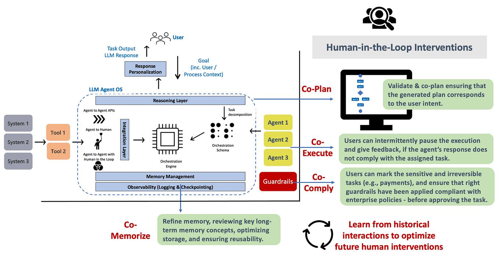
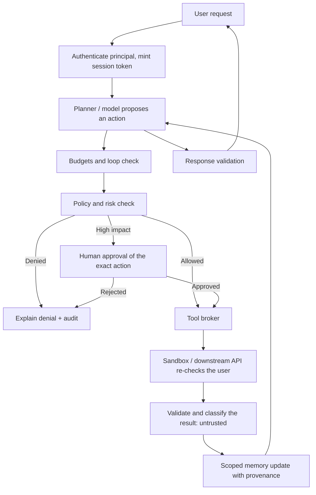

# Module 05: Agentic AI Security

> **Weeks:** 17–20 · **Time:** ~40 hours · **Phase 5 gate** at the end of week 20
> **You will:** learn to let an AI agent plan and use tools while keeping its identity, permissions, memory and code execution inside boundaries that hold even when the model is fooled.

## What and why

An **agent** is an LLM application that does more than answer. It **plans** a sequence of steps, **calls tools** (APIs, databases, email, shell), **remembers** things between steps and sessions, and often **delegates** to other agents. It runs in a **loop**: observe, plan, act, observe again.

That changes the threat model. A chatbot that is fooled says something wrong. An agent that is fooled **does** something wrong, possibly many times, quickly, with real credentials. One injected sentence in a document can become a deleted database, a data export or an email to an attacker.

The core rule of this module: **constrain the agent's authority independently of its reasoning.** The model proposes. Deterministic services decide who it is acting for, what it may do, whether a human must approve, how much it may spend, and where its code runs. Every action is recorded, and everything can be stopped.



## Learning path

| Week | Lesson | You will build / prove |
|---|---|---|
| 17 | This page: agent lifecycle, planner/executor, memory, orchestration, [threat model](#week-17-agent-lifecycle-and-threat-model) | A threat model of a single agent |
| 17–18 | [Agent identity and delegated authority](agent-identity/) | Short-lived scoped tokens per agent and session, the user and agent chain in every token, a hash-chained audit log |
| 18–19 | [Permissions, policy, budgets and memory](permissions/) | A policy engine (allow/deny/approval), human approval of exact actions, budgets and loop detection, provenance-tagged memory |
| 20 | [Sandboxing agent code execution](sandboxing/) | A process sandbox with scrubbed environment, limits and a kill switch; proof of which layers are soft and which are hard |
| 20 | [Module mini-project](#module-mini-project-a-controlled-cloud-read-only-agent) | A controlled cloud read-only agent: the Phase 5 gate |

Run every lab test in the module:

```powershell
python -m pytest 05-agent-security -v
```

## Reference architecture


| Component | Job | Trust level | Lesson |
|---|---|---|---|
| **Planner (LLM)** | Reads the task and context; proposes the next action | Untrusted output: assume it can be fooled | all |
| **Executor loop** | Runs the plan step by step; enforces budgets; tracks taint | Trusted code | [permissions](permissions/) |
| **Identity service** | Mints short-lived tokens for (user, agent, session) | Trusted | [agent-identity](agent-identity/) |
| **Policy engine** | Decides allow / deny / require approval from attributes | Trusted, deterministic | [permissions](permissions/) |
| **Human approval** | A person approves the exact action; approval bound to its hash | Trusted service + human | [permissions](permissions/) |
| **Tool broker** | Validates arguments, attaches credentials the model never sees, applies egress rules | Trusted | [agent-identity](agent-identity/), [permissions](permissions/) |
| **Sandbox** | Runs generated code with no secrets, limited resources, no persistence | Hard boundary | [sandboxing](sandboxing/) |
| **Memory** | Stores notes with provenance, per user; never turns untrusted text into instructions | Data store | [permissions](permissions/) |
| **Audit log** | Records user, agent chain, decision, approval; tamper-evident | Trusted, append-only | [agent-identity](agent-identity/) |
| **Kill switch** | Stops runs, revokes tokens, disables agents | Trusted, human-owned | [agent-identity](agent-identity/), [sandboxing](sandboxing/) |

A simpler view of the same idea, from earlier in the repo:


## Week 17: agent lifecycle and threat model

### The lifecycle of one request



### Planner / executor and orchestration patterns

| Pattern | How it works | Main security concern |
|---|---|---|
| **Single loop (ReAct style)** | One model reasons and calls tools step by step | Every step can be steered by the last tool result |
| **Planner / executor** | One component writes a plan; another executes steps | Approve and pin the *plan*; stop new untrusted content from adding steps |
| **Supervisor + workers** | A supervisor agent delegates to specialist agents | Delegation abuse, chained identity, cascading errors |
| **Dual-LLM / quarantine** | A privileged model never sees untrusted text; a quarantined one has no tools | Leaks if the privileged side must reason over untrusted meaning |
| **Workflow with LLM steps** | Fixed code calls the model only for specific sub-tasks | Safest; least flexible |

Prefer the **least autonomous pattern that does the job.** A fixed workflow with one LLM step is easier to secure than an open-ended agent.

### Agent-specific risks

| Risk | What it looks like |
|---|---|
| **Excessive agency** | More tools, permissions or autonomy than the task needs |
| **Goal hijacking** | Injected content redirects the task |
| **Tool misuse** | A valid tool used in an unauthorized context (right tool, wrong recipient) |
| **Delegation abuse** | Authority passed to another agent without narrowing |
| **Identity confusion** | Actions done with a shared account; nobody can tell who asked (confused deputy) |
| **Memory poisoning** | Hostile or false content persists and affects later sessions |
| **Context leakage** | One user's memory or data enters another user's task |
| **Runaway execution** | Loops and retries create cost or impact |
| **Unexpected code execution** | Generated code runs with the agent's secrets and network |
| **Unreviewed action** | Production change without approval or rollback |
| **Repudiation** | No trustworthy record of what happened |

### Exercise: threat-model a single agent

Pick an agent (yours, or "a cloud-ops assistant that reads metrics and opens change requests"). In your journal, for each component of the reference architecture, write:

1. What untrusted input reaches it.
2. What the worst action is if the model is fully fooled at that point (its **maximum blast radius**).
3. Which hard control limits that action, and which lesson implements it.
4. For every action: the initiating human, the executing agent, the delegated authority, the resource scope, how long the permission is valid, whether approval is needed, and how it is attributed in the audit log.

Also answer: *Why is it not enough to ask the model to wait for approval?* (Answer: the model is the thing that can be fooled; approval must be enforced by a separate service that checks a bound approval at execution time.)

## Key concepts (glossary)

| Term | Meaning |
|---|---|
| **Agent** | An LLM application that plans and takes actions through tools, often in a loop |
| **Tool** | A function the agent may call (API, database query, email, shell) |
| **Non-human identity (NHI)** | An identity used by software: service account, API key, token, workload identity |
| **Delegation** | Acting with part of a user's authority; the user stays the subject, the agent is the actor |
| **`act` claim** | Token claim (RFC 8693) naming the actor; nested for each delegation hop |
| **Confused deputy** | A program uses its own authority for a caller who should not have it |
| **Least privilege** | Only the tools, scopes and data the current task needs |
| **Policy engine** | Deterministic code that returns allow / deny / require approval |
| **ABAC** | Attribute-based access control: rules over attributes of user, action, resource and context |
| **Risk tier** | A number (0–4) for how dangerous an action is; rules use it |
| **Taint** | A flag that untrusted content has entered the context |
| **Human-in-the-loop (HITL)** | A person approves an action before it runs |
| **Budget** | A hard limit on steps, tool calls, cost or time |
| **Memory poisoning** | Untrusted content written to long-term memory and replayed later |
| **Provenance** | A record of where a piece of data came from and whether it is trusted |
| **Sandbox** | An isolated place to run untrusted code, with no secrets and limited resources |
| **Soft / hard layer** | Soft lowers the odds (filters, prompts); hard limits the outcome (boundaries, policy in code) |
| **Kill switch** | One control to stop all runs and revoke agent credentials now |
| **Hash chain** | A log where each entry includes the previous entry's hash, so edits are detectable |

## How the lessons connect

```text
 agent-identity          permissions                 sandboxing
 WHO is acting?    -->   WHAT may it do?      -->    WHERE does its code run?
 user + agent chain      policy, approval,           no secrets, limits,
 short-lived token       budgets, memory gate        ephemeral, kill switch
        \                       |                           /
         +------------- audit log + kill switch -----------+
```

- The **token** from agent identity is what the policy engine and resource servers check. The policy can use the agent chain as an attribute.
- The **policy engine** decides whether a `run_code` tool call may happen; the **sandbox** decides what that code can touch if it does.
- The **kill switch** appears in all three: revoke tokens (identity), refuse tool calls (permissions), kill running code (sandboxing).
- Prompt injection ([Module 02](../02-llm-security/prompt-injection/)) is the most common *trigger*. MCP ([Module 04](../04-mcp-security/)) is a common *tool transport*. This module is about limiting the *impact*.

## Module mini-project: a controlled cloud read-only agent

**Goal (Phase 5 gate):** build a small agent that helps an on-call engineer, combining all three labs. Use mocks and synthetic data only. **Never grant it write access to a real cloud account.**

It can:
- list synthetic cloud resources;
- read sanitised monitoring data;
- draft a remediation plan;
- create a **mock** change request (tier 2: approval if the session is tainted);
- run a small analysis snippet in the sandbox (no network, no secrets).

Build it from the labs: `SecureAgentRuntime` tokens (identity), `PolicyEngine` + `Budget` + `ProvenanceMemory` (permissions), `SubprocessSandbox` + `KillSwitch` (sandboxing). Put the code in `05-agent-security/mini-project/` with its own tests.

A starting point for the authorization function (production policy also checks token claims, environment, resource ownership, approval expiry, separation of duties, policy version and revocation):

```python
def authorize_action(claims, action, resource, approval, kill_switch):
    if kill_switch.tripped or not claims_are_valid(claims):   # signature, aud, exp, revocation
        return deny("inactive principal or agent")
    if resource not in live_permissions(claims["sub"]):        # the user, not the agent
        return deny("user lacks access")
    if action not in claims["scope"]:                          # the agent's narrowed scope
        return deny("token lacks scope")
    if risk_tier(action) >= 3:
        return allow_if(approval and approval.matches(claims, action, resource)
                        and not approval.expired and approval.approver != claims["sub"])
    return allow()
```

**Required tests (each asserts impact, not model wording):**

1. The prompt says "ignore policy": no unauthorized tool runs.
2. A retrieved document asks for secrets: no canary in any output.
3. Memory contains a stale or hostile instruction: it never reaches the planner as an instruction; policy denies its action.
4. The agent calls an unregistered tool: denied and logged.
5. The agent asks for a resource outside the user's scope: denied by the resource check.
6. The agent loops: stopped by a budget.
7. Approval is denied, and approval is expired: no action either way.
8. The principal is revoked mid-session: the next call fails.
9. A tool returns malformed or hostile content: schema rejects it or it is treated as tainted data.
10. Kill switch: running sandbox code is killed, new calls are refused, tokens stop working.
11. Benign path: the on-call engineer gets a useful plan and a mock change request.

**Acceptance criteria:** distinct identity and minimal permissions per agent; re-authorization at execution time; external approval for high-impact actions; scoped, provenance-aware memory; sandbox and budgets; tested kill switch and credential revocation; an audit log that answers "who did this, for whom, under which rule, approved by whom" and verifies as intact.

**Operational record:** for each action, log agent ID, principal, model and version, task/session ID, policy version and rule ID, tool call, approval ID, timestamps, resource identifiers and result status. Do not log full sensitive prompts by default.

## Interview questions (system design, cross-cutting)

<details><summary><b>Q1. Design the security architecture for an enterprise agent platform that many teams will use.</b></summary>

Central components: an **agent registry** (owner, purpose, approved tools and scopes, risk tier, version); an **identity service** that mints short-lived tokens per (user, agent, session) via token exchange; a **policy service** (policy as code, ABAC, default deny) called on every tool call; a **tool broker / gateway** that validates arguments, injects credentials and enforces egress; an **approval service** for tier 3+; **sandbox pools** for code; a **memory service** with per-tenant namespaces and provenance; a **tamper-evident audit pipeline** to the SIEM; budgets and a **kill switch** per agent, tenant and globally. Teams build agents on top; they cannot bypass the broker, because downstream systems only accept broker-issued, user-bound tokens.
</details>

<details><summary><b>Q2. "The model is smart enough to know when not to act." Why is that not a security control?</b></summary>

Its behaviour depends on its whole context, which attackers can influence through documents, web pages, tool outputs and other agents. Its decisions are probabilistic, change with model versions, and cannot be audited as rules. A security control must be deterministic, testable and outside the attacker's influence. Use the model's judgment to *reduce* bad proposals (a soft layer), and policy, identity and sandboxing to *limit* outcomes (hard layers).
</details>

<details><summary><b>Q3. How do identity, policy and sandboxing work together on one risky action, for example "run this script against the staging database"?</b></summary>

Identity: the call carries a token for (user, agent, session) with only staging-read scopes, so production is unreachable whatever the script says. Policy: `run_code` is tier 3 in a tainted session, so it needs approval showing the exact script hash and target; budgets cap runtime. Sandbox: the script runs with no credentials (the broker passes a short-lived, read-only staging token or the data itself), no internet egress, resource limits and an ephemeral workspace. Audit logs all three decisions; the kill switch can stop it at any layer.
</details>

<details><summary><b>Q4. Walk through the response to "an agent did something destructive" from detection to lessons learned.</b></summary>

Contain: trip the kill switch for that agent (refuse calls, kill sandboxes, revoke tokens). Scope: query the audit log for the agent chain, users, sessions and actions in the window; verify the log's hash chain and anchor. Root cause: find the input that led to the action (document, memory note, tool result, user request), and which control should have stopped it (missing rule, broad scope, approval fatigue, sandbox gap). Recover: restore from backups or roll back changes. Improve: fix the control, add the exact payload as a regression test, review similar agents, and report to owners and, if needed, regulators.
</details>

<details><summary><b>Q5. How do you secure multi-agent systems where agents call each other?</b></summary>

Each agent has its own identity and registered scopes; calls between agents use token exchange so authority only narrows and the full chain is visible; receivers apply policy to the chain; messages between agents are untrusted data; agents that read untrusted content get no side-effecting tools; context is isolated per agent (no shared scratchpad with privileged agents); budgets apply across the whole tree (fan-out limits); one correlation ID ties the tree together in logs; the kill switch can disable any agent and every chain containing it.
</details>

<details><summary><b>Q6. Where should human approval sit, and how do you keep it meaningful at scale?</b></summary>

In a separate approval service, called by the policy engine for actions that need judgment (tier 3, or tier 2 in tainted sessions). The human sees the exact action and why; approval is bound to the action's hash, single-use and short-lived; requester ≠ approver for high tiers. To keep it meaningful: deny clearly bad actions automatically, allow clearly safe ones, measure approval rates and time-to-approve (rubber-stamping shows up as near-100% approvals in seconds), and move recurring safe patterns into policy.
</details>

<details><summary><b>Q7. How do you stop an agent platform from becoming a cost or availability problem?</b></summary>

Budgets at several levels: per step, per task (steps, tool calls, tokens, time, money), per user per day, per tenant per month. Fan-out limits for sub-agents. Loop detection plus hard caps. Rate limits on expensive tools. Spend alerts at thresholds and an automatic kill switch on spikes. Graceful degradation: queue or deny new tasks instead of failing everything. These map to OWASP LLM10:2025 Unbounded Consumption.
</details>

<details><summary><b>Q8. Design long-term memory for an assistant used by thousands of employees.</b></summary>

Per-tenant and per-user namespaces enforced by the memory service (not by prompt). Every note has provenance (user, document, tool, admin), trust level, timestamps and retention. Only trusted sources write durable notes; facts from documents are stored as citable data, never instructions. Only trusted notes of *this* user reach the planner, in a data block. Users can view, correct and delete; notes expire; deletion requests cover memory and its embeddings. Monitor for instruction-like content and unusual write rates. Action-time policy is the backstop.
</details>

<details><summary><b>Q9. How would you evaluate whether an agent is safe to launch?</b></summary>

Threat model (this module's week 17 exercise) with maximum blast radius per action. Verify controls with tests that assert impact: injection payloads, memory poisoning, loops, unregistered tools, scope escalation, approval bypass, revocation mid-session, kill switch, sandbox escapes with benign canaries. Run the payload suite against the real model many times and track rates. Check operational readiness: owners, on-call, dashboards, alerts, rollback tested. Launch with narrow scope and approval, then widen based on metrics.
</details>

<details><summary><b>Q10. Explain the whole module to an executive in one minute.</b></summary>

"AI agents don't just answer questions, they take actions with our systems. They can be tricked by text they read. So we treat the AI like a capable new contractor: it gets its own badge that only opens the doors it needs, for the person it's helping, for a few minutes. A rulebook decides what it may do, and a person signs off on anything risky after seeing exactly what will happen. Any code it writes runs in a sealed, disposable room. Everything is recorded in a log nobody can secretly change, and one switch stops every agent at once."
</details>

## References

- OWASP GenAI Security Project, *Agentic AI – Threats and Mitigations* (2025): https://genai.owasp.org/resource/agentic-ai-threats-and-mitigations/
- OWASP GenAI Security Project, *OWASP Top 10 for Agentic Applications for 2026*: https://genai.owasp.org/resource/owasp-top-10-for-agentic-applications-for-2026/
- OWASP GenAI Security Project (home, for the latest agentic resources): https://genai.owasp.org/
- OWASP Top 10 for LLM Applications 2025, LLM06:2025 Excessive Agency: https://genai.owasp.org/llmrisk/llm062025-excessive-agency/
- OWASP Top 10 for LLM Applications 2025, LLM10:2025 Unbounded Consumption: https://genai.owasp.org/llmrisk/llm102025-unbounded-consumption/
- RFC 8693, OAuth 2.0 Token Exchange: https://www.rfc-editor.org/rfc/rfc8693
- NIST AI 100-1, *AI Risk Management Framework 1.0*: https://doi.org/10.6028/NIST.AI.100-1
- NIST AI 600-1, *Generative AI Profile* (2024): https://doi.org/10.6028/NIST.AI.600-1
- MITRE ATLAS (adversarial threat landscape for AI systems): https://atlas.mitre.org/
- Debenedetti et al., *Defeating Prompt Injections by Design* (CaMeL, 2025): https://arxiv.org/abs/2503.18813
- Lesson references: [agent-identity](agent-identity/#9-references), [permissions](permissions/#9-references), [sandboxing](sandboxing/#9-references)
