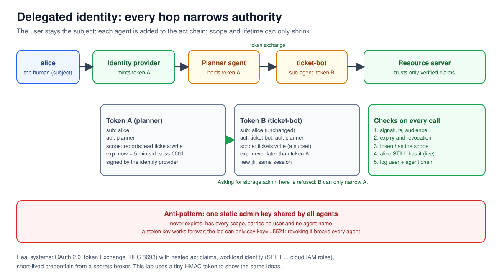
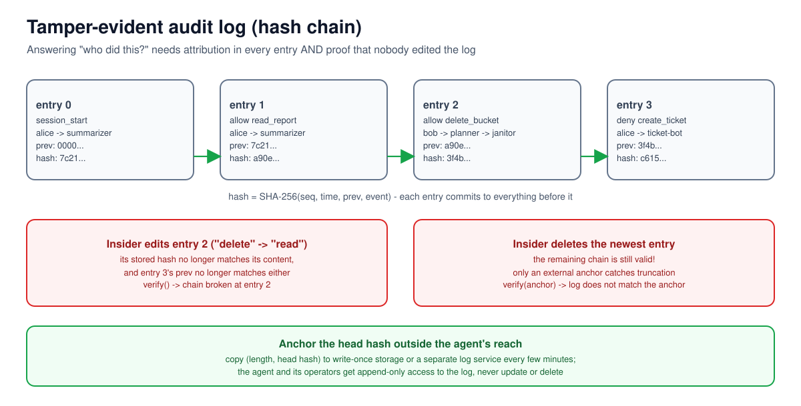

# Agent Identity and Delegated Authority

> **Module:** 05 · Agentic AI Security · **Weeks:** 17–18 · **Time:** ~12 hours
> **You will:** break an agent runtime where every agent shares one admin key, then rebuild it with short-lived, scoped, per-session tokens that carry the user and the agent chain, plus a tamper-evident audit log, and prove it with tests.

| | |
|---|---|
| **Prerequisites** | [Prompt injection](../../02-llm-security/prompt-injection/) (indirect injection, `CALL_TOOL`); [Module 04](../../04-mcp-security/) OAuth basics (scopes, tokens) |
| **Lab** | [`lab/`](lab/): runs offline, no API key needed, standard library tokens |
| **Maps to** | OWASP LLM06:2025 Excessive Agency · OWASP *Agentic AI – Threats and Mitigations* (identity, privilege and traceability threats) · NIST AI RMF *Govern* and *Manage* · NIST SP 800-207 Zero Trust |

---

## 1. Why this matters

An agent is software that **acts**. Every action it takes uses some identity. If you cannot say *whose* authority that was, you cannot limit it, revoke it or investigate it.

Public examples of the underlying problem (not all involve AI, but agents make each one worse):

- **2022, Uber breach:** the attacker found hard-coded admin credentials for Uber's privileged-access system in a script on an internal network share. One static secret unlocked a great deal.
- **2023, Storm-0558 (Microsoft):** an attacker used a stolen Microsoft consumer signing key to forge tokens and read the cloud email of government and enterprise customers. The US Cyber Safety Review Board's 2024 report called out weak key management. Long-lived keys are a single point of failure.
- **2025, Salesloft Drift integration:** attackers stole OAuth tokens held by a third-party chat integration and used them to export data from many companies' Salesforce instances (tracked by Google Threat Intelligence as UNC6395). Integration and machine tokens are now a main attack path.
- **Every year, GitGuardian's *State of Secrets Sprawl* report** finds millions of new secrets leaked in public GitHub commits. Agents that write code and configuration add more.
- **1988, Norm Hardy, *The Confused Deputy*:** a program with its own broad authority was tricked into using it on behalf of a caller who had none. An AI agent with a shared service account is exactly this deputy.

The pattern: **a powerful, long-lived, shared credential, used by software that can be steered by untrusted input, with logs that cannot say who asked.**

---

## 2. Understand it

### 2.1 The root cause in one sentence

Most agent runtimes give the *agent* an identity (or none) and forget the *human*, so authority is decided by "what the service account can do", not by "what this person, through this agent, for this task, may do right now".

### 2.2 Non-human identities (NHI)

A **non-human identity** is any identity used by software instead of a person: service accounts, API keys, OAuth clients, cloud roles, certificates, and now AI agents. In most companies they already outnumber human accounts. Agents add three new problems:

| Problem | Why agents make it worse |
|---|---|
| **Steerable** | A human admin can be phished; an agent can be steered by *any document it reads* (indirect prompt injection). |
| **Fast and repetitive** | An agent can make hundreds of calls a minute. A mistake becomes an incident before a human notices. |
| **Chained** | Agents call tools that call other agents. Without a chain in the token, the last hop has no idea who started it. |

### 2.3 Three identities in every agent action

For every action you must be able to answer three questions. A shared key answers none of them.

| Question | Name in a token | Example |
|---|---|---|
| **On whose behalf?** | `sub` (subject): the human or tenant | `alice` |
| **Which software acted?** | `act` (actor): the agent, nested for each hop | `ticket-bot`, acting for `planner` |
| **Who wrote and deployed that software?** | the agent's registration: owner, version, approved scopes | `ticket-bot v1.4, owner: support-platform team` |

The *developer* is accountable for what the agent is **allowed** to do (its registered scopes). The *user* is accountable for what they **asked**. The *agent* is what **did** it. A good audit trail records all three. That is how you separate "the agent misbehaved" from "the user abused the agent" from "the agent was over-permissioned by design".

### 2.4 Acting on behalf of a user: delegation



**Delegation** means the agent acts with *some* of a user's authority, for a limited time and purpose. Key ideas:

- **Effective permission = agent's registered scopes ∩ user's permissions ∩ task's needs.** The intersection, never the union. The summarizer may read finance reports, but when *alice* (no finance access) uses it, her token has no `finance:read`.
- **OAuth 2.0 Token Exchange (RFC 8693)** standardises "give me a new token, derived from this one, for this actor". The new token keeps the `sub` (alice) and adds an **`act` claim** naming the actor. When the actor delegates again, the `act` claims **nest**: the outermost is the current actor, inner ones are the earlier actors. RFC 8693 also defines `may_act`, which says *who is allowed* to act for the subject.
- **Down-scoping only.** An exchanged token may have *fewer* scopes and a *shorter* life than its parent, never more. In the lab, a planner that tries to give `storage:admin` to a sub-agent is refused.
- **Audience (`aud`).** A token is for one resource server. A token for the cloud API must not work against the mail API. (OAuth *resource indicators*, RFC 8707, let the client ask for a token for a specific resource.)

### 2.5 Per-agent and per-session identity vs shared service accounts

| | Shared service account / static key | Per-agent identity | Per-agent **+ per-session** token |
|---|---|---|---|
| Blast radius of a leak | Everything, forever | One agent's scopes, until rotated | One agent, one user, one session, minutes |
| Least privilege | Impossible: union of all needs | Per agent | Per agent ∩ user ∩ task |
| Revocation | Breaks everything, so nobody does it | Per agent | Per session, per token, per agent |
| Attribution | "the key did it" | "the agent did it" | "alice, through planner → ticket-bot, session 0001" |
| Confused deputy | Built in | Still possible | Prevented if the resource re-checks the user |

### 2.6 Short-lived credentials

A credential that lives for minutes turns a leak into a small window. Patterns:

- **Workload identity:** the platform proves *which workload* is running (Kubernetes service account tokens, cloud instance roles, SPIFFE IDs) and exchanges that proof for short-lived credentials. No static secret to leak.
- **Just-in-time credentials:** a broker mints a token when the session starts and it expires when the task ends.
- **Secrets never in the prompt or in the agent's environment.** The **tool broker** injects credentials at call time, outside the model's view (see the [module architecture](../README.md)).
- **Sender-constrained tokens** (mTLS-bound tokens, DPoP): a stolen token is useless without the matching private key.

### 2.7 Attribution and audit trails

An audit log for agents must answer *who did what, for whom, under which policy, approved by whom, and when*, and it must be **tamper-evident**, so an attacker or an embarrassed insider cannot quietly edit it.



A **hash chain** stores, in each entry, the hash of the previous entry. Editing or deleting an entry in the middle breaks every later link. Deleting the *newest* entries (truncation) leaves a valid shorter chain, so you also copy the head hash to a separate write-once store (an **anchor**). Production systems use append-only log services, object storage with retention locks, or transparency logs.

Record: user (`sub`), agent chain (`act`), session ID, token ID (`jti`), action, resource, decision (allow/deny), policy version, approval ID, model and agent version, timestamp. Do **not** record full prompts with personal data by default.

### 2.8 Agent-to-agent trust

When agents talk to agents (directly, through MCP, or with a protocol such as Google's Agent2Agent (A2A), announced in 2025, check the current spec):

1. **Authenticate the peer** (mTLS, signed tokens). Know which agent you are talking to.
2. **Authenticated is not trustworthy.** Another agent's *message* is untrusted content. It may carry an injection it read somewhere else.
3. **Never forward your own token.** Use token exchange to give the peer a narrower token of its own.
4. **Keep the chain.** The receiving side should see the full `act` chain and the original `sub`, and apply policy to *the whole chain* (for example, deny if any hop is a disabled agent, as the lab's kill switch does).

---

## 3. Defend it

| Layer | Control | Type | What it buys you |
|---|---|---|---|
| L1 | **Short-lived tokens** per session (minutes); no static keys in agents | Hard | A stolen credential expires quickly |
| L2 | **Scoped tokens**: agent's registered scopes ∩ user's permissions | Hard | A hijacked agent can only do its own job |
| L3 | **On-behalf-of check at the resource**: re-check the user's *live* permissions on every call | Hard | No confused deputy; access removal works before token expiry |
| L4 | **Delegation by token exchange**: subset scopes, nested `act`, lifetime never extended | Hard | Sub-agents never gain power |
| L5 | **Revocation and kill switch** per token, session and agent | Hard | You can stop one thing without stopping everything |
| L6 | **Tamper-evident audit** (hash chain + external anchor) with user and agent chain | Hard (detect) | You can prove who did what, and that the log is intact |
| L7 | **Agent registry**: owner, purpose, approved scopes, version, review date | Process | Every NHI has an accountable human |
| L8 | **Monitoring**: alert on denials, new scopes, unusual volume, use after hours, tokens used from new places | Process | You notice misuse early |

### Design patterns worth knowing

- **Identity propagation, not identity replacement.** The agent never "becomes" a powerful service account. It carries the user's identity forward.
- **Credentials outside the model.** The model sees tool names and results. A tool broker attaches the credential. Prompts and memory never contain secrets.
- **Separate identities for separate trust levels.** A read-only retriever, a planner and a write-capable executor get different identities. A read-only token cannot write, whatever the model says.
- **Policy on the whole chain.** "Allow `delete` only if the chain is `human → change-agent` and an approval ID is present."

### What does NOT work on its own

- **Telling the model "only act within alice's permissions".** The model is not an authorization system. Lab case 2 shows the shared-key runtime leaking payroll anyway.
- **Logging the agent name only.** "summarizer did it" does not tell you which user asked.
- **Rotating the shared key every 90 days.** It is still shared, all-powerful and anonymous for 90 days.
- **A hash chain without an anchor.** It detects edits but not truncation (test `test_truncation_needs_an_external_anchor`).
- **Trusting identity claims in tool arguments** like `{"acting_user": "bob"}`. Identity comes only from a verified token.

---

## 4. Hands-on lab

**Scenario:** ACME runs `summarizer` and `ticket-bot` agents for staff. To ship fast, both call the cloud API with one admin key, `CANARY-ADMIN-KEY-5521`. *alice* is a support lead (no finance, no storage admin). *bob* is a platform admin. A shared report has been edited by a stranger.

### Setup (once for the whole repo)

```powershell
python -m venv .venv
.venv\Scripts\Activate.ps1
python -m pip install -e ".[dev]"
```

### Step 1: Run the scorecard

```powershell
python 05-agent-security/agent-identity/lab/demo.py
```

Expected output:

```text
case                           vulnerable       secure           secure-side evidence
--------------------------------------------------------------------------------------------------------
injected_delete_via_summarizer BUCKET DELETED   denied           403 token lacks scope storage:admin
confused_deputy_payroll        PAYROLL LEAKED   denied           403 token lacks scope finance:read
stolen_credential_misuse       BUCKET DELETED   denied           403 token lacks scope storage:admin
replay_after_30_days           WORKS            denied           401 token expired
tampered_token                 n/a (no token)   denied           401 bad signature
subagent_scope_widening        ALREADY ADMIN    denied           ticket-bot is not registered for ['storage:admin']
revoked_session_reuse          CANNOT REVOKE    denied           401 token revoked
attribution_who_deleted        key=...5521      attributed       bob -> planner -> storage-janitor (session sess-0001)
insider_deletes_log_entry      UNDETECTED       DETECTED         log does not match the external anchor (truncated or rewritten)
benign_own_report              ok               ok               Q3 support volume fell 12 percent. Respo...

The secure runtime never holds a long-lived secret. Every action carries the human
AND the agent chain, the resource server re-checks both, and the log can prove it.
Tip: try SecureAgentRuntime(scoped=False, check_user=False) and re-run case 2.
```

Read the `attribution_who_deleted` row twice. On the vulnerable side, the only answer to "who deleted the bucket?" is a key suffix. On the secure side it is a human, a chain of two agents and a session ID.

### Step 2: Read the vulnerable code

Open [`lab/vulnerable_runtime.py`](lab/vulnerable_runtime.py) and find the six `VULN` comments. For each one, write one line in your journal: which row of the scorecard does it cause?

### Step 3: Read the secure code layer by layer

Open [`lab/secure_runtime.py`](lab/secure_runtime.py). Find:

- `TokenService.mint`: the claims (`sub`, `act`, `sid`, `scope`, `aud`, `exp`, `jti`).
- `TokenService.exchange`: the subset check and `min(parent["exp"], ...)`.
- `SecureCloudAPI.call`: the checks in order (verify the token, known action, token scope, the user's live permission), then the audit entry.
- `AuditLog.append` / `verify` / `anchor`.

Then run the tests:

```powershell
python -m pytest 05-agent-security/agent-identity -v
```

### Step 4: Break it yourself

Predict the result *before* you run each one:

1. `SecureAgentRuntime(scoped=False)`: run case 2 (alice + payroll). Which layer stops it now? (Hint: `test_user_check_alone_stops_confused_deputy`.)
2. `SecureAgentRuntime(check_user=False)`: run case 1 as **bob** instead of alice. Bob may delete buckets. Does his summarizer? Why is that the right answer?
3. `SecureAgentRuntime(short_lived=False, clock=FakeClock())`: mint a token, advance the clock 7 days, call the API. What changed, and which real incident does this resemble?
4. In `AuditLog.verify`, delete the line that checks `entry.get("prev") != prev`. Which test fails? What attack does that check catch that the per-entry hash does not?
5. Add `"acting_user"` to a tool call's arguments in [`lab/attacks.py`](lab/attacks.py) and try to make the secure runtime act as bob. Why can't it?

### Step 5: Try it on a real model (optional)

With [Ollama](https://ollama.com) running (`ollama pull llama3.2`):

```powershell
$env:AISEC_LLM_BACKEND = "ollama"
python 05-agent-security/agent-identity/lab/demo.py
```

A real model will not emit the mock's JSON tool calls reliably, so most rows become "ok" on *both* sides. That is the point of this lesson: **none of the secure-side denials depend on the model**. Write down which rows still differ and why (cases 3–8 never call the model at all).

### Stretch goals

- **Sender-constrained tokens:** bind each token to a per-agent key pair (store the public key's hash in a `cnf` claim) and make the resource server require a signature over each request. Show that a stolen token alone now fails.
- **`may_act`:** add a claim to alice's token listing which agents may act for her, and make `exchange` enforce it.
- **Anchor rotation:** write the audit anchor to a separate file every N entries and add a CLI command `verify-log` for incident responders.
- **Real JWTs:** replace the HMAC format with asymmetric JWTs (an identity provider signs; resource servers only hold the public key). Why is that better when there are many resource servers?

---

## 5. Real-world scenarios

*These are hypothetical composites of common failure patterns, not reports of specific incidents.*

**Scenario A: "the bot deleted the backups".**
On Monday, the `customer-backups` bucket is gone. CloudTrail-style logs show the deletion came from `svc-ai-agents`, the one service account all five agents use.
- *What went wrong:* a shared, all-powerful identity. Nobody can tell which agent, which user or which input triggered it. Revoking the account stops every agent in the company.
- *Investigate:* correlate timestamps with each agent's own application logs and model traces; list which documents each agent read in that window (look for injected tool directives); check whether the key appears anywhere it should not (repos, tickets, prompts).
- *Fix:* per-agent identities with registered scopes; per-session tokens carrying the user; deny `delete` to every agent except a change agent that requires an approval ID; restore from backup and add object-lock retention on backups.

**Scenario B: the helpful finance summarizer (confused deputy).**
A support engineer asks the company assistant "what were the payroll totals last month?" and gets an answer. The assistant's service account can read finance data because finance staff use the same assistant.
- *What went wrong:* the agent's authority was used for a user who had none. The model was not "hacked". It did exactly what it was asked.
- *Investigate:* search the audit log for finance resources accessed in sessions of users without finance roles. If the log has no user field, that is your first finding.
- *Fix:* on-behalf-of tokens; resource servers check the *user's* entitlements (L3); data-classification labels on documents; alert on cross-role access.

**Scenario C: the planner that hired a contractor.**
A multi-agent system lets a planner agent spawn sub-agents. One sub-agent, given a broad token "for convenience", reads an injected web page and creates admin users in a SaaS tenant.
- *What went wrong:* the planner forwarded its own token (or a broader one) to the sub-agent. No down-scoping, no chain in the token, no policy on the chain.
- *Investigate:* reconstruct the call tree from logs; identify the token used by each hop and whether any hop had more scope than its parent.
- *Fix:* token exchange with subset scopes and nested `act`; sub-agents that read untrusted content get read-only tokens; admin actions require a human approval bound to the exact action; the kill switch disables every token whose chain contains the compromised agent.

---

## 6. Common mistakes

- Putting API keys in the system prompt or the agent's environment "because the tool needs it". Use a tool broker.
- One service account for "the AI platform", shared by every agent and every environment.
- Long-lived refresh tokens stored in agent memory or vector stores.
- Checking the agent's scopes but not the user's (confused deputy), or the user's but not the agent's (a hijacked summarizer can do everything the admin can).
- Logging only successful calls. Denials are your best early warning.
- Letting the audit log live in the same database the agent can write to.
- No owner for an agent identity, so nobody reviews or removes it.

---

## 7. Interview preparation

<details><summary><b>Q1. What is a non-human identity, and why do AI agents make NHI management harder?</b></summary>

A non-human identity is any credential used by software: service accounts, API keys, OAuth clients, cloud roles, certificates. Agents make it harder because they are *steerable* by untrusted input (indirect prompt injection), they act *fast and repeatedly*, and they *chain* through other tools and agents. A traditional service account runs fixed code. An agent's "code path" is decided at run time by a model reading content you do not control. So the identity must be narrower, shorter-lived and more traceable than a classic service account.
</details>

<details><summary><b>Q2. Why is a shared service account for all agents a bad idea? Give four reasons.</b></summary>

1. **Blast radius:** least privilege is impossible; the account needs the union of all agents' needs.
2. **Revocation:** you cannot disable one agent without breaking all of them, so in practice nobody revokes it.
3. **Attribution:** logs say "the service account did it", not which agent or which user.
4. **Confused deputy:** any user of any agent borrows the account's full power.
Also: a leak of one agent's config leaks every agent's power, and rotation is risky, so it rarely happens.
</details>

<details><summary><b>Q3. Explain the confused deputy problem in an AI agent.</b></summary>

The agent (the deputy) holds authority of its own, for example read access to finance reports. A user without that authority asks the agent, or injects instructions through a document, and the agent uses *its* authority to serve them. Nothing was "hacked"; the authorization check was done against the wrong principal. Fix: the agent acts *on behalf of* the user with a token that names the user, and the resource server checks the user's entitlements on every call. Effective permission = agent ∩ user ∩ task.
</details>

<details><summary><b>Q4. What is OAuth 2.0 Token Exchange (RFC 8693), and what is the act claim?</b></summary>

RFC 8693 defines a way to send a token to an authorization server and get a *new* token for a different context: delegation or impersonation. In **delegation**, the new token keeps the original subject (`sub` = alice) and adds an **`act` (actor) claim** for the party acting on her behalf. If that actor delegates again, `act` claims nest, so the full chain is visible. `may_act` lists who is allowed to act for the subject. For agents, I'd use it so each hop gets its own narrower, shorter-lived token instead of forwarding the parent's.
</details>

<details><summary><b>Q5. Delegation vs impersonation: which should an agent use?</b></summary>

Impersonation gives the agent a token that looks exactly like the user; downstream services cannot tell an agent was involved. Delegation keeps the user as subject and adds the agent as actor. Agents should use **delegation**: you keep attribution, you can write policy about agents ("no agent may approve payments"), and you can revoke a specific agent without locking out the user.
</details>

<details><summary><b>Q6. Design identity for a planner agent that spawns sub-agents.</b></summary>

- Each agent type is registered with an owner and a maximum scope set.
- The session starts with a token for (user, planner) = planner scopes ∩ user permissions, 5–15 minute lifetime, audience-bound.
- To delegate, the planner calls token exchange; the new token has a *subset* of scopes, nested `act`, lifetime ≤ parent, and the same session ID.
- Sub-agents that read untrusted content get read-only scopes.
- Resource servers verify the token, check scope, re-check the user's live permissions and apply chain policies.
- Everything is logged with user, chain, session and token ID; kill switch can disable any agent and every token whose chain includes it.
</details>

<details><summary><b>Q7. How short should agent credentials live, and what are the trade-offs?</b></summary>

Minutes, roughly matched to the task (for example 5–15 minutes, refreshed by the broker while the session is active). Shorter lifetimes shrink the replay window but increase token-service load and add failure modes if the identity provider is down. Mitigate with caching of signing keys, renewal before expiry, and graceful re-authentication. Long tasks should re-request tokens, which is also a natural checkpoint for re-authorization.
</details>

<details><summary><b>Q8. A token is valid until 10:15, but at 10:05 the user is removed from the finance group. What happens?</b></summary>

If resources only check token scopes, the user (through the agent) keeps finance access for 10 more minutes. That is why I add an **on-behalf-of check against live entitlements** at the resource (lab test `test_live_permission_change_takes_effect_before_token_expiry`), and also support revocation lists or token introspection for high-risk resources. Short lifetimes limit the gap; live checks close it.
</details>

<details><summary><b>Q9. What should an agent audit record contain?</b></summary>

User (`sub`), agent chain (`act`), agent version and model version, session ID, token ID (`jti`), tool/action, target resource, arguments (redacted), policy decision and rule/policy version, approval ID and approver, result status, timestamps. It should be append-only, tamper-evident (hash chain plus external anchor or a write-once store), and kept separately from anything the agent can write. Avoid storing full prompts with personal data by default.
</details>

<details><summary><b>Q10. How does a hash-chained log work, and what are its limits?</b></summary>

Each entry includes the hash of the previous entry, and its own hash covers its content plus that link. Changing or removing any middle entry breaks the chain from that point. Limits: (1) truncation of the newest entries leaves a valid shorter chain, so you need an external anchor; (2) someone with full write access can recompute the whole chain, so anchors must live where that person cannot write; (3) it proves integrity, not truth: a compromised writer can log lies. Pair it with separation of duties and a write-once store.
</details>

<details><summary><b>Q11. Scenario: an attacker exfiltrated an agent's environment variables. What is your response, and how would better design have helped?</b></summary>

Response: revoke/rotate every credential in that environment, disable the agent, search audit logs for use of those credentials from unusual sources, scope the impact by what each credential could do, and look for the root cause (often a code-execution or injection path). Better design: no long-lived secrets in the agent's environment at all; the agent gets a short-lived session token from workload identity, and the tool broker attaches real credentials outside the agent. Then the stolen data is a token that expires in minutes and is scoped to one user and one agent.
</details>

<details><summary><b>Q12. How do you establish trust between two agents from different teams?</b></summary>

Authenticate each other (mTLS or signed tokens tied to a workload identity). Authorize *which* agent may call which capability. Treat message content as untrusted data, never as instructions. Do not forward tokens; exchange them for narrower ones with the full `act` chain. Apply policy on the whole chain and log both sides with a shared correlation ID. Define a contract (schemas, rate limits) and monitor for drift.
</details>

<details><summary><b>Q13. Who is accountable when an agent does something harmful: the user, the agent's developer, or the platform?</b></summary>

It depends on the evidence, which is why attribution matters. If the agent acted within its registered scope at the user's clear request, the user owns the request. If the agent could do something no user of it should be able to do, the developer/owner over-permissioned it. If an injected document steered it, the root cause is the design that let untrusted content drive a privileged action. A good audit record (user, chain, input sources, policy decision, approval) lets you tell these apart.
</details>

<details><summary><b>Q14. Explain to a non-technical executive why agents need their own identities.</b></summary>

"Today our AI assistants all use one master key. If anyone tricks any assistant, they get the master key's power, and afterwards we can't tell who did what. We're giving each assistant its own badge that only opens the doors it needs, only for the person it's helping, and only for a few minutes. Every door it opens is recorded in a log that nobody can secretly edit."
</details>

---

## 8. Checklist (definition of done)

- [ ] I can explain `sub`, `act`, `scope`, `aud`, `exp` and `jti`, and RFC 8693 delegation, without notes.
- [ ] `python -m pytest 05-agent-security/agent-identity` passes.
- [ ] I did all five "break it yourself" exercises and recorded the predictions vs results.
- [ ] I implemented at least one stretch goal.
- [ ] Week 18 journal entry: an identity design for a planner + two sub-agents, with the token claims for each hop and how I'd answer "who did this?".

## 9. References

- OWASP Top 10 for LLM Applications 2025, LLM06:2025 Excessive Agency: https://genai.owasp.org/llmrisk/llm062025-excessive-agency/
- OWASP GenAI Security Project, *Agentic AI – Threats and Mitigations* (2025): https://genai.owasp.org/resource/agentic-ai-threats-and-mitigations/
- OWASP GenAI Security Project, *OWASP Top 10 for Agentic Applications for 2026*: https://genai.owasp.org/resource/owasp-top-10-for-agentic-applications-for-2026/
- RFC 8693, OAuth 2.0 Token Exchange: https://www.rfc-editor.org/rfc/rfc8693
- RFC 8707, Resource Indicators for OAuth 2.0: https://www.rfc-editor.org/rfc/rfc8707
- RFC 7519, JSON Web Token (JWT): https://www.rfc-editor.org/rfc/rfc7519
- RFC 9449, OAuth 2.0 Demonstrating Proof of Possession (DPoP): https://www.rfc-editor.org/rfc/rfc9449
- SPIFFE (workload identity): https://spiffe.io/
- NIST SP 800-207, *Zero Trust Architecture*: https://csrc.nist.gov/pubs/sp/800/207/final
- Norm Hardy, *The Confused Deputy* (1988): https://dl.acm.org/doi/10.1145/54289.871709
- US Cyber Safety Review Board, review of the Summer 2023 Microsoft Exchange Online intrusion (2024): https://www.cisa.gov/resources-tools/resources/CSRB-Review-Summer-2023-MEO-Intrusion
- GitGuardian, *State of Secrets Sprawl* reports: https://www.gitguardian.com/state-of-secrets-sprawl-report
