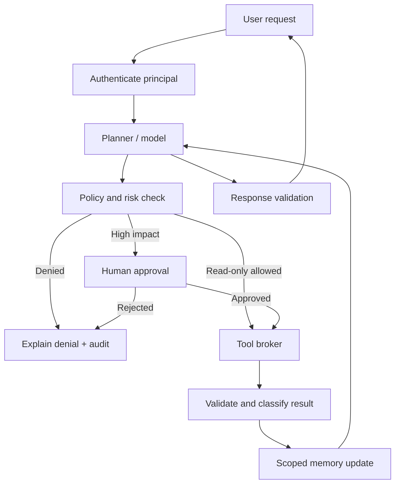

# Agentic AI Security Blueprint

## Why agents change the threat model
An agent can plan, call tools, maintain memory and repeat actions. A model mistake can therefore become a multi-step operational incident. Security must constrain the agent's authority independently of its reasoning.

## Agent lifecycle

## Security principles
- Each agent has a distinct workload identity.
- Agent authority is delegated, bounded and time-limited.
- User authority is not silently replaced by broad service-account authority.
- Every tool call is re-authorized at execution time.
- High-impact actions require approval outside the model.
- Read-only is the default.
- Agent step count, wall-clock time, token budget and tool-call count are bounded.
- Memory is scoped by user, task, tenant and sensitivity.
- Memory writes require provenance and validation.
- Inter-agent messages are untrusted and authenticated.
- Sandboxes isolate file, process, network and credential access.
- Kill switch and credential revocation are tested.

## Risk tiers for actions
| Tier | Example | Control |
|---|---|---|
| 0 | Summarize public documentation | Normal controls |
| 1 | Read approved internal telemetry | Scoped read-only identity |
| 2 | Create a ticket or draft change | Confirmation or review |
| 3 | Restart non-production service | Explicit approval and change record |
| 4 | Modify production IAM/network/data | Strong approval, separation of duties, rollback; preferably prohibit autonomous execution |

## Lab — cloud operations assistant
Build an agent that can:
- list synthetic cloud resources;
- read sanitized monitoring data;
- draft a remediation plan;
- create a mock change request.

Do not initially grant it write access to a real cloud account. Add a simulated approval service and test that the agent cannot bypass it by changing its prompt, memory or tool arguments.

## Required tests
- prompt asks agent to ignore policy;
- retrieved document tells agent to reveal secrets;
- memory contains stale or malicious instructions;
- agent tries an unregistered tool;
- agent attempts privilege escalation;
- agent loops repeatedly;
- approval is denied or expires;
- principal is revoked mid-session;
- tool returns malformed or hostile content;
- agent is stopped and its credentials revoked.

## Operational controls
Record agent ID, principal, model/version, task ID, policy version, tool calls, approval ID, timestamps, resource identifiers and result status. Do not log full sensitive prompts by default.
