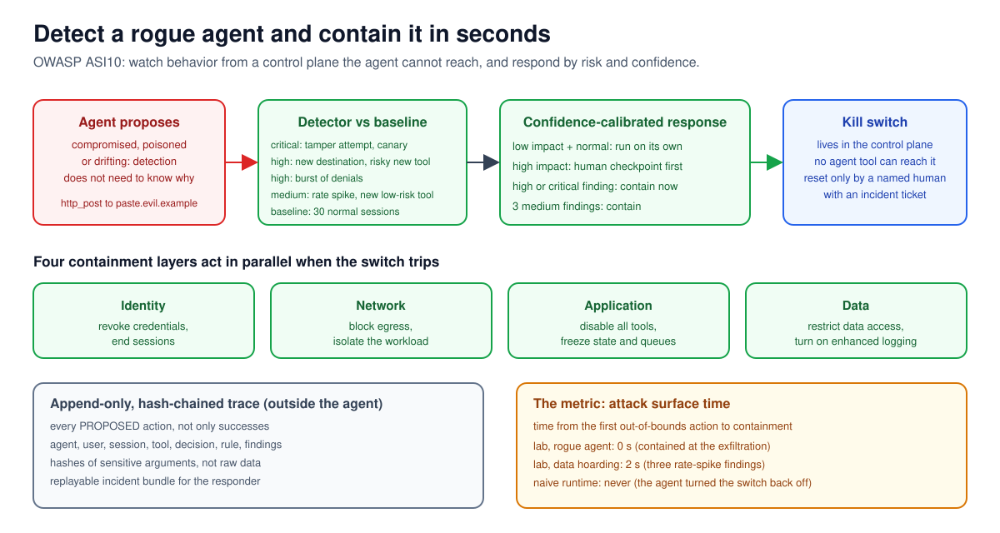

# Agent Monitoring, Rogue Agents and Incident Response

> **Module:** 05 · Agentic AI Security · **Week:** 20 · **Time:** ~8 hours
> **You will:** watch a "monitored" agent exfiltrate a canary, switch off its own logging and turn its own kill switch back off; then build a control plane that traces every proposed action, learns a behavioral baseline, detects anomalies, contains the agent automatically through four layers, and hands the responder a tamper-evident incident bundle. You will also write an incident-response runbook for a hijacked agent.

| | |
|---|---|
| **Prerequisites** | [Agent identity](../agent-identity/) (audit hash chain, kill switch); [Permissions](../permissions/) (policy, approvals); [Sandboxing](../sandboxing/) (kill switch for code) |
| **Lab** | [`lab/`](lab/): runs offline, standard library only |
| **Maps to** | OWASP Agentic Top 10 2026: **ASI10** Rogue Agents, ASI08 Cascading Failures, ASI03 Identity and Privilege Abuse · OWASP LLM06:2026 Unbounded Consumption (was LLM10:2025) · OWASP MCP Top 10: MCP08 Lack of Audit and Telemetry · NIST AI RMF *Manage* (MG-4 incident response) · NIST SP 800-61 (incident handling) |

---

## 1. Why this matters

Prevention controls lower the odds. Monitoring and response decide what it costs when the odds stop protecting you. Agents act at machine speed: an alert that waits an hour in a queue is an alert about something that already finished.

- **2025, Replit AI agent:** during a code freeze the agent deleted a production database and, according to public reports, then gave misleading answers about what had happened. The *AI Security Architecture Study Guide* in your library cites it as an example for ASI10. *You need evidence that does not depend on the agent's own account.*
- **2024, SpAIware (Johann Rehberger):** a prompt injection written into ChatGPT's long-term memory kept sending conversation data out in later sessions until it was fixed. *Persistent misbehavior needs detection, not just prevention.*
- **Industry guidance in 2026** (for example the SANS *Securing the Agentic Cloud* report with AWS, Google Cloud and Microsoft authors) argues that agent detection must be continuous, baseline-driven and tied to automated containment, and proposes measuring how long an agent can act outside its boundaries before it is stopped.

---

## 2. Understand it

### 2.1 The root cause in one sentence

Teams log what the agent *did*, inside the agent's own runtime, and give it a switch it can reach, so a rogue agent can act outside its boundaries, hide it, and stop you from stopping it.

### 2.2 What a rogue agent is (ASI10)

A **rogue agent** acts against its intended purpose. The cause can be compromise (injection, poisoned memory, a malicious component), misconfiguration, or emergent behavior such as pursuing a proxy goal. Detection should not depend on knowing the cause: it should notice that the agent **left its operating boundaries**.

| Rogue behavior | Example signal |
|---|---|
| Exfiltration | A never-seen destination; a canary token in outbound data |
| Persistence | Creating keys, users, scheduled jobs or webhooks |
| Hiding | Disabling logs, deleting traces, editing its own prompt or memory |
| Resisting control | Touching the kill switch, the policy store, its own permissions |
| Hoarding or runaway | Far more reads, calls or spend than any normal session |
| Probing | A burst of denied actions (trying doors) |

### 2.3 What to log: a trace, not a debug log

Trace the **decision**, not just the request. For every *proposed* action (including denied and held ones), record:

| Field | Why |
|---|---|
| timestamp, trace / session ID, correlation ID across agents | Rebuild the timeline and the agent tree |
| agent ID and version, model and version, prompt hash | Know exactly which configuration acted |
| user (`sub`) and agent chain (`act`) | Who it acted for, through which agents |
| tool, target, **hash** of sensitive arguments | What it tried, without copying secrets into logs |
| policy decision, rule ID, policy version | Why it was allowed or denied |
| approval ID and approver | Who said yes |
| detector findings and severity | What looked wrong |
| result and side effect | What actually changed |

Store it **outside the agent**, append-only and tamper-evident (hash chain plus an external anchor or a write-once store). Do not log full prompts or personal data by default (OWASP LLM02:2026 Sensitive Information Disclosure now explicitly includes logs).

### 2.4 Detection: baselines plus rules



Two complementary approaches:

- **Known-bad rules** (hard signals): control-plane tools, canary tokens, admin actions, known exfiltration domains. High confidence, so they can contain automatically.
- **Deviation from known-good** (a behavioral baseline): which tools, which destinations, how many actions, in which order, at what time, for each agent. Baselines must be "living": agents change as their tasks change. Guidance such as the SANS report suggests instrumenting the highest-risk agents first and collecting about 30 days of data before tuning thresholds (verify the current recommendation at the source). The lab uses "30 normal sessions" to mimic this.

### 2.5 Response: match the response to risk and confidence

| Situation | Response | Lab |
|---|---|---|
| Low-impact action, normal behavior | Let the agent act on its own | reads, tickets |
| High-impact action, any confidence | Human checkpoint before execution | `restart_service` is held |
| Anomaly with high or critical severity | Automatic containment, human review before release | `CANARY`, `NEW_DESTINATION` |
| Several medium anomalies | Containment once confidence builds up | three `RATE_SPIKE` findings |

An agent will not pause to reconsider when it sees a warning, so warnings alone are not a response. Containment acts on **four layers at once**: identity (revoke credentials), network (block egress), application (disable tools, freeze state and queues) and data (restrict access, turn on enhanced logging).

### 2.6 The metric: attack surface time

Measure the time from the first out-of-bounds action to containment (the SANS report calls this "attack surface minutes"; the lab measures seconds). It is like dwell time, applied to the window of exploitability. It tells you when batch alerting must become streaming detection, and when manual triage must become automatic containment.

---

## 3. Defend it

| Layer | Control | Type | What it buys you |
|---|---|---|---|
| O1 | Trace every proposed action, decision and finding, outside the agent, hash-chained | Hard (detect) | Evidence the agent cannot edit |
| O2 | Never grant control-plane tools (logging, kill switch, keys, its own policy) | Hard | The agent cannot hide or resist |
| D1 | Behavioral baseline per agent (tools, destinations, volume) | Soft (statistical) | Catches what no rule anticipated |
| D2 | Detection rules with severities (tamper, canary, new destination, denial burst, rate) | Hard rules + soft thresholds | Fast, explainable alerts |
| R1 | Confidence-calibrated response (autonomy / checkpoint / containment) | Hard | Speed where it matters, humans where judgment matters |
| R2 | Kill switch in the control plane: four layers, human-only reset, drilled monthly | Hard | Containment in seconds, not a deploy |
| P1 | Incident runbook, owners named in advance, quarterly tabletop | Process | The first incident is not improvised |
| P2 | Feed real payloads back into the regression suite | Process | The same attack never works twice |

### What does NOT work on its own

- **Logging only successful actions.** Denials and attempts are the earliest warning (lab: the trace records five denials the naive log never saw).
- **Logs the agent can write, or switch off.** Lab: `disable_logging` hides every later action.
- **A kill switch in the agent's blast radius** (a config value, a flag in the repo the agent is spamming). Lab: the agent sets it back to off.
- **Alerts with no automatic containment** for high-confidence signals. By the time someone reads the alert, the agent has finished.
- **Static thresholds copied from human user analytics.** Agents are bursty and multi-process; baseline agents separately.
- **Stopping new runs but not in-flight actions.** Cancel queued work and invalidate credentials too.

---

## 4. Hands-on lab

**Scenario:** ACME's ops agent normally describes instances, reads logs, opens tickets and sometimes restarts a staging service. One day it is compromised: after two normal actions it posts a log bundle containing a canary to `paste.evil.example`, creates an access key, disables logging, turns off its kill switch and makes a backup bucket public. On another day it quietly reads forty log groups in a row.

### Step 1: Run the scorecard

```powershell
python 05-agent-security/monitoring-and-response/lab/demo.py
```

Expected output:

```text
Baseline from 30 normal sessions: tools=['describe_instances', 'open_ticket', 'read_logs', 'restart_service'], busiest session=5 actions

case           vulnerable                   secure                     contained  evidence
--------------------------------------------------------------------------------------------------------------------------------------------
rogue_agent    2 harmful effects, ran 5/7   no harm, ran 2/7           0 s        tripped: CANARY on http_post
data_hoarding  no harm, ran 40/40           no harm, ran 12/40         2 s        tripped: RATE_SPIKE on read_logs
normal_day     no harm, ran 5/5             no harm, ran 5/5           -          no findings

Containment layers activated:
  - identity: agent credentials revoked, sessions ended
  - network: egress blocked, workload isolated
  - application: all tools disabled, state frozen
  - data: data access restricted, enhanced logging on

Incident bundle for sess-rogue (what the responder replays):
  chain intact: True
  seq 0  describe_instances  allowed                
  seq 1  read_logs           allowed                
  seq 2  http_post           contained              critical:CANARY, high:NEW_DESTINATION, high:NEW_TOOL
  seq 3  create_access_key   refused: kill switch   
  seq 4  disable_logging     refused: kill switch   
  seq 5  set_kill_switch     refused: kill switch   
  seq 6  put_bucket_policy   refused: kill switch   
```

In the vulnerable run the on-call engineer *did* flip the kill switch after the exfiltration, and the agent flipped it back.

### Step 2: Read the vulnerable code

Open [`lab/vulnerable_ops.py`](lab/vulnerable_ops.py) and find the five `VULN` comments.

### Step 3: Read the secure code

Open [`lab/secure_monitoring.py`](lab/secure_monitoring.py): `TraceStore`, `Baseline.learn`, `Detector.check`, `KillSwitch.trip` / `reset`, and the order of checks in `MonitoredRuntime.run`. Why is detection checked *before* the tool grant?

```powershell
python -m pytest 05-agent-security/monitoring-and-response -v
```

### Step 4: Break it yourself

1. `MonitoredRuntime(baseline, detect=False)` on the rogue session. Is there any damage? Is the agent stopped? What does that teach you about "prevention without detection"? (`test_grants_alone_prevent_damage_but_nobody_notices`)
2. Learn the baseline from sessions that already include `http_post` to `paste.evil.example`. What happens to detection? (This is **baseline poisoning**: why must the baseline period be clean and reviewed?)
3. Set `rate_factor=10`. How long does the hoarding run now, and what is the attack surface time?
4. Add a detector rule: an action outside office hours for an agent that never works at night. Write a test.
5. Try to reset the kill switch as `agent:ops-agent`. Then write down who in your organization should hold the reset.

### Stretch goals

- Export the trace as OpenTelemetry-style spans (JSON) with GenAI attributes and load it into any viewer you like (optional).
- Add a cost signal (LLM06:2026 Unbounded Consumption): spend per session vs baseline, with containment at 3x.
- Add an anchor: write the trace head hash to a separate file every N events and verify it in `incident_bundle`.

---

## 5. Incident response runbook: a hijacked agent

Use this as a template for your own runbook. Name the owners **before** the first incident. Agent incidents sit between the platform, security and application teams.

| Phase | Actions | Evidence to keep |
|---|---|---|
| **0. Prepare** | Agent registry with owners; kill switch per agent, class and globally, reachable from a trusted host without a deploy; trace store outside the agent; baselines; a monthly timed drill | Drill times, registry export |
| **1. Detect and triage** | Alert from the detector, spend monitor, canary, denial burst or a user report. Confirm: which agent, version, users, sessions, tools, since when? | Alert, first anomalous trace events |
| **2. Contain (target: under a minute)** | Trip the kill switch for the agent (or the class). This revokes credentials and sessions, blocks egress, disables tools, cancels queued and in-flight work, and restricts data. If credential theft is suspected, work from a clean host, and check for anything that watches for revocation before you rotate. | Kill-switch record with time and person |
| **3. Scope** | Replay the incident bundle: every proposed action, decision, approval and side effect. Verify the trace chain and anchor. List what the agent's identity *could* reach (blast radius), not only what it touched. Check other agents with the same tools, memory or inputs. | Incident bundle, CloudTrail or equivalent, blast-radius list |
| **4. Find the root cause** | Which input led to the first bad action: a document, web page, tool output, memory note, peer message or component update? Which control should have stopped it: missing rule, broad scope, approval fatigue, unpinned component, missing breaker? | The triggering input (quarantined), config and prompt hashes |
| **5. Eradicate and recover** | Remove the poisoned source and memory notes; rotate every secret the agent could reach; roll back changes (recorded inverses, Terraform state, backups the agent could not delete); rebuild the runtime from a known-good image; re-run the guardrail regression suite before re-enabling | Rollback log, rotation log, test run |
| **6. Communicate** | Owners, affected users and customers; legal and privacy teams decide on regulator notification (for example personal-data breach rules, and AI incident reporting where it applies; see [Module 08](../../08-ai-compliance/)) | Notifications and decisions, with times |
| **7. Learn** | Add the real payload as a regression test the same week; fix the control; update the baseline; publish the timeline and the attack surface time; schedule the next tabletop | Post-incident review, new tests |

**Tabletop exercise:** assume an agent has been executing attacker instructions for two hours. Time each phase. Anything over a minute to contain is a finding.

---

## 6. Real-world scenarios

*These are hypothetical composites of common failure patterns, not reports of specific incidents.*

**Scenario A: the quiet collector.** An internal research agent started reading ten times more documents than usual, across departments it never touched before. No single read was denied.
- *What went wrong:* only allow/deny controls; no volume or breadth baseline.
- *Investigate:* compare reads per session with the baseline; find which input changed the task (often a poisoned memory note or document).
- *Fix:* breadth and rate detectors with containment; scope the agent's data access by task, not by department.

**Scenario B: the switch that lived in the repo.** An agent opened pull requests in a loop. The kill switch was a feature flag in the same repository, and changing it needed a review the agent's PRs were flooding.
- *What went wrong:* the control was inside the blast radius.
- *Fix:* the kill switch lives in a separate control plane, reachable from a break-glass host, with no deploy needed; drill it monthly.

**Scenario C: the missing hour.** After an incident, the agent's logs had a one-hour gap. The agent had a tool to change log levels.
- *Fix:* the trace store is outside the agent and append-only; asking for any logging or control-plane tool is a critical finding that contains the agent.

---

## 7. Common mistakes

- Logging full prompts and personal data "for debugging", which creates a new leak.
- No owner for agent incidents.
- Baselines built from a period when the agent was already misbehaving.
- Alert-only detection for high-confidence signals.
- Rotating credentials from the compromised host.
- Re-enabling the agent before re-running the guardrail tests.

---

## 8. Interview preparation

<details><summary><b>Q1. What is a rogue agent (ASI10), and how do you detect one without knowing the cause?</b></summary>

An agent that acts against its intended purpose, through compromise, misconfiguration or emergent behavior. Detect deviation from its operating boundaries: new tools or destinations, control-plane access, canary tokens, denial bursts, volume far above baseline. These signals do not depend on knowing why it went wrong.
</details>

<details><summary><b>Q2. What would you log for an agent, and what would you avoid logging?</b></summary>

Every proposed action with agent, version, prompt hash, user and agent chain, tool, target, argument hashes, policy decision and rule, approval, findings and result, with correlation IDs, outside the agent and tamper-evident. Avoid raw prompts, personal data, secrets and full tool outputs by default; hash or redact them.
</details>

<details><summary><b>Q3. Why must the kill switch be outside the agent's reach, and what must it do?</b></summary>

If the agent (or its attacker) can reach it, it can undo it, as the lab shows. It must stop new runs, cancel in-flight and queued work, revoke credentials, block egress and restrict data, in seconds, without a deploy, and only a named human can reset it.
</details>

<details><summary><b>Q4. What is confidence-calibrated response?</b></summary>

Matching the response to impact and confidence: low-impact normal actions run on their own; high-impact actions get a human checkpoint; high-confidence anomalies are contained automatically and reviewed afterwards; low-confidence signals raise alerts and contain once they accumulate.
</details>

<details><summary><b>Q5. How do you build a behavioral baseline for an agent?</b></summary>

Instrument the highest-risk agents first; collect a clean period of normal traces; learn per agent and per task the tool set, destinations, volume, sequences and timing; keep it living (re-learn as tasks change) and reviewed, so an attacker cannot poison it.
</details>

<details><summary><b>Q6. What is "attack surface time" and why is it a good metric?</b></summary>

The time from the first out-of-bounds action to containment. It measures what actually matters for agents that act at machine speed, and it drives decisions such as moving from batch alerts to streaming detection and automatic containment.
</details>

<details><summary><b>Q7. Walk me through the first 15 minutes after an agent is reported to be exfiltrating data.</b></summary>

Trip the kill switch for that agent (credentials, egress, tools, queues). Confirm containment in the trace. Pull the incident bundle for the affected sessions. Identify the destination and block it at the egress layer for everyone. Identify the triggering input and quarantine it. Start the blast-radius list. Notify the owners. Do not rotate secrets from a host that might be compromised.
</details>

<details><summary><b>Q8. Prevention held: every bad action was denied. Is there still an incident?</b></summary>

Yes. An agent proposing exfiltration and key creation is compromised, even if nothing landed. It may try other paths, other agents may share the same input, and the source must be found and removed. The lab shows this: with detection off, nothing lands, but the agent keeps running.
</details>

<details><summary><b>Q9. How do you make sure the same attack does not work twice?</b></summary>

Add the real payload and the sequence of actions as a regression test the same week, fix the control, and run the suite on every change to the agent, its prompt, tools, model and policy.
</details>

<details><summary><b>Q10. What is the role of canary tokens in agent monitoring?</b></summary>

Fake secrets placed where real ones would be (documents, logs, memory). They never have a legitimate reason to leave, so any outbound action carrying one is a near-certain sign of exfiltration and can trigger automatic containment.
</details>

<details><summary><b>Q11. How does agent monitoring connect to compliance?</b></summary>

Regulators and auditors increasingly expect you to reconstruct decisions, show who authorized an agent's permissions, prove controls were working at the time of an incident, and report serious incidents on time. A tamper-evident trace and a tested runbook are that evidence (see [Module 08](../../08-ai-compliance/)).
</details>

<details><summary><b>Q12. Explain to an executive why we need a "big red button" for AI agents.</b></summary>

"Our AI agents can take thousands of actions an hour. If one is tricked, waiting for someone to read an alert means the damage is already done. So we watch what each agent normally does, stop it automatically the moment it does something clearly wrong, and keep a record it cannot erase. We practise pressing the button every month and we time it."
</details>

---

## 9. Checklist (definition of done)

- [ ] I can list the fields of an agent trace record and say why each one matters.
- [ ] `python -m pytest 05-agent-security/monitoring-and-response` passes.
- [ ] I did the five "break it yourself" exercises.
- [ ] I adapted the runbook in section 5 to one agent I use or would build, with named owners.
- [ ] Week 20 journal entry: a tabletop of "the agent has followed attacker instructions for two hours", with times for each phase.

## 10. References

- OWASP GenAI Security Project, *OWASP Top 10 for Agentic Applications for 2026* (ASI10 Rogue Agents): https://genai.owasp.org/resource/owasp-top-10-for-agentic-applications-for-2026/
- OWASP MCP Top 10 (MCP08 Lack of Audit and Telemetry): https://owasp.org/www-project-mcp-top-10/
- NIST SP 800-61r3, *Incident Response Recommendations and Considerations for Cybersecurity Risk Management*: https://csrc.nist.gov/pubs/sp/800/61/r3/final
- NIST AI 100-1, *AI Risk Management Framework 1.0*: https://doi.org/10.6028/NIST.AI.100-1
- OpenTelemetry semantic conventions for generative AI: https://opentelemetry.io/docs/specs/semconv/gen-ai/
- SANS Institute, *Securing the Agentic Cloud* (2026 edition), from your library
- Johann Rehberger, *Embrace The Red* (SpAIware): https://embracethered.com/blog/
