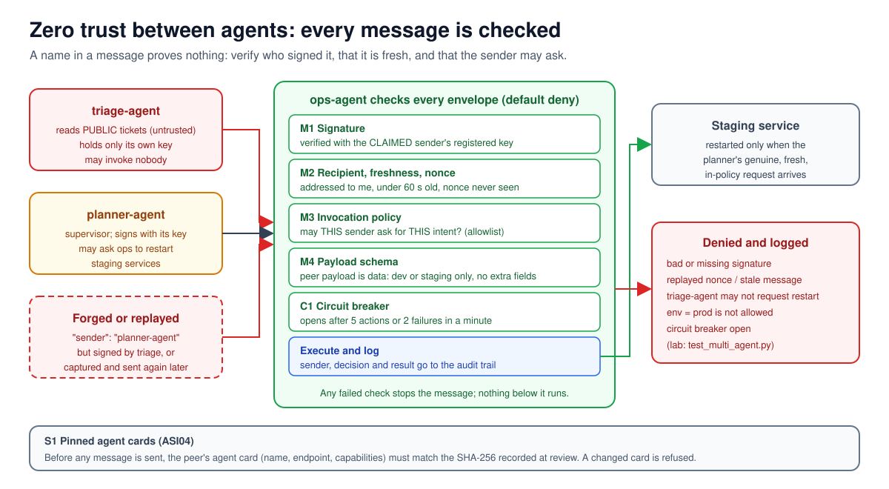
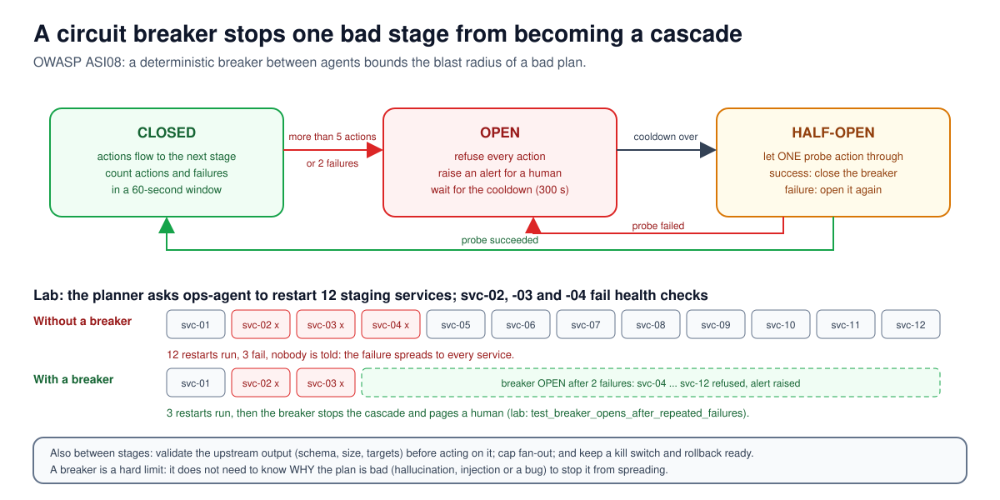

# Multi-Agent Trust: Inter-Agent Communication, Cascades and Agent Supply Chain

> **Module:** 05 · Agentic AI Security · **Week:** 19 · **Time:** ~8 hours
> **You will:** make a low-privilege agent that reads public tickets order a production restart by writing one sentence, replay a captured message, watch a bad plan cascade through twelve services, and then rebuild the agent team on zero trust: signed envelopes, freshness and replay checks, an invocation policy, payload schemas, a circuit breaker and pinned agent cards.

| | |
|---|---|
| **Prerequisites** | [Agent identity](../agent-identity/) (per-agent identity, the `act` chain); [Permissions](../permissions/) (policy engine, taint) |
| **Lab** | [`lab/`](lab/): runs offline, standard library HMAC plus `pydantic` |
| **Maps to** | OWASP Agentic Top 10 2026: **ASI07** Insecure Inter-Agent Communication, **ASI08** Cascading Failures, **ASI04** Agentic Supply Chain, ASI03 Identity and Privilege Abuse · OWASP LLM03:2026 Excessive Agency (was LLM06:2025) · OWASP MCP Top 10: MCP07 Insufficient Authentication and Authorization, MCP09 Shadow MCP Servers · NIST SP 800-207A (service identity, mTLS, per-request authorization) |

---

## 1. Why this matters

Multi-agent systems split one job across a supervisor and specialist agents. Every hand-off is a new trust boundary. If the hand-off is just text, anyone who can influence that text can command the agent on the other side.

- **2024, Morris II "AI worm" research (Cohen, Bitton and Nassi):** researchers showed a self-replicating prompt that spread between GenAI-powered email assistants: one assistant's output became the next assistant's input. *Agent-to-agent text is an attack channel.*
- **2025, Google's Agent2Agent (A2A) protocol** was announced as an open protocol for agents to discover each other (through "agent cards") and exchange tasks. Protocols like this make inter-agent traffic common, so authentication and authorization between agents now matter (check the current A2A specification for its security features).
- **2025, Amazon Q Developer extension:** a malicious prompt merged through a pull request shipped in a release of the VS Code extension (AWS published a security bulletin and a fixed version). *The components an agent loads at run time are part of its attack surface (ASI04).*
- **2025, `postmark-mcp` npm package:** a look-alike MCP server package was found silently copying emails to an attacker (reported by Koi Security). *Discovering a peer by name is not the same as trusting it.*

---

## 2. Understand it

### 2.1 The root cause in one sentence

Agents trust messages from other agents because "they are ours", but the sender, the freshness and the right to ask are never **proven**, so the least-trusted agent in the system can drive the most-privileged one.

### 2.2 Multi-agent architectures and their trust questions

| Pattern | How it works | Trust question at each hand-off |
|---|---|---|
| **Supervisor (orchestrator) + workers** | One agent routes tasks to specialists and merges results | Can a worker send work *back up* or *sideways*? Is the supervisor's output validated before workers act? |
| **Network (peer-to-peer)** | Any agent may call any other | Who may invoke whom? Without an allowlist, every agent is as powerful as the strongest one |
| **Hierarchical** | Supervisors of supervisors | Does authority narrow at every level, or is the top-level token passed down? |
| **Pipeline** | Fixed stages, each consuming the last stage's output | One bad stage poisons every later stage (cascade) |
| **Shared blackboard / memory** | Agents read and write a shared state | Any writer can plant instructions for every reader |

Four questions apply to every hand-off: **identity** (which agent is acting?), **data** (what context crosses the boundary?), **authority** (what can the receiver actually do?), and **return** (which artifacts are trusted when they come back?).

### 2.3 Attack taxonomy

| Attack | How it works | OWASP | Lab case |
|---|---|---|---|
| **Sender spoofing** | A message *claims* to come from a privileged agent | ASI07 | `forged_planner_message` |
| **Privilege laundering** | A low-trust agent that reads public text asks a high-trust agent to act | ASI07, ASI03 | `triage_invokes_ops` |
| **Replay / redirect** | A captured message is sent again, later, or to another agent | ASI07 | `replay_captured_message` |
| **Payload tampering** | A message is edited in transit or carries out-of-scope parameters (`env: prod`) | ASI07 | `test_editing_a_signed_message_breaks_the_signature` |
| **Cascade** | One hallucinated, injected or buggy plan fans out into many actions, and failures do not stop it | ASI08 | `cascade_with_failures`, `runaway_fan_out` |
| **Agent card / component swap** | A peer's card, endpoint or description changes after review (a rug pull for agents) | ASI04 | `tampered_agent_card` |
| **Worm-like propagation** | Output of agent A carries an injection that agent B executes and passes on | ASI07, ASI01 | Morris II research |



### 2.4 Zero trust between agents (NIST SP 800-207A applied)

NIST SP 800-207A describes zero trust for cloud-native services. Its identity-tier recommendations map directly onto agents talking to agents:

| 800-207A idea (paraphrased) | What it means for agents | Lab layer |
|---|---|---|
| Encrypt every connection between service endpoints | Agent-to-agent traffic uses TLS, wherever the agents run | (transport; out of lab scope) |
| Each service presents a short-lived, cryptographically verifiable identity, re-checked regularly | Each agent has its own workload identity (for example a SPIFFE ID with mTLS), never a shared key | M1 signatures |
| Service-to-service authorization uses that runtime identity | An invocation policy says which agent may ask which agent for what | M3 |
| The end user gets a short-lived token that every hop can verify | Carry the human (`sub`) and the agent chain (`act`) across hops ([agent identity](../agent-identity/)) | identity lab |
| The end user is authorized for the resource on every request | The receiver re-checks the user's rights, not just the caller's | identity lab L3 |
| Enforcement points are always invoked, verifiable and independent of application code | Put the checks in a gateway, sidecar or the receiving runtime, not in the model's prompt | the whole `accept()` |

### 2.5 Cascading failures (ASI08)

A cascade is not only an attack. A planner that hallucinates "restart every service" is enough. The defences are classic reliability engineering, applied between agents:

- **Circuit breaker** between stages: closed → open (refuse, alert) → half-open (one probe) → closed. It opens on too many actions (a blast-radius cap) or too many failures in a window.
- **Independent validation between stages:** the downstream stage validates the upstream output (schema, size, targets) instead of trusting it.
- **Fan-out caps and budgets across the whole tree**, not only per agent.
- **Kill switch and rollback** for when the breaker was not enough.



### 2.6 Agent supply chain (ASI04)

Agents load things at run time: other agents' cards, MCP servers, tool descriptions, prompts, plugins. Treat each as a dependency: review it, record its hash, refuse anything that changed, and keep a registry of approved agents (an unknown agent is a "shadow agent", like MCP09 shadow servers). The same idea is covered for MCP tool descriptions in [Module 04](../../04-mcp-security/) (rug-pull pinning).

---

## 3. Defend it

| Layer | Control | Type | What it buys you |
|---|---|---|---|
| M1 | **Signed envelopes**: per-agent keys (production: mTLS with workload identity, or asymmetric signatures) | Hard | A claimed name proves nothing without the key |
| M2 | **Recipient binding, timestamp window, single-use nonce** inside the signed body | Hard | No replay, no redirect, no stale messages |
| M3 | **Invocation policy** (allowlist: who may ask whom for what) | Hard | Low-trust agents cannot drive high-trust ones |
| M4 | **Payload schemas** per intent, `extra="forbid"`, narrow enums | Hard | A peer cannot widen the action (`prod`) |
| C1 | **Circuit breaker** with a blast-radius cap, failure threshold, cooldown and alert | Hard | One bad plan has a bounded impact |
| S1 | **Pinned agent cards** and an approved-agent registry | Hard | No silent swap of a peer or endpoint |
| P1 | **Messages are data**: the receiver never feeds a peer's free text into its planner as instructions | Soft + design | Limits worm-like propagation |
| P2 | **Correlation IDs** across the agent tree and logs of every accept and deny | Process | You can rebuild the cascade during an incident |

### Design patterns worth knowing

- **Report up, never command up.** In the lab, the triage agent may send `report_finding` to the planner but can never send `restart_service` to anyone. Low-trust agents produce data; high-trust agents decide.
- **Structured hand-offs.** Pass IDs, enums and validated fields between agents, not paragraphs. Free text is where injections hide.
- **Separate identities per role** (reader, planner, executor), each with its own key and scopes. A compromised reader key signs only reader messages.
- **Authenticated is not trusted.** A correctly signed message from a real agent can still carry an injection that agent read somewhere else. Signatures answer "who sent it", policy answers "may they ask", and schemas answer "is the request in bounds".

### What does NOT work on its own

- **A sender allowlist on a `from` field.** The forged ticket writes `"from": "planner-agent"` and walks through it.
- **Phrase allowlists as triggers.** If the privileged side reacts to a command string, the low-trust side can print that string. Bind the trigger to a key the low-trust agent does not hold.
- **Network location as identity** ("it came from inside the cluster"). Agents in the same cluster read different, untrusted content.
- **A breaker without alerts.** It stops the cascade but nobody learns why.
- **Pinning only at install time.** Re-verify the hash every time the card or tool is loaded.

---

## 4. Hands-on lab

**Scenario:** ACME's ops "agent team": `triage-agent` reads public support tickets, `planner-agent` supervises, and `ops-agent` restarts services. In the vulnerable mesh, ops-agent trusts any message whose `from` field says `planner-agent`.

### Step 1: Run the scorecard

```powershell
python 05-agent-security/multi-agent-trust/lab/demo.py
```

Expected output:

```text
case                         vulnerable                 secure                     secure-side evidence
------------------------------------------------------------------------------------------------------------------------
forged_planner_message       PROD DB RESTARTED          nothing happened           denied: bad or missing signature
triage_invokes_ops           nothing happened           nothing happened           denied: triage-agent may not request restart_service
replay_captured_message      2 restarts, 0 failed       1 restarts, 0 failed       denied: replayed nonce
cascade_with_failures        12 restarts, 3 failed      3 restarts, 2 failed       breaker opened: 2 failures in 60s
runaway_fan_out              8 restarts, 0 failed       5 restarts, 0 failed       breaker opened: more than 5 actions in 60s
tampered_agent_card          SENT TO EVIL ENDPOINT      nothing happened           agent card for 'ops-agent' changed since review (hash mismatch)
benign_planner_restart       1 restarts, 0 failed       1 restarts, 0 failed       svc-search restarted in staging

Tip: SecureMesh(ops_options={'verify_signatures': False, 'schemas': False}) and re-run row 1.
```

Read rows 1 and 2 together. In row 2 the vulnerable mesh "holds" only because the triage agent was honest about its name. Row 1 is the same attacker being dishonest, and the `from` allowlist believes it.

### Step 2: Read the vulnerable code

Open [`lab/vulnerable_mesh.py`](lab/vulnerable_mesh.py) and find the six `VULN` comments. Match each to a scorecard row.

### Step 3: Read the secure code

Open [`lab/secure_mesh.py`](lab/secure_mesh.py):

- `AgentIdentity.sign` and `KeyRegistry.verify`: why can the triage agent not sign as the planner?
- `Envelope` and `seal`: which fields are inside the signature?
- `SecureOpsAgent.accept`: the order of the checks. Why is the signature checked before the invocation policy?
- `CircuitBreaker.allow` and `record`: the three states.
- `PinnedCardStore.load`.

```powershell
python -m pytest 05-agent-security/multi-agent-trust -v
```

### Step 4: Break it yourself

Predict first, then run:

1. `SecureMesh(ops_options={"verify_signatures": False, "schemas": False})` on the forged ticket. What restarts? (`test_without_signatures_a_claimed_identity_is_believed`)
2. Turn off only `invocation_policy`. Does the forged message still fail? Why? Now let the triage agent sign honestly (`SELF_SIGNED_TICKET`): which layer is left?
3. Change `FRESHNESS_SECONDS` to 3600. Which attack becomes easier, and why is a short window plus a nonce cache better than either alone?
4. Set `CircuitBreaker(max_actions=50)`. Which test fails, and what is the right number for your own system?
5. Add a new field to `OPS_CARD` (for example a second capability) without re-pinning. What happens, and what process should re-approve it?

### Step 5: Optional real tools

Agent frameworks such as **LangGraph** (graph-based supervisor and worker agents) and **AutoGen** (conversational multi-agent teams) are where these controls plug in: wrap every hand-off node or message handler with the `accept()` checks, and put the breaker on edges that fan out. This is optional and not needed for the tests.

### Stretch goals

- Replace HMAC with Ed25519 signatures (needs the `cryptography` package, optional) so receivers hold only public keys.
- Add a correlation ID to every envelope and print the full call tree for one task.
- Add a `report_finding` intent from triage to planner with a schema, and prove the planner never turns the finding's text into a command.

---

## 5. Real-world scenarios

*These are hypothetical composites of common failure patterns, not reports of specific incidents.*

**Scenario A: the helpful triage bot.** A public issue tracker is read by a triage agent that can post comments. A privileged CI agent runs whenever a comment contains a slash command from a "collaborator". The triage agent, steered by an issue body, posts the command.
- *What went wrong:* the trigger was a string, and the gate checked a role the triage agent held.
- *Investigate:* list every privileged run triggered by an agent identity; diff the triggering comments against issue bodies.
- *Fix:* agents never hold human-equivalent roles; privileged triggers need a signature from a key only humans hold; separate the low-trust and privileged jobs.

**Scenario B: the planner that restarted everything.** A planning agent misread a dashboard and produced a 40-step "remediation". The executor ran all steps; the failures it caused triggered more remediation.
- *What went wrong:* no validation between stages, no fan-out cap, no breaker.
- *Investigate:* rebuild the plan tree from correlation IDs; find the first wrong output.
- *Fix:* breaker on the executor; plan size and target validation; human approval for plans above N steps.

**Scenario C: the agent card that moved.** A partner's agent card in a shared registry was edited to point at a new endpoint. Your agents kept sending task data there.
- *What went wrong:* discovery by name, no pinning, no review on change.
- *Investigate:* when did the card change, and which messages went to the new endpoint?
- *Fix:* pinned hashes, re-review on change, an egress allowlist for agent endpoints.

---

## 6. Common mistakes

- Treating messages from "our own" agents as trusted input.
- One shared service key for every agent, so any agent can sign as any other.
- Signing the payload but not the recipient, timestamp or nonce.
- Letting the agent that reads the internet hold tools, or the ability to call agents that do.
- Retrying failed actions automatically with no breaker.
- Loading agent cards, tools or prompts by name at run time with no hash check.

---

## 7. Interview preparation

<details><summary><b>Q1. What is OWASP ASI07, and how is it different from prompt injection?</b></summary>

ASI07 Insecure Inter-Agent Communication covers spoofed, replayed, intercepted or manipulated messages between agents. Prompt injection is about content steering a model. ASI07 is about the *channel*: nobody proves who sent a message, whether it is fresh, or whether the sender may ask for that action. They combine: an injected agent sends a forged message to a privileged one.
</details>

<details><summary><b>Q2. How do you authenticate agent-to-agent calls?</b></summary>

Give each agent its own workload identity (for example a SPIFFE ID) and use mTLS, or sign each message with the agent's private key. The receiver verifies against the registered identity of the claimed sender. Put the recipient, a timestamp and a nonce inside the signed body. Never use a shared key or a name field as identity.
</details>

<details><summary><b>Q3. A message is correctly signed by a real agent. Is it safe to act on?</b></summary>

No. Authentication says who sent it, not whether it is a good idea. The sender may have been injected by content it read. Apply an invocation policy (may this sender ask for this?), validate the payload schema, re-check the end user's rights, and treat any free text in the payload as data.
</details>

<details><summary><b>Q4. What is privilege laundering in multi-agent systems?</b></summary>

A low-privilege agent cannot do X itself, so it asks a high-privilege agent to do X. If the high-privilege agent accepts requests from any peer, the low-privilege agent effectively has its power. Fix: an allowlist of which agent may invoke which intent, "report up, never command up", and carrying the original user and agent chain so the receiver can apply policy to the whole chain.
</details>

<details><summary><b>Q5. Explain a circuit breaker between agents and how you would tune it.</b></summary>

It sits on the edge where one agent's output becomes another's actions. Closed: actions flow and are counted. Open: everything is refused and an alert fires. Half-open after a cooldown: one probe decides whether to close. Tune the action cap from normal peaks (baseline data), set the failure threshold low for destructive actions, and make the cooldown long enough for a human to look.
</details>

<details><summary><b>Q6. How do you stop a cascade that a breaker did not catch?</b></summary>

Kill switch for the agent and every chain containing it, revoke tokens, pause queues, then roll back using recorded inverse operations or backups. Afterwards: add validation between stages, lower fan-out caps, and add the triggering plan as a regression test.
</details>

<details><summary><b>Q7. What is ASI04, and what does pinning protect against?</b></summary>

ASI04 Agentic Supply Chain: compromised agents, tools, prompts, MCP servers or frameworks loaded at run time. Pinning records the hash of a reviewed component and refuses it if it changes, which stops silent swaps (rug pulls) and redirected endpoints. It does not prove the original was safe; review does that.
</details>

<details><summary><b>Q8. How would you apply NIST SP 800-207A to an agent platform?</b></summary>

Encrypt all agent traffic; give each agent a short-lived, verifiable workload identity with mTLS; authorize service-to-service by that identity; carry a short-lived user token that every hop verifies; authorize the end user for the resource on every request; and put enforcement in components that are always invoked and independent of the agent's code (a gateway or sidecar).
</details>

<details><summary><b>Q9. How do you contain a worm-like injection spreading between agents?</b></summary>

Break the chain: agents that read untrusted content cannot send messages that trigger actions; hand-offs are structured, not free text; outputs are scanned and tainted; fan-out and rate limits apply per tenant. During an incident: kill switch, quarantine the shared state, and find the first infected input from correlation IDs.
</details>

<details><summary><b>Q10. Supervisor or network architecture: which is easier to secure?</b></summary>

A supervisor pattern, because there are fewer, known edges and the supervisor is a natural enforcement point. A network where any agent can call any other needs an explicit invocation policy, or every agent ends up as powerful as the strongest one.
</details>

<details><summary><b>Q11. What should the audit log for an inter-agent call contain?</b></summary>

Sender identity (verified, not claimed), recipient, intent, a hash of the payload, nonce, timestamp, decision and reason, the end user and agent chain, the correlation ID, and the breaker state. Denials too.
</details>

<details><summary><b>Q12. Explain to an executive why our AI agents need to "check each other's ID".</b></summary>

"Our AI assistants now pass work to each other. Today, any assistant can say 'the manager sent me' and the others believe it, including the one that reads messages from the public. We are giving each assistant a tamper-proof signature, a list of who may ask whom for what, and an automatic brake that stops a chain reaction after a few actions."
</details>

---

## 8. Checklist (definition of done)

- [ ] I can draw the six checks in `accept()` and say which attack each one stops.
- [ ] `python -m pytest 05-agent-security/multi-agent-trust` passes.
- [ ] I did the five "break it yourself" exercises and wrote down predictions vs results.
- [ ] Week 19 journal entry: an invocation policy (who may ask whom for what) for a multi-agent system I use or would build.

## 9. References

- OWASP GenAI Security Project, *OWASP Top 10 for Agentic Applications for 2026* (ASI04, ASI07, ASI08): https://genai.owasp.org/resource/owasp-top-10-for-agentic-applications-for-2026/
- OWASP GenAI Security Project, *Agentic AI – Threats and Mitigations*: https://genai.owasp.org/resource/agentic-ai-threats-and-mitigations/
- OWASP MCP Top 10 (beta): https://owasp.org/www-project-mcp-top-10/
- NIST SP 800-207A, *A Zero Trust Architecture Model for Access Control in Cloud-Native Applications in Multi-Cloud Environments*: https://csrc.nist.gov/pubs/sp/800/207/a/final
- SPIFFE (workload identity): https://spiffe.io/
- Agent2Agent (A2A) protocol (check the current specification): https://a2a-protocol.org/
- Cohen, Bitton and Nassi, *Here Comes The AI Worm* (Morris II, 2024): https://arxiv.org/abs/2403.02817
- AWS security bulletin on the Amazon Q Developer extension (2025), verify at source: https://aws.amazon.com/security/security-bulletins/
- Martin Fowler, *CircuitBreaker*: https://martinfowler.com/bliki/CircuitBreaker.html
