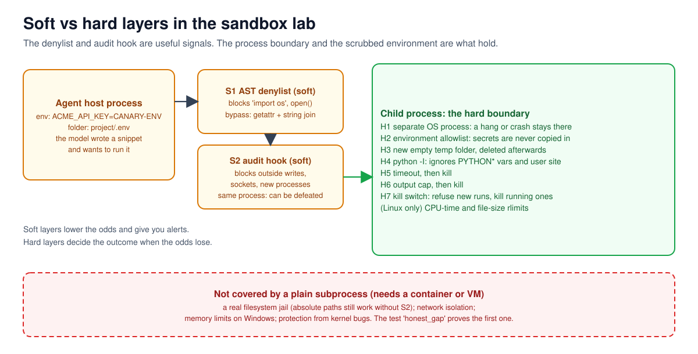
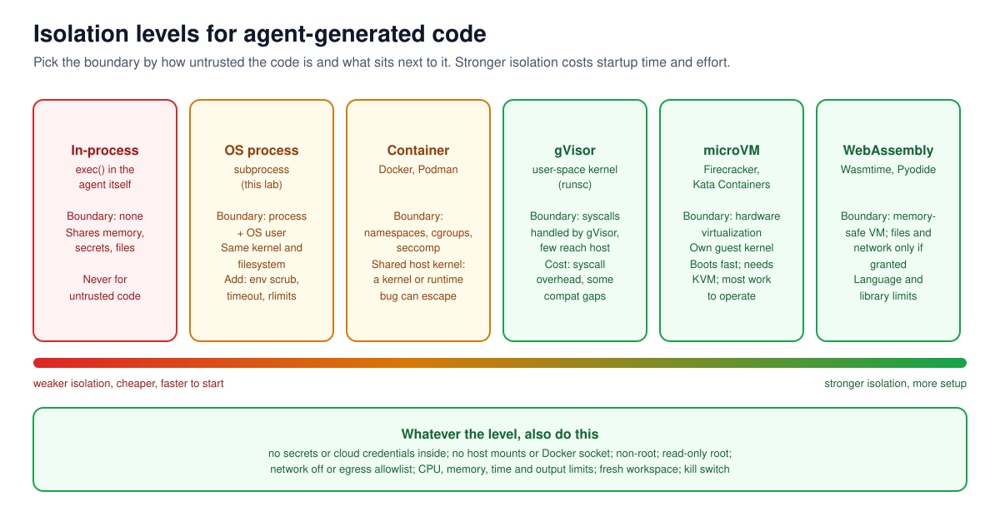

# Sandboxing Agent Code Execution

> **Module:** 05 · Agentic AI Security · **Week:** 20 · **Time:** ~10 hours
> **You will:** steal a secret from a "safe" code runner that relies on a denylist, then run the same snippets in a process sandbox with a scrubbed environment, an empty temporary folder, time and output limits and a kill switch, and prove which layers really hold, including where a plain subprocess stops being enough.

| | |
|---|---|
| **Prerequisites** | [Agent permissions](../permissions/) (budgets, kill switch idea); basic processes and environment variables |
| **Lab** | [`lab/`](lab/): runs offline on Windows and Linux, standard library only, benign snippets |
| **Maps to** | OWASP LLM05:2025 Improper Output Handling · LLM06:2025 Excessive Agency · OWASP *Agentic AI – Threats and Mitigations* (unexpected code execution) · CIS Docker / Kubernetes Benchmarks |

---

## 1. Why this matters

Coding agents, data-analysis agents and "computer use" agents run code or shell commands that a model wrote. That code is **untrusted output**: it was shaped by the user, by retrieved content and possibly by an attacker. If it runs next to your secrets, your files or your network, prompt injection becomes remote code execution.

Public examples:

- **2023, LangChain:** early chains such as `LLMMathChain` and `PALChain` executed model-generated Python. Researchers showed that prompt injection turned them into code execution, and several of these chains were moved to the separate `langchain_experimental` package with warnings.
- **2024, Vanna.AI (CVE-2024-5565):** JFrog showed that a prompt injection in this text-to-SQL library's chart feature could make it run arbitrary Python, because generated plotting code was executed directly.
- **2019, runc (CVE-2019-5736)** and **2024, runc "Leaky Vessels" (CVE-2024-21626):** container-runtime bugs that allowed escape from a container to the host. Containers share the host kernel and runtime; they are a boundary, not a wall.
- **2025, Replit AI agent:** an agent deleted a production database during a code freeze. Isolation is not only about attackers: it is also about a confused agent and your ability to **roll back**.
- **Python's own docs (PEP 578)** say audit hooks are *not* a sandbox: code running in the same process can get around them. The lab proves the same point about denylists.

---

## 2. Understand it

### 2.1 The root cause in one sentence

Model-generated code runs with **the agent's own privileges, environment and network**, so any successful injection inherits everything the agent can reach.

### 2.2 What untrusted code will try (benign versions are in the lab)

| Goal | Example | Lab snippet |
|---|---|---|
| Steal secrets from environment variables | `os.environ["API_KEY"]` | `read_env_obvious`, `read_env_bypass` |
| Steal secrets from files | read `.env`, `~/.aws/credentials`, SSH keys | `read_project_dotenv` |
| Change files outside its task | overwrite code, plant a backdoor, delete data | `write_outside_workdir` |
| Start other programs | shells, downloaders, miners | `spawn_process` |
| Exhaust resources | infinite loop, huge output, memory or disk fill, fork bomb | `infinite_loop`, `huge_output` |
| Reach the network | exfiltrate data, scan internal hosts, call cloud metadata (`169.254.169.254`) | `NETWORK_SNIPPET` (test only) |

### 2.3 Soft vs hard layers



- A **soft layer** inspects or guards code *in the same trust domain* as the code it guards. Example: an AST denylist (it reads source text; attackers build names at run time with `getattr(__builtins__, '__imp' + 'ort__')`), or an audit hook in the same process.
- A **hard layer** puts a boundary the code *cannot reach*: a separate process that never received the secret, a folder it cannot see, a kernel it does not share, a network it is not connected to.

Soft layers are still useful: they block lazy attacks and produce **alerts** (someone tried `import os`). But your security claim must rest on hard layers.

### 2.4 Isolation levels and trade-offs



| Level | Boundary | Strength | Cost | Use when |
|---|---|---|---|---|
| In-process `exec()` | none | none | none | Never for untrusted code |
| OS process (this lab) | process, OS user | Stops inherited secrets and hangs; **not** a filesystem or network jail | very low | Local tools; first layer inside a container |
| Container (Docker, Podman) | namespaces, cgroups, seccomp, capabilities | Good if hardened; shares the host kernel | low | Most server-side code tools, with hardening |
| gVisor (`runsc`) | user-space kernel intercepts system calls | Much smaller host-kernel exposure | syscall overhead, some compatibility gaps | Multi-tenant untrusted code |
| microVM (Firecracker, Kata Containers) | hardware virtualization, own guest kernel | Strong; AWS built Firecracker for Lambda and Fargate | needs KVM; more to operate | Untrusted code from many tenants |
| WebAssembly (Wasmtime, Pyodide) | memory-safe VM; files/network only if granted (WASI) | Strong, capability-based | language and library limits | Small, pure computations; browser-side |

Choose by asking: *how untrusted is the code, what sits next to it, and how many tenants share the host?*

### 2.5 The controls every sandbox needs, whatever the level

| Area | Control |
|---|---|
| **Secrets** | Scrubbed environment from an **allowlist**; no cloud credentials, no SSH agent, no Docker socket, no metadata endpoint |
| **Filesystem** | Fresh empty workspace; read-only root; no host mounts (or read-only, specific ones); delete afterwards |
| **Network** | Off by default (`--network none`); if needed, an egress proxy with a domain allowlist; block internal ranges and `169.254.169.254` |
| **Privileges** | Non-root user, drop all Linux capabilities, `no-new-privileges`, seccomp profile |
| **Resources** | Wall-clock timeout, CPU, memory, process count (`pids-limit`), file size, output size |
| **Lifecycle** | One sandbox per task (or session); destroy after; never reuse between tenants |
| **Control** | Kill switch that stops running sandboxes and refuses new ones; all runs logged with user, agent, code hash, result |

**Platform notes.** Linux offers `rlimit` (used by the lab when available), cgroups, namespaces, seccomp, and tools like *bubblewrap* and *nsjail*. Windows offers Job Objects (limits on CPU, memory, process count), AppContainers and Windows Sandbox; none are in Python's standard library. The `resource` module does not exist on Windows, which is why the lab's portable limits are a timeout and an output cap. **For memory limits and a real filesystem/network jail, use a container or VM.**

### 2.6 Kill switch and rollback

- **Kill switch:** one control, owned by humans (and automated monitors), that (1) refuses new runs, (2) kills running ones, (3) revokes the agent's tokens (see [agent identity](../agent-identity/)). Test it regularly, like a fire drill.
- **Rollback by design:** ephemeral workspaces (nothing persists unless explicitly exported), changes as reviewable diffs or pull requests, infrastructure changes through plan/approve/apply, snapshots or checkpoints before risky steps, and backups the agent's identity cannot delete (retention locks). The question to ask before giving an agent any write access: *"How do we undo this, and have we tested it?"*

---

## 3. Defend it

| Layer | Control | Type | What it buys you |
|---|---|---|---|
| S1 | AST denylist on the code | Soft | Catches lazy attempts; creates alerts |
| S2 | Audit-hook guard in the child (writes outside the work dir, sockets, new processes) | Soft | Blocks naive escapes; in-process, so defeatable |
| H1 | Separate OS process | Hard | Hangs and crashes stay out of the agent |
| H2 | Environment **allowlist** (scrubbed) | Hard | No inherited secrets to steal |
| H3 | Empty temp work dir, deleted after the run | Hard | No project files; nothing persists |
| H4 | `python -I` isolated mode (+ `-B`, `-X utf8`) | Hard | Ignores `PYTHON*` variables, user site-packages and the script's folder |
| H5 | Wall-clock timeout, then kill | Hard | Endless loops end |
| H6 | Output cap, then kill | Hard | No memory blow-up or context flooding |
| H7 | Kill switch | Hard | Humans can stop everything now |
| C1 | Container / gVisor / microVM with no network, read-only root, non-root, dropped capabilities, resource limits | Hard | Filesystem, network and kernel isolation that a subprocess cannot give |
| P1 | Logging of every run (user, agent, code hash, status) and alerting on S1/S2 hits | Process | You see attempts, not only successes |

### Design patterns worth knowing

- **Defense in depth:** a hardened process *inside* a hardened container *inside* a dedicated node pool or VM.
- **Credential-free sandbox:** if code needs data, the tool broker passes the data in (files or stdin), not the credentials to fetch it.
- **Outputs are untrusted too:** sandbox output goes back to the model and maybe to users. Cap it, and scan it for secrets and canaries.
- **Pre-warmed pools with one-shot use:** keep startup fast with a pool of fresh sandboxes, but never reuse one after a task.

### What does NOT work on its own

- **Denylists of dangerous names.** `test_denylist_misses_runtime_built_names` shows four bypasses with simple string joins.
- **"Run as subprocess" without scrubbing the environment.** `test_without_env_scrubbing_the_secret_leaks`.
- **A subprocess as a filesystem jail.** `test_honest_gap_process_boundary_alone_does_not_stop_absolute_path_writes` shows it is not.
- **A privileged container, or one with the Docker socket or host home directory mounted.** That is the host with extra steps.
- **Asking the model to "write safe code".** The code is shaped by whoever controls the model's input.

---

## 4. Hands-on lab

**Scenario:** ACME's data agent writes small Python snippets to answer questions. The agent host has `ACME_API_KEY` in its environment and a `.env` file in its project folder (both canaries). The current runner rejects code that mentions `os`, `open`, `eval` and similar names, and runs everything else with `python -c` in the project folder.

### Setup (once for the whole repo)

```powershell
python -m venv .venv
.venv\Scripts\Activate.ps1
python -m pip install -e ".[dev]"
```

### Step 1: Run the scorecard

```powershell
python 05-agent-security/sandboxing/lab/demo.py
```

Expected output (times vary by machine; the demo takes about 10 seconds because some cases wait for limits):

```text
case                     vulnerable         secure           secure-side evidence
----------------------------------------------------------------------------------------------------
read_env_obvious         blocked            blocked          denylist: import of os
read_env_bypass          SECRET LEAKED      ok               'no secret here' in 0.5s
read_project_dotenv      SECRET LEAKED      error            error: FileNotFoundError: [Errno 2] No such file or directo...
write_outside_workdir    WROTE OUTSIDE      blocked          guard: PermissionError: sandbox: write outside work dir blo...
spawn_process            PROCESS SPAWNED    blocked          guard: PermissionError: sandbox: starting processes is blocked
infinite_loop            HUNG (no limit)    timeout          timeout 1.5s
huge_output              20 MB OUTPUT       output_capped    output cap 64000 bytes
benign                   ok                 ok               'total 29' in 0.3s

Secure sandbox with BOTH soft layers off (denylist=False, fs_guard=False):
  read_env_obvious       -> ok             'no secret here'
  read_env_bypass        -> ok             'no secret here'
  read_project_dotenv    -> error          error: FileNotFoundError: [Errno 2] No such file or directory: '.env'

Kill switch: running snippet -> killed after 0.5s; next run -> refused
Ephemeral work dir: snippet created ['out.txt']; dir still exists afterwards: False
```

Look at row 1 and row 2 together. The denylist "worked" on row 1, and the team would have shipped it. Row 2 does the same thing with the names built at run time. In the second block, with **both soft layers off**, the secret still does not leak: the process never received it.

### Step 2: Read the vulnerable code

Open [`lab/vulnerable_runner.py`](lab/vulnerable_runner.py) and find the six `VULN` comments. Note that `lab_fuse` is not a control: it exists only so this lab never hangs your machine.

### Step 3: Read the secure code layer by layer

Open [`lab/secure_runner.py`](lab/secure_runner.py):

- `minimal_env()`: an allowlist. Why is a denylist of "secret-looking" variable names worse?
- `SubprocessSandbox.run`: the temp folder, the command line (`-B -X utf8 -I`), `Popen` with `env=`, the `pump` thread that enforces the output cap, and `wait(timeout=...)`.
- `BOOTSTRAP`: the audit hook. Read the comment that it is *soft*.
- `KillSwitch`: `trip()` kills registered processes; `run()` refuses when tripped.

```powershell
python -m pytest 05-agent-security/sandboxing -v
```

### Step 4: Break it yourself

Predict, then run:

1. `SubprocessSandbox(denylist=False, fs_guard=False, block_network=False)` with `read_env_bypass`. Which layer protects the secret? (`test_hard_layers_alone_protect_secrets`)
2. Add `scrub_env=False`. What leaks now, and which real-world mistake does this match?
3. Run `write_outside_workdir` with `fs_guard=False`. Where did the file go? Why can't a plain subprocess stop this, and what would (C1)?
4. Write a new snippet that the AST denylist does **not** catch but that still tries to read `ACME_API_KEY`, using a different trick from the lab's. Add it to [`lab/attacks.py`](lab/attacks.py) and confirm the secure sandbox still leaks nothing.
5. Set `max_output=100` and run `benign`. Then set `timeout=0.05`. What does a too-tight limit do to real users? How would you choose limits?
6. Read PEP 578's section on why audit hooks are not a sandbox. In two sentences, explain why S2 is marked soft even though it blocked three snippets.

### Step 5: Try a container (optional, needs Docker)

The same idea with a real filesystem and network boundary. From the repository root, with a snippet saved in `scratch\snippet.py`:

```powershell
docker run --rm --network none --read-only --cap-drop ALL --security-opt no-new-privileges `
  --pids-limit 64 --memory 256m --cpus 0.5 --user 65534:65534 `
  -v "${PWD}\scratch:/work:ro" python:3.12-slim python -I /work/snippet.py
```

Try `write_outside_workdir` (targeting `/etc/x`) and `NETWORK_SNIPPET` inside it. On Linux with gVisor installed, add `--runtime=runsc` and compare startup time. Record what each flag stops.

### Stretch goals

- **Output scanning:** after each run, scan `stdout` for canaries and secret patterns, and redact before returning it to the model.
- **Run log:** record user, agent, SHA-256 of the code, status, duration and events for every run, and a monitor that trips the kill switch after N guard hits in a minute.
- **Linux limits:** on Linux, add `RLIMIT_AS` (memory) and `RLIMIT_NPROC` in `_posix_limits` and write a test that is skipped on Windows.
- **Artifact export:** let the snippet write only to `out/` and copy just those files (size-capped) back to the caller before the work dir is deleted.

---

## 5. Real-world scenarios

*These are hypothetical composites of common failure patterns, not reports of specific incidents.*

**Scenario A: the chart that leaked the keys.**
A BI assistant generates Python to draw charts. A user uploads a CSV whose header contains an instruction. The generated code prints `os.environ`, and the response shows cloud keys to the user.
- *What went wrong:* model-generated code ran in the app's own process environment with real credentials; output went straight back to the user.
- *Investigate:* search run logs for code that touched `environ`, files or sockets; rotate every credential in that environment; check cloud logs for use of the keys from unknown IPs.
- *Fix:* sandbox with a scrubbed environment and no credentials; data passed in as files; network off; output scanning for secrets; alerts on soft-layer hits.

**Scenario B: the container that wasn't.**
A coding agent runs tests in Docker. To "make builds faster", someone mounted the Docker socket and the host's home directory into the container. An injected README instructs the agent to run a "setup" script.
- *What went wrong:* the Docker socket gives control of the host's Docker daemon (effectively root on the host); the home mount exposes SSH keys and cloud credentials.
- *Investigate:* list containers started from inside the sandbox; check the host for new containers, users, keys or cron jobs; review what the mounted directories contained.
- *Fix:* never mount the Docker socket; use a separate build service or rootless builders; no host home mounts; read-only root; drop capabilities; per-task disposable VMs for untrusted repositories.

**Scenario C: the cleanup job that cleaned too much.**
An ops agent can run shell commands on a staging server to free disk space. It misreads the task and deletes a shared directory used by another team's service.
- *What went wrong:* broad shell access on a shared host, no dry-run, no allowlist of commands or paths, no snapshot, no approval for deletes.
- *Investigate:* reconstruct commands from the run log; restore from snapshot; check other agents with similar access.
- *Fix:* replace raw shell with narrow tools (`clean_tmp(older_than_days)`); dry-run plus approval for deletes; snapshots before changes; per-task sandbox with only the target path mounted; tested kill switch.

---

## 6. Common mistakes

- Running generated code with `exec()` in the agent's own process "because it is just math".
- Relying on denylists, regexes or "the model promised to be safe".
- Inheriting the full environment into the sandbox (the most common real leak).
- Allowing network access "for pip install" and forgetting it is also an exfiltration channel. Pre-build images with the needed packages instead.
- Reusing one long-lived sandbox for many users or tasks.
- No timeouts, no output caps, no process limits.
- A kill switch that exists only in a runbook and has never been tested.

---

## 7. Interview preparation

<details><summary><b>Q1. Why does an agent that runs generated code need a sandbox, if we already defend against prompt injection?</b></summary>

Because prompt-injection defences are probabilistic and generated code is untrusted output by nature. The sandbox is the hard layer that limits impact when the model writes harmful code, whether from an attacker's injection, a user's request or a simple mistake. "Assume the model will be fooled" applies doubly when its output is executed.
</details>

<details><summary><b>Q2. Compare process, container, gVisor, microVM and WebAssembly isolation.</b></summary>

- **Process:** separate memory and environment, same kernel, filesystem and network. Cheap; not a jail.
- **Container:** namespaces, cgroups, seccomp, capabilities. Good when hardened, but shares the host kernel, so kernel/runtime bugs can escape.
- **gVisor:** a user-space kernel handles most system calls, shrinking the host-kernel attack surface. Some overhead and compatibility gaps.
- **microVM (Firecracker, Kata):** hardware virtualization with its own guest kernel. Strong isolation, fast boot, needs KVM and more operations work.
- **WebAssembly:** memory-safe VM with capability-based access (nothing unless granted). Strong, but limited languages and libraries.
Choose by threat (how untrusted, how many tenants) and by cost/latency.
</details>

<details><summary><b>Q3. Why are AST denylists or regex filters weak?</b></summary>

They inspect source text, but Python can build names at run time (`getattr`, string joins, `__builtins__`, encodings, `importlib`). There are endless equivalent spellings, and the filter runs in a different place from the code's real behaviour. They are useful as signals and to block lazy attempts, but the real control must be a boundary the code cannot reach.
</details>

<details><summary><b>Q4. Why use an environment allowlist instead of removing "secret" variables?</b></summary>

A denylist must guess every secret's name, and new ones appear all the time (`AWS_*`, `*_TOKEN`, custom names, connection strings). An allowlist starts from nothing and adds only what the runtime needs (on Windows, `SYSTEMROOT`), so unknown secrets are excluded by default. Same principle as default-deny firewall rules.
</details>

<details><summary><b>Q5. How would you control network egress for a code sandbox?</b></summary>

Default: no network at all. If a task needs it, route all traffic through an egress proxy with a domain allowlist and logging; block private IP ranges and the cloud metadata endpoint; deny raw sockets and DNS except through the proxy; set rate and size limits. For package installs, pre-build images instead of allowing internet access at run time.
</details>

<details><summary><b>Q6. What resource limits matter, and how do you enforce them on Linux vs Windows?</b></summary>

Wall-clock time, CPU time, memory, number of processes, file size and count, output size. Linux: `rlimit`, cgroups (memory, CPU, pids), container flags (`--memory`, `--cpus`, `--pids-limit`). Windows: Job Objects (via platform APIs), or run the code in a Linux container/VM. Portable in-process measures are limited to a timeout and reading output with a cap, which is what the lab does.
</details>

<details><summary><b>Q7. What does "rollback" mean for an agent, and how do you design for it?</b></summary>

Being able to undo what the agent changed. Design: ephemeral workspaces; changes as diffs/PRs instead of direct writes; plan → approve → apply for infrastructure; snapshots before risky steps; backups the agent cannot delete; idempotent, reversible tools where possible. Test the restore, not only the backup.
</details>

<details><summary><b>Q8. Design a kill switch for a fleet of agents.</b></summary>

A single control (API plus a big red button) that, per agent, per tenant or globally: refuses new sessions and tool calls, kills running sandboxes, revokes or disables the agents' tokens at the identity provider, and pauses queued jobs. It must not depend on the agent cooperating, must be fast (seconds), must be audited, must require humans to reset, and must be tested regularly. Automated monitors (spend spikes, guard hits) can trip it too.
</details>

<details><summary><b>Q9. Scenario: your sandbox's audit hook blocked 300 file-write attempts outside the work dir in one hour. What do you do?</b></summary>

Treat it as an active attack or a broken prompt. Identify the user, agent and sessions; look at the code hashes and the inputs that led to them (often a poisoned document); trip the kill switch for that agent or tenant if the volume is unusual; check that no hard layer was bypassed (no secrets in output, nothing written by other paths); remove the source content; add the payload to regression tests. The soft layer did its job as a **signal**.
</details>

<details><summary><b>Q10. Is a Docker container a security boundary?</b></summary>

A useful one when hardened (non-root, dropped capabilities, seccomp, read-only root, no host mounts, no Docker socket, resource limits, no network), but it shares the host kernel and runtime, and escapes have happened (for example runc CVE-2019-5736 and CVE-2024-21626). For untrusted multi-tenant code, add gVisor or microVMs, keep hosts patched, and isolate tenants onto separate nodes.
</details>

<details><summary><b>Q11. What is the risk of sandbox output, and how do you handle it?</b></summary>

Output flows back to the model and possibly users and other systems. It can contain secrets (if any leaked), huge data that floods context and cost, or new injection text that steers the next step. Cap size, scan for secrets and canaries, treat it as untrusted content (taint the session), and render it safely (no HTML/markdown execution).
</details>

<details><summary><b>Q12. A developer wants to give the coding agent network access so it can `pip install` anything. Your answer?</b></summary>

Not at run time. Pre-build images with approved, pinned, scanned dependencies. If dynamic installs are essential, allow only a private package mirror through an egress proxy, with hash-pinned requirements and logging. Open internet access turns every injection into an exfiltration and a supply-chain risk.
</details>

<details><summary><b>Q13. Explain to an executive why we need sandboxes for AI coding tools.</b></summary>

"Our AI tools write and run small programs. Those programs can be influenced by anyone who can get text in front of the AI. So we run them in a sealed, disposable room with no keys, no access to our files or network, and a timer, and we have a switch that shuts every room down at once. If something goes wrong, it happens in the room, not in our systems."
</details>

---

## 8. Checklist (definition of done)

- [ ] I can explain soft vs hard layers and place each sandbox control in the right column.
- [ ] `python -m pytest 05-agent-security/sandboxing` passes on my machine.
- [ ] I wrote one new denylist bypass snippet and proved the secure sandbox still leaks nothing.
- [ ] I ran the optional Docker step, or wrote down which flags I would use and what each one stops.
- [ ] Week 20 journal entry: a sandbox design for a coding agent (isolation level, network, secrets, limits, kill switch, rollback) and the Phase 5 gate (see the [module README](../README.md)).

## 9. References

- OWASP Top 10 for LLM Applications 2025, LLM05:2025 Improper Output Handling: https://genai.owasp.org/llmrisk/llm052025-improper-output-handling/
- OWASP Top 10 for LLM Applications 2025, LLM06:2025 Excessive Agency: https://genai.owasp.org/llmrisk/llm062025-excessive-agency/
- OWASP GenAI Security Project, *Agentic AI – Threats and Mitigations* (2025): https://genai.owasp.org/resource/agentic-ai-threats-and-mitigations/
- PEP 578, *Python Runtime Audit Hooks*: https://peps.python.org/pep-0578/
- Python docs, command-line option `-I` (isolated mode): https://docs.python.org/3/using/cmdline.html#cmdoption-I
- gVisor: https://gvisor.dev/ · Firecracker: https://firecracker-microvm.github.io/ · Kata Containers: https://katacontainers.io/ · Wasmtime: https://wasmtime.dev/
- Docker security documentation: https://docs.docker.com/engine/security/
- JFrog, Vanna.AI prompt injection to RCE (CVE-2024-5565): https://jfrog.com/blog/prompt-injection-attack-code-execution-in-vanna-ai-cve-2024-5565/
- NVD, CVE-2019-5736 (runc): https://nvd.nist.gov/vuln/detail/CVE-2019-5736 · CVE-2024-21626 (runc): https://nvd.nist.gov/vuln/detail/CVE-2024-21626
- CIS Docker Benchmark: https://www.cisecurity.org/benchmark/docker
