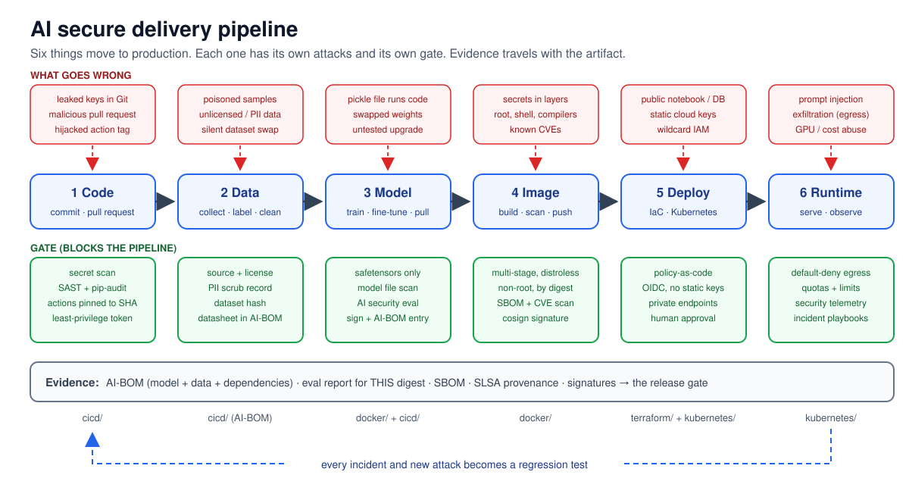
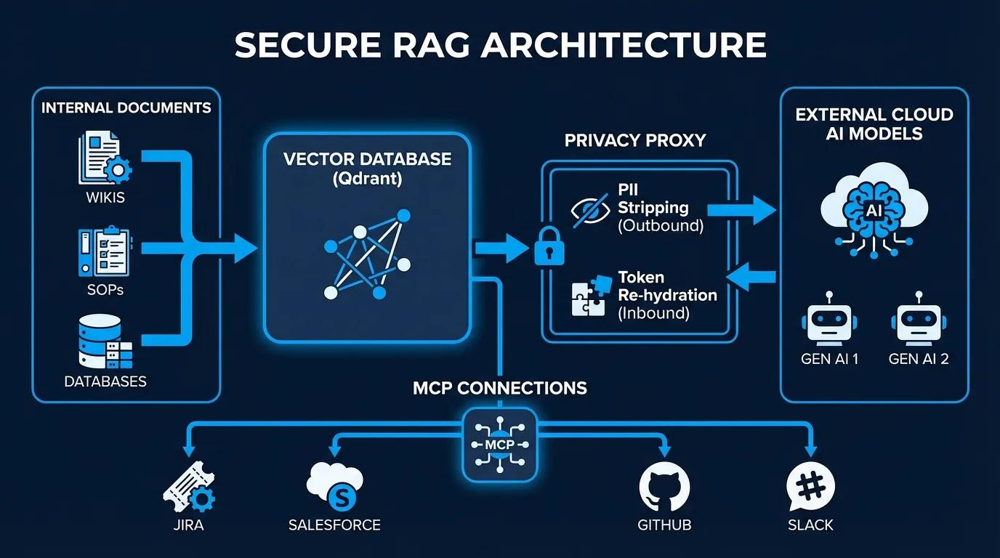

# Module 06 · AI DevSecOps: Secure Delivery of AI Systems

> **Weeks:** 21–24 · **Time:** ~45 hours · **Outcome:** you can add repeatable, testable security gates to the way AI applications, models and their infrastructure are built and shipped, and you can explain each gate in an interview.

## What and why

Modules 02–05 taught you to secure an AI application's *behavior*: prompts, retrieval, tools and agents. This module secures the **path to production**: the infrastructure code, the container image, the model file, the cluster and the pipeline that ships all of them.

Why it deserves its own module:

- **The weakest point is often not the model.** Public buckets, open AI compute ports, keys in images and over-powered CI tokens have caused more real AI incidents than clever model attacks (see the incidents in each lesson).
- **AI adds new artifacts with their own supply chain.** Model weights can execute code (pickle). Datasets carry licenses and personal data. Behavior can change with no code change. Your pipeline must track and test all of that.
- **Controls only count if they are automatic.** A checklist in a wiki doesn't stop a release. A failing pipeline step does.

Every lesson follows the same pattern: **insecure configuration → a Python policy checker with rule IDs → hardened configuration → tests that prove each rule catches a specific exposure.** Real tools (Checkov, Trivy, hadolint, ModelScan, kube-linter, zizmor, cosign) are optional steps, never required.

## Learning path

| # | Lesson | Weeks | You build | Rules |
|---|---|---|---|---|
| 1 | [Secure IaC for AI infrastructure (Terraform)](terraform/) | 21–22 | A policy checker over `terraform show -json` plans, with expiring waivers | TF-AI-001 … 060 (17) |
| 2 | [Secure model-serving images and model files (Docker)](docker/) | 23 | A Dockerfile linter and a pickle scanner that never loads the file | DF-001 … 012 (12) + model scan |
| 3 | [Hardened model serving on Kubernetes](kubernetes/) | 23 | A manifest checker: PSS, network isolation, workload identity, GPU pools | K8S-001 … 017 (17) |
| 4 | [Secure AI delivery pipelines (CI/CD)](cicd/) | 24 | A GitHub Actions linter and an AI release gate over an AI-BOM and eval evidence | GHA-001 … 011 (11) + GATE-001 … 010 |

Week mapping from the [36-week plan](../00-program/36-week-plan.md): week 21 = secure AI SDLC and design-time gates (this page + Terraform); week 22 = model/dataset provenance and artifacts (Terraform artifact storage, the AI-BOM in [CI/CD](cicd/), model files in [Docker](docker/)); week 23 = containers, Kubernetes, secrets, network and workload identity; week 24 = CI/CD, adversarial testing gates, telemetry and incident response (Phase 6 gate).

Run every lab test in the module:

```powershell
python -m pytest 06-ai-devsecops
```

Expected: `123 passed`.

## Module architecture



Six things move to production, and each has its own gate:

| Stage | Main risks | Gate | Lesson |
|---|---|---|---|
| **Code** | Leaked secrets, malicious PRs, hijacked actions, script injection | Secret scan, SAST, dependency audit, pinned actions, least-privilege tokens | [CI/CD](cicd/) |
| **Data** | Poisoning, unlicensed data, PII | Provenance, license, PII-scrub record, dataset hash in the AI-BOM | [CI/CD](cicd/) |
| **Model** | Pickle code execution, swapped weights, untested upgrades | safetensors only, model scan, AI eval bound to the digest, signature | [Docker](docker/), [CI/CD](cicd/) |
| **Image** | Secrets in layers, root, big attack surface, CVEs | Multi-stage distroless, non-root, digest-pinned, SBOM, signed | [Docker](docker/) |
| **Deploy** | Public endpoints, static keys, wildcard IAM, privileged pods | Policy as code on plans and manifests, OIDC, private endpoints, admission control | [Terraform](terraform/), [Kubernetes](kubernetes/) |
| **Runtime** | Prompt injection with an exit path, exfiltration, GPU/cost abuse | Default-deny egress, quotas and limits, security telemetry, incident playbooks | [Kubernetes](kubernetes/), this page |

The enterprise view of the same ideas, used again in the capstone:



## Secure AI SDLC: the lifecycle gates

| Stage | Security activity | Evidence |
|---|---|---|
| Intake | Intended use, owner, users, data classes, risk tier | AI system intake record |
| Design | Threat model, data flow, trust boundaries, privacy review | Approved architecture ([Module 01](../01-ai-security-fundamentals/)) |
| Build | Secure coding, dependency and secret checks | CI reports |
| Model / data | Provenance, license, integrity, evaluation | Model and data inventory (AI-BOM) |
| Test | SAST, DAST, LLM / RAG / agent abuse tests | Test and eval reports |
| Release | Artifact integrity, policy approval, rollback plan | Release record, signatures, provenance |
| Operate | Monitoring, quotas, incident response | Dashboards, runbooks |
| Retire | Revoke access, delete or retain data, archive evidence | Decommission record |

### What to track for models and data (the AI-BOM)

- **Model:** identifier, provider, version or revision, **digest**, format, source/registry, license, base model.
- **Adaptation:** fine-tuning adapters (e.g. LoRA) and their training config.
- **Runtime:** tokenizer, inference runtime, framework and dependency versions.
- **Data:** dataset origin, license, collection method, classification, consent or legal basis, PII handling, snapshot hash.
- **Evaluation:** eval datasets, suites, results, and the model digest they ran on.
- **Storage:** artifact location, access policy, integrity verification.
- **Governance:** approvals and change history.

Threats this inventory helps with: malicious model files, compromised dependencies, poisoned datasets, unauthorized adapters and unreviewed model upgrades.

## Operate: telemetry and incident response (week 24)

**Security telemetry to collect** for every AI request (attributable, but redacted):

- principal and tenant IDs; correlation / request ID
- model, provider and version (or digest); prompt template version
- policy and guardrail decisions; authorization result
- retrieval source IDs (not the full documents)
- tool, MCP server and action identifiers; approval ID for human-approved actions
- token counts, cost and latency

**Avoid** logging raw prompts, full documents, bearer tokens or personal data by default. If you need samples for debugging, use a separate, access-controlled, short-retention store.

**Runtime controls:** request, token and cost quotas; per-tenant isolation; egress allowlists; secrets manager integration; workload identity; non-root hardened containers; resource limits and network policies; model/API version pinning with rollback; anomaly detection and security alerting.

**Incident playbooks to prepare and tabletop-test:**

| Scenario | First moves |
|---|---|
| Prompt injection with data exposure | Disable the affected tool/feature flag, preserve logs, identify affected tenants, add the payload to the regression suite |
| Unauthorized RAG retrieval (cross-tenant) | Block the index or filter, audit retrieval logs by tenant, notify per policy |
| MCP / tool credential compromise | Revoke tokens, rotate secrets, review tool-call logs for the window |
| Agent action outside scope | Kill switch, roll back the actions, tighten approval policy |
| Model supply-chain tampering | Stop deployments, compare digests with the AI-BOM, roll back to the last signed release, scan all model files |
| Runaway cost / denial of service | Enforce quotas, scale down, block abusive keys, review limits |
| Sensitive data in telemetry | Restrict access, purge per retention policy, fix redaction, assess notification duty |

Use the [AI incident playbook template](../00-program/templates/ai-incident-playbook.md).

## Key concepts glossary

| Term | Meaning |
|---|---|
| **DevSecOps** | Building security checks into the normal development and delivery flow, so they run automatically on every change |
| **Shift left** | Finding problems earlier (in the pull request) where they are cheaper to fix |
| **IaC** (Infrastructure as Code) | Describing cloud resources in files (Terraform, Bicep, CloudFormation) instead of clicking in a console |
| **Policy as code** | Security rules written as code (Python, Rego, CEL) and run automatically against plans, manifests or requests |
| **Terraform plan JSON** | The machine-readable output of `terraform show -json`: what will be created or changed, with final values |
| **Waiver** | A recorded, approved exception to a rule, with an owner, a reason and an expiry date |
| **CMEK** | Customer-managed encryption key: you control the key policy, rotation and audit |
| **Private endpoint** | A private network address for a cloud service, so traffic never uses the public internet |
| **Distroless image** | A container base with only the runtime your app needs: no shell, no package manager |
| **Image digest** | The content hash of an image (`@sha256:…`). Unlike a tag, it can't change |
| **Multi-stage build** | A Dockerfile with a build stage and a smaller final stage; only selected files are copied across |
| **Pickle** | Python's object serialization format. Loading it can run code |
| **safetensors** | A data-only format for model weights: JSON header + raw bytes |
| **Pod Security Standards** | Kubernetes' three security levels for pods: privileged, baseline, restricted |
| **NetworkPolicy** | Kubernetes rules for which pods may talk to which, in and out |
| **Workload identity** | Giving a pod a short-lived cloud identity through its ServiceAccount instead of a stored key |
| **Admission control** | Checks inside the Kubernetes API server that accept or reject objects before they are stored |
| **OIDC federation** | A CI job proves its identity with a short-lived signed token and gets temporary cloud credentials |
| **SBOM** | Software bill of materials: the list of packages in an artifact |
| **AI-BOM / ML-BOM** | A bill of materials for models and datasets: digests, sources, licenses, model cards |
| **SLSA** | Supply-chain Levels for Software Artifacts: a framework for build integrity and provenance |
| **Provenance** | Signed metadata saying how, where and from what source an artifact was built |
| **Sigstore / cosign** | Tools for signing and verifying artifacts, including keyless signing with OIDC identities |
| **Release gate** | An automated step that approves or blocks a release based on evidence |
| **Pwn request** | A privileged CI workflow that runs untrusted pull-request code |

## How the lessons connect

All four labs use the same fictional team, *support-llm*, so the pieces fit together:

1. **Terraform** builds the private platform: model bucket (CMEK, versioning), private model endpoint, private vector DB, and a CI role trusted through OIDC for *one* repo and environment (TF-AI-042).
2. **Docker** builds the model-server image that runs there. It only accepts safetensors weights (DF-011, `pickle_scan.py`) and runs non-root on a distroless base.
3. **Kubernetes** runs that image with PSS `restricted`, read-only FS, default-deny egress and workload identity, so the pod reads the model bucket from step 1 without a key (K8S-010).
4. **CI/CD** ties it together: the release workflow uses the OIDC role from step 1 (GHA-005), scans the model with the Docker lesson's scanner, re-runs the Module 02 prompt-injection suite, and the release gate checks that the eval ran on the exact model digest in the AI-BOM before the signed image is deployed by digest.

The same rule shows up at several layers on purpose: "no static cloud keys" is TF-AI-041, K8S-010 and GHA-005. Defense in depth means a mistake that slips past one checker is caught by the next.

## Module mini-project: the Phase 6 gate

**Goal:** a reproducible, gated delivery pipeline for your capstone (or for the prompt-injection app from Module 02).

Build, in your own repository:

1. **IaC** for the model store and endpoint (any cloud, or plan-only), checked by the Terraform policy checker in CI, with at least one documented waiver that expires.
2. **A Dockerfile** for the app that passes the Docker linter, with weights in safetensors and a model scan step.
3. **Kubernetes manifests** that pass the Kubernetes checker (PSS restricted, default deny, workload identity, limits).
4. **A release workflow** that passes the workflow linter in `--release` mode, runs your AI security suites, writes JUnit, and calls the release gate with an AI-BOM you maintain.

**Prove it (record these in your journal):**

- Introduce a failing security test (for example, disable the tool policy) and show that the release is **blocked**.
- Change the model file (one byte) or the model version and show that the eval must re-run before release (GATE-001 / GATE-007).
- Show the dependency audit running, and the CI identity using OIDC with least privilege (no static cloud keys anywhere).

**Acceptance criteria:**

- [ ] CI runs security regressions on every PR and blocks on failure.
- [ ] Dependencies and model artifacts are inventoried (SBOM + AI-BOM).
- [ ] No static cloud keys where federation is available.
- [ ] Containers hardened (non-root, read-only FS, digest-pinned).
- [ ] Logs are attributable and redacted.
- [ ] One incident playbook from the table above was tabletop-tested, with notes.

## Interview questions (system design, cross-cutting)

<details><summary><b>Q1. Design the end-to-end secure delivery pipeline for a company's first production LLM feature.</b></summary>

Start with ownership and risk tier (intake), then a threat model. The pipeline has five parts:

- **PR stage**: secret scan, SAST, dependency audit, IaC and manifest policy checks, workflow linting, unit and authorization tests, and the AI security regression suite (injection, leakage, tool authorization) against a deterministic mock.
- **Model stage**: an approved source, a safetensors-only format, a model scan, a digest and license in the AI-BOM, and evals bound to the digest.
- **Build stage**: a distroless, digest-pinned image, an SBOM, a keyless signature and SLSA provenance.
- **Deploy stage**: a protected environment with reviewers, OIDC credentials, signature verification at admission, and a private endpoint behind an AI gateway.
- **Runtime**: default-deny egress, quotas, redacted security telemetry and incident playbooks.

Everything fails closed, and exceptions have owners and expiry dates.
</details>

<details><summary><b>Q2. A team wants to use an open-weights model from a public hub. What is your process?</b></summary>

1. Check the publisher's reputation and **pin the exact revision** (commit hash).
2. Check the license for the intended use.
3. Download inside an isolated, network-less job and verify the hash.
4. Refuse pickle formats, or convert them in the sandbox with a restricted unpickler. Prefer safetensors.
5. Scan the files, and review any `trust_remote_code` code as normal code.
6. Run the AI security and quality eval suites on that digest.
7. Record everything in the AI-BOM, store it in the private model registry, sign it, and from then on serve only from the registry.

Re-evaluate on every upgrade.
</details>

<details><summary><b>Q3. How do you make sure the model running in production is the one you tested?</b></summary>

Bind everything to digests. The eval report names the model digest. The AI-BOM names the same digest. The release gate hashes the actual file and compares all three. The model is either baked into an image that is signed and deployed by digest, or pulled from a versioned, write-protected store and verified against the AI-BOM before loading. Admission control only runs signed images, and runtime logs record the model digest per request, so drift is visible.
</details>

<details><summary><b>Q4. Where would you put policy checks: CI, admission, cloud guardrails or runtime? Why?</b></summary>

All four, with different jobs:

- **CI** gives fast feedback on the PR and is cheap to fix.
- **Admission control** (Kubernetes) and **cloud guardrails** (SCPs, Azure Policy, Org Policy) enforce the rules even when CI is bypassed: manual changes, compromised pipelines, other tools.
- **Runtime detection** (CSPM, audit logs, Falco-style rules) catches drift and anything new.

Ideally the rules come from one source, so developers see in CI what production will reject. One layer alone always has a bypass.
</details>

<details><summary><b>Q5. How do you remove long-lived secrets from an AI platform?</b></summary>

- **CI → cloud**: OIDC federation with subject-bound trust.
- **Pods → cloud**: workload identity, one role per workload.
- **Service → service**: mTLS or platform identity.
- **Signing**: keyless Sigstore.
- **Third-party AI API keys that must exist**: a secrets manager, injected at runtime through the CSI driver or External Secrets, never in images, manifests or Git. Rotate them automatically, scope them per environment, and monitor their use.
- **Guardrails**: lint rules (DF-004, K8S-009/010, GHA-005, TF-AI-041) plus secret scanning with push protection, to stop new ones appearing.
</details>

<details><summary><b>Q6. What makes AI DevSecOps different from normal DevSecOps?</b></summary>

- New artifacts with supply chains: model weights (some formats execute code), adapters, datasets with licenses and personal data.
- Behavior that changes without code changes: model versions, prompts, tools, retrieval config, provider-side updates.
- Probabilistic testing: attack success rates, alongside deterministic tests of hard controls.
- New runtime risks: prompt injection with tools and egress, GPU cost abuse.
- New evidence: AI-BOMs, model cards and eval reports bound to digests.

The base practices (pinning, least privilege, signing, policy as code) are the same, applied to these new things.
</details>

<details><summary><b>Q7. Your GPU inference cluster is shared by three product teams. Design the isolation.</b></summary>

- **Per team**: a namespace with PSS restricted, a ResourceQuota on CPU, memory and `nvidia.com/gpu`, a LimitRange, a default-deny NetworkPolicy, its own ServiceAccounts and a workload-identity role.
- **Nodes**: dedicated tainted GPU node pools per sensitivity level. Notebooks and training that load third-party models never share nodes with production inference.
- **GPU sharing**: whole GPUs or MIG between teams; time-slicing only inside one team.
- **Ingress**: an AI gateway with per-team keys and quotas.
- **Runtime**: patched drivers and container toolkit, plus runtime detection.
- **Untrusted tenants** (external customers): separate clusters.
</details>

<details><summary><b>Q8. Which metrics would you report to show the AI delivery pipeline is working?</b></summary>

- **Coverage**: percentage of AI services behind the full gate set; percentage of models with complete AI-BOM entries; percentage of workflows passing the linter.
- **Effectiveness**: releases blocked by each gate (and how many were true positives); time from a new attack technique to a regression test.
- **Hygiene**: number of active waivers and how many expired; number of static credentials left; median time to patch critical CVEs in model-serving images.
- **Outcome**: AI security incidents and their root-cause stage (code, data, model, image, deploy, runtime).
</details>

<details><summary><b>Q9. Scenario: a critical vulnerability is announced in a popular inference runtime you use. Walk through your response.</b></summary>

1. Use the SBOMs and AI-BOMs to find every image and service running the affected version. This is why you need inventories.
2. Assess exploitability: is the vulnerable path reachable, and from where? Network policy and private endpoints may reduce urgency, but don't assume.
3. Patch through the normal pipeline: bump the version, re-run all gates including the AI eval suite (runtimes can change model behavior), sign and deploy by digest.
4. If there is no patch yet, mitigate: tighten ingress, add a WAF or gateway rule, or disable the feature.
5. Check logs for exploitation during the window.
6. Record the timeline and update the playbook.
</details>

<details><summary><b>Q10. Explain to a CTO why the AI release gate is worth the extra minutes in every pipeline run.</b></summary>

"Every release of our AI is a new piece of software we didn't fully write: a model trained on data we didn't fully see, built from packages and tools we don't control. The gate takes a few minutes to prove four things automatically: it's exactly the model we tested, it passed our security tests, we have the rights to use it, and it came from a trusted source. Without that, one bad file or one skipped test can leak customer data or take the product down, and we couldn't show auditors that we checked. A few minutes per release is cheap insurance, and it lets teams ship *faster* because approvals stop being manual."
</details>

## References

- NIST SP 800-218, *Secure Software Development Framework (SSDF)*: https://csrc.nist.gov/pubs/sp/800/218/final
- NIST SP 800-218A, *SSDF Community Profile for Generative AI and Dual-Use Foundation Models* (2024): https://csrc.nist.gov/pubs/sp/800/218/a/final
- NIST AI RMF 1.0 and the Generative AI Profile (NIST AI 600-1): https://www.nist.gov/itl/ai-risk-management-framework
- OWASP Top 10 for LLM Applications 2025: https://genai.owasp.org/llm-top-10/
- OWASP Top 10 CI/CD Security Risks: https://owasp.org/www-project-top-10-ci-cd-security-risks/
- SLSA: https://slsa.dev/ · Sigstore: https://www.sigstore.dev/ · CycloneDX ML-BOM: https://cyclonedx.org/capabilities/mlbom/
- NIST SP 800-190, *Application Container Security Guide*: https://csrc.nist.gov/pubs/sp/800/190/final
- Kubernetes Pod Security Standards: https://kubernetes.io/docs/concepts/security/pod-security-standards/
- MITRE ATLAS (AML.T0010 ML Supply Chain Compromise): https://atlas.mitre.org/
- Lesson-specific references are at the end of each lesson.
