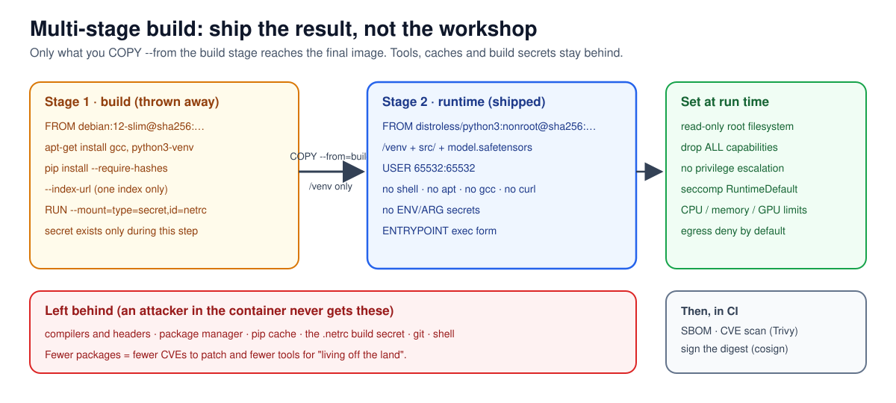
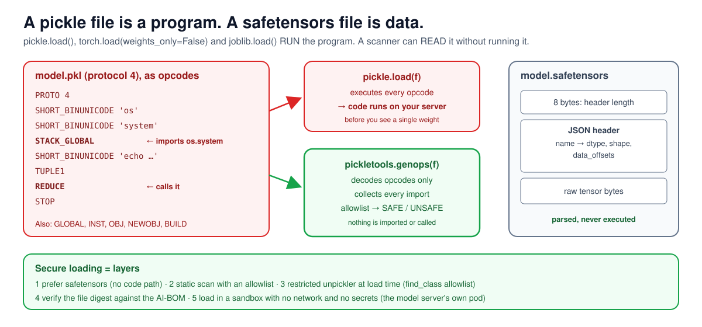

# Secure Model-Serving Images and Model Files (Docker)

> **Module:** 06 · AI DevSecOps · **Week:** 23 · **Time:** ~10 hours
> **You will:** lint a model-serving Dockerfile with 12 rules, rebuild it as a pinned, non-root, multi-stage distroless image, and build a pickle scanner that finds code execution in model files **without ever loading them**.

| | |
|---|---|
| **Prerequisites** | Docker basics (`FROM`, `RUN`, `COPY`, layers); Python; [Terraform lesson](../terraform/) helps but is not required |
| **Lab** | [`lab/`](lab/): runs offline, no Docker install needed |
| **Maps to** | OWASP LLM04:2026 Supply Chain [LLM03:2025] · OWASP LLM05:2026 Data and Model Poisoning [LLM04:2025] · OWASP Agentic ASI04 Agentic Supply Chain, ASI05 Unexpected Code Execution (pickle loading) · MITRE ATLAS AML.T0010 (ML Supply Chain Compromise) · NIST SP 800-190 (container security) · CIS Docker Benchmark |

---

## 1. Why this matters

A model server is two things you download from strangers: **a container image** and **a model file**. Both can carry code.

- **2022, PyTorch nightly `torchtriton`:** a malicious package with the same name as an internal PyTorch dependency was uploaded to PyPI. Because nightly installs used an extra index, pip picked the public one, and it collected data from the machines that installed it. This is *dependency confusion*.
- **2024, JFrog:** researchers reported malicious models on Hugging Face whose pickle files ran code as soon as they were loaded; one opened a reverse shell to an external host.
- **2025, ReversingLabs "nullifAI":** models on Hugging Face used deliberately *broken* pickle files (and a different compression format) so a popular scanner missed the payload. The payload still ran on load, because pickle executes opcodes in order and only fails later.
- **2024, "Leaky Vessels" (Snyk):** a runc bug (CVE-2024-21626) allowed escape from a container to the host. Running as non-root, with dropped capabilities and a patched runtime, shrinks what such a bug can do.
- **2023, academic study of public images (Dahlmanns et al.):** scanning images on public registries found many with private keys and API secrets baked into layers.

The pattern: **anything in the image runs with the server's identity, and a pickle model file *is* code.**

---

## 2. Understand it

### 2.1 Image layers never forget

Each Dockerfile instruction makes a layer. Layers are stacked, and **a later layer cannot remove data from an earlier one**: it can only hide it.

```dockerfile
COPY .env /app/.env      # layer 5: the file is stored here forever
RUN rm /app/.env         # layer 6: hides it; anyone with the image can still extract layer 5
```

`ARG` and `ENV` values are also stored in the image config and history (`docker history --no-trunc <image>`). The fix for build-time secrets is a **BuildKit secret mount**: the secret exists only during one `RUN` step and never touches a layer.

```dockerfile
RUN --mount=type=secret,id=netrc,target=/root/.netrc pip install ...
```

### 2.2 Multi-stage builds and minimal bases



| Choice | Why it matters for a model server |
|---|---|
| **Pin the base by digest** (`image@sha256:…`) | A tag like `python:3.11` or `latest` can point to different content tomorrow. A digest can't. Let Renovate/Dependabot bump digests through PRs. |
| **Multi-stage build** | Compilers, headers, `git`, pip caches and build secrets stay in the build stage. Only `/venv`, your code and the weights are copied out. |
| **Distroless or minimal base** | No shell, no package manager, no `curl`. An attacker with code execution has far fewer tools ("living off the land"). Fewer packages = fewer CVEs. |
| **Non-root numeric `USER`** | Kubernetes `runAsNonRoot` can only verify a numeric UID. Root inside a container is one kernel or runtime bug away from root on the node. |
| **Hash-checked dependencies, one index** | `pip install --require-hashes -r requirements.lock` + `--index-url` to a single trusted mirror stops tampered packages and dependency confusion (`--extra-index-url` is what bit PyTorch). |
| **Read-only root filesystem** (set at run time) | Malware can't write tools or modify code. Give the app an `emptyDir`/tmpfs for `/tmp` only. |

### 2.3 Model files: pickle is a program



Python's pickle format is a list of instructions (opcodes) for a small stack machine. Two kinds of opcodes make it dangerous:

- **`GLOBAL` / `STACK_GLOBAL`**: import any object by name, such as `os.system` or `builtins.exec`.
- **`REDUCE`** (and `INST`, `OBJ`, `NEWOBJ`): call that object with arguments.

`pickle.load()` executes these instructions. So do `torch.load(..., weights_only=False)`, `joblib.load()` and `numpy.load(..., allow_pickle=True)`. **Loading an untrusted model file = running untrusted code.**

`pickletools.genops()` from the standard library only *decodes* the opcodes. It never imports or calls anything. That makes a safe scanner possible: walk the opcodes, collect every import, compare with an **allowlist**.

| Format | Can it run code on load? | Notes |
|---|---|---|
| `.pkl`, `.pickle`, `.joblib` | **Yes** | Raw pickle |
| `.pt`, `.pth`, `.bin`, `.ckpt` (PyTorch) | **Yes**, unless loaded with `weights_only=True` | A zip archive with `data.pkl` inside. PyTorch 2.6 made `weights_only=True` the default; a 2025 advisory showed it could be bypassed in older versions, so keep PyTorch patched |
| `.npy` / `.npz` | Only with `allow_pickle=True` | Keep the default (`False`) |
| Keras `.h5` / `.keras` | Lambda layers can carry code | Keras 3 loads `.keras` files in safe mode by default; don't turn it off for untrusted files |
| ONNX, GGUF | No Python code by design | Still parsed by native code: keep the runtime patched |
| **`.safetensors`** | **No** | 8-byte length + JSON header + raw bytes. Nothing to execute |
| Hugging Face `trust_remote_code=True` | **Yes** | Downloads and runs Python from the model repo. Treat it like installing a package |

### 2.4 The Dockerfile rules in the lab

| Rule | Sev | What it catches |
|---|---|---|
| DF-001 | HIGH | Base image not pinned by `@sha256:` digest |
| DF-002 | MEDIUM | `latest` tag or no tag |
| DF-003 | HIGH | Final stage has no `USER`, or `USER root`/`0` |
| DF-004 | CRITICAL | Secret-looking `ENV`/`ARG` (by name or by value shape) |
| DF-005 | HIGH | Credential file copied in (`.env`, `*.pem`, `id_rsa`, `.netrc`, …) |
| DF-006 | MEDIUM | `ADD https://…` without `--checksum` |
| DF-007 | HIGH | `curl … \| sh` |
| DF-008 | MEDIUM | Compilers / git in the **final** stage |
| DF-009 | MEDIUM | Unpinned `pip install`, or `-r` without `--require-hashes` |
| DF-010 | HIGH | `--extra-index-url` (dependency confusion) |
| DF-011 | MEDIUM | Pickle-format model file in the image |
| DF-012 | MEDIUM | `COPY .` with no `.dockerignore` |

---

## 3. Defend it

| Layer | Control | Type | What it buys you |
|---|---|---|---|
| L1 | **Minimal, pinned, multi-stage image**; non-root numeric user | Hard | Less to exploit, less to patch, no root |
| L2 | **No secrets in the image**: BuildKit secret mounts at build, runtime secrets from the platform | Hard | Stolen image ≠ stolen keys |
| L3 | **Data-only model formats** (safetensors); refuse pickle in production | **Hard** | No code path on load |
| L4 | **Static model scan** with an allowlist (this lab, ModelScan, Hugging Face's scanners) | Hard-ish | Catches malicious pickles before they ship; can be evaded, so not alone |
| L5 | **Restricted loading**: `weights_only=True`, or a restricted unpickler with a `find_class` allowlist | **Hard** | Enforcement at the moment of loading, even if the scan was fooled |
| L6 | **Integrity**: model digest in the AI-BOM, checked before load; image signed and verified by digest | Hard | A swapped file or image is refused |
| L7 | **Runtime sandbox**: read-only FS, drop all capabilities, seccomp, no egress (see [Kubernetes](../kubernetes/)) | Hard | If code still runs, it can't do much or call home |
| L8 | **Image scanning + SBOM** in CI (Trivy, Grype, Syft), lint (hadolint) | Detect / Process | Known CVEs and bad patterns found early |

### Design patterns worth knowing

- **Convert once, in a sandbox.** If you must accept a pickle model, convert it to safetensors inside an isolated, network-less job, scan the result, and only ever ship the safetensors file.
- **Bake vs pull the model.** Baking weights into the image ties model and code to one signed digest (simple provenance). Pulling at startup keeps images small but needs a digest check against the AI-BOM before load. Both are fine if the integrity check exists.
- **Allowlist, not denylist.** The lab's `timeit.timeit` sample isn't on any denylist, but it executes a string of Python. An allowlist refuses it simply because it isn't approved.
- **Fail closed on parse errors.** A broken pickle stream is suspicious (nullifAI). Report what was found *before* the break, and refuse the file.

### What does NOT work on its own

- `RUN rm secret.txt` after `COPY secret.txt`. The secret is still in the earlier layer.
- A denylist of "bad" modules (`os`, `subprocess`). There are many other gadgets.
- Scanning only the top-level file. PyTorch `.pt` files are zip archives; scan every `.pkl` inside.
- "We only download from Hugging Face." Anyone can upload there. Trust specific, verified publishers and pin the exact revision (commit hash), then scan.
- Image scanning without a minimal base. You'll drown in CVEs for packages you never use.

---

## 4. Hands-on lab

**Scenario:** the *support-llm* team ships a FastAPI model server. Their Dockerfile "works", the model is a `pytorch_model.bin` downloaded during the build, and a `.pkl` intent classifier is copied in. You review the image and the model files.

| File | What it is |
|---|---|
| [`lab/vulnerable/Dockerfile`](lab/vulnerable/Dockerfile) | The risky image. Each `VULN` names a rule |
| [`lab/secure/Dockerfile`](lab/secure/Dockerfile) + [`.dockerignore`](lab/secure/.dockerignore) | Multi-stage, pinned (placeholder digests), non-root, distroless |
| [`lab/dockerfile_lint.py`](lab/dockerfile_lint.py) | The linter: 12 rules with IDs |
| [`lab/pickle_scan.py`](lab/pickle_scan.py) | Opcode scanner, safetensors validator, and the layered `safe_load_model()` |
| [`lab/vulnerable_loader.py`](lab/vulnerable_loader.py) | `pickle.load()` like many real servers do |
| [`lab/harmless_payload.py`](lab/harmless_payload.py) | The only payload that ever *runs*: it writes a canary file |
| [`lab/attacks.py`](lab/attacks.py) | Malicious-*style* pickle bytes. **Only scanned, never loaded** |

### Setup

From the repository root, with the virtual environment active (see the [main README](../../README.md)).

### Step 1: Run the scorecard

```powershell
python 06-ai-devsecops/docker/lab/demo.py
```

Expected output:

```text
rule    sev      title                                              vulnerable  secure
-------------------------------------------------------------------------------------
DF-001  HIGH     Base image not pinned by digest                    FAIL x1     ok
DF-002  MEDIUM   Base image uses 'latest' or no tag                 FAIL x1     ok
DF-003  HIGH     Final image runs as root                           FAIL x1     ok
DF-004  CRITICAL Secret in ENV or ARG                               FAIL x2     ok
DF-005  HIGH     Secret file copied into the image                  FAIL x1     ok
DF-006  MEDIUM   ADD downloads a remote URL without verification    FAIL x1     ok
DF-007  HIGH     Remote script piped to a shell                     FAIL x1     ok
DF-008  MEDIUM   Build tools in the final image                     FAIL x1     ok
DF-009  MEDIUM   Python packages not pinned / not hash-checked      FAIL x1     ok
DF-010  HIGH     Extra package index (dependency confusion)         FAIL x1     ok
DF-011  MEDIUM   Pickle-format model file in the image              FAIL x2     ok
DF-012  MEDIUM   Whole build context copied with no .dockerignore   FAIL x1     ok

model file                         scanner    vulnerable loader    secure loader
-------------------------------------------------------------------------------------
booby_trapped.pkl                  UNSAFE     CODE RAN             REFUSED
global_os_system.pkl               DANGEROUS  (never loaded)       REFUSED
stack_global_os_system.pkl         DANGEROUS  (never loaded)       REFUSED
memo_trick_os_system.pkl           DANGEROUS  (never loaded)       REFUSED
broken_stream_after_payload.pkl    DANGEROUS  (never loaded)       REFUSED
second_pickle_appended.pkl         DANGEROUS  (never loaded)       REFUSED
gadget_not_on_denylist.pkl         UNSAFE     (never loaded)       REFUSED
torch_style.pt                     DANGEROUS  (never loaded)       REFUSED
state_dict.pkl                     SAFE       loads                loads
support-llm-v3.safetensors         SAFE       n/a (not pickle)     loads

The secure loader was run with prefer_safetensors=False so you can see the scan layer work.
With the default (True) it refuses every pickle-based file before even scanning it.
```

`CODE RAN` means the vulnerable loader executed the harmless payload (it wrote a canary file) just by *loading* the model. The secure loader refused every non-SAFE file, and the benign files still load.

### Step 2: Lint the Dockerfiles

```powershell
python 06-ai-devsecops/docker/lab/dockerfile_lint.py 06-ai-devsecops/docker/lab/vulnerable/Dockerfile
```

```text
line   5  HIGH     DF-001  'python:latest' can change under you; pin it as image@sha256:<digest>
line   5  MEDIUM   DF-002  'python:latest' resolves to 'latest'
line   5  HIGH     DF-003  no USER in the final stage: the process runs as root (UID 0)
line   8  CRITICAL DF-004  ARG HF_TOKEN: values are kept in image metadata/history; use --mount=type=secret
line   9  CRITICAL DF-004  ENV OPENAI_API_KEY: values are kept in image metadata/history; use --mount=type=secret
line  14  MEDIUM   DF-008  ['build-essential', 'git'] ship to production; build in an earlier stage (multi-stage build)
line  17  HIGH     DF-007  curl | sh runs whatever the server sends; download, verify a checksum, then run
line  20  MEDIUM   DF-009  unpinned packages ['torch', 'transformers', 'fastapi', 'uvicorn']
line  20  HIGH     DF-010  pip may pick a public package with the same name as your internal one
line  23  MEDIUM   DF-006  use ADD --checksum=sha256:<hash> <url>, or download and verify in a build stage
line  23  MEDIUM   DF-011  'https://models.example/support-llm/v3/pytorch_model.bin' can run code when loaded; convert to safetensors and scan it
line  26  MEDIUM   DF-011  'weights/intent_classifier.pkl' can run code when loaded; convert to safetensors and scan it
line  29  HIGH     DF-005  '.env' looks like a credential file; it stays in a layer even if deleted later
line  33  MEDIUM   DF-012  COPY . copies .git, .env, notebooks and caches unless .dockerignore excludes them

FAIL: 14 finding(s), fail-on=HIGH
```

Then lint `lab/secure/Dockerfile`: it prints `PASS: 0 finding(s), fail-on=HIGH`. Read the secure file top to bottom and match each `FIX` to a rule. Notice that `gcc` is installed in stage 1 and DF-008 stays quiet: only the final stage ships.

### Step 3: Scan model files without loading them

Write the malicious-*style* samples to a scratch folder (they are only bytes; nothing is executed), then scan two of them:

```powershell
python -c "import sys,pathlib; sys.path.insert(0,'06-ai-devsecops/docker/lab'); import attacks; d=pathlib.Path('scratch-models'); d.mkdir(exist_ok=True); [(d/f'{k}.pkl').write_bytes(v) for k,v in attacks.MALICIOUS_STYLE.items()]"
python 06-ai-devsecops/docker/lab/pickle_scan.py scratch-models/memo_trick_os_system.pkl scratch-models/gadget_not_on_denylist.pkl scratch-models/broken_stream_after_payload.pkl
```

```text
DANGEROUS pickle       calls=1   scratch-models/memo_trick_os_system.pkl
          dangerous import: os.system
UNSAFE    pickle       calls=1   scratch-models/gadget_not_on_denylist.pkl
          not on allowlist: timeit.timeit
DANGEROUS pickle       calls=1   scratch-models/broken_stream_after_payload.pkl
          dangerous import: os.system
          error: scratch-models\broken_stream_after_payload.pkl: could not parse at byte 0+: at position 29, opcode b'\xff' unknown
```

Read [`lab/attacks.py`](lab/attacks.py) to see how each sample tries to evade a naive scanner (memo tricks, broken streams, a second pickle after `STOP`, a gadget not on the denylist). Delete `scratch-models/` when you're done.

### Step 4: Run the tests

```powershell
python -m pytest 06-ai-devsecops/docker -v
```

The key tests in `test_pickle_scan.py`:

- `test_loading_a_pickle_runs_code`: proves the risk with the harmless payload (canary file appears).
- `test_scanning_never_executes_the_payload`: the scanner sees the import, and the canary file does **not** appear.
- `test_restricted_unpickler_alone_blocks_the_payload`: scanning switched off, and load-time enforcement still holds.
- `test_with_every_layer_off_the_payload_runs`: why the layers exist.

### Step 5: Break it yourself

Predict, then run:

1. Remove `"collections.OrderedDict"` from `SAFE_GLOBALS`. Which test fails, and what does that tell you about allowlists and false positives?
2. In `pickle_scan.py`, delete the `MEMO_GET` branch. Which attack sample now resolves to the wrong name? Does the verdict still block it? (Look at the allowlist.)
3. Call `safe_load_model(path, prefer_safetensors=False, scan=False)` on the booby-trapped file. Which layer stops it?
4. In the secure Dockerfile, change the final `USER` to `root`. Then move `USER 65532:65532` into the build stage only. Does DF-003 catch both?
5. Add `RUN pip install --extra-index-url https://pypi.internal.example/simple fastapi==0.115.0` to the secure file. Which rule fires, and why is pinning the version not enough?

### Step 6: Real tools (optional)

None of these is needed for the tests.

```powershell
# hadolint: the standard Dockerfile linter
docker run --rm -i hadolint/hadolint < 06-ai-devsecops/docker/lab/vulnerable/Dockerfile

# Trivy: Dockerfile misconfiguration (and, for built images, CVEs + secrets)
trivy config 06-ai-devsecops/docker/lab/vulnerable

# ModelScan (Protect AI): scans pickle, PyTorch, Keras and other model formats
pip install modelscan
modelscan -p scratch-models/
```

To *build* the secure image for real, you need a `requirements.lock` with hashes, a `src/serve.py`, a model file, and real digests in place of the placeholders. Then run it like production would:

```powershell
docker build --secret id=netrc,src=$HOME/.netrc -t support-llm:dev 06-ai-devsecops/docker/lab/secure
docker run --rm --read-only --tmpfs /tmp --cap-drop ALL --security-opt no-new-privileges -p 8080:8080 support-llm:dev
```

### Stretch goals

- Add rule **DF-013**: `HEALTHCHECK` or `ENTRYPOINT` in shell form (`CMD foo bar`) in the final stage. Why does shell form matter for signal handling and for distroless images?
- Make the scanner understand **7z/gzip-wrapped** PyTorch archives (the nullifAI trick) or, simpler, mark any unrecognized archive format as `UNSAFE`.
- Write `convert_to_safetensors.py` that takes an allowlisted state-dict pickle (using the restricted unpickler) and writes safetensors with `write_safetensors()`.
- Add a digest check to `safe_load_model(path, expected_sha256=...)` and a test that a one-bit change is refused.

---

## 5. Real-world scenarios

**Scenario A: "it's just a fine-tuned model from the hub".**
A developer pulls `pytorch_model.bin` from a new account on a public model hub and loads it with `torch.load()` on an old PyTorch version. A day later an EDR alert shows an outbound connection from the inference pod.
- *What went wrong:* untrusted pickle loaded with full code execution, in a pod with internet egress and cloud credentials.
- *Investigate:* scan the file with `pickle_scan.py`/ModelScan (never load it again). List its imports. Check egress logs, the pod's cloud role activity in audit logs, and every other place the file was copied.
- *Fix:* rotate the pod's credentials. Require safetensors or `weights_only=True` on a patched PyTorch. Add the scan + AI-BOM digest gate in CI. Default-deny egress for model pods. Allow only verified publishers and pinned revisions.

**Scenario B: the API key in layer 7.**
A security researcher reports that your public container image contains a working OpenAI-style API key. Your Dockerfile has `RUN rm .env` at the end.
- *What went wrong:* `COPY .` included `.env` in an earlier layer; `rm` only hid it. There was no `.dockerignore`.
- *Investigate:* `docker history --no-trunc` and extract the layers (e.g. with `docker save` or dive) to confirm. Check the provider's usage logs for the key since the image was first pushed.
- *Fix:* revoke and rotate the key **first** (deleting the image does not un-leak it). Add a `.dockerignore` (allowlist style), BuildKit secrets, DF-004/005/012 in CI, and secret scanning on built images. Make images private unless they need to be public.

**Scenario C: the nightly build that installed the wrong package.**
CI builds a training image with `pip install --extra-index-url https://pypi.internal.example/simple acme-tokenizers`. A public package `acme-tokenizers` with a higher version appears on PyPI.
- *What went wrong:* dependency confusion. pip considers both indexes and can prefer the public, higher version. This is what happened with PyTorch nightly and `torchtriton`.
- *Investigate:* compare the installed version and hash with your internal registry; look at the package's install-time code; check which builds and machines installed it.
- *Fix:* a single `--index-url` that points to a proxy which serves internal names only from internal sources; `--require-hashes` lock files; reserve your internal names on public registries where practical.

---

## 6. Common mistakes

- Pinning the app's packages but not the base image (or the reverse).
- Using `USER appuser` (a name) instead of a numeric UID, so `runAsNonRoot` can't verify it.
- Believing `slim` = secure. Slim still has a shell, a package manager and a lot of packages.
- Scanning the image for CVEs but never scanning the **model file**, which is often the most dangerous artifact in it.
- Unpickling a "small test file" from a ticket or a chat message "just to see what's inside". Use `python -m pickletools file.pkl` to read it instead.
- Turning on `trust_remote_code=True` to make a model load, without reviewing the code it pulls.

---

## 7. Interview preparation

<details><summary><b>Q1. Why is loading a pickle file dangerous, in one minute?</b></summary>

Pickle is not a data format. It is a program for a small stack machine. The `GLOBAL`/`STACK_GLOBAL` opcodes import any Python object by name, and `REDUCE` calls it. `pickle.load()` runs that program, so a model file can call `os.system` or open a reverse shell before you ever see a weight. `torch.load(weights_only=False)`, `joblib.load()` and `numpy.load(allow_pickle=True)` have the same problem.
</details>

<details><summary><b>Q2. How can you inspect a pickle safely?</b></summary>

Don't unpickle it. Use `pickletools.genops()` (or `python -m pickletools file.pkl`), which only decodes opcodes. Collect every global the pickle would import, including ones built with `STACK_GLOBAL` from memoized strings, and compare them with an allowlist. Treat parse errors as suspicious, scan every `.pkl` inside zip-based formats, and do the whole thing in a sandbox anyway.
</details>

<details><summary><b>Q3. Why is safetensors safer?</b></summary>

A safetensors file is an 8-byte header length, a JSON header (tensor names, dtypes, shapes, byte offsets) and raw bytes. Loading it is parsing JSON and copying bytes. There is no instruction stream, no import and no call, so there's no code-execution path in the format itself. You still need integrity (digest, signature) because the *weights* could be backdoored. Safe format doesn't mean trustworthy model.
</details>

<details><summary><b>Q4. Scanner vs restricted unpickler: why both?</b></summary>

The scanner is static and runs in CI. It gives early, explainable results, but parser differences can fool it (the nullifAI case). A restricted unpickler (`find_class` allowlist, or `torch.load(weights_only=True)`) enforces the same allowlist at the moment of loading, inside the server. If one is evaded or skipped, the other still holds. The lab proves each one blocks the payload alone.
</details>

<details><summary><b>Q5. How do secrets end up in images, and how do you prevent it?</b></summary>

Through `COPY .` without a `.dockerignore`, `COPY .env`, `ENV API_KEY=…`, and `ARG TOKEN` used in `RUN`. Layers are immutable, so `rm` later doesn't help, and ARG/ENV show up in the image history. Prevention: allowlist-style `.dockerignore`, BuildKit `--mount=type=secret` for build-time secrets, runtime secrets injected by the platform, lint rules in CI, and secret scanning of built images. If one leaks: revoke first, then clean up.
</details>

<details><summary><b>Q6. What does a multi-stage build buy you for an AI image?</b></summary>

GPU and ML stacks often need compilers and headers to build wheels. Multi-stage builds keep those, plus pip caches and build secrets, in a throwaway stage. The final stage gets only the virtual environment, the code and the weights, on a minimal base. Result: smaller image, fewer CVEs, no tools for an attacker, and build secrets that never reach a layer.
</details>

<details><summary><b>Q7. Why pin base images by digest, and how do you keep them updated?</b></summary>

A tag is a movable pointer, so the same Dockerfile can build different images on different days. A digest is the content hash, so builds are reproducible and you can sign and verify exactly what you tested. To avoid stale images, a bot (Renovate, Dependabot) opens PRs with new digests, CI rebuilds and re-scans, and the normal review merges them.
</details>

<details><summary><b>Q8. Explain dependency confusion with an AI example.</b></summary>

When pip is given an internal index *and* public PyPI (`--extra-index-url`), it looks at both and may choose the public package if it has the same name and a higher version. In December 2022, PyTorch nightly users installed a malicious `torchtriton` from PyPI this way. Fixes: one index (a proxy that serves internal names only from internal sources), hash-locked requirements, and name reservation.
</details>

<details><summary><b>Q9. Should model weights be baked into the image or pulled at startup?</b></summary>

Both can be secure. Baking ties code and weights to one signed digest: simple provenance and rollback, but large images. Pulling keeps images small and lets you swap models without rebuilding, but the server must verify the file's digest against the AI-BOM (or a signature) before loading, and needs read access to a private model store. The insecure option is "pull whatever is at this URL and load it".
</details>

<details><summary><b>Q10. What runtime settings complete a hardened image?</b></summary>

Read-only root filesystem with a small writable `/tmp`; drop all Linux capabilities; `no-new-privileges` (`allowPrivilegeEscalation: false`); seccomp `RuntimeDefault`; a non-root UID; CPU/memory/GPU limits; no host mounts; default-deny egress. In Kubernetes these live in the pod `securityContext` and NetworkPolicy, and Pod Security Admission can enforce them.
</details>

<details><summary><b>Q11. Scenario: your image scanner reports 300 CVEs in the model server image. What do you do?</b></summary>

1. Check how many come from packages the app doesn't need. Usually most do, so move to a multi-stage distroless or minimal base. That alone often removes the majority.
2. Prioritize what remains by exploitability (reachable code, network exposure, known exploitation, e.g. the CISA KEV list), not by count.
3. Fix criticals in reachable components and set an SLA for the rest.
4. Record accepted risks with expiry.
5. Rebuild regularly so base-image fixes flow in.
</details>

<details><summary><b>Q12. A data scientist needs to load a `.pkl` model from a partner. What process do you propose?</b></summary>

1. Get it through an approved channel, with the partner's published hash.
2. Scan it statically in CI.
3. Load it **once** in an isolated, network-less sandbox with a restricted unpickler.
4. Convert it to safetensors (or ONNX) and validate the outputs.
5. Record source, hash, scan result and license in the AI-BOM.
6. Production only ever sees the converted file.

If it can't be loaded with an allowlist, it contains custom code, and that code needs a normal code review.
</details>

<details><summary><b>Q13. Explain the model-file risk to an executive.</b></summary>

"AI models are files we often download from the internet. Some common model file types can secretly contain programs that run the moment we open them, like a document with a malicious macro. We now only accept model formats that can't contain programs, we scan every model before use, and we check that the model in production is exactly the one we tested."
</details>

---

## 8. Checklist (definition of done)

- [ ] I can explain GLOBAL/STACK_GLOBAL/REDUCE and why `pickletools.genops` is safe to run.
- [ ] `python -m pytest 06-ai-devsecops/docker` passes.
- [ ] I did the five "break it yourself" steps.
- [ ] I can list five differences between the vulnerable and the secure Dockerfile, and the attack each one prevents.
- [ ] Optional: I ran hadolint, Trivy or ModelScan and compared the results.
- [ ] Week 23 journal entry: my policy for third-party model files (formats, sources, scanning, who approves).

## 9. References

- Python docs, `pickle` (security warning) and `pickletools`: https://docs.python.org/3/library/pickle.html · https://docs.python.org/3/library/pickletools.html
- Hugging Face, *safetensors* documentation: https://huggingface.co/docs/safetensors
- PyTorch docs, `torch.load` and `weights_only`: https://pytorch.org/docs/stable/generated/torch.load.html
- Docker docs, *Build secrets*: https://docs.docker.com/build/building/secrets/ · *Multi-stage builds*: https://docs.docker.com/build/building/multi-stage/
- Google distroless images: https://github.com/GoogleContainerTools/distroless
- NIST SP 800-190, *Application Container Security Guide*: https://csrc.nist.gov/pubs/sp/800/190/final
- PyTorch, *Compromised PyTorch-nightly dependency chain* (Dec 2022): https://pytorch.org/blog/compromised-nightly-dependency/
- JFrog, research on malicious models on Hugging Face (2024): https://jfrog.com/blog/
- ReversingLabs, *nullifAI* research (2025): https://www.reversinglabs.com/blog
- Snyk, *Leaky Vessels* (runc CVE-2024-21626): https://snyk.io/blog/leaky-vessels-docker-runc-container-breakout-vulnerabilities/
- MITRE ATLAS, AML.T0010 ML Supply Chain Compromise: https://atlas.mitre.org/
- Tools: hadolint https://github.com/hadolint/hadolint · Trivy https://trivy.dev/ · ModelScan https://github.com/protectai/modelscan
