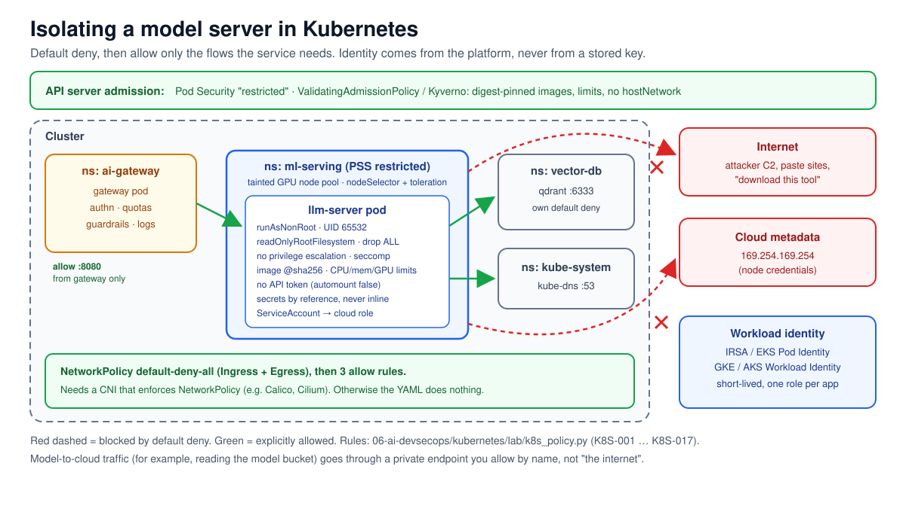

# Hardened Model Serving on Kubernetes

> **Module:** 06 · AI DevSecOps · **Week:** 23 · **Time:** ~10 hours
> **You will:** check model-serving manifests with 17 policy rules, rebuild a dangerous deployment into a hardened baseline (Pod Security "restricted", default-deny network, workload identity, GPU isolation), and see where admission control fits.

| | |
|---|---|
| **Prerequisites** | Kubernetes basics (Pod, Deployment, Service, Namespace); the [Docker lesson](../docker/) |
| **Lab** | [`lab/`](lab/): runs offline, no cluster needed |
| **Maps to** | OWASP LLM10:2025 Unbounded Consumption (limits) · OWASP LLM02:2025 Sensitive Information Disclosure · NSA/CISA Kubernetes Hardening Guidance · CIS Kubernetes Benchmark · Kubernetes Pod Security Standards |

---

## 1. Why this matters

Model servers are attractive targets: they hold GPUs (expensive compute), cloud credentials (to read models and data), and they process untrusted input (prompts, documents, sometimes model files). A weak pod turns any bug into a cluster problem.

- **2018, Tesla (reported by RedLock):** a Kubernetes console without a password let attackers run cryptomining pods, and cloud credentials stored in the cluster exposed data in cloud storage.
- **2024, Wiz research on AI-as-a-service (Hugging Face):** researchers showed that a malicious model (a pickle file) uploaded to a shared inference service could run code inside the service's infrastructure. They then studied how that foothold could be used to move inside a shared Kubernetes environment. The providers fixed the issues with Wiz.
- **2024, NVIDIA Container Toolkit (CVE-2024-0132, found by Wiz):** a crafted container image could escape to the host on GPU nodes that used vulnerable versions of the toolkit. GPU nodes need patching like any other part of the runtime.
- **2025, "IngressNightmare" (CVE-2025-1974, found by Wiz):** a flaw in the ingress-nginx admission controller allowed code execution by anyone who could reach it from the pod network, with access to Secrets across the cluster. It is a good reminder that **network policy inside the cluster matters**, not just at the edge.

The pattern: **the pod was given more than it needed: privileges, network reach, credentials or compute.**

---

## 2. Understand it

### 2.1 What can go wrong with a model-serving pod

| Weakness | What an attacker gets | Lab rule |
|---|---|---|
| `privileged: true`, root user, host namespaces, `hostPath` (worst of all: the Docker or containerd socket) | The node, then other pods on it | K8S-001, 002, 006 |
| Writable root FS, default capabilities, no seccomp | Room to install tools and attack the kernel | K8S-003, 004, 005 |
| Mutable image tag | A different image can run without any manifest change | K8S-007 |
| No CPU/memory limits | One huge prompt or batch starves the node (denial of service, cost) | K8S-008 |
| Secret value in the manifest | It's now in Git, in CI logs, in every copy | K8S-009 |
| Static cloud keys | Long-lived keys that work from anywhere | K8S-010 |
| Automounted API token + broad RBAC | Control of the cluster | K8S-011, 016 |
| No Pod Security label | Nothing stops a privileged pod being admitted | K8S-012 |
| No default deny / open egress | Data exfiltration, command and control, cloud metadata access, lateral movement | K8S-013, 014 |
| Public `LoadBalancer` | Raw model API on the internet, with no auth, quota or guardrails | K8S-015 |
| GPU pod on shared nodes | Noisy neighbors, cross-tenant risk, untrusted pods on expensive GPU nodes | K8S-017 |

### 2.2 Pod Security Standards (PSS)

Kubernetes defines three levels. **Pod Security Admission** (built in) enforces them per namespace with a label:

| Level | Meant for | Key requirements |
|---|---|---|
| `privileged` | System components only | No restrictions |
| `baseline` | Most apps; blocks known privilege escalations | No privileged, no host namespaces, no `hostPath`, limited capabilities |
| `restricted` | **Model servers and other untrusted-input workloads** | Baseline **plus**: `runAsNonRoot: true`, `allowPrivilegeEscalation: false`, drop `ALL` capabilities, seccomp `RuntimeDefault` (or `Localhost`), limited volume types |

```yaml
metadata:
  labels:
    pod-security.kubernetes.io/enforce: restricted   # reject pods that don't meet it
    pod-security.kubernetes.io/warn: restricted      # warn kubectl users
    pod-security.kubernetes.io/audit: restricted     # record in the audit log
```

`readOnlyRootFilesystem` and resource limits are **not** part of `restricted`. Add them with your own policy (the lab's K8S-003 and K8S-008, or admission policies).

### 2.3 The isolated model server



**Network.** Start with a namespace-wide **default deny** for both Ingress *and* Egress. Then allow only the flows the service needs: gateway → model server, model server → DNS, model server → vector DB. Egress matters most for AI workloads: a model server that is tricked (through prompt injection and tools, or a malicious model file) can only cause harm if it can *reach* something. Remember:

- Standard NetworkPolicy works on IPs, ports and labels, not domain names. For "allow only `api.vendor.example`", use a CNI with FQDN policies (Cilium, Calico Enterprise) or an egress proxy/gateway.
- Block the cloud **metadata endpoint** (`169.254.169.254`): default deny already does, so don't add a broad `0.0.0.0/0` allow that re-opens it.
- NetworkPolicy does nothing without a CNI that enforces it.

**Identity.** Don't give pods cloud keys. Use **workload identity**: the pod's ServiceAccount gets a short-lived, audience-bound token that the cloud exchanges for a role: IRSA or EKS Pod Identity (AWS), Workload Identity Federation for GKE (Google), Microsoft Entra Workload ID on AKS (Azure). One role per app, scoped to exactly the bucket prefix or vector index it needs.

**Secrets.** Kubernetes Secrets are base64-encoded, not encrypted, unless you enable encryption at rest (ideally with a KMS provider). Prefer an external store (AWS Secrets Manager, Azure Key Vault, Google Secret Manager) through the Secrets Store CSI Driver or External Secrets Operator. Mount secrets as files where possible (easier to rotate, less likely to end up in a crash dump or debug log), and restrict `get/list` on Secrets with RBAC.

**GPU isolation.** Put inference on a **dedicated, tainted node pool** (`nvidia.com/gpu:NoSchedule`) so only pods with a matching toleration *and* a nodeSelector land there. When several tenants share GPUs, know your option: whole GPUs per pod, MIG partitions (hardware isolation on supported NVIDIA GPUs), or time-slicing (no memory isolation between pods: only for one trust domain). For hostile multi-tenancy (running customers' models), use separate node pools or clusters and consider sandboxed runtimes (gVisor, Kata Containers).

**Tenants.** A namespace is a *soft* boundary: it scopes names, RBAC, quotas and network policy. Hard isolation needs separate nodes or clusters. Give each tenant a namespace with its own ResourceQuota, LimitRange, default-deny NetworkPolicy and ServiceAccounts.

### 2.4 Admission control: the cluster-side gate

The lab checker runs in CI (shift left). **Admission control** runs inside the API server and also blocks things that never went through CI: a `kubectl apply` from a laptop, a compromised pipeline, a Helm chart from somewhere else.

| Tool | How you write policy | Good for |
|---|---|---|
| Pod Security Admission | Namespace label | The PSS levels, built in |
| ValidatingAdmissionPolicy | CEL expressions, built in ([example](lab/secure/admission-policy.yaml)) | Simple rules without running a webhook |
| Kyverno | YAML policies | Validate, mutate, generate; image signature verification |
| OPA Gatekeeper | Rego | Complex rules; shared language with Terraform policy |
| Sigstore policy-controller / Kyverno `verifyImages` | Signature policies | Only run images signed by your pipeline ([CI/CD lesson](../cicd/)) |

---

## 3. Defend it

| Layer | Control | Type | What it buys you |
|---|---|---|---|
| L1 | **Pod hardening**: non-root, read-only FS, drop ALL, no escalation, seccomp (plus AppArmor or SELinux where available), digest-pinned image, limits | Hard | A compromised process stays small |
| L2 | **Namespace guardrails**: PSS `restricted` enforced, ResourceQuota, LimitRange | Hard | Bad pods are rejected, not just reported |
| L3 | **Network**: default deny both ways, explicit allows, no internet egress, metadata blocked, internal Service only | Hard | No exfiltration path, no lateral movement |
| L4 | **Identity**: workload identity, no API token, no static keys, minimal RBAC | Hard | Stolen pod ≠ stolen cloud or cluster |
| L5 | **Admission control**: PSA + VAP/Kyverno/Gatekeeper + image signature verification | **Hard** | Enforced even when CI is bypassed |
| L6 | **CI policy checks** (this lab, kube-linter, kubescape, Trivy) | Process | Fast feedback on every PR |
| L7 | **Runtime detection**: audit logs, Falco/Tetragon-style syscall rules, egress flow logs | Detect | You notice when something gets through |

### Design patterns worth knowing

- **Gateway in front, model behind.** Users talk to an AI gateway (authn, quotas, guardrails, logging). The model Service is `ClusterIP` and accepts traffic only from the gateway's namespace.
- **One ServiceAccount, one cloud role per workload.** Never share the "ml" role between training, serving and notebooks.
- **Separate trust domains on GPUs.** Training jobs that load third-party models and production inference shouldn't share nodes.
- **Deny by default, then allow by name.** In network policy, RBAC, egress domains and admission rules alike.

### What does NOT work on its own

- A NetworkPolicy without a CNI that enforces it.
- `runAsUser: 1000` without `runAsNonRoot: true` and a non-root image: a container-level setting can override it (see the lab test).
- Ingress-only default deny. Egress is where exfiltration happens.
- "It's an internal cluster." IngressNightmare-style bugs are reachable from inside the pod network.
- Base64 in a Secret. It is encoding, not encryption.

---

## 4. Hands-on lab

**Scenario:** the *support-llm* team deployed their model server "to get it working": privileged, root, `hostNetwork`, a public LoadBalancer, static AWS keys and cluster-admin. You review it and produce the hardened baseline.

| File | What it is |
|---|---|
| [`lab/vulnerable/model-server.yaml`](lab/vulnerable/model-server.yaml) | Namespace, ServiceAccount, ClusterRoleBinding, Deployment, Service, NetworkPolicy. Each `VULN` names a rule |
| [`lab/secure/model-server.yaml`](lab/secure/model-server.yaml) | The hardened version. Each `FIX` names a rule |
| [`lab/secure/admission-policy.yaml`](lab/secure/admission-policy.yaml) | A ValidatingAdmissionPolicy (CEL) for reading |
| [`lab/k8s_policy.py`](lab/k8s_policy.py) | The checker: 17 rules, `yaml.safe_load_all`, namespace-aware |

### Step 1: Run the scorecard

```powershell
python 06-ai-devsecops/kubernetes/lab/demo.py
```

Expected output:

```text
rule     sev      title                                                  vulnerable  secure
------------------------------------------------------------------------------------------
K8S-001  HIGH     Privileged container or privilege escalation allowed   FAIL x1     ok
K8S-002  HIGH     Container may run as root                              FAIL x1     ok
K8S-003  MEDIUM   Root filesystem is writable                            FAIL x1     ok
K8S-004  MEDIUM   Linux capabilities not dropped                         FAIL x1     ok
K8S-005  MEDIUM   No seccomp profile                                     FAIL x1     ok
K8S-006  CRITICAL Host namespaces or hostPath volumes                    FAIL x2     ok
K8S-007  MEDIUM   Image not pinned by digest                             FAIL x1     ok
K8S-008  MEDIUM   Missing CPU/memory limits                              FAIL x1     ok
K8S-009  CRITICAL Secret value written in the manifest                   FAIL x1     ok
K8S-010  HIGH     Static cloud credentials instead of workload identity  FAIL x2     ok
K8S-011  MEDIUM   Kubernetes API token automounted                       FAIL x1     ok
K8S-012  HIGH     Namespace does not enforce Pod Security 'restricted'   FAIL x1     ok
K8S-013  HIGH     No default-deny NetworkPolicy                          FAIL x1     ok
K8S-014  HIGH     NetworkPolicy allows egress to the internet            FAIL x1     ok
K8S-015  HIGH     Model server exposed outside the cluster               FAIL x1     ok
K8S-016  CRITICAL Over-privileged RBAC                                   FAIL x1     ok
K8S-017  MEDIUM   GPU workload not isolated on a dedicated node pool     FAIL x1     ok

vulnerable: 19 findings    secure: 0 findings
Tip: delete the default-deny-all NetworkPolicy from secure/model-server.yaml and re-run.
```

### Step 2: Run the checker like CI does

```powershell
python 06-ai-devsecops/kubernetes/lab/k8s_policy.py 06-ai-devsecops/kubernetes/lab/vulnerable/model-server.yaml
```

The first lines of the output:

```text
HIGH     K8S-001  Deployment/ml-serving/llm-server: container 'server' is privileged (root on the node)
HIGH     K8S-002  Deployment/ml-serving/llm-server: container 'server' can run as UID 0 (set runAsNonRoot: true and a UID)
MEDIUM   K8S-003  Deployment/ml-serving/llm-server: container 'server': an attacker can drop tools or modify code on disk
...
CRITICAL K8S-016  ClusterRoleBinding/llm-server-admin: binds cluster-admin to ['llm-server']
MEDIUM   K8S-017  Deployment/ml-serving/llm-server: GPU pods should run only on a tainted, dedicated GPU pool (nodeSelector + toleration)

FAIL: 19 finding(s), fail-on=HIGH
```

Then check the secure manifests (`secure/model-server.yaml secure/admission-policy.yaml`): `PASS: 0 finding(s), fail-on=HIGH`.

### Step 3: Read the two files side by side

For each `VULN` in the vulnerable file, find the `FIX` in the secure file. In your journal, write the attack each change blocks. Pay attention to three things that are easy to miss:

- `automountServiceAccountToken: false` is set on **both** the ServiceAccount and the pod.
- The default-deny policy lists **both** `Ingress` and `Egress` in `policyTypes`, with no rules.
- The egress allow-list has DNS and the vector DB, and nothing else: no internet, no metadata endpoint.

### Step 4: Run the tests

```powershell
python -m pytest 06-ai-devsecops/kubernetes -v
```

Notice `test_container_setting_overrides_pod_setting` (Kubernetes' own precedence rule), `test_ingress_only_default_deny_is_not_enough`, and `test_manifests_are_parsed_with_safe_load`: a checker that parses untrusted YAML must never use `yaml.load()` with a full loader.

### Step 5: Break it yourself

Predict, then run:

1. Delete the `default-deny-all` policy from a copy of the secure file. Which rule fires? Which *flows* become possible in a real cluster?
2. Add an egress rule `- to: [{ipBlock: {cidr: 10.0.0.0/8}}]` to `allow-llm-egress`. The checker passes it. Is that safe? What could a compromised model server reach inside `10.0.0.0/8`? Write a stricter rule.
3. Change the Service to `type: LoadBalancer` with the AWS internal annotation. K8S-015 stays quiet. Is an internal load balancer enough on its own? What still protects the model API?
4. Remove the `tolerations` from the secure Deployment. In a real cluster, what would happen to the pod (hint: taints)? What does K8S-017 report?
5. Add `capabilities: {add: [NET_RAW]}`. Which rule fires? What can a process do with `NET_RAW`?

### Step 6: Real tools and a real cluster (optional)

```powershell
# Static checks
kube-linter lint 06-ai-devsecops/kubernetes/lab/vulnerable/model-server.yaml
kubescape scan 06-ai-devsecops/kubernetes/lab/vulnerable/model-server.yaml
trivy config 06-ai-devsecops/kubernetes/lab/vulnerable
```

With a local cluster (for example `kind create cluster`), watch Pod Security Admission reject the vulnerable pod:

```powershell
kubectl create namespace ml-serving
kubectl label namespace ml-serving pod-security.kubernetes.io/enforce=restricted pod-security.kubernetes.io/warn=restricted
kubectl apply --dry-run=server -f 06-ai-devsecops/kubernetes/lab/vulnerable/model-server.yaml
```

Pod Security Admission checks the Deployment's pod template in `warn` mode, so kubectl prints the violations right away. `enforce` mode applies to the Pods themselves: without `--dry-run`, the Deployment would be created but the ReplicaSet could not create any pods (see `kubectl describe replicaset -n ml-serving`). Then try the admission policy file on a cluster version that supports `admissionregistration.k8s.io/v1` ValidatingAdmissionPolicy.

### Stretch goals

- Add **K8S-018**: every namespace with workloads must have a `ResourceQuota` that caps `requests.nvidia.com/gpu`.
- Add **K8S-019**: images must come from your registry (`ghcr.io/acme/`), and write the same rule in the admission policy (CEL).
- Make the checker understand **Helm output**: run it on `helm template` output and handle `List` kinds.
- Write a Kyverno `verifyImages` policy that only admits images signed by your release workflow ([CI/CD lesson](../cicd/)).

---

## 5. Real-world scenarios

**Scenario A: the GPU bill.**
Monthly GPU costs triple. `kubectl top` shows the model-server pods at 100% GPU, but request volume is flat.
- *What went wrong:* the model API was exposed through a public LoadBalancer with no auth. Someone found it and used it as free inference, or ran their own workload through a vulnerable endpoint.
- *Investigate:* Service type and external IPs; load balancer and gateway logs (source IPs, request sizes); pod process lists; egress flow logs.
- *Fix:* `ClusterIP` behind the gateway (auth, per-key quotas); NetworkPolicy ingress only from the gateway; limits and ResourceQuota on GPUs; a cost alert per namespace.

**Scenario B: credentials in the pod.**
Incident response finds that an attacker who got code execution in the model-server pod (through a malicious model file) used `AWS_ACCESS_KEY_ID` from its environment to list and download S3 buckets.
- *What went wrong:* static keys in env, scoped far wider than the pod needed, and usable from anywhere.
- *Investigate:* CloudTrail for the key ID (source IPs, API calls, time window); which buckets were read; whether the key was used after the pod died.
- *Fix:* revoke the key. Move to workload identity with a role limited to `s3:GetObject` on one prefix (TF-AI-040) and a condition on the VPC endpoint. Add K8S-010 to CI and an admission rule that rejects pods with those env names.

**Scenario C: "the policy says default deny, but traffic still flows".**
A pentest shows the model server can reach the internet, although the namespace has a default-deny NetworkPolicy.
- *What went wrong:* the cluster's CNI didn't enforce NetworkPolicy; or the policy only listed `Ingress`; or another policy allowed `0.0.0.0/0` (policies are additive: any allow wins).
- *Investigate:* `kubectl get networkpolicy -n ml-serving -o yaml`; check the CNI and whether policy enforcement is enabled; test from a debug pod with the same labels.
- *Fix:* a CNI with enforcement; K8S-013/014 in CI; an automated connectivity test in the pipeline (a pod that must *fail* to reach `example.com` and the metadata endpoint).

---

## 6. Common mistakes

- Adding `securityContext` at the pod level and assuming it covers init containers and sidecars added by other tools. Check every container.
- `readOnlyRootFilesystem: true` without an `emptyDir` for `/tmp`, then turning it off when the app crashes, instead of giving it a writable `/tmp`.
- Putting model servers in `default` namespace, with the `default` ServiceAccount.
- Using one big shared GPU node pool for notebooks, training and production inference.
- Allowing `0.0.0.0/0` egress "temporarily" so the model can download weights at startup. Pull from a private registry or bucket through a private endpoint instead.
- Testing policies only on the happy path. A policy needs a test that a *bad* manifest is rejected.

---

## 7. Interview preparation

<details><summary><b>Q1. What does Pod Security "restricted" require, and what doesn't it cover?</b></summary>

Restricted requires: non-root (`runAsNonRoot: true`), `allowPrivilegeEscalation: false`, dropping `ALL` capabilities (only `NET_BIND_SERVICE` may be added back), a seccomp profile (`RuntimeDefault` or `Localhost`), no host namespaces, ports or `hostPath`, and only safe volume types. It does **not** require a read-only root filesystem, resource limits, digest-pinned images, network policies or image signatures. I add those with admission policies (VAP, Kyverno, Gatekeeper) and CI checks.
</details>

<details><summary><b>Q2. Design network policy for a model server.</b></summary>

1. A default-deny policy in the namespace with empty `podSelector` and both `Ingress` and `Egress`.
2. Allow ingress only from the AI gateway's namespace and pod labels, on the serving port.
3. Allow egress only to DNS (kube-dns, port 53) and the specific backends it needs (vector DB on its port, the model store through a private endpoint).
4. No `0.0.0.0/0`, which also keeps the metadata endpoint blocked.
5. If it must call an external API, use an egress proxy or FQDN-aware CNI policy.
6. Verify with a connectivity test in CI and flow logs in production.
</details>

<details><summary><b>Q3. Why is egress control especially important for AI workloads?</b></summary>

Model servers and agents process untrusted input that can steer them (prompt injection through tools, malicious model files). The harm usually needs an outbound path: sending data to an attacker, downloading a second-stage payload, reaching the cloud metadata endpoint for credentials, or calling internal services. Remove the path and many successful attacks become harmless. It's the "external communication" leg of the lethal trifecta from Module 02, enforced at the network layer.
</details>

<details><summary><b>Q4. How does workload identity work, and why is it better than a key in a Secret?</b></summary>

The pod runs with a ServiceAccount. Kubernetes issues a short-lived, audience-bound, signed token for it (a projected token). The cloud's identity service trusts the cluster's issuer and exchanges that token for temporary credentials of one role, based on the namespace and ServiceAccount in the token. No long-lived secret exists to steal or rotate; credentials expire in hours; and the trust can be limited to exactly one ServiceAccount. A key in a Secret works from anywhere, for months, until someone rotates it.
</details>

<details><summary><b>Q5. Are Kubernetes Secrets secure?</b></summary>

By default, they're base64-encoded in etcd, so they're only as safe as etcd access and backups. Improve it with encryption at rest using a KMS provider, tight RBAC (very few subjects may `get/list` Secrets), no Secret values in Git (use External Secrets / Secrets Store CSI from a vault, or sealed/encrypted manifests), mounting as files, and audit logging of Secret reads. Better still, avoid secrets entirely with workload identity.
</details>

<details><summary><b>Q6. How would you isolate GPU workloads from different teams or customers?</b></summary>

- Same trust level: shared node pool with quotas, limits and per-namespace policies.
- Different teams: dedicated tainted node pools per team or workload class, so pods need a toleration plus nodeSelector; ResourceQuota on `nvidia.com/gpu`.
- Untrusted tenants (customer models): separate node pools or clusters, sandboxed runtimes such as gVisor or Kata where supported, no GPU time-slicing across tenants (no memory isolation), MIG only where its isolation is acceptable.
- In all cases: patch the GPU driver, device plugin and container toolkit (CVE-2024-0132).
</details>

<details><summary><b>Q7. CI policy checks vs admission control: why both?</b></summary>

CI checks give fast, friendly feedback on the pull request, before anything reaches a cluster. Admission control is the actual enforcement: it runs in the API server and blocks resources however they arrive, including manual `kubectl`, other pipelines and compromised credentials. Ideally they share the same rules (or the same policy source), so developers see in CI exactly what the cluster will reject.
</details>

<details><summary><b>Q8. What is the difference between namespace isolation and real multi-tenancy?</b></summary>

Namespaces scope names, RBAC, quotas and network policies. That is a soft boundary, fine for teams that trust each other. Pods from different namespaces still share nodes, the kernel, the container runtime and often the GPU driver. Real (hard) multi-tenancy for untrusted tenants needs separate nodes or clusters, sandboxed runtimes, strict network separation and separate cloud identities.
</details>

<details><summary><b>Q9. Scenario: a pod is compromised through a malicious model file. With the secure manifest, what can the attacker do?</b></summary>

Very little:

- They run as UID 65532, not root, with no capabilities, no privilege escalation, a seccomp filter and a read-only root FS (only `/tmp` is writable).
- There is no Kubernetes API token.
- The pod's cloud role reads one model prefix.
- The network allows DNS and the vector DB only: no internet, no metadata endpoint.

They could still read what the pod can legitimately read (model, vector DB data within its permissions) and abuse the service itself. So we also monitor (runtime detection, vector DB access logs) and scope the vector DB role to the right indexes.
</details>

<details><summary><b>Q10. Why must a manifest checker use `yaml.safe_load`?</b></summary>

PyYAML's full loader can build arbitrary Python objects from tags like `!!python/object/apply:os.system`. A policy checker runs in CI on manifests from pull requests, which are untrusted input. A full loader would let a PR run code in your CI. `safe_load` only builds plain data types. The lab test proves the payload raises an error instead of running.
</details>

<details><summary><b>Q11. What runtime detection would you add for model-serving pods?</b></summary>

- Kubernetes audit logs: exec into pods, Secret reads, RBAC changes.
- Syscall or eBPF rules (Falco, Tetragon): a shell started in a model-server container, unexpected outbound connections, writes outside `/tmp`, reads of service-account tokens.
- Flow logs for denied egress attempts, which are a strong signal when the default is deny.
- Cloud audit logs for the workload's role.

All of these feed the SIEM with pod, namespace and image digest labels.
</details>

<details><summary><b>Q12. Explain the hardened baseline to an executive.</b></summary>

"Our AI model servers now run like a locked hotel room instead of an open-plan office. Each one has only the keys it needs, can only talk to the few systems it must, can't change its own software, and can't use more computer power than we budget. If an attacker does get in through a bad file or a clever input, they find themselves in a small room with nothing useful in it, and we get an alert."
</details>

---

## 8. Checklist (definition of done)

- [ ] I can list the PSS `restricted` requirements and what they don't cover.
- [ ] `python -m pytest 06-ai-devsecops/kubernetes` passes.
- [ ] I did the five "break it yourself" steps.
- [ ] I can draw the allowed network flows for the model server from memory.
- [ ] Optional: I watched Pod Security Admission reject the vulnerable pod on a local cluster.
- [ ] Week 23 journal entry: my hardened baseline for model-serving pods, as a one-page checklist.

## 9. References

- Kubernetes, *Pod Security Standards*: https://kubernetes.io/docs/concepts/security/pod-security-standards/
- Kubernetes, *Network Policies*: https://kubernetes.io/docs/concepts/services-networking/network-policies/
- Kubernetes, *Validating Admission Policy*: https://kubernetes.io/docs/reference/access-authn-authz/validating-admission-policy/
- Kubernetes, *Good practices for Kubernetes Secrets*: https://kubernetes.io/docs/concepts/security/secrets-good-practices/
- NSA/CISA, *Kubernetes Hardening Guidance* (v1.2, 2022), published on nsa.gov and cisa.gov
- AWS, *IAM roles for service accounts* / *EKS Pod Identity*: https://docs.aws.amazon.com/eks/latest/userguide/iam-roles-for-service-accounts.html
- Google Cloud, *Workload Identity Federation for GKE*: https://cloud.google.com/kubernetes-engine/docs/concepts/workload-identity
- Microsoft, *Microsoft Entra Workload ID on AKS*: https://learn.microsoft.com/azure/aks/workload-identity-overview
- NVIDIA, *GPU sharing: time-slicing and MIG* (GPU Operator docs): https://docs.nvidia.com/datacenter/cloud-native/
- Wiz Research blog (AI-as-a-service isolation, CVE-2024-0132, IngressNightmare): https://www.wiz.io/blog
- Tools: kube-linter https://github.com/stackrox/kube-linter · kubescape https://kubescape.io/ · Kyverno https://kyverno.io/ · Gatekeeper https://open-policy-agent.github.io/gatekeeper/
