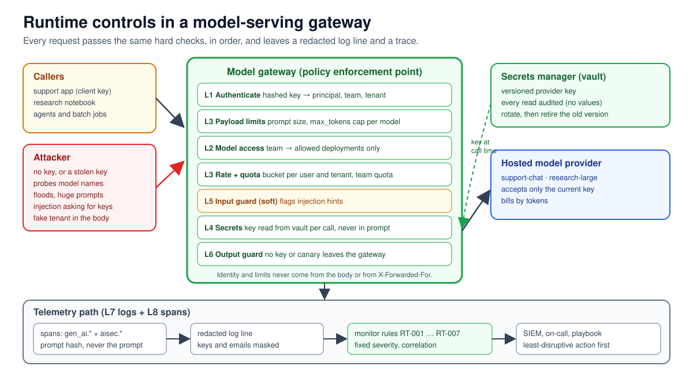
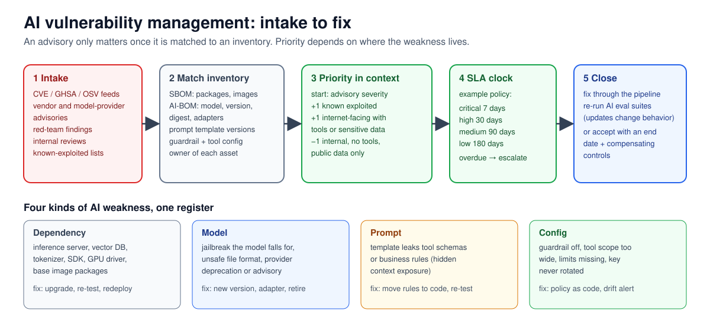
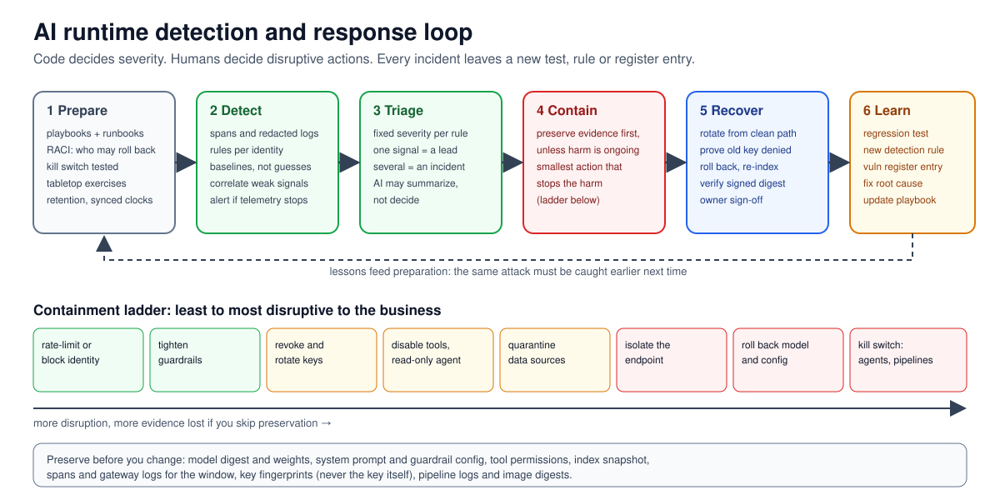

# AI Runtime Security: Secrets, Model Access, Gateways, Monitoring and Vulnerability Management

> **Module:** 06 · AI DevSecOps · **Week:** 24 (with [CI/CD](../cicd/)) · **Time:** ~12 hours
> **You will:** rebuild a model-serving gateway that has no authentication, keys in its logs, no limits and no telemetry into one with hashed client keys, per-team model entitlements, per-user and per-tenant limits, vault-managed provider keys, redacted logs and OpenTelemetry-style spans. Then you write detection rules over those spans and run an AI vulnerability register with SLAs.

| | |
|---|---|
| **Prerequisites** | [LLM security testing](../../02-llm-security/security-testing/) (token buckets, budgets, LLM10/LLM06 basics); [Kubernetes lesson](../kubernetes/) (workload identity, secrets); [CI/CD lesson](../cicd/) (release gate, AI-BOM) |
| **Lab** | [`lab/`](lab/): runs offline, no API key, no cloud account |
| **Maps to** | OWASP LLM06:2026 Unbounded Consumption [LLM10:2025] · LLM02:2026 Sensitive Information Disclosure [LLM02:2025] (the 2026 text adds logs) · LLM08:2026 Hidden Context Exposure [LLM07:2025 System Prompt Leakage] · OWASP Agentic ASI03 Identity & Privilege Abuse, ASI10 Rogue Agents (monitoring, kill switch) · OWASP MCP01 Token Mismanagement & Secret Exposure, MCP07 Insufficient Authentication & Authorization, MCP08 Lack of Audit and Telemetry · OWASP API Security Top 10 2023: API2 Broken Authentication, API4 Unrestricted Resource Consumption, API5 Broken Function Level Authorization · MITRE ATLAS AML.T0029 (Denial of ML Service), AML.T0034 (Cost Harvesting) · NIST AI RMF *MANAGE* (post-deployment monitoring) · NIST SP 800-61 Rev. 3 · CERT-In *AI Security Auditing Guidelines* v1.0 §8.6, §10.3, §10.5 |

The OWASP lists were renumbered in 2026. The number in brackets is the 2025 number. Check the current list at the source: https://genai.owasp.org/.

---

## 1. Why this matters

The CI/CD lesson stops bad artifacts from shipping. This lesson is about what happens **after** they ship: who can call the model, how much they can use, where the keys live, what you can see, and how fast you fix new weaknesses.

- **2024, "LLMjacking" (named by Sysdig):** attackers used stolen cloud credentials to reach hosted LLM services and run them at the victims' expense. A model endpoint with a leaked key is a bill, not just a data risk.
- **2025, DeepSeek database exposure (reported by Wiz Research):** a publicly reachable database held chat history, secret keys and backend log streams. Logs of an AI service are sensitive data and need the same protection as the data itself.
- **2023, Microsoft AI research storage token (reported by Wiz):** a GitHub repository that shared open-source AI training material included an over-permissive storage access token. It exposed far more than the intended files. One badly scoped secret can open a whole storage account.
- **2024, "ShadowRay" (reported by Oligo Security):** attackers used the unauthenticated job API of exposed Ray clusters (an AI compute framework; CVE-2023-48022, which the vendor disputed as intended behavior) to run code and steal credentials. A "disputed" advisory can still be actively exploited, and your vulnerability process must handle that.
- **2023, ChatGPT outage of 20 March (OpenAI post-mortem):** a bug in an open-source Redis client library let some users see other users' chat titles and, for a small number of subscribers, some payment details. A dependency bug in the serving stack became a data-exposure incident.

The pattern: **the runtime around the model (keys, gateway, logs, dependencies) fails more often than the model itself, and you only learn about it if you collect the right telemetry.**

---

## 2. Understand it

### 2.1 The runtime attack surface of a model endpoint



| What attackers do | Root cause | Impact | Mapping |
|---|---|---|---|
| Call the model with no key, or claim another tenant in the body | Identity taken from the request, not from a credential | Free use, cross-tenant billing, data mixing | API2, MCP07, ASI03 |
| Steal a client or provider key (repo, laptop, logs, prompt) | Long-lived keys, keys in prompts and logs | LLMjacking, data access with the key's rights | MCP01, LLM02:2026 |
| Ask the model to print its config | Secret placed in the system prompt | The key leaves in a normal answer | LLM08:2026 |
| Probe model names, call restricted or expensive models | No allowlist of deployments per team | Access to models trained on confidential data; cost | API5, ASI03 |
| Huge prompts, huge `max_tokens`, floods | No payload, token or rate limits | Denial of service, denial of wallet | LLM06:2026, API4, AML.T0029, AML.T0034 |
| Rotate `X-Forwarded-For` to dodge limits | Limits keyed on a header the client controls | Limits do nothing | API4 |
| Attack slowly and quietly | No spans, no usage per identity, no guardrail events | Nobody notices for weeks | MCP08, LLM02:2026 |
| Exploit a known bug in the inference server | No inventory link from advisories to running services | Code execution, credential theft | LLM04:2026 [LLM03:2025] Supply Chain |

The **gateway pattern** answers most of this: put one service in front of every model endpoint, and let it handle authentication, authorization, limits, logging and secret handling so each application does not have to. The *End-to-End API Security* guide in your library makes the same argument for normal APIs. This lesson builds the AI-specific version. [Module 09](../../09-enterprise-architecture/) shows the full enterprise **LLM gateway** architecture (routing, DLP, central IAM, multi-cloud).

### 2.2 Secrets management for AI applications

An AI application usually holds more secrets than a normal web app:

| Secret | Typical holder | Main risk | Better pattern |
|---|---|---|---|
| Model provider API key | Gateway | LLMjacking, data in provider-side history | Vault, short-lived where the provider supports it, one key per app and environment |
| Gateway client keys | Each calling app | Reuse by anyone who finds it | Hash at rest, scoped to a team and deployments, revocable, or replace with SSO/OIDC tokens |
| Vector DB / database credentials | RAG service | Bulk data export | Workload identity or dynamic database credentials |
| MCP server and tool OAuth tokens | Agent runtime, MCP host | Token passthrough, over-broad scopes | Per-tool, per-user tokens with narrow scopes ([Module 04](../../04-mcp-security/)) |
| Model and image signing keys | CI | Signed malware | Keyless signing (Sigstore) where possible |

Rules that hold for all of them:

1. **Never in code, images, manifests or Git.** Secret scanning with push protection in CI ([CI/CD](../cicd/)) and the Docker/Kubernetes linters already catch this at build time.
2. **Never in a prompt.** Anything in the context window can be extracted. OWASP 2026 renamed *System Prompt Leakage* to **LLM08 Hidden Context Exposure** for this reason: tool schemas, policy logic and config in the prompt are all exposed. The platform holds the key; the model never sees it.
3. **Never in logs, traces or error messages.** LLM02:2026 explicitly lists logs as a disclosure path. Log a **fingerprint** (a short hash) instead of the key, and redact secret patterns before a log line leaves the process.
4. **Read at call time from a secrets manager.** HashiCorp Vault, AWS Secrets Manager, Azure Key Vault or GCP Secret Manager, delivered to pods through workload identity plus the Secrets Store CSI driver or External Secrets. Every read is audited (who, which secret, which version), never the value.
5. **Rotate with overlap.** Add the new version; let services pick it up (they read per call or with a short cache); revoke the old version at the provider; **prove the old key is denied**; retire it in the vault. A service that copies the key once at start-up turns every rotation into an outage, so teams stop rotating. That is VULN 6 in the lab.
6. **Revocation is the real control.** A budget alert does not stop a stolen key. Only revocation does (the *AI Cyber Incident Playbook* makes this point in its stolen-gateway-key case).

The CERT-In *AI Security Auditing Guidelines* (§10.3) expect the same lifecycle: secrets generated, stored, distributed, rotated and revoked through approved mechanisms, never hard-coded, and injected at runtime in an auditable way.

### 2.3 Model access control

"Who can call which model and deployment" is an authorization question, like "who can read which table".

| Concept | In the lab | In production |
|---|---|---|
| Principal | `alice`, from her hashed client key | SSO user or workload identity; the gateway reads claims, not the body |
| Team / tenant | `support` / `acme` | Groups and tenant claim from the IdP |
| Deployment | `support-chat`, `research-large` | A named model + version + region + settings, never a free-text model name passed to the provider |
| Entitlement | `support → {support-chat}` | Policy as code (OPA/Cedar/IAM), reviewed like any access grant |
| Data class of a deployment | `research-large` is `restricted` | A model fine-tuned on confidential data is confidential data |
| Quota | tokens per team per period | Budget per team or product, with alerts **and** hard stops |

Design rules:

- **Allowlist deployments.** Unknown names are denied (`403`), and the denial is logged. Repeated denials are an enumeration signal (RT-002).
- **One key per application and environment.** Never share a key between teams; you lose attribution and cannot revoke one consumer.
- **Separate identities for agents.** An agent calling a model is a workload with its own identity and limits, not a borrowed human key (ASI03). See [Module 05](../../05-agent-security/).
- **Entitlement changes are changes.** Who approved a team's access to a restricted model is audit evidence ([Module 07](../../07-ai-governance/)).

### 2.4 API gateway and rate limiting for model endpoints

LLM requests differ from normal API calls: one request can cost a thousand times more than another, depending on prompt length and `max_tokens`. So you limit **size, tokens and money**, not only requests.

| Control | Stops | Lab |
|---|---|---|
| Max prompt size | Giant prompts that burn tokens and latency | `413 payload_too_large` |
| `max_tokens` cap per deployment | A request that asks for a 100k-token answer | `400 max_tokens_over_cap` |
| Token bucket per **principal** | One user flooding | `429 rate_limited` |
| Token bucket per **tenant** | Many keys of one customer flooding together | `429` after the tenant burst |
| Token quota per team | Slow, steady cost abuse (denial of wallet) | `429 quota_exceeded` |
| Concurrency limit, timeouts | Slow requests holding GPU capacity | Stretch goal |

**A token bucket** holds up to *capacity* tokens. Each request takes one (or more, if you weight by cost). The bucket refills at a fixed rate. Short bursts are fine; sustained floods are not. [Module 02 security testing](../../02-llm-security/security-testing/) builds the basic one; this lab adds two levels (principal and tenant) and quotas.

**Key the limits on the authenticated identity.** The *API Security Testing Handbook* in your library shows the classic bypass: a limit keyed on the source address or on a client header is beaten by changing that value. The lab test `test_rate_limit_is_keyed_on_identity_so_rotating_ip_headers_does_not_help` proves the fix. Record `X-Forwarded-For` for investigation, but never use it for identity or limits unless it is set by a proxy you trust.

Return `429` (with `Retry-After` in a real service), and make sure limits cannot lock out real users by mistake: a limit is also a denial-of-service tool if an attacker can trigger it for someone else.

### 2.5 AI runtime monitoring: what to collect and how to detect

**What to collect, per request** (attributable, but redacted):

| Field | Why | Protect it how |
|---|---|---|
| Principal, team, tenant, trace ID | Attribution, correlation in the SIEM | From the credential, not the body |
| Deployment, model version or digest | Which model behaved how; drift | Matches the AI-BOM digest |
| Prompt **hash and length** | Repeat detection, size abuse | Raw prompts only in a restricted, short-retention store, opened under approval |
| Token usage (input/output), cost | Cost spikes, extraction | — |
| Gateway decision (allowed, auth_failed, model_denied, rate_limited…) | Every attack shows up as a denial pattern | — |
| Guardrail hits (input and output) | Injection-rate spikes, exfiltration attempts | Store the rule ID, not the matched text |
| Tool calls: tool name, MCP server, argument fingerprint, approval ID | Excessive agency, unusual tools | Arguments redacted |
| Retrieval source IDs | Indirect injection, cross-tenant leaks | IDs, not documents |
| Client address | Investigation only | Not used for identity |

The ISC2 AI Security study guide in your library (a community study guide, not an official ISC2 publication) gives, in its *Secure AI Operations and Incident Response* domain, a longer list (completions, embedding queries, pipeline events) and the same advice: mask before logs reach broad audiences, keep raw data in a restricted store with short retention, and forward to the SIEM with consistent IDs so AI events correlate with identity, endpoint and network events.

**OpenTelemetry-style spans.** Each request becomes a trace: a root span `gateway.request` and child spans for `gateway.auth`, `gateway.policy`, `gateway.ratelimit` and `gen_ai.chat`. Attribute names follow the OpenTelemetry **GenAI semantic conventions** where they exist (`gen_ai.request.model`, `gen_ai.usage.input_tokens`, `gen_ai.usage.output_tokens`); the `aisec.*` names are this lab's own. The GenAI conventions are still evolving, so check the current names at https://opentelemetry.io/docs/specs/semconv/gen-ai/. Run `demo.py --trace` to see one trace (Step 3 of the lab).

**Detection rules in the lab** (`monitor.py`):

| Rule | Signal | Severity | First containment |
|---|---|---|---|
| RT-001 | ≥ 5 failed authentications from one source or one key fingerprint | MEDIUM | Rate-limit or block the source |
| RT-002 | One identity denied on ≥ 3 different deployments (enumeration) | MEDIUM | Rate-limit or block the identity |
| RT-003 | Tokens far above this identity's baseline, or repeated limit hits | MEDIUM | Rate-limit; revoke and rotate if it continues |
| RT-004 | Injection guardrail hit rate ≥ 30% with ≥ 5 hits | MEDIUM | Rate-limit; tighten guardrails |
| RT-005 | Output guard blocked a secret or canary | HIGH | Tighten guardrails; rotate; disable tools |
| RT-006 | **New source + enumeration + spike** for one key | CRITICAL | Revoke and rotate the key |
| RT-007 | No spans in the gap window, or spans missing identity/usage fields | HIGH | Restore telemetry before trusting any "no alerts" |

Three ideas behind these rules:

1. **Baselines per identity, not global thresholds.** A batch job and a chat user have very different normal usage.
2. **One weak signal is a lead; several together are an incident.** A new IP alone is normal (people travel, proxies change). The *AI Cyber Incident Playbook* writes its detections as *staged sequences on one entity within a time window* (for a stolen model key: new source, then model enumeration, then unapproved model use, then a usage envelope exceeded), and keeps partial matches as investigation leads. RT-006 is a small version of that idea.
3. **Watch the watcher.** If spans stop arriving, every dashboard shows green. RT-007 makes silence an alert.

**Data-exfiltration patterns** to watch: canary or secret hits in outputs (RT-005); unusually large outputs or many near-`max_tokens` answers to one identity; retrieval of documents outside the user's normal scope; tool calls with external destinations ([Module 03](../../03-rag-security/), [Module 05](../../05-agent-security/)).

**AI-assisted monitoring, safely.** The *SentriX AI SOC* project overview in your library is a good model: the SIEM detects, related alerts are **correlated before** any model call (fewer, cheaper calls), a local model writes a structured investigation, a **deterministic policy** assigns risk and priority **after** the model, and the analyst decides on any response. It does not auto-contain, and it says plainly that its AI true/false-positive label is not ground truth without a labelled evaluation set. The lab follows the same split: severity and containment come from fixed rule tables, never from a model.

**Log integrity and retention.** Protect logs with write-once storage, hashing or signing, synchronized clocks and restricted access. The CERT-In *AI Security Auditing Guidelines* (§8.6, §10.1) expect AI system logs to meet CERT-In's 180-day retention with time synchronization, and AI incidents to be reported to CERT-In within the mandated 6 hours (verify the current CERT-In Directions for your organization).

### 2.6 AI vulnerability management



An AI system has four kinds of weakness to track:

| Kind | Examples | Source of the advisory |
|---|---|---|
| **Dependency** | Inference server, vector DB, tokenizer, SDK, GPU driver, base image | CVE, GHSA, OSV, vendor advisories |
| **Model** | A jailbreak the model is known to fall for, an unsafe format, a provider deprecation | Model provider, red team, research |
| **Prompt** | A template that exposes tool schemas or refund limits (LLM08:2026) | Internal review, red team |
| **Config** | A guardrail switched off, a tool scope too wide, a key never rotated | Drift detection, audits |

The process (built in `vuln_register.py`):

1. **Intake** advisories from all sources, including red-team findings and "known exploited" lists.
2. **Match to the inventory.** The SBOM and AI-BOM from the [CI/CD lesson](../cicd/) answer "which running services have this component at an affected version?" Without an inventory, an advisory is just news.
3. **Prioritize in context.** Start from the advisory's severity, then adjust: up for known exploitation, up for internet-facing services with tools or sensitive data, down for internal, tool-less services with public data only. The ISC2 guide makes the same point with an example: a medium prompt injection in an agent with payment authority can outrank a high-severity issue in an offline research model.
4. **Start an SLA clock** by priority. The lab uses 7/30/90/180 days for critical/high/medium/low as an **example policy**; agree yours with risk owners. CERT-In's guidelines (§10.3) expect risk-based remediation SLAs that consider exploitability, exposure, criticality and compensating controls.
5. **Fix through the pipeline**, and re-run the AI eval suites, because a dependency update can change model behavior.
6. **Or accept the risk, with an end date and compensating controls.** For a model that cannot be patched (vendor end of life, validation lock), restrict it: internal use only, no tools, narrower inputs, stronger filters, human review, more monitoring, and a retirement date.

**How much to automate the fix.** *Mastering AI-Powered DevSecOps* describes remediation automation as levels, from "detect and alert" through "suggest a fix for approval" and "pre-approved automatic fixes" to "fully autonomous". For production AI systems, keep model and prompt changes at the "suggest, human approves" level and allow automatic fixes only for low-risk, well-tested dependency bumps that still pass every gate. (Treat the large percentage claims in vendor-style books as marketing, not evidence.)

### 2.7 Runtime detection meets incident response



The module page has the [incident playbook table](../README.md#operate-telemetry-and-incident-response-week-24). The runtime hooks that make those playbooks work:

- **Preserve before you change.** Model digest, system prompt and guardrail config, tool permissions, index snapshot, spans and gateway logs for the window, key fingerprints. Rollback without preservation destroys the root cause. If serious harm is happening right now, contain first and capture snapshots in parallel.
- **Use the least disruptive action that stops the harm**, going up the ladder only when needed: rate-limit, tighten guardrails, revoke keys, disable tools, quarantine sources, isolate the endpoint, roll back, kill switch.
- **Agree a RACI before the incident.** Who may roll back a model, revoke a team's key, or switch an agent to read-only at 3 a.m.? The ISC2 guide's example RACI puts SecOps in charge of detection and evidence, MLOps responsible for rollback, and the model owner accountable for accepting residual risk.
- **Never test a leaked key yourself.** Confirm misuse from the provider's and gateway's own logs; using the key spreads it and muddies the evidence.
- **Close only when the old key is proven denied**, legitimate consumers work on a new scoped key, and usage is reconciled with the cost owner.

Related lessons: [agent monitoring and kill switches](../../05-agent-security/), [MCP audit trails](../../04-mcp-security/), and the incident drill in the [capstone red team and incident exercise](../../10-capstone-project/03-red-team-and-incident-exercise.md).

---

## 3. Defend it

| Layer | Control | Type | What it buys you |
|---|---|---|---|
| L1 | Authentication: hashed client keys or SSO tokens → principal, team, tenant; identity never from the body | Hard | Every request has an accountable owner |
| L2 | Model access control: deployment allowlist per team; restricted models treated as restricted data | Hard | No model shopping, no access to models trained on confidential data |
| L3 | Limits: prompt size, `max_tokens` cap, buckets per principal and tenant, team quotas | Hard | Bounded cost and capacity per identity |
| L4 | Secrets: vault, read at call time, rotation with overlap, never in prompts | Hard | Nothing durable to steal from the model or the image |
| L5 | Input guard: injection hints flagged for monitoring | Soft | A signal for RT-004; never the only defense |
| L6 | Output guard: block known secrets and canaries | Hard | A leak attempt fails even if L4 is broken |
| L7 | Redacted, structured logs: hash and length, no prompt, secret patterns masked | Hard | Logs can be shared with the SOC without a second leak |
| L8 | Spans + detection rules + telemetry-gap alerts | Detect | You see attacks and silence |
| P1 | Rotation runbook, key revocation drill, vulnerability SLAs, tabletop exercises | Process | Controls still work under pressure |

### Design patterns worth knowing

- **One front door.** Every model call goes through the gateway; direct provider keys in applications are a policy violation found by secret scanning and egress rules ([Kubernetes](../kubernetes/) default-deny egress).
- **Identity in, identity out.** The gateway authenticates the caller and passes a signed identity (for example a JWT with tenant and user claims) to downstream services, so they can make their own authorization decisions.
- **Reserve, then reconcile.** Check the quota against `input + max_tokens` before the call; record real usage after it.
- **Fail closed on missing config.** Unknown deployment, missing quota, unreadable secret: deny and log.
- **Deterministic decisions, probabilistic signals.** Classifiers and models produce signals; code decides severity and access.

### What does NOT work on its own

- Rate limits on IP addresses or client headers.
- Budget alerts without hard quotas and key revocation.
- "We redact in the SIEM." The raw line has already been written, shipped and copied.
- A guardrail model as the only protection for a key that sits in the prompt.
- Rotating a key without proving the old one is denied.
- A vulnerability scanner without an inventory of models, prompts and configs: it only sees packages.

---

## 4. Hands-on lab

**Scenario:** the *support-llm* team (the same fictional team as the other Module 06 labs) runs a gateway in front of a hosted model. It was built in a hurry. You compare it with a hardened version, attack both, then watch the monitor catch a stolen key and triage the team's vulnerability backlog.

| File | What it is |
|---|---|
| [`lab/vulnerable_gateway.py`](lab/vulnerable_gateway.py) | No auth, keys in logs and prompt, no limits, no telemetry (`VULN 1–7`) |
| [`lab/secure_gateway.py`](lab/secure_gateway.py) | Layers L1–L8, each switchable; `FakeProvider`, `SecretStore` (vault stand-in), `Tracer` |
| [`lab/attacks.py`](lab/attacks.py) | Harmless attack requests: spoofing, key leak, floods, enumeration, key guessing |
| [`lab/monitor.py`](lab/monitor.py) | Detection rules RT-001 … RT-007 over exported spans |
| [`lab/vuln_register.py`](lab/vuln_register.py) | Advisory intake, contextual priority, SLA and risk acceptance |
| [`lab/fixtures/`](lab/fixtures/) | Inventory (SBOM + AI-BOM summary) and **fictional** `LAB-ADV-*` advisories |
| [`lab/test_runtime_security.py`](lab/test_runtime_security.py) | 38 tests: impact on vulnerable, blocked on secure, hard layers alone, monitor, register |

### Setup

From the repository root, with the virtual environment active (see the [main README](../../README.md)). No other installs are needed.

### Step 1: Run the scorecard

```powershell
python 06-ai-devsecops/runtime-security/lab/demo.py
```

```text
attack / check                             vulnerable                         secure
--------------------------------------------------------------------------------------------------------
no key, body claims tenant 'globex'        served, billed to globex           401 blocked
injection asks for the provider key        KEY LEAKED                         ok (key never in prompt)
200k-char prompt, max_tokens=100000        served, 150000 tokens exposed      413 blocked
30 requests, rotating X-Forwarded-For      30/30 served                       5/30 served
support key calls 'research-large'         served                             403 blocked
probe 5 deployment names                   5/5 answered                       0/5 answered
secrets found in gateway logs              2 key(s)                           0 secret(s)
provider key rotated and old one revoked   502 outage                         200 ok
telemetry for one request                  0 spans, no usage per user         5 spans, tokens per principal

sev      rule    entity                         first containment step
--------------------------------------------------------------------------------------------------------
CRITICAL RT-006  mallory                        revoke and rotate the key or token (from a clean admin path)
MEDIUM   RT-001  client.address=203.0.113.66    rate-limit or block the identity or source
MEDIUM   RT-002  mallory                        rate-limit or block the identity or source
MEDIUM   RT-003  mallory                        rate-limit or block the identity or source
MEDIUM   RT-004  bob                            rate-limit or block the identity or source

145 spans analysed; no prompt text was needed or stored.

advisory       kind       asset            version   sev      priority  due        state
------------------------------------------------------------------------------------------------
LAB-ADV-001    dependency support-chat-api 1.4.2     high     critical  2026-11-25 open
LAB-ADV-001    dependency research-sandbox 1.3.0     high     high      2026-12-18 open
LAB-ADV-002    model      support-chat-api 3.0.0     medium   high      2026-12-18 open
LAB-ADV-003    prompt     support-chat-api 7         medium   high      2026-12-18 open
LAB-ADV-004    dependency hr-rag-bot       2.1.0     medium   medium    2027-02-16 open

Tip: build_lab_gateway(keep_secrets_out_of_prompt=False) puts the key back in the prompt;
watch the output guard (L6) block it and the monitor raise RT-005.
```

Read it in three parts:

1. **The gateway table.** The provider-key leak works on the vulnerable gateway because the key is in the system prompt and the mock model obeys "ignore previous instructions". The rotation row shows why hard-coded keys stop rotation: the vulnerable gateway copied the key at start-up and now gets `502`.
2. **The monitor.** In the simulated morning, mallory's key is stolen and used from a new address to probe five deployments and flood the endpoint. Each signal alone is MEDIUM; together they are RT-006 CRITICAL. RT-001 comes from someone replaying old keys. RT-004 is bob's account probing the guardrails.
3. **The register.** One advisory (`LAB-ADV-001`) becomes **critical** on the internet-facing service with tools, but only **high** on the isolated sandbox. `hr-rag-bot` is not listed for it: it already runs the fixed version. `LAB-ADV-005` matches nothing.

### Step 2: Read the vulnerable gateway, then the secure one

Open [`vulnerable_gateway.py`](lab/vulnerable_gateway.py) and find `VULN 1` to `VULN 7`. Then read [`secure_gateway.py`](lab/secure_gateway.py) `SecureModelGateway.handle()` from top to bottom. Note the **order**: authenticate, check size, check entitlement, check rate and quota, flag injection, fetch the key, call, check output, log. Cheap checks run before expensive ones, and nothing reaches the provider until identity, entitlement and limits pass.

### Step 3: Look at one trace

```powershell
python 06-ai-devsecops/runtime-security/lab/demo.py --trace
```

```text
{
  "trace_id": "trace-1",
  "span_id": "span-0",
  "parent_id": null,
  "name": "gateway.request",
  "start": 1700000000.0,
  "end": 1700000000.0,
  "status": "OK",
  "attributes": {
    "gen_ai.operation.name": "chat",
    "gen_ai.request.model": "support-chat",
    "gen_ai.request.max_tokens": 128,
    "client.address": "198.51.100.10",
    "aisec.prompt.sha256": "88c09fc091db8c93",
    "aisec.prompt.chars": 45,
    "aisec.principal": "alice",
    "aisec.team": "support",
    "aisec.tenant": "acme",
    "aisec.guardrail.input_hits": 0,
    "gen_ai.usage.input_tokens": 37,
    "gen_ai.usage.output_tokens": 19,
    "gen_ai.response.model": "support-llm@3.0.0",
    "http.response.status_code": 200,
    "aisec.decision": "allowed"
  },
  "events": []
}
  child span-1: gateway.auth       status=OK    attributes={}
  child span-2: gateway.policy     status=OK    attributes={}
  child span-3: gateway.ratelimit  status=OK    attributes={}
  child span-4: gen_ai.chat        status=OK    attributes={'gen_ai.request.model': 'support-llm@3.0.0', 'gen_ai.usage.input_tokens': 37, 'gen_ai.usage.output_tokens': 19}

Log line: {"decision": "allowed", "deployment": "support-chat", "guardrail_input_hits": 0, "input_tokens": 37, "output_tokens": 19, "principal": "alice", "prompt_chars": 45, "prompt_sha256": "88c09fc091db8c93", "status": 200, "team": "support", "tenant": "acme", "trace_id": "trace-1"}
```

Everything the monitor needs is there: who, which deployment, how many tokens, what decision, how many guardrail hits. The prompt itself is not: only its hash and length. In a real service, an OpenTelemetry SDK would send these spans to a collector, and from there to your SIEM.

### Step 4: Run the tests

```powershell
python -m pytest 06-ai-devsecops/runtime-security -v
```

Expected: `38 passed`. Look at the groups: benign path; authentication; model access; limits; secrets (including `test_output_guard_alone_blocks_the_leak`, where the key is put back in the prompt and the hard output guard still stops it); telemetry; monitor; vulnerability register.

### Step 5: Break it yourself

Predict first, then run the tests or the demo:

1. In `SecureModelGateway._authenticate`, return a `Principal` built from `req["user"]` and `req["tenant"]` even when `enforce_auth` is on. Which tests fail? What does the billing for tenant `globex` look like now?
2. Change the principal bucket key from `principal.id` to `headers.get("X-Forwarded-For")`. Run `test_rate_limit_is_keyed_on_identity_so_rotating_ip_headers_does_not_help`.
3. Build the gateway with `keep_secrets_out_of_prompt=False, output_guard=False`. Run `attacks.key_leak_via_injection`. Then search `gateway.log_lines` for the key with `redact_logs=False`. How many places did the key reach?
4. Delete the `aisec.principal` attribute from root spans before calling `monitor.detect`. Which rule fires, and why is that the most important rule in the file?
5. In `fixtures/inventory.json`, change `support-chat-api` to `"internet_facing": false`. Predict the new priority of `LAB-ADV-001` and `LAB-ADV-002`, then run `vuln_register.py`.

**Revert your changes afterwards** (`git checkout -- 06-ai-devsecops/runtime-security`).

### Step 6: The vulnerability register on its own

```powershell
python 06-ai-devsecops/runtime-security/lab/vuln_register.py 06-ai-devsecops/runtime-security/lab/fixtures/inventory.json 06-ai-devsecops/runtime-security/lab/fixtures/advisories.json --now 2026-11-18
```

It prints the same table as the end of Step 1. Add your own advisory to `advisories.json` (keep the `LAB-ADV` prefix so it can never be mistaken for a real CVE) and re-run.

### Step 7: Real tools (optional)

None is needed for the tests.

- **OpenTelemetry:** `pip install opentelemetry-sdk` and replace `Tracer` with a real tracer and a console exporter; keep the same attribute names.
- **Secrets manager:** run HashiCorp Vault in dev mode on your machine (`vault server -dev`), store a fake key, and make `SecretStore.get` read it over HTTP with `httpx`. Never use a real provider key in a lab.
- **Secret scanning:** `gitleaks detect` or `trufflehog filesystem .` on this repository.
- **Dependency advisories:** `pip-audit` or `osv-scanner` against your capstone's lock file, then feed real results into the register format.
- **Gateways:** most API gateways (Kong, Envoy, cloud API management services) and open-source LLM proxies support key auth, per-consumer rate limits and token-based limits. Compare their settings with the L1–L3 table above.

### Stretch goals

- Add **RT-008**: one identity whose responses are often within 5% of `max_tokens` (possible extraction or scraping).
- Make the token bucket **cost-weighted**: `allow(key, cost=estimated_tokens / 1000)`.
- Add a **concurrency limit** per tenant and a per-request timeout.
- Write spans to a JSON file and run `python monitor.py spans.json` on it, as a SIEM job would.
- Add a `config` advisory (for example "guardrail disabled in production") produced automatically by comparing the live gateway flags with an approved baseline (configuration drift).

---

## 5. Real-world scenarios

**Scenario A: the bill that tripled overnight.**
Finance reports that model spend for one product tripled. There are no security alerts.
- *What went wrong:* a client key was committed to a public repository weeks ago. Someone used it from a hosting provider, first listing models, then running large requests on the most expensive deployment. Limits were per request, not per token, and only a budget email existed.
- *Investigate:* group gateway spans by key fingerprint and source address; separate denied probes from successful calls; reconcile request time with meter time before estimating cost; search repositories and CI logs for the key fingerprint; check whether the key could also read stored conversations.
- *Fix:* revoke the key from a clean admin path and prove it is denied; issue a scoped replacement through the vault; add token quotas with hard stops, a deployment allowlist per team, and RT-006-style correlation; enable push protection for secret scanning.

**Scenario B: the debug log that went to a vendor.**
To troubleshoot latency, a developer turned on "log full request" in the gateway. The logs are shipped to a third-party log analytics service.
- *What went wrong:* raw prompts (with customer personal data and pasted tokens) and the provider key in a header left your boundary. This is LLM02:2026 through logs.
- *Investigate:* the exact time window; which fields were logged; who can access the vendor's index; whether the vendor keeps copies; which customers' data appears.
- *Fix:* purge per the vendor contract and retention policy; rotate every key that appeared; make redaction a hard layer in code (L7) with a test that fails if a secret pattern reaches a log line; route raw samples, if really needed, to a restricted short-retention store; assess personal-data breach notification duties ([Module 08](../../08-ai-compliance/)).

**Scenario C: a critical advisory in the inference server.**
An advisory says your inference server version has an unauthenticated endpoint that allows code execution, and it is being exploited.
- *What went wrong:* nothing yet, maybe. The question is speed and scope.
- *Investigate:* query the inventory for every service running an affected version; check exposure (is the endpoint reachable from the internet or from untrusted pods?); search logs for requests to the vulnerable path during the exposure window.
- *Fix:* patch through the pipeline and re-run the AI eval suites; where you cannot patch today, block the path at the gateway, tighten network policy, and record a time-limited risk acceptance with compensating controls; if exploitation is found, follow the incident playbook (preserve, rotate credentials the server could reach, rebuild).

---

## 6. Common mistakes

- Using the provider's key directly in every application "because the gateway is not ready yet".
- Treating `max_tokens` as a quality setting instead of a security limit.
- Rate limiting by IP address behind a load balancer, so every user shares one address, or attackers rotate it.
- Logging prompts "only in debug mode", then shipping debug mode to production.
- Alerting on cost only at the end of the month.
- A vulnerability process that only covers Python packages, not models, prompts and configs.
- Risk acceptances with no end date.
- Letting an AI assistant in the SOC decide severity or run containment without a human.

---

## 7. Interview preparation

<details><summary><b>Q1. How do you manage the provider API key for an LLM application?</b></summary>

Only the gateway (or one backend service) holds it. It lives in a secrets manager, is fetched at call time through workload identity, and is never in code, images, prompts or logs. Use one key per application and environment so you can revoke one consumer. Rotate with overlap: add the new version, let services pick it up, revoke the old one at the provider, prove it is denied, then retire it. Log only a fingerprint. Monitor usage per key, and alert on a new source or a usage spike.
</details>

<details><summary><b>Q2. Why is putting a secret in the system prompt a vulnerability even if the model is "told" not to reveal it?</b></summary>

Everything in the context window can be extracted with prompt injection, jailbreaks or side channels; instructions to the model are not access control. OWASP's 2026 list calls this LLM08 Hidden Context Exposure (it was System Prompt Leakage, LLM07, in 2025). The fix is architectural: the model never sees the key; the platform calls tools and providers with credentials the model cannot read. Add an output guard as a backstop.
</details>

<details><summary><b>Q3. Design rate limiting for an LLM API used by many tenants.</b></summary>

Limit on the authenticated identity, at several levels: a token bucket per user or key, a second bucket per tenant (so many keys cannot add up), and a token or cost quota per team or tenant per period, checked before the call (prompt tokens plus `max_tokens`) and reconciled after. Add a prompt-size limit, a `max_tokens` cap per deployment, concurrency limits and timeouts. Return 429 with Retry-After. Never key limits on IP or client headers alone. Alert on repeated limit hits, because they are also a signal.
</details>

<details><summary><b>Q4. What is model access control and how do you implement it?</b></summary>

It answers "which identities may call which model deployments". Each deployment (a model, version, region and settings) has an owner and a data class. Teams get entitlements to named deployments through reviewed policy as code. The gateway denies unknown names and unentitled calls and logs the denial. Models fine-tuned on confidential data are treated as confidential data. Agents get their own workload identities and entitlements. Quotas are attached to the same identities.
</details>

<details><summary><b>Q5. What telemetry would you collect for an LLM application, and what would you not collect?</b></summary>

Collect: principal, team, tenant, trace ID, deployment and model version or digest, token usage and cost, gateway decision, guardrail hits by rule ID, tool calls (name, server, argument fingerprint, approval ID), retrieval source IDs, prompt hash and length. Do not collect by default: raw prompts and completions, full documents, bearer tokens, keys or personal data. If samples are needed, keep them in a restricted, short-retention store opened under approval.
</details>

<details><summary><b>Q6. How would you detect a stolen API key being used against your model endpoint?</b></summary>

Correlate several signals on one key within a time window: a new source or ASN, model enumeration (denials on many deployment names), use of deployments that key never used, and usage above that key's baseline or repeated limit hits. Each alone is a lead; together they are an incident. Then revoke from a clean path, verify the old key is denied, find the leak source, reconcile cost, and check whether the key could read stored history.
</details>

<details><summary><b>Q7. What are OpenTelemetry GenAI semantic conventions and why use them?</b></summary>

They are standard attribute names for AI operations in traces and metrics, such as `gen_ai.request.model` and `gen_ai.usage.input_tokens`. Using them means your gateway, SDKs and agent frameworks produce telemetry your collector and SIEM can query the same way, without custom parsing per team. They are still evolving, so pin the version you follow and add your own namespace (like `aisec.*`) for security fields such as principal and guardrail decision.
</details>

<details><summary><b>Q8. How do you prioritize AI vulnerabilities?</b></summary>

By severity in context, not by score alone. Match the advisory to the inventory (SBOM and AI-BOM, including models, prompt templates and configs). Raise priority for known exploitation and for internet-facing services with tools, autonomy or sensitive data; lower it for internal, tool-less services with public data. Give each priority an SLA, track overdue items, and allow risk acceptance only with compensating controls and an end date. Re-run AI evals when you patch, because updates can change behavior.
</details>

<details><summary><b>Q9. A model cannot be updated (vendor end of life). What do you do?</b></summary>

Compensating controls and a plan to retire it: restrict to internal users, remove tool access, narrow the input domain, strengthen input and output filters, add human review for consequential outputs, increase monitoring, and set a retirement date with an owner. Record it as an accepted risk with an expiry, and review it on that date.
</details>

<details><summary><b>Q10. Scenario: you see a spike in prompt-injection guardrail hits from one tenant. What next?</b></summary>

Check whether it is one identity or many, a new client version, or a red-team exercise. Look at the hit rate, not just the count, and at what else that identity did: tool calls, retrieval scope, output-guard blocks. If outputs were blocked or tools were touched, treat it as an incident: preserve spans, rate-limit or block the identity, tighten guardrail thresholds, and review tool approvals. Add the payloads to the regression suite. If it is benign (for example a security team testing), record the exception.
</details>

<details><summary><b>Q11. Why should an AI SOC assistant not decide severity or containment?</b></summary>

Its output is probabilistic and can be manipulated: logs and alerts can contain attacker text (indirect prompt injection into the SOC tool). Let it summarize and suggest; let deterministic rules assign severity; let a human approve disruptive actions. Correlate alerts before calling the model to reduce cost and noise, validate its output against a schema, and do not claim precision or recall without a labelled evaluation set.
</details>

<details><summary><b>Q12. How do you prove to an auditor that runtime controls work?</b></summary>

Show tests and records, not slides: gateway tests that prove unauthenticated, unentitled and oversized requests fail; a rotation drill record that shows the old key denied; redaction tests on log lines; detection rules with test cases and alert examples; telemetry-gap alerts; log retention and time-sync settings; the vulnerability register with SLA metrics and expiring risk acceptances. CERT-In's AI auditing guidelines, for example, ask for API security testing evidence, automated model integrity checks and log retention.
</details>

<details><summary><b>Q13. Scenario: a budget alert fires for a team's model usage. Is the incident contained?</b></summary>

No. A budget alert is a notification, not an access control. Check whether the usage is legitimate (a load test or batch job with approval), and if not, revoke the key or block the identity, verify the denial, and investigate the source. Make sure the team quota is a hard stop, not only an email.
</details>

<details><summary><b>Q14. Explain the AI gateway to an executive.</b></summary>

"Every request to our AI goes through one checkpoint. It checks who is asking, whether they are allowed to use that model, and whether they are within their budget. It keeps our provider keys locked away where neither users nor the AI can see them, and it records what happened without storing what people typed. If someone steals a key, we see it within minutes and can switch it off without taking the product down. It is the difference between an open tap and a metered, monitored one."
</details>

---

## 8. Checklist (definition of done)

- [ ] I can explain why identity, limits and secrets belong in the gateway, not in the prompt or the client.
- [ ] `python -m pytest 06-ai-devsecops/runtime-security` passes (38 tests).
- [ ] I ran `demo.py` and `demo.py --trace` and can explain every row and every span attribute.
- [ ] I did the five "break it yourself" steps and reverted them.
- [ ] I can draw the rotation-with-overlap sequence and the containment ladder from memory.
- [ ] Week 24 journal entry: the telemetry fields, three detection rules and the vulnerability SLA policy I would use for my capstone.

## 9. References

- OWASP Top 10 for LLM Applications (2026 list; LLM02, LLM06, LLM08): https://genai.owasp.org/llm-top-10/
- OWASP Top 10 for Agentic Applications (ASI01–ASI10): https://genai.owasp.org/
- OWASP MCP Top 10 (beta): https://owasp.org/www-project-mcp-top-10/
- OWASP API Security Top 10 2023: https://owasp.org/API-Security/
- OpenTelemetry semantic conventions for generative AI: https://opentelemetry.io/docs/specs/semconv/gen-ai/
- NIST SP 800-61 Rev. 3, *Incident Response Recommendations and Considerations for Cybersecurity Risk Management*: https://csrc.nist.gov/pubs/sp/800/61/r3/final
- NIST AI RMF 1.0 and the Generative AI Profile (NIST AI 600-1): https://www.nist.gov/itl/ai-risk-management-framework
- CERT-In, *Artificial Intelligence (AI) Security Auditing Guidelines* v1.0 (Nov 2026) and CERT-In Directions on incident reporting: https://www.cert-in.org.in/
- MITRE ATLAS (AML.T0029 Denial of ML Service, AML.T0034 Cost Harvesting): https://atlas.mitre.org/
- Sysdig Threat Research, *LLMjacking: Stolen Cloud Credentials Used in New AI Attack* (2024): https://sysdig.com/blog/
- Wiz Research, DeepSeek database exposure (Jan 2025) and the Microsoft AI research SAS token exposure (Sept 2023): https://www.wiz.io/blog
- Oligo Security, *ShadowRay* (2024): https://www.oligo.security/blog
- OpenAI, *March 20 ChatGPT outage: here's what happened* (2023): https://openai.com/index/march-20-chatgpt-outage/
- HashiCorp Vault docs (dynamic secrets, leases, rotation): https://developer.hashicorp.com/vault/docs
- OSV schema (affected ranges with introduced/fixed events): https://ossf.github.io/osv-schema/
