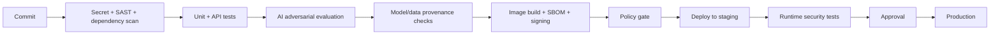

# Secure AI SDLC and DevSecOps

## Lifecycle gates
| Stage | Security activity | Evidence |
|---|---|---|
| Intake | Intended use, data class, owner, risk tier | AI system intake |
| Design | Threat model, trust boundaries, privacy review | Approved design |
| Build | Secure coding, dependency controls, secrets scanning | CI results |
| Model/data | Provenance, licenses, integrity, evaluation | Model/data inventory |
| Test | SAST, DAST, prompt/RAG/agent red team, abuse tests | Test report |
| Release | Policy approval, artifact signing, rollback plan | Release record |
| Operate | Telemetry, drift/abuse monitoring, incident response | Dashboards/runbooks |
| Retire | Revoke access, delete/retain data, archive evidence | Decommission record |

## Pipeline example


## Example GitHub Actions security job
```yaml
name: ai-security-checks
on:
  pull_request:
  push:
    branches: [main]

permissions:
  contents: read

jobs:
  checks:
    runs-on: ubuntu-latest
    steps:
      - uses: actions/checkout@v4
      - uses: actions/setup-python@v5
        with:
          python-version: "3.11"
      - name: Install test dependencies
        run: |
          python -m pip install --upgrade pip
          pip install -r requirements-dev.txt
      - name: Unit and authorization tests
        run: pytest -q
      - name: Dependency audit
        run: pip-audit -r requirements.txt
      - name: Run local AI security regression suite
        run: pytest -q tests/security/
```
Pin third-party actions to verified commit SHAs in production workflows. Use a dedicated runner strategy, least-privilege job permissions, protected environments and secretless OIDC federation where supported.

## Model and dataset supply chain
Track:
- model identifier, provider, version/revision and digest where available;
- dataset origin, license, collection method, classification and consent/legal basis;
- fine-tuning adapters and configuration;
- tokenizer, runtime, framework and dependency versions;
- evaluation datasets and results;
- artifact storage, access policy and integrity verification;
- approval and change history.

## Runtime controls
- request/token/cost quotas;
- per-tenant isolation;
- egress allowlists;
- secrets manager integration;
- workload identity;
- container hardening and non-root execution;
- resource limits and network policies;
- model/API version pinning and rollback;
- anomaly detection and security alerting;
- incident playbooks for prompt injection, data leakage, tool misuse and provider outage.
