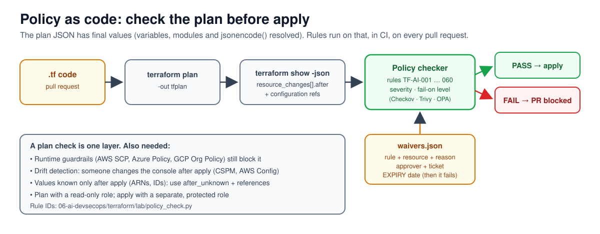
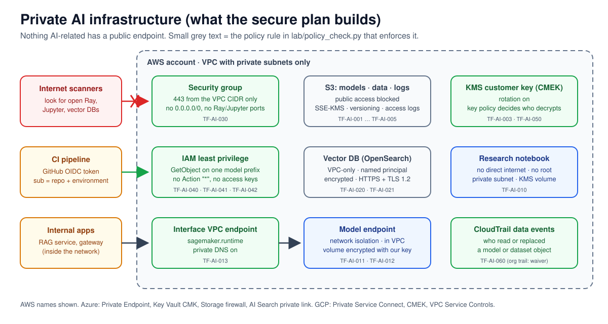

# Secure Infrastructure as Code for AI (Terraform)

> **Module:** 06 · AI DevSecOps · **Weeks:** 21–22 · **Time:** ~12 hours
> **You will:** read a Terraform plan the way a policy engine does, catch 17 kinds of AI-infrastructure exposure with a Python policy checker, and manage exceptions with expiring waivers.

| | |
|---|---|
| **Prerequisites** | Basic Terraform (`resource`, `variable`, `plan`); cloud basics (VPC, IAM, object storage); [Module 01](../../01-ai-security-fundamentals/) trust boundaries |
| **Lab** | [`lab/`](lab/): runs offline, no cloud account and no Terraform install needed |
| **Maps to** | OWASP LLM02:2025 Sensitive Information Disclosure · OWASP LLM03:2025 Supply Chain · NIST SP 800-218A (SSDF for generative AI) · NIST AI RMF *MANAGE* · CIS AWS Foundations Benchmark |

---

## 1. Why this matters

Most AI breaches are not clever model attacks. They are ordinary cloud mistakes around valuable AI assets: a public bucket, an open port, a key with too much power.

- **2019, Capital One:** an attacker used SSRF against a misconfigured web application firewall, took the credentials of an IAM role that had far too much S3 access, and copied data about roughly 100 million people. The model is simple: *one network weakness plus one over-privileged role.*
- **2023, Microsoft AI research (reported by Wiz):** a GitHub repository that shared open-source AI training material linked to Azure Storage with an over-permissive SAS token. It exposed about 38 TB of private data, including workstation backups.
- **2023, Qubitstrike (reported by Cado Security):** a campaign scanned the internet for exposed Jupyter notebooks, then mined cryptocurrency and hunted for cloud credentials on them.
- **2024, ShadowRay (reported by Oligo Security):** attackers used the Ray Jobs API on internet-exposed Ray clusters (AI compute clusters) to run code, steal credentials and mine crypto. The API has no authentication by default (CVE-2023-48022, which the vendor disputes because Ray is meant to run only inside trusted networks). The lesson stands either way: **AI compute must never be reachable from the internet.**

The pattern: **the infrastructure code decided the exposure.** A single line such as `cidr_blocks = ["0.0.0.0/0"]` or `acl = "public-read"` published the asset. So the best place to stop it is the pull request that adds that line.

---

## 2. Understand it

### 2.1 The AI assets your IaC creates

| Asset | Why attackers want it | Typical IaC mistake |
|---|---|---|
| **Model artifact bucket** (weights, adapters) | Stolen IP; or *replace* the file to plant a backdoor | Public ACL, no versioning, AWS-owned key |
| **Training / fine-tuning data** | PII and secrets in raw data; poisoning the next training run | No encryption with your key, no access logs |
| **Notebooks** (SageMaker, Vertex AI Workbench, Azure ML) | Full data access + cloud credentials + internet | Direct internet access, root access, public IP |
| **Model endpoint** (inference API) | Free GPU, data exfiltration, abuse | Public endpoint, container with outbound internet |
| **Vector database** | Embeddings of private documents. Research ("vec2text", Morris et al. 2023) showed text can often be reconstructed from embeddings | Public endpoint, `Principal: "*"`, no encryption |
| **GPU / training clusters** (Ray, Kubeflow, MLflow) | Run code, steal tokens, mine crypto | Dashboard or job API open to `0.0.0.0/0` |
| **Keys (KMS)** | Whoever can decrypt can read every artifact | No rotation, broad key policy |
| **Identities** (service roles, CI) | The key to everything above | `Action: "*"`, static access keys, OIDC trust without a subject check |

### 2.2 Root cause: the plan is the truth

Terraform code is a *recipe*. The **plan** is what will actually happen, with variables, modules, `count`, `for_each` and functions like `jsonencode()` already worked out. So policy tools check the plan JSON:

```powershell
terraform plan -out tfplan
terraform show -json tfplan > tfplan.json
```

Three parts of the JSON matter:

```jsonc
{
  "resource_changes": [{
    "address": "aws_s3_bucket_public_access_block.model_artifacts",
    "type": "aws_s3_bucket_public_access_block",
    "change": {
      "actions": ["create"],
      "after": { "block_public_acls": true, "restrict_public_buckets": true },
      "after_unknown": { "bucket": true, "id": true }        // (1) known only after apply
    }
  }],
  "configuration": { "root_module": { "resources": [{
      "address": "aws_s3_bucket_public_access_block.model_artifacts",
      "expressions": { "bucket": { "references": ["aws_s3_bucket.model_artifacts.id",
                                                  "aws_s3_bucket.model_artifacts"] } }   // (2) who points at whom
  }]}}
}
```

1. **`after`** has the final values. Values that only exist after apply (ARNs, IDs) are left out of `after` and marked `true` in **`after_unknown`**.
2. That is why "which bucket does this public-access block protect?" often can't be answered from `after` (`bucket` is unknown). The **`configuration`** section lists the **`references`** of each expression, and the checker uses those to link resources.
3. `actions: ["delete"]` resources are skipped: a resource being destroyed can't be misconfigured.



### 2.3 What "private AI infrastructure" looks like



The same ideas in each cloud (names change, the design does not; check each provider's current docs because AI service names change often):

| Control | AWS | Azure | Google Cloud |
|---|---|---|---|
| Private path to the model API | Interface VPC endpoint (PrivateLink) for SageMaker Runtime / Bedrock Runtime | Private Endpoint for Azure OpenAI / Azure AI services | Private Service Connect for Vertex AI |
| Customer-managed keys | KMS customer managed key | Key Vault customer-managed key | Cloud KMS CMEK |
| No public storage | S3 Block Public Access | Disable blob public access + storage firewall | Public access prevention + uniform bucket-level access |
| Data-exfiltration perimeter | VPC endpoint policies + bucket policies on `aws:SourceVpce` | Private endpoints + network rules | VPC Service Controls |
| Notebook hardening | No direct internet, no root, in a subnet | Compute instance without public IP | Workbench without public IP |
| Who-read-what logs | CloudTrail S3 data events | Storage diagnostic logs | Data Access audit logs |
| CI identity without keys | IAM OIDC provider + role trust on `sub` | Federated identity credential | Workload Identity Federation |

### 2.4 The rules in the lab

| Rule | Sev | What it catches |
|---|---|---|
| TF-AI-001 | HIGH | Bucket without all four S3 Block Public Access settings |
| TF-AI-002 | HIGH | Public canned ACL (`public-read`, …) |
| TF-AI-003 | HIGH | Bucket not encrypted with **your** KMS key (CMEK) |
| TF-AI-004 | MEDIUM | No versioning: a replaced model file can't be recovered |
| TF-AI-005 | MEDIUM | No server access logging (log bucket itself exempt) |
| TF-AI-010 | HIGH | Notebook with internet, root, or no private subnet |
| TF-AI-011 | HIGH | Model container without network isolation / VPC |
| TF-AI-012 | MEDIUM | Endpoint storage not encrypted with your key |
| TF-AI-013 | MEDIUM | Model API has no private (interface) endpoint |
| TF-AI-020 | CRITICAL | Vector DB public, or access policy `Principal: "*"` |
| TF-AI-021 | HIGH | Vector DB without encryption at rest / node-to-node / HTTPS |
| TF-AI-030 | CRITICAL | Security group ingress from `0.0.0.0/0` or `::/0` |
| TF-AI-040 | HIGH | IAM `Action: "*"` (or `service:*`) on `Resource: "*"` |
| TF-AI-041 | HIGH | Long-lived IAM access key |
| TF-AI-042 | HIGH | GitHub OIDC trust policy with no specific `sub` condition |
| TF-AI-050 | MEDIUM | KMS key rotation disabled |
| TF-AI-060 | MEDIUM | No CloudTrail S3 data events for the AI buckets |

---

## 3. Defend it

| Layer | Control | Type | What it buys you |
|---|---|---|---|
| L1 | **Golden modules**: a reviewed `ai-bucket`, `ai-endpoint`, `ai-notebook` module with secure defaults that teams reuse | Process + Hard | Most teams never write the risky line at all |
| L2 | **Plan policy in CI** (this lab; Checkov, Trivy, OPA/conftest): fail the PR at a severity threshold | **Hard** (pre-deploy) | Exposure is blocked before it exists |
| L3 | **Cloud guardrails**: AWS SCPs and S3 account-level Block Public Access, Azure Policy *deny*, GCP Organization Policy | **Hard** (runtime) | Blocks it even when someone skips CI or clicks in the console |
| L4 | **Drift detection / CSPM**: compare reality to code; AWS Config, Defender for Cloud, Security Command Center | Detect | Catches console changes after apply |
| L5 | **Audit logging**: data-plane logs for model and data buckets, key usage logs | Detect | You can answer "who read or replaced the model?" |
| L6 | **Exception process**: waivers with owner, reason, ticket and *expiry* | Process | Exceptions are visible and don't live forever |

### Design patterns worth knowing

- **Separate plan and apply identities.** CI plans with a read-only role on every PR. Only the protected `main` branch, through a protected environment, can assume the apply role.
- **Private by construction.** The module simply has no variable for "make it public". You can't misconfigure an option that doesn't exist.
- **Encrypt with a key whose policy you own.** CMEK turns "can read the bucket" into "can read the bucket *and* is allowed by the key policy": two checks instead of one.
- **Versioning + object lock for model artifacts.** If someone replaces `model.safetensors`, you can see it, roll back, and compare digests with the AI-BOM ([CI/CD lesson](../cicd/)).
- **Fail closed on unknowns.** If a rule can't decide (value unknown, resource in another module), treat it as a finding or require a human review. Don't silently pass.

### What does NOT work on its own

- **Scanning only the `.tf` text.** It misses values from variables, modules and functions. Check the plan too.
- **"It's in a private subnet."** A public bucket, a pre-signed URL or an over-broad IAM role doesn't care about subnets.
- **Encryption with the cloud provider's default key.** It protects stolen disks, not misused permissions. Anyone with `s3:GetObject` still reads the file.
- **Tags like `data_classification = "restricted"`.** Tags are labels, not controls, unless a policy enforces something based on them.
- **Waivers without expiry.** They become permanent holes that nobody remembers approving.

---

## 4. Hands-on lab

**Scenario:** the *support-llm* team built their AI platform quickly: buckets for model weights and training data, a research notebook, a SageMaker endpoint, a self-managed Ray cluster, an OpenSearch vector store and a CI user. You review the plan before it is applied.

| File | What it is |
|---|---|
| [`lab/vulnerable/main.tf`](lab/vulnerable/main.tf) | The risky platform. Every `VULN` comment names a rule |
| [`lab/secure/main.tf`](lab/secure/main.tf) | The hardened platform. Every `FIX` names a rule |
| [`lab/plans/*.plan.json`](lab/plans/) | Hand-written `terraform show -json` output for each (trimmed, but the same shape) |
| [`lab/policy_check.py`](lab/policy_check.py) | The policy checker: 17 rules with IDs, waivers, severity threshold |
| [`lab/waivers.json`](lab/waivers.json) | One approved, expiring exception |

### Setup (once for the whole repo)

```powershell
python -m venv .venv
.venv\Scripts\Activate.ps1
python -m pip install -e ".[dev]"
```

### Step 1: Run the scorecard

```powershell
python 06-ai-devsecops/terraform/lab/demo.py
```

Expected output:

```text
rule       sev      title                                                    vulnerable  secure
------------------------------------------------------------------------------------------------
TF-AI-001  HIGH     S3 bucket without a full public access block             FAIL x2     ok
TF-AI-002  HIGH     S3 bucket ACL grants public access                       FAIL x1     ok
TF-AI-003  HIGH     S3 bucket not encrypted with a customer-managed KMS key  FAIL x2     ok
TF-AI-004  MEDIUM   S3 bucket versioning not enabled                         FAIL x2     ok
TF-AI-005  MEDIUM   S3 bucket access logging missing                         FAIL x2     ok
TF-AI-010  HIGH     Notebook exposed: internet, root or no VPC               FAIL x1     ok
TF-AI-011  HIGH     Model container not network-isolated / not in a VPC      FAIL x1     ok
TF-AI-012  MEDIUM   Model endpoint storage not encrypted with a customer key FAIL x1     ok
TF-AI-013  MEDIUM   Model API has no private (interface) VPC endpoint        FAIL x1     ok
TF-AI-020  CRITICAL Vector database reachable from the internet              FAIL x2     ok
TF-AI-021  HIGH     Vector database encryption or HTTPS disabled             FAIL x3     ok
TF-AI-030  CRITICAL Security group open to the internet                      FAIL x2     ok
TF-AI-040  HIGH     IAM policy with wildcard actions on all resources        FAIL x1     ok
TF-AI-041  HIGH     Long-lived IAM access key                                FAIL x1     ok
TF-AI-042  HIGH     GitHub OIDC trust policy does not restrict the subject   FAIL x1     ok
TF-AI-050  MEDIUM   KMS key rotation disabled                                FAIL x1     ok
TF-AI-060  MEDIUM   No CloudTrail S3 data events for AI buckets              FAIL x1     WAIVED

vulnerable -> FAIL (fail-on MEDIUM): 25 open, 0 waived
secure     -> PASS (fail-on MEDIUM): 0 open, 1 waived

Tip: run policy_check.py plans/secure.plan.json without --waivers and see TF-AI-060 come back.
```

### Step 2: Read the vulnerable code, then the plan

Open [`lab/vulnerable/main.tf`](lab/vulnerable/main.tf) and find each `VULN`. Then open [`lab/plans/vulnerable.plan.json`](lab/plans/vulnerable.plan.json) and find the same thing in JSON form. Notice:

- `aws_s3_bucket_acl.model_artifacts` has no `bucket` in `after`. Find how the checker still knows which bucket it belongs to (hint: `configuration` → `references`).
- The IAM policy was written with `jsonencode({...})` in HCL, but in the plan it is a plain JSON **string**. The checker parses that string.

In your journal, write one line per `VULN`: which real attack from section 1 it enables.

### Step 3: Run the checker like CI does

```powershell
python 06-ai-devsecops/terraform/lab/policy_check.py 06-ai-devsecops/terraform/lab/plans/vulnerable.plan.json
```

It prints 25 findings and exits with code 1 (`FAIL`). Now the secure plan, with the strictest threshold:

```powershell
python 06-ai-devsecops/terraform/lab/policy_check.py 06-ai-devsecops/terraform/lab/plans/secure.plan.json --fail-on MEDIUM
```

```text
MEDIUM   TF-AI-060  <plan>: nobody will be able to tell who read or replaced a model file

FAIL: 1 open finding(s), 0 waived, fail-on=MEDIUM
```

The secure stack doesn't create its own CloudTrail, because the security team runs an **organization trail**. That is a legitimate exception, so it is recorded:

```powershell
python 06-ai-devsecops/terraform/lab/policy_check.py 06-ai-devsecops/terraform/lab/plans/secure.plan.json --waivers 06-ai-devsecops/terraform/lab/waivers.json --fail-on MEDIUM
```

```text
WAIVED   TF-AI-060  <plan>: S3 data events for all AI buckets are captured by the organization CloudTrail owned by the security team. (SEC-1234, expires 2027-05-31)

PASS: 0 open finding(s), 1 waived, fail-on=MEDIUM
```

### Step 4: Run the tests

```powershell
python -m pytest 06-ai-devsecops/terraform -v
```

Read `test_terraform_policy.py`. Each Part 3 test changes **one** setting in the secure plan and proves the right rule fires. That is how you test a policy: not "it found something", but "it found *this* exposure on *this* resource".

### Step 5: Break it yourself

Predict the result before you run each one:

1. In `secure.plan.json`, change the security group's `cidr_blocks` to `["0.0.0.0/0"]`. Which rule fires, and at which severity?
2. In `waivers.json`, change `expires` to yesterday's date. What happens to the secure plan at `--fail-on MEDIUM`? Why is that the behavior you want?
3. Add a second waiver for `TF-AI-030` with `"address": "*"`. What risk does a wildcard waiver create? How would you stop people from writing one (hint: a test over `waivers.json`)?
4. In the vulnerable plan, set the access key's `actions` to `["delete"]`. Why does TF-AI-041 disappear, and is that correct?
5. Change the OIDC `sub` condition in the secure plan to `repo:acme/*`. The checker passes it. Should it? Write the rule change and a test.

### Step 6: Use real tools (optional)

These need internet access to install, and none of them is required for the tests.

```powershell
# Checkov: reads both HCL and plan JSON
pip install checkov
checkov -d 06-ai-devsecops/terraform/lab/vulnerable
checkov -f 06-ai-devsecops/terraform/lab/plans/vulnerable.plan.json --framework terraform_plan

# Trivy: misconfiguration scanning of the .tf files
trivy config 06-ai-devsecops/terraform/lab/vulnerable
```

Compare their findings with the lab checker. Which of the 17 lab rules do they also catch? Which AI-specific ones (notebook root access, OIDC `sub`, vector DB principal) do they word differently or miss?

**OPA / conftest:** save this as `policy/ai.rego` (outside the repo or in a scratch folder) and run `conftest test 06-ai-devsecops/terraform/lab/plans/vulnerable.plan.json -p policy/`:

```rego
package main

import rego.v1

deny contains msg if {
	rc := input.resource_changes[_]
	rc.type == "aws_security_group"
	rule := rc.change.after.ingress[_]
	rule.cidr_blocks[_] == "0.0.0.0/0"
	msg := sprintf("TF-AI-030: %s allows ingress from 0.0.0.0/0", [rc.address])
}
```

Rego is the policy language used by OPA, conftest and many admission controllers. Port two more lab rules to it.

### Stretch goals

- Add **TF-AI-070**: model and data buckets must have an `aws_s3_bucket_policy` that denies requests not coming through your VPC endpoint (`aws:SourceVpce`).
- Make TF-AI-040 **fail closed**: if a policy document is fully unknown at plan time (`after_unknown.policy == true`), report a finding that asks for review.
- Support **child modules**: resources at `module.ai_platform.aws_s3_bucket.x` and `configuration.root_module.module_calls`.
- Write a tiny Azure or GCP plan JSON and add one equivalent rule (for example, a storage account with public blob access).

---

## 5. Real-world scenarios

**Scenario A: "the notebook was only for a demo".**
A data scientist creates a notebook with direct internet access and a role that can read every bucket. Two weeks later, cloud bills spike and outbound traffic appears from the notebook to an unknown IP.
- *What went wrong:* internet exposure + broad credentials + no owner. This is the pattern behind the Qubitstrike campaign.
- *Investigate:* CloudTrail for API calls made by the notebook role (unusual `ListBuckets`, `GetObject` bursts, new access keys); VPC flow logs; the notebook's terminal history and lifecycle scripts.
- *Fix:* rotate everything that role could reach. Rebuild notebooks from the golden module (no internet, no root, VPC only). Add an SCP or Azure Policy that denies notebooks with public access, and a TTL tag with an automatic stop.

**Scenario B: the model file that changed by itself.**
Production answers suddenly contain a strange phrase. The model file in S3 has a new `LastModified` date, but no deployment happened.
- *What went wrong:* someone with `s3:PutObject` on the artifact bucket replaced the weights. There was no versioning, no digest check at load, and no data-event logging.
- *Investigate:* if versioning is on, compare object versions and their SHA-256 with the AI-BOM. Look for `PutObject` in CloudTrail data events (only if they were enabled!).
- *Fix:* versioning + object lock on the artifact bucket; write access only for the release pipeline role; the model server verifies the digest from the AI-BOM before loading ([CI/CD lesson](../cicd/)); data events on.

**Scenario C: the OIDC role any repository could use.**
During an audit you find a role that trusts `token.actions.githubusercontent.com` and checks only `aud = sts.amazonaws.com`.
- *What went wrong:* without a `sub` condition, a workflow in *any* GitHub repository can request a token with that audience and assume the role. Several public write-ups have described this misconfiguration in real AWS accounts.
- *Investigate:* CloudTrail `AssumeRoleWithWebIdentity` events for the role. Check the `sub` values of the tokens that were used and look for repositories you don't own.
- *Fix:* add `token.actions.githubusercontent.com:sub` = `repo:ORG/REPO:environment:production` (exact match). Add TF-AI-042 to CI. Search every account for roles with the same trust pattern.

---

## 6. Common mistakes

- Running policy checks only on `main` after merge. Run them on the **pull request**, where fixing is cheap.
- Setting `--fail-on CRITICAL` "for now" and never lowering it.
- Approving waivers with no expiry, no owner and no ticket.
- Fixing the console but not the code. The next `terraform apply` brings the problem back, or worse, the code and reality drift apart.
- Treating the model bucket like any other bucket. It is a **code-execution path** (pickle files) and a **supply-chain artifact** (integrity matters as much as confidentiality).
- Giving the CI apply role `AdministratorAccess` "because Terraform needs it". Scope it to the services the stack manages and use a permission boundary.

---

## 7. Interview preparation

<details><summary><b>Q1. Why check the Terraform plan JSON instead of the .tf files?</b></summary>

The `.tf` files are the recipe. The plan is what will really happen: variables, locals, modules, `count`/`for_each` and functions like `jsonencode()` are resolved. A rule such as "no IAM statement with `Action: *`" is easy on the plan and unreliable on raw HCL. I scan both: HCL scanning gives fast feedback in the editor, and the plan check is the gate in CI.
</details>

<details><summary><b>Q2. What are `after_unknown` and `configuration.references`, and why do they matter?</b></summary>

Values that only exist after apply, such as ARNs and IDs, are left out of `change.after` and marked `true` in `after_unknown`. So a public-access-block's `bucket` is often unknown at plan time. `configuration` holds the expressions, and each lists the resources it `references`. A checker uses those references to link companion resources (public access block, encryption config, logging) to their bucket. If it can't link them, it should fail closed, not pass.
</details>

<details><summary><b>Q3. Which AI-specific assets do you look for in an infrastructure review?</b></summary>

Model artifact storage, training and fine-tuning data, notebooks, inference endpoints, vector databases, GPU or training clusters (Ray, Kubeflow, MLflow), feature stores, KMS keys, and the identities that touch them, including CI. For each one I ask: is it reachable from the internet? Who can read it? Who can *write* it (integrity)? Is it encrypted with a key we control? Can we prove who accessed it?
</details>

<details><summary><b>Q4. Design the network for a private LLM inference endpoint.</b></summary>

- The endpoint runs in private subnets with network isolation, so the container has no outbound internet.
- Callers reach it through an interface/private endpoint (PrivateLink, Private Endpoint, Private Service Connect) with private DNS. There is no public endpoint.
- A security group allows 443 only from known subnets or security groups.
- Users never call the model directly. They go through an AI gateway that does authentication, quotas and guardrails.
- Model artifacts come from a private bucket via a gateway endpoint, with a bucket policy that requires that endpoint.
- Everything is encrypted with a CMEK, and invocation and data events are logged.
</details>

<details><summary><b>Q5. Why is CMEK better than the provider-managed default key?</b></summary>

With the default key, anyone who has storage read permission can read the data. With a customer-managed key, the **key policy** is a second, independent authorization check. You can also audit every decrypt, disable the key in an emergency (crypto-shredding), and separate duties (storage admins are not key admins). It doesn't help if the same over-privileged role has both permissions, so least privilege still matters.
</details>

<details><summary><b>Q6. Walk me through the ShadowRay incident and the infrastructure lesson.</b></summary>

Ray is a framework for distributed AI compute. Its dashboard and Jobs API were exposed to the internet on many clusters, and the Jobs API accepts job submissions without authentication by default. Attackers submitted jobs that ran their code on the clusters, stole credentials and tokens, and mined crypto (reported by Oligo in 2024; the related CVE-2023-48022 is disputed by the vendor). The infra lesson: AI compute control planes must be private, behind authentication, and never in a security group open to `0.0.0.0/0`. That is exactly rule TF-AI-030 plus a guardrail at the organization level.
</details>

<details><summary><b>Q7. How do you handle exceptions to infrastructure policy?</b></summary>

As data in version control: a waiver file with rule ID, the exact resource (no wildcards), a reason, an approver, a ticket and an **expiry date**. The checker honors only valid, unexpired waivers and reports expired ones loudly. Waivers are reviewed in the same PR process as code, and a monthly report lists all active ones. Expiry forces someone to re-decide instead of letting the risk become permanent.
</details>

<details><summary><b>Q8. What does a plan check NOT protect you from?</b></summary>

- Changes made outside Terraform (console clicks, scripts). That needs drift detection and CSPM.
- Resources created by other stacks or accounts.
- Values unknown at plan time.
- Runtime behavior (who actually reads the data).
- A compromised pipeline that skips the check.

That is why I pair it with organization guardrails (SCPs, Azure Policy, Org Policy) that deny the worst things at the cloud API, whatever tool sends the request.
</details>

<details><summary><b>Q9. A team says "Checkov already covers this". Why write custom rules?</b></summary>

Generic scanners are a great baseline and I'd run one. But they don't know our context: which buckets hold model artifacts, that our OIDC `sub` must match `repo:org/repo:environment:prod`, that notebooks may never have root access, or that our vector DB must trust only the retriever role. Custom rules encode *our* architecture decisions. I'd keep them few, tested and versioned, and contribute generic ones upstream when possible.
</details>

<details><summary><b>Q10. How should CI authenticate to the cloud to run Terraform?</b></summary>

Through OIDC federation, with no stored keys. The workflow gets a short-lived token from the CI provider and exchanges it for a cloud role. The role trust policy checks the issuer, the audience **and** the subject (repository + branch or environment). Use two roles: a read-only *plan* role for pull requests, and an *apply* role only for the protected branch through a protected environment with required reviewers. Both are scoped to the services the stack manages.
</details>

<details><summary><b>Q11. Scenario: the plan check passes, but next week the vector DB is public. What happened, and what do you do?</b></summary>

Likely causes: someone changed it in the console (drift), another stack modified it, or a rule had a gap (e.g. a new resource type or a module path the checker ignores). Steps:

1. Contain: make it private and rotate any credentials it held.
2. Check access logs for reads during the exposure window.
3. Find the change in CloudTrail (who and what tool).
4. Fix the root cause: an org guardrail that denies public domains, drift alerts, and a regression test for the gap in the checker.
5. Treat the data as exposed until logs prove otherwise.
</details>

<details><summary><b>Q12. Why does model-bucket integrity matter as much as confidentiality?</b></summary>

A model file is executable in practice. Pickle-based formats run code on load, and even data-only weights can carry a backdoor. Anyone who can *write* the bucket can change what production runs. So I want: write access only for the release pipeline, versioning (and object lock if possible), data-event logs, and a digest check against the AI-BOM before the server loads the file.
</details>

<details><summary><b>Q13. Explain this lesson to an executive in 30 seconds.</b></summary>

"Our AI systems run on cloud infrastructure that we describe in code. One wrong line in that code can put our models or customer data on the internet. Several real AI breaches happened exactly that way. So every infrastructure change now goes through an automatic check that blocks those mistakes before they reach the cloud, and any exception has a named owner and an end date."
</details>

---

## 8. Checklist (definition of done)

- [ ] I can explain `after`, `after_unknown` and `configuration.references` without notes.
- [ ] `python -m pytest 06-ai-devsecops/terraform` passes.
- [ ] I did the five "break it yourself" steps and wrote down my predictions vs results.
- [ ] I added one new rule (stretch goal or my own) with a test that changes exactly one setting.
- [ ] Optional: I ran Checkov or Trivy and compared their findings with the lab rules.
- [ ] Week 21–22 journal entry: which three rules I would enforce on day one in a real company, and why.

## 9. References

- Terraform, *JSON Output Format* (plan representation): https://developer.hashicorp.com/terraform/internals/json-format
- NIST SP 800-218A, *Secure Software Development Practices for Generative AI and Dual-Use Foundation Models* (2024): https://csrc.nist.gov/pubs/sp/800/218/a/final
- OWASP Top 10 for LLM Applications 2025: https://genai.owasp.org/llm-top-10/
- AWS, *Security best practices for Amazon S3*: https://docs.aws.amazon.com/AmazonS3/latest/userguide/security-best-practices.html
- AWS, *Configure OpenID Connect in AWS* (GitHub docs): https://docs.github.com/en/actions/deployment/security-hardening-your-deployments/configuring-openid-connect-in-amazon-web-services
- Oligo Security, *ShadowRay* research (March 2024), Oligo blog: https://www.oligo.security/blog
- Wiz Research, *38TB of data accidentally exposed by Microsoft AI researchers* (2023): https://www.wiz.io/blog/38-terabytes-of-private-data-accidentally-exposed-by-microsoft-ai-researchers
- Morris et al., *Text Embeddings Reveal (Almost) As Much As Text* (2023): https://arxiv.org/abs/2310.06816
- Checkov: https://www.checkov.io/ · Trivy: https://trivy.dev/ · Open Policy Agent: https://www.openpolicyagent.org/ · conftest: https://www.conftest.dev/
