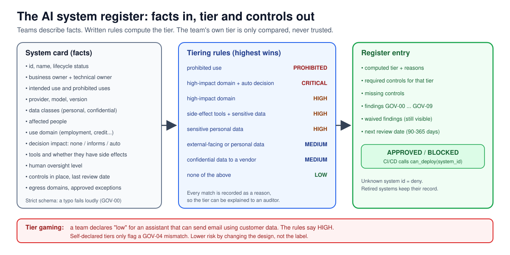

# AI Inventory and the AI System Register

> **Module:** 07 · AI Governance · **Weeks:** 29 · **Time:** ~8 hours
> **You will:** find AI that nobody registered, describe each AI system with a system card, and let written rules (not opinions) decide its risk tier. Then prove that a "spreadsheet register" approves systems that a governed register blocks.

| | |
|---|---|
| **Prerequisites** | [Module 01](../01-ai-security-fundamentals/) trust boundaries; [Module 02 prompt injection](../02-llm-security/prompt-injection/) (the InboxBot example) |
| **Lab** | [`lab/`](lab/): `secure_register.py`, `vulnerable_register.py`, `demo.py`. Runs offline, synthetic data |
| **Maps to** | NIST AI RMF GOVERN 1.6 (inventory), MAP 1–2 (context, categorization) · ISO/IEC 42001 clause 4.3 (scope), Annex A.4 (resources) · EU AI Act Art 49 (registration of high-risk systems) |

---

## 1. Why this matters

You cannot secure, assess or report on AI you do not know about. Every other governance activity starts from the inventory.

- **2023, Samsung:** engineers pasted confidential source code and meeting notes into a public chatbot. Samsung then restricted generative AI tools on company devices. Nobody had registered "employees use a public chatbot" as an AI system with data flowing out.
- **2023, *Mata v. Avianca* (US federal court):** lawyers filed a brief with case citations that ChatGPT had invented, and the court sanctioned them. An AI tool was used in a consequential process with no intended-use limits and no human verification step.
- **2024, *Moffatt v. Air Canada* (British Columbia Civil Resolution Tribunal):** the airline's website chatbot gave wrong information about bereavement fares. The tribunal held the airline responsible for what its chatbot said. "The chatbot is a separate thing" was not a defense, so an owner must be accountable for every AI system.
- **2018, Amazon recruiting tool (reported by Reuters):** Amazon dropped an experimental CV-ranking model after finding it penalized CVs that mentioned the word "women's". Hiring is a high-impact domain, and it needs a higher tier and stronger controls from day one.

The pattern: **AI was in use, but nobody had written down what it was for, who owned it, what data it touched, and how risky it was.**

---

## 2. Understand it

### 2.1 What counts as an "AI system" for the register?

Use a broad, practical definition. The register is for *your* control, not only for legal definitions. Include:

| Type | Example | Often missed? |
|---|---|---|
| Built in-house | RAG assistant, fraud model, agent | Rarely |
| Bought as a product with AI inside | CV screening SaaS, CRM "copilot" features | **Yes**: the AI arrives in a feature update |
| Called via an API | Calls to a model provider from your code | Sometimes: shows up as a library, not a project |
| Used by staff directly | Public chatbots, meeting-note tools, browser extensions | **Yes**: this is "shadow AI" |
| Embedded in another vendor's service | A payroll vendor that uses AI to flag anomalies | **Yes**: found only through vendor questionnaires |

**Shadow AI** means AI tools used without the organization knowing or approving. It is the AI version of shadow IT.

### 2.2 How to find AI you don't know about (discovery)



| Source | What it shows | Limits |
|---|---|---|
| Web proxy / DNS / egress logs | Traffic to known AI service domains | Personal devices and phones are invisible |
| Expense and procurement records | Paid AI subscriptions, API invoices | Free tools never appear |
| Code and dependency scans | AI SDKs, model files, API keys in config | Only for code you can scan |
| Cloud billing and resource inventory | Model endpoints, GPU instances, AI services enabled | Only for your own cloud accounts |
| SaaS admin consoles | AI features switched on in tools you already pay for | Each console is different |
| Vendor questionnaires | AI used *by your suppliers* on your data | Depends on honest answers |
| Staff survey and amnesty | Tools people use and why | Self-reported |

Discovery is not a one-time project. Run it on a schedule. In the lab, `discover_shadow_ai()` compares a proxy log with the register. Anything that is an AI service and not declared by a registered system is shadow AI.

**What to do when you find shadow AI.** Do not only block it. People use it because it helps them. The usual response is: (1) block or warn for high-risk data flows, (2) offer an approved alternative, (3) register the tool if the business wants it, and (4) send it through the normal intake.

### 2.3 The system card: the facts about one AI system

A **system card** is a short, structured description of one AI system. (It is related to a *model card*, which describes a model. A system card describes the whole system: the model plus data, tools, users and controls.) Keep it in a machine-readable format such as YAML, so code can check it.

| Field | Why governance needs it |
|---|---|
| System ID, name, lifecycle status | A stable key for every other record (risks, evidence, incidents) |
| **Business owner** | The person accountable for *using* AI for this purpose |
| **Technical owner** | The team that runs it and fixes it |
| **Intended use** | What it is *for*. Anything outside this is misuse |
| Prohibited uses | What it must *not* be used for, even if it technically can |
| Provider, model, version | Vendor risk, model changes, supply chain |
| Data classes | Personal, sensitive, confidential: drives privacy and security duties |
| Affected people | Who can be harmed: customers, applicants, employees, the public |
| Use domain | Employment, credit, healthcare… drives the tier |
| Decision impact | None / informs a human / makes the decision automatically |
| Tools and side effects | Can it send, write, delete, pay? |
| Human oversight | None, sample review, approve each action, human decides |
| Controls in place, last review | What is already done, and when it was last checked |
| Jurisdictions, regions | Which laws apply (Module 08) |
| Exceptions | Approved, time-limited deviations from policy |

**The intended-use statement is the most important field.** A good one is specific: *"Summarize each application against the published job criteria; a recruiter makes every shortlisting decision."* A bad one is "TBD", "general use" or "see wiki". Without it you cannot decide the tier, you cannot spot misuse, and you cannot answer a regulator.

### 2.4 Classification: why rules beat opinions

A **risk tier** is the organization's label for how much scrutiny a system needs (for example low / medium / high / critical / prohibited). The tier decides which controls are required.

If teams choose their own tier, they choose the lowest one. It is not dishonesty. Lower tier means less paperwork. This is called **tier gaming**. The fix is to compute the tier from facts, using written rules:

| Rule (highest match wins) | Tier |
|---|---|
| Use is on the organization's prohibited list | Prohibited |
| High-impact domain **and** automated decision | Critical |
| High-impact domain (employment, credit, health, education…) | High |
| Tools with side effects **and** personal or confidential data | High |
| Sensitive personal data | High |
| External-facing, or personal data | Medium |
| Confidential data sent to an external provider | Medium |
| None of the above | Low |

This is an *example* organizational policy. It is inspired by the EU AI Act categories (Module 08) but it is not the same. Your tiering must cover security and business risks that a law does not.

Two important properties:
1. **Every match is recorded as a reason.** An auditor can ask "why is this high?" and get an answer.
2. **The declared tier is compared, never trusted.** A mismatch is itself a finding (GOV-04).

### 2.5 The register: more than a list

The **AI system register** is the inventory plus decisions: the computed tier, required and missing controls, findings, waivers and the release decision. In the lab, the deployment pipeline asks the register `can_deploy(system_id)`. That turns the register from documentation into a control.

---

## 3. Defend it

| Layer | Control | Type | What it buys you |
|---|---|---|---|
| L1 | **Strict schema** for system cards (unknown fields rejected, enums checked) | Hard | A typo like `human_oversite` fails loudly instead of silently meaning "no oversight" |
| L2 | **Rule-based tiering**; declared tier only compared | Hard | Stops tier gaming; makes tiers explainable |
| L3 | **Governance checks** (owner, intended use, oversight, controls, review date) | Hard | Bad states are found by code, every run |
| L4 | **Release gate** in CI/CD: unknown or blocked systems cannot deploy | Hard | The register becomes enforcement, not paperwork |
| L5 | **Discovery** on a schedule (egress, expenses, code, cloud, SaaS) | Process + tooling | Finds AI that never went through intake |
| L6 | Intake form, training, amnesty for shadow AI | Soft | People register things willingly |

### Design patterns worth knowing

- **Register as code.** Keep system cards in a repository. Changes go through pull requests. Validation runs in CI. You get history and review for free.
- **One ID everywhere.** Use the system ID in risk entries, evidence files, incident tickets and cloud resource tags. Then you can join them.
- **Re-tier on change.** A new tool, a new data class, a new region or a new user group re-runs the rules automatically.
- **Deny unknown.** If the pipeline cannot find the system ID, it does not deploy.
- **Retire, don't delete.** Retired systems keep their record. Auditors and incident responders still need them.

### What does NOT work on its own

- A spreadsheet that teams fill in once a year. It is stale on the day after it is completed.
- Self-declared risk tiers. The lab shows `AI-001` declared "low" while the rules say "high".
- Blocking every AI domain at the proxy. People switch to phones and personal laptops, and you lose visibility.
- An inventory of *models* only. The risk comes from the whole system: data, tools, users and decisions.

---

## 4. Hands-on lab

**Scenario:** ACME keeps its AI register in a shared sheet. Five systems are listed. Every one has a problem. Proxy logs also show AI tools that nobody listed.

### Setup (once for the whole repo)

```powershell
python -m venv .venv
.venv\Scripts\Activate.ps1
python -m pip install -e ".[dev]"
```

### Step 1: Read the fixtures and predict

Open [`lab/fixtures/systems_vulnerable.yaml`](lab/fixtures/systems_vulnerable.yaml). For each system, write in your journal which governance problem you see. Then compare with [`systems_governed.yaml`](lab/fixtures/systems_governed.yaml).

### Step 2: Run the scorecard

```powershell
python 07-ai-governance/lab/demo.py
```

Expected output (first section):

```text
As of 2026-11-15. Spreadsheet = vulnerable_register.py; governed = secure_register.py + risk_register.py

=== AI system register: vulnerable fixtures (systems_vulnerable.yaml) ===
system  name                           declared    computed    spreadsheet  governed  findings
----------------------------------------------------------------------------------------------------------------
AI-001  InboxBot email summarizer      low         high        APPROVED     BLOCKED   GOV-03,GOV-04,GOV-05x8,GOV-06,GOV-09
AI-002  CV screening assistant         medium      unknown     APPROVED     BLOCKED   GOV-00
AI-003  Internal code assistant        low         medium      APPROVED     BLOCKED   GOV-02,GOV-04,GOV-05x5
AI-004  Website support chatbot        medium      medium      APPROVED     BLOCKED   GOV-05,GOV-06
AI-005  Meeting mood monitor           medium      prohibited  APPROVED     BLOCKED   GOV-04,GOV-07
governance KPIs: {'systems_in_scope': 5, 'pct_owned': 80, 'pct_intended_use': 60, 'blocked': 5, 'overdue_reviews': 2, 'missing_controls': 14, 'active_waivers': 0}
```

and the shadow-AI section:

```text
--- shadow AI (egress log vs register) ---
UNREGISTERED chat.free-ai-tool.example      Free consumer chatbot      users=3 depts=finance,legal requests=4 bytes_out=604563
UNREGISTERED transcribe.ai-notes.example    AI meeting-notes service   users=2 depts=sales requests=2 bytes_out=4084253
```

The spreadsheet approves all five systems. The governed register blocks all five. In the governed fixtures, the sales team's meeting-notes tool was registered as `AI-006`, so only the free chatbot is still shadow AI.

### Step 3: Look at one system closely

```powershell
python 07-ai-governance/lab/secure_register.py 07-ai-governance/lab/fixtures/systems_vulnerable.yaml --id AI-002
```

```text
AI-002 CV screening assistant: declared=medium computed=unknown decision=BLOCKED
  required -
  missing  -
  critical GOV-00 record rejected by schema: human_oversite: Extra inputs are not permitted  [not waivable]
```

The record says `human_oversite: approve_each`. A person reading the sheet sees "approve each". The system sees no oversight field at all. Now switch L1 off and see what was hiding:

```powershell
python 07-ai-governance/lab/secure_register.py 07-ai-governance/lab/fixtures/systems_vulnerable.yaml --id AI-002 --no-validate
```

```text
AI-002 CV screening assistant: declared=medium computed=critical decision=BLOCKED
  reason   critical: automated decision in high-impact domain (employment)
  reason   medium: processes personal data
  required CTL-REG, CTL-AUP, CTL-TM, CTL-EVAL, CTL-LOG, CTL-HO, CTL-RT, CTL-MON, CTL-IR, CTL-IA, CTL-BOARD, CTL-APPEAL, CTL-PRIV, CTL-VEND
  missing  CTL-AUP, CTL-TM, CTL-EVAL, CTL-LOG, CTL-HO, CTL-RT, CTL-MON, CTL-IR, CTL-IA, CTL-BOARD, CTL-APPEAL, CTL-VEND
  high     GOV-01 unowned: no business_owner  [not waivable]
  critical GOV-03 critical risk with human oversight 'none'  [not waivable]
  medium   GOV-04 declared tier 'medium' is below computed tier 'critical'
  high     GOV-05 missing required control CTL-AUP: Users trained on the AI acceptable-use policy
  ...
```

The typo dropped the oversight field, so the system has **no** human oversight. L3 still blocks it (GOV-03). That is defense in depth: one layer failed, another held.

### Step 4: Prove tier gaming

```powershell
python 07-ai-governance/lab/secure_register.py 07-ai-governance/lab/fixtures/systems_vulnerable.yaml --id AI-001 --no-auto-tier
```

```text
AI-001 InboxBot email summarizer: declared=low computed=low decision=BLOCKED
  reason   declared by the team (not verified)
  required CTL-REG, CTL-AUP, CTL-PRIV
  missing  CTL-PRIV
  high     GOV-05 missing required control CTL-PRIV: Privacy review / DPIA screening
  high     GOV-09 exception for GOV-05:CTL-RT expired on 2026-06-30
```

With L2 off, the team's "low" is trusted. Only 3 controls are required instead of 11, and the missing human oversight (GOV-03) is no longer flagged. An assistant that can email customer data out is treated like a spell checker.

### Step 5: Run the tests

```powershell
python -m pytest 07-ai-governance -v
```

All 53 tests should pass. Read `test_governance.py` Part 4: each test switches off one layer and shows what gets through.

### Step 6: Break it yourself (predict, then run)

1. In `systems_vulnerable.yaml`, fix the `human_oversite` typo to `human_oversight`. Predict which findings `AI-002` now shows. Run Step 3 again.
2. Give `AI-003` a real intended-use statement but leave `declared_tier: low`. Is it approved now? Why not?
3. Add a line to `fixtures/egress_log.txt` for `api.genai-vendor-b.example`. Does it appear as shadow AI? Why not? (Hint: which systems declare that domain?)
4. Add a new rule to `compute_tier()`: "biometric data → high". Which existing tests should still pass? Write a new test for the rule first.

### Step 7: Real-world extension (optional)

Build the register for your capstone (Module 10). Create a system card for every AI component (LLM app, RAG index, MCP server, agent). Run it through `secure_register.py`. Record the tier and the reasons in your journal.

### Stretch goals

- Read real proxy logs format (for example a CSV export) and add domains for real AI providers to `KNOWN_AI_DOMAINS`. Keep test data synthetic.
- Add a `next_review_due` field to the output and a KPI for "reviews due in the next 30 days".
- Make the pipeline gate a FastAPI endpoint: `GET /systems/{id}/can-deploy`.

---

## 5. Real-world scenarios

**Scenario A: the feature update.**
A CRM vendor switches on an AI "email writer" for all users in a routine update. Sales staff start using it with customer data.
- *What went wrong:* the AI arrived inside an approved product, so nobody ran intake. The vendor's data use terms changed without review.
- *Investigate:* check the vendor's release notes and the admin console for AI features. Check the contract and data processing terms. Ask which data the feature sends to which sub-processor.
- *Fix:* add "AI features in existing SaaS" to discovery (admin consoles, vendor notices). Require vendors to notify you of new AI features in the contract. Register the feature as its own system with its own tier.

**Scenario B: the forgotten pilot.**
A data science team built a churn-prediction pilot two years ago. The sponsor left. The model still scores customers each night and a marketing tool uses the scores.
- *What went wrong:* no owner, no review date, no retirement. The pilot quietly became production.
- *Investigate:* search cloud resources and scheduled jobs for model endpoints. Trace who consumes the output. Check the last time someone evaluated it.
- *Fix:* every system has two named owners and a review date. An overdue review raises a finding. A system with no owner for 30 days is suspended or retired.

**Scenario C: "it's only an internal tool".**
An internal HR assistant answers policy questions. A manager starts asking it to "rank my team for the layoff list".
- *What went wrong:* the use drifted into a high-impact domain (employment) without re-assessment. The intended-use statement existed but nothing enforced it.
- *Investigate:* review prompts in logs for out-of-scope use (with privacy safeguards). Ask whether the output influenced any decision.
- *Fix:* add prohibited uses to the system card and to the user interface. Monitor for out-of-scope requests. Re-tier when usage changes. Train managers on the acceptable-use policy (Lesson 02).

---

## 6. Common mistakes

- Inventorying models, not systems. The same model can be low risk in one system and critical in another.
- Letting the tier be a free-text field.
- No technical owner, so findings have nowhere to go.
- Treating shadow AI only as a blocking problem, which drives it underground.
- Registering a system once and never re-tiering after new tools, data or users are added.
- Deleting records of retired systems.

---

## 7. Interview preparation

<details><summary><b>Q1. Why is an AI inventory the first governance control?</b></summary>

Every other activity needs it. You cannot run risk assessments, apply controls, answer regulators, respond to incidents or retire systems you don't know about. NIST AI RMF GOVERN 1.6 asks for an inventory, ISO/IEC 42001 needs a defined scope, and the EU AI Act requires high-risk systems to be registered. Practically, the inventory is the join key between risks, evidence and incidents.
</details>

<details><summary><b>Q2. What is the minimum set of fields you would require in a system card?</b></summary>

System ID; business owner and technical owner; intended use and prohibited uses; provider, model and version; data classes; affected people; use domain; decision impact; tools and side effects; human oversight level; status; jurisdictions; controls in place; last review date. If I could only keep three: owner, intended use and data classes. Without them you can't assign accountability, scope the tier, or apply privacy duties.
</details>

<details><summary><b>Q3. How do you discover shadow AI?</b></summary>

Combine sources, because each has blind spots: egress/proxy and DNS logs against a list of AI service domains; expense and procurement records; code scans for AI SDKs and keys; cloud billing; SaaS admin consoles for AI features; vendor questionnaires; and a staff survey with an amnesty. Then run it on a schedule and compare against the register, as the lab's `discover_shadow_ai()` does.
</details>

<details><summary><b>Q4. You found 40 employees using a free public chatbot. What do you do?</b></summary>

1. Find out what data they put in and why. The why tells you the business need.
2. If sensitive data is going out, block or warn at the proxy *for that data class*, and tell people why.
3. Offer an approved alternative with enterprise terms (no training on your data, retention limits, SSO, logging).
4. Register the approved tool and train users on the acceptable-use policy.
5. Assess whether anything already sent is a reportable incident (for example personal data).

Blocking alone pushes use to personal devices.
</details>

<details><summary><b>Q5. Why compute the risk tier from rules instead of asking the team?</b></summary>

Teams have an incentive to choose a low tier, because a higher tier means more work. Rules applied to facts are consistent, explainable and testable. The team's declared tier is still useful: a mismatch shows a misunderstanding or gaming, and that becomes a finding.
</details>

<details><summary><b>Q6. What's the difference between a model card and a system card?</b></summary>

A model card (Mitchell et al., 2019) describes one model: training data, intended use, evaluation results and limitations. A system card describes the deployed system: the model plus prompts, retrieval data, tools, users, human oversight and controls. Risk usually comes from the system. The same model can be harmless in a summarizer and dangerous in an agent with payment tools.
</details>

<details><summary><b>Q7. What makes a good intended-use statement?</b></summary>

It says who uses the system, for what task, on which data, and what the human does with the output. Example: "Summarize each application against the published job criteria; a recruiter makes every shortlisting decision." It should also list prohibited uses. "General productivity" or "TBD" is not an intended use. The lab treats such text as missing (GOV-02).
</details>

<details><summary><b>Q8. How do you keep the register accurate over time?</b></summary>

Make it part of the delivery path: system cards live in a repository, CI validates them, and the deployment pipeline refuses to deploy an unknown or blocked system ID. Add scheduled discovery, review dates per tier, and triggers that re-tier on change (new tool, data class, region, user group). Tag cloud resources with the system ID so orphans are visible.
</details>

<details><summary><b>Q9. Scenario: a "low-risk" summarizer gets a send_email tool in the next release. What should happen?</b></summary>

The change touches tools and side effects, so the tier is recomputed. With personal data and a side-effecting tool it becomes high. That adds required controls: human oversight, red-team testing, monitoring and an incident runbook. The release is blocked until those exist or a time-limited exception is approved. This is exactly lab system `AI-001`.
</details>

<details><summary><b>Q10. Should the register include AI used by your vendors?</b></summary>

Yes, when the vendor's AI processes your data or affects your customers or employees. You may not control the system, but you carry the risk and often the legal duty (for example as a deployer under the EU AI Act, or as a controller under GDPR). Record it as a third-party system, link the vendor assessment, and ask for notice of AI changes in the contract.
</details>

<details><summary><b>Q11. A team says the register slows them down. How do you respond?</b></summary>

Make the low-risk path fast: a short form, automatic tiering and instant approval for low tier with standard controls. Spend review time only on high and critical systems. Show that the register gives them something back: pre-approved vendors, reusable controls and a clear path to production. Governance that blocks everything gets bypassed.
</details>

<details><summary><b>Q12. What does "deny unknown" mean for AI deployments?</b></summary>

The deployment pipeline asks the register whether this system ID is approved. If the ID is missing or blocked, the deploy fails. It is the same idea as default-deny in a firewall. It is what turns the register from a document into a control. In the lab, `can_deploy("AI-999")` returns `False`.
</details>

<details><summary><b>Q13. Explain to an executive why we need an AI register.</b></summary>

"We're already using AI in more places than anyone can list: in products we build, tools we buy and apps staff use on their own. If one of them leaks customer data or makes an unfair decision, the first questions from regulators, customers and the board will be: did you know it existed, who owned it, and what was it allowed to do? The register lets us answer those questions in minutes, and it lets us focus our controls on the few systems that can really hurt us."
</details>

---

## 8. Checklist (definition of done)

- [ ] I can list the system-card fields and say why each one matters.
- [ ] I can name at least five shadow-AI discovery sources and their blind spots.
- [ ] `python -m pytest 07-ai-governance` passes.
- [ ] I fixed the `AI-002` typo and predicted the new findings before running.
- [ ] I wrote system cards for my capstone and recorded the computed tiers.
- [ ] Week 29 journal entry: which governance failure in the fixtures would be most likely in a real company, and why.

## 9. References

- NIST AI RMF 1.0 (NIST AI 100-1, 2023), GOVERN 1.6 inventory, MAP function: https://www.nist.gov/itl/ai-risk-management-framework
- ISO/IEC 42001:2023 AI management system: https://www.iso.org/standard/42001
- Regulation (EU) 2024/1689 (EU AI Act), Art 49 and Art 71 (EU database): https://eur-lex.europa.eu/eli/reg/2024/1689/oj
- Mitchell et al., *Model Cards for Model Reporting* (2019): https://arxiv.org/abs/1810.03993
- Gebru et al., *Datasheets for Datasets*: https://arxiv.org/abs/1803.09010
- OWASP GenAI Security Project (includes guidance on governance checklists): https://genai.owasp.org/
- *Moffatt v. Air Canada*, 2024 BCCRT 149 (search the CanLII database for the decision text).
