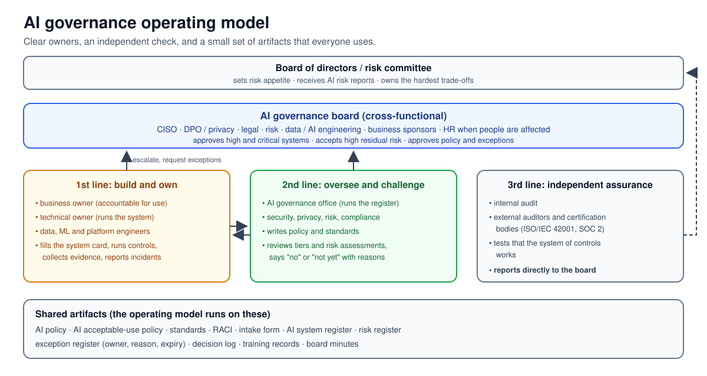

# Roles, Policies and the Governance Operating Model

> **Module:** 07 · AI Governance · **Weeks:** 29–30 (policy lifecycle revisited in week 32) · **Time:** ~8 hours
> **You will:** design who decides what about AI (board, owners, RACI), write an AI acceptable-use policy, run a policy lifecycle, and implement time-limited exceptions that a release gate respects.

| | |
|---|---|
| **Prerequisites** | [Lesson 01](01-ai-inventory-and-system-register.md) (the register) |
| **Lab** | [`lab/`](lab/): exceptions, non-waivable findings and the release gate in `secure_register.py`; `policy_lint.py` for the policy pack |
| **Policy pack** | [`policies/`](policies/): seven templates (acceptable use, risk management, model approval, data governance, third-party risk, incident response, AI security standard) |
| **Maps to** | NIST AI RMF GOVERN 1 (policies), GOVERN 2 (accountability), GOVERN 4 (culture), GOVERN 5 (engagement) · ISO/IEC 42001 clause 5 (leadership, AI policy, roles), Annex A.2–A.3 · EU AI Act Art 4 (AI literacy), Art 26(2) (competent oversight staff) |

---

## 1. Why this matters

Technical controls fail quietly when nobody owns them. Governance answers three questions: **who decides, by which rules, and what happens when the rules are broken.**

- **2016, Microsoft Tay:** a public chatbot that learned from user conversations was taken offline within about a day after users taught it to post offensive messages. The launch decision did not account for abuse by the public.
- **2021, Zillow Offers:** Zillow closed its home-buying business after its pricing models could not forecast house prices accurately enough in a fast-moving market. A model drove large financial commitments, which is a board-level risk, not only a data science one.
- **2021, Netherlands childcare benefits scandal:** the tax authority's fraud risk classification, which used nationality as a factor, contributed to thousands of families being wrongly accused. The Dutch government resigned in January 2021. Accountability for an automated system was spread so thinly that nobody stopped it.
- **2023, Australia Robodebt Royal Commission:** the inquiry into an automated debt-raising scheme found it was unlawful and caused serious harm. A recurring theme was that warnings were raised but the governance structure did not act on them.

These are not "AI bugs". They are failures of **ownership, escalation and challenge**.

---

## 2. Understand it

### 2.1 The operating model



An **operating model** describes how governance runs day to day: who does what, which forums meet, and which documents they use. A common shape is the **three lines** model (from risk management in banking; the US Federal Reserve's SR 11-7 model risk guidance uses the same idea of "effective challenge"):

| Line | Who | Job |
|---|---|---|
| 1st: build and own | Business owner, technical owner, engineers | Run the system and its controls; collect evidence; report incidents |
| 2nd: oversee and challenge | AI governance office, security, privacy, risk, legal/compliance | Write policy; review tiers and risks; say "no" or "not yet" with reasons |
| 3rd: independent assurance | Internal audit, external auditors | Test that the whole system of controls works; report to the board |

The **AI governance board** (also called an AI council or AI risk committee) is a cross-functional forum. It approves high and critical systems, accepts high residual risks, approves policy and decides on exceptions. It should include the CISO, the DPO or privacy lead, legal, risk, engineering, business sponsors, and HR when employees or applicants are affected.

**Make it small and fast.** A board that meets quarterly to approve every chatbot becomes a bottleneck, and teams route around it. Low-tier systems should be approved by rules (Lesson 01). The board's time is for the high and critical ones.

### 2.2 RACI: who does what

**RACI** stands for **R**esponsible (does the work), **A**ccountable (owns the outcome, exactly one person), **C**onsulted (asked before), **I**nformed (told after).

| Activity | Business owner | Technical owner | AI gov. office | Security | Privacy/DPO | Legal | AI gov. board |
|---|---|---|---|---|---|---|---|
| Register system, intended use | **A** | R | C | I | I | I | I |
| Tier and risk assessment | A | R | **R/C** | C | C | C | I (A for high/critical) |
| Threat model, security tests | I | R | I | **A** | I | – | – |
| DPIA / privacy review | C | R | I | C | **A** | C | – |
| Accept high residual risk | C | C | C | C | C | C | **A** |
| Approve exception | R (requests) | C | C | C | C | – | **A** |
| Incident response | A | R | I | **R** | R (if personal data) | C | I |
| Retire system | **A** | R | I | I | C (deletion) | I | I |

Rule: **exactly one "A" per row.** Two accountable people means nobody is accountable.

### 2.3 The policy stack

| Document | Says | Owner | Example |
|---|---|---|---|
| **AI policy** | Principles and commitments ("we will…") | Board / executive | "We register every AI system and assess its risk before use." |
| **AI acceptable-use policy (AUP)** | What staff may and may not do with AI tools | AI gov. office + HR | "Do not paste customer personal data into unapproved AI tools." |
| **Standards** | Measurable requirements | 2nd line | "High-tier systems must have a red-team test before release." |
| **Procedures / runbooks** | Step-by-step how | 1st line | "How to request an exception." |
| **Guidelines** | Helpful advice, not mandatory | Anyone | "Prompt-writing tips." |

A good **AI acceptable-use policy** is short (one or two pages) and covers:
- Approved tools and how to request a new one.
- Data rules: which data classes may go into which tools (a simple table works best).
- Human responsibility: you are accountable for AI output you use; verify facts, code and citations.
- Prohibited uses (for example: decisions about people without approval, generating deceptive content, uploading secrets).
- Disclosure: when to tell customers or colleagues that AI was used.
- Reporting: how to report a problem or a suspected incident.
- Consequences and where to get help.

### 2.4 The policy lifecycle

```text
draft → consult (security, privacy, legal, HR, works council if needed) → approve (board)
      → publish + train → enforce (technical controls where possible) → monitor (metrics, exceptions)
      → review (at least yearly, or on trigger) → update or retire
```

Triggers for an early review: a new law or regulator guidance; a serious incident; a new class of tool (for example agents); repeated exceptions to the same rule (the rule may be wrong).

**Enforce in code where you can.** "Do not send customer data to unapproved AI tools" becomes a proxy rule plus DLP. "High-tier systems need human oversight" becomes the GOV-03 check in the release gate. A policy that is only words depends on everyone remembering it.

**The full pack.** This repo's [`policies/`](policies/) folder has seven short templates with the same structure: purpose, scope, roles, numbered requirements that each say *how we check*, exceptions, review cycle and a NIST AI RMF / ISO/IEC 42001 mapping. `python 07-ai-governance/lab/policy_lint.py` checks that structure, so a policy without evidence or past its review date is a finding, just like a system without an owner.

### 2.4b The board's role: what directors must see and decide

The *Director's Guide to AI Governance* (Human Technology Institute with the Australian Institute of Company Directors, v2, June 2026) organizes board oversight in four elements. In our own words:

| Element | What the board does | What you (the architect) give the board |
|---|---|---|
| **Strategy** | Links AI to the organization's goals; sets an AI risk appetite with management; checks data and infrastructure readiness | A one-page appetite statement with examples ("no autonomous decisions about people without human review") |
| **Structure** | Assigns a senior accountable leader; maps AI responsibilities; decides when the board is consulted | The RACI, the board charter, and approval thresholds by tier |
| **Practices** | Makes sure AI risks run through the existing risk framework; checks that cyber, data and AI controls connect (for example patching applies to AI stacks too); oversees vendor risk | Quarterly risk report: systems by tier, top residual risks, incidents, vendor issues |
| **Enablers** | AI literacy for directors and staff; culture of responsible use; attention to the impact on employees | Training completion, shadow-AI trend, staff feedback |

The guide's practical point for security people: boards should have **visibility**, not just a committee. They need to know where AI is used (including AI features inside SaaS and shadow use) and how AI, cybersecurity and data governance risks overlap. Its small-organization checklist starts with exactly what this module builds: an inventory, a risk appetite discussion, a named accountable leader, a proportionate approval process and a short AI policy.

**Questions a director should be able to ask, and you should be able to answer with data:** Where are we using AI today, including in vendor products? Which systems could harm customers or staff, and who owns each? What is our appetite and where are we above it? Which vendors hold our data in AI services, and on what terms? What happened in our last AI incident, and what changed? Do our cyber controls cover the AI stack?

### 2.5 Exceptions: the safety valve

An **exception** (or waiver) is a documented, approved, time-limited permission to deviate from a policy or standard. Without an exception process, people either stop work or ignore the rule silently. Both are worse.

A valid exception has:
1. The exact rule it waives (in the lab: a key such as `GOV-05:CTL-RT`).
2. A reason and compensating controls.
3. An approver with the right authority.
4. An **expiry date**. Expired means the finding comes back automatically.
5. Visibility: waived findings are still reported, not hidden.

Some findings must be **non-waivable**: no owner, no intended use, no human oversight for a high-risk system, a prohibited use. These are not paperwork gaps; they mean the system should not run.

---

## 3. Defend it

| Layer | Control | Type | What it buys you |
|---|---|---|---|
| L1 | Named owners and one "A" per activity (RACI) | Process | Findings and incidents have somewhere to go |
| L2 | AI policy + AUP, approved and trained | Soft | People know the rules |
| L3 | Policy rules turned into checks (owner, oversight, controls) | **Hard** | Rules apply even when people forget |
| L4 | Exception register with expiry, applied by code | **Hard** | Flexibility without permanent drift |
| L5 | Non-waivable findings | **Hard** | Some risks cannot be signed away |
| L6 | Board review of high/critical systems and metrics | Process | Effective challenge at the right level |
| L7 | Internal audit of the governance process | Process | Independent check that the above works |

### Design patterns worth knowing

- **Tiered approval.** Rules approve low tier; the 2nd line reviews medium; the board approves high and critical.
- **Policy as code.** Each "must" in a standard maps to a check ID (GOV-xx). The check ID appears in the policy text, so people can trace one to the other.
- **Exception budget.** Track the number and age of exceptions per team. Many exceptions to one rule mean the rule needs fixing.
- **Separation of duties.** The person who requests an exception does not approve it.

### What does NOT work on its own

- A policy PDF on the intranet with no training and no technical enforcement.
- An AI ethics committee with no authority to stop a launch.
- Exceptions without expiry dates. They become permanent policy.
- "Everyone is responsible", which means nobody is.

---

## 4. Hands-on lab

**Scenario:** ACME's InboxBot (`AI-001`) is high tier. The red-team test (CTL-RT) is booked for December, but the release is in November. The CISO approved a time-limited exception.

### Step 1: See a valid exception

```powershell
python 07-ai-governance/lab/secure_register.py 07-ai-governance/lab/fixtures/systems_governed.yaml --id AI-001
```

Expected output:

```text
AI-001 InboxBot email summarizer: declared=high computed=high decision=APPROVED
  reason   high: tools with side effects can act on sensitive data
  reason   medium: processes personal data
  required CTL-REG, CTL-AUP, CTL-TM, CTL-EVAL, CTL-LOG, CTL-HO, CTL-RT, CTL-MON, CTL-IR, CTL-PRIV, CTL-VEND
  missing  CTL-RT
  waived   GOV-05:CTL-RT
```

The control is still listed as **missing**. The finding is **waived**, not deleted.

### Step 2: Let the exception expire

```powershell
python 07-ai-governance/lab/secure_register.py 07-ai-governance/lab/fixtures/systems_governed.yaml --id AI-001 --as-of 2027-02-01
```

```text
AI-001 InboxBot email summarizer: declared=high computed=high decision=BLOCKED
  reason   high: tools with side effects can act on sensitive data
  reason   medium: processes personal data
  required CTL-REG, CTL-AUP, CTL-TM, CTL-EVAL, CTL-LOG, CTL-HO, CTL-RT, CTL-MON, CTL-IR, CTL-PRIV, CTL-VEND
  missing  CTL-RT
  high     GOV-05 missing required control CTL-RT: Red-team exercise before release
  high     GOV-09 exception for GOV-05:CTL-RT expired on 2027-01-31
```

Nobody had to remember. The date passed and the gate closed.

### Step 3: Try to waive what cannot be waived

Run the tests about exceptions, owners and the gate:

```powershell
python -m pytest 07-ai-governance -v -k "exception or waive or gate or unowned"
```

```text
collected 53 items / 49 deselected / 4 selected

07-ai-governance\lab\test_governance.py ....                             [100%]

====================== 4 passed, 49 deselected in 1.50s =======================
```

Read `test_unowned_system_is_blocked_and_cannot_be_waived`. A CISO-approved exception for GOV-01 (no owner) is ignored, because `Finding.waivable` is `False` for that check.

### Step 4: Map RACI to code

Open [`lab/secure_register.py`](lab/secure_register.py) and find `_run_checks`. For each check, write the RACI row that owns it (who fixes it, who is accountable). Example: GOV-01 → business owner is A; AI governance office is R for chasing it.

### Step 5: Write the AUP

Write a one-page AI acceptable-use policy for ACME in your journal, using the outline in section 2.3. Then list which sentences can be enforced by a technical control (proxy rule, DLP, register check, SSO-only tools) and which cannot.

### Step 6: Break it yourself (predict, then run)

1. Remove `approved_by` (set it to `""`) on the AI-001 exception in `systems_governed.yaml`. Is the finding still waived? Why?
2. Make GOV-06 (overdue review) blocking. Which governed system, if any, becomes blocked today? Which in six months (`--as-of 2027-05-15`)?
3. Add an exception for `GOV-03` to `AI-002` in the vulnerable file (after fixing its typo). What happens, and which line of code decides?
4. Create a gate with `GovernedRegister(as_of=..., gate=False)`. What would an auditor say about a register that computes findings but cannot block?

### Stretch goals

- Add `requested_by` to exceptions and a check that the requester is not the approver (separation of duties).
- Add a KPI: average age of active exceptions, and number of exceptions per control. Which control would you review first?
- Add "max exception length per tier" (for example 90 days for high, 30 days for critical).

---

## 5. Real-world scenarios

**Scenario A: the permanent exception.**
An exception for "no logging on the support bot" was approved three years ago "until the new platform is ready". It has no expiry date. During an incident nobody can reconstruct what the bot said.
- *What went wrong:* an exception without expiry became policy. No metric showed old exceptions.
- *Investigate:* list all exceptions by age and by control. Check which ones have compensating controls that still exist.
- *Fix:* every exception gets an expiry; code re-opens the finding on expiry; the board sees an "exceptions older than 90 days" metric each quarter.

**Scenario B: the committee with no teeth.**
An AI ethics committee reviews a facial-analysis feature and recommends against it. The product team launches anyway, because the committee's charter says "advisory".
- *What went wrong:* no decision rights. The 2nd line could not stop a launch.
- *Investigate:* read the charter, the RACI and the release process. Who can block a release today?
- *Fix:* give the AI governance board explicit decision rights for high and critical systems. Wire its approval (CTL-BOARD) into the release gate as a required control.

**Scenario C: the policy nobody read.**
The AUP says "no customer data in public AI tools". Proxy logs show hundreds of uploads a week to a free chatbot from the support team.
- *What went wrong:* policy without training, without an approved alternative, and without technical enforcement.
- *Investigate:* talk to the support team. What task were they doing? What data went out? Is any of it a reportable breach?
- *Fix:* provide an approved tool for the task; add DLP rules for personal data to unapproved AI domains; short training with real examples; measure the change in proxy logs.

---

## 6. Common mistakes

- Creating an AI committee before writing down what it decides.
- Writing policy in legal language that engineers cannot turn into checks.
- Two accountable owners for one system, or none.
- Exceptions approved by the person asking for them.
- Not training staff: the EU AI Act's AI-literacy duty (Art 4) has applied to providers and deployers since 2 February 2025. The Digital Omnibus (Regulation (EU) 2026/1744) is reported to have softened its wording; check the current text, and train staff anyway.
- Policy review only "when someone remembers".

---

## 7. Interview preparation

<details><summary><b>Q1. What is an AI governance operating model, in one minute?</b></summary>

It is how AI decisions get made and checked. The first line (owners and engineers) runs systems and controls. The second line (AI governance office, security, privacy, risk, legal) writes policy and challenges risk assessments. The third line (internal audit) independently tests that the whole thing works. A cross-functional AI governance board approves high-risk systems, accepts high residual risk and decides exceptions. It runs on a few shared artifacts: the policy, the register, the risk register and the exception register.
</details>

<details><summary><b>Q2. Who should sit on an AI governance board?</b></summary>

CISO or security lead, DPO or privacy lead, legal/compliance, enterprise risk, a senior engineering or data leader, business sponsors of the systems being discussed, and HR when employees or applicants are affected. It needs a chair with authority and a clear charter: what it approves, what it can block, and what it delegates.
</details>

<details><summary><b>Q3. Why exactly one "Accountable" per activity?</b></summary>

Accountability means one person answers for the outcome. With two, each assumes the other acted. With none, issues stay open forever. Many people can be Responsible, Consulted or Informed, but only one is Accountable.
</details>

<details><summary><b>Q4. What goes into an AI acceptable-use policy?</b></summary>

Approved tools and how to request new ones; a simple data-class table (what may go into which tool); human responsibility for outputs (verify facts, code and citations); prohibited uses; disclosure rules; how to report problems; consequences. Keep it to one or two pages and train people with real examples.
</details>

<details><summary><b>Q5. How do you make a policy enforceable?</b></summary>

Turn each "must" into a measurable standard, then into a technical check where possible: proxy and DLP rules for data to AI tools, SSO-only access to approved tools, register checks in the release gate, logging requirements checked by config scans. Give each check an ID and reference it in the policy text. Measure compliance and exceptions.
</details>

<details><summary><b>Q6. What makes an exception process healthy?</b></summary>

Exact scope (which rule, which system), a reason, compensating controls, an approver with the right authority (not the requester), an expiry date that code enforces, and visibility (waived findings still appear in reports). Some findings must be non-waivable. Track exceptions by age and by control; many exceptions to one rule mean the rule needs to change.
</details>

<details><summary><b>Q7. Which findings should never be waivable, and why?</b></summary>

No owner, no intended use, no human oversight on a high-risk system, and prohibited uses. These are not missing paperwork. They mean nobody is accountable, nobody knows what the system is for, or the system can harm people with no human check. Waiving them is accepting an unknown risk, which nobody has the authority to do.
</details>

<details><summary><b>Q8. Scenario: the board takes six weeks to approve anything and teams are going around it. What do you change?</b></summary>

Tier the approval path. Low tier: automatic approval by rules with standard controls. Medium: 2nd-line review within days. High and critical: the board, with a pre-read and a clear decision. Publish service levels. Measure cycle time. Provide pre-approved patterns and vendors so most systems arrive already compliant.
</details>

<details><summary><b>Q9. How does the three-lines model apply to an AI red team?</b></summary>

An internal red team used by product teams before release is a first-line activity (testing their own system). A security team that sets red-team standards and reviews results is second line. Internal audit checking that red-team findings are tracked and fixed is third line. The independence of the tester matters for how much an auditor relies on the result.
</details>

<details><summary><b>Q10. How often should the AI policy be reviewed?</b></summary>

At least yearly, and early when there is a trigger: a new law or guidance, a serious incident, a new class of technology (for example autonomous agents), or repeated exceptions to the same rule. Record each review, even when nothing changes; that record is audit evidence.
</details>

<details><summary><b>Q11. How do you measure whether governance is working?</b></summary>

Percentage of systems with owners and intended-use statements; reviews on time; systems blocked at the gate and why; time to approve by tier; number and age of exceptions; shadow-AI findings per month; overdue risk treatments; training completion. The lab's `governance_kpis()` computes several of these. Trends matter more than single values.
</details>

<details><summary><b>Q12. What's the difference between a policy, a standard and a procedure?</b></summary>

A policy states intent and commitments ("we assess AI risk before use"). A standard sets measurable requirements ("high-tier systems require a red-team test"). A procedure says step by step how to do something ("how to book a red-team test"). Engineers implement standards and follow procedures; auditors test all three.
</details>

<details><summary><b>Q13. Explain to an executive why we need decision rights, not just an ethics committee.</b></summary>

"An advisory committee can warn us but can't stop us. When something goes wrong, regulators and the press will ask who had the authority to stop it and why they didn't. Clear decision rights mean a small group can say 'not yet' to the riskiest systems, while everything else moves fast through automatic checks."
</details>

<details><summary><b>Q14. What does a board need to see about AI, and what should it decide?</b></summary>

See: where AI is used (including vendor features and shadow use), systems by tier with owners, top residual risks against appetite, incidents and near misses, vendor exposure, and literacy and adoption metrics. Decide: the AI risk appetite, who is accountable, which uses are off-limits, and acceptance of critical residual risks. The Director's Guide groups this as strategy, structure, practices and enablers.
</details>

<details><summary><b>Q15. How do you make a policy "testable"?</b></summary>

Write each requirement as one numbered, observable rule with a named piece of evidence ("Use only approved AI tools" → proxy and CASB report of AI domains). Keep the how-to in the standard. Lint the pack for structure, evidence and review dates, as `policy_lint.py` does, and map each requirement to NIST AI RMF and ISO/IEC 42001 so audits reuse it.
</details>

---

## 8. Checklist (definition of done)

- [ ] I drew ACME's operating model and RACI for five activities, with one "A" per row.
- [ ] I wrote a one-page AI acceptable-use policy and marked which lines are technically enforced.
- [ ] I ran the expiring-exception steps and explained why waived findings stay visible.
- [ ] I adapted at least three templates from [`policies/`](policies/) to my capstone and `policy_lint.py` reports no findings.
- [ ] I wrote a one-page board AI report with the four elements (strategy, structure, practices, enablers).
- [ ] `python -m pytest 07-ai-governance` passes.
- [ ] Journal: which exception would I refuse, and how would I explain that to the requester?

## 9. References

- NIST AI RMF 1.0, GOVERN function: https://www.nist.gov/itl/ai-risk-management-framework
- ISO/IEC 42001:2023, clause 5 (leadership) and Annex A.2–A.3: https://www.iso.org/standard/42001
- US Federal Reserve SR 11-7, *Guidance on Model Risk Management* (2011): https://www.federalreserve.gov/boarddocs/srletters/2011/sr1107.htm
- The Institute of Internal Auditors, *Three Lines Model* (2020): https://www.theiia.org/
- Regulation (EU) 2024/1689 (EU AI Act), Art 4 (AI literacy) and Art 26: https://eur-lex.europa.eu/eli/reg/2024/1689/oj
- OWASP *LLM AI Cybersecurity & Governance Checklist* (OWASP GenAI Security Project): https://genai.owasp.org/
- Royal Commission into the Robodebt Scheme, final report (2023): https://robodebt.royalcommission.gov.au/
