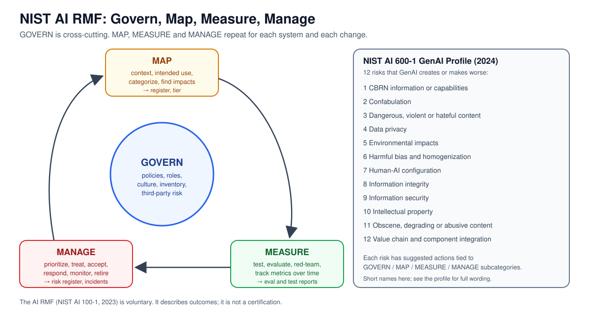
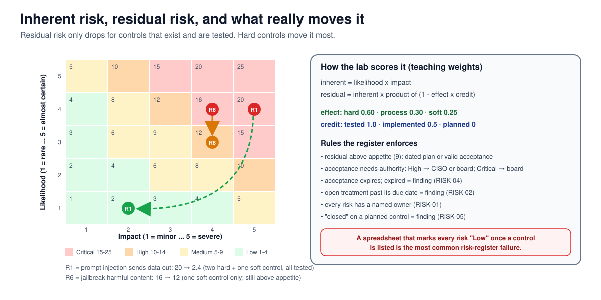

# AI Risk Management: NIST AI RMF, the GenAI Profile and ISO/IEC 23894

> **Module:** 07 · AI Governance · **Weeks:** 30 · **Time:** ~10 hours
> **You will:** run an AI risk assessment end to end, score inherent and residual risk in a risk register, treat or accept risks with the right authority, assess an AI vendor, and see why "a control is listed" is not the same as "the risk is low".

| | |
|---|---|
| **Prerequisites** | [Lesson 01](01-ai-inventory-and-system-register.md) (tiers), [Lesson 02](02-roles-policies-and-operating-model.md) (who may accept risk); threat modeling from [Module 01](../01-ai-security-fundamentals/) |
| **Lab** | [`lab/risk_register.py`](lab/risk_register.py), fixtures `risks_*.csv` (based on [`00-program/templates/risk-register.csv`](../00-program/templates/risk-register.csv)) |
| **Maps to** | NIST AI RMF (all four functions) and NIST AI 600-1 · ISO/IEC 23894:2023 · ISO/IEC 42001 clause 6.1 and 8.2–8.4 · EU AI Act Art 9 (risk management for high-risk systems) · CERT-In AI Security Auditing Guidelines section 5 (risk tiering) · threat sources: OWASP Top 10 for LLM Applications **2026** (renumbered from the 2025 edition; for example Excessive Agency is now LLM03, was LLM06:2025), OWASP Top 10 for Agentic Applications (ASI01–ASI10), OWASP MCP Top 10, MITRE ATLAS |
| **Policy** | [AI Risk Management Policy](policies/02-ai-risk-management-policy.md), [AI Third-Party Risk Assessment](policies/05-ai-third-party-risk-assessment.md) |

---

## 1. Why this matters

Risk management is how an organization decides **which AI risks to reduce, which to accept, and who signs for the rest**. Without it, security work is a list of fixes with no priority.

- **2021, Zillow Offers:** Zillow wound down its home-buying business after its price-forecasting models could not keep up with market changes. The model risk was business-critical, but the size of the exposure grew faster than the controls around it.
- **2020, UK A-level grades:** an algorithm used to estimate exam grades during the pandemic downgraded many students and was withdrawn after public protest. Affected people and fairness had not been weighted as a top risk.
- **2020, SyRI ruling (District Court of The Hague):** the court stopped the Dutch government's welfare-fraud risk-scoring system because it breached the right to private life under the European Convention on Human Rights. Privacy and transparency risks were not managed.
- **2024, NIST AI 600-1 (Generative AI Profile):** NIST listed 12 risks that generative AI creates or makes worse, such as confabulation (confident false output) and information security, with suggested actions for each. It is a ready-made risk catalog for GenAI systems.

---

## 2. Understand it

### 2.1 Vocabulary

| Term | Meaning |
|---|---|
| **Risk** | The chance that something bad happens, combined with how bad it is |
| **Likelihood** | How probable the event is (scored 1–5 in the lab) |
| **Impact** | How bad it is when it happens: harm to people, money, legal, reputation (1–5) |
| **Inherent risk** | Risk before your controls: likelihood × impact |
| **Residual risk** | Risk left after controls that really work |
| **Risk appetite** | How much risk the organization is willing to accept to reach its goals |
| **Treatment** | What you do: avoid, mitigate, transfer, or accept |
| **Risk owner** | The person accountable for the risk and its treatment |

### 2.2 The risk workflow

1. **Context:** purpose, users, affected people, operating environment (from the system card).
2. **Identify:** harms, security threats, privacy risks, misuse and failure modes. Use catalogs: OWASP Top 10 for LLM Applications 2026, OWASP Top 10 for Agentic Applications (ASI01–ASI10) for agents, OWASP MCP Top 10 for MCP servers and clients, MITRE ATLAS, NIST AI 600-1 risks, OWASP GenAI data-security risks (DSGAI01–21), your own incidents.
3. **Analyze:** likelihood, impact, exposure, how easily you'd detect it, and whether the harm can be reversed.
4. **Evaluate:** compare with risk appetite and legal requirements.
5. **Treat:** avoid, mitigate, transfer, or accept with accountable approval.
6. **Monitor:** incidents, changes, drift, abuse and control effectiveness.
7. **Communicate:** owners, affected parties, regulators and auditors as needed.

**Re-assess when anything material changes:** model or model version, data sources, tools, user population, purpose, region, or architecture. A model upgrade is a change.

### 2.3 NIST AI RMF: Govern, Map, Measure, Manage



The **NIST AI Risk Management Framework 1.0** (NIST AI 100-1, January 2023) is voluntary. It describes outcomes, not a checklist, and it is not a certification.

| Function | Question it answers | Examples of what you produce |
|---|---|---|
| **GOVERN** (cross-cutting) | Do we have the culture, policies, roles and processes? | AI policy, RACI, inventory (GOVERN 1.6), third-party risk process (GOVERN 6) |
| **MAP** | What is this system, in what context, and what could go wrong? | System card, intended use, categorization, impact identification |
| **MEASURE** | How do we know how risky it is? | Evaluations, red-team results, metrics tracked over time |
| **MANAGE** | What do we do about it? | Prioritized treatments, risk acceptance, incident response, monitoring, decommissioning |

NIST also describes **characteristics of trustworthy AI**: valid and reliable; safe; secure and resilient; accountable and transparent; explainable and interpretable; privacy-enhanced; and fair with harmful bias managed. A useful habit: for each system, ask which of these could fail and how you would notice.

The companion **AI RMF Playbook** (on the NIST AI Resource Center) gives suggested actions for each subcategory. NIST has announced a revision of AI RMF 1.0; the four functions are expected to stay the core, but check the current version.

#### The Playbook in practice: key actions per function (our summary)

The Playbook is long (about 70 subcategories, each with suggested actions, transparency questions and references). These are the actions a security architect uses most, in our own words:

| Subcategory | What it asks for | What you actually do | Evidence in this repo |
|---|---|---|---|
| GOVERN 1.1 | Legal and regulatory requirements understood and documented | Applicability matrix per system | Module 08 Lesson 01 engine |
| GOVERN 1.4 | Risk process set by transparent policies | Written risk policy with numbered, checkable rules | [Risk Management Policy](policies/02-ai-risk-management-policy.md) |
| GOVERN 1.5 | Ongoing monitoring and periodic review planned, with roles | Review intervals by tier; overdue finding | GOV-06 |
| GOVERN 1.6 | AI system inventory | Register as code | Lesson 01 |
| GOVERN 1.7 | Safe decommissioning | Retirement checklist; disable keys and endpoints | Lesson 06, APR-12 |
| GOVERN 2.1 / 2.3 | Roles clear; executives own AI risk decisions | RACI; board accepts critical risk | Lesson 02, RISK-04 |
| GOVERN 3.2 | Roles for human-AI configuration and oversight | Oversight levels per system | GOV-03 |
| GOVERN 4.3 | Practices for testing, incident identification and information sharing | Red-team in CI; incident triage; near-miss log | Lesson 06 |
| GOVERN 5.1 | Feedback from people outside the team | Appeal and complaint routes feed the risk register | CTL-APPEAL |
| GOVERN 6.1 / 6.2 | Third-party policies; contingency for high-risk third-party failures | Vendor tiers, questionnaire, exit plan | [Third-Party Risk Assessment](policies/05-ai-third-party-risk-assessment.md) |
| MAP 1.1 | Intended purpose, context and laws documented | Intended-use statement; system card | GOV-02 |
| MAP 1.5 | Risk tolerance documented | Appetite (residual ≤ 9 in the lab) | `APPETITE` |
| MAP 2.2 | Knowledge limits and human use of output documented | Model card limitations | Lesson 05, DOC-06 |
| MAP 3.5 | Human oversight processes defined | Approve-each / human-decides by tier | GOV-03 |
| MAP 4.1 | Legal and technology risks of components, incl. third-party data and software | AI BOM; datasheets; licence check | DS-03 |
| MAP 5.1 | Likelihood and magnitude of impacts estimated, using past incidents | 5×5 scoring with incident databases as input | `risk_register.py` |
| MEASURE 1.1 | Metrics chosen for the most significant risks first; unmeasured risks documented | Eval plan per tier | APR-03 |
| MEASURE 2.7 | Security and resilience evaluated | Prompt-injection and leakage regression suites | Modules 02–06 tests |
| MEASURE 2.8 / 2.9 | Transparency, accountability, explanation examined | Decision notices; model cards | Lesson 05 |
| MEASURE 3.1 | Emergent and unanticipated risks tracked in deployment | Monitoring, drift alerts, incident trends | Lesson 06 |
| MANAGE 1.3 | Responses to high-priority risks planned (mitigate, transfer, avoid, accept) | Treatment plans with owners and dates | RISK-03 |
| MANAGE 2.3 / 2.4 | Respond to unknown risks; supersede, disengage or deactivate systems | Kill switch; rollback to approved hash | AIR-03, `can_deploy` |
| MANAGE 3.1 | Third-party risks monitored | Annual vendor reassessment; change notices | MA-05 |
| MANAGE 4.1 / 4.3 | Post-deployment monitoring plan; incidents communicated, including to affected people | Monitoring plan; incident policy; reporting clocks | Module 08 Lesson 04 |

### 2.4 NIST AI 600-1: the Generative AI Profile

Published in July 2024, it applies the AI RMF to generative AI. Its 12 risks (short names):

| # | Risk | Security-architect angle |
|---|---|---|
| 1 | CBRN information or capabilities | Misuse; output filtering; abuse monitoring |
| 2 | Confabulation | Grounding, citations, human verification |
| 3 | Dangerous, violent or hateful content | Content safety layers |
| 4 | Data privacy | Leakage, memorization, PII in prompts and logs |
| 5 | Environmental impacts | Cost and energy budgets |
| 6 | Harmful bias and homogenization | Fairness testing, diverse evaluation |
| 7 | Human-AI configuration | Over-reliance, automation bias, bad UX for oversight |
| 8 | Information integrity | Misinformation, deepfakes, provenance |
| 9 | Information security | Prompt injection, data poisoning, model theft |
| 10 | Intellectual property | Training data, outputs, licensing |
| 11 | Obscene, degrading or abusive content | Content safety, CSAM controls |
| 12 | Value chain and component integration | Third-party models, plugins, datasets |

### 2.5 ISO/IEC 23894: AI risk management guidance

**ISO/IEC 23894:2023** gives guidance on managing AI risk. It builds on **ISO 31000** (general risk management): principles, a framework, and a process (scope and context → assess → treat → monitor and review → record and report). It adds AI-specific sources of risk, such as lack of transparency, data quality and changes in the environment. It is guidance ("should"), not a certifiable requirement. ISO/IEC 42001 (Lesson 04) is the certifiable management system that *uses* this kind of process.

| | NIST AI RMF | ISO/IEC 23894 |
|---|---|---|
| Type | Voluntary framework (US) | International guidance standard |
| Structure | Govern / Map / Measure / Manage | ISO 31000 process, AI-specific additions |
| Certifiable? | No | No |
| Best use | Outcomes and a shared vocabulary; GenAI Profile | Fitting AI risk into an existing ISO 31000 / ISO 27001 risk process |

### 2.6 Scoring: inherent, residual, and why evidence matters



The lab uses a 5×5 matrix: inherent = likelihood × impact. Residual risk is calculated from the controls, with two teaching rules:

- **Control effect:** hard controls (deterministic code: tool policy, access control) reduce risk most (0.60). Process controls (human approval) less (0.30). Soft controls (spotlighting, classifiers, prompt wording) least (0.25).
- **Control credit:** a control counts fully only when *tested* (1.0). *Implemented* but untested counts half (0.5). *Planned* counts zero.

These numbers are for teaching, not an industry standard. The shape is the lesson. It matches Module 02: a soft control alone never takes a critical prompt-injection risk to low.

### 2.7 Treatment options

| Option | Meaning | AI example |
|---|---|---|
| **Avoid** | Don't do the risky thing | Don't give the summarizer a `send_email` tool |
| **Mitigate** | Add controls | Tool broker, recipient allowlist, human approval |
| **Transfer** | Shift some impact to another party | Contract terms with the vendor; cyber insurance (you keep the accountability) |
| **Accept** | Live with it, knowingly | Board accepts a residual High risk until a fix ships, with an expiry date |

Acceptance needs **authority**. The lab's delegation table: Low → any named owner; Medium → system owner, CISO or board; High → CISO or board; Critical → board only. Every acceptance has an expiry date.

### 2.8 Third-party and vendor AI risk

Most AI systems depend on someone else's model, API, dataset or plugin (NIST AI 600-1 risk 12; NIST GOVERN 6 and MANAGE 3). Assess model providers and AI vendors on:

| Area | Questions |
|---|---|
| Data use | Is your input used for training? Can you opt out? What is retained, for how long? |
| Human access | Can vendor staff read your prompts and outputs (for abuse review)? Under what controls? |
| Location | Which regions process and store data? Which sub-processors? |
| Security | Independent reports (SOC 2 Type II, ISO/IEC 27001, ISO/IEC 42001 scope), encryption, tenant isolation |
| Incidents | Notification time in the contract; past incidents |
| Change | Notice of model changes and deprecations; version pinning |
| Deletion and exit | Deletion on request, data export, continuity if the vendor fails |
| IP and licensing | Output ownership, indemnities, licence of open-weight models |
| AI-specific | Evaluation results, red-team summary, system card, content safety settings, abuse monitoring |

A vendor's certificate covers **the vendor's** scope. It does not make **your application** compliant or secure.

---

## 3. Defend it

| Layer | Control | Type | What it buys you |
|---|---|---|---|
| L1 | Risk catalog per system from OWASP / ATLAS / NIST 600-1 | Process | You don't forget whole classes of risk |
| L2 | Numeric scoring with an explicit formula | Hard (code) | Consistent, comparable, testable scoring |
| L3 | Residual credit only for tested controls | **Hard** | Paper controls stop lowering the score |
| L4 | Hygiene checks: owner, due dates, appetite, acceptance authority and expiry | **Hard** | The register can't silently rot |
| L5 | Re-assessment triggers on change (model, data, tools, users, region) | Process + code | Risk stays current |
| L6 | Vendor assessment before contract and on renewal | Process | Value-chain risk is visible |
| L7 | Board reporting of top risks and trends | Process | Leaders own the appetite |

### What does NOT work on its own

- A heat map with no owners and no dates.
- Marking a risk "mitigated" because a control is *planned*.
- A single risk score for "the AI program" instead of per system.
- Copying a vendor's SOC 2 report into your evidence folder as proof that *your* system is controlled.
- Scoring likelihood from optimism. Use incidents, red-team results and threat intelligence.

---

## 4. Hands-on lab

**Scenario:** ACME's risk register was kept in a spreadsheet. Every risk with a listed control was rated "Low". Score it properly.

### Step 1: Score the vulnerable register

```powershell
python 07-ai-governance/lab/risk_register.py 07-ai-governance/lab/fixtures/risks_vulnerable.csv
```

Expected output:

```text
risk   system  inherent  residual  rating    findings
R-001  AI-001        20      17.5  Critical  RISK-02 treatment overdue since 2026-08-31 (76 days)
R-002  AI-001        12       8.4  Medium    RISK-01 no risk owner
R-003  AI-002        20      15.0  Critical  RISK-04 'HR Manager' may not accept a Critical residual risk
R-004  AI-003        12      10.2  High      RISK-04 acceptance expired on 2026-03-31
R-005  AI-004        12      12.0  High      RISK-05 closed while a listed control is only planned
{'risks': 5, 'above_appetite': 3, 'overdue_treatments': 1, 'invalid_acceptances': 2, 'unowned': 1}
```

In `demo.py`, the "spreadsheet" column shows **Low** for all five.

### Step 2: Switch off the evidence and deadline rules

```powershell
python 07-ai-governance/lab/risk_register.py 07-ai-governance/lab/fixtures/risks_vulnerable.csv --no-evidence-rule --no-deadlines
```

```text
risk   system  inherent  residual  rating    findings
R-001  AI-001        20       6.0  Medium    -
R-002  AI-001        12       8.4  Medium    RISK-01 no risk owner
R-003  AI-002        20      15.0  Critical  RISK-04 'HR Manager' may not accept a Critical residual risk
R-004  AI-003        12       8.4  Medium    -
R-005  AI-004        12       4.8  Low       RISK-05 closed while a listed control is only planned
{'risks': 5, 'above_appetite': 1, 'overdue_treatments': 0, 'invalid_acceptances': 1, 'unowned': 1}
```

R-001 drops from Critical to Medium because a *planned* tool broker now gets full credit, and its overdue treatment disappears. This is how a board gets told "prompt injection is under control" before any code exists.

### Step 3: Score the governed register

```powershell
python 07-ai-governance/lab/risk_register.py 07-ai-governance/lab/fixtures/risks_governed.csv
```

```text
risk   system  inherent  residual  rating    findings
R-001  AI-001        20       2.4  Low       -
R-002  AI-001        12       3.4  Low       -
R-003  AI-002        20       4.8  Low       -
R-004  AI-003        12       3.4  Low       -
R-005  AI-004        12       3.4  Low       -
R-006  AI-004        16      12.0  High      -
R-007  AI-006         9       4.4  Low       -
{'risks': 7, 'above_appetite': 1, 'overdue_treatments': 0, 'invalid_acceptances': 0, 'unowned': 0}
```

R-006 is still High (above appetite) with no finding. That is fine: it has a treatment plan with a due date (output moderation by 2027-01-31). **A high risk with a dated plan is managed. A low score with no evidence is not.**

### Step 4: Connect risk to the register

```powershell
python -m pytest 07-ai-governance -v -k "risk_entry or acceptance or appetite or soft_control"
```

Read `test_high_risk_system_without_a_risk_entry_is_blocked`: a high-tier system with no owned risk-register entry is blocked at the release gate (GOV-08).

### Step 5: Build your own risk register (the week-30 deliverable)

Copy `fixtures/risks_governed.csv` to your journal folder. Write **at least 15 risks** for your capstone system across security, privacy, safety, reliability, misuse and third-party dependency. Use NIST AI 600-1's 12 risks, the OWASP Top 10 for LLM Applications 2026 and, for agents and MCP, the OWASP Agentic (ASI) and MCP Top 10 lists as prompts. Put the catalog IDs in a column. Score them with `risk_register.py`. For every risk above appetite, write a treatment with an owner and a due date.

### Step 6: Assess a vendor

Pick one model provider you use or plan to use. Fill the 14-question questionnaire in the [AI Third-Party Risk Assessment](policies/05-ai-third-party-risk-assessment.md) (Appendix A; the table in section 2.8 is the short version) from its public documentation (trust center, terms, data processing addendum). Mark each answer "documented", "contractual" or "unknown". Unknowns become questions for procurement and a risk entry (value chain).

### Step 7: Break it yourself (predict, then run)

1. In `risks_governed.csv`, change R-001's tool broker from `tested` to `implemented`. Predict the new residual. (Hint: 20 × (1 − 0.6×0.5) × 0.4 × 0.75.)
2. Change R-006's `due_date` to `2026-10-31`. Which finding appears?
3. Set R-004's `accepted_by` to `Intern`. Is that a finding? Why not? (Look at `ACCEPT_AUTHORITY` for a Low residual.) Do you agree with that policy?
4. Change `EFFECT["soft"]` to 0.9. Which test fails, and what real-world belief does that test protect against?

### Stretch goals

- Add a "velocity" field (how fast the risk could happen after a change, e.g. a model update) and use it to set review frequency.
- Produce a top-10 risk report for the board, sorted by residual, with trend arrows compared with last quarter's CSV.
- Map each risk to its NIST AI RMF function and NIST AI 600-1 risk number in two new columns.

---

## 5. Real-world scenarios

**Scenario A: the model upgrade.**
A provider retires the model version you use. The new version is "better", so the team switches without telling anyone. The jailbreak success rate in your test suite doubles.
- *What went wrong:* a model change was not a re-assessment trigger.
- *Investigate:* compare test results before and after; check which controls depend on model behavior (soft) versus code (hard).
- *Fix:* make model version part of the system card; any change re-runs the evaluation suite and the risk scoring; pin versions; ask vendors for deprecation notice in the contract.

**Scenario B: "accepted" by the wrong person.**
An HR manager accepted the risk of biased CV ranking because "we need the tool before hiring season".
- *What went wrong:* no delegation of authority. A critical residual risk affecting applicants' rights was accepted at the wrong level, with no expiry. This is the lab's R-003.
- *Investigate:* who approved what, when, and with what information? Was the residual risk calculated with tested controls?
- *Fix:* a delegation table enforced by the register; critical acceptances need the board; every acceptance expires; affected-people impacts get an impact assessment (CTL-IA).

**Scenario C: the vendor certificate.**
Procurement approves an AI vendor because "they are ISO 42001 certified". Later you learn the certificate's scope covers only the vendor's internal R&D, not the API you use.
- *What went wrong:* nobody read the certificate's scope.
- *Investigate:* request the certificate and the Statement of Applicability scope; read the SOC 2 report's system description and exceptions.
- *Fix:* vendor assessments record certificate scope and expiry; anything outside scope is assessed directly; contract requires notice if certification lapses.

---

## 6. Common mistakes

- Scoring every risk 3 × 3 because nobody wants to argue.
- Using the vendor's marketing claims as control evidence.
- No link between the risk register and the system register (orphan risks, unassessed systems).
- Treating "accept" as the default.
- Ignoring affected people who are not users (job applicants, loan applicants, the public).
- Never re-assessing after go-live.

---

## 7. Interview preparation

<details><summary><b>Q1. Explain the four NIST AI RMF functions in two sentences each.</b></summary>

GOVERN builds the culture, policies, roles and processes for AI risk; it is cross-cutting and supports the other three. MAP establishes context: what the system is for, who it affects and what could go wrong. MEASURE uses tests, evaluations and metrics to understand how risky the system really is, and tracks that over time. MANAGE prioritizes and treats risks, responds to incidents, monitors in production and decides when to retire a system.
</details>

<details><summary><b>Q2. What does NIST AI 600-1 add to the AI RMF?</b></summary>

It is the Generative AI Profile (July 2024). It names 12 risks that GenAI creates or worsens (for example confabulation, information security, data privacy, value chain and component integration) and lists suggested actions mapped to AI RMF subcategories. It turns a general framework into a usable GenAI risk catalog.
</details>

<details><summary><b>Q3. How does ISO/IEC 23894 relate to ISO 31000 and ISO/IEC 42001?</b></summary>

ISO/IEC 23894 is AI-specific guidance built on the ISO 31000 risk-management principles and process. ISO/IEC 42001 is the certifiable AI management system; it requires an AI risk assessment and treatment process, and 23894 is guidance on how to run one well. Neither 23894 nor ISO 31000 is certifiable on its own.
</details>

<details><summary><b>Q4. Inherent vs residual risk: why does the difference matter for AI?</b></summary>

Inherent risk shows how dangerous the design is before controls; residual shows what is left. For AI, many controls are probabilistic (prompt instructions, classifiers), so residual risk is often overstated as "low". I only credit tested controls, weight deterministic controls higher, and require evidence. Otherwise leaders accept risks based on controls that don't exist yet.
</details>

<details><summary><b>Q5. Walk me through a risk assessment for an LLM agent that can issue refunds.</b></summary>

Context: intended use, users, refund limits, data. Identify: prompt injection leading to unauthorized refunds; confabulated policy; account takeover via the agent; excessive agency; vendor model change; logging of payment data. Analyze likelihood (exposed to untrusted customer text = high) and impact (direct money loss, fraud at scale). Evaluate against appetite: likely critical. Treat: hard limits in the payment API, per-customer caps, human approval above a threshold, tool broker with schema validation, anomaly detection, regression tests. Re-score residual with tested controls only. Owner, due dates, board acceptance for what remains.
</details>

<details><summary><b>Q6. What are the four treatment options? Give an AI example of each.</b></summary>

Avoid: don't give the summarizer tools. Mitigate: add a tool broker and human approval. Transfer: contract terms and insurance for some financial impact (accountability stays with you). Accept: the board accepts a residual High jailbreak risk until moderation ships next quarter, with an expiry date.
</details>

<details><summary><b>Q7. Who should be allowed to accept AI risk?</b></summary>

It depends on the size of the residual risk, through a written delegation of authority: system owner for low, CISO or a risk committee for high, the AI governance board or executive for critical. The acceptor must understand the risk, the acceptance must be recorded with an expiry date, and the person who builds the system should not accept its critical risks alone.
</details>

<details><summary><b>Q8. What would you ask an AI model provider before signing?</b></summary>

Is our data used for training, and can we opt out? Retention and human access to prompts? Processing regions and sub-processors? Independent assurance (SOC 2 Type II, ISO 27001, ISO 42001) and its scope? Incident notification time? Model change and deprecation notice? Deletion and exit? Output IP and indemnities? Safety evaluations and system card? Abuse monitoring and its data use?
</details>

<details><summary><b>Q9. Which events should trigger an AI risk re-assessment?</b></summary>

A new model or model version; new data sources or data classes; new tools or permissions; a new user group or affected group; a new purpose or domain; a new region or jurisdiction; architecture changes (for example adding memory or agents); a significant incident; new threat intelligence; a change in law.
</details>

<details><summary><b>Q10. Scenario: your top risk has been "in progress" for nine months. What do you do?</b></summary>

Find out why: lack of funding, unclear owner, a technical blocker or a bad plan. Re-score with current evidence. Either set a realistic new date with the owner and executive sponsor, add interim compensating controls, or escalate for formal acceptance at the right level. Report it in the overdue metric so it can't hide. The lab flags this as RISK-02.
</details>

<details><summary><b>Q11. How do you score likelihood for prompt injection honestly?</b></summary>

Base it on exposure and evidence: does the system read untrusted content? Is there an exfiltration path (the lethal trifecta)? What does the red-team suite show, and how often do attacks succeed on the real model? Public incidents in similar systems count too. If it reads untrusted content and has a side-effecting tool, likelihood is high until hard controls are tested.
</details>

<details><summary><b>Q12. How do you show risk to the board without drowning them?</b></summary>

A one-page view: top 10 residual risks with owners and trend; risks above appetite with their dated plans; acceptances due to expire; overdue treatments; new risks from incidents or new systems. One clear ask per meeting (approve, accept, fund). Details stay in the register.
</details>

<details><summary><b>Q13. What's the relationship between OWASP LLM Top 10, MITRE ATLAS and a risk register?</b></summary>

OWASP and ATLAS are threat catalogs: lists of what can go wrong and how attackers do it. The risk register is the organization's decision record: which of those apply to *our* systems, how likely and severe they are here, what we do about them, and who owns them. Catalogs feed the "identify" step.
</details>

<details><summary><b>Q14. Explain residual risk to a non-technical executive.</b></summary>

"Every AI system starts with some danger built in. Our controls reduce it, but only the ones that are actually built and tested. Residual risk is what's left after that. Today the biggest leftover risk is X; it is above what we agreed to tolerate, the fix is due on this date, and until then we either accept it with your sign-off or we limit the feature."
</details>

<details><summary><b>Q15. Pick three NIST AI RMF Playbook subcategories you would implement first, and how.</b></summary>

GOVERN 1.6 (inventory: the register as code, discovery of shadow AI), MAP 1.1 (intended use and context: required fields in the system card), and MEASURE 2.7 (security and resilience evaluated: prompt-injection and leakage regression suites in CI). Together they tell you what exists, what it is for, and whether it resists attack, which every later decision depends on.
</details>

<details><summary><b>Q16. How would you use the CERT-In eight-factor tiering next to your own risk register?</b></summary>

As a second, external view of inherent risk per system: score F1–F8 (1–4) before credit for controls, compute the composite and tier, and compare with your own tier. If they differ, the higher one decides audit depth. The risk register then holds the specific risks and treatments. Module 08 Lesson 06 has the lab.
</details>

---

## 8. Checklist (definition of done)

- [ ] I can explain Govern / Map / Measure / Manage and name five of the NIST AI 600-1 risks.
- [ ] I can explain how ISO/IEC 23894, ISO 31000 and ISO/IEC 42001 relate.
- [ ] My capstone risk register has 15+ risks with owners, scores, treatments and dates.
- [ ] I completed one vendor assessment and recorded unknowns as risks.
- [ ] `python -m pytest 07-ai-governance` passes.
- [ ] Week 30 journal: one risk I would accept and one I would never accept, and why.

## 9. References

- NIST AI RMF 1.0 (NIST AI 100-1), https://doi.org/10.6028/NIST.AI.100-1 and https://www.nist.gov/itl/ai-risk-management-framework
- NIST AI 600-1, *Generative AI Profile* (2024): https://doi.org/10.6028/NIST.AI.600-1 and https://www.nist.gov/publications/artificial-intelligence-risk-management-framework-generative-artificial-intelligence
- NIST AI Resource Center (Playbook, crosswalks): https://airc.nist.gov/
- ISO/IEC 23894:2023, *AI — Guidance on risk management*: https://www.iso.org/standard/77304.html
- ISO 31000, *Risk management — Guidelines*: https://www.iso.org/iso-31000-risk-management.html
- OWASP Top 10 for LLM Applications 2026 (released August 2026; the 2025 edition is the previous numbering): https://genai.owasp.org/llm-top-10/
- OWASP Top 10 for Agentic Applications (ASI01–ASI10, December 2025): https://genai.owasp.org/
- OWASP MCP Top 10 (beta): https://owasp.org/www-project-mcp-top-10/
- NIST AI RMF Playbook: https://airc.nist.gov/
- MITRE ATLAS: https://atlas.mitre.org/
- Regulation (EU) 2024/1689 (EU AI Act), Art 9: https://eur-lex.europa.eu/eli/reg/2024/1689/oj
- Repo template: [`00-program/templates/risk-register.csv`](../00-program/templates/risk-register.csv)
