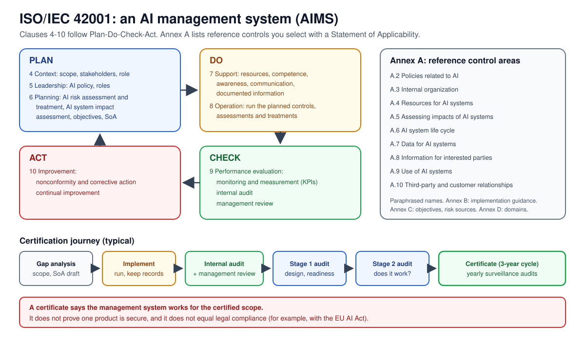

# ISO/IEC 42001: the AI Management System

> **Module:** 07 · AI Governance · **Weeks:** 30 · **Time:** ~7 hours
> **You will:** explain what an AI management system (AIMS) is, walk through ISO/IEC 42001's clauses and Annex A control areas at a high level, plan a certification journey, and run a small internal audit using the lab's register and risk outputs as evidence.

| | |
|---|---|
| **Prerequisites** | Lessons [01](01-ai-inventory-and-system-register.md)–[03](03-ai-risk-management.md); basic idea of ISO/IEC 27001 helps |
| **Lab** | [`lab/`](lab/): `demo.py` KPIs (`governance_kpis`, `register_kpis`) as clause-9 metrics; findings as nonconformities |
| **Maps to** | ISO/IEC 42001:2023 clauses 4–10 and Annex A · ISO/IEC 27001 (same management-system structure) · NIST AI RMF GOVERN · EU AI Act Art 17 (quality management system for high-risk providers) |

> **Note on the standard text.** ISO standards are copyrighted. This lesson paraphrases the structure and ideas. It does not reproduce the standard. Use your organization's licensed copy for exact wording and numbering.

---

## 1. Why this matters

Lessons 01–03 built parts: a register, roles, a risk process. A **management system** is what makes those parts run every year, survive staff changes, and improve. ISO/IEC 42001 is the international standard for that, and it is certifiable.

- **December 2023:** ISO and IEC published ISO/IEC 42001, the first international standard for an AI management system.
- **Since 2024:** several cloud and AI providers (for example AWS and Anthropic) have announced ISO/IEC 42001 certification for defined scopes. Customers now ask for it in procurement, and they need to read the *scope* of each certificate.
- **Long history in security:** ISO/IEC 27001 certification has been common for years, and organizations still have breaches. A management system shows that a process for managing risk exists and works. It does not prove a system is secure. The same is true for AI.
- **EU AI Act Art 17:** providers of high-risk AI systems must run a quality management system. An AIMS built on ISO/IEC 42001 can cover much of the same ground. Whether a standard gives legal "presumption of conformity" depends on the harmonised standards published for the Act, so check the current status.

---

## 2. Understand it

### 2.1 What a management system is

A **management system** is the set of policies, roles, processes and records an organization uses to reach its objectives, and to improve over time. It follows **Plan–Do–Check–Act (PDCA)**:

- **Plan:** decide scope, policy, objectives, risks and controls.
- **Do:** run the controls and processes.
- **Check:** measure, audit and review.
- **Act:** fix problems and improve.

An **AIMS** (AI management system) applies this to the development, provision or use of AI systems. It is about the **organization**, not one product.

### 2.2 The clauses at a high level



ISO/IEC 42001 uses the same high-level structure as ISO/IEC 27001 and ISO 9001 (the ISO "harmonized structure"). Clauses 1–3 are scope, references and terms. Clauses 4–10 hold the requirements:

| Clause | Theme (paraphrased) | What you build | In this module |
|---|---|---|---|
| 4 Context | Understand the organization, interested parties and your AI role (developer, provider, user…); define the AIMS scope | Scope statement, list of AI systems in scope | Lesson 01 register |
| 5 Leadership | Top-management commitment; an AI policy; roles and responsibilities | AI policy, RACI, board charter | Lesson 02 |
| 6 Planning | AI risk assessment, AI risk treatment, AI system impact assessment, AI objectives; choose controls (Statement of Applicability) | Risk method, risk register, impact assessments, SoA | Lesson 03 |
| 7 Support | Resources, competence, awareness, communication, documented information | Training records, document control | Lesson 02 (AUP, training) |
| 8 Operation | Run the planned processes; perform risk assessments, treatments and impact assessments as planned and on change | Operating records, change triggers | Lessons 01–03 lab |
| 9 Performance evaluation | Monitoring and measurement, internal audit, management review | KPIs, audit reports, review minutes | This lesson's lab |
| 10 Improvement | Handle nonconformities, corrective action, continual improvement | Corrective action log | This lesson's lab |

Two AI-specific ideas stand out compared with ISO/IEC 27001:
1. **AI system impact assessment:** assess the consequences of AI systems for **individuals, groups and society**, not only for the organization. (The separate standard ISO/IEC 42005 gives guidance on this; check its current status.)
2. **Your role matters:** an organization may develop, provide or use AI, and the controls that apply differ.

### 2.3 Annex A: reference controls

Annex A lists control objectives and controls. You select those that address your risks and record the decision in a **Statement of Applicability (SoA)**: for each control, whether it applies, why, and how it is implemented (or why it is excluded).

The control areas (paraphrased names):

| Area | Theme | Example from this repo |
|---|---|---|
| A.2 | Policies related to AI | AI policy, AUP (Lesson 02) |
| A.3 | Internal organization | Roles, reporting of concerns (Lesson 02) |
| A.4 | Resources for AI systems | Inventory of data, tools, compute, people (Lesson 01) |
| A.5 | Assessing impacts of AI systems | Impact assessment (CTL-IA), DPIA (Module 08) |
| A.6 | AI system life cycle | Requirements, design, verification, deployment, monitoring, logs (Modules 02–06) |
| A.7 | Data for AI systems | Data quality, provenance, preparation (Module 03 RAG) |
| A.8 | Information for interested parties | System documentation, incident communication (Module 08) |
| A.9 | Use of AI systems | Intended use, human oversight, responsible use (CTL-HO) |
| A.10 | Third-party and customer relationships | Vendor assessment, supplier responsibilities (Lesson 03) |

Annex B gives implementation guidance for the controls. Annex C lists possible AI objectives and risk sources. Annex D covers use across domains and sectors.

### 2.4 ISO/IEC 42001 compared with other things you'll hear

| | ISO/IEC 42001 | ISO/IEC 27001 | NIST AI RMF | ISO/IEC 23894 | EU AI Act |
|---|---|---|---|---|---|
| What | AI management system | Information security management system | Voluntary risk framework | AI risk guidance | Law |
| Certifiable? | Yes (organization, scope) | Yes | No | No | No (conformity assessment for high-risk systems is a legal process) |
| Focus | AI governance, impacts, lifecycle | Confidentiality, integrity, availability | Trustworthy-AI outcomes | Risk process | Legal duties by role and category |

**Integrate, don't duplicate.** If you already have ISO/IEC 27001, run one integrated management system: shared document control, internal audit, management review and corrective action. Add the AI-specific parts (impact assessment, AI lifecycle, data for AI, AI use).

### 2.5 The certification journey

| Step | What happens | Typical evidence |
|---|---|---|
| Gap analysis | Compare current practice with the clauses and Annex A; decide scope | Gap report, draft scope and SoA |
| Implement | Build and run the processes for a few months | Register, risk register, impact assessments, training records |
| Internal audit | Independent check against the standard | Audit report, nonconformities |
| Management review | Top management reviews performance and decides actions | Minutes, decisions, resources |
| Stage 1 audit | The certification body reviews design and readiness | Documents, scope, SoA |
| Stage 2 audit | The certification body tests that the system works in practice | Records, interviews, samples |
| Certificate | Usually a three-year cycle | Certificate with scope |
| Surveillance audits | Usually yearly | Ongoing records, corrective actions |

Choose an accredited certification body. (ISO/IEC 42006 sets requirements for bodies that audit and certify AI management systems; check its current status.) **The scope statement is everything.** "AI-enabled customer support platform, EU operations" is very different from "the whole company".

### 2.6 What a certificate does and does not tell you

| It tells you | It does not tell you |
|---|---|
| A management system exists for the stated scope | That a specific AI product is secure or fair |
| An independent auditor sampled evidence that it operates | That every system in scope was tested |
| Nonconformities are tracked and fixed | That the organization meets the EU AI Act or GDPR |
| Top management is involved | Anything outside the scope |

---

## 3. Defend it

For an AIMS, "defense" means making the management system real rather than a paper exercise.

| Layer | Control | Type | What it buys you |
|---|---|---|---|
| L1 | Clear scope and SoA tied to the system register | Process | Everyone knows what is covered |
| L2 | Automated checks for the AI processes (register, risk, evidence) | **Hard** | Operation is continuous, not once a year |
| L3 | KPIs measured from systems, not surveys | **Hard** | Clause 9 is based on data |
| L4 | Internal audit by people independent of the work | Process | Effective challenge |
| L5 | Management review with decisions and resources | Process | Leadership actually steers |
| L6 | Corrective-action log with owners and dates | Process | Findings get fixed, and the same ones don't come back |

### What does NOT work on its own

- Buying a policy template pack and calling it an AIMS.
- A scope so narrow it excludes every risky system.
- An internal audit run by the team that built the processes.
- Treating the certificate as the goal. The goal is fewer, smaller AI incidents and faster, safer delivery.

---

## 4. Hands-on lab

**Scenario:** ACME wants ISO/IEC 42001 certification next year for "AI systems used in customer support and HR". You run a mini internal audit using the lab as the organization's records.

### Step 1: Collect clause-9 metrics

```powershell
python 07-ai-governance/lab/demo.py
```

From the output, copy the KPI lines. Expected for the **vulnerable** set:

```text
governance KPIs: {'systems_in_scope': 5, 'pct_owned': 80, 'pct_intended_use': 60, 'blocked': 5, 'overdue_reviews': 2, 'missing_controls': 14, 'active_waivers': 0}
risk KPIs: {'risks': 5, 'above_appetite': 3, 'overdue_treatments': 1, 'invalid_acceptances': 2, 'unowned': 1}
```

and for the **governed** set:

```text
governance KPIs: {'systems_in_scope': 5, 'pct_owned': 100, 'pct_intended_use': 100, 'blocked': 0, 'overdue_reviews': 0, 'missing_controls': 1, 'active_waivers': 1}
risk KPIs: {'risks': 7, 'above_appetite': 1, 'overdue_treatments': 0, 'invalid_acceptances': 0, 'unowned': 0}
```

Note `pct_owned: 80` in the vulnerable set. `AI-002` failed the schema, so the KPI counts it as **not** owned. A record you cannot validate cannot prove anything. (Read the comment in `governance_kpis()`.)

### Step 2: Write audit findings as nonconformities

Pick three findings from the vulnerable set (run `demo.py --details`). For each, write:

| Field | Example |
|---|---|
| Requirement | Clause 5/A.3: roles and responsibilities assigned |
| Evidence | Register entry AI-002 has no business owner (GOV-01 after the typo is fixed) |
| Nonconformity grade | Major (a high-risk system with no accountable owner) or minor |
| Root cause | Owner left; no process to reassign owners when people leave |
| Corrective action | Leaver process includes register check; KPI for systems without owner |
| Owner and due date | AI governance office, 30 days |

### Step 3: Draft a Statement of Applicability

In your journal, make a table with the nine Annex A areas (section 2.3). For each: applicable (yes/no), justification, how implemented, evidence location (for example `lab/fixtures/risks_governed.csv`). Mark at least one area where your evidence is weak.

### Step 4: Run the module test suite as "operating evidence"

```powershell
python -m pytest 07-ai-governance
```

```text
.....................................................                    [100%]
53 passed in 0.27s
```

(The time will differ on your machine.)

In a real AIMS, a scheduled run of checks like these (with stored results) is strong evidence that clause 8 processes operate continuously.

### Step 5: Management review pack

Write one page for "top management": the KPI trend (vulnerable → governed), top three risks, nonconformities and their status, resources needed, and one decision you need from them.

### Step 6: Break it yourself

1. Change the governed `AI-004` `last_review` to `2025-01-01`. Which KPI changes? Is that a nonconformity, an observation, or both?
2. Remove `AI-006` from the governed register. What does the shadow-AI section show? Which clause does that relate to (scope, operation, or both)?
3. Argue for and against putting `AI-005` (retired, prohibited) in the AIMS scope.

### Stretch goals

- Write `soa.yaml` with the nine areas and a small script that checks every applicable area has at least one evidence file path that exists.
- Map each GOV-xx check to an Annex A area and print a coverage table.

---

## 5. Real-world scenarios

**Scenario A: the narrow scope.**
A vendor advertises "ISO/IEC 42001 certified". Your procurement team accepts it. The certificate scope covers the vendor's internal research tools, not the API product you buy.
- *What went wrong:* certificate scope not checked.
- *Investigate:* request the certificate and scope statement; check the certification body is accredited; ask how the product is covered.
- *Fix:* vendor assessments record certificate scope, issuer and expiry; products outside scope are assessed directly.

**Scenario B: certification as a project.**
A company passes Stage 2, disbands the project team, and stops internal audits. At the first surveillance audit, risk assessments are a year old and new AI systems are not in the register.
- *What went wrong:* the AIMS was a project, not an operating process.
- *Investigate:* compare register and risk-register dates with the change log; check management review minutes.
- *Fix:* automate the operating checks (register in CI, scheduled discovery, evidence freshness); give the AIMS a permanent owner and budget.

**Scenario C: two management systems that disagree.**
The ISO/IEC 27001 team and the new AI governance team each run their own risk method, document control and internal audit. A prompt-injection risk is scored "Low" in one and "High" in the other.
- *What went wrong:* duplicated management systems.
- *Investigate:* map overlapping processes and records.
- *Fix:* integrate: one risk method with AI-specific additions, one document control, one audit program, one management review covering both.

---

## 6. Common mistakes

- Thinking ISO/IEC 42001 certifies a product. It certifies a management system for a scope.
- Copying another company's SoA.
- Skipping the AI system impact assessment because "we already did a DPIA". A DPIA covers personal data; impact assessment is broader.
- No link between the AIMS and engineering pipelines, so evidence is created by hand before audits.
- Treating nonconformities as embarrassing instead of as the improvement engine.

---

## 7. Interview preparation

<details><summary><b>Q1. What is an AI management system?</b></summary>

The policies, roles, processes and records an organization uses to govern AI responsibly and improve over time, structured as Plan–Do–Check–Act. ISO/IEC 42001 specifies requirements for one: context and scope, leadership and policy, AI risk and impact assessment, support, operation, performance evaluation and improvement. It applies to the organization, for a defined scope.
</details>

<details><summary><b>Q2. Name the main clauses of ISO/IEC 42001.</b></summary>

Clauses 4–10: context of the organization; leadership; planning (including AI risk assessment, treatment and impact assessment); support; operation; performance evaluation (monitoring, internal audit, management review); improvement (nonconformity, corrective action, continual improvement). Annex A lists reference controls selected via a Statement of Applicability.
</details>

<details><summary><b>Q3. What is a Statement of Applicability?</b></summary>

A document that lists each Annex A control, says whether it applies to your scope, justifies the decision, and describes how it is implemented. Auditors use it as the map of your control set. It must follow from your risk assessment, not from a template.
</details>

<details><summary><b>Q4. How does ISO/IEC 42001 differ from ISO/IEC 27001?</b></summary>

They share the same management-system structure. 27001 manages information security risk (confidentiality, integrity, availability). 42001 manages AI-specific risk and impacts across the AI lifecycle, including impacts on individuals and society, data for AI, human oversight and the organization's AI role. Most organizations should integrate them into one management system.
</details>

<details><summary><b>Q5. Does ISO/IEC 42001 certification mean you comply with the EU AI Act?</b></summary>

No. It shows a working AI management system for a scope. The EU AI Act sets legal duties by role and risk category, including technical requirements, conformity assessment and registration for high-risk systems. An AIMS supports compliance, for example Art 17's quality management system, but legal compliance must be assessed separately. Check the current list of harmonised standards for the Act.
</details>

<details><summary><b>Q6. What happens in Stage 1 and Stage 2 audits?</b></summary>

Stage 1 reviews documentation and readiness: scope, policy, risk method, SoA, and whether the system is designed to meet the standard. Stage 2 tests that it actually operates: auditors sample records, interview people and check that processes ran as described. Then come yearly surveillance audits and recertification at the end of the cycle (usually three years).
</details>

<details><summary><b>Q7. What evidence would you show for clause 9?</b></summary>

KPIs measured from systems (percentage of AI systems with owners, reviews on time, overdue treatments, exceptions by age, incidents), the internal audit program and reports, and management review minutes with decisions. Automated, dated outputs are stronger than slides.
</details>

<details><summary><b>Q8. What is an AI system impact assessment, and how is it different from a DPIA?</b></summary>

It assesses potential consequences of an AI system for individuals, groups and society: fairness, safety, rights, access to services, as well as misuse. A DPIA (GDPR Art 35) focuses on risks to people from processing personal data. They overlap and can share a template, but an impact assessment also covers systems with no personal data that still affect people.
</details>

<details><summary><b>Q9. Scenario: at internal audit you find three high-risk systems with no human oversight design. What do you do?</b></summary>

Raise a major nonconformity: a requirement of the organization's own AIMS (and Annex A use-of-AI controls) is not met for high-risk systems. Contain first: check whether the systems should be paused or restricted. Then root cause (why did the gate not stop them?), corrective action (fix designs; enforce GOV-03 in the release gate), and verify effectiveness at a follow-up audit.
</details>

<details><summary><b>Q10. How do you avoid "audit theatre"?</b></summary>

Generate evidence from the systems that do the work: register validation in CI, scheduled discovery, risk scoring, evidence freshness checks. Keep scope honest. Use independent internal auditors. Track corrective actions to closure and look for repeat findings. Measure outcomes such as incidents and time to fix, not only documents.
</details>

<details><summary><b>Q11. How would you choose the scope of a first 42001 certification?</b></summary>

Start where risk and customer demand meet: the AI systems customers ask about, plus the shared processes (register, risk, vendor management) they depend on. Make the scope meaningful but achievable. Write it clearly (systems, locations, roles) and plan to expand. Avoid a scope that excludes the riskiest systems; customers and auditors notice.
</details>

<details><summary><b>Q12. Explain ISO/IEC 42001 to a CFO in 30 seconds.</b></summary>

"It's the AI equivalent of the security certification we already have. An independent auditor checks that we have a working system for deciding which AI we use, managing its risks and fixing problems, every year. It helps us win customers who ask for it and prepares us for AI regulation. It doesn't make any single product safe on its own, so we still test the products."
</details>

---

## 8. Checklist (definition of done)

- [ ] I can explain clauses 4–10 and the Annex A areas in my own words, without the standard's text.
- [ ] I wrote three nonconformities with root cause and corrective action from the lab findings.
- [ ] I drafted an SoA for the nine Annex A areas with evidence locations.
- [ ] I can explain what a certificate does and does not prove.
- [ ] Week 30 journal: should my capstone organization integrate 42001 with 27001? Why?

## 9. References

- ISO/IEC 42001:2023, *Information technology — Artificial intelligence — Management system*: https://www.iso.org/standard/42001
- ISO/IEC 27001, *Information security management systems*: https://www.iso.org/standard/27001
- ISO/IEC 23894:2023, *AI — Guidance on risk management*: https://www.iso.org/standard/77304.html
- ISO/IEC 42005 (AI system impact assessment) and ISO/IEC 42006 (requirements for bodies certifying AIMS): search https://www.iso.org/ for the current editions.
- NIST AI RMF crosswalks (including to ISO/IEC standards) on the NIST AI Resource Center: https://airc.nist.gov/
- Regulation (EU) 2024/1689 (EU AI Act), Art 17 (quality management system) and Art 40 (harmonised standards): https://eur-lex.europa.eu/eli/reg/2024/1689/oj
