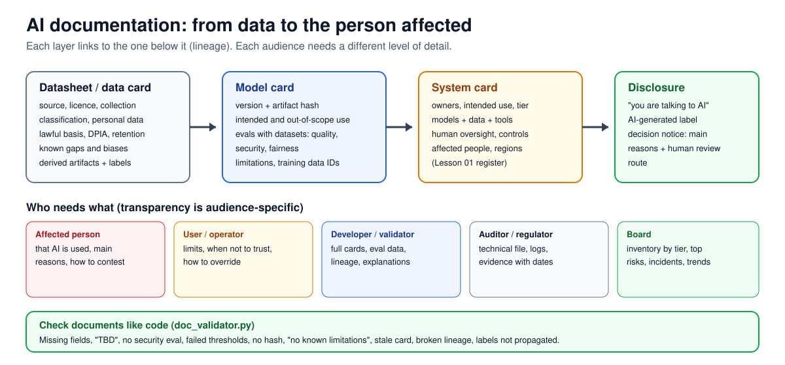

# Model Cards, Data Documentation and Transparency

> **Module:** 07 · AI Governance · **Weeks:** 29–30 · **Time:** ~7 hours
> **You will:** write and check model cards and datasheets as data, make classification labels follow data into embeddings and fine-tune sets, decide what to disclose to whom, and catch missing AI disclosures with code.

| | |
|---|---|
| **Prerequisites** | [Lesson 01](01-ai-inventory-and-system-register.md) (system cards), [Lesson 03](03-ai-risk-management.md) |
| **Lab** | [`lab/doc_validator.py`](lab/doc_validator.py), fixtures `documentation_*.yaml`, `demo.py --part 2` |
| **Policy** | [AI Data Governance Policy](policies/04-ai-data-governance-policy.md), [AI Model Approval Policy](policies/03-ai-model-approval-policy.md) (APR-02) |
| **Maps to** | NIST AI RMF MAP 2.2 (knowledge limits documented), MEASURE 2.8 (transparency), MEASURE 2.9 (explained and validated) · ISO/IEC 42001 Annex A.6, A.7, A.8 · EU AI Act Art 10, 11, 13, 50, 86 · GDPR Art 13–15 and 22 · CERT-In AI Security Auditing Guidelines domains 8.2 and 8.5 · OWASP LLM02:2026 Sensitive Information Disclosure (LLM02:2025) and LLM08:2026 Hidden Context Exposure (was LLM07:2025 System Prompt Leakage) |

---

## 1. Why this matters

Documentation is how you prove what a model is, what data made it, and what it must not be used for. Without it you cannot approve a version, answer an erasure request, or explain a decision.

- **2019, "Model Cards for Model Reporting" (Mitchell et al.):** proposed a short, standard report for each trained model: intended use, evaluation across groups, and limitations. It is now the common shape for model documentation.
- **2018 onward, "Datasheets for Datasets" (Gebru et al.):** proposed that every dataset come with a datasheet: why it was made, how it was collected, what it contains, and how it should (and should not) be used. "Data Cards" (Pushkarna et al., 2022) adapted the idea for product teams.
- **2018, Amazon's experimental recruiting model (reported by Reuters):** learned a bias from historical CVs. A datasheet that recorded "known gaps and biases" of the training data would have put the problem on the table before training.
- **OWASP GenAI Data Security Risks and Mitigations 2026 (DSGAI07):** describes how a missing label on source data spreads into embeddings, fine-tune sets and backups, and how a missing data-to-model lineage record makes erasure and incident scoping impossible.

---

## 2. Understand it



### 2.1 Four documents, four questions

| Document | Describes | Answers | Owner |
|---|---|---|---|
| **Datasheet / data card** | One dataset (training, evaluation, RAG corpus) | Where did the data come from, may we use it, how sensitive is it, how long do we keep it? | Data steward |
| **Model card** | One model *version* | What is it for, how well does it work (and for whom), what are its limits? | Model owner |
| **System card** | The whole AI system (Lesson 01) | Who owns it, which models, data and tools, which oversight? | Business + technical owner |
| **AI BOM** (bill of materials) | Components and versions | Which models, datasets, libraries and MCP servers, at which hashes? | Platform team |

They link together. The model card lists the dataset IDs it was trained on (lineage). The system card lists the model versions it runs. The model approval (Lesson 06) points to the exact model-card version it relied on.

### 2.2 Required fields (the lab's choice)

| Model card field | Why governance needs it | Lab check |
|---|---|---|
| version + artifact SHA-256 | You approve one artifact, not a name | DOC-05 |
| intended use, out-of-scope uses | Defines misuse; drives the tier | DOC-01 |
| training data (dataset IDs) | Lineage for erasure and incidents | DOC-08 |
| evaluations with result, threshold, dataset | Reproducible proof; a number without a test set is marketing | DOC-03, DOC-04 |
| at least one **security** evaluation | Prompt-injection and leakage regression results | DOC-02 |
| limitations | "No known limitations" means nobody looked | DOC-06 |
| human oversight, explanation available | What a reviewer and an affected person can rely on | DOC-01 |
| last updated | Cards go stale after model or data changes | DOC-07 |

| Datasheet field | Why | Lab check |
|---|---|---|
| source, collection method, licence | Legal right to use; provenance | DS-01, DS-03 |
| classification, personal-data flag | Drives access, DLP and privacy duties | DS-01 |
| lawful basis + DPIA reference (if personal) | GDPR Art 6 and 35; DPDP consent or legitimate use | DS-02 |
| derived artifacts with their labels | Labels must follow data into embeddings, logs, fine-tune sets | DS-04 |
| retention | Never "forever"; backups expire too | DS-05 |
| known gaps and biases | Fairness risks become visible before training | DS-01 |

### 2.3 Classification propagation: the data-security idea to remember

A source document labelled *confidential* becomes chunks, embeddings, cached answers, log lines and fine-tune rows. If those copies are labelled *internal* (or nothing), access control and retention stop working on them. The rule: **every derived artifact carries at least the classification of its source.** The OWASP GenAI data-security guidance calls for scanners at every ingestion point, lineage as a first-class record, and deletion tests that check every derived copy. Module 08's [`privacy_rights.py`](../08-ai-compliance/lab/privacy_rights.py) shows the erasure side.

### 2.4 Explainability, interpretability and transparency

| Term | Meaning | Example |
|---|---|---|
| **Transparency** | People know that AI is used, what it does, and its limits | Chatbot notice; model card; published AI use policy |
| **Explainability** | You can give the main reasons for a specific output or decision | "Shortlist summary weighted: required certificate missing" |
| **Interpretability** | Experts can understand how the model works inside | Feature attribution, probing; often hard for large LLMs |

For LLM systems, true interpretability is limited. Practical explainability comes from **system design**: retrieval citations, logged tool calls, structured outputs with reasons, and a human who decides and records why. NIST's trustworthy-AI characteristics list "explainable and interpretable" and "accountable and transparent" separately; MEASURE 2.8 and 2.9 ask you to examine and document both.

### 2.5 What to disclose, and to whom

| Audience | What they need | Legal hooks (verify at source) |
|---|---|---|
| **Affected person** (applicant, customer) | That AI is used; the main reasons for a decision about them; how to get a human review or contest it | EU AI Act Art 26(11) and Art 86 (high-risk); GDPR Art 13–15 and 22; DPDP notice duties |
| **User talking to the system** | "You are talking to an AI" (unless obvious); labels on synthetic content | EU AI Act Art 50 |
| **Operator / human overseer** | Limits, failure modes, when not to trust it, how to override | EU AI Act Art 13 (instructions for use) and Art 14 |
| **Developer / validator** | Full model card, eval data, lineage | ISO/IEC 42001 Annex A.6 |
| **Auditor / regulator** | Technical documentation, logs, evidence with dates | EU AI Act Art 11 and Annex IV; CERT-In audit domain 8.5 |
| **Board** | Inventory by tier, top risks, incidents | NIST GOVERN 2.3 |

**Do not over-disclose.** Transparency does not mean publishing your system prompt, tool schemas or guardrail rules. Exposing them helps attackers (OWASP **LLM08:2026 Hidden Context Exposure**, which widened LLM07:2025 System Prompt Leakage). Disclose *what* the system does and *how people can challenge it*, not the internal security logic.

### 2.6 User-facing disclosure patterns

- **Chat notice** at the start: "You are chatting with an AI assistant. A person reviews refunds."
- **Content label** on generated text, images and audio published externally, plus machine-readable marking where required.
- **Decision notice** for decisions about people: the outcome, the main reasons, that AI assisted, and the route to a human review with a deadline.
- **Agent action receipts**: what the agent did on the user's behalf, with an undo or report link.

---

## 3. Defend it

| Layer | Control | Type | What it buys you |
|---|---|---|---|
| L1 | Cards and datasheets as YAML in the repo, validated in CI (`doc_validator.py`) | **Hard** | No "TBD" reaches approval |
| L2 | Model approval requires zero documentation findings (Lesson 06, MA-02) | **Hard** | Documentation is a release gate, not a wiki page |
| L3 | Label propagation checked on derived artifacts (DS-04); index ACLs inherit source labels | **Hard** | Embeddings and logs stay protected |
| L4 | Disclosure checks per system (TR-01..03) before go-live | **Hard** | Missing notices are caught before users see them |
| L5 | Card owner reviews after every model, data or prompt change; 180-day staleness rule | Process | Cards stay true |
| L6 | Plain-language decision notices tested with real users | Process | Explanations people understand |

### What does NOT work on its own

- A model card written once for the launch blog post.
- Vendor model cards alone: they describe *their* model, not *your* system, data and oversight.
- "Explainability" tools that produce heat maps nobody can act on.
- Publishing the system prompt "for transparency".
- A datasheet without lineage: you still cannot find the fine-tune that used deleted data.

---

## 4. Hands-on lab

### Step 1: Validate the vulnerable documentation pack

```powershell
python 07-ai-governance/lab/doc_validator.py 07-ai-governance/lab/fixtures/documentation_vulnerable.yaml
```

Expected output (as of 2026-11-15):

```text
DS-01  DS-101   required field 'collection_method' is missing or placeholder
DS-01  DS-101   required field 'known_gaps_and_biases' is missing or placeholder
DS-02  DS-101   personal data without a lawful basis and a DPIA reference
DS-04  DS-101   derived artifact 'ft-set' is 'internal' but its source is 'confidential': labels must follow the data into embeddings, logs and fine-tune sets
DS-04  DS-101   derived artifact 'embeddings-index' is 'unlabelled' but its source is 'confidential': labels must follow the data into embeddings, logs and fine-tune sets
DS-05  DS-101   no retention rule (or 'forever')
DS-01  DS-900   required field 'licence' is missing or placeholder
DS-01  DS-900   required field 'contains_personal_data' must be true or false
DS-01  DS-900   required field 'retention' is missing or placeholder
DS-03  DS-900   web_scraped source with no licence or terms recorded
DS-05  DS-900   no retention rule (or 'forever')
DOC-01 MDL-002  required field 'artifact_sha256' is missing or placeholder
DOC-01 MDL-002  required field 'intended_use' is missing or placeholder
DOC-01 MDL-002  required field 'out_of_scope_uses' is missing or placeholder
DOC-01 MDL-002  required field 'human_oversight' is missing or placeholder
DOC-01 MDL-002  required field 'explanation_available' is missing or placeholder
DOC-02 MDL-002  no security evaluation (add the prompt-injection / red-team regression result)
DOC-03 MDL-002  evaluation 'accuracy' = 0.81 misses threshold 0.85
DOC-04 MDL-002  evaluation 'accuracy' has no dataset reference (not reproducible)
DOC-05 MDL-002  artifact_sha256 missing or not a SHA-256 hex digest: the approved version cannot be pinned
DOC-06 MDL-002  no real limitations listed
DOC-07 MDL-002  last updated 2025-12-01 (349 days > 180)
DOC-08 MDL-002  training data 'DS-777' has no datasheet (lineage break)
TR-03  AI-002   decisions about people with no explanation of main reasons and no route to a human review
TR-01  AI-001   people interact with the system but no 'you are talking to AI' notice
TR-02  AI-001   generated content is published without an AI-generated label
26 finding(s)
```

Then run it on `documentation_governed.yaml`: `0 finding(s)`. Compare the two files side by side: every finding has a fix you can see.

### Step 2: Run the tests

```powershell
python -m pytest 07-ai-governance/lab/test_model_governance.py -v -k "documentation or card or labels or limitations"
```

### Step 3: Write your own (week-29 deliverable, extended)

Copy `documentation_governed.yaml` to your journal. Write one datasheet for your capstone RAG corpus and one model card for the model you use (for a vendor model, set `training_data: [vendor-provided]` and record what the vendor tells you). Add the disclosure block for every user-facing system in your register. Reach zero findings.

### Step 4: Break it yourself (predict, then run)

1. In the governed pack, change the embeddings' classification from `confidential` to `internal`. Which code appears?
2. Set the security evaluation result to `0.97` with threshold `1.0`. Is a 97% pass rate on a prompt-injection regression suite good enough? Why does the lab say no?
3. Change `last_updated` to a year ago. Which code appears, and what real event should have triggered an update?

### Stretch goals

- Add a check that a model card's `out_of_scope_uses` appear in the system card's `prohibited_uses`.
- Generate a plain-language decision notice from the model card and system card fields.
- Add an AI BOM section (models, datasets, MCP servers with hashes) and check it against the registry.

---

## 5. Real-world scenarios

**Scenario A: the erasure request nobody could finish (hypothetical).** A customer asks for deletion. The source record is gone, but nobody knows which fine-tune used it.
- *What went wrong:* no datasheet lineage; derived artifacts not labelled.
- *Investigate:* search for every index, cache, log and training run that touched the source; check backups.
- *Fix:* DS-04 and DOC-08 checks in CI; lineage records for every training run and index build; deletion tests.

**Scenario B: the 92% accuracy claim (hypothetical).** A vendor's card claims 92% accuracy; your users see far worse.
- *What went wrong:* the result has no dataset reference, and the vendor's test data looks nothing like yours.
- *Investigate:* ask for the evaluation set description; run your own eval on representative data.
- *Fix:* require dataset IDs (DOC-04); approve only on your own evaluation results.

**Scenario C: "transparency" that helped the attacker (hypothetical).** A team published the full system prompt and tool list "to be transparent".
- *What went wrong:* hidden context such as tool schemas and policy rules became an attack map (LLM08:2026).
- *Fix:* publish purpose, limits, data use and how to contest; keep security logic internal; review disclosures with security.

---

## 6. Common mistakes

- Treating a vendor model card as your system documentation.
- Accuracy numbers without the test set, date and model version.
- Labels on the source data only.
- Explaining the model instead of the decision: affected people need reasons and a route to a human.
- No owner for the card, so it is never updated.

---

## 7. Interview preparation

<details><summary><b>Q1. Model card vs datasheet vs system card: what is the difference?</b></summary>

A datasheet describes a dataset (source, licence, sensitivity, retention, gaps). A model card describes one model version (intended use, evaluations, limitations, training data). A system card describes the whole deployed system (owners, models, data, tools, oversight, tier). They link by IDs so you can trace a decision back to data.
</details>

<details><summary><b>Q2. What must a model card contain before you approve a model?</b></summary>

Version and artifact hash, intended and out-of-scope use, training-data IDs, evaluations with result, threshold and dataset (including a security evaluation), real limitations, oversight and explanation information, an owner and a recent update date. In the lab, zero `doc_validator.py` findings is a gate.
</details>

<details><summary><b>Q3. Why must classification labels propagate to embeddings?</b></summary>

Embeddings, chunks, caches and logs contain or reveal the source content. If they lose the label, retrieval access control, DLP and retention no longer apply, and erasure cannot find them. Every derived artifact needs at least the source's classification.
</details>

<details><summary><b>Q4. Explainability vs transparency vs interpretability?</b></summary>

Transparency: people know AI is used and what it does. Explainability: you can give the main reasons for one output. Interpretability: experts understand the internal mechanics. For LLM systems, practical explainability comes from design (citations, logged tool calls, structured reasons, human decision records).
</details>

<details><summary><b>Q5. A rejected applicant asks "why?". What do you need to be able to answer?</b></summary>

The decision record: model and prompt version, inputs used, retrieved documents, the AI output, the human reviewer's decision and reason. Then a plain-language notice with the main reasons and the route to a human review. For high-risk use in the EU, Art 86 gives a right to an explanation, and GDPR Art 22 rights may apply.
</details>

<details><summary><b>Q6. Is publishing the system prompt good transparency?</b></summary>

No. It exposes hidden context (OWASP LLM08:2026) that attackers use to plan injections and bypasses. Disclose purpose, data use, limits and contest routes instead.
</details>

<details><summary><b>Q7. How do you keep documentation from going stale?</b></summary>

Store it as data next to the code, validate in CI, make it a release gate, set a staleness rule (180 days in the lab), and trigger updates on model, data, prompt or tool changes.
</details>

<details><summary><b>Q8. Scenario: an auditor asks how you know a fine-tune did not use data from a deleted customer.</b></summary>

Show the lineage: the model card's training dataset IDs, the datasheet versions, the dataset snapshot hashes and the deletion log. If you cannot, admit the gap, record it as a nonconformity, and plan retraining or a documented assessment with the DPO.
</details>

<details><summary><b>Q9. What should a vendor give you for a model you buy?</b></summary>

A model or system card with intended use and limitations, evaluation summaries including safety and security testing, data-use and retention terms, version and change notice, and incident contacts. Record it in your own model card with `vendor-provided` lineage.
</details>

<details><summary><b>Q10. Explain to an executive why we "document AI like code".</b></summary>

"Every AI decision we make must be explainable to a customer, an auditor or a court. If the documents are checked automatically before release, we can always say exactly which model, which data and which limits applied. If they are wiki pages, we find out they were wrong during an incident."
</details>

<details><summary><b>Q11. Which audit domain of the CERT-In AI guidelines covers this lesson?</b></summary>

Mainly 8.5 (explainability and transparency) and 8.2 (data lifecycle, quality and privacy); model cards also support 8.3 (model risk management). The pre-audit document list asks for model cards, data documentation and sample decision explanations.
</details>

<details><summary><b>Q12. How do you disclose AI in an agent that takes actions for users?</b></summary>

Tell users up front what the agent can do; show an action receipt for every side-effecting step; let them undo or report; keep the action log. This is transparency and also a security control against misuse (OWASP ASI09 Human-Agent Trust Exploitation).
</details>

---

## 8. Checklist (definition of done)

- [ ] I can explain the four documents and how they link.
- [ ] My capstone datasheet, model card and disclosure block pass `doc_validator.py`.
- [ ] I can state who needs which disclosure, and what must not be disclosed.
- [ ] `python -m pytest 07-ai-governance` passes.

## 9. References

- Mitchell et al., *Model Cards for Model Reporting* (2019): https://arxiv.org/abs/1810.03993
- Gebru et al., *Datasheets for Datasets*: https://arxiv.org/abs/1803.09010
- Pushkarna et al., *Data Cards* (2022): https://arxiv.org/abs/2204.01075
- NIST AI RMF and Playbook (MAP 2.2, MEASURE 2.8, 2.9): https://airc.nist.gov/
- EU AI Act, Regulation (EU) 2024/1689: https://eur-lex.europa.eu/eli/reg/2024/1689/oj
- OWASP GenAI Security Project (LLM Top 10 2026, data security guidance): https://genai.owasp.org/
- CERT-In AI Security Auditing Guidelines v1.0 (see Module 08, Lesson 06): https://www.cert-in.org.in/
