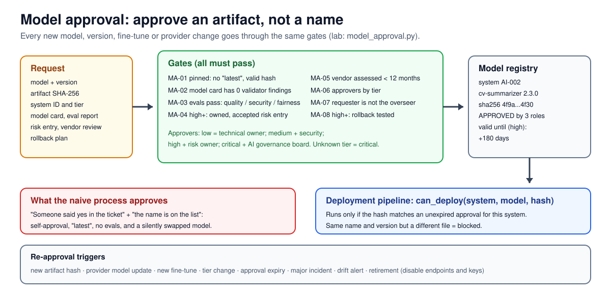

# Model Approval, Lifecycle Governance and AI Incident Management

> **Module:** 07 · AI Governance · **Weeks:** 30 · **Time:** ~8 hours
> **You will:** govern an AI system from idea to retirement, approve model *versions* through testable gates, block a silently swapped model at deploy time, and triage AI incidents so the right legal clocks start on time.

| | |
|---|---|
| **Prerequisites** | Lessons [01](01-ai-inventory-and-system-register.md)–[05](05-model-cards-data-documentation-and-transparency.md); CI/CD from [Module 06](../06-ai-devsecops/) |
| **Lab** | [`lab/model_approval.py`](lab/model_approval.py), [`lab/incident_triage.py`](lab/incident_triage.py), fixtures `model_requests.yaml`, `incidents.yaml`, `demo.py --part 2` |
| **Policies** | [AI Model Approval Policy](policies/03-ai-model-approval-policy.md), [AI Incident Response Policy](policies/06-ai-incident-response-policy.md), [AI Third-Party Risk Assessment](policies/05-ai-third-party-risk-assessment.md) |
| **Maps to** | NIST AI RMF GOVERN 1.7 (decommissioning), GOVERN 4.3 (incidents and information sharing), MANAGE 2.3, 2.4 (respond, disengage, deactivate), MANAGE 4.1, 4.3 (monitoring, incident communication) · ISO/IEC 42001 Annex A.6 (life cycle), A.8 (communication of incidents), clause 10.2 · EU AI Act Art 9, 15, 26(5), 72–73 · CERT-In AI audit domains 8.3 (model risk management) and 8.6 (security and incident reporting) · OWASP LLM04:2026 Supply Chain (LLM03:2025), OWASP ASI04 Agentic Supply Chain, MCP04 Supply Chain |

---

## 1. Why this matters

- **Banking model risk management (US Federal Reserve SR 11-7, 2011):** banks have long been expected to validate models independently, keep an inventory and control changes. AI governance reuses this idea: a model version is approved, not a model name.
- **2024, ByteDance intern case (widely reported):** the company said an intern interfered with model training. Whatever the details, it shows that training pipelines and artifacts need change control and integrity checks, like production code.
- **2023, "PoisonGPT" demonstration (Mithril Security):** researchers edited an open model to spread a false fact and uploaded it under a name close to a real one. It shows why approval must pin a hash from a trusted source, not a name.
- **AI incident databases (AI Incident Database, OECD AI Incidents Monitor):** thousands of reported incidents show that many AI failures are not attacks at all but drift, bias and over-reliance. Incident management must cover both.

---

## 2. Understand it

### 2.1 Lifecycle governance: gates from idea to retirement

| Stage | Gate question | Artifacts | Lab / policy |
|---|---|---|---|
| 1 Intake | Should we do this at all? Is it prohibited? | Use-case form, owner | Register (Lesson 01), AUP-04/05 |
| 2 Design | What is the tier? What could go wrong? | System card, threat model, impact assessment | `secure_register.py`, risk register |
| 3 Build | Is the data lawful and documented? | Datasheets, lineage | `doc_validator.py` (DS) |
| 4 Validate | Does it work, safely and fairly, for our use? | Model card, eval report (quality, security, fairness) | `doc_validator.py` (DOC), CI evals |
| 5 Approve | Who signs, for which exact artifact? | Approval record with hash and expiry | `model_approval.py` |
| 6 Deploy | Is this the approved artifact? | Deploy log | `can_deploy` |
| 7 Operate | Is it still behaving? | Monitoring, drift alerts, incident log | `incident_triage.py` |
| 8 Change | Is this change material? | Change ticket, re-approval | Re-approval triggers |
| 9 Retire | Is it really gone? | Decommissioning checklist | APR-12, GOVERN 1.7 |

Retirement is often forgotten: disable endpoints and keys, remove the model from the registry, archive the documentation, apply retention to logs and data, and tell users what replaces it.

### 2.2 Model governance: approve versions, not names



Rules that make approval mean something:

1. **Pin the artifact.** Version label plus SHA-256 (or the provider's immutable model ID). "latest" changes under you.
2. **Gates scale with the tier.** Low: quality eval and the technical owner. Medium: plus security eval and security approval. High: plus fairness eval, an accepted risk entry and a tested rollback. Critical: plus the AI governance board.
3. **Separation of duties.** The requester cannot approve their own request in an oversight role.
4. **Approvals expire** (lab: 12 / 6 / 3 months by tier), so models are re-checked against new attacks and new rules.
5. **The pipeline enforces it.** The deploy step asks the registry; a hash mismatch is blocked, even with the same name and version label.

**What counts as a material change?** New weights or fine-tune; a provider model update; a new prompt template or tool for a high-tier system; new training or retrieval data sources; a new user group, purpose or region. Vendor API models are the hard case: pin a dated model ID where the provider offers one, require change notice in the contract (TPR-04), and monitor output drift to catch silent changes.

### 2.3 Third-party AI risk in the lifecycle

Vendor risk enters at three gates: at intake (vendor tier), at approval (assessment not older than 12 months, MA-05) and in operation (change notices, incidents). The [AI Third-Party Risk Assessment](policies/05-ai-third-party-risk-assessment.md) has a 14-question questionnaire and three vendor tiers; Lesson 03 section 2.8 explains the areas.

### 2.4 AI incident management

An **AI incident** is an event where an AI system causes or could cause harm: security attacks, data leaks through AI, harmful or false output, wrong decisions about people, model failure or drift, or data sent to unapproved AI tools. Near misses (blocked attempts) are recorded too: they prove controls work and feed the regression suite.

**Categories (lab catalog) with OWASP 2026 mappings:**

| Category | OWASP LLM 2026 | OWASP Agentic | First containment action |
|---|---|---|---|
| Prompt injection / goal hijack | LLM01 | ASI01 | Kill switch: tools or connector off, model read-only |
| Agent tool misuse / excessive agency | LLM03 (was LLM06:2025) | ASI02, ASI03 | Revoke agent credentials; approval for every action |
| Sensitive information disclosure | LLM02 | – | Block the route; purge caches |
| Knowledge / data poisoning | LLM05 (was LLM04:2025), LLM09 | ASI06 | Quarantine sources; rebuild index from a known-good snapshot |
| Agent memory poisoning | LLM05 | ASI06 | Snapshot, then roll back memory |
| Supply chain | LLM04 (was LLM03:2025) | ASI04 | Roll back to the last approved hash |
| Stolen keys or tokens | LLM02, LLM06 | ASI03 | Rotate and revoke; spend limits |
| Harmful or false output | LLM07 (was LLM09:2025) | ASI09 | Stricter filtering or human check |
| Biased decisions about people | LLM07 | – | Stop automation; re-check affected cases |
| Shadow AI upload | LLM02 | – | Block domain; request deletion |
| Model failure / drift | LLM07 | ASI08 | Roll back or fall back to the manual process |

**Severity follows impact, not technology.** The AI Cyber Incident Playbook in your library makes the same point in every case it walks through: priority comes from data, privilege and actions, and "an AI was involved" is context, not a severity. The lab's scale:

| Severity | When | Example |
|---|---|---|
| SEV1 | Ongoing harm with sensitive data leaving, privileged access or unauthorized actions; many people harmed; critical infrastructure | Injected agent still forwarding customer emails |
| SEV2 | Confirmed exposure, unauthorized actions or privileged access (contained); wrong decisions about people | Biased CV summaries affected 40 applicants |
| SEV3 | Limited impact: internal data, harmful output to a few users, policy breach | Internal design doc pasted into a free chatbot |
| SEV4 | Near miss: blocked by a control | Red-team canary blocked by the tool broker |

**Downgrade only after verified containment.** "We asked the vendor to revoke the key" is not containment; "the key is revoked and no further calls were seen for 24 hours" is.

**The link to Module 08.** Triage must output the facts that start legal clocks: Is it a personal data breach? EU or Indian personal data? A reportable cyber incident in India (CERT-In: 6 hours)? A serious incident of a high-risk system we provide (EU AI Act Art 73)? The lab returns these as `clock_flags`, with the same names that [`08-ai-compliance/lab/incident_clock.py`](../08-ai-compliance/lab/incident_clock.py) reads.

**Evidence to preserve before you change anything:** prompts and outputs, retrieved document IDs, tool-call log, model and index versions with hashes, agent memory snapshot, gateway logs. Recovery means a known-good state: approved hash, clean index, rotated keys.

---

## 3. Defend it

| Layer | Control | Type | What it buys you |
|---|---|---|---|
| L1 | Approval request schema with pinned hash (MA-01) | **Hard** | Approval refers to one artifact |
| L2 | Tiered gates: docs, evals, risk, vendor, approvers, separation of duties, rollback (MA-02..08) | **Hard** | Risk-proportionate, testable approval |
| L3 | Deploy check by hash and expiry (`can_deploy`) | **Hard** | Silent swaps and expired approvals cannot run |
| L4 | Kill switch / degrade mode per high-tier system, tested | **Hard** | Containment in minutes |
| L5 | Triage rules with impact-based severity and clock flags | Process (codified) | Right severity, clocks start on time |
| L6 | Post-incident review → new regression tests and risk entries | Process | The same incident does not repeat |

### What does NOT work on its own

- An approval ticket with "LGTM" from the requester's teammate.
- Approving "GPT-x" or "our fine-tune" without a version and hash.
- Treating prompt injection as a "model quality bug" for the ML backlog.
- Waiting for legal to decide before starting the clock: the clock starts at awareness.
- Lowering severity because "the vendor is looking into it".

---

## 4. Hands-on lab

### Step 1: Run part 2 of the scorecard

```powershell
python 07-ai-governance/lab/demo.py --part 2
```

Expected output:

```text
Part 2 (as of 2026-11-15): documentation, model approval, incident triage, policy pack

=== Model cards, datasheets and disclosure (doc_validator.py) ===
vulnerable 26 finding(s): DOC-01x5,DOC-02,DOC-03,DOC-04,DOC-05,DOC-06,DOC-07,DOC-08,DS-01x5,DS-02,DS-03,DS-04x2,DS-05x2,TR-01,TR-02,TR-03
governed    0 finding(s): -

=== Model approval gates (model_approval.py) ===
request  model          version  tier    naive     gated     findings
MAR-001  cv-summarizer  2.3.0    high    APPROVED  APPROVED  -
MAR-002  cv-summarizer  latest   high    APPROVED  REJECTED  MA-01,MA-02,MA-03x2,MA-04,MA-05,MA-06,MA-07,MA-08
MAR-003  code-helper    1.8.2    medium  APPROVED  APPROVED  -
deploy check, same model name and version but a swapped artifact:
  naive (name only): True
  gated (by hash):   False - artifact hash differs from every approved artifact (silent swap or unapproved version)

=== AI incident triage (incident_triage.py) ===
incident naive  triage category                                         clock flags for Module 08
INC-01   SEV4   SEV1   Prompt injection / goal hijack                   personal_data_breach,eu_personal_data,india_personal_data,india_reportable_cyber_incident
INC-02   SEV4   SEV2   Biased or wrong decisions about people           eu_high_risk_provider,eu_serious_incident
INC-03   SEV4   SEV3   Data uploaded to an unapproved AI service        -
INC-04   SEV4   SEV4   Prompt injection / goal hijack                   -
INC-05   SEV2   SEV2   Stolen model gateway keys or connector tokens    india_reportable_cyber_incident

=== AI policy pack (policy_lint.py) ===
7 policies, 76 testable requirements, findings: none
```

Read the naive column: the "send it to the ML team" approach calls an ongoing data leak SEV4. That is how clocks are missed.

### Step 2: One request in detail

```powershell
python 07-ai-governance/lab/model_approval.py 07-ai-governance/lab/fixtures/model_requests.yaml
```

```text
MAR-001  cv-summarizer      2.3.0     high     APPROVED
MAR-002  cv-summarizer      latest    high     REJECTED
          MA-01 version 'latest' / hash not pinned to one artifact
          MA-02 model card has 4 open validator finding(s)
          MA-03 fairness evaluation is 'missing' (must be 'pass' for high)
          MA-03 security evaluation is 'missing' (must be 'pass' for high)
          MA-04 no linked risk entry accepted by its owner
          MA-05 vendor assessment from 2025-06-10 is older than 365 days
          MA-07 requester 'a.rao' approved their own request as 'security'
          MA-06 missing approval from: risk_owner, security
          MA-08 no tested rollback to the previous approved version
MAR-003  code-helper        1.8.2     medium   APPROVED
```

### Step 3: Triage the incidents

```powershell
python 07-ai-governance/lab/incident_triage.py 07-ai-governance/lab/fixtures/incidents.yaml
```

```text
INC-01  SEV1 Prompt injection / goal hijack                   LLM01+ASI01
        why: ongoing: sensitive data exposed, unauthorized actions taken
        first action: Disable the affected tools or connector (kill switch); keep the model read-only
        clock flags for 08: personal_data_breach, eu_personal_data, india_personal_data, india_reportable_cyber_incident
...
INC-05  SEV2 Stolen model gateway keys or connector tokens    LLM02+LLM06+ASI03
        why: sensitive data exposed, privileged access; containment verified: severity reflects the contained state
        first action: Rotate and revoke keys/tokens; set spend and rate limits
        clock flags for 08: india_reportable_cyber_incident
```

Now feed INC-01's flags into Module 08: `python 08-ai-compliance/lab/demo.py` section 4 shows the clocks that start (CERT-In 6 hours first).

### Step 4: Run the tests

```powershell
python -m pytest 07-ai-governance/lab/test_model_governance.py -v
```

Read `test_silent_model_swap_cannot_deploy`, `test_ai_involvement_alone_does_not_change_severity` and `test_ongoing_leak_stays_sev1_until_containment_is_verified`.

### Step 5: Break it yourself (predict, then run)

1. In MAR-001, change one approval so `security` is signed by `a.rao`. Which code appears, and does the request still pass?
2. Set MAR-003's tier to `high`. Which gates now fail?
3. In INC-05, set `containment_verified: false`. What severity now, and why is that correct?
4. Remove `india` from INC-01's jurisdictions. Which clocks disappear?

### Stretch goals

- Add a `change_type` rule: `patch` with the same tier may skip the fairness eval if the eval dataset is unchanged; prove it with a test.
- Add `retire_model()` that removes approvals and returns a decommissioning checklist.
- Write a playbook for one category (for example knowledge poisoning) using the Incident Response Policy structure, then run it as a tabletop (Module 08, Lesson 04).

---

## 5. Real-world scenarios

**Scenario A: the vendor update nobody approved (hypothetical).** Answers from the support assistant change style and start leaking internal ticket notes after the provider updates its default model.
- *What went wrong:* the app used a floating "latest" alias; no change notice; no drift monitor.
- *Investigate:* gateway logs for model ID changes; compare outputs before and after; check the contract's change-notice clause.
- *Fix:* pin a dated model ID; re-approve; add drift alerts; enforce APR-01 and TPR-04.

**Scenario B: the fine-tune that skipped review (hypothetical).** A data scientist pushes a new fine-tune with the same version label "to fix a typo".
- *What went wrong:* the deploy step matched on name and version only.
- *Investigate:* registry vs deployed hash; who pushed; what changed in the training data.
- *Fix:* `can_deploy` by hash; separation of duties; lineage in the model card.

**Scenario C: the injection treated as a bug (hypothetical).** A support agent reports the assistant "behaving strangely" after reading a customer email. Three days later the team finds it forwarded conversation history to an outside address.
- *What went wrong:* triage by technology ("AI quirk") instead of impact; no clock flags; evidence overwritten by redeploys.
- *Fix:* impact-based triage; kill switch; evidence preservation before changes; GDPR and CERT-In clocks started at awareness.

---

## 6. Common mistakes

- Approval with no expiry, so a 2-year-old model runs unchanged against today's attacks.
- Re-using the same model approval across systems with different tiers.
- No rollback plan, so the only containment is a full outage.
- Severity lowered on "containment requested".
- Not recording near misses: you lose proof that controls work.

---

## 7. Interview preparation

<details><summary><b>Q1. Design a model approval process for a company with 40 AI use cases.</b></summary>

A model registry; requests that pin artifact hashes; tiered gates (documentation, evaluations, risk acceptance, vendor assessment, approvers by tier, separation of duties, rollback); expiring approvals; and a deploy step that refuses any artifact without a matching unexpired approval. Low tier is automated; only high and critical go to people.
</details>

<details><summary><b>Q2. Why approve a hash and not a model name?</b></summary>

Names and version labels can point to different files over time (provider updates, retraining, tampering). Only a content hash (or an immutable provider model ID) proves the deployed artifact is the one that was tested and approved.
</details>

<details><summary><b>Q3. How do you govern a vendor API model you cannot hash?</b></summary>

Pin the most specific immutable model ID available; contract for change notice and version support; re-run your evaluation suite on schedule and on any ID change; monitor output drift; treat an unannounced change as an incident.
</details>

<details><summary><b>Q4. What are your AI incident severity criteria?</b></summary>

Impact: data sensitivity and whether it left, privileged access, unauthorized actions, number of people harmed, critical infrastructure, and whether it is ongoing. AI involvement alone is not a criterion. Downgrade only after verified containment.
</details>

<details><summary><b>Q5. What evidence do you preserve in an AI incident?</b></summary>

Prompts and outputs, retrieved document IDs, tool-call logs, model and index versions with hashes, agent memory snapshot, gateway and identity logs, and the timeline. Preserve before you roll back or redeploy.
</details>

<details><summary><b>Q6. How does AI incident triage connect to legal reporting?</b></summary>

Triage sets the facts that start clocks: personal data breach (GDPR 72 hours; DPDP), reportable cyber incident in India (CERT-In 6 hours), serious incident of an EU high-risk system (AI Act Art 73). The clock starts at awareness, so triage must flag these in the first hour.
</details>

<details><summary><b>Q7. Scenario: a red-team canary was blocked by your tool broker. Is it an incident?</b></summary>

It is a near miss (SEV4): record it, confirm the control worked, add the payload to the regression suite, and check whether it came from a real attacker. No containment and no legal clock.
</details>

<details><summary><b>Q8. What does lifecycle governance add beyond a release gate?</b></summary>

Intake (should we build it), design reviews, change control after release, monitoring and incident handling, periodic re-approval, and retirement. Most AI risk appears after launch through change and drift.
</details>

<details><summary><b>Q9. How do you retire an AI system safely?</b></summary>

Tell users and give an alternative; disable endpoints, keys and agent identities; remove approvals; archive documentation and evidence; apply retention to data, logs, indexes and backups; confirm vendor deletion; close risk entries with a note (NIST GOVERN 1.7).
</details>

<details><summary><b>Q10. Explain the kill switch to an executive.</b></summary>

"Every high-risk AI system has a tested off switch for its risky parts, like the tools that send email or move money. If something goes wrong, on-call staff can turn those parts off in minutes while the rest keeps working or falls back to people."
</details>

<details><summary><b>Q11. Which OWASP 2026 entries matter most for model approval?</b></summary>

LLM04 Supply Chain (was LLM03:2025) and LLM05 Data and Model Poisoning (was LLM04:2025), plus OWASP ASI04 Agentic Supply Chain and MCP04 for tools and servers. Approval gates are the supply-chain control at the model layer.
</details>

<details><summary><b>Q12. What does the CERT-In AI audit guideline expect for model risk management?</b></summary>

Among other things: a model registry, model cards, version control, independent validation proportionate to tier (validation separate from the development team at Tier 3), monitoring and decommissioning protocols. The pre-audit request list asks for a model registry export and model cards for all in-scope models.
</details>

---

## 8. Checklist (definition of done)

- [ ] I can describe the nine lifecycle stages and their gates.
- [ ] I can explain each approval gate MA-01..08 and why the deploy check uses a hash.
- [ ] I can triage an AI incident by impact and name the clocks it starts.
- [ ] `python -m pytest 07-ai-governance` passes.
- [ ] Week 30 journal: one model approval request and one incident triage for my capstone.

## 9. References

- US Federal Reserve SR 11-7, Guidance on Model Risk Management: https://www.federalreserve.gov/boarddocs/srletters/2011/sr1107.htm
- NIST AI RMF Playbook (GOVERN 1.7, 4.3; MANAGE 2.3, 2.4, 4.1, 4.3): https://airc.nist.gov/
- OWASP Top 10 for LLM Applications 2026 and Agentic Top 10: https://genai.owasp.org/
- OWASP MCP Top 10: https://owasp.org/www-project-mcp-top-10/
- AI Incident Database: https://incidentdatabase.ai/ · OECD AI Incidents Monitor: https://oecd.ai/en/incidents
- CERT-In (incident reporting Directions, AI audit guidelines): https://www.cert-in.org.in/
