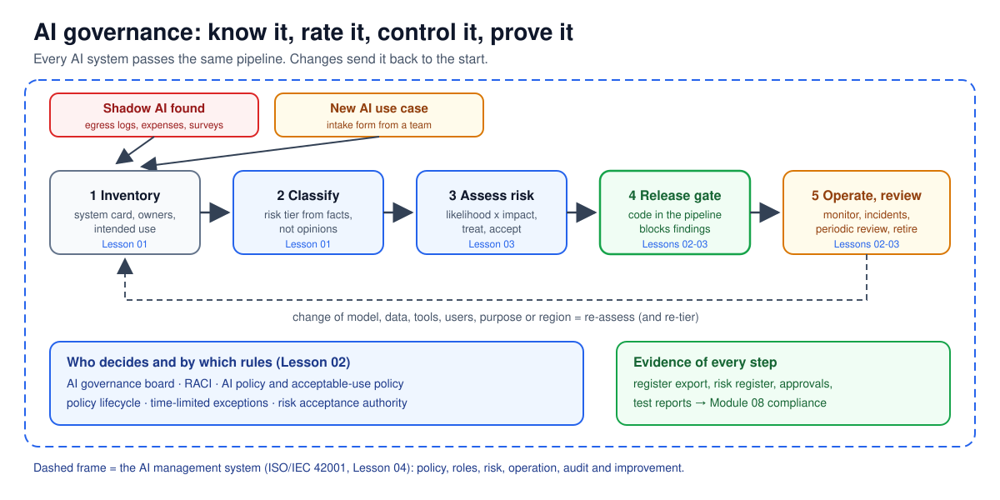
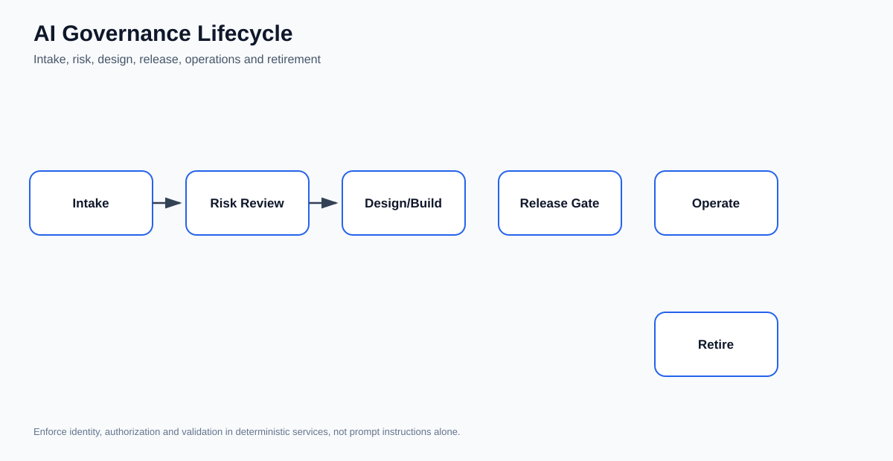

# Module 07 — AI Governance

> **Weeks:** 29–30 · **Time:** ~33 hours · **Outcome:** you can set up and run the governance layer for AI in an organization: an inventory with rule-based risk tiers, clear roles and policies, a working risk register, and an AI management system that an auditor can test.

## What and why

**AI governance** is how an organization decides which AI it uses, for what, who is accountable, what risks it accepts, and how it proves all of that. It answers questions that technical controls cannot answer on their own:

- Why is this AI system used, and who owns it?
- Who may be affected by it?
- Which data, models and tools does it touch?
- Which risks are acceptable, and who decided?
- Who approves its release and its changes?
- How are its incidents handled, and how is it retired?

Governance is **not** a replacement for technical controls. Modules 02–06 built the controls (tool policy, access control, sandboxing, CI gates). This module decides *where* they are required, *checks* that they exist, and *records* the decisions. An AI security architect sits exactly at this boundary: you translate GRC (governance, risk and compliance) requirements into engineering controls, and engineering reality back into risk language.



The lifecycle view from the original repository diagram is still useful: every system moves through intake, risk review, design and build, a release gate, operation and retirement.



## Learning path

| # | Lesson | Weeks | You will |
|---|---|---|---|
| 01 | [AI inventory and system register](01-ai-inventory-and-system-register.md) | 29 | Discover shadow AI, write system cards, compute risk tiers from rules |
| 02 | [Roles, policies and the operating model](02-roles-policies-and-operating-model.md) | 29–30 (policy lifecycle again in 32) | Design the board and RACI, write an AI acceptable-use policy, run time-limited exceptions |
| 03 | [AI risk management](03-ai-risk-management.md) | 30 | Use NIST AI RMF, NIST AI 600-1 and ISO/IEC 23894; score inherent and residual risk; assess vendors |
| 04 | [ISO/IEC 42001 AI management system](04-iso-42001-ai-management-system.md) | 30 | Understand AIMS clauses and Annex A areas, plan certification, run a mini internal audit |
| 05 | [Model cards, data documentation and transparency](05-model-cards-data-documentation-and-transparency.md) | 29–30 | Write and validate model cards and datasheets, propagate data labels, decide what to disclose to whom |
| 06 | [Model approval, lifecycle governance and AI incidents](06-model-approval-lifecycle-and-ai-incidents.md) | 30 | Approve model versions through gates, block silent swaps at deploy, triage AI incidents and start the legal clocks |
| Pack | [`policies/`](policies/README.md) | 29–30 | Seven policy templates (AUP, risk, model approval, data, third-party questionnaire, incident response, AI security standard), linted like code |
| Lab | [`lab/`](lab/) | 29–30 | Governed register vs spreadsheet register, risk-register scorer, shadow-AI discovery, documentation validator, model approval gates, incident triage, policy linter |

Week-plan deliverables ([36-week plan](../00-program/36-week-plan.md)): week 29 → **AI system register**; week 30 → **AI risk register and treatment plan**.

## Key concepts

| Term | Meaning |
|---|---|
| **AI system register** | The inventory of AI systems plus decisions: tier, required controls, findings, approval |
| **Shadow AI** | AI tools used without the organization knowing or approving them |
| **System card** | Structured facts about one AI system: owners, intended use, data, tools, oversight |
| **Intended use** | What the system is for; anything else is misuse |
| **Risk tier** | The organization's label for how much scrutiny a system needs (low → critical, or prohibited) |
| **Tier gaming** | Declaring a lower tier than the facts justify, to avoid review |
| **Release gate** | A deployment-pipeline check that refuses unknown or blocked systems |
| **RACI** | Responsible, Accountable, Consulted, Informed: who does what |
| **Three lines** | 1st line owns and runs; 2nd line oversees and challenges; 3rd line independently assures |
| **Acceptable-use policy (AUP)** | What staff may and may not do with AI tools |
| **Exception (waiver)** | Approved, time-limited deviation from a rule; expires automatically |
| **Inherent / residual risk** | Risk before controls / risk left after controls that really work |
| **Risk appetite** | How much risk the organization accepts to reach its goals |
| **Treatment** | Avoid, mitigate, transfer or accept |
| **NIST AI RMF** | Voluntary US framework: Govern, Map, Measure, Manage |
| **NIST AI 600-1** | The Generative AI Profile of the AI RMF: 12 GenAI risks with suggested actions |
| **ISO/IEC 23894** | Guidance on AI risk management, built on ISO 31000 |
| **ISO/IEC 42001** | Certifiable standard for an AI management system (AIMS) |
| **Statement of Applicability (SoA)** | Which Annex A controls apply, why, and how they are implemented |
| **Nonconformity** | A requirement that is not met; it needs a corrective action |
| **Model card / datasheet** | Structured facts about one model version / one dataset; checked like code in Lesson 05 |
| **Classification propagation** | Derived artifacts (embeddings, logs, fine-tune sets) keep at least the source data's label |
| **Model approval** | A time-limited approval of one pinned artifact (hash) for one system, through tiered gates |
| **Kill switch / degrade mode** | A tested way to turn off an AI system's risky parts (tools, autonomy) in minutes |
| **SEV1–SEV4** | AI incident severity by impact (data, privilege, actions, people), not by "AI involved" |

## How the lessons connect

1. **Lesson 01** creates the list of things to govern and computes each one's tier from facts.
2. **Lesson 02** decides who acts on that list and by which rules, including how to bend a rule safely (exceptions).
3. **Lesson 03** goes deep on each system's risks: scores, treatments, acceptance and vendors. High-tier systems cannot pass the release gate without an owned risk entry (GOV-08), which links lessons 01 and 03.
4. **Lesson 04** wraps it all in a management system that runs every year and improves, and that a certification body can audit.
5. **Lesson 05** documents models and data so approvals, erasure and explanations are possible.
6. **Lesson 06** governs change over the lifecycle: model versions are approved and pinned, and incidents are triaged by impact with flags that start Module 08's reporting clocks.
7. **The policy pack** writes all of this down as seven checkable policies.
8. **Module 08** then maps these controls to laws and standards and checks the evidence behind them.

Main links to other modules: system cards describe the systems you secured in [Module 02](../02-llm-security/) (LLM), [03](../03-rag-security/) (RAG), [04](../04-mcp-security/) (MCP) and [05](../05-agent-security/) (agents); the release gate plugs into the CI/CD from [Module 06](../06-ai-devsecops/); the [capstone](../10-capstone-project/) needs your register, risk register and governance pack.

## Lab overview

All code runs offline with synthetic data. From the repository root:

```powershell
python 07-ai-governance/lab/demo.py                 # spreadsheet vs governed register, risk register, shadow AI
python 07-ai-governance/lab/demo.py --details       # every finding
python 07-ai-governance/lab/secure_register.py 07-ai-governance/lab/fixtures/systems_vulnerable.yaml --id AI-001
python 07-ai-governance/lab/risk_register.py 07-ai-governance/lab/fixtures/risks_vulnerable.csv
python 07-ai-governance/lab/demo.py --part 2        # lessons 05-06: documentation, approval, incidents, policies
python 07-ai-governance/lab/doc_validator.py 07-ai-governance/lab/fixtures/documentation_vulnerable.yaml
python 07-ai-governance/lab/model_approval.py 07-ai-governance/lab/fixtures/model_requests.yaml
python 07-ai-governance/lab/incident_triage.py 07-ai-governance/lab/fixtures/incidents.yaml
python 07-ai-governance/lab/policy_lint.py 07-ai-governance/policies
python -m pytest 07-ai-governance -v               # 83 tests
```

| File | Role |
|---|---|
| `vulnerable_register.py` | The "spreadsheet" register: trusts declared tiers, approves everything (VULN 1–9) |
| `secure_register.py` | Governed register: schema (L1), rule-based tiering (L2), checks (L3), release gate (L4), exceptions, shadow-AI discovery, KPIs |
| `risk_register.py` | Risk scorer: inherent, residual with evidence-based control credit, hygiene findings |
| `doc_validator.py` | Model cards (DOC-01..08), datasheets (DS-01..05) and disclosure checks (TR-01..03) |
| `model_approval.py` | Model-version approval gates (MA-01..08) and the hash-based deploy check |
| `incident_triage.py` | AI incident category, SEV1–4, first actions, OWASP 2026 / ASI IDs, and clock flags for Module 08 |
| `policy_lint.py` | Checks the policy pack: sections, header, numbered requirements with evidence, review date, mapping (POL-01..06) |
| `fixtures/` | Vulnerable and governed system YAML, risk CSVs, synthetic proxy log, documentation packs, model requests, incidents |
| `test_governance.py`, `test_risk_register.py`, `test_model_governance.py` | Impact tests: what can deploy, which finding appears, what each layer catches |

Finding codes: GOV-00 schema · 01 unowned · 02 no intended use · 03 weak oversight · 04 tier under-declared · 05 missing control · 06 review overdue · 07 prohibited · 08 no risk entry · 09 expired exception. RISK-01 no owner · 02 overdue treatment · 03 above appetite with no plan · 04 invalid acceptance · 05 closed on a planned control · 06 bad scores.

## Module mini-project: "AI governance pack" = Portfolio Project 5, part 1

The roadmap's **Portfolio Project 5, "AI Governance & Compliance Framework"** has six parts: inventory, risk register, policy set, control mapping, evidence repository and compliance dashboard. Module 07 builds the first three; [Module 08](../08-ai-compliance/README.md#module-mini-project-compliance-pack--portfolio-project-5-part-2) builds the last three and the dashboard that pulls everything together.

Produce, in your journal folder:

1. **Inventory (register):** system cards (YAML) for every AI component of your capstone, validated by `secure_register.py`, with computed tiers and reasons; a shadow-AI discovery memo.
2. **Documentation:** a datasheet for each dataset and a model card for each model, with zero `doc_validator.py` findings; the disclosure block for every user-facing system.
3. **Operating model:** a one-page diagram, RACI for at least eight activities, the board charter (what it approves, what it can block) and a one-page board AI report (strategy, structure, practices, enablers).
4. **Policy set:** adapt the seven templates in [`policies/`](policies/) to your organization; `policy_lint.py` reports no findings.
5. **Risk register:** 15+ risks across security, privacy, safety, reliability, misuse and third parties, with OWASP LLM 2026 / ASI / MCP IDs, scored by `risk_register.py`, with treatments, owners and dates.
6. **Model approval and vendor review:** one approved model request (`model_approval.py`) and one completed vendor questionnaire (policy 05, Appendix A).
7. **Incident readiness:** triage of three incident scenarios with `incident_triage.py`, and the kill-switch design for your highest-tier system.
8. **AIMS starter:** scope statement, draft SoA for the nine Annex A areas, three nonconformities with corrective actions, and a one-page management review.

**Acceptance criteria:** the inventory is complete; every high-tier system has an owned risk entry and an approved, pinned model; every policy requirement says how it is checked; frameworks are correctly distinguished (law vs standard vs framework vs guidance); every decision has an owner and date; evidence is reproducible by re-running the lab tools; review triggers are written down.

## Interview questions (cross-cutting, system-design style)

<details><summary><b>Q1. Design AI governance for a 5,000-person company that has no AI policy and 30 teams already using AI. Where do you start?</b></summary>

1. **Discover and register** (weeks 1–4): proxy and expense discovery, a short intake form, an amnesty; register everything with owners and intended use.
2. **Tier by rules** so effort goes to the few high and critical systems.
3. **Minimum policy:** AI policy plus a one-page AUP; approved tools for common needs so shadow AI has an alternative.
4. **Operating model:** a small AI governance board with decision rights; RACI; exception process with expiry.
5. **Risk process** for high-tier systems first, using NIST AI RMF and the GenAI Profile.
6. **Automate:** register as code, release gate in CI/CD, scheduled discovery, KPIs.
7. **Then** build toward an AIMS (ISO/IEC 42001) and map to laws (Module 08).

Quick wins first, but nothing high-risk ships without owner, tier and oversight.
</details>

<details><summary><b>Q2. How do you make governance enforceable in engineering, not just on paper?</b></summary>

Put the decisions where the work happens: system cards in a repository with schema validation in CI; tiering rules as code; a release gate that calls the register and blocks unknown or blocked system IDs; checks with IDs that the policy text references; exceptions stored as data with expiry that code honors; evidence produced by pipelines. People can still decide, but the default path enforces the decision.
</details>

<details><summary><b>Q3. A product team says its agent is "low risk" because it is internal. Walk me through how you'd decide the tier.</b></summary>

Ignore the label and collect facts: data classes (personal? confidential?), tools and whether they have side effects, decision impact, affected people (employees count), use domain (HR is high impact), oversight, external exposure, vendor. Apply the written rules; the highest match wins and every match is recorded. An internal agent with write access to HR records and personal data is high, possibly critical if it decides. The declared tier mismatch becomes a finding to discuss, not a fight.
</details>

<details><summary><b>Q4. How do the AI system register, the risk register and the evidence index fit together?</b></summary>

One system ID joins them. The system register says what exists and its tier and required controls. The risk register says what can go wrong for that system, how bad, which controls treat it and who owns the residual. The evidence index (Module 08) proves the controls exist and work. Gate rules connect them: high-tier systems need owned risk entries; controls without fresh evidence don't count for residual risk or compliance.
</details>

<details><summary><b>Q5. Compare NIST AI RMF, ISO/IEC 23894 and ISO/IEC 42001. When would you use each?</b></summary>

NIST AI RMF: a voluntary outcome framework and shared vocabulary; great for structuring the program and, with the GenAI Profile, for GenAI risk catalogs. ISO/IEC 23894: guidance to run AI risk management inside an ISO 31000 or 27001-style risk process. ISO/IEC 42001: a certifiable management system when customers or regulators want independent assurance. In practice: 42001 as the management-system backbone, 23894 for the risk method, NIST AI RMF and 600-1 for content and crosswalks.
</details>

<details><summary><b>Q6. What is your approach to third-party AI risk at scale (hundreds of SaaS vendors adding AI features)?</b></summary>

Tier vendors by data and impact, not alphabetically. Add AI questions to the standard vendor questionnaire (training on our data, retention, human access, regions, model change notice, AI feature notice). Contract clauses: notify us of new AI features and model changes; no training on our data without consent. Use SaaS admin consoles and CASB data to detect AI features being switched on. Register significant vendor AI as third-party systems. Deep-assess only the high tier.
</details>

<details><summary><b>Q7. How would you report AI risk to the board each quarter?</b></summary>

One page: number of AI systems by tier and trend; top 10 residual risks with owner, trend and treatment date; risks above appetite and acceptances expiring; incidents and near misses; governance KPIs (owned, reviewed on time, gate blocks, exception age, shadow-AI findings); regulatory changes coming. End with one decision you need from them.
</details>

<details><summary><b>Q8. Scenario: an incident shows that a high-risk system went live without human oversight. Your gate should have stopped it. How do you investigate the governance failure?</b></summary>

Contain first (restrict or pause the system). Then trace: was the system registered? What tier was computed, and from which facts? Did a schema problem hide a field (like the lab's `human_oversite` typo)? Was there an exception, and who approved it? Did the pipeline actually call the gate, or was there a bypass path? Fix the root cause (validation, non-waivable rule, no bypass), add a regression test, record a nonconformity and corrective action, and report it in management review.
</details>

<details><summary><b>Q9. How do you balance governance with delivery speed?</b></summary>

Risk-proportionate paths: automatic approval for low tier with standard controls; days, not weeks, for medium; board review only for high and critical. Reusable patterns (approved model providers, reference architectures, pre-tested controls) so most teams arrive compliant. Publish service levels for reviews and measure them. Governance that is slow and uniform gets bypassed, which is worse than no governance.
</details>

<details><summary><b>Q10. Explain to a CEO why AI governance is a security architect's concern and not only legal's.</b></summary>

"Legal tells us what the rules are. Security architecture makes sure the systems can actually follow them: that we know every AI system, that risky ones can't ship without the right controls, and that we can prove it with evidence. If governance only lives in documents, the first incident will show the gap. If it lives in our pipelines, it holds even when people are busy."
</details>

## References

Verify current editions before use. For each source you rely on, record the edition, publication date, jurisdiction, applicability, URL, date accessed and owner. This module is educational, not legal advice.

**Governance and standards**
- NIST AI Risk Management Framework: https://www.nist.gov/itl/ai-risk-management-framework
- NIST AI 600-1, Generative AI Profile: https://www.nist.gov/publications/artificial-intelligence-risk-management-framework-generative-artificial-intelligence
- NIST AI Resource Center (Playbook, crosswalks): https://airc.nist.gov/
- OWASP Top 10 for LLM Applications 2026 and OWASP Top 10 for Agentic Applications: https://genai.owasp.org/
- CERT-In AI Security Auditing Guidelines v1.0 (India): https://www.cert-in.org.in/
- ISO/IEC 42001 (AI management system): https://www.iso.org/standard/42001
- ISO/IEC 23894 (AI risk management guidance): https://www.iso.org/standard/77304.html
- ISO/IEC 27001 (information security management system): https://www.iso.org/standard/27001
- US Federal Reserve SR 11-7, model risk management: https://www.federalreserve.gov/boarddocs/srletters/2011/sr1107.htm

**AI security catalogs used as risk sources**
- OWASP GenAI Security Project: https://genai.owasp.org/
- OWASP Top 10 for LLM Applications (2026 edition; renumbered from 2025): https://genai.owasp.org/llm-top-10/
- OWASP MCP Top 10: https://owasp.org/www-project-mcp-top-10/
- MITRE ATLAS: https://atlas.mitre.org/

**Regulation (details in Module 08)**
- EU AI Act, Regulation (EU) 2024/1689: https://eur-lex.europa.eu/eli/reg/2024/1689/oj
- EU AI Act implementation timeline (AI Act Service Desk): https://ai-act-service-desk.ec.europa.eu/en/ai-act/eu-ai-act-implementation-timeline
- India Ministry of Electronics and IT (DPDP Act and Rules): https://www.meity.gov.in/

**Engineering references used by the lab**
- Python: https://docs.python.org/3/
- Pydantic: https://docs.pydantic.dev/
- Repo templates: [`00-program/templates/`](../00-program/templates/) (risk register, threat model, incident playbook)

---

**Courses for this module (KodeKloud / Udemy):** see [00-program/learning-resources.md](../00-program/learning-resources.md).

## Roadmap coverage

| Roadmap topic (Module 7: AI Governance and Risk) | Where it is covered |
|---|---|
| Frameworks | Lesson 03 (NIST AI RMF, Playbook actions, NIST AI 600-1, ISO/IEC 23894), Lesson 04 (ISO/IEC 42001); legal frameworks in Module 08 |
| Risk assessment | Lesson 03, `risk_register.py`; CERT-In eight-factor tiering in Module 08 Lesson 06 |
| AI inventory | Lesson 01, `secure_register.py`, shadow-AI discovery |
| Model cards and data documentation | Lesson 05, `doc_validator.py`, policy 04 |
| Risk classification | Lesson 01 (rule-based tiers), Lesson 03 (scoring) |
| Explainability and transparency | Lesson 05 sections 2.4–2.6 (audiences, disclosure patterns, TR checks) |
| Accountability and human oversight | Lesson 02 (RACI, three lines, board duties), GOV-03, policy 01 |
| Third-party AI risk | Lesson 03 section 2.8, policy 05 (questionnaire and vendor tiers), MA-05 |
| AI incident management | Lesson 06 section 2.4, `incident_triage.py`, policy 06; reporting clocks in Module 08 Lesson 04 |
| Lifecycle governance | Lesson 06 section 2.1 (nine stages and gates, retirement) |
| Model governance (approve models and versions) | Lesson 06 section 2.2, `model_approval.py`, policy 03 |
| Data governance (data ownership) | Lesson 05, policy 04 |
| Auditing | Lesson 04 (internal audit), Module 08 Lessons 03, 04 and 06 |
| Hands-on: enterprise AI governance framework and risk register | Lab + mini-project (Portfolio Project 5 part 1) |
| Policies: AUP, risk management, model approval, data governance, third-party risk assessment, incident response, AI security standard | [`policies/`](policies/README.md) 01–07, checked by `policy_lint.py` |

## Further reading from your library

- **A Director's Guide to AI Governance** (Human Technology Institute, v2, 2026): the snapshot of board duties and Part 2 (operating model: strategy, structure, practices, enablers); Appendix C, the small-organization checklist. Use it for Lesson 02 and your board report.
- **NIST AI RMF Playbook:** read GOVERN 1.6, 1.7, 4.3, 6.1–6.2; MAP 1.1, 2.2, 3.5, 4.1; MEASURE 2.7–2.9; MANAGE 2.3–2.4, 4.1–4.3 (the rows in Lesson 03's table), including the "transparency and documentation" questions under each.
- **OWASP GenAI Data Security Risks and Mitigations 2026:** DSGAI03 (shadow AI), DSGAI07 (data governance, lifecycle and classification) and DSGAI08 (non-compliance) for Lesson 05 and policy 04.
- **OWASP GenAI Data Security Best Practices v2.0, Part 1:** chapter 3 on AI data security posture management (continuous inventory and classification) for Lessons 01 and 05.
- **AI Cyber Incident Playbook** (triage, investigation, response and recovery): read two or three playbooks (for example the ones on tool metadata redirecting an agent, persistent agent memory, and stolen model gateway keys) to see impact-based priority and evidence lists; compare with Lesson 06.
- **ISC2 AI Security study guide** (unofficial, Nov 2026): Domain 2 (governance, ethics, risk and compliance) as a self-test for this module and Module 08.
- **CERT-In AI Security Auditing Guidelines v1.0:** section 5 (risk tiering) and section 8.3 (model risk management) for Lessons 03 and 06; the rest is in Module 08 Lesson 06.
