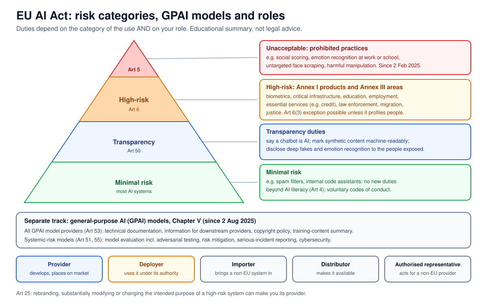
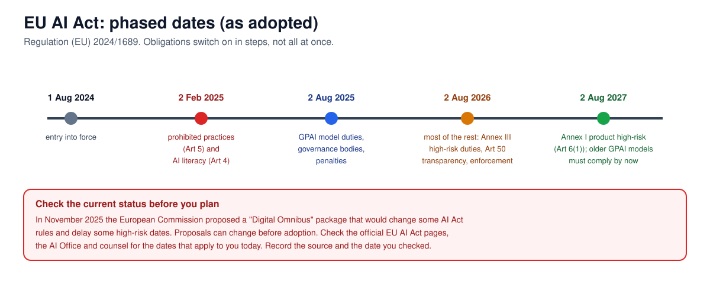

# The EU AI Act

> **Module:** 08 · AI Compliance · **Weeks:** 32 · **Time:** ~9 hours
> **You will:** decide whether the EU AI Act applies to a system, find its risk category and your role, list the obligations that follow and when they start, and see how a naive "is it a chatbot?" classifier gets the important cases wrong.

| | |
|---|---|
| **Prerequisites** | [Module 07](../07-ai-governance/) (register, tiers, risk) |
| **Lab** | [`lab/ai_act_classifier.py`](lab/ai_act_classifier.py), [`lab/fixtures/ai_act_cases.yaml`](lab/fixtures/ai_act_cases.yaml), `demo.py` section 1 |
| **Maps to** | Regulation (EU) 2024/1689 · NIST AI RMF MAP 1 (legal requirements in context) · ISO/IEC 42001 clause 4 (context, interested parties, legal requirements) |

> **Educational, not legal advice.** This lesson simplifies a long regulation to teach its structure. Classification of a real system needs the official text, current European Commission guidelines and qualified legal counsel. **Dates and some rules may change:** in November 2025 the Commission proposed a "Digital Omnibus" package that would amend parts of the AI Act, including delaying some high-risk dates. Check the current status before relying on any date here.

---

## 1. Why this matters

The EU AI Act is the first broad, binding AI law. It applies to organizations outside the EU when their AI is placed on the EU market or its output is used in the EU. That includes many Indian, US and UK companies.

- **2024:** the AI Act was published in the EU Official Journal in July 2024 and entered into force on **1 August 2024**. Its obligations apply in phases.
- **2 February 2025:** the bans on prohibited practices and the AI-literacy duty started to apply. In the same month the Commission published guidelines on prohibited practices and on the definition of an "AI system".
- **2022, Clearview AI and the Italian data protection authority:** the Garante fined Clearview AI EUR 20 million under GDPR, partly for scraping facial images to build a recognition database. Under the AI Act, building facial recognition databases by untargeted scraping is now a **prohibited practice** in its own right.
- **2018, Amazon's experimental recruiting model (reported by Reuters):** it penalized CVs that mentioned "women's". Under the AI Act, AI used to recruit or select people is listed in **Annex III** as high-risk.
- **Penalties** can reach EUR 35 million or 7% of worldwide annual turnover for prohibited practices, and EUR 15 million or 3% for many other obligations (Art 99; lower caps apply to SMEs).

---

## 2. Understand it

### 2.1 The decision order

Classify in a fixed order. Each step can end the analysis.

1. **Is it an AI system?** (Art 3(1): a machine-based system that infers from inputs how to generate outputs such as predictions, content, recommendations or decisions, with some autonomy.) Simple rule-based software is usually not.
2. **Is it in scope?** Placed on the EU market, put into service in the EU, or its output used in the EU (Art 2). Exclusions include military, defence and national security uses, scientific research only, and purely personal non-professional use.
3. **What is your role?** Provider, deployer, importer, distributor, authorised representative (section 2.3).
4. **Is it a prohibited practice?** (Art 5) Then stop: it may not be used.
5. **Is it high-risk?** Annex I product safety component (Art 6(1)) or an Annex III area (Art 6(2)), unless the Art 6(3) exception applies.
6. **Transparency duties?** (Art 50) Chatbots, synthetic content, deep fakes, emotion recognition.
7. **General-purpose AI model?** A separate track for model providers (Chapter V).
8. Otherwise **minimal risk**: no new duties beyond AI literacy; voluntary codes of conduct.

### 2.2 Risk categories



**Prohibited practices (Art 5)** include, in short:
- Subliminal, manipulative or deceptive techniques that cause significant harm.
- Exploiting vulnerabilities due to age, disability or social or economic situation.
- Social scoring that leads to unjustified or unrelated detrimental treatment.
- Predicting criminal offences based only on profiling or personality traits.
- Building facial recognition databases by untargeted scraping of images.
- Emotion recognition in the workplace and in education (except for medical or safety reasons).
- Biometric categorisation to infer sensitive traits such as race, political opinions or sexual orientation.
- Real-time remote biometric identification in public spaces for law enforcement, except in narrow listed cases.

**High-risk (Art 6)** has two routes:
- **Annex I:** the AI is a safety component of (or is) a product covered by EU product laws that need third-party conformity assessment (for example machinery, medical devices, toys).
- **Annex III areas:** biometrics; critical infrastructure; education and vocational training; employment and worker management; access to essential private and public services (for example creditworthiness, life and health insurance pricing, public benefits); law enforcement; migration, asylum and border control; administration of justice and democratic processes.

**The Art 6(3) exception.** An Annex III system is *not* high-risk if it does not pose a significant risk of harm, for example because it only performs a narrow procedural task, improves the result of a previous human activity, detects decision patterns without replacing human review, or does a preparatory task. **But a system that profiles natural persons is always high-risk.** A provider using the exception must document its assessment (Art 6(4)) and still register the system (Art 49(2)).

**Transparency (Art 50):**
- Providers: design chatbots so people know they are talking to AI (unless obvious); mark synthetic audio, image, video and text in a machine-readable way.
- Deployers: tell people exposed to emotion recognition or biometric categorisation; disclose deep fakes; disclose AI-generated text published to inform the public on matters of public interest, unless a human has editorial responsibility.

**General-purpose AI (GPAI) models (Chapter V):**
- All GPAI model providers (Art 53): technical documentation; information for downstream providers who build on the model; a copyright policy (including respecting text-and-data-mining opt-outs); a public summary of training content using the Commission's template. Open-source models have some exemptions, unless they have systemic risk.
- Models with **systemic risk** (Art 51; presumed above a training-compute threshold, or designated): also model evaluation including adversarial testing, assessing and mitigating systemic risks, reporting serious incidents to the AI Office, and adequate cybersecurity (Art 55).
- A **General-Purpose AI Code of Practice** was published in 2025 as a voluntary way to show compliance.

### 2.3 Roles: the same system, different duties

| Role | Who | Typical duties for a high-risk system |
|---|---|---|
| **Provider** | Develops the AI system (or has it developed) and places it on the market or puts it into service under its own name | Risk management, data governance, technical documentation, logging, instructions for use, human-oversight design, accuracy/robustness/cybersecurity, quality management system, conformity assessment, CE marking, registration, post-market monitoring, serious-incident reporting |
| **Deployer** | Uses an AI system under its authority (not personal use) | Use per instructions; competent human oversight; relevant input data; monitor and report; keep logs at least six months; inform affected people and workers; fundamental rights impact assessment in some cases |
| **Importer** | Places a non-EU provider's system on the EU market | Verify conformity assessment, documentation, CE marking and authorised representative |
| **Distributor** | Makes it available in the supply chain | Verify CE marking, declaration and instructions |
| **Authorised representative** | Acts in the EU for a non-EU provider | Holds documentation, cooperates with authorities |

**Art 25: you can become the provider.** A deployer, importer or distributor that puts its own name or trademark on a high-risk system, makes a substantial modification, or changes its intended purpose so it becomes high-risk takes on provider duties. Fine-tuning a vendor's model and selling it under your brand is a typical trap.

**Fundamental rights impact assessment (Art 27).** Required before first use for deployers that are public bodies or private entities providing public services, and for deployers of high-risk systems for creditworthiness and for life and health insurance pricing.

### 2.4 Timeline



| Date (as adopted) | What applies |
|---|---|
| 1 Aug 2024 | Entry into force |
| 2 Feb 2025 | Prohibited practices (Art 5); AI literacy (Art 4) |
| 2 Aug 2025 | GPAI model obligations; governance bodies; penalties |
| 2 Aug 2026 | Most remaining obligations, including Annex III high-risk duties and Art 50 transparency |
| 2 Aug 2027 | High-risk duties for Annex I products (Art 6(1)); GPAI models placed on the market before 2 Aug 2025 must comply |

Again: the Commission has proposed changes (the Digital Omnibus). Record the date you checked and your source.

### 2.5 Where security architects come in

Several provider duties are security engineering in legal language:

| Article | Plain meaning | Where you built it |
|---|---|---|
| Art 9 | Lifecycle risk management | Module 07 risk register |
| Art 10 | Data governance | Module 03 (RAG data), data provenance |
| Art 12, 19, 26(6) | Automatic logs, kept long enough | Module 06 logging, Module 08 evidence |
| Art 14 | Human oversight by design | Module 05 approvals, Module 07 GOV-03 |
| Art 15 | Accuracy, robustness, **cybersecurity** (including against data poisoning, adversarial examples, model flaws) | Modules 02–05 defenses and red-team tests |
| Art 72–73 | Post-market monitoring, serious-incident reporting | Lesson 04 |

---

## 3. Defend it

"Defending" here means not getting the classification wrong.

| Layer | Control | Type | What it buys you |
|---|---|---|---|
| L1 | Questionnaire with **required** answers; unknown fails closed | **Hard** | No silent "minimal risk" |
| L2 | Fixed decision order (scope → prohibited → high-risk → exception → transparency → GPAI) | **Hard** | Consistent, explainable results |
| L3 | Role-specific obligation lists | **Hard** | Provider duties don't get assigned to deployers, or the reverse |
| L4 | Profiling override for the Art 6(3) exception | **Hard** | The most common over-claim is refused |
| L5 | Open questions routed to counsel; record kept with date and source | Process | Legal judgment where it is needed |
| L6 | Re-classify on change (purpose, market, role, Art 25 triggers) | Process | Classification stays current |

### What does NOT work on its own

- "It's just a chatbot, so it's limited risk." The lab's naive classifier says that about a CV-screening tool.
- Assuming you are only a deployer because you bought the model. Rebranding or fine-tuning can make you a provider.
- Assuming non-EU companies are out of scope.
- Treating the AI Act as replacing GDPR. Both apply (Lesson 02).
- Copying dates from a blog post. Use official sources and record the access date.

---

## 4. Hands-on lab

**Scenario:** ACME (headquartered in India, selling in the EU) must build its compliance applicability matrix. Ten example systems are in [`fixtures/ai_act_cases.yaml`](lab/fixtures/ai_act_cases.yaml).

### Step 1: Run the classification scorecard

```powershell
python 08-ai-compliance/lab/demo.py
```

Expected output (section 1):

```text
=== 1. EU AI Act classification (educational, not legal advice) ===
case                       naive          engine categories          role      #obl  applies from (original dates)
----------------------------------------------------------------------------------------------------------------
cv-screening-deployer      minimal_risk   high_risk                  deployer     9  2025-02-02, 2026-08-02
cv-screening-provider      minimal_risk   high_risk                  provider    14  2025-02-02, 2026-08-02
hr-document-router         minimal_risk   annex_iii_not_high_risk    provider     3  2025-02-02, 2026-08-02
credit-scoring-bank        minimal_risk   high_risk                  deployer     9  2025-02-02, 2026-08-02
support-chatbot            limited_risk   transparency               provider     3  2025-02-02, 2026-08-02
meeting-mood-monitor       minimal_risk   prohibited                 deployer     2  2025-02-02
internal-code-assistant    limited_risk   minimal_risk               deployer     1  2025-02-02
open-weights-model         minimal_risk   gpai_model                 provider     5  2025-02-02, 2025-08-02
frontier-model             minimal_risk   gpai_systemic_risk         provider    10  2025-02-02, 2025-08-02
india-only-app             limited_risk   out_of_scope               provider     0  -
Dates are those in Regulation (EU) 2024/1689 as adopted. Later EU acts may change them: check the current status.
```

Count the naive classifier's errors: it calls a **prohibited** system "minimal", calls all three high-risk systems "minimal", gives a deployer a provider's chatbot duty, and claims EU duties for an India-only app.

### Step 2: See the obligations for one case

```powershell
python 08-ai-compliance/lab/demo.py --case cv-screening-deployer
```

```text
cv-screening-deployer      minimal_risk   high_risk                  deployer     9  2025-02-02, 2026-08-02
      WHY: Art 6(2) + Annex III area: employment
      Art 4         from 2025-02-02  AI literacy: staff who operate or use AI have sufficient AI literacy
      Art 26(1)     from 2026-08-02  Use the system according to the provider's instructions for use
      Art 26(2)     from 2026-08-02  Assign human oversight to people with competence, training and authority
      Art 26(4)     from 2026-08-02  Make sure input data you control is relevant and representative
      Art 26(5)     from 2026-08-02  Monitor operation; inform provider/authorities of risks and serious incidents
      Art 26(6)     from 2026-08-02  Keep automatically generated logs under your control for at least six months
      Art 26(11)    from 2026-08-02  Inform people that they are subject to the use of a high-risk AI system
      Art 86        from 2026-08-02  Be ready to explain individual decisions to affected persons on request
      Art 26(7)     from 2026-08-02  Inform workers' representatives and affected workers before use
      ASK COUNSEL: Art 25: putting your name on it, substantially modifying it, or changing its intended purpose can make YOU the provider. Is any of that planned?
```

Now compare the provider of the same product:

```powershell
python 08-ai-compliance/lab/demo.py --case cv-screening-provider
```

```text
cv-screening-provider      minimal_risk   high_risk                  provider    14  2025-02-02, 2026-08-02
      WHY: Art 6(3) exception refused: the system profiles natural persons
      WHY: Art 6(2) + Annex III area: employment
      Art 4         from 2025-02-02  AI literacy: staff who operate or use AI have sufficient AI literacy
      Art 9         from 2026-08-02  Risk management system across the whole lifecycle
      ...
      Art 73        from 2026-08-02  Report serious incidents to market surveillance authorities
```

The vendor claimed the "preparatory task" exception. The engine refused it because the product profiles candidates.

### Step 3: Run the tests

```powershell
python -m pytest 08-ai-compliance/lab/test_ai_act_classifier.py -v
```

All tests pass. Read `test_incomplete_questionnaire_fails_closed`: delete one answer and the engine raises an error instead of guessing.

### Step 4: Build ACME's applicability matrix (week-32 deliverable)

For each system in your Module 07 register, fill the questionnaire YAML, run the engine, and make a table: system, role, category, obligations, earliest date, open questions for counsel. Add a column for GDPR and India DPDP (Lesson 02). Mark every cell whose answer you are unsure about.

### Step 5: Break it yourself (predict, then run)

1. In `credit-scoring-bank`, set `credit_or_life_health_insurance: false`. Which obligation disappears? Is the system still high-risk?
2. In `hr-document-router`, set `profiling: true`. What changes, and why is this the most important single answer in the file?
3. Change `internal-code-assistant` to `role: provider` (ACME now sells it). Which new obligations appear?
4. Remove `eu_nexus` from any case. What happens? Why is that better than a default?

### Step 6: Optional, real text

Open the official text on EUR-Lex. For one obligation the engine prints (for example Art 26(6)), read the article and write in one sentence what the engine simplified or left out.

### Stretch goals

- Add questions for the Art 50(4) exceptions (artistic or satirical content) and route them to counsel.
- Add an `as_of` argument that marks each obligation as "applies now" or "applies from".
- Add an `answers_source` field (who answered, when) and refuse answers older than 12 months.

---

## 5. Real-world scenarios

**Scenario A: "we only use the vendor's tool".**
An Indian BPO company uses a vendor's AI to score call-centre agents' performance for EU clients' teams and to decide bonuses.
- *What went wrong:* the company assumed it had no duties as a buyer. In fact it is a **deployer** of an Annex III employment system (worker management), and the output is used in the EU.
- *Investigate:* who uses the output, where, and for what decisions? What do the provider's instructions for use say?
- *Fix:* deployer obligations: competent human oversight, logs kept, inform workers and their representatives, monitor and report. Ask the provider for its conformity documentation. Re-check whether any customization triggers Art 25.

**Scenario B: the exception that wasn't.**
A vendor claims its candidate-ranking product falls under the Art 6(3) "preparatory task" exception, so it is not high-risk.
- *What went wrong:* the product builds candidate profiles from CVs and online data. Profiling of natural persons means it is always high-risk.
- *Investigate:* ask for the vendor's Art 6(4) assessment and registration; check what data the system uses about candidates.
- *Fix:* treat it as high-risk in procurement; require provider documentation; reflect it in your register and risk register.

**Scenario C: the friendly chatbot that measures mood.**
Marketing adds "sentiment detection" to an internal staff assistant to measure employees' moods in chats.
- *What went wrong:* emotion recognition in the workplace is a prohibited practice (except for medical or safety reasons).
- *Investigate:* what exactly is inferred (emotions vs simple text sentiment about a product)? Who sees it? For what purpose?
- *Fix:* stop the feature; get legal review; record the decision; add the use to the organization's prohibited list (Module 07 GOV-07).

---

## 6. Common mistakes

- Starting with "which tier?" before "are we in scope and what is our role?"
- Assuming GPAI rules apply to every company using an LLM. They apply to **model providers**. Companies building systems on top usually have system-level duties instead.
- Forgetting AI literacy (Art 4): it already applies to providers and deployers.
- Ignoring Art 25 when fine-tuning or rebranding.
- Writing dates into slides without a source and an access date.

---

## 7. Interview preparation

<details><summary><b>Q1. Summarize the EU AI Act's structure in one minute.</b></summary>

It is risk-based. Some practices are prohibited. High-risk systems (Annex I products and Annex III areas such as employment, credit, education, law enforcement) carry heavy duties, mainly for providers, with specific duties for deployers. Some systems have transparency duties (chatbots, synthetic content, deep fakes). Everything else is minimal risk. General-purpose AI models have a separate track, with extra duties for systemic-risk models. Obligations apply in phases from 2025, and the exact dates should be checked because amendments have been proposed.
</details>

<details><summary><b>Q2. Does the AI Act apply to an Indian company with no EU office?</b></summary>

It can. It applies to providers placing AI systems or GPAI models on the EU market, and to providers and deployers outside the EU where the system's output is used in the EU. A non-EU provider of a high-risk system needs an EU authorised representative. The lab's `eu_nexus` question captures this.
</details>

<details><summary><b>Q3. Provider vs deployer: what is the difference and why does it matter?</b></summary>

The provider develops the system and places it on the market under its name; the deployer uses it under its authority. For high-risk systems, providers carry most design, documentation, conformity and post-market duties; deployers must use it correctly, ensure competent oversight, keep logs, monitor, inform people and sometimes run a fundamental rights impact assessment. Misidentifying the role gives you the wrong control list.
</details>

<details><summary><b>Q4. What is the Art 6(3) exception and its main limit?</b></summary>

An Annex III system is not high-risk if it poses no significant risk, for example it performs a narrow procedural task, improves a completed human activity, detects decision patterns without replacing human review, or does a preparatory task. But profiling of natural persons always makes it high-risk. The provider must document the assessment and still register the system.
</details>

<details><summary><b>Q5. Which AI Act articles are most relevant to a security architect?</b></summary>

Art 15 (accuracy, robustness and cybersecurity, including resilience to data poisoning and adversarial inputs), Art 12 and 19/26(6) (logging and retention), Art 14 (human oversight by design), Art 9 (risk management), Art 10 (data governance), Art 72–73 (post-market monitoring and serious-incident reporting), and Art 55 for systemic-risk GPAI (adversarial testing, cybersecurity).
</details>

<details><summary><b>Q6. When does a company that uses a vendor's model become a provider?</b></summary>

Under Art 25, when it puts its name or trademark on a high-risk system, makes a substantial modification to one, or changes the intended purpose of a system so that it becomes high-risk. Fine-tuning and rebranding a model for a high-risk use is a common trigger. Model providers (GPAI) and system providers are also different roles.
</details>

<details><summary><b>Q7. What does a deployer of a high-risk system need to do in practice?</b></summary>

Use it according to the instructions; assign trained people with authority to oversee it; ensure input data it controls is relevant; monitor and report risks and serious incidents to the provider and authorities; keep logs for at least six months; inform affected people (and workers' representatives for workplace use); support explanation requests; and run a fundamental rights impact assessment if it is a public body or uses it for credit or life/health insurance.
</details>

<details><summary><b>Q8. What are GPAI provider obligations, and what changes with systemic risk?</b></summary>

All GPAI providers: technical documentation, information for downstream providers, a copyright policy, and a public training-content summary. Systemic-risk models additionally need evaluations including adversarial testing, systemic-risk assessment and mitigation, serious-incident reporting to the AI Office and adequate cybersecurity. A Code of Practice published in 2025 offers a voluntary way to demonstrate compliance.
</details>

<details><summary><b>Q9. Scenario: your HR team wants to use emotion detection in video interviews. What do you advise?</b></summary>

Stop and escalate. Emotion recognition in the workplace is prohibited, and recruitment is closely tied to employment; legal counsel must confirm whether this use falls within the prohibition. Even outside it, it would be high-risk (employment) with serious fairness and privacy concerns, plus GDPR special-category issues. Record the decision and add it to the prohibited-uses list.
</details>

<details><summary><b>Q10. How would you build an applicability process that scales to 200 AI systems?</b></summary>

A required-answer questionnaire tied to the AI register; an engine that applies the decision order and lists obligations by role; open questions routed to counsel; results stored with answer source and date; re-classification triggered by changes in purpose, market, role or vendor; obligations mapped into the control set (Lesson 03) so they become engineering work with evidence.
</details>

<details><summary><b>Q11. How do you handle the uncertainty around dates and proposed amendments?</b></summary>

Plan to the adopted dates unless and until changes are formally adopted, track the legislative process, and record the source and date checked for every planning assumption. Many duties (risk management, logging, oversight, security testing) are good practice anyway, so building them early is low-regret.
</details>

<details><summary><b>Q12. Explain the AI Act to a product manager in plain words.</b></summary>

"If we sell or use AI that touches people in the EU, there are rules. A few uses are banned outright. Uses that affect people's jobs, money, education or safety need serious engineering: risk management, logs, human oversight, security testing and documentation. Chatbots must say they're AI. Most other AI just needs trained staff. The earlier we know which bucket a feature is in, the cheaper it is to comply."
</details>

---

## 8. Checklist (definition of done)

- [ ] I can walk through the decision order without notes.
- [ ] I can explain provider vs deployer duties and Art 25.
- [ ] `python -m pytest 08-ai-compliance` passes.
- [ ] I built an applicability matrix for my Module 07 register, with open questions for counsel.
- [ ] I recorded the date and source I used for AI Act dates.
- [ ] Week 32 journal: which system in my register was hardest to classify, and why.

## 9. References

- Regulation (EU) 2024/1689 (Artificial Intelligence Act), official text on EUR-Lex: https://eur-lex.europa.eu/eli/reg/2024/1689/oj
- European Commission, AI Act policy page (guidelines, codes, updates): https://digital-strategy.ec.europa.eu/en/policies/regulatory-framework-ai
- AI Act Service Desk, implementation timeline: https://ai-act-service-desk.ec.europa.eu/en/ai-act/eu-ai-act-implementation-timeline
- European Commission guidelines on prohibited AI practices and on the AI system definition (February 2025): via the policy page above.
- General-Purpose AI Code of Practice (2025): via the policy page above.
- European Commission "Digital Omnibus" proposals (November 2025): check the current legislative status on the Commission and EUR-Lex sites.
