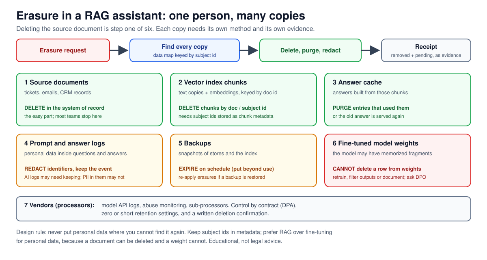

# Privacy for AI Systems: GDPR and India's DPDP Act

> **Module:** 08 · AI Compliance · **Weeks:** 31 (GDPR, DPIA, retention, vendors) and 32 (India DPDP) · **Time:** ~10 hours
> **You will:** choose a lawful basis for AI processing, decide when a DPIA is needed, handle automated decisions under GDPR Article 22, map India's DPDP Act duties, and prove that a data subject's erasure really removes their data from a RAG assistant.

| | |
|---|---|
| **Prerequisites** | [Module 03 RAG security](../03-rag-security/) (chunks, indexes, metadata); [Lesson 01](01-eu-ai-act.md) |
| **Lab** | [`lab/privacy_rights.py`](lab/privacy_rights.py), `demo.py` section 3, `test_privacy_and_incidents.py` |
| **Maps to** | GDPR (Regulation (EU) 2016/679) Art 5, 6, 9, 12–22, 25, 28, 32–35 · India Digital Personal Data Protection Act 2023 and DPDP Rules · OWASP LLM02:2025 Sensitive Information Disclosure · NIST AI 600-1 risk 4 (data privacy) · ISO/IEC 42001 A.7 (data for AI) |

> **Educational, not legal advice.** Privacy law is detailed and depends on facts and jurisdiction. Use this lesson to ask the right questions and build the right controls; get privacy counsel and your DPO for real decisions. For India's DPDP Rules in particular, **check the current notified text and commencement dates.**

---

## 1. Why this matters

AI systems collect personal data in new places: prompts, retrieved documents, embeddings, caches, logs, fine-tuning sets and model outputs. Privacy law applies to all of them.

- **2023–2024, Italy and ChatGPT:** in March 2023 the Italian data protection authority (Garante) temporarily limited ChatGPT's processing of Italian users' data. In December 2024 it fined OpenAI EUR 15 million, citing issues including the legal basis for training and transparency.
- **2024, noyb complaint against OpenAI (Austria):** the privacy group noyb complained that ChatGPT produced a wrong date of birth for a public figure and that the error could not be corrected. Under GDPR, personal data must be accurate and people have a right to rectification. That applies to what a model *says* about people.
- **December 2024, EDPB Opinion 28/2024:** the European Data Protection Board gave its opinion on AI models and personal data: when a model can be considered anonymous, how legitimate interest can be assessed for development and deployment, and what happens when a model was trained on unlawfully processed data.
- **2022, Clearview AI:** several EU authorities fined Clearview AI (Italy: EUR 20 million) for scraping facial images to build a biometric database without a legal basis.
- **2023, India:** Parliament passed the Digital Personal Data Protection Act, 2023. The DPDP Rules were notified in **November 2025**, with obligations commencing in phases. Many AI products built in India for Indian users fall under it.

---

## 2. Understand it

### 2.1 Where personal data lives in an AI system



| Place | Example | Privacy questions |
|---|---|---|
| Training / fine-tuning data | Support tickets used to fine-tune | Lawful basis? Can you honor erasure? Memorization? |
| Retrieval sources | CRM, tickets, HR files | Access control per user (Module 03); purpose limitation |
| Vector index chunks | Copies of text + embeddings | Are subject IDs in metadata so you can find and delete them? |
| Prompts and outputs | Users paste personal data; the model writes about people | Minimization; accuracy of outputs; logging |
| Caches | Answer cache, semantic cache | Purge on erasure; cross-user leakage |
| Logs and traces | Prompt logs, tool-call logs | Retention; redaction; who can read them |
| Backups | Snapshots | Expiry; re-applying erasures after restore |
| Vendors (processors) | Model API, observability tools | Contract (DPA), retention, training on your data, location |

### 2.2 GDPR essentials for AI

**Principles (Art 5):** lawfulness, fairness and transparency; purpose limitation; data minimisation; accuracy; storage limitation; integrity and confidentiality; accountability (you must be able to *prove* compliance).

**Lawful basis (Art 6).** Every processing purpose needs one of: consent; contract; legal obligation; vital interests; public task; legitimate interests. For AI, decide the basis **per purpose**: "answer the customer's question" (often contract) is different from "use support tickets to fine-tune a model" (often legitimate interests, which needs a documented balancing test, or consent).

**Special categories (Art 9).** Health, biometric data for identification, racial or ethnic origin, political opinions, religion, trade union membership, sex life or sexual orientation, genetic data. Processing them needs an additional condition. Watch for AI that *infers* them.

**Controller vs processor (Art 28).** The **controller** decides why and how data is processed. The **processor** processes on the controller's behalf. A model API provider is usually a processor for your inference traffic, but check whether it uses data for its own purposes (for example training), which can make it a controller for that part. You need a **data processing agreement (DPA)**.

**DPIA (Art 35).** A **data protection impact assessment** is required when processing is likely to cause high risk to people. Typical AI triggers: systematic and extensive evaluation of people based on automated processing (including profiling) with significant effects; large-scale special-category data; systematic monitoring; innovative technology combined with other risk factors. A DPIA describes the processing, assesses necessity and proportionality, assesses risks to people, and lists measures. If high risk remains, you consult the supervisory authority (Art 36). The EU AI Act Art 26(9) says deployers of high-risk AI use the provider's information to do their DPIA.

**Automated decisions (Art 22).** People have the right not to be subject to a decision **based solely on automated processing**, including profiling, that produces **legal or similarly significant effects** (for example rejecting a loan or a job application automatically). It is allowed only if necessary for a contract, authorised by law, or based on explicit consent, and then with safeguards: at least the right to human intervention, to express their view and to contest. Transparency rules (Art 13–15) require meaningful information about the logic involved.

**A human "rubber stamp" does not count.** If a reviewer always clicks "approve" without real authority or information, the decision is still solely automated in practice. Human oversight must be meaningful (this links to EU AI Act Art 14 and Module 07 GOV-03).

**Data subject rights (Art 15–21) and AI:**

| Right | AI challenge | Practical approach |
|---|---|---|
| Access (15) | Data spread across logs, chunks, caches | Data map keyed by subject ID; search all stores |
| Rectification (16) | The model "says" wrong things about a person | Fix sources; output filters; correct in RAG rather than in weights |
| Erasure (17) | Copies in index, cache, logs, backups, weights | Propagated deletion; receipts; backups expire; avoid personal data in fine-tuning |
| Restriction (18) | Keep but don't use | Flag in metadata; exclude from retrieval |
| Objection (21) | Objecting to legitimate-interest processing, e.g. training | Opt-out lists applied to training and retrieval |
| Art 22 | Solely automated significant decisions | Meaningful human review; contest route |

**Breach notification (Art 33–34):** notify the supervisory authority within 72 hours of becoming aware, unless the breach is unlikely to result in a risk to people; tell the people affected without undue delay if the risk is high (Lesson 04).

### 2.3 RAG vs fine-tuning: a privacy design decision

| | RAG (retrieve at query time) | Fine-tuning (change the weights) |
|---|---|---|
| Erase one person | Delete their chunks and purge caches | Not possible to delete precisely; retrain or accept risk |
| Rectify | Fix the source document | Retrain, or filter outputs |
| Access control | Per-user filters at retrieval (Module 03) | None: the weights are shared by everyone |
| Evidence | Deletion receipt per store | Hard to prove |

**Design rule:** keep personal data in retrieval, where you can find, filter and delete it, not in weights. If personal data must be used for training, minimise it, pseudonymise it, document the lawful basis and the DPIA, and plan for erasure requests honestly.

### 2.4 Retention vs logging: a real tension

The EU AI Act expects high-risk systems to keep logs (deployers: at least six months, Art 26(6)). GDPR requires storage limitation and supports erasure. Both can be met: **keep the event, redact or pseudonymise the person** in it, set a defined retention period, restrict access, and document the reason. The lab's `redact_logs` layer does exactly this: the number of log records stays the same, but the identifiers are replaced with a pseudonym.

### 2.5 India's Digital Personal Data Protection Act, 2023

What the Act establishes (check the current Rules for detail and timing):

| Topic | DPDP Act |
|---|---|
| Scope | Digital personal data processed in India; and processing outside India if it relates to offering goods or services to people in India |
| Roles | **Data Principal** (the person), **Data Fiduciary** (decides purpose and means, like a controller), **Data Processor**, **Significant Data Fiduciary** (designated by government), **Consent Manager**, **Data Protection Board of India** |
| Grounds | Consent (free, specific, informed, unconditional, unambiguous, with clear affirmative action), or certain **legitimate uses** listed in the Act. There is no general "legitimate interests" ground like GDPR |
| Notice | Tell the Data Principal what data and for what purpose, and how to exercise rights and complain |
| Fiduciary duties | Accuracy when data is used for decisions or shared; reasonable security safeguards; breach intimation to the Board and to each affected Data Principal; erase data when the purpose is served or consent is withdrawn (unless law requires retention); grievance redressal; processors only under contract |
| Children | Verifiable consent of a parent or guardian for under-18s; no tracking, behavioural monitoring or targeted advertising directed at children |
| Significant Data Fiduciaries | Data Protection Officer based in India, independent data auditor, periodic data protection impact assessment and audit |
| Rights | Information about processing; correction, completion, updating and erasure; grievance redressal; nominate another person |
| Cross-border | Transfers allowed except to countries the government restricts by notification |
| Publicly available data | The Act does not apply to personal data made publicly available by the Data Principal themselves (or under a legal obligation). Read this carefully before relying on it for scraping |
| Penalties | Set in the Act's Schedule; the highest (for failing to take reasonable security safeguards) is up to INR 250 crore |

**DPDP Rules.** Notified in November 2025. They set details such as notice content, consent managers, breach intimation, data retention for certain fiduciaries, children's consent and SDF duties, with a **phased commencement** (most fiduciary duties after a transition period). **Check the official notification for which duties are in force on the date you assess.**

**GDPR vs DPDP for an AI architect, in short:**

| | GDPR | DPDP Act |
|---|---|---|
| Bases | Six, including legitimate interests | Consent or listed legitimate uses |
| Automated decisions | Specific right (Art 22) | No equivalent specific article; general duties (accuracy, notice) still apply |
| Special categories | Yes (Art 9) | No separate special-category list in the Act |
| DPIA | Required for high-risk processing | Required periodically for Significant Data Fiduciaries |
| Breach | 72 hours to authority (if risk) | Intimation to Board and each affected person (form and timing in the Rules) |

### 2.6 Privacy engineering checklist for AI

- Minimise collection and prompt context: send the model only what the task needs.
- Define purpose and lawful basis per purpose; record them in the system card.
- Map data subjects and data flows, including vendors and sub-processors.
- Apply retention and deletion to sources, caches, logs, embeddings and backups.
- Restrict access by role and purpose (retrieval-time filtering, Module 03).
- Document processor and sub-processor processing; sign DPAs; check training-on-data settings.
- Assess cross-border transfers and data residency.
- Build rights-request and incident workflows that cover AI stores.
- Use synthetic or de-identified data for labs and tests.

---

## 3. Defend it

| Layer | Control | Type | What it buys you |
|---|---|---|---|
| L1 | Data minimisation and PII redaction before the prompt | **Hard** | Less personal data reaches models, vendors and logs |
| L2 | Subject IDs in chunk metadata; data map of every store | **Hard** | You can find every copy |
| L3 | Propagated erasure: index, cache, logs (redact), backups (expire) | **Hard** | Rights requests are actually honored |
| L4 | Erasure receipt as evidence, with honest "pending" items | Process + code | Auditable proof, no false claims |
| L5 | RAG over fine-tuning for personal data | Design | Deletion and rectification remain possible |
| L6 | Meaningful human review for significant decisions | Process | Art 22 and AI Act Art 14 |
| L7 | DPIA before launch and on change; vendor DPA and settings | Process | Risks known and accepted at the right level |
| L8 | Privacy notice and transparency text for AI features | Soft | People know what happens to their data |

### What does NOT work on its own

- Deleting the source record and closing the ticket (the lab's `naive_erasure`).
- "We anonymised it" when the data is only pseudonymised (a key or other data can re-identify people).
- A human approval click with no time, information or authority to disagree.
- Relying on a vendor's "we don't train on API data" without checking the contract and settings.
- A DPIA written after launch to satisfy an audit.

---

## 4. Hands-on lab

**Scenario:** customer Asha Verma (synthetic) asks ACME to erase her data. ACME's support assistant uses RAG over tickets, caches answers and logs prompts.

### Step 1: Watch naive erasure fail

```powershell
python 08-ai-compliance/lab/demo.py
```

Expected output (section 3):

```text
=== 3. Right to erasure in a RAG assistant ===
naive erasure (source only) -> assistant still answers: 'Her email is asha.verma@customer.example and her loyalty id is L-5521.'
layered erasure            -> assistant answers:       'I could not find that.'
receipt removed: {'source_documents': 1, 'index_chunks': 2, 'cached_answers': 1, 'log_fields_redacted': 3}
receipt PENDING: backup 2026-11-12: expires 2026-12-17; re-apply erasure if restored
receipt PENDING: model fine-tuned in FT-2026-07: cannot erase from weights; output filter added; escalate to DPO (retrain or document assessment)
```

The source was deleted, but the assistant still answers with her email from the index and the cache.

### Step 2: Switch layers off one at a time

```powershell
python 08-ai-compliance/lab/privacy_rights.py --no-cache
```

```text
before erasure: 'Her email is asha.verma@customer.example and her loyalty id is L-5521.'
after erasure:  'Her email is asha.verma@customer.example and her loyalty id is L-5521.'
removed: {'source_documents': 1, 'index_chunks': 2, 'log_fields_redacted': 6}
PENDING: cache: answers with the person's data still served
PENDING: backup 2026-11-12: expires 2026-12-17; re-apply erasure if restored
complete: False
```

The index is clean, but the **cache** still serves the old answer. Now run with all layers on:

```powershell
python 08-ai-compliance/lab/privacy_rights.py
```

```text
before erasure: 'Her email is asha.verma@customer.example and her loyalty id is L-5521.'
after erasure:  'I could not find that.'
removed: {'source_documents': 1, 'index_chunks': 2, 'cached_answers': 1, 'log_fields_redacted': 6}
PENDING: backup 2026-11-12: expires 2026-12-17; re-apply erasure if restored
complete: False
```

`complete: False` is the honest answer: one backup still holds her data until it expires. The receipt says so, with the date.

### Step 3: Run the privacy tests

```powershell
python -m pytest 08-ai-compliance/lab/test_privacy_and_incidents.py -v
```

Read `test_logs_are_redacted_not_deleted`: the log keeps its event records (for audit and AI Act logging) while the personal data is gone.

### Step 4: Write a DPIA outline (week-31 deliverable)

For your capstone system, write a short DPIA: description of processing and purposes; lawful basis per purpose; necessity and proportionality; data flows including vendors; risks to people (leakage, inaccurate outputs, automated decisions, retention); measures (from section 3); residual risk and sign-off. Add a section "erasure plan" listing every store from section 2.1 and how each is handled.

### Step 5: DPDP mapping

For the same system, assume Indian users. Fill the DPDP table in section 2.5 for your system: role (fiduciary or processor), ground (consent or legitimate use), notice, children, breach path, erasure trigger. Mark everything that depends on the Rules as "check current Rules".

### Step 6: Break it yourself (predict, then run)

1. Run `privacy_rights.py --no-index`. Which store leaks now?
2. Run `privacy_rights.py --fine-tuned`. What new pending item appears? What would you tell the DPO?
3. In `demo_store()`, ingest a second ticket for Asha *without* her subject ID (use `"unknown"`). Does erasure find it? What design rule does that teach?
4. Change the backup `retention_days` to 400. What does that mean for the erasure promise in your privacy notice?

### Stretch goals

- Add a "restriction" flag: chunks stay in the index but are excluded from retrieval.
- Add an access-request function that lists every store holding a subject's data.
- Add a semantic cache keyed by embeddings, and prove that erasure must purge near-duplicate questions too.

---

## 5. Real-world scenarios

**Scenario A: the deleted customer who keeps coming back.**
A customer is erased on Monday. On Wednesday the support assistant quotes her address in an answer to an agent.
- *What went wrong:* deletion stopped at the CRM. Chunks and cached answers remained.
- *Investigate:* search the index, caches and logs for her identifiers; check how chunks are keyed; check whether a backup was restored.
- *Fix:* subject IDs in chunk metadata; propagated erasure with receipts; cache purge; erasure re-applied after restores; a monthly erasure drill (its receipt is audit evidence).

**Scenario B: "solely automated" by accident.**
A lender's loan pre-check model rejects applications below a score. Officers "review" rejections in batches of 500 by clicking approve-all.
- *What went wrong:* the human review is not meaningful, so the decision is effectively solely automated with significant effects (Art 22). It is also Annex III high-risk under the AI Act (Lesson 01).
- *Investigate:* override rates, time spent per review, what information reviewers see, whether they can change outcomes.
- *Fix:* real review for adverse decisions with reasons shown; a contest route; staffing to match volume; monitor override rates as an oversight KPI.

**Scenario C: the helpful fine-tune.**
A team fine-tuned a model on two years of support chats to "learn our tone". Customers' names and order details appear in completions.
- *What went wrong:* personal data put into weights without a lawful-basis assessment or DPIA, and with no way to erase.
- *Investigate:* what data went in; extraction tests for memorized personal data; which users can reach the model.
- *Fix:* stop serving or restrict; retrain on minimised, pseudonymised data or use RAG plus a style guide; DPIA; erasure answer documented; consider whether it is a reportable breach.

---

## 6. Common mistakes

- One lawful basis for "the AI" instead of one per purpose.
- Treating embeddings as anonymous. They are derived from personal data and can often be linked back.
- Logging full prompts with personal data to a widely readable log.
- Forgetting vendors' abuse-monitoring logs and sub-processors.
- Assuming DPDP is "GDPR for India". The bases, children's rules and structure differ.
- Stating DPDP dates without checking the current notification.

---

## 7. Interview preparation

<details><summary><b>Q1. How do you choose a lawful basis for an AI feature under GDPR?</b></summary>

Per purpose. Answering a customer's request may rest on contract; improving or fine-tuning a model on customer data is a separate purpose, often legitimate interests (with a documented necessity and balancing test, and an opt-out) or consent. Special-category data needs an extra Art 9 condition. Document it in the system card and DPIA, and reflect it in the privacy notice.
</details>

<details><summary><b>Q2. When is a DPIA required for an AI system?</b></summary>

When processing is likely to result in high risk: for example systematic and extensive evaluation of people with significant effects (profiling, scoring), large-scale special-category data, systematic monitoring, or new technology combined with other risk factors. Most customer-facing or employee-facing AI that processes personal data at scale should at least be screened. Do it before launch and update it on change.
</details>

<details><summary><b>Q3. Explain GDPR Article 22 and how it affects AI design.</b></summary>

People can refuse decisions based solely on automated processing that have legal or similarly significant effects, unless an exception applies (contract necessity, law, explicit consent), and even then they get safeguards: human intervention, the chance to give their view, and to contest. Design implication: put meaningful human review where decisions are significant, give reviewers information and authority, provide a contest route, and explain the logic.
</details>

<details><summary><b>Q4. How do you handle a right-to-erasure request in a RAG system?</b></summary>

Find every copy using subject IDs: source, index chunks, caches, logs, backups, vendor stores. Delete source and chunks, purge caches, redact identifiers in logs (keep events if they must be retained), let backups expire and re-apply erasures on restore, and request deletion from processors. Produce a receipt listing what was removed and what is pending with dates. If the data was used for fine-tuning, escalate: you cannot delete precisely from weights.
</details>

<details><summary><b>Q5. Why prefer RAG over fine-tuning for personal data?</b></summary>

In RAG, personal data stays in documents you can filter per user, correct and delete. In fine-tuning it becomes part of shared weights: you can't delete one person, can't apply per-user access control, and it may be memorized and regurgitated. RAG makes rights requests and access control feasible.
</details>

<details><summary><b>Q6. The EU AI Act wants logs kept; GDPR wants minimisation. How do you reconcile them?</b></summary>

Keep the log events needed for traceability for a defined period, but minimise and pseudonymise personal data inside them, restrict access, and delete at the end of the period. On erasure requests, redact identifiers in logs rather than deleting the event. Document the reasoning in the DPIA and retention schedule.
</details>

<details><summary><b>Q7. What is a model provider under GDPR: controller or processor?</b></summary>

Usually a processor for your inference traffic, under a DPA, if it only processes on your instructions. If it uses your data for its own purposes (such as training its models or certain abuse monitoring), it may be a controller for that processing. Check the contract, data-use settings, retention, sub-processors and transfer mechanism.
</details>

<details><summary><b>Q8. What are the key roles and grounds under India's DPDP Act?</b></summary>

Data Principal (the person), Data Fiduciary (decides purpose and means), Data Processor, Significant Data Fiduciary (with extra duties such as a DPO in India, an independent data auditor and periodic DPIAs), Consent Manager and the Data Protection Board. Processing needs consent or one of the listed legitimate uses; there is no broad legitimate-interests ground. Detailed procedures are in the DPDP Rules notified in November 2025, which commence in phases, so check what is in force.
</details>

<details><summary><b>Q9. Name three differences between GDPR and DPDP that matter for AI products.</b></summary>

DPDP has no general legitimate-interests basis, so training and analytics need consent or a listed legitimate use. It has no Art 22-style specific right on automated decisions. It has strict children's rules for all under-18s (verifiable parental consent; no tracking, behavioural monitoring or targeted ads aimed at children). Also, data made public by the person is outside the Act, which is narrower and different from GDPR's approach.
</details>

<details><summary><b>Q10. Scenario: a chatbot invents a false criminal record for a named person. What are the privacy issues and your response?</b></summary>

It is inaccurate personal data about an identifiable person, possibly defamatory and harmful. GDPR accuracy and rectification apply. Respond: block or filter outputs about that person, trace whether the claim came from retrieval or the model, correct sources, add regression tests, log and assess as an incident, and answer the person's request within the legal timeframe. Longer term: grounding with citations, refusal policies for claims about private individuals.
</details>

<details><summary><b>Q11. How do you prove to an auditor that erasure works?</b></summary>

Show the data map, the erasure procedure, automated erasure drills with receipts (removed counts per store, pending items with dates), backup retention settings, processor deletion confirmations and test results (like the lab tests that assert the assistant can no longer reveal the data). Evidence should be dated and repeatable.
</details>

<details><summary><b>Q12. Explain to a product owner why "just delete the row" isn't enough.</b></summary>

"Our assistant makes copies: in its search index, in a cache of old answers, in logs and in backups. If we delete only the original, the assistant can still repeat the person's details tomorrow. We need one button that cleans every copy and gives us a receipt, or we are promising customers something we don't do."
</details>

---

## 8. Checklist (definition of done)

- [ ] I can state the GDPR principles, lawful bases and Art 22 conditions without notes.
- [ ] I can list DPDP roles, grounds, children's rules and SDF duties, and I know which details depend on the Rules.
- [ ] `python -m pytest 08-ai-compliance` passes.
- [ ] I wrote a DPIA outline with an erasure plan for my capstone system.
- [ ] Week 31 journal: which store in my capstone would be hardest to erase from, and why.
- [ ] Week 32 journal: one difference between GDPR and DPDP that would change my design.

## 9. References

- GDPR, Regulation (EU) 2016/679: https://eur-lex.europa.eu/eli/reg/2016/679/oj
- European Data Protection Board (guidelines on DPIA, automated decisions; Opinion 28/2024 on AI models): https://www.edpb.europa.eu/
- Digital Personal Data Protection Act, 2023 and DPDP Rules: Ministry of Electronics and Information Technology, https://www.meity.gov.in/
- Regulation (EU) 2024/1689 (EU AI Act), Art 26(6) and 26(9): https://eur-lex.europa.eu/eli/reg/2024/1689/oj
- OWASP LLM02:2025 Sensitive Information Disclosure: https://genai.owasp.org/llm-top-10/
- NIST AI 600-1, Generative AI Profile (data privacy risk): https://doi.org/10.6028/NIST.AI.600-1
- Italian Garante per la protezione dei dati personali (ChatGPT decisions): https://www.garanteprivacy.it/
