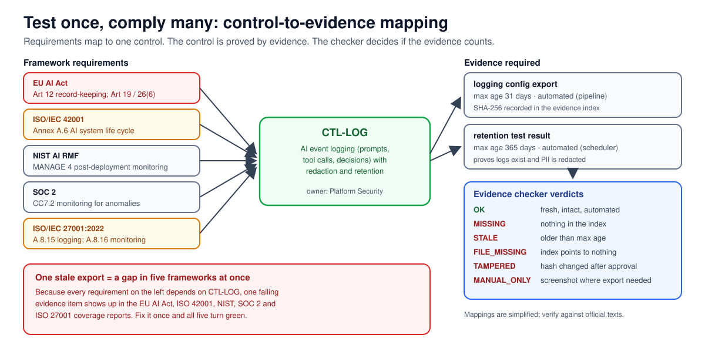
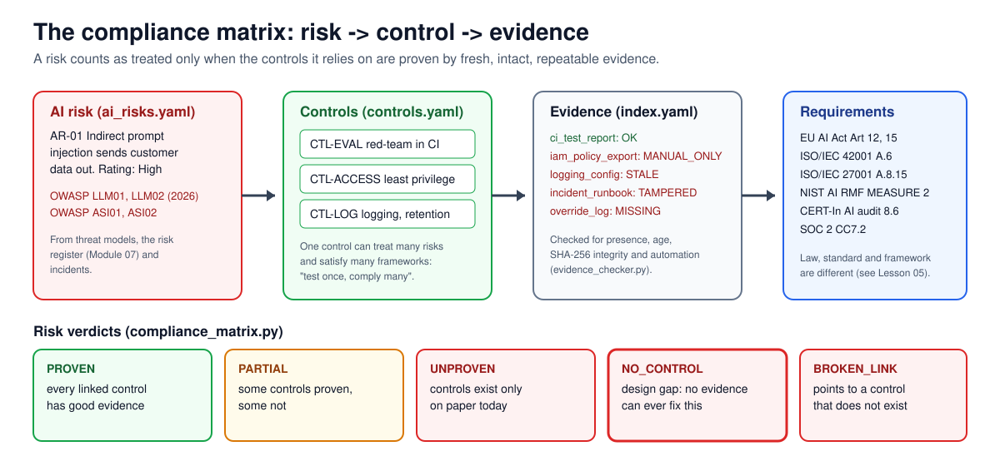

# Control Mapping and Evidence: Test Once, Comply Many

> **Module:** 08 · AI Compliance · **Weeks:** 31–32 · **Time:** ~9 hours
> **You will:** map one AI control set to the EU AI Act, ISO/IEC 42001, NIST AI RMF, SOC 2 and ISO/IEC 27001; decide what evidence an auditor will accept; and build an evidence-gap checker that catches missing, stale, deleted, edited and manual-only evidence.

| | |
|---|---|
| **Prerequisites** | [Module 07](../07-ai-governance/) (controls CTL-xx, risk register); [Lesson 01](01-eu-ai-act.md) |
| **Lab** | [`lab/evidence_checker.py`](lab/evidence_checker.py), [`lab/fixtures/controls.yaml`](lab/fixtures/controls.yaml), `fixtures/evidence_vulnerable/` and `evidence_compliant/`, [`lab/compliance_matrix.py`](lab/compliance_matrix.py) with [`fixtures/ai_risks.yaml`](lab/fixtures/ai_risks.yaml), [`lab/build_dashboard.py`](lab/build_dashboard.py), `demo.py` sections 2 and 5 |
| **Maps to** | ISO/IEC 42001 clause 7.5 (documented information) and 9 · ISO/IEC 27001 · AICPA SOC 2 Trust Services Criteria · NIST AI RMF GOVERN 1 · EU AI Act Art 11, 18 (documentation and its retention) |

> **Educational, not legal or audit advice.** The mappings in the lab are simplified and at article, clause or category level. Verify every reference against the current official texts and your licensed ISO copies.

---

## 1. Why this matters

Most organizations face several frameworks at once: a law (EU AI Act, GDPR), certifications customers ask for (ISO/IEC 27001, ISO/IEC 42001), attestation reports (SOC 2) and internal frameworks (NIST AI RMF). Doing each separately means the same engineers answer the same questions four times, with four slightly different answers.

- **Compliance is not security:** Target's 2013 payment-card breach happened shortly after the company had been certified compliant with the card industry standard (PCI DSS), as its leadership said publicly afterwards. A point-in-time check passed; controls did not hold in operation.
- **SOC 2 reports list "complementary user entity controls":** controls the *customer* must run for the vendor's controls to work. If you rely on a model provider's SOC 2 report but don't run your side, the report does not cover you.
- **Standards change:** ISO/IEC 27001 was revised in 2022 (93 Annex A controls in four themes), and certified organizations had to transition by October 2025. Every mapping you build needs an owner and a review date.
- **NIST publishes crosswalks** between the AI RMF and other frameworks (including ISO/IEC standards) on its AI Resource Center, because organizations asked for exactly this mapping work.

---

## 2. Understand it

### 2.1 Four kinds of "framework" (don't mix them up)

| Kind | Examples | Who checks | Output |
|---|---|---|---|
| **Law** | EU AI Act, GDPR, India DPDP | Regulators, courts | Legal compliance (or fines) |
| **Certifiable standard** | ISO/IEC 27001, ISO/IEC 42001 | Accredited certification body | Certificate for a scope |
| **Attestation report** | SOC 2 Type I / Type II | Independent CPA firm | Report with auditor opinion (not a certificate) |
| **Voluntary framework / guidance** | NIST AI RMF, NIST AI 600-1, ISO/IEC 23894, ISO/IEC 27090, OWASP lists, MITRE ATLAS | Yourself, customers | Better practice, shared vocabulary |
| **Government audit guideline** | CERT-In AI Security Auditing Guidelines (India) | Auditors (CERT-In empanelled for higher tiers) | Audit scope, depth and finding severity ([Lesson 06](06-cert-in-ai-security-audit.md)) |

The key distinction, again: **NIST AI RMF and OWASP are not laws. ISO/IEC 42001 is a certifiable management-system standard. GDPR, India's DPDP Act and the EU AI Act are law.** The full comparison table is in [Lesson 05](05-iso-standards-and-law-vs-standard.md).

**SOC 2 in one paragraph.** An AICPA attestation against the Trust Services Criteria (security, plus optionally availability, processing integrity, confidentiality and privacy). **Type I** checks that controls are suitably designed at a point in time. **Type II** checks that they operated effectively over a period (often 6–12 months). The report describes the system, the controls, the tests and any exceptions. Read the exceptions and the complementary user entity controls.

### 2.2 The compliance mapping method

For every requirement:
1. **Identify** the authoritative requirement (article, clause, criterion) from the official source.
2. **Decide applicability** and write the rationale (Lesson 01 decides most of this for the AI Act).
3. **Map to a control objective** in your own control set.
4. **Describe the implementation** and name the **control owner**.
5. **Define the evidence** and how often it is collected and tested.
6. **Record exceptions** and remediation (Module 07 exceptions).
7. **Re-check** when the law, the standard or the system scope changes.

A completed checklist does not prove compliance. Compliance is **scoped, evidence-based and subject to legal interpretation.**

### 2.3 One control set, many frameworks



Build a **unified control set** (also called a common control framework): your own controls, written once, each mapped to the requirements it satisfies. The lab's [`controls.yaml`](lab/fixtures/controls.yaml) has ten AI controls. For example:

| Control | EU AI Act | ISO/IEC 42001 | NIST AI RMF | SOC 2 | ISO/IEC 27001 |
|---|---|---|---|---|---|
| CTL-LOG AI event logging with redaction and retention | Art 12; Art 19 / 26(6) | A.6 life cycle | MANAGE 4 | CC7.2 | A.8.15, A.8.16 |
| CTL-HO Human oversight | Art 14; Art 26(2) | A.9 use of AI | MAP 3 | – | – |
| CTL-VEND Vendor assessment | Art 25 | A.10 third parties | GOVERN 6; MANAGE 3 | CC9.2 | A.5.19 |
| CTL-ACCESS Least-privilege access | Art 15 | – | MEASURE 2.7 | CC6.1 | A.5.15 |

Notice the **empty cells**. SOC 2 and ISO/IEC 27001 have no requirement for AI human oversight. If you only prepare for those, you will miss what the AI Act and ISO/IEC 42001 add. Empty cells are findings too.

**Mapping is many-to-many and often partial.** One control may satisfy part of a requirement; one requirement may need several controls. Mark partial coverage honestly. Auditors and regulators read the requirement, not your mapping.

### 2.4 What auditors accept as evidence

Good evidence is **relevant** (it proves this control, for this scope), **reliable** (hard to fake, from a system rather than a person), **sufficient** (covers the period and the population), **timely** (fresh enough) and **traceable** (who, when, from where).

| Evidence type | Strength | AI example |
|---|---|---|
| Re-performance by the auditor | Strongest | Auditor runs the injection regression suite themselves |
| System-generated export with timestamp | Strong | IAM policy export from the cloud API; register export from CI |
| Automated test result in a pipeline | Strong | CI report showing the red-team suite passed on release X |
| Ticket with approval trail | Good | Exception approved by the CISO with expiry |
| Sample of operating records | Good | 25 random human-override log entries from the quarter |
| Signed procedure / policy | Design only | Oversight procedure (proves design, not operation) |
| Screenshot | Weak | Hard to date, easy to fake, shows one moment |
| Interview / "we do this" | Weakest alone | Needs corroboration |

**Design vs operating effectiveness.** A policy proves the control is *designed*. Only records over time prove it *operates*. Type II audits and ISO surveillance audits look for operation.

**AI-specific evidence** auditors increasingly ask for: system cards and model cards; evaluation and red-team reports with dates and model versions; data lineage for training and retrieval data; human-override logs; prompt and tool-call log samples (redacted); model version pinning and change approvals; vendor assessments and DPAs; erasure receipts; incident tabletop reports.

### 2.5 Evidence integrity and freshness

Evidence is only useful if it is the same file that was approved, and recent enough to describe today.
- **Freshness:** each evidence item has a maximum age (for example 31 days for a configuration export, 365 days for a vendor assessment).
- **Integrity:** store a hash (SHA-256) when the evidence is approved. If the file changes later, the hash no longer matches. The lab normalizes Windows line endings before hashing, so a checkout on another operating system is not "tampering".
- **Automation:** for controls that run continuously (logging, access), require evidence produced by a pipeline or scheduler, not a person's upload.
- **Retention:** keep evidence for the audit period and as required by law (the EU AI Act requires providers to keep technical documentation for 10 years after the system is placed on the market, Art 18).

### 2.6 Continuous compliance

Instead of collecting evidence before an audit, produce it as part of normal operation:

```text
pipelines & schedulers ──> evidence store (dated, hashed) ──> gap checker ──> findings ──> risk register / tickets
       ^                                                                                         |
       └──────────────────────────────── fix, re-run, close ─────────────────────────────────────┘
```

Examples: CI exports the test report on every release; a nightly job exports IAM and logging configuration; a monthly erasure drill writes a receipt; the gap checker runs daily and opens tickets for MISSING or STALE items. The audit then becomes a review of a system you already run.

### 2.7 The compliance matrix: risks → controls → audit evidence



Framework coverage answers "which requirements are backed?". Management and auditors also ask the reverse question: **"for our top AI risks, is the treatment proven?"** The compliance matrix joins three things you already have:

1. **Risks** (from the Module 07 risk register), each tagged with catalog IDs: OWASP LLM Top 10 **2026** (for example LLM01 Prompt Injection, LLM03 Excessive Agency, which was LLM06 in 2025), OWASP Agentic ASI01–ASI10 and OWASP MCP01–MCP10.
2. **Controls** each risk relies on (`controls.yaml`), with their framework mappings.
3. **Evidence status** of each control from the checker.

Each risk gets a verdict: **PROVEN** (all its controls have good evidence), **PARTIAL**, **UNPROVEN** (controls exist only on paper today), **NO_CONTROL** (a design gap: no amount of evidence can fix it) or **BROKEN_LINK** (the risk names a control that does not exist). Read across a row and you have the auditor's whole story: risk, treatment, proof, and which law or standard it satisfies.

| Risk (example) | OWASP 2026 / ASI / MCP | Controls | Evidence (vulnerable set) | Frameworks satisfied | Verdict |
|---|---|---|---|---|---|
| AR-01 Indirect prompt injection sends customer data out | LLM01, LLM02, ASI01, ASI02 | CTL-EVAL, CTL-ACCESS, CTL-LOG | CI report missing; IAM export manual; logging config stale | EU AI Act Art 12, 15; ISO/IEC 42001 A.6; ISO/IEC 27001 A.8.15; CERT-In 8.6 | UNPROVEN |
| AR-02 Agent tool runs with more permission than the user | LLM03, ASI03, MCP02, MCP07 | CTL-ACCESS, CTL-HO | IAM export manual; override log missing | EU AI Act Art 14, 15; ISO/IEC 27001 A.5.15; CERT-In 8.8 | UNPROVEN |
| AR-10 Fairness drifts after deployment | LLM07 | none | – | – | NO_CONTROL |

The dashboard script turns the matrix, framework coverage, CERT-In domain status, the policy pack and the inventory into one page: the **compliance dashboard** of Portfolio Project 5.

---

## 3. Defend it

| Layer | Control | Type | What it buys you |
|---|---|---|---|
| L1 | Unified control set with owners and mappings | Process | Each control built once; gaps per framework visible |
| L2 | Evidence requirements per control (type, max age, automated?) | **Hard** (data) | Clear definition of "proved" |
| L3 | Freshness check | **Hard** | Old evidence stops counting |
| L4 | Integrity check (file exists, hash matches) | **Hard** | Deleted or edited evidence is caught |
| L5 | Automation rule for continuous controls | **Hard** | Screenshots can't stand in for exports |
| L6 | Coverage report per framework | **Hard** | One failing item shows everywhere it matters |
| L7 | Mapping review on law/standard change | Process | Mappings stay correct |

### What does NOT work on its own

- "We have a document for that control" (the lab's `naive_evidence_check`).
- Screenshots collected the week before the audit.
- A vendor's SOC 2 report as evidence for *your* controls.
- A mapping spreadsheet nobody owns.
- Calling a system "compliant" without stating scope, date and framework.

---

## 4. Hands-on lab

**Scenario:** an auditor arrives next month. ACME's evidence folder looks complete. Is it?

### Step 1: Checkbox vs checker

```powershell
python 08-ai-compliance/lab/demo.py
```

Expected output (section 2, vulnerable set):

```text
=== 2. Evidence gaps: vulnerable set (as of 2026-11-15) ===
control     checkbox    checker  problems
----------------------------------------------------------------------------------------------------
CTL-INV     COMPLIANT   OK       -
CTL-RISK    COMPLIANT   GAP      risk_review_minutes=MISSING
CTL-HO      COMPLIANT   GAP      override_log_sample=MISSING
CTL-LOG     COMPLIANT   GAP      logging_config_export=STALE, retention_test_result=MANUAL_ONLY
CTL-EVAL    COMPLIANT   GAP      ci_test_report=FILE_MISSING
CTL-ACCESS  COMPLIANT   GAP      iam_policy_export=MANUAL_ONLY
CTL-VEND    COMPLIANT   GAP      vendor_assessment=STALE
CTL-IR      COMPLIANT   GAP      incident_runbook=TAMPERED, tabletop_exercise_report=MISSING
CTL-DOC     COMPLIANT   OK       -
CTL-PRIV    COMPLIANT   GAP      erasure_test_receipt=MISSING
framework coverage (requirements backed by a control with good evidence):
  eu_ai_act     3/14  gaps: Art 12 record-keeping; Art 14 human oversight; Art 15 accuracy, robustness and cybersecurity ...
  iso_42001     4/9   gaps: A.10 third-party and customer relationships; A.5 assessing impacts of AI systems; A.7 data for AI systems ...
  nist_ai_rmf   2/12  gaps: GOVERN 6 third-party risk; MANAGE 1 risks prioritized and treated; MANAGE 3 third-party risks managed ...
  soc2          0/8   gaps: CC3.2 risk identification and analysis; CC6.1 logical access; CC7.2 monitoring for anomalies ...
  iso_27001     1/10  gaps: A.5.15 access control; A.5.19 supplier relationships; A.5.24 incident management planning ...
  cert_in_ai    2/10  gaps: 11 contestability and decision review; 5 risk tiering and AI impact assessment (AIIA); 8.2 data lifecycle, quality and privacy ...
```

The checkbox check says all ten controls are compliant. The checker finds eight gaps, and the coverage report shows how each gap spreads across every framework the control maps to. The compliant set shows `OK` everywhere and full coverage (`eu_ai_act 14/14` … `cert_in_ai 10/10`). The sixth framework, `cert_in_ai`, maps each control to a CERT-In AI audit domain (Lesson 06).

### Step 2: See each evidence item

```powershell
python 08-ai-compliance/lab/evidence_checker.py 08-ai-compliance/lab/fixtures/evidence_vulnerable
```

```text
CTL-INV     register_export            OK           EV-001  ctl-inv_register_export_2026-11-01.json (14 days old)
CTL-RISK    risk_register_export       OK           EV-002  ctl-risk_risk_register_export_2026-10-31.json (15 days old)
CTL-RISK    risk_review_minutes        MISSING      -       no evidence in the index
CTL-HO      oversight_procedure        OK           EV-003  ctl-ho_oversight_procedure_2026-06-01.md (167 days old)
CTL-HO      override_log_sample        MISSING      -       no evidence in the index
CTL-LOG     logging_config_export      STALE        EV-004  collected 2026-03-02 (258 days > 31)
CTL-LOG     retention_test_result      MANUAL_ONLY  EV-005  needs automated evidence, got upload by 'j.doe'
CTL-EVAL    ci_test_report             FILE_MISSING EV-006  ctl-eval_ci_test_report_2026-11-12.json not found
CTL-ACCESS  iam_policy_export          MANUAL_ONLY  EV-007  needs automated evidence, got upload by 'IT admin'
CTL-ACCESS  access_review_signoff      OK           EV-008  ctl-access_access_review_signoff_2026-10-05.md (41 days old)
CTL-VEND    vendor_assessment          STALE        EV-009  collected 2025-06-10 (523 days > 365)
CTL-IR      incident_runbook           TAMPERED     EV-010  ctl-ir_incident_runbook_2026-05-20.md hash does not match the index
CTL-IR      tabletop_exercise_report   MISSING      -       no evidence in the index
CTL-DOC     system_card                OK           EV-011  ctl-doc_system_card_2026-08-14.md (93 days old)
CTL-PRIV    dpia                       OK           EV-012  ctl-priv_dpia_2026-03-01.md (259 days old)
CTL-PRIV    erasure_test_receipt       MISSING      -       no evidence in the index
controls: {'CTL-INV': 'OK', 'CTL-RISK': 'GAP', 'CTL-HO': 'GAP', 'CTL-LOG': 'GAP', 'CTL-EVAL': 'GAP', 'CTL-ACCESS': 'GAP', 'CTL-VEND': 'GAP', 'CTL-IR': 'GAP', 'CTL-DOC': 'OK', 'CTL-PRIV': 'GAP'}
```

Open `fixtures/evidence_vulnerable/ctl-ir_incident_runbook_2026-05-20.md`. The last line was added after approval. That is why the hash fails.

### Step 3: Switch the checks off

```powershell
python 08-ai-compliance/lab/evidence_checker.py 08-ai-compliance/lab/fixtures/evidence_vulnerable --no-freshness --no-integrity --no-automation
```

The last line now reads:

```text
controls: {'CTL-INV': 'OK', 'CTL-RISK': 'GAP', 'CTL-HO': 'GAP', 'CTL-LOG': 'OK', 'CTL-EVAL': 'OK', 'CTL-ACCESS': 'OK', 'CTL-VEND': 'OK', 'CTL-IR': 'GAP', 'CTL-DOC': 'OK', 'CTL-PRIV': 'GAP'}
```

Four controls turn green with no real change. Only MISSING items survive, because no switch can invent evidence that doesn't exist (`test_no_switch_can_invent_missing_evidence`).

### Step 4: Evidence ages

```powershell
python 08-ai-compliance/lab/evidence_checker.py 08-ai-compliance/lab/fixtures/evidence_compliant --as-of 2027-01-15
```

Lines that are not OK:

```text
CTL-INV     register_export            STALE        EV-001  collected 2026-11-01 (75 days > 31)
CTL-LOG     logging_config_export      STALE        EV-006  collected 2026-11-10 (66 days > 31)
CTL-EVAL    ci_test_report             STALE        EV-008  collected 2026-11-12 (64 days > 31)
CTL-ACCESS  iam_policy_export          STALE        EV-009  collected 2026-11-10 (66 days > 31)
CTL-ACCESS  access_review_signoff      STALE        EV-010  collected 2026-10-05 (102 days > 92)
```

The compliant set is only compliant if the pipelines keep running. This is why continuous compliance matters.

### Step 5: Add evidence correctly

Compute the hash of a file for the index:

```powershell
python 08-ai-compliance/lab/evidence_checker.py --hash 08-ai-compliance/lab/fixtures/evidence_compliant/ctl-priv_dpia_2026-03-01.md
```

```text
f0b8a4d41a5995e517f580957b7f6c69f36d9d8218b900218268c782446b57a0
```

It matches the `sha256` stored for that file in `evidence_compliant/index.yaml`.

### Step 6: Run the tests

```powershell
python -m pytest 08-ai-compliance/lab/test_evidence_checker.py -v
```

Read `test_one_control_gap_shows_up_in_every_framework_it_maps_to`.

### Step 6b: Build the compliance matrix and the dashboard

```powershell
python 08-ai-compliance/lab/demo.py --section 5
```

Expected output (section 5; section 6 is explained in Lesson 06):

```text
=== 5. Compliance matrix: AI risks -> controls -> audit evidence ===
risk   rating    OWASP 2026 / ASI / MCP         controls (status, vulnerable set)              vulnerable  compliant
----------------------------------------------------------------------------------------------------------------
AR-03  Critical  LLM07                          CTL-HO(GAP), CTL-EVAL(GAP), CTL-DOC(OK)        PARTIAL     PROVEN
AR-01  High      LLM01,LLM02,ASI01,ASI02        CTL-EVAL(GAP), CTL-ACCESS(GAP), CTL-LOG(GAP)   UNPROVEN    PROVEN
AR-02  High      LLM03,ASI03,MCP02,MCP07        CTL-ACCESS(GAP), CTL-HO(GAP)                   UNPROVEN    PROVEN
AR-04  High      LLM02,LLM09                    CTL-PRIV(GAP), CTL-LOG(GAP)                    UNPROVEN    PROVEN
AR-06  High      LLM05,ASI04,ASI06,MCP03,MCP09  CTL-VEND(GAP), CTL-EVAL(GAP), CTL-INV(OK)      PARTIAL     PROVEN
AR-07  High      ASI08,MCP08                    CTL-IR(GAP), CTL-LOG(GAP)                      UNPROVEN    PROVEN
AR-08  High      LLM07,ASI09                    CTL-DOC(OK), CTL-HO(GAP)                       PARTIAL     PROVEN
AR-10  High      LLM07                          -                                              NO_CONTROL  NO_CONTROL
AR-05  Medium    LLM04,ASI04                    CTL-VEND(GAP), CTL-INV(OK)                     PARTIAL     PROVEN
AR-09  Medium    LLM08,MCP10                    CTL-EVAL(GAP), CTL-ACM(UNKNOWN)                BROKEN_LINK BROKEN_LINK
vulnerable proven 0/10; high/critical not proven: AR-03, AR-01, AR-02, AR-04, AR-06, AR-07, AR-08, AR-10
compliant  proven 8/10; high/critical not proven: AR-10
Full table with framework requirements: python 08-ai-compliance/lab/build_dashboard.py
```

Two lessons hide in the compliant column. Perfect evidence did **not** prove AR-10 (no control exists) or AR-09 (it names a control, `CTL-ACM`, that nobody built). Evidence checks find operating failures; only the matrix finds design gaps.

Now build the full dashboard (Markdown to the screen, or a file):

```powershell
python 08-ai-compliance/lab/build_dashboard.py --set vulnerable
python 08-ai-compliance/lab/build_dashboard.py --out journal/week-32/compliance-dashboard.html
```

The first lines of the vulnerable dashboard:

```text
# AI Governance and Compliance Dashboard (vulnerable, as of 2026-11-15)

> Generated from lab data by `build_dashboard.py`. Synthetic data; educational, not legal advice.

## Headline numbers

| Measure | Value |
|---|---|
| AI systems in the register | 6 (high: 2, medium: 3, prohibited: 1) |
| Policies in the pack | 7 (0 overdue for review) |
| Controls with good evidence | 2/10 |
| Top risks proven by evidence | 0/10 (0%) |
| High/critical risks not proven | AR-03, AR-01, AR-02, AR-04, AR-06, AR-07, AR-08, AR-10 |
```

Exercise: add a control `CTL-FAIR` (fairness monitoring) to `controls.yaml` with evidence and a CERT-In `8.4 ethics, bias and fairness` mapping, link it from AR-10, add the evidence file and index entry, and re-run until AR-10 is PROVEN.

### Step 7: Build your own mapping (week-32 deliverable)

Add three controls from your capstone to a copy of `controls.yaml` (for example your MCP tool authorization from Module 04 and your RAG tenant isolation from Module 03). For each, map to at least three frameworks, define evidence with max age and automation, and mark partial coverage in a comment. Create one evidence file per item and index it with its hash.

### Step 8: Break it yourself (predict, then run)

1. Change `max_age_days` for `vendor_assessment` to 600. Which status changes? Is that a good fix?
2. Add a second, older `ci_test_report` entry to the compliant index. Does the checker use it? (Read `test_newest_evidence_item_is_judged`.)
3. Remove all `soc2` mappings from `CTL-LOG`. What happens to the SOC 2 coverage numbers, and why is that misleading?
4. Change `collected_by` for the IAM export in the vulnerable index to `pipeline`. Is the evidence now trustworthy? What would an auditor ask?

### Stretch goals

- Write a GitHub Actions or Azure DevOps job (YAML only) that runs the checker daily and fails on any non-OK item for high-tier systems.
- Add a `partial: true` flag to mappings and report partial coverage separately.
- Export the coverage report as CSV for a GRC tool.

---

## 5. Real-world scenarios

**Scenario A: the screenshot audit.**
A team prepares for SOC 2 by taking 200 screenshots of console settings in the week before fieldwork. The auditor asks for the same settings across the full six-month period.
- *What went wrong:* evidence of one moment, not of operation over the period.
- *Investigate:* which controls are continuous? What systems could have produced dated records all along?
- *Fix:* scheduled configuration exports with timestamps and hashes; keep them for the audit period; use screenshots only as a last resort.

**Scenario B: the vendor report that didn't cover you.**
Your AI assistant relies on a model provider with a clean SOC 2 Type II report. The report's complementary user entity controls say customers must manage API keys and review access. Your team hard-coded a shared key.
- *What went wrong:* you relied on the vendor's report without doing your side.
- *Investigate:* read the CUEC section of every key vendor's report; map each CUEC to one of your controls.
- *Fix:* add CUECs to your control set with owners and evidence (for example key rotation records, access reviews).

**Scenario C: one stale export, five findings.**
A logging pipeline broke in March. Nobody noticed. In November, the ISO 27001 surveillance audit, the SOC 2 audit and an EU customer's AI Act questionnaire all ask for logging evidence.
- *What went wrong:* no freshness check, so a single failure stayed hidden until it hit every framework at once.
- *Investigate:* when did the last good export run? Were logs actually missing, or only the evidence?
- *Fix:* run the gap checker daily; alert the control owner on STALE; treat broken evidence pipelines as incidents for high-tier controls.

---

## 6. Common mistakes

- Mapping frameworks to each other instead of to **your** controls.
- Claiming full coverage when it is partial.
- Evidence with no date, no source and no owner.
- Keeping evidence in personal drives or chat threads.
- Updating a control without updating its evidence definition.
- Forgetting that a vendor's certificate or report has a scope and an expiry.

---

## 7. Interview preparation

<details><summary><b>Q1. What does "test once, comply many" mean?</b></summary>

You build one set of controls, map each to the requirements it satisfies in every framework, and collect one set of evidence per control. One test result (for example the CI red-team report) then supports the EU AI Act, ISO/IEC 42001, SOC 2 and ISO/IEC 27001 at once. It saves effort and gives consistent answers.
</details>

<details><summary><b>Q2. What is the difference between a law, a certifiable standard, an attestation and a framework?</b></summary>

A law (EU AI Act, GDPR) is mandatory and enforced by regulators. A certifiable standard (ISO/IEC 27001, 42001) is voluntary; an accredited body certifies a scope. An attestation (SOC 2) is an auditor's opinion report on controls, not a certificate. A framework (NIST AI RMF) is voluntary guidance with no formal pass or fail.
</details>

<details><summary><b>Q3. SOC 2 Type I vs Type II?</b></summary>

Type I tests whether controls are suitably designed at a point in time. Type II tests whether they operated effectively over a period, often 6–12 months, by sampling records. Customers usually want Type II. Always read the scope, exceptions and complementary user entity controls.
</details>

<details><summary><b>Q4. What evidence would you show for "human oversight" of a high-risk AI system?</b></summary>

Design: the oversight procedure, roles and training records for reviewers. Operation: system-generated override and review logs over the period, a random sample with outcomes, override rate metrics, time-per-review data, and examples where reviewers changed the outcome. Plus the UI showing reviewers the information they need. A policy alone proves design, not operation.
</details>

<details><summary><b>Q5. What evidence proves deletion and access control?</b></summary>

Deletion: data map, erasure procedure, automated erasure-drill receipts per store, backup retention configuration, processor deletion confirmations, tests showing the data is no longer retrievable. Access control: IAM policy exports from the platform API, access review sign-offs with removed accounts, logs of denied access, and tests (for example cross-tenant retrieval tests from Module 03).
</details>

<details><summary><b>Q6. Why are screenshots weak evidence?</b></summary>

They show one moment, are hard to date reliably, are easy to edit, and don't show the population or the period. Auditors prefer system-generated exports, logs and pipeline results with timestamps and integrity protection. Screenshots are acceptable only when nothing better exists, and they need context (who, when, where).
</details>

<details><summary><b>Q7. How do you protect evidence integrity?</b></summary>

Store evidence in a controlled repository with access control and versioning; record a hash when it is approved; check the hash at audit time; prefer write-once storage for high-value evidence; record who collected it and how. The lab flags TAMPERED when a hash no longer matches.
</details>

<details><summary><b>Q8. How do you build continuous compliance for AI controls?</b></summary>

Define evidence per control with max age and automation needs; make pipelines and schedulers export evidence (CI test reports, config exports, erasure drills); store them dated and hashed; run a gap checker daily; open tickets automatically for MISSING or STALE; report coverage per framework. Audits become reviews of a running system.
</details>

<details><summary><b>Q9. Scenario: a customer sends a 300-question AI security questionnaire. How do you answer efficiently and honestly?</b></summary>

Answer from the control set: map their questions to your controls, reuse approved answers that cite current evidence, and state scope and dates. Where you have a gap, say so with the remediation plan rather than over-claiming. Track the questionnaire answers as commitments; they can become contractual.
</details>

<details><summary><b>Q10. What do SOC 2 and ISO/IEC 27001 miss for AI systems?</b></summary>

They don't specifically require AI human oversight, AI impact assessment, data governance for training data, model evaluation and red-teaming, AI-specific transparency, or AI incident reporting under the AI Act. Map your AI controls to the EU AI Act and ISO/IEC 42001 too; empty cells in the mapping show the gap.
</details>

<details><summary><b>Q11. How do you keep mappings correct as frameworks change?</b></summary>

Give each mapping an owner and a review date; track framework versions (for example ISO/IEC 27001:2022); subscribe to regulator and standards updates; re-review mappings when a framework changes; prefer article- or clause-level mappings over vague ones; use official crosswalks as input, not as truth.
</details>

<details><summary><b>Q12. Explain continuous compliance to a CFO.</b></summary>

"Instead of paying people to collect screenshots for weeks before every audit, our systems record proof that controls work every day. When a control breaks, we know within a day, not at the audit. One set of proof serves all our certifications and customer questionnaires, so audit costs go down and surprises disappear."
</details>

---

## 8. Checklist (definition of done)

- [ ] I can distinguish law, certifiable standard, attestation and framework, with examples.
- [ ] I can list evidence types from strongest to weakest and give AI examples.
- [ ] `python -m pytest 08-ai-compliance` passes.
- [ ] I added three capstone controls with mappings and hashed evidence.
- [ ] Week 32 journal: which framework adds the most AI-specific requirements to my control set, and which cells are empty.

## 9. References

- AICPA Trust Services Criteria and SOC 2 overview: https://www.aicpa-cima.com/
- ISO/IEC 27001 (2022 edition): https://www.iso.org/standard/27001
- ISO/IEC 42001: https://www.iso.org/standard/42001
- NIST AI Resource Center (AI RMF crosswalks): https://airc.nist.gov/
- Regulation (EU) 2024/1689 (EU AI Act), Art 11, 18, Annex IV: https://eur-lex.europa.eu/eli/reg/2024/1689/oj
- Tools that produce AI test evidence: Microsoft PyRIT https://github.com/Azure/PyRIT · garak https://garak.ai/ · Promptfoo https://www.promptfoo.dev/ · Ragas https://docs.ragas.io/
- Cloud provider security documentation (inputs to shared-responsibility mappings): AWS Bedrock https://docs.aws.amazon.com/bedrock/latest/userguide/security.html · Azure AI Foundry https://learn.microsoft.com/azure/ai-foundry/ · Vertex AI https://cloud.google.com/vertex-ai/docs/general/security
