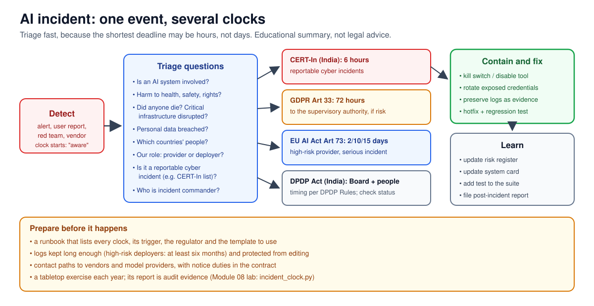

# Audit Readiness, AI Documentation and Incident Reporting

> **Module:** 08 · AI Compliance · **Weeks:** 32 · **Time:** ~8 hours
> **You will:** prepare an AI system for an audit (documentation, evidence index, walkthroughs), know which records to keep and for how long, and run an AI incident through several regulatory reporting clocks at once.

| | |
|---|---|
| **Prerequisites** | [Lesson 03](03-control-mapping-and-evidence.md) (evidence), [Module 07](../07-ai-governance/) (register, risk register), [`00-program/templates/ai-incident-playbook.md`](../00-program/templates/ai-incident-playbook.md) |
| **Lab** | [`lab/incident_clock.py`](lab/incident_clock.py), `evidence_checker.py`, `demo.py` section 4 |
| **Maps to** | EU AI Act Art 11–13, 18–19, 26(5)–(6), 72–73 · GDPR Art 33–34 · CERT-In Directions (28 April 2022) · India DPDP Act s.8(6) · ISO/IEC 42001 clause 9.2 (internal audit), Annex A.8 · NIST AI RMF MANAGE 4 · SOC 2 CC7.3–CC7.4 · CERT-In AI Security Auditing Guidelines domain 8.6 (deep dive in [Lesson 06](06-cert-in-ai-security-audit.md)) · triage input from [Module 07 Lesson 06](../07-ai-governance/06-model-approval-lifecycle-and-ai-incidents.md) |

> **Educational, not legal advice.** Reporting duties have conditions and exceptions that the lab does not model. Use your organization's incident policy and counsel; check the current texts, especially the DPDP Rules.

---

## 1. Why this matters

Two moments test an AI program hardest: the audit, and the incident. Both ask the same question: **can you show what happened, with records you made at the time?**

- **2024, *Moffatt v. Air Canada*:** the tribunal's decision relied on what the chatbot actually told the customer. Records of AI conversations decide disputes.
- **2023, *Mata v. Avianca*:** lawyers were sanctioned after filing AI-invented citations. Documentation of how AI was used (and checked) protects people and organizations.
- **2025, Deloitte Australia:** the firm agreed to partially refund the Australian government for a report that contained AI-generated errors, including references that did not exist. Undisclosed, unverified AI use in a deliverable became a contractual and reputational incident.
- **2022, CERT-In Directions (India):** organizations must report specified cyber incidents to CERT-In within **6 hours** of noticing them and keep ICT system logs for 180 days. An AI incident that is also a cyber incident can start this clock.
- **EU AI Act Art 73:** providers of high-risk AI systems must report serious incidents to market surveillance authorities, within **15 days** in general, **10 days** if a person died, and **2 days** for widespread infringements or serious disruption of critical infrastructure.

Public AI incident collections, such as the **AI Incident Database** and the **OECD AI Incidents Monitor**, show that most AI incidents are not exotic attacks. They are wrong outputs used without checking, data exposure, and systems used outside their intended purpose.

---

## 2. Understand it

### 2.1 Audit readiness: what auditors do

| Phase | What happens | What you prepare |
|---|---|---|
| Planning | Scope, criteria, timeline agreed | Scope statement, system list (from the register), framework list |
| Request list | Auditor sends a "provided by client" (PBC) list | Evidence index mapped to each request |
| Walkthroughs | Owners explain how a control works, end to end | Owners who know their controls; diagrams |
| Testing | Inspection, sampling, re-performance | System-generated populations; reproducible queries |
| Findings | Exceptions and nonconformities raised | Management responses with owners and dates |
| Report | Opinion or certificate decision | Corrective action plan |

**Sampling.** For operating controls, the auditor picks a sample from the full **population** (for example 25 releases out of 300). You must be able to produce the full population from a system, not a hand-made list.

**Mock audit.** Run one internally a month before. The lab's evidence checker is a mock audit you can run every day.

### 2.2 Documentation an AI system needs

| Document | Purpose | Source of truth |
|---|---|---|
| **System card** | What the system is, intended use, owners, data, tools, oversight, controls | Module 07 register |
| **Model card** (Mitchell et al., 2019) | One model: training data summary, intended use, evaluation, limitations | Model team or vendor |
| **Datasheet** for datasets (Gebru et al.) | Where data came from, how it was collected and processed | Data team |
| **Technical documentation** (EU AI Act Art 11, Annex IV) | For high-risk providers: general description, design and development, monitoring and control, performance metrics, risk management, changes, standards applied, post-market monitoring plan | Engineering + compliance |
| **Instructions for use** (Art 13) | What deployers need: intended purpose, accuracy and limits, human oversight measures, logs | Provider |
| **Risk register and impact assessments** | Risks, treatments, acceptances; DPIA / FRIA | Module 07, Lesson 02 |
| **Evaluation and red-team reports** | Dated results per model version | CI / red team |
| **Change log** | Model, prompt, tool and data changes with approvals | CI/CD, tickets |
| **Incident records** | What happened, decisions, notifications | Incident tool |

Keep documentation **versioned with the system**. A system card that describes last year's model is worse than none, because it misleads.

### 2.3 Logs and retention

| Record | Minimum or typical retention | Source |
|---|---|---|
| High-risk AI logs under a deployer's control | At least six months (unless other law says otherwise) | EU AI Act Art 26(6) |
| High-risk AI logs under a provider's control | At least six months | EU AI Act Art 19 |
| Provider technical documentation, QMS documents, declaration of conformity | 10 years after the system is placed on the market | EU AI Act Art 18 |
| ICT system logs (organizations covered by CERT-In Directions) | 180 days, within Indian jurisdiction | CERT-In Directions 2022 |
| Personal data in any of the above | No longer than necessary; minimise and pseudonymise | GDPR Art 5(1)(e); DPDP Act |
| Audit evidence | The audit period plus your policy (often several years) | Your evidence policy |

Design logs for both needs: enough detail to reconstruct an incident (prompt, retrieved sources, tool calls, model version, decision, reviewer) with personal data redacted or pseudonymised, protected from editing, and deleted on schedule.

### 2.4 What is an "AI incident"?

A useful internal definition: **an event where an AI system caused, or nearly caused, harm, or behaved outside its intended use or security boundary.** Examples:
- Prompt injection that leaked data or ran a tool (Module 02).
- A RAG system returning another tenant's documents (Module 03).
- An agent acting beyond its permissions (Module 05).
- A biased or wrong output used in a decision about a person.
- A model or vendor change that silently broke a control.

Some of these are also **legally reportable**:

| Regime | Trigger (simplified) | Who reports to whom | Clock (from awareness) |
|---|---|---|---|
| EU AI Act Art 73 | Serious incident with a high-risk AI system (death or serious harm to health; serious, irreversible disruption of critical infrastructure; infringement of fundamental-rights obligations; serious harm to property or the environment) | Provider → market surveillance authority (deployers inform the provider and authorities, Art 26(5)) | 15 days; 10 days (death); 2 days (widespread or critical infrastructure) |
| EU AI Act Art 55 | Serious incident with a systemic-risk GPAI model | GPAI provider → AI Office | Without undue delay |
| GDPR Art 33–34 | Personal data breach | Controller → supervisory authority; and people if high risk | 72 hours (if risk to people) |
| CERT-In Directions | Listed types of cyber incident | Organization → CERT-In | 6 hours |
| DPDP Act s.8(6) + Rules | Personal data breach | Data Fiduciary → Data Protection Board and each affected Data Principal | Without delay; Rules add a detailed report to the Board within 72 hours. Breach rules expected to commence around 13 May 2027: verify |



**The shortest clock wins your attention.** An incident involving Indian infrastructure and EU personal data can require a CERT-In report within hours, while the AI Act report is due in days.

### 2.5 After the incident: learn and prove it

1. Update the **risk register**: new risk or higher likelihood (Module 07 Lesson 03).
2. Update the **system card** and, if needed, the **tier**.
3. Add the attack or failure to the **regression test suite**.
4. Record **corrective actions** with owners (ISO/IEC 42001 clause 10).
5. File the **post-incident report** and keep it as evidence.
6. For high-risk providers, feed it into **post-market monitoring** (Art 72).

---

## 3. Defend it

| Layer | Control | Type | What it buys you |
|---|---|---|---|
| L1 | Documentation versioned with the system (system card, model card, tech docs) | Process + code | Docs match reality |
| L2 | Logs designed for reconstruction, redacted, tamper-protected, on a retention schedule | **Hard** | You can answer "what happened?" |
| L3 | Evidence index with daily gap checks | **Hard** | No surprises at audit time |
| L4 | Incident triage with a reporting-clock table | Process + code | No missed deadlines |
| L5 | Pre-agreed templates and regulator contacts | Process | Fast, consistent notifications |
| L6 | Tabletop exercise each year | Process | People know their roles; the report is evidence |
| L7 | Kill switch and containment steps per AI system | **Hard** | Damage stops while you investigate |

### What does NOT work on its own

- Writing documentation the week before the audit.
- Logging everything forever "just in case" (privacy risk) or nothing at all (no investigation possible).
- An incident playbook that doesn't mention AI-specific steps (disable tools, pin model, purge caches).
- Waiting for full certainty before notifying when a clock is running. Many regimes allow an initial report followed by updates.

---

## 4. Hands-on lab

**Scenario:** a prompt-injection attack makes ACME's CV-screening product (ACME is the provider; it is high-risk) leak applicant data. Applicants are in the EU and India. ACME's security team became aware on 14 November 2026 at 09:00.

### Step 1: Compute the clocks

```powershell
python 08-ai-compliance/lab/demo.py
```

Expected output (section 4):

```text
=== 4. Reporting clocks for one AI incident ===
Scenario: prompt injection made the CV-screening product leak applicant data (EU + India).
Aware at 2026-11-14 09:00.
  CERT-In    notify CERT-In                                          by 2026-11-14 15:00 (Directions 28 Apr 2022: 6 hours)
  GDPR       notify lead supervisory authority                       by 2026-11-17 09:00 (Art 33: 72 hours)
  EU AI Act  notify market surveillance authority                    by 2026-11-29 09:00 (Art 73: serious incident -> 15 days; practice only: Art 73 applies from 2027-12-02)
  DPDP Act   notify Data Protection Board + affected Data Principals without delay       (s.8(6); Rules breach duties not yet commenced (expected ~2027-05-13))
```

Six hours is the first deadline. Two clocks are not binding yet on this date: the DPDP Rules' breach duties (expected around May 2027) and Art 73 for an Annex III system (from 2 December 2027 after the Digital Omnibus). The lab still shows them so your runbook is ready; for a real incident before those dates, follow the duties in force (and contracts or customer commitments that may ask for more).

Where do the input flags come from? From triage: Module 07's [`incident_triage.py`](../07-ai-governance/lab/incident_triage.py) outputs the same flag names (`personal_data_breach`, `eu_personal_data`, `india_reportable_cyber_incident`, `eu_serious_incident`...). Triage by impact first, then start the clocks.

Six hours is still the first deadline. Is this an AI Act "serious incident" at all? A data leak may infringe fundamental-rights obligations (privacy, non-discrimination), but that is a legal judgment. The engine assumes yes; your triage must decide.

### Step 2: Read the clock rules and tests

Open [`lab/incident_clock.py`](lab/incident_clock.py). Then run:

```powershell
python -m pytest 08-ai-compliance/lab/test_privacy_and_incidents.py -v -k clock
```

```text
======================= 4 passed, 8 deselected in 0.12s =======================
```

(Your timing will differ.) `test_ai_act_clock_shortens_for_death_and_critical_infrastructure` checks the 15 / 10 / 2-day rule.

### Step 3: Prepare the audit pack

Run the evidence checker on the compliant set and save the output as your "PBC response":

```powershell
python 08-ai-compliance/lab/evidence_checker.py 08-ai-compliance/lab/fixtures/evidence_compliant > $env:TEMP\audit-pack.txt
```

Every line shows `OK`. Now write, in your journal, the walkthrough script for **CTL-IR** (incident response): who owns it, what triggers it, which evidence shows it worked (runbook, tabletop report), and what the auditor could sample.

### Step 4: Tabletop exercise (week-32 deliverable)

Using [`00-program/templates/ai-incident-playbook.md`](../00-program/templates/ai-incident-playbook.md) and the scenario above, run a 60-minute tabletop with yourself or a study partner:
1. Triage: answer the questions in the incident diagram.
2. Contain: which kill switch, which tool to disable, which caches to purge?
3. Notify: draft the first CERT-In and GDPR notifications (facts known, facts unknown, actions taken).
4. Learn: list the risk-register, system-card and test-suite updates.

Write the tabletop report. Index it as evidence for CTL-IR with its hash (Lesson 03, Step 5).

### Step 5: Break it yourself (predict, then run)

1. In `demo.py`, set `"death": True`. Which AI Act deadline do you get? Then add `"widespread_or_critical_infrastructure": True` as well. Which rule wins, and is that what you'd want?
2. Set `"risk_to_individuals": False` for the GDPR part. What disappears? Who decides that, and what evidence would you keep for the decision?
3. Make ACME a **deployer** instead (`eu_high_risk_provider: False`). Which clock disappears from the code? What does Art 26(5) still require of a deployer? Add it.

### Stretch goals

- Add GDPR Art 34 (notify people) with a "high risk" flag and show it in the demo.
- Add a function that writes a notification draft (Markdown) with known facts, unknowns and next update time.
- Add an `aware_at` timezone and show deadlines in UTC and IST.

---

## 5. Real-world scenarios

**Scenario A: "we can't reconstruct it".**
A customer says the support bot told her she qualified for a refund. Logs keep only the last seven days and contain no model version.
- *What went wrong:* logs not designed for reconstruction; retention too short.
- *Investigate:* what is still available (vendor logs, CRM notes)? Who changed the retention?
- *Fix:* log prompt, retrieved sources, tool calls, model version and output (redacted), with retention matched to legal and business needs; protect logs from editing.

**Scenario B: the missed six-hour window.**
An AI agent's API key leaks and is used to read cloud storage in India. The team spends a day deciding whether it is "an AI incident or a security incident".
- *What went wrong:* classification debates delayed a cyber-incident report with a 6-hour clock.
- *Investigate:* the timeline from detection to triage to decision.
- *Fix:* triage on facts, not labels. Any incident is checked against every clock in the table immediately. AI-specific teams are part of the normal incident process, not a separate one.

**Scenario C: the auditor's sample.**
An ISO/IEC 42001 auditor asks for the impact assessments for 5 of your 12 high-tier AI systems. Two exist only as drafts with no approval.
- *What went wrong:* impact assessments not tied to the release gate.
- *Investigate:* how did those systems pass the gate? Was there an exception?
- *Fix:* make an approved impact assessment a required control (CTL-IA) with evidence; raise a nonconformity and corrective action.

---

## 6. Common mistakes

- One generic incident playbook with no AI steps (disable tools, pin or roll back the model, purge caches and indexes, check memory stores).
- Only one clock in the runbook (usually GDPR's 72 hours).
- Keeping technical documentation in slides.
- Not keeping the model version with every log entry and evaluation result.
- Treating audit findings as failures to hide instead of improvements to track.

---

## 7. Interview preparation

<details><summary><b>Q1. How do you prepare an AI system for its first external audit?</b></summary>

Confirm scope and criteria; map criteria to the control set; run the evidence gap checker and fix MISSING and STALE items early; make sure populations can be produced from systems; prepare owners for walkthroughs; run a mock audit; have a corrective-action process ready for findings. Documentation (system card, technical documentation, risk register) must match the current system version.
</details>

<details><summary><b>Q2. What should an AI system's logs contain to support an investigation?</b></summary>

Timestamp, user or service identity, session ID, model and version, prompt (redacted), retrieved source IDs, tool calls with arguments and results, guardrail and policy decisions, output (redacted), human reviewer actions. Protected from editing, access-controlled, and retained per a schedule that balances legal duties and privacy.
</details>

<details><summary><b>Q3. What is in EU AI Act technical documentation for a high-risk system?</b></summary>

At a high level (Annex IV): a general description and intended purpose; a detailed description of the elements and the development process; information on monitoring, functioning and control including human oversight; performance metrics; the risk management system; relevant changes over the lifecycle; standards applied; a copy of the declaration of conformity; and the post-market monitoring plan. Providers keep it for 10 years after placing the system on the market.
</details>

<details><summary><b>Q4. Model card vs system card vs technical documentation?</b></summary>

A model card describes one model's training, intended use, evaluations and limits. A system card describes the deployed system: model plus data, tools, users, oversight and controls. Technical documentation under the AI Act is a legally required, detailed file for high-risk systems covering design, development, testing, risk management and monitoring. They should share facts from one source of truth.
</details>

<details><summary><b>Q5. One incident, several regulators: how do you manage the clocks?</b></summary>

Keep a table of every applicable regime with trigger, recipient and deadline. At triage, check the incident against every row at once. Start with the shortest clock. Send initial notifications with known facts and planned updates, rather than waiting for full certainty. Assign one owner per notification and log every decision and time.
</details>

<details><summary><b>Q6. What are the EU AI Act serious-incident deadlines?</b></summary>

For providers of high-risk systems: immediately after establishing a causal link or its reasonable likelihood, and no later than 15 days after becoming aware; no later than 10 days if a person died; no later than 2 days for a widespread infringement or a serious and irreversible disruption of critical infrastructure. Deployers that find a serious incident must inform the provider and then the authorities. Check the current text and guidance.
</details>

<details><summary><b>Q7. What does CERT-In require that surprises many teams?</b></summary>

Reporting specified cyber incidents within 6 hours of noticing them, and keeping ICT system logs for 180 days within Indian jurisdiction. Covered organizations operating in India must build this into triage and log design.
</details>

<details><summary><b>Q8. What AI-specific steps belong in an incident runbook?</b></summary>

Disable or restrict tools; switch to a safe mode or a fallback without AI; roll back or pin the model version; purge caches, indexes or memory stores that hold poisoned or leaked content; rotate keys used by agents and MCP servers; preserve prompts, retrieval results and tool-call logs as evidence; check other systems that share the same model, prompt or data.
</details>

<details><summary><b>Q9. What would you show an auditor for "post-market monitoring"?</b></summary>

The monitoring plan; dashboards and alerts for quality, safety and security metrics with history; logs of drift or abuse findings; user feedback and complaint handling; incidents and near misses with analysis; changes made as a result (with approvals and re-tests). Dated, system-generated records over the period.
</details>

<details><summary><b>Q10. Scenario: you discover a serious AI incident on a Friday evening and legal is unavailable. What do you do?</b></summary>

Follow the runbook: contain, preserve evidence, start the incident record with exact times, and check every reporting clock. Escalate through the on-call chain to the incident commander and the deputy for legal or the DPO. If a short clock (for example 6 hours) applies, prepare the initial notification with facts known so far so it can be sent on time. Never let a missing approver silently miss a legal deadline; that risk should be decided in advance in the runbook.
</details>

<details><summary><b>Q11. How do audits and incidents feed back into governance?</b></summary>

Findings and incidents create or update risk entries, change tiers or required controls, add regression tests, and drive corrective actions tracked to closure. Management review looks at trends. Over time the same finding should not repeat. If it does, the root cause wasn't fixed.
</details>

<details><summary><b>Q12. Explain to an executive why we rehearse AI incidents.</b></summary>

"When an AI incident happens, several regulators may need to hear from us within hours to days, and we need to stop the damage first. A one-hour rehearsal each year shows us the gaps: who decides, which switch turns the feature off, what we can prove from our logs. The rehearsal report also counts as evidence for our audits."
</details>

---

## 8. Checklist (definition of done)

- [ ] I can list the documents an AI system needs and who owns each.
- [ ] I can state the main reporting clocks (CERT-In, GDPR, EU AI Act) and what triggers them.
- [ ] `python -m pytest 08-ai-compliance` passes.
- [ ] I ran a tabletop and indexed the report as evidence with its hash.
- [ ] Week 32 journal (Phase 8 gate): my compliance applicability matrix, evidence coverage report and the top three gaps I would fix first.

## 9. References

- Regulation (EU) 2024/1689 (EU AI Act), Art 11, 13, 18, 19, 26, 72, 73, Annex IV: https://eur-lex.europa.eu/eli/reg/2024/1689/oj
- GDPR Art 33–34 and EDPB guidelines on personal data breach notification: https://www.edpb.europa.eu/
- CERT-In Directions under section 70B(6) of the IT Act, 28 April 2022: https://www.cert-in.org.in/
- India DPDP Act and Rules: https://www.meity.gov.in/
- AI Incident Database: https://incidentdatabase.ai/
- OECD AI Incidents Monitor: https://oecd.ai/en/incidents
- Mitchell et al., *Model Cards for Model Reporting*: https://arxiv.org/abs/1810.03993
- Gebru et al., *Datasheets for Datasets*: https://arxiv.org/abs/1803.09010
- Repo template: [`00-program/templates/ai-incident-playbook.md`](../00-program/templates/ai-incident-playbook.md)
