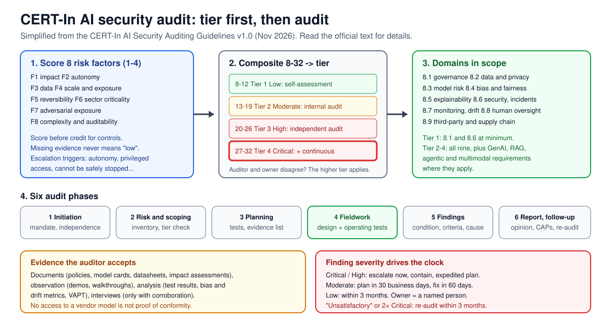

# AI Audit Requirements: the CERT-In AI Security Auditing Guidelines

> **Module:** 08 · AI Compliance · **Weeks:** 32 · **Time:** ~8 hours
> **You will:** scope an AI security audit the way India's CERT-In guideline describes it (eight risk factors, four tiers, nine audit domains, six phases), prepare the evidence an auditor will request, write findings that survive review, and connect all of it to the lab's evidence checker.

| | |
|---|---|
| **Prerequisites** | [Lesson 03](03-control-mapping-and-evidence.md) (evidence), [Lesson 04](04-audit-readiness-and-ai-incidents.md) (audit readiness), [Module 07](../07-ai-governance/) register and risk register |
| **Lab** | [`lab/certin_audit.py`](lab/certin_audit.py), [`lab/fixtures/certin_audit.yaml`](lab/fixtures/certin_audit.yaml), the `cert_in_ai` column in [`controls.yaml`](lab/fixtures/controls.yaml), `demo.py` section 6, `build_dashboard.py` |
| **Maps to** | CERT-In AI Security Auditing Guidelines v1.0 (CERT-In working group, dated 4 November 2026) · ISO/IEC 42001 clause 9.2 (internal audit), 10.2 · ISO 19011 (auditing management systems) · NIST AI RMF GOVERN 1.5, MEASURE 1–4 · OWASP LLM Top 10 2026 and OWASP Agentic Top 10 (the guideline's GenAI, RAG and agentic requirements cover the same threats) |

> **Educational, India focus.** This lesson summarizes the structure of the guideline in our own words. It is a first version; check CERT-In's website for the current text, and check which parts are binding for your organization (through sector regulators, contracts or other directions). The incident-reporting Directions of 28 April 2022 are a separate legal instrument.

---

## 1. Why this matters

- **Scope reaches beyond India-based companies.** The guideline covers AI systems built, bought, deployed or operated by organizations in India, and also AI systems that process Indian data or serve Indian users.
- **It is risk-tiered.** Audit depth, frequency and independence depend on a tier computed from eight factors. Higher tiers need independent audits by CERT-In empanelled auditing organizations.
- **It names AI-specific threats.** Beyond classic security, its advanced-AI section covers prompt injection, sensitive-information disclosure, excessive agency, poisoning, vector and embedding weaknesses, unsafe tool use, persistent memory, inter-agent communication and multimodal attacks: the same ground as the OWASP 2026 lists you used in Modules 02–05.
- **It expects operating evidence.** The guideline says an auditor must not conclude a control is effective only from policy or design documents. That is exactly the difference between the lab's checkbox check and the evidence checker.

---

## 2. Understand it



### 2.1 Risk tiering: eight factors, four tiers

Each AI system is scored **before** taking credit for controls. Each factor gets 1 (low) to 4 (critical).

| Factor | Question (paraphrased) | Low (1) … Critical (4) |
|---|---|---|
| F1 Impact severity | How bad is a wrong, compromised or unsafe output? | negligible … systemic or irreversible |
| F2 Autonomy and actionability | What can it do or trigger before a human or control steps in? | advisory only … plans and executes multi-step consequential actions |
| F3 Data sensitivity | What data does it process? | public … biometric, classified, critical-infrastructure |
| F4 Scale and exposure | How widely and often is it used? | small internal … population-scale or national |
| F5 Reversibility | How easily can harm be undone? | readily … potentially irreversible |
| F6 Operational / sector criticality | Does it support an essential or regulated function? | supporting … critical infrastructure, national security |
| F7 Adversarial exposure | How exposed is it to hostile input and attackers? | isolated … actively targeted |
| F8 Complexity and auditability | How hard is it to understand and assess? | simple … black-box, emergent behaviour |

**Missing evidence must not justify a low score.** If you cannot show a factor is low, it is not low. The lab enforces this by refusing to compute a tier when any factor is missing.

| Composite (8–32) | Tier | Minimum audit (summary) |
|---|---|---|
| 8–12 | Tier 1 Low | Self-assessment or basic internal review with documented evidence |
| 13–19 | Tier 2 Moderate | Documented internal audit; independent audit by a CERT-In empanelled auditor at least yearly |
| 20–26 | Tier 3 High | Periodic independent third-party audit by an empanelled auditor; more often after changes or incidents |
| 27–32 | Tier 4 Critical | Independent audit by an empanelled auditor with continuous monitoring |

**Escalation triggers** must be considered whatever the score: the system acts autonomously in consequential or safety-critical ways, affects critical infrastructure, can cause irreversible harm, has privileged access, can execute code, transactions or external messages by itself, runs in a high-threat environment, or cannot be reliably stopped or rolled back. Escalation must be documented with a rationale and an approver. (The lab's own rule, not CERT-In's: any trigger lifts the tier to at least Tier 3.)

**Other tiering rules worth knowing:**
- The auditor validates the tier independently; if auditor and organization disagree, the **higher tier** applies for scoping.
- Re-assess at least yearly and on material change (before deployment for planned changes), regulatory direction, incidents, and lifecycle transitions such as pilot to production.
- A downgrade needs a documented, sustained reduction in the risk factors and approval by the risk authority.
- Small companies get proportionality for Tier 1 and 2, but **Tier 3 and 4 have no size exemption**.

Tier also sets other obligations, for example AI impact assessment (AIIA: optional at Tier 1, simplified at Tier 2, comprehensive at Tier 3–4), model validation independence, technical security testing depth (from basic assessment up to adversarial testing and red teaming) and governance structure (from a named owner up to board oversight).

### 2.2 The nine core audit domains

| Domain | Focus (summary) | Repo coverage |
|---|---|---|
| 8.1 Governance and accountability | Policy, committee, RACI, inventory, AIIA | Module 07 Lessons 01–02, policies |
| 8.2 Data lifecycle, quality and privacy | Authorisation, classification, lineage, quality, retention, separation of training and inference data | Module 07 Lesson 05; Lesson 02 |
| 8.3 Model risk management | Registry, model cards, versioning, independent validation, decommissioning | Module 07 Lessons 05–06 |
| 8.4 Ethics, bias and fairness | Bias tests, fairness metrics, proxy variables, monitoring | Partly (fairness eval gate MA-03); **no control in `controls.yaml`** |
| 8.5 Explainability and transparency | XAI methods, decision logging, user-facing explanations | Module 07 Lesson 05 |
| 8.6 Security, adversarial resilience and incident reporting | Threat model, adversarial testing, AI VAPT, CERT-In reporting (6 hours), forensic readiness with 180-day logs, model integrity | Modules 02–06; Lesson 04 |
| 8.7 Monitoring, drift and validation | Performance and drift monitoring, thresholds, re-validation | Module 06; CTL-LOG |
| 8.8 Human oversight and decision accountability | HITL / HOTL configuration, override tests, reviewer training | Module 05; CTL-HO |
| 8.9 Third-party and AI supply-chain assurance | Vendor due diligence, provenance, AIBOM / SBOM, provider change records, exit plans | Module 07 policy 05; CTL-VEND |

Minimum coverage: **Tier 1** at least 8.1 and 8.6; **Tier 2 and above** all nine domains, plus the advanced-AI requirements (generative AI, RAG, agentic, multimodal, multi-agent, autonomous systems) and contestability (human review of AI decisions) where they apply.

### 2.3 The six audit phases

| Phase | What happens | Key output |
|---|---|---|
| 1 Engagement initiation | Objectives, audit type (initial, periodic, re-audit, special/incident-triggered), terms, independence and competence of auditors, stakeholders | Engagement letter / audit charter |
| 2 Risk assessment and scoping | Review the AI inventory (an incomplete inventory is itself a nonconformity), validate tiers, select domains | Scope document, domain selection matrix |
| 3 Detailed planning | Procedures, evidence list, sampling, interviews, schedule | Audit programme, evidence request list |
| 4 Fieldwork and evidence | Execute tests, collect and evaluate evidence, interviews, technical testing, working papers | Working papers, test results |
| 5 Analysis and findings | Root cause, severity, recommendations, draft report | Finding worksheets, draft report |
| 6 Reporting and follow-up | Final report, assurance opinion, corrective action plans, verification | Final report, CAP tracker |

### 2.4 Evidence expectations

- **Four evidence types:** documentary (policies, model cards, datasheets, AIIA reports), observational (demonstrations, walkthroughs), analytical (test results, bias metrics, drift analysis, VAPT reports) and testimonial (interviews, which need corroboration by another source).
- **Design vs operating effectiveness** are tested separately. A policy proves design at most.
- **Reproducible technical tests:** record model or provider version, artifact hash, dataset and prompt versions, RAG index version, parameters (temperature, seed), tool and version, payloads, expected and actual results, and raw evidence. Your CI evaluation reports should contain these fields.
- **Scope limits:** when a vendor model cannot be inspected, the auditor uses black-box or API testing, independent assurance reports and the deployer's own controls, records the residual risk, and states the effect on the opinion. **Lack of access is not evidence of conformity.**
- **AI-assisted auditing** is allowed under safeguards (approved scope, confidentiality, validated tools, traceable evidence, human review); AI output never replaces evidence or the auditor's judgement.

**Pre-audit request list (summary by domain):** governance (AI policy, committee charter and minutes, RACI, inventory, AIIA reports); data (classification, provenance and lineage, access records, quality and bias assessments, retention schedules); models (registry export, model cards, version logs, validation reports, decommissioning protocols); ethics (bias test reports, fairness monitoring); explainability (XAI documentation, sample explanations, user-facing templates); security (threat model, adversarial and VAPT reports, CERT-In incident reports, supply-chain assessment); monitoring (drift setup, thresholds, retraining and re-validation records); human oversight (HITL configuration, override test records, reviewer training); third parties (due diligence, provenance, contracts, AIBOM/SBOM, provider change records, exit plans).

### 2.5 Findings, opinions and follow-up

| Severity | Meaning (summary) | Remediation expectation |
|---|---|---|
| Critical | Immediate or severe risk: active exploitation, compromised model or data, uncontrolled consequential actions, essential controls failed | Immediate escalation to senior management; containment or restriction; expedited corrective action plan |
| High | Significant nonconformity; violates a mandatory control; no shutdown needed | Tracked through governance escalation until closed |
| Moderate | Control exists but is incomplete or inconsistent (for example incomplete model cards) | Plan within 30 business days; fix within 60 days |
| Low / Observation | Minor issue or improvement | Within 3 months or continuous improvement |

- **Finding structure:** ID, title, severity, domain, standards mapping (ISO/IEC 42001, NIST AI RMF, MITRE ATLAS), **condition** (what was found), **criteria** (what was expected), **cause** (root cause), **effect** (risk), recommendation, management response, evidence references.
- **Assurance opinions:** Satisfactory; Satisfactory with Reservations; Requires Significant Improvement; Unsatisfactory. The opinion is a judgement, not a count of findings.
- **Corrective action plans** are required for Critical, High and Moderate findings; each names **one person** as owner (not a team), with milestones, completion evidence and a verification method.
- **Re-audit within 3 months** after an Unsatisfactory opinion or two or more Critical findings.
- **External reporting** is separate: a finding does not automatically trigger reporting, but a finding that is also a reportable cyber incident follows the incident rules (for CERT-In, 6 hours).
- **Maturity model:** five levels from initial/ad hoc to optimising; maturity gives context but never changes a finding's severity.

---

## 3. Defend it (be audit-ready)

| Layer | Control | Type | What it buys you |
|---|---|---|---|
| L1 | Score F1–F8 for every system in the register; store scores with evidence | Process (+ code) | Tier and audit depth are defensible |
| L2 | Map every control to a CERT-In domain (`cert_in_ai` column) | **Hard** (data) | Domains with no control are visible (NO_CONTROL) |
| L3 | Evidence checker on all mapped controls | **Hard** | Operating effectiveness, not only design |
| L4 | Reproducible test records in CI (versions, hashes, payloads, results) | **Hard** | Technical tests can be re-performed |
| L5 | CAP register with named owners and severity deadlines | Process | Findings close for real |
| L6 | CERT-In 6-hour incident process tested on AI scenarios; logs kept 180 days | Process + **Hard** | Domain 8.6 holds |

### What does NOT work on its own

- Self-declaring Tier 1 to avoid an independent audit: the auditor validates tiers and the higher one wins.
- "The vendor won't give us access, so it's out of scope."
- Policies without operating evidence.
- CAPs owned by "the AI team".

---

## 4. Hands-on lab

### Step 1: Tier ACME's systems

```powershell
python 08-ai-compliance/lab/certin_audit.py 08-ai-compliance/lab/fixtures/certin_audit.yaml
```

Expected output:

```text
internal-code-assistant      composite 10  Tier 1 (Low)       audit: self-assessment or basic internal review with documented evidence
support-chatbot              composite 18  Tier 2 (Moderate)  audit: documented internal audit; independent audit by a CERT-In empanelled auditor at least yearly
                              organization said Tier 1 (Low); the higher tier applies for scoping
cv-screening-provider        composite 22  Tier 3 (High)      audit: periodic independent third-party audit by a CERT-In empanelled auditor; more often after changes
                              organization said Tier 2 (Moderate); the higher tier applies for scoping
payments-ops-agent           composite 18  Tier 3 (High)      audit: periodic independent third-party audit by a CERT-In empanelled auditor; more often after changes
                              escalation trigger: can autonomously execute code, transactions or external messages
                              escalation trigger: has privileged access to production, sensitive data or critical processes
                              lab rule: an escalation trigger lifts the tier to at least Tier 3 (document why)
                              organization said Tier 2 (Moderate); the higher tier applies for scoping
grid-load-forecaster         composite 28  Tier 4 (Critical)  audit: independent audit by a CERT-In empanelled auditor with continuous monitoring
                              escalation trigger: controls or materially affects critical infrastructure
AISAG-2026-001   High      OK
AISAG-2026-002   Moderate  owner 'HR Tech team' must be a named person, not a team
```

Three of five systems were under-tiered by their owners. The payments agent scores Moderate but acts autonomously with privileged access.

### Step 2: Join tiers with evidence

```powershell
python 08-ai-compliance/lab/demo.py --section 5
```

Section 6 of the output:

```text
=== 6. CERT-In AI audit scoping (educational) ===
system                   score  score tier         final tier         org said not audit-ready
internal-code-assistant     10  Tier 1 (Low)       Tier 1 (Low)       1        -
support-chatbot             18  Tier 2 (Moderate)  Tier 2 (Moderate)  1        8.4 ethics, bias and fairness
cv-screening-provider       22  Tier 3 (High)      Tier 3 (High)      2        8.4 ethics, bias and fairness
payments-ops-agent          18  Tier 2 (Moderate)  Tier 3 (High)      2        8.4 ethics, bias and fairness
grid-load-forecaster        28  Tier 4 (Critical)  Tier 4 (Critical)  -        8.4 ethics, bias and fairness
```

Even with the fully compliant evidence set, every Tier 2+ system fails domain 8.4: no control in `controls.yaml` maps to ethics, bias and fairness. Evidence cannot fix a missing control. With the vulnerable evidence set, domains 8.2, 8.3 and 8.6–8.9 also show GAP (run `build_dashboard.py --set vulnerable` and read the "CERT-In AI audit domains" table).

### Step 3: Run the tests

```powershell
python -m pytest 08-ai-compliance/lab/test_certin_and_matrix.py -v
```

Read `test_missing_factor_fails_closed`, `test_higher_of_auditor_and_self_assessed_tier_applies` and `test_tier_3_system_is_not_audit_ready_without_fairness_controls`.

### Step 4: Close the 8.4 gap (week-32 deliverable)

Add a control `CTL-FAIR` (pre-release bias test plus monthly fairness monitoring of the CV assistant) to your copy of `controls.yaml`, mapped to `8.4 ethics, bias and fairness`, the EU AI Act (Art 10 data governance, Art 15), ISO/IEC 42001 (A.5) and NIST AI RMF (MEASURE 2.11). Add two evidence items with hashes. Re-run until no Tier 2+ system lists 8.4.

### Step 5: Write two findings and CAPs

Using the finding structure in 2.5, write one High and one Moderate finding for your capstone (condition, criteria, cause, effect, recommendation, owner, evidence references). Check them with `certin_audit.check_finding` and compute the deadlines with `remediation_plan`.

### Step 6: Break it yourself (predict, then run)

1. Remove `F8` from `support-chatbot`. What happens, and why is this better than treating it as 1?
2. Give `internal-code-assistant` the trigger `privileged_access`. What tier now?
3. Change AISAG-2026-002's owner to `Meera Iyer (HR Tech lead)`. Does it pass?
4. Two Critical findings and an opinion of "Satisfactory with Reservations": is a re-audit required?

### Stretch goals

- Add a `maturity_level` self-assessment (1–5) per domain and show it next to findings without changing their severity.
- Generate the "finding summary matrix" (ID, domain, severity, title, status, owner, target date) as Markdown from the YAML.
- Add the advanced-AI requirements for your RAG and agent systems as extra controls mapped to OWASP LLM01, LLM03, LLM09 (2026) and ASI01–ASI03.

---

## 5. Real-world scenarios

**Scenario A: the self-declared Tier 1 (hypothetical).** A bank's customer chatbot is declared Tier 1 "because it only answers FAQs". It is internet-facing, has millions of users and can open service tickets.
- *Investigate:* score F4 (scale), F7 (exposure) and F2 (it can act); check what tools it really has.
- *Fix:* Tier 2 at least; full domain coverage; independent audit by an empanelled auditor yearly.

**Scenario B: no access to the vendor model (hypothetical).** The provider will not share weights or training data.
- *Investigate:* what black-box testing is possible; which independent reports exist; which deployer controls (gateway, DLP, oversight) you run.
- *Fix:* document the limitation and residual risk; test through the API; strengthen deployer-side controls; note the effect on the opinion.

**Scenario C: findings that never close (hypothetical).** Last year's High findings are still "in progress", owned by "IT".
- *Fix:* named owners; monthly reporting of Critical and High findings to the AI governance committee; overdue escalation to senior management; closure only after verification of root-cause fixes.

---

## 6. Common mistakes

- Scoring factors after counting your controls (the guideline scores inherent risk first).
- Treating the maturity level as a reason to lower a finding's severity.
- Testimonial evidence without corroboration.
- Mixing up audit findings and incident reporting: they are separate obligations, though one event can trigger both.
- Forgetting that this guideline is v1.0 and may change.

---

## 7. Interview preparation

<details><summary><b>Q1. Summarize the CERT-In AI Security Auditing Guidelines in one minute.</b></summary>

A risk-based framework for auditing AI systems linked to India. Score eight inherent-risk factors (1–4) to get one of four tiers; the tier sets audit depth, frequency and independence (independent empanelled auditors from Tier 2's yearly audit upward). Audits cover nine domains, from governance to supply chain, plus advanced-AI requirements for GenAI, RAG and agents. A six-phase method produces findings rated Critical to Low with remediation timelines, an assurance opinion and corrective action plans.
</details>

<details><summary><b>Q2. Why must risk factors be scored before controls?</b></summary>

So the tier reflects the system's inherent potential for harm, which decides how deeply its controls must be checked. If you credit controls first, a system with untested controls could get a light audit, and nobody would test those controls.
</details>

<details><summary><b>Q3. What happens if the auditor's tier and the company's tier differ?</b></summary>

The higher tier applies for scoping. The company can argue for a downgrade later with a documented, sustained reduction in risk factors and approval by the risk authority.
</details>

<details><summary><b>Q4. What evidence types does an AI auditor use?</b></summary>

Documentary, observational, analytical and testimonial. Testimonial needs corroboration. Controls are tested for design and for operating effectiveness separately, and technical tests must be recorded so they can be reproduced.
</details>

<details><summary><b>Q5. How do you audit a closed vendor model?</b></summary>

Identify the missing evidence and its effect; use black-box or API testing; review independent assurance reports; test the deployer's own controls; document residual risk and whether it affects the opinion. No access is not conformity.
</details>

<details><summary><b>Q6. How do finding severities translate into deadlines?</b></summary>

Critical: immediate escalation, containment and an expedited plan. High: tracked through governance escalation until closed. Moderate: plan in 30 business days, fix in 60 days. Low: within 3 months. An Unsatisfactory opinion or two or more Critical findings means a re-audit within 3 months.
</details>

<details><summary><b>Q7. What makes a well-written audit finding?</b></summary>

Condition (what was found, with evidence), criteria (the requirement and its source), cause (root cause), effect (risk), a specific recommendation, a management response, and one named owner with a date.
</details>

<details><summary><b>Q8. How does this guideline relate to the CERT-In 6-hour rule?</b></summary>

They are separate. The 2022 Directions require reporting certain cyber incidents within 6 hours. The audit guideline checks that an AI-aware incident reporting process exists and is tested (domain 8.6), and says a finding is reported externally only if the underlying condition itself triggers a reporting duty.
</details>

<details><summary><b>Q9. How would you prepare a company for its first CERT-In AI audit?</b></summary>

Complete the AI inventory; score and tier every system; map controls to the nine domains and find domains with no control; run the evidence checker and fix gaps; make CI test records reproducible; prepare the pre-audit document list; set up a CAP register with named owners; run an internal audit first.
</details>

<details><summary><b>Q10. Which OWASP 2026 risks does the guideline's advanced-AI section cover?</b></summary>

It covers prompt injection (LLM01), sensitive-information disclosure (LLM02), excessive agency (LLM03, was LLM06:2025), data and model poisoning (LLM05), supply chain (LLM04), vector and embedding weaknesses (LLM09), misinformation (LLM07) and improper output handling (LLM10), plus agentic issues such as unsafe tool use, persistent memory and inter-agent communication (ASI02, ASI06, ASI07).
</details>

<details><summary><b>Q11. Explain to a CEO why a "Moderate" score can still mean an independent audit.</b></summary>

"Our score puts the agent in the middle band, but it can move money and act on its own. The guideline asks us to consider escalating any system like that, and our policy says autonomy plus privileged access means the strictest checks. An outside auditor will look at it anyway; it is cheaper to be ready than to be surprised."
</details>

---

## 8. Checklist (definition of done)

- [ ] I can explain the eight factors, the four tiers and the escalation triggers.
- [ ] I tiered every system in my capstone register and recorded evidence for each score.
- [ ] My `controls.yaml` maps every control to a CERT-In domain, and no Tier 2+ system has a NO_CONTROL domain.
- [ ] I wrote two findings with CAPs that pass `check_finding`.
- [ ] `python -m pytest 08-ai-compliance` passes.

## 9. References

- CERT-In (guidelines, Directions of 28 April 2022, empanelled auditors): https://www.cert-in.org.in/
- India AI Governance Guidelines (MeitY), which the CERT-In guideline aligns with: https://www.meity.gov.in/
- ISO 19011 (guidelines for auditing management systems): https://www.iso.org/standard/70017.html
- ISO/IEC 42001 clause 9.2 and 10.2 (internal audit, corrective action): https://www.iso.org/standard/42001
- OWASP Top 10 for LLM Applications 2026 and Agentic Top 10: https://genai.owasp.org/
- MITRE ATLAS: https://atlas.mitre.org/
