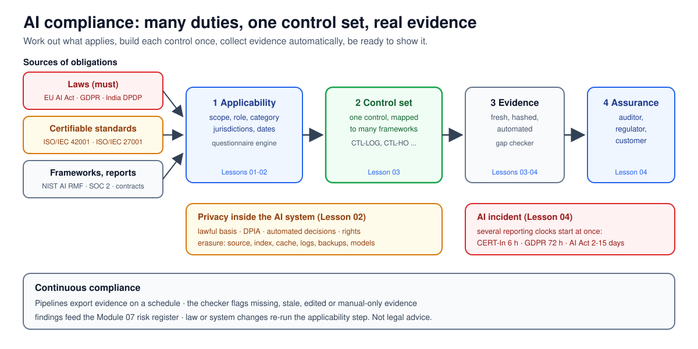

# Module 08 — AI Compliance

> **Weeks:** 31–32 · **Time:** ~36 hours · **Outcome:** you can work out which AI and privacy laws apply to a system and what they require by role, map one control set to several frameworks, prove each control with evidence an auditor accepts, and handle AI incidents against several reporting clocks.

> **Educational, not legal advice.** This module teaches structure and engineering practice. Real compliance decisions need the official texts, current regulator guidance and qualified counsel. Laws in this area change fast: the EU AI Act was amended by the Digital Omnibus (Regulation (EU) 2026/1744, in force 27 July 2026: Annex III high-risk duties now from 2 December 2027, Annex I from 2 August 2028), and India's DPDP Rules 2025 commence in phases until about May 2027. **Check the current status and record the date you checked.**

## The one distinction to get right

| | Examples | Binding? | Certifiable? |
|---|---|---|---|
| **Law** | EU AI Act, GDPR, India DPDP Act + Rules, CERT-In Directions (2022) | **Yes**, within scope | Only specific conformity routes (for example EU AI Act high-risk) |
| **Management-system standard** | ISO/IEC 42001, ISO/IEC 27001 | No, unless a contract or regulator requires it | **Yes** (accredited certification body) |
| **Guidance standard** | ISO/IEC 23894, ISO/IEC 42005, ISO/IEC 27090 (verify status) | No | No |
| **Voluntary framework / catalog** | NIST AI RMF + AI 600-1, OWASP LLM / Agentic / MCP Top 10, MITRE ATLAS | No | No |
| **Audit guideline / attestation** | CERT-In AI Security Auditing Guidelines; SOC 2 | Through audits, contracts or sector rules | SOC 2 is an attestation report, not a certificate |

**NIST AI RMF and OWASP are not laws. ISO/IEC 42001 is a management-system standard. GDPR, DPDP and the EU AI Act are law.** Details: [Lesson 05](05-iso-standards-and-law-vs-standard.md).

## What and why

Module 07 built governance: a register, roles, risk management and a management system. **Compliance** is the part where outside rules come in: laws (EU AI Act, GDPR, India's DPDP Act), certifiable standards (ISO/IEC 42001, ISO/IEC 27001), attestation reports (SOC 2) and frameworks (NIST AI RMF). Each asks for overlapping things in different words.

An AI security architect in a GRC-facing role does four things here:
1. **Applicability:** decide what applies to each system, given its role, category, data and jurisdictions.
2. **Translation:** turn legal and standard language into concrete engineering controls.
3. **Proof:** make sure every control produces evidence that is fresh, intact and repeatable.
4. **Response:** when something goes wrong, make sure the right people are told on time.

The common failure is **checkbox compliance**: a document exists for each control, so everything is marked "compliant". The lab shows how much that hides.



## Learning path

| # | Lesson | Weeks | You will |
|---|---|---|---|
| 01 | [The EU AI Act](01-eu-ai-act.md) | 32 | Decide scope, role and category; list obligations and dates; avoid classification traps |
| 02 | [Privacy: GDPR and India's DPDP Act](02-privacy-gdpr-and-india-dpdp.md) | 31 (GDPR, DPIA, retention, vendors), 32 (DPDP) | Choose lawful bases, run DPIAs, handle Art 22 decisions, erase data across a RAG system |
| 03 | [Control mapping and evidence](03-control-mapping-and-evidence.md) | 31–32 | Map one control set to six frameworks; build the risk → control → evidence matrix and dashboard; define and check audit-grade evidence |
| 04 | [Audit readiness and AI incidents](04-audit-readiness-and-ai-incidents.md) | 32 | Prepare documentation and logs; run an incident through several reporting clocks |
| 05 | [ISO standards and law vs standard](05-iso-standards-and-law-vs-standard.md) | 31 | Use ISO/IEC 23894 for the risk process; interpret ISO/IEC 27001 Annex A for AI; place 42001, 27701, 42005, 27090 |
| 06 | [AI audit requirements: CERT-In AI Security Auditing Guidelines](06-cert-in-ai-security-audit.md) | 32 | Tier systems with eight factors, scope nine audit domains, meet evidence expectations, write findings and CAPs |
| Lab | [`lab/`](lab/) | 31–32 | AI Act questionnaire engine, evidence-gap checker, erasure propagation, incident clocks, compliance matrix and dashboard, CERT-In tiering |

Week-plan deliverables ([36-week plan](../00-program/36-week-plan.md)): week 31 → **privacy impact and vendor assessment**; week 32 → **compliance applicability matrix** and the **Phase 8 gate**.

## Key concepts

| Term | Meaning |
|---|---|
| **Applicability** | Whether, and how, a law or standard applies to a system: scope, role, category, dates |
| **Provider / deployer** | EU AI Act roles: who places the system on the market vs who uses it under its authority |
| **High-risk (AI Act)** | Annex I product safety components and Annex III areas (employment, credit, education…) |
| **GPAI model** | General-purpose AI model; its providers have their own duties (Chapter V) |
| **Prohibited practice** | AI uses banned outright by Art 5 (for example workplace emotion recognition) |
| **Controller / processor** | GDPR roles: who decides purposes and means vs who processes on their behalf |
| **Data Fiduciary / Data Principal** | DPDP Act roles: the organization deciding purpose and means / the person |
| **Lawful basis** | The legal ground for processing personal data (GDPR Art 6; DPDP consent or legitimate uses) |
| **DPIA** | Data protection impact assessment for high-risk processing |
| **Art 22 decision** | A solely automated decision with legal or similarly significant effects |
| **Unified control set** | Your own controls, each mapped to many frameworks ("test once, comply many") |
| **Evidence** | Records that prove a control is designed and operating: exports, logs, test results |
| **Stale / tampered evidence** | Too old for its max age / changed since approval (hash mismatch) |
| **Continuous compliance** | Evidence produced and checked automatically as part of normal operation |
| **SOC 2 Type I / II** | Attestation on control design at a point in time / operation over a period |
| **Complementary user entity controls** | Controls a vendor's customer must run for the vendor's controls to work |
| **Serious incident** | AI Act term for incidents with serious harm; triggers provider reporting (Art 73) |
| **Reporting clock** | A legal deadline that starts when you become aware of an incident |
| **Digital Omnibus** | Regulation (EU) 2026/1744, which amended the AI Act and moved the high-risk dates |
| **Compliance matrix** | AI risks → controls → audit evidence → framework requirements, with a verdict per risk |
| **CERT-In AI audit tier** | Tier 1–4 from eight inherent-risk factors; sets audit depth and independence |
| **Design vs operating effectiveness** | Whether a control could work / whether it did work over the period |

## How the lessons connect

1. **Lesson 01** decides which AI Act obligations apply to each system in the Module 07 register, by role.
2. **Lesson 02** adds the privacy layer: most AI systems process personal data, so GDPR and DPDP apply alongside the AI Act. Erasure is where privacy meets RAG engineering.
3. **Lesson 03** turns all those obligations into one control set mapped to every framework, and defines the evidence that proves each control.
4. **Lesson 04** uses that evidence for audits and that logging for incidents, where several reporting clocks can start at once.
5. **Lesson 05** fixes the vocabulary: which instruments are law, which are certifiable standards, which are guidance, and how ISO/IEC 27001 controls extend to AI assets.
6. **Lesson 06** turns it into an audit: CERT-In's tiering decides the audit depth, its nine domains are mapped onto the same control set, and its evidence rules match the evidence checker.
7. Everything feeds back into Module 07: gaps and incidents become risk-register entries, and the release gate requires the controls.

Links to other modules: logging and CI evidence come from [Module 06](../06-ai-devsecops/); human oversight and agent permissions from [Module 05](../05-agent-security/); RAG access control and deletion from [Module 03](../03-rag-security/); injection tests (Art 15 robustness and cybersecurity) from [Module 02](../02-llm-security/prompt-injection/); multi-cloud shared-responsibility controls from [Module 09](../09-enterprise-architecture/); the [capstone](../10-capstone-project/) needs your applicability matrix and evidence pack.

## Lab overview

All code runs offline with synthetic data. From the repository root:

```powershell
python 08-ai-compliance/lab/demo.py                                    # all four sections
python 08-ai-compliance/lab/demo.py --case cv-screening-provider       # one AI Act case in detail
python 08-ai-compliance/lab/evidence_checker.py 08-ai-compliance/lab/fixtures/evidence_vulnerable
python 08-ai-compliance/lab/privacy_rights.py --no-cache
python 08-ai-compliance/lab/demo.py --section 5                        # compliance matrix and CERT-In tiering only
python 08-ai-compliance/lab/certin_audit.py 08-ai-compliance/lab/fixtures/certin_audit.yaml
python 08-ai-compliance/lab/build_dashboard.py --set vulnerable        # Portfolio Project 5 dashboard (Markdown)
python -m pytest 08-ai-compliance -v                                   # 96 tests
```

| File | Role |
|---|---|
| `vulnerable_compliance.py` | Checkbox compliance: "is it a chatbot?" classifier, "a document exists" evidence check, delete-the-source erasure (VULN 1–10) |
| `ai_act_classifier.py` | Questionnaire engine: required answers, fixed decision order, role-specific obligations with dates, open questions for counsel |
| `evidence_checker.py` | Controls ↔ evidence: MISSING, STALE, FILE_MISSING, TAMPERED, MANUAL_ONLY; framework coverage |
| `privacy_rights.py` | Toy RAG assistant: erasure across index, cache, logs (redact), backups and fine-tuning, with a receipt |
| `incident_clock.py` | Reporting clocks: EU AI Act Art 73 (practice-only before 2 Dec 2027), GDPR Art 33, CERT-In, DPDP (Rules phased, ~May 2027) |
| `compliance_matrix.py` | Risk → control → evidence matrix with verdicts (PROVEN, PARTIAL, UNPROVEN, NO_CONTROL, BROKEN_LINK); Markdown and HTML dashboard rendering |
| `build_dashboard.py` | Script: joins the Module 07 register and policy pack with the Module 08 controls, evidence and risks into one dashboard |
| `certin_audit.py` | CERT-In style tiering (8 factors, 4 tiers, escalation, higher-tier rule), domain readiness, finding checks, remediation deadlines, re-audit rule |
| `fixtures/` | 10 AI Act cases, a 10-control set mapped to 6 frameworks (incl. CERT-In domains), vulnerable and compliant evidence sets, 10 AI risks with OWASP 2026 / ASI / MCP IDs, CERT-In scoping data |
| `test_*.py` | Impact tests: wrong category, fails closed, stale or edited evidence caught, data no longer retrievable |

## Module mini-project: "compliance pack" = Portfolio Project 5, part 2

Module 07 built part 1 of **Portfolio Project 5, "AI Governance & Compliance Framework"** (inventory, risk register, policy set). This module adds the control mapping, the evidence repository and the compliance dashboard. Together they are the full framework:

| Portfolio part | Built in | Lab artifact |
|---|---|---|
| Inventory | Module 07 Lesson 01 | `systems_*.yaml`, `secure_register.py` |
| Risk register | Module 07 Lesson 03 | `risks_*.csv`, `risk_register.py`; top risks in `ai_risks.yaml` |
| Policy set | Module 07 policies | `07-ai-governance/policies/`, `policy_lint.py` |
| Control mapping | Lessons 03, 05, 06 | `controls.yaml` (6 frameworks incl. CERT-In domains) |
| Evidence repository | Lesson 03 | `evidence_*/index.yaml` + files, `evidence_checker.py` |
| Compliance dashboard | Lesson 03 Step 6b | `compliance_matrix.py`, `build_dashboard.py` (Markdown or HTML) |

Build on your Module 07 governance pack:

1. **Applicability matrix:** for every system in your register: EU AI Act role, category, obligations and dates after the Omnibus (from the engine); GDPR role and lawful basis per purpose; DPDP role and ground, with the Rules' phase dates; open questions for counsel. Scenario: your organization is in India and serves EU customers.
2. **DPIA** for your highest-risk system, with an erasure plan covering every data store.
3. **Vendor and privacy assessment** for your model provider: DPA, retention, training use, regions, sub-processors.
4. **Control set:** at least ten controls (reuse the lab's and add your own, including a fairness control), each mapped to the EU AI Act, ISO/IEC 42001, NIST AI RMF, SOC 2, ISO/IEC 27001 and the CERT-In domains, with empty cells marked.
5. **Evidence repository:** at least one evidence file per control with date, collector and hash; a clean run of `evidence_checker.py`; the coverage report.
6. **Compliance matrix and dashboard:** your top 10 AI risks with OWASP 2026 / ASI / MCP IDs linked to controls; `build_dashboard.py --out` produces your dashboard; no High or Critical risk is NO_CONTROL or BROKEN_LINK.
7. **Audit readiness:** CERT-In tiering for every system, the pre-audit document list for one Tier 3 system, two findings with CAPs.
8. **Incident readiness:** a reporting-clock table for your jurisdictions, a triage of one scenario with Module 07's `incident_triage.py`, and a tabletop report.

**Acceptance criteria:** laws, standards, attestations and frameworks are correctly distinguished; applicability is documented from authoritative sources with access dates; every control has an owner and evidence; every top risk has a verdict; evidence is repeatable (re-running the tools reproduces it); open legal questions are listed, not guessed.

## Interview questions (cross-cutting, system-design style)

<details><summary><b>Q1. Design a compliance architecture for an Indian SaaS company launching an AI hiring assistant to EU and Indian customers.</b></summary>

Applicability first: the company is a **provider** of an Annex III (employment) **high-risk** system under the EU AI Act; customers are deployers. GDPR applies to EU candidates' data (often as processor for customers, controller for its own purposes such as model improvement); DPDP applies to Indian candidates. Then controls: risk management, data governance, logging, human oversight design, robustness and security testing, QMS, technical documentation, conformity assessment and registration, post-market monitoring; DPIA support for customers; erasure across RAG stores; no solely automated rejections. Evidence produced by pipelines. An EU authorised representative. Incident clocks for AI Act, GDPR, CERT-In and DPDP in one runbook. Counsel for open questions.
</details>

<details><summary><b>Q2. How do you turn a legal requirement into an engineering control? Use EU AI Act Art 12 as an example.</b></summary>

Read the requirement (automatic recording of events over the system's lifetime, enabling traceability). Define a control objective: "every high-risk AI interaction is logged with enough detail to reconstruct it, protected and retained." Specify the implementation: log fields (identity, model version, prompt and sources redacted, tool calls, decisions, reviewer), tamper protection, retention (at least six months for deployers), access control. Define evidence: config export (automated, ≤31 days) and a retention test (≤365 days). Map the same control to ISO 42001, NIST, SOC 2 and ISO 27001. Check it continuously.
</details>

<details><summary><b>Q3. A customer asks: "Are you EU AI Act compliant?" How do you answer?</b></summary>

Never with a plain yes. State scope and role: which product, which version, whether we are provider or deployer, the category we determined and why, which obligations apply and from which dates (as adopted, noting proposed changes), what we have implemented with evidence, and what is in progress. Offer documentation under NDA. Over-claiming in a questionnaire can become a contractual commitment.
</details>

<details><summary><b>Q4. How do the EU AI Act and GDPR interact for the same system?</b></summary>

Both apply. The AI Act regulates the AI system by risk and role; GDPR regulates personal data processing. Overlaps: logging (AI Act wants logs, GDPR wants minimisation, so pseudonymise and set retention), human oversight vs Art 22 human intervention, transparency notices, deployers using provider information for DPIAs (Art 26(9)), and the fundamental rights impact assessment alongside the DPIA. Design one set of controls that satisfies both.
</details>

<details><summary><b>Q5. Your evidence checker shows 40% of evidence is stale two weeks before an ISO 42001 surveillance audit. What do you do?</b></summary>

Triage by control criticality: high-tier and continuous controls first. Re-run pipelines that produce exports; fix broken jobs (stale often means a pipeline died). For controls that really didn't operate, don't backfill: disclose, raise an internal nonconformity, and show corrective action. Afterwards, make the checker daily with alerts to control owners, and treat broken evidence pipelines for high-tier controls as incidents.
</details>

<details><summary><b>Q6. How would you build continuous compliance into an AI platform?</b></summary>

A control catalog as code with framework mappings and evidence definitions; evidence emitted by CI (test reports per release), schedulers (config exports, retention tests, erasure drills) and the incident tool (tabletop reports); a dated, hashed evidence store with write-once options; a daily gap checker that opens tickets; coverage dashboards per framework; and the release gate (Module 07) checking that required controls have fresh evidence for high-tier systems.
</details>

<details><summary><b>Q7. How do you handle a right-to-erasure request when the data was used to fine-tune a model?</b></summary>

Erase every store you can (sources, index, caches, logs by redaction, vendor copies), and record a pending item for the model. Escalate to the DPO: options include retraining without the data, output filtering for the person's identifiers as an interim measure, and a documented assessment. Learn from it: keep personal data in retrieval, not weights, and minimise or pseudonymise training data.
</details>

<details><summary><b>Q8. An incident involves an AI agent leaking EU customers' personal data through infrastructure in India. Walk me through the first 24 hours.</b></summary>

Hour 0: contain (disable the agent's tools, rotate keys, pause the feature), preserve logs, open the incident record with times. Within the first hours: triage against every clock: CERT-In (6 hours for covered incidents), GDPR (72 hours to the lead authority if risk), DPDP if Indian data, AI Act serious incident if a high-risk system is involved. Send initial notifications with known facts and planned updates. Brief leadership. Start root-cause analysis and plan customer communication. Everything logged as evidence.
</details>

<details><summary><b>Q9. What is the most common mistake GRC teams make with AI, and how does an architect fix it?</b></summary>

Treating AI compliance as documents: policies and questionnaires with no link to how systems actually behave. The architect fixes it by turning requirements into controls that run in the platform (gates, logging, access control, erasure, tests) and making those controls produce evidence automatically. The documents then describe a system that really exists.
</details>

<details><summary><b>Q10. Explain to a board why "compliant" is not the same as "secure" for AI.</b></summary>

"Compliance shows we meet specific rules for a defined scope at the time we checked. Security is whether our AI can be misused or fail in a harmful way today. A model update, a new tool or a new attack can make a compliant system unsafe overnight. We use compliance as the minimum and a structure for proof, and we keep testing the real system continuously."
</details>

<details><summary><b>Q11. Build a compliance matrix for an AI product in one week. What does it contain, and what does it prove?</b></summary>

Rows are the top AI risks (with OWASP LLM 2026, Agentic and MCP IDs); each links to the controls that treat it; each control links to its evidence (checked for presence, age, integrity and automation) and to the requirements it satisfies (EU AI Act articles, ISO/IEC 42001 and 27001 controls, NIST AI RMF subcategories, CERT-In domains). Each risk gets a verdict. It proves which risks are treated *today* with evidence, and it exposes design gaps (risks with no control) that evidence checks alone never find.
</details>

<details><summary><b>Q12. An Indian SaaS company with EU customers asks what changed in 2026. What do you tell them?</b></summary>

EU: the Digital Omnibus (Regulation (EU) 2026/1744, in force 27 July 2026) moved Annex III high-risk duties to 2 December 2027 and Annex I to 2 August 2028; prohibitions, GPAI duties and Art 50 transparency are unchanged. India: the DPDP Rules 2025 phase in, with most operational duties (notices, safeguards, breach reporting) around May 2027; CERT-In published AI Security Auditing Guidelines that tier AI systems and set audit depth, while the 6-hour incident reporting Directions still apply. Plan to the dates in force, build the controls now, and record sources and dates checked.
</details>

## References

Verify current editions before use. For each source you rely on, record the edition, publication date, jurisdiction, applicability, URL, date accessed and owner. This module is educational, not legal advice.

**Regulation**
- EU AI Act, Regulation (EU) 2024/1689 (EUR-Lex): https://eur-lex.europa.eu/eli/reg/2024/1689/oj
- European Commission AI Act policy page (guidelines, codes of practice, updates): https://digital-strategy.ec.europa.eu/en/policies/regulatory-framework-ai
- EU AI Act implementation timeline (AI Act Service Desk): https://ai-act-service-desk.ec.europa.eu/en/ai-act/eu-ai-act-implementation-timeline
- GDPR, Regulation (EU) 2016/679: https://eur-lex.europa.eu/eli/reg/2016/679/oj
- European Data Protection Board: https://www.edpb.europa.eu/
- India Ministry of Electronics and IT (DPDP Act 2023 and DPDP Rules): https://www.meity.gov.in/
- CERT-In (Directions of 28 April 2022; AI Security Auditing Guidelines v1.0, 2026): https://www.cert-in.org.in/
- Digital Omnibus on AI, Regulation (EU) 2026/1744: search EUR-Lex for "2026/1744"

**Standards, frameworks and attestations**
- ISO/IEC 42001: https://www.iso.org/standard/42001
- ISO/IEC 23894: https://www.iso.org/standard/77304.html
- ISO/IEC 27001: https://www.iso.org/standard/27001
- NIST AI RMF: https://www.nist.gov/itl/ai-risk-management-framework
- NIST AI 600-1 GenAI Profile: https://www.nist.gov/publications/artificial-intelligence-risk-management-framework-generative-artificial-intelligence
- AICPA (SOC 2, Trust Services Criteria): https://www.aicpa-cima.com/

**AI security sources used as control inputs**
- OWASP GenAI Security Project: https://genai.owasp.org/ · OWASP Top 10 for LLM Applications 2026 (renumbered from 2025): https://genai.owasp.org/llm-top-10/ · OWASP Top 10 for Agentic Applications (ASI01–ASI10) · OWASP MCP Top 10: https://owasp.org/www-project-mcp-top-10/
- MITRE ATLAS: https://atlas.mitre.org/

**Testing tools that produce evidence**
- Microsoft PyRIT: https://github.com/Azure/PyRIT · garak: https://garak.ai/ · Promptfoo: https://www.promptfoo.dev/ · Ragas: https://docs.ragas.io/

**Cloud and platform documentation (shared-responsibility inputs)**
- AWS Bedrock security: https://docs.aws.amazon.com/bedrock/latest/userguide/security.html
- Azure AI Foundry: https://learn.microsoft.com/azure/ai-foundry/
- Vertex AI security: https://cloud.google.com/vertex-ai/docs/general/security
- Kubernetes security concepts: https://kubernetes.io/docs/concepts/security/
- MCP documentation: https://modelcontextprotocol.io/ · MCP specification: https://modelcontextprotocol.io/specification

**Incident knowledge bases**
- AI Incident Database: https://incidentdatabase.ai/ · OECD AI Incidents Monitor: https://oecd.ai/en/incidents

---

**Courses for this module (KodeKloud / Udemy):** see [00-program/learning-resources.md](../00-program/learning-resources.md).

## Roadmap coverage

| Roadmap topic (Module 8: AI Compliance) | Where it is covered |
|---|---|
| EU AI Act (incl. Digital Omnibus dates) | Lesson 01, `ai_act_classifier.py`, new timeline diagram |
| NIST AI RMF (+ GenAI Profile) | Module 07 Lesson 03 (functions, Playbook actions, AI 600-1); `nist_ai_rmf` column in `controls.yaml` |
| ISO/IEC 42001 | Module 07 Lesson 04; Lesson 05 (place among standards); `iso_42001` column |
| ISO/IEC 23894 | Lesson 05 section 2.2 (risk process on ISO 31000); Module 07 Lesson 03 |
| ISO/IEC 27001 + AI controls (and ISO/IEC 27090, hedged) | Lesson 05 sections 2.3–2.4; `iso_27001` column |
| GDPR | Lesson 02; erasure lab; GDPR clock |
| India DPDP Act and Rules (phased to ~May 2027) | Lesson 02; DPDP clock with commencement check |
| AI audit requirements | Lesson 04 (audit readiness), Lesson 06 (CERT-In AI Security Auditing Guidelines), `certin_audit.py` |
| Compliance mapping and evidence collection | Lesson 03, `evidence_checker.py`, `controls.yaml` (6 frameworks) |
| Hands-on: compliance matrix AI risks → controls → audit evidence | Lesson 03 section 2.7 and Step 6b, `compliance_matrix.py`, `build_dashboard.py` |
| Key distinction: NIST/OWASP not law; ISO 42001 management-system standard; GDPR/DPDP/EU AI Act law | Top of this README; Lesson 05 section 2.1; Lesson 03 section 2.1 |
| Compliance priority table (NIST, GenAI Profile, 42001, 23894, OWASP GenAI and MCP Top 10, 27001, GDPR, DPDP, EU AI Act) | All of the above; OWASP 2026 / ASI / MCP IDs in `ai_risks.yaml` and Module 07's AI Security Standard |
| Portfolio Project 5 (with Module 07) | Mini-project above |

## Further reading from your library

- **CERT-In AI Security Auditing Guidelines v1.0:** sections 5 (applicability and risk tiering), 7 (audit planning, evidence, pre-audit document list), 8 (the nine core domains: read the audit-control tables for 8.3, 8.6 and 8.8), 9 (generative, RAG and agentic requirements) and 12 (findings, opinions, CAPs). Primary source for Lesson 06.
- **NIST AI RMF Playbook:** GOVERN 1.1 (legal requirements), MEASURE 2.7–2.10 and MANAGE 4.3 for what evidence of "trustworthy" looks like.
- **OWASP GenAI Data Security Risks and Mitigations 2026:** DSGAI07 (data governance and lifecycle) and DSGAI08 (non-compliance and regulatory violations) for Lessons 02 and 03.
- **ISC2 AI Security study guide** (unofficial, validated Nov 2026): Domain 2 for current regulatory facts (EU AI Act after the Omnibus, ISO/IEC 27090) and a self-test; verify any date it gives against the official source.
- **AI Cyber Incident Playbook:** the evidence tables and priority rules in the playbooks on stolen connector tokens and on sensitive documents uploaded to an unapproved AI service, for Lesson 04's tabletop.
- **A Director's Guide to AI Governance:** Appendix A (regulatory obligations and AI) for how boards should see legal duties; its examples are Australian, so map them to your jurisdictions.

