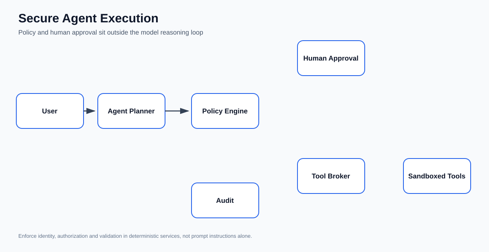

# Module 09 — Enterprise Capstone: Secure AI Operations Assistant

**Effort:** 35–45 hours. **Outcome:** Demonstrate end-to-end AI security engineering and architecture.

## Business scenario
Build an internal assistant that answers from approved knowledge, reads sanitized cloud monitoring data, accesses approved tools through MCP, drafts remediation recommendations and submits a mock change request for human approval. It must not independently modify production infrastructure.

## Scope
**In scope:** synthetic/approved non-sensitive documents; read-only cloud inventory/monitoring; mock change workflow; one model provider plus portability notes; AWS/Azure/GCP control mapping.

**Out of scope:** autonomous production write actions; unrestricted shell/SQL/browser; real customer personal data; public MCP endpoints; fine-tuning on confidential data.

## Mandatory security requirements
1. SSO/OIDC authentication.
2. Server-side authorization for every document and tool.
3. Tenant and document-level isolation.
4. Approved model/provider and controlled data egress.
5. Prompt/context minimization.
6. Typed tool schemas and allowlisted operations.
7. Per-agent identity and bounded permissions.
8. Human approval for change submission.
9. Rate, token, cost, time and step limits.
10. Secrets manager; no credentials in prompts/source.
11. Audit trail with correlation IDs and redaction.
12. Monitoring, alerting, kill switch and incident runbooks.
13. Model/dependency provenance and vulnerability scanning.
14. AI inventory, risk register and compliance applicability record.

## End-to-end test plan
- unauthenticated user denied;
- tenant A cannot retrieve tenant B content;
- prompt injection in retrieved document cannot authorize a tool;
- unregistered MCP server and unknown tool denied;
- invalid arguments rejected;
- agent cannot call production write tool;
- approval denial/expiry prevents action;
- revoked token rejected;
- model outage fails safely;
- excessive requests trigger quotas;
- logs redact secrets;
- kill switch blocks execution;
- model/dependency change triggers review.

## Deliverables
Architecture/data-flow diagrams; threat model/risk register; source and tests; RAG ACL design/isolation tests; MCP registry/gateway; agent identity/approval workflow; CI/CD and SBOM/provenance; cloud control matrix; AI inventory/compliance matrix; incident playbooks; final architecture defense.

## Definition of done
No unresolved critical finding. High findings are fixed or have approved time-bound exceptions and compensating controls. Mandatory tests have repeatable evidence. The architecture owner can explain residual risks, operational ownership and recovery.
