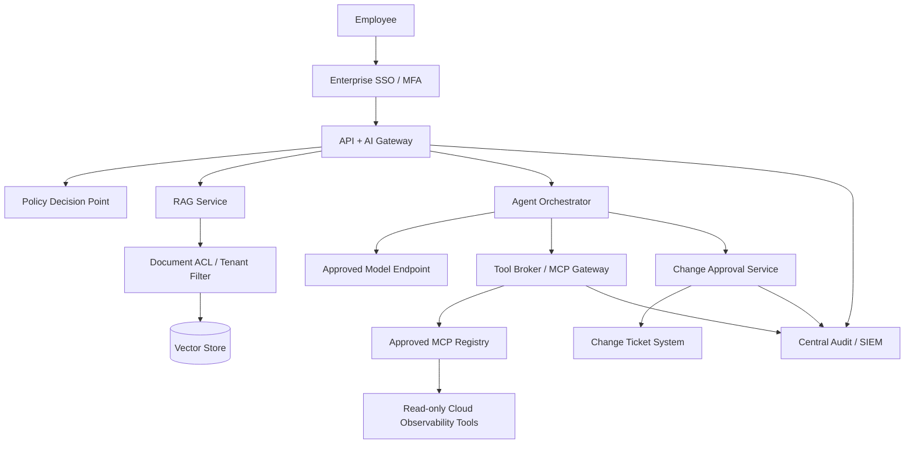

# Capstone: Enterprise Secure AI Operations Assistant

## Business scenario
Build a controlled internal assistant that can:
- answer questions using approved internal knowledge (RAG);
- read sanitized cloud monitoring information;
- access approved tools through MCP;
- draft remediation recommendations;
- submit a change request for human approval.

The agent must not independently modify production infrastructure.

## Reference architecture

## Scope boundaries
In scope:
- synthetic or approved non-sensitive documents;
- read-only cloud inventory/monitoring;
- mock ticket/change workflow;
- one model provider plus a documented portability design;
- AWS, Azure and GCP control mapping.

Out of scope:
- autonomous production write actions;
- unrestricted shell, SQL or browser access;
- real customer personal data;
- public exposure of MCP servers;
- training/fine-tuning on confidential data.

## Mandatory security requirements
1. SSO/OIDC authentication.
2. Server-side authorization for every document and tool.
3. Tenant and document-level isolation.
4. Approved model/provider and controlled data egress.
5. Prompt/context minimization.
6. Typed tool schemas and allowlisted operations.
7. Per-agent identity and bounded permissions.
8. Human approval for change submission.
9. Rate, token, cost, time and step limits.
10. Secrets manager; no credentials in prompts or source.
11. Audit trail with correlation IDs and redaction.
12. Monitoring, alerting, kill switch and incident runbooks.
13. Model/dependency provenance and vulnerability scanning.
14. Risk register, AI inventory and compliance applicability record.

## Test plan
- unauthenticated user denied;
- user from tenant A cannot retrieve tenant B content;
- prompt injection in a retrieved document cannot authorize tool calls;
- tool name not in allowlist is denied;
- tool argument schema violation is denied;
- agent cannot call a write-capable production tool;
- approval denial/expiry prevents action;
- expired/revoked token is rejected;
- model outage fails safely;
- excessive requests trigger quotas;
- logs redact secrets and sensitive prompt content;
- kill switch stops tool execution and revokes/blocks credentials;
- dependency/model version change triggers review.

## Deliverables
- architecture diagram and data-flow inventory;
- threat model and risk register;
- secure application source and tests;
- MCP server/gateway and policy;
- RAG index/ACL design and isolation tests;
- agent policy and approval workflow;
- CI/CD workflow and SBOM/provenance record;
- cloud control matrix;
- AI system inventory and compliance matrix;
- operational dashboards/runbooks;
- final architecture presentation and residual-risk statement.

## Definition of done
No unresolved critical security finding. High findings are remediated or have an approved, time-bound exception with compensating controls. All mandatory tests have repeatable evidence. The architecture owner can explain residual risks and operational responsibilities.
