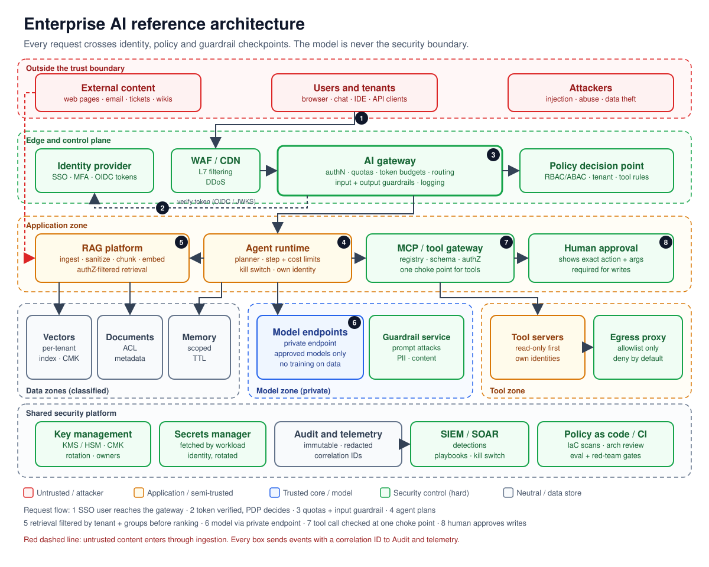
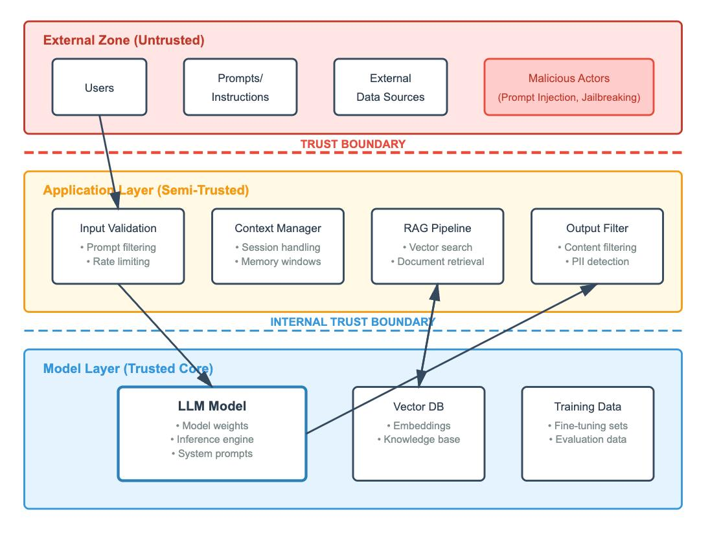

# Enterprise AI Reference Architecture

> **Module:** 09 · Enterprise AI Security Architecture · **Weeks:** 25–28 (read first in week 25, revisit in week 28) · **Time:** ~8 hours
> **You will:** learn the building blocks of a secure enterprise AI platform, see where each control lives, and use an architecture-as-code reviewer to find the gaps in a real-looking design.

| | |
|---|---|
| **Prerequisites** | [Module 01](../01-ai-security-fundamentals/) trust boundaries; Modules [02](../02-llm-security/)–[05](../05-agent-security/) controls (LLM, RAG, MCP, agents) |
| **Lab** | [`lab/`](lab/): architecture-as-code reviewer, runs offline |
| **Maps to** | OWASP Top 10 for LLM Applications 2026: LLM01 Prompt Injection, LLM02 Sensitive Information Disclosure, LLM03 Excessive Agency [2025: LLM06], LLM06 Unbounded Consumption [2025: LLM10], LLM09 Vector and Embedding Weaknesses [2025: LLM08] · OWASP Agentic Top 10 (ASI02, ASI03, ASI04) · OWASP MCP Top 10 beta (MCP07, MCP09) · NIST AI RMF (MAP, MANAGE) · NIST AI 600-1 · CIS Controls v8 (3, 5, 6, 8, 12) · Google SAIF |

---

## 1. Why this matters

Most real AI security failures so far were **platform and architecture failures**, not clever model tricks:

- **2023, Microsoft AI research (found by Wiz):** a storage access token (an Azure SAS token) shared in a public GitHub repo for AI models was far too broad. It exposed about 38 TB of internal data, including backups of employee workstations.
- **2024, "LLMjacking" (reported by Sysdig):** attackers used stolen cloud credentials to call hosted LLM services on the victim's account. The victim pays the model bill. This is an identity and cost-control failure.
- **2024, "SAPwned" (Wiz research on SAP AI Core):** researchers showed that running their own AI training code let them reach other customers' secrets and data. Tenant isolation in an AI platform was the weak point. SAP fixed the issues.
- **2024, "ShadowRay" (reported by Oligo):** exposed dashboards of Ray, a popular framework for AI compute clusters, were attacked in the wild. The jobs API had no authentication, so anyone who could reach it could run code.
- **2025, DeepSeek (found by Wiz):** a publicly reachable database exposed chat history, API secrets and backend details. No model attack was needed.

The pattern: **missing identity, missing network boundaries, missing tenant isolation, or a debug path nobody reviewed.** These are architecture problems, and an architecture review would have found them.

---

## 2. Understand it

### 2.1 What an "enterprise AI platform" is

A single team can ship one chatbot. An enterprise has **dozens of AI use cases** and needs a shared platform so each team does not rebuild (and mis-build) security. The platform gives every use case the same:

- **front door** (one gateway),
- **identity** (who is asking, for which tenant),
- **policy** (what they may do),
- **guardrails** (screening of inputs and outputs),
- **data access** (retrieval that respects permissions),
- **tool access** (one controlled path to actions),
- **evidence** (logs that security can search).



### 2.2 The building blocks

| Block | What it does | The security question it answers |
|---|---|---|
| **AI gateway** | The single entry point for model, RAG and agent traffic. Authenticates, applies quotas and token budgets, routes to approved models, calls guardrails, writes logs. | "Can anything reach a model without being checked?" |
| **Identity provider (IdP)** | Enterprise SSO (single sign-on) with MFA. Issues OIDC tokens that carry user, tenant and groups. | "Who is really asking?" |
| **Policy decision point (PDP)** | A service that answers "is this allowed?" using roles (RBAC) and attributes (ABAC: tenant, data class, tool). Examples: OPA, Cedar, a cloud IAM check. The *enforcement* happens elsewhere (gateway, RAG, broker): those are *policy enforcement points* (PEPs). | "Is this user allowed to do this, on this data, right now?" |
| **Guardrail service** | Classifiers for prompt attacks, PII, harmful content, unsafe URLs (e.g. Bedrock Guardrails, Azure AI Content Safety, Model Armor). | "Does this input or output look dangerous?" (soft layer) |
| **RAG platform** | Ingestion (parse, sanitize, chunk, embed, label) and retrieval. Retrieval filters by the caller's tenant and groups **before** ranking. | "Can a user retrieve a document they may not open?" |
| **MCP / tool gateway** | One choke point for tools: registry allowlist, typed schemas, authorization, human approval for writes. | "Can the model trigger an action nobody approved?" |
| **Agent runtime** | Runs the plan-act loop with its own identity, step limits, cost limits and a kill switch. | "Can an agent run forever or act with too much power?" |
| **Data zones** | Stores separated by classification (public, internal, confidential, restricted), each with its own keys and access rules. | "Does sensitive data sit next to untrusted data?" |
| **Key management (KMS/HSM)** | Customer-managed keys (CMK) for data stores, with rotation and an owner. | "Can we prove and revoke access to data at rest?" |
| **Secrets manager** | Runtime fetch of the few secrets that remain (third-party API keys) using workload identity. | "Is there any secret in code, images or prompts?" |
| **Observability / SIEM** | Redacted, immutable logs with correlation IDs; detections and playbooks in the SIEM (security information and event management). | "Would we notice an attack, and can we reconstruct it?" |
| **Egress proxy** | Outbound allowlist for agents and tools. | "Can an injected instruction send data to an attacker?" |

### 2.3 Planes and zones

Think in three **planes**:

1. **Control plane:** who can *change* the platform (deploy models, edit policies, change network rules). Protect it with admin MFA, PIM / just-in-time access, change review and audit logs.
2. **Data plane:** the requests themselves (prompts, retrieval, tool calls). Protect it with the gateway, PDP, guardrails and broker.
3. **Management / observability plane:** logs, metrics, keys. Protect it so an attacker who gets into the data plane cannot delete the evidence.

And place every component in a **zone** with a trust level (see the trust-zone picture below). Data may only cross a zone boundary through a control.



### 2.4 Security invariants (rules that must always hold)

Good architects write invariants, then design controls to keep them true:

1. No request reaches a model, index or tool without a **verified identity and tenant**.
2. **Tenant comes from the token**, never from the request body or the prompt.
3. Retrieval returns **only documents the caller may open**. Filtering happens before ranking.
4. The model **proposes**; deterministic code **decides**. No tool runs on the model's word alone.
5. **Writes need a human** who sees the exact action.
6. **No secret** is in a prompt, an image, an environment variable or a log.
7. Every request has a **correlation ID**, and its events are in an **immutable** log.
8. Agents and tools have **deny-by-default egress**.

### 2.5 The platform as code

In an enterprise, architecture lives in **code** (Terraform, Bicep, CloudFormation, Kubernetes manifests) and in **design documents**. Both can be checked automatically:

- **Infrastructure-as-code scanners** (Checkov, tfsec/Trivy, cloud-native policy engines) check single resources: "is this bucket public?"
- **Architecture-as-code review** checks the *system*: "is there any path from the internet to the model that skips the gateway?" That needs a model of components and data flows, which is what this module's lab builds.

### 2.6 Seven design principles behind the invariants

The *AI Security Architecture Study Guide* in your library groups architect thinking into seven principles. Here they are in short form, with the place where this repo enforces each one:

| # | Principle (in plain words) | What it means in a design | Where you see it |
|---|---|---|---|
| 1 | The model is not a security boundary | Authorization, limits and validation live in code outside the model. System prompts are for behavior, not for security. | Invariant 4; DATA-03; the broker in [Module 05](../05-agent-security/) |
| 2 | Break the "lethal trifecta" | No single agent session should combine private data, untrusted input and an outbound channel without a gate (approval, split agents, egress block). | NET-03 egress; AGT-01 approval; [lethal trifecta picture](../images/01-lethal-trifecta.svg) |
| 3 | Zero trust for context | Everything that enters the context window is untrusted: prompts, RAG chunks, tool results, tool descriptions, memory, other agents' output. Label provenance; validate output with schemas. | GR-01/GR-02; trust labels in [Module 10](../10-capstone-project/) |
| 4 | Least privilege **and** least agency | Fewer tools, narrower scopes, less autonomy, shorter lifetimes (just-in-time, task-scoped tokens). | IAM-02, TOOL-01, AGT-01, AGT-02 |
| 5 | Agents are identities | Each agent has its own workload identity; downstream systems see agent **and** user (token exchange); no token passthrough; no secrets in context. | IAM-03, IAM-05, IAM-06; [lesson 07](07-centralized-ai-iam-and-zero-trust.md) |
| 6 | Layered defense, deterministic first | Assume every layer fails sometimes. For high-impact actions, prefer permissions, sandboxes and egress rules over classifiers. | The Hard/Soft column in every Defend table |
| 7 | Observability and kill switches | Trace every step with identities; tamper-evident logs; per-agent and per-tool disable switches that work in seconds; tested runbooks. | LOG-01, LOG-02, AGT-02; [lesson 08](08-continuous-assessment-and-ai-secops.md) |

### 2.7 The six security services every AI application needs

The roadmap's "AI security overall" build asks for an application architecture with **IAM, secrets, network isolation, logging, encryption and runtime protection**. In this platform each one is a shared service, with a control id you can test:

| Service | Platform block | Controls | Cloud examples (lessons 02–04) |
|---|---|---|---|
| IAM | IdP + workload identity + PDP | IAM-01..IAM-06 | IAM roles / managed identities / service accounts |
| Secrets | Secrets manager, fetched by workload identity | SEC-01 | Secrets Manager / Key Vault / Secret Manager |
| Network isolation | Private endpoints, no bypass, egress proxy | NET-01..NET-04 | PrivateLink / Private Link / PSC + VPC-SC |
| Logging | Central SIEM, redacted immutable logs | LOG-01, LOG-02 | CloudTrail / Activity Log / Cloud Audit Logs |
| Encryption | Customer-managed keys per data zone | DATA-01, DATA-02 | KMS / Key Vault keys / Cloud KMS |
| Runtime protection | Gateway limits and routing, guardrails, agent limits, continuous assessment | GW-01, GW-02, GR-01, GR-02, AGT-02, OPS-01, OPS-02 | Bedrock Guardrails / Prompt Shields / Model Armor |

### 2.8 The capstone layers on this architecture

The roadmap lists eleven layers for the final capstone. The reference architecture has a home for every one of them:

| Capstone layer | Controls asked for | Block in this architecture | Where you build or check it |
|---|---|---|---|
| User access | SSO, MFA, RBAC | IdP + PDP at the gateway | IAM-04; [lesson 07](07-centralized-ai-iam-and-zero-trust.md) |
| AI gateway | AuthN, rate limiting, DLP | AI gateway | [lesson 06](06-secure-llm-ai-gateway.md) + `lab/gateway/`; GW-01, GW-02, OPS-01 |
| LLM | Prompt security, output validation | Guardrail service + output handling | GR-01, GR-02; [Module 02](../02-llm-security/) |
| RAG | Tenant isolation, document ACLs | RAG platform, data zones | DATA-03; [Module 03](../03-rag-security/) |
| MCP | Tool allowlisting, server verification | MCP / tool gateway | TOOL-01, IAM-06; [Module 04](../04-mcp-security/) |
| Agent | Identity, least privilege, approval | Agent runtime + broker | IAM-03, AGT-01, AGT-02; [Module 05](../05-agent-security/) |
| Infrastructure | Terraform, Kubernetes, network policies | Landing zone, private networking | NET-01..04; [Module 06](../06-ai-devsecops/) |
| Supply chain | Model provenance, dependency scanning | Approved-model routing; model registry | GW-01; [Module 06](../06-ai-devsecops/) |
| Monitoring | SIEM, audit logs, anomaly detection | Observability / SIEM | LOG-01, LOG-02, OPS-02; [lesson 08](08-continuous-assessment-and-ai-secops.md) |
| Governance | Inventory, risk register, policies | ADRs, dated exceptions, owners | IAM-05, exceptions; [Module 07](../07-ai-governance/) |
| Compliance | NIST, ISO, DPDP, EU AI Act mapping | Control matrix with evidence per cloud | [lesson 05](05-multi-cloud-control-matrix-and-shared-responsibility.md); [Module 08](../08-ai-compliance/) |

---

## 3. Defend it

| Layer | Control | Type | What it buys you |
|---|---|---|---|
| L1 | Enterprise SSO at the gateway; tenant from verified claims; short-lived workload credentials; one identity per component | **Hard** | Every action is attributable; stolen static keys are not possible |
| L2 | Private endpoints for models and data stores; gateway as the only path (no bypass routes); deny-by-default egress for agents and tools | **Hard** | Network cannot be used to skip controls or exfiltrate |
| L3 | PDP + enforcement in gateway, RAG and broker; retrieval filtered by tenant and groups before ranking | **Hard** | Confused-deputy and cross-tenant leaks are blocked |
| L4 | Tool gateway: registry allowlist, schemas, per-tenant resources, approval for writes; agent step/cost limits and kill switch | **Hard** | A fooled model cannot act beyond policy or run away |
| L5 | Customer-managed keys with rotation; secrets manager; data zones by classification | **Hard** | Data at rest is controlled and revocable |
| L6 | Guardrail services on input and output (prompt attacks, PII, URLs) | Soft | Lower attack success; useful signals for detection |
| L7 | Redacted, immutable, correlated logs to the SIEM; detections; kill-switch drills | Process | You notice, you can investigate, you can stop it |
| L8 | Architecture review in CI, ADRs, time-bound exceptions, provider data-terms review | Process | Gaps are caught before production and risk has an owner |

### Design patterns worth knowing

- **Gateway pattern.** One AI gateway for all model traffic. It is where quotas, logging, guardrails and model routing live. Without it, every team re-implements them differently.
- **Policy decision / enforcement split.** Keep "is it allowed?" logic in one PDP, call it from every PEP. Policies become reviewable code, not scattered `if` statements.
- **Filter-then-rank retrieval.** Apply ACL filters inside the vector query, not after. Post-filtering can still leak through ranking, counts and caches.
- **Broker for actions.** The model never holds credentials for tools. The broker does, and it checks every call.
- **Landing zones.** Separate accounts / subscriptions / projects per environment and per sensitivity, with organization-level guardrails (SCPs, Azure Policy, Organization Policy).
- **Secure defaults in templates.** Platform teams ship templates (modules) where private networking, CMK and logging are already on. Teams have to work hard to turn them off.

### What does NOT work on its own

- **A system prompt as access control** ("only use documents from the user's tenant"). The lab's `vulnerable_aws.yaml` does this; the reviewer marks it critical.
- **A guardrail product as the only control.** Classifiers miss paraphrases. They are a soft layer.
- **"It's internal, so it's safe."** Internal users, internal wikis and internal tools are where indirect injection and confused-deputy bugs live.
- **Provider compliance certificates as proof your app is secure.** They cover the provider's part of the shared responsibility, not your configuration.

---

## 4. Hands-on lab

**Scenario:** ACME's "ops assistant" AI platform was built at a hackathon and promoted to production. You are the security architect asked to review it before a customer audit. The platform team has written the deployment down as YAML.

### Setup (once for the whole repo)

```powershell
python -m venv .venv
.venv\Scripts\Activate.ps1
python -m pip install -e ".[dev]"
```

### Step 1: Run the scorecard

```powershell
python 09-enterprise-architecture/lab/demo.py
```

Expected output:

```text
control  severity  vulnerable_aws  secure_aws      secure_azure    secure_gcp      drifted_gcp     
---------------------------------------------------------------------------------------------------
IAM-01   high      FAIL            pass            pass            pass            pass            
IAM-02   high      FAIL            pass            pass            pass            pass            
IAM-03   medium    FAIL            pass            pass            pass            pass            
IAM-04   critical  FAIL            pass            pass            pass            pass            
IAM-05   high      FAIL            pass            pass            pass            pass            
IAM-06   high      FAIL            pass            pass            pass            pass            
NET-01   high      FAIL            pass            pass            pass            pass            
NET-02   high      FAIL            pass            pass            pass            pass            
NET-03   high      FAIL            pass            pass            pass            FAIL            
NET-04   critical  FAIL            pass            pass            pass            FAIL            
DATA-01  medium    FAIL            pass            pass            pass            pass            
DATA-02  medium    n/a             pass            pass            pass            pass            
DATA-03  critical  FAIL            pass            pass            pass            pass            
DATA-04  medium    FAIL            pass            pass            pass            pass            
GR-01    medium    FAIL            pass            pass            pass            accepted        
GR-02    medium    FAIL            pass            pass            pass            pass            
GW-01    high      FAIL            pass            pass            pass            pass            
GW-02    high      FAIL            pass            pass            pass            pass            
TOOL-01  high      FAIL            pass            pass            pass            pass            
AGT-01   high      FAIL            pass            pass            pass            pass            
AGT-02   high      FAIL            pass            pass            pass            pass            
LOG-01   high      FAIL            pass            pass            pass            pass            
LOG-02   medium    FAIL            pass            pass            pass            pass            
OPS-01   medium    FAIL            pass            pass            pass            pass            
OPS-02   medium    FAIL            pass            pass            pass            pass            
SEC-01   high      FAIL            pass            pass            pass            pass            
---------------------------------------------------------------------------------------------------
open findings      25              0               0               0               2               
review gate        FAIL            PASS            PASS            PASS            FAIL            

Same outcome, different services (NET-01, private model access):
  aws    VPC interface endpoints (AWS PrivateLink) for bedrock-runtime and SageMaker; VPC endpoint policies
  azure  Private Endpoints (Azure Private Link) for Azure OpenAI / AI services; publicNetworkAccess Disabled
  gcp    Private Service Connect for Vertex AI; VPC Service Controls perimeter around aiplatform.googleapis.com

The gate fails on any open critical or high finding. 'accepted' means a
time-bound risk exception is still valid; expired exceptions count as FAIL again.
Tip: break a secure file (e.g. set egress: allow_all on the agent) and re-run.
```

`DATA-02` is `n/a` for the hackathon build: it has no customer-managed keys at all, so there is nothing to rotate. That gap is reported by `DATA-01` instead.

### Step 2: Review the hackathon design yourself first

Open [`lab/architectures/vulnerable_aws.yaml`](lab/architectures/vulnerable_aws.yaml). It has 22 `VULN` comments. **Before** you run the reviewer, write in your journal which control each VULN breaks and how severe it is. Then compare with the reviewer:

```powershell
python 09-enterprise-architecture/lab/reviewer.py 09-enterprise-architecture/lab/architectures/vulnerable_aws.yaml
```

Expected output (first lines; the full report lists all 25 open findings with a fix each):

```text
Architecture review: ops-assistant-hackathon (aws)
------------------------------------------------------------------------------
FAIL     critical IAM-04   Users authenticate with enterprise SSO (OIDC/SAML) at the AI gateway
                          why: ai-gateway user_auth=api_key
                          fix: On aws: IAM Identity Center or external IdP; Amazon Cognito; JWT authorizers on API Gateway or ALB OIDC auth
FAIL     critical NET-04   All traffic to models, RAG and tools passes the AI gateway (no bypass path)
                          why: reachable from the internet without the AI gateway: rag, vectors
                          fix: On aws: API Gateway or ALB plus your gateway service in front; private subnets for everything behind it
FAIL     critical DATA-03  Tenant and document permissions are enforced server-side during retrieval
                          why: rag retrieval_authz=prompt_only; vectors tenant_isolation=none
                          fix: On aws: Bedrock Knowledge Bases metadata filters set by your code; OpenSearch fine-grained access control; index per tenant
...
------------------------------------------------------------------------------
open: 3 critical, 14 high, 8 medium, 0 low | accepted: 0
GATE: FAIL (open critical/high findings)
```

The command exits with code 1, so a CI pipeline would block this change.

### Step 3: Read the reviewer

Open [`lab/reviewer.py`](lab/reviewer.py). Notice four ideas:

1. **Strict schema** (`extra="forbid"`): a typo is an error, not a silent pass.
2. **Insecure defaults:** a missing setting is treated as the cloud default (usually public, provider-managed keys, open egress).
3. **Graph check** `gateway_chokepoint`: it walks the data flows to find bypass paths. The hackathon file's "debug /search endpoint" makes `rag` and `vectors` reachable from the internet.
4. **Exceptions:** risk acceptance needs an approver and an expiry date, and is refused for critical controls.

Run the tests:

```powershell
python -m pytest 09-enterprise-architecture -v
```

Look at `test_breaking_one_control_is_caught_precisely`: it breaks **one** control at a time in each secure design (26 controls × 3 clouds) and checks the reviewer catches exactly that control. This is **mutation testing** for your security checks.

### Step 4: Break it yourself

Predict the result first, then run it.

1. In a copy of `secure_aws.yaml` (save it as `architectures/my_aws.yaml`), add the flow `- {from: internet, to: rag, note: "temporary debug endpoint"}`. Which control fails, and why is it critical? Expected:

   ```text
   FAIL     critical NET-04   All traffic to models, RAG and tools passes the AI gateway (no bypass path)
                             why: reachable from the internet without the AI gateway: rag, vectors
   ```

2. Remove `kill_switch: true` from the agent. Which severity is it, and does the gate fail?
3. Set `multi_tenant: false`. Which control becomes `N/A`? Is that correct for a single-tenant app? What *other* isolation still matters (hint: groups inside one tenant)?
4. Add a component `{id: notebook, type: frontend, zone: public}` and flows `internet -> notebook -> model`. A frontend is not a "protected" type. Does the graph check still catch it? (It should: it follows paths, not single hops.)

### Step 5: Draw your own (optional, no code)

Take an AI feature from your job or a public product. Draw it with the blocks from section 2.2. Mark each of the eight invariants as "holds", "broken" or "unknown". The "unknown" items are your interview questions for that team.

### Stretch goals

- Add a control **DATA-05 "ingestion sanitizes untrusted documents"** (strip hidden text, label provenance). Add a field to the schema, a check, a matrix row for all three clouds, and a mutation test. The tests will force you to finish all four.
- Make the graph check report the **full path** (e.g. `internet -> notebook -> model`), not only the end node.
- Write a converter that reads a tiny subset of Terraform JSON (`terraform show -json`) into this YAML format.

---

## 5. Real-world scenarios

**Scenario A: the "temporary" debug endpoint.**
A developer exposes the retrieval service directly "for one day" to debug relevance. It stays for six months. A partner discovers they can query other tenants' documents without a token.
- *What went wrong:* a bypass path around the gateway; no architecture review in CI; no expiry on the exception.
- *Investigate:* list all internet-facing endpoints (load balancers, public IPs, API stages); compare with the approved data-flow diagram; search access logs for requests without a user identity.
- *Fix:* remove the route; make the reviewer's graph check a required CI step; require time-bound exceptions with an owner.

**Scenario B: the shared "platform" key.**
Five AI teams share one model API key stored in a CI variable. One team's repository leaks it. Model spend jumps overnight and nobody can tell which team's traffic is real.
- *What went wrong:* static shared credential, no per-team identity, no budget alerts. This is the LLMjacking pattern.
- *Investigate:* provider audit logs for the key's usage by source IP and model; billing anomaly timeline; the repo commit history.
- *Fix:* revoke the key; move to workload identity per team; disable local (key) auth where the provider allows it; per-team quotas and budget alerts at the gateway.

**Scenario C: one index, many tenants.**
A SaaS company stores all customers' embeddings in one vector index. The app adds `tenant_id` to the prompt: "only answer from this tenant's documents". A security researcher gets another tenant's content with a crafted question.
- *What went wrong:* the prompt was used as access control (`retrieval_authz: prompt_only`).
- *Investigate:* reproduce with canary documents per tenant; check whether the vector query includes a tenant filter.
- *Fix:* server-side filters from verified claims (or one index / namespace per tenant for strong isolation); cross-tenant tests in CI with canaries.

---

## 6. Common mistakes

- Drawing the architecture once for a review and never updating it. Keep it as code next to the infrastructure.
- Reviewing components one by one and missing **paths** (bypass routes, shared identities).
- Treating the AI gateway as "just a proxy" without identity, quotas and logging.
- Logging full prompts and outputs to a broadly readable log store. A log is a data store too.
- Making exceptions without an expiry date. "Temporary" becomes permanent.
- Using the same identity for ingestion (writes the index) and retrieval (reads it).
- Exposing MCP servers or tool APIs directly to the internet "so agents in other environments can reach them", without a reviewed design and the tool gateway in front.
- Mixing dev, test and prod in one account or project, so a test notebook can read production indexes.
- Letting tools that fetch URLs reach cloud metadata endpoints (for example `169.254.169.254`). Block link-local and private ranges.

---

## 7. Interview preparation

<details><summary><b>Q1. Draw a secure enterprise AI platform on a whiteboard. What are the must-have blocks?</b></summary>

Untrusted zone (users, external content) → WAF → **AI gateway** (authN via enterprise IdP, quotas, token budgets, routing, guardrails, logging) → **PDP** for decisions → application zone with **RAG** (filter-then-rank retrieval), **agent runtime** (limits, kill switch) and **tool/MCP gateway** (registry, schemas, approval) → private **model endpoints** and classified **data zones** → shared **KMS, secrets manager, immutable audit logs, SIEM**. Then I state the invariants: verified identity everywhere, tenant from token, model proposes and code decides, writes need a human, no secrets in prompts, deny-by-default egress.
</details>

<details><summary><b>Q2. Why put an AI gateway in front of every model?</b></summary>

It is the one place to enforce cross-cutting controls: authentication, per-user and per-tenant quotas, token budgets, approved-model routing, guardrail calls, redacted logging, and fast kill switches. Without it, each team re-implements these, usually incompletely, and there is no single place to see or stop traffic. It also makes provider changes easier because apps talk to one interface.
</details>

<details><summary><b>Q3. What is the difference between a policy decision point and a policy enforcement point?</b></summary>

The PDP answers "is this allowed?" from policy and attributes (user, tenant, resource, action, data class). PEPs are the places that *ask* the PDP and then *enforce* the answer: the gateway, the retrieval service and the tool broker. Splitting them keeps policy in one reviewable place (OPA/Cedar policies, cloud IAM) while enforcement stays close to the data or action.
</details>

<details><summary><b>Q4. How do you stop a bypass of the gateway?</b></summary>

Make the backends unreachable except from the gateway: private endpoints, no public IPs, network rules or endpoint policies that only allow the gateway's identity or subnet, and organization policies that block public access. Then *prove* it: reachability analysis and an architecture-as-code graph check in CI that fails if any path from the internet reaches a model, index, agent or tool without passing the gateway.
</details>

<details><summary><b>Q5. Where should tenant isolation be enforced in a RAG platform?</b></summary>

At retrieval time, server-side, using the tenant and groups from the **verified token**, inside the vector query (filter-then-rank), or by separate indexes/namespaces per tenant for strong isolation. Also at ingestion (correct labels), in caches, in memory stores and in logs. Never in the prompt. I test it with canary documents per tenant in CI.
</details>

<details><summary><b>Q6. What do you put in the control plane vs the data plane, and why separate them?</b></summary>

Control plane: deploying models, changing policies, network rules, keys, guardrail configs. Data plane: user requests, retrieval, tool calls. They have different attackers and different controls. Admin actions need MFA, just-in-time elevation, change review and control-plane audit logs. Data-plane traffic needs per-request authN/authZ, quotas and guardrails. Separating them means a compromised app identity cannot change the rules that constrain it.
</details>

<details><summary><b>Q7. Your company wants one shared API key for the model provider "to keep it simple". Respond.</b></summary>

I'd explain the risks: no attribution, no per-team limits, one leak exposes everyone, and attackers actively steal such keys to resell model access ("LLMjacking"). Instead: workload identity per application (managed identities, IAM roles, service accounts), disable key-based auth where possible, gateway quotas per team, and budget alerts. If a key is unavoidable for a third-party model, keep it in the secrets manager, scoped to one app, rotated, and monitored.
</details>

<details><summary><b>Q8. What does "the model proposes, code decides" mean architecturally?</b></summary>

The model never holds credentials and never calls tools directly. It returns a *proposed* action. A deterministic broker validates the schema, checks the caller's role, checks the resource belongs to the caller's tenant, requires human approval for writes, enforces limits, then executes with its own scoped identity. So even a fully injected model can only propose; the blast radius is set by policy.
</details>

<details><summary><b>Q9. How would you design logging for an AI platform without creating a privacy problem?</b></summary>

Log metadata by default (who, tenant, model, tokens, tool, decision, correlation ID). Log prompt and output content only where needed, **redacted before writing** (secrets, PII), into a restricted store with retention and immutability (WORM). Separate security logs from developer debug logs. Give the SIEM detections on denials, injection signals and cost spikes. Document retention in the privacy assessment.
</details>

<details><summary><b>Q10. What is architecture-as-code review, and how is it different from an IaC scanner?</b></summary>

An IaC scanner checks individual resources ("bucket is public"). Architecture-as-code review models the whole system (components, identities, keys, flows) and checks system properties: bypass paths, shared identities, prompt-only tenant filters, tools reachable without the gateway. It runs in CI, gives severity and fixes, and supports dated exceptions. Both are useful; they catch different classes of bugs.
</details>

<details><summary><b>Q11. Scenario: a team asks for an exception to skip private endpoints for a pilot. What do you do?</b></summary>

Ask what data the pilot uses and who can reach it. If it is synthetic or public data, I can accept a **time-bound exception** with an owner, expiry date, compensating controls (IP allowlist, key auth disabled, quotas, logging) and a ticket to fix. I would never accept an exception for a critical control like tenant isolation or gateway bypass on real data. The exception goes into the register and the reviewer stops honoring it after expiry.
</details>

<details><summary><b>Q12. How do guardrail services fit into the architecture?</b></summary>

They are a **soft** layer called by the gateway (and sometimes by RAG ingestion) on inputs and outputs. They reduce attack success and produce detection signals. I tune them, measure false positives, and send their verdicts to the SIEM. But no harmful action may depend on them alone; hard controls (authZ, broker policy, egress, approval) must hold when the classifier misses.
</details>

<details><summary><b>Q13. What would you check first in an AI platform design review if you had only 30 minutes?</b></summary>

1. Identity: SSO at the front door, tenant from token, no static keys.
2. Bypass paths: can anything reach models, indexes or tools without the gateway?
3. Tenant isolation in retrieval.
4. Tools: write actions, approvals, egress.
5. Logs: would we see and reconstruct an incident?

These are where the critical findings usually are.
</details>

<details><summary><b>Q14. Explain to an executive why we need a "platform" instead of letting each team buy AI tools.</b></summary>

"Every AI feature needs the same safety basics: knowing who is using it, keeping customers' data apart, stopping the AI from taking risky actions on its own, and keeping records. If each team builds these separately, some will get it wrong, and one mistake can expose all our customers. A shared platform builds them once, correctly, and lets teams ship faster and more safely."
</details>

---

## 8. Checklist (definition of done)

- [ ] I can draw the reference architecture from memory and name the control in each block.
- [ ] I can state the eight invariants and say which block enforces each one.
- [ ] `python -m pytest 09-enterprise-architecture` passes.
- [ ] I mapped every `VULN` in `vulnerable_aws.yaml` to a control *before* reading the reviewer's output.
- [ ] I added one new control (stretch goal) with a matrix row, a check and a mutation test.
- [ ] Journal entry: the three findings I would fix first in the hackathon design, and why.

## 9. References

- OWASP Top 10 for LLM Applications 2026 (verify the current list at the source), https://genai.owasp.org/llm-top-10/
- OWASP Top 10 for Agentic Applications 2026 and OWASP MCP Top 10 (beta), https://genai.owasp.org/ · https://owasp.org/www-project-mcp-top-10/
- NIST AI 600-1, *Generative AI Profile* (2024), https://doi.org/10.6028/NIST.AI.600-1
- NIST AI Risk Management Framework 1.0, https://www.nist.gov/itl/ai-risk-management-framework
- Google Secure AI Framework (SAIF), https://saif.google/
- MITRE ATLAS, https://atlas.mitre.org/
- CIS Critical Security Controls v8, https://www.cisecurity.org/controls/v8
- Wiz Research, *38TB of data accidentally exposed by Microsoft AI researchers* (2023), https://www.wiz.io/blog/38-terabytes-of-private-data-accidentally-exposed-by-microsoft-ai-researchers
- Sysdig, *LLMjacking: stolen cloud credentials used in new AI attack* (2024), https://sysdig.com/blog/llmjacking-stolen-cloud-credentials-used-in-new-ai-attack/
- Wiz Research, *SAPwned: SAP AI vulnerabilities* (2024), https://www.wiz.io/blog/sapwned-sap-ai-vulnerabilities-ai-security
- Oligo Security, *ShadowRay* (2024), https://www.oligo.security/blog/shadowray-attack-ai-workloads-actively-exploited-in-the-wild
- Wiz Research, *Exposed DeepSeek database* (2025), https://www.wiz.io/blog/wiz-research-uncovers-exposed-deepseek-database-leak
- Open Policy Agent, https://www.openpolicyagent.org/ · Cedar policy language, https://www.cedarpolicy.com/
